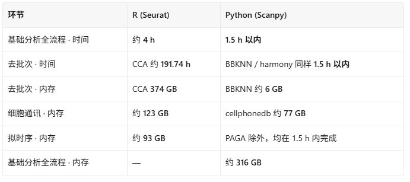
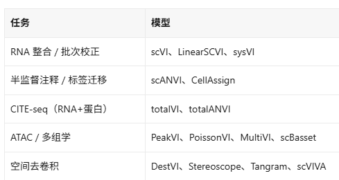
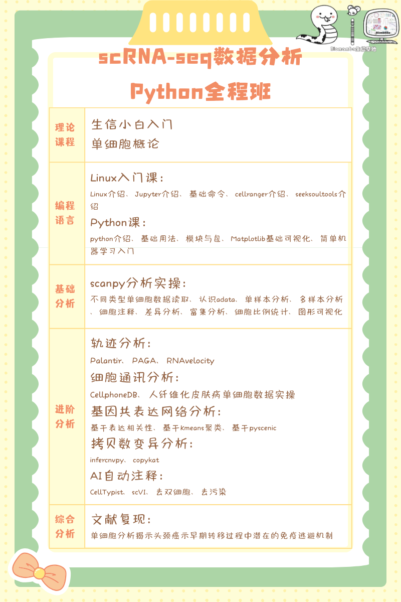

# Python几乎是AI时代单细胞学习的必选项？

> 原文：https://mp.weixin.qq.com/s/6QPRltETi-bKy2QGmWm13A

* * *

写在前面
最早关注到Python比R语言分析效率高是因为
比R版本快几十倍| Pyscenic单细胞转录因子预测
，相信老玩家都深有体会，的确能将R版SCENIC运行几周的时间压缩到几个小时。虽然
Biomamba一直是R人
，
Python分析单细胞
的转型阵痛期阵痛了好几年了也没过。但不得不承认的是，如果你的单细胞分析还以R为主力，那么大概率你会遇到数据分析规模和效率上不去、前沿方法用不着的痛点。
我们做过很多期压力测试，在计算时间和内存占用方面，python几乎是断层式的领先，所以AI时代我们也把
Python单细胞教学蒸馏成skills
，用于让AI更高效的干活。
Python为什么更有优势？
数据来源于我们此前整理的教程：
挑战用Python分析一百万个单细胞数据
、
挑战用R语言硬干一百万单细胞数据分析
可以看出来数据相当夸张，尤其是去批次这一步，用R语言的
CCA
接近要八天而python的
BBKNN只需要1.5h，内存也是有夸张的60倍差异，你可以说这两种软件的算法有本质上的差别，但Python比R语言更高效也是不争的事实。
这不是
Scanpy
的作者比
Seurat
的作者聪明，而是编程语言底部的根本性差别。要知道这只是一次计算，
谁的生信分析能一次运行就成功？
改参数、调整分析思路是家常便饭，这么长的等待时间，只会放大你的焦虑。当然会有人说，你这样测试不公平，R也有BPCells、也有on-disk方案，也能以节省内存的方式高效运行，
Seurat V5
也通过layer的形式提升了不少。但是，这些R包改进的出现，是
AnnData
和Scanpy生态几年前就在玩的事情。所以，
对标谁就直接选谁
，准没错。
甚至百万级别的单细胞数据分析都已经过时了，几年内单细胞的数量级翻了很多倍，以前百万级的单细胞数据可以称为数据库级别的文章了，但是我们最近分享的
scBaseCount
把SRA里所有公开的数据集跑了遍定量，收纳了
5.02亿
的细胞，这只会是一个开端，以后会有更多像
CELLxGENE、
Tahoe-100M、
TranscriptFormer这种上亿数量级的单细胞数据库发布。当然，这些资源的流动形式会
是
h5ad、TileDB-SOMA、AnnData，而
不是rds和rdata
。
并且python还有R语言摸不到的资源，那就是我们演示过的
rapidXXX系列
工具。rapids-singlecell能以一模一样的API和函数继承scanpy，并且能够加速上百倍。还有一个比较现实的原因，所有基于深度学习、人工智能的方法，几乎也都是python优先。例如scvi-tools这一整个家族，能提供非常多模态的模型：
TranscriptFormer、
scGPT、
Geneformer、scFoundation、UCE 、CellPLM 、scBERT、GeneCompass这些单细胞基础模型，也几乎都基于Anndata、PyTorch架构，一点R语言的影子都没有。
AI天生是R的战场
当然有可能你会说，现在都用AI分析了，至于R还是Python对我来说也不重要。但AI Agent写代码也不是"一锤子买卖"，是输出与输入的迭代循环。反馈周期越短，AI能做的尝试越多，单位时间内接受的信息越多，才能做出更对、更好的分析。
比如上面的rapids-singlecell能让单细胞的预处理从52分钟变成26秒。这是有很大的质变的：52分钟的循环，算你不休息，一天最多调二十多次参数，你会开始"想清楚了再跑"，跑完了
等半天
看结果。但是26秒的循环，你可以在十分钟内让AI连着试二十组参数，立竿见影的看到结果输出，几乎等于交互式探索。
这才是"AI 时代"真正提升的生产力——不是 AI 替你写代码，而是AI+短反馈周期让实验性分析的成本速降。而这种生态，目前只有Python能同时提供：AI生成质量高、框架执行快、GPU加速。
所以，正是由于python的优势，空间转录组这个相较于单细胞而言的后起之秀，生态几乎全在Python里。
Visium HD
、
stereo-seq
、
Xenium
这样的平台，一张片子就能达到百万级的bin，直接少走了单细胞的好几年弯路，直接上python，
squidpy
算是王者之一。主流的解卷积更不用说，基本都是python+
GPU
双加速：
cell2location
、
Tangram
、DestVI、Stereoscope。
R人也有坚守的理由
当然，也有很多原因，能让你留在R：
1、
样本量小（几万细胞以内）且分析简单。 rapids-singlecell官网自己都说了，低于5万细胞
GPU
无优势，毕竟数据在磁盘、CPU、内存、GPU里面走来走去都要时间；同理，小规模数据上Seurat和Scanpy的体验差距不大，学习成本的确大于收益。
2、你自己封装了大量的R语言脚本、pipeline，前期投入太大了，积重难返，你还是守着R语言吧。
3、
-你要用的方法只有R实现。 monocle3、CellChat 的部分高级用法、一些特定的CNV工具，R的工具仍然更成熟。迁移不等于抛弃——Python 主力 + R 补位是完全合理的组合。我也干过这事：
R+Python组合拳可能是分析SCENIC最好的方式
4、可视化：
ggplot2的图层语法算是替R语言续命了很久，虽然也有python版，但基于ggplot2的绘图生态过于庞大，冰冻三尺非一日之寒。
你怎么看？
以上只是Biomamba的个人观点，当然，我python和R语言的教程都有：
R语言单细胞教学持续进行中~
就是为了快，82h搞定scRNA-seq分析全流程(Python版)
CPU和GPU的设备我也都有
三年套餐打骨折，足够支持你完成硕博生涯的共享服务器
GPU一直在涨价，现有存货上机：RTX5090(32GB)、RTX4090(48GB)、RTX4080S(32GB)、5080(16GB)、5070(12GB)
那么问题来了，元芳，你怎么看：
欢迎交流
留一个领取
资料
、
开箱即用的单细胞分析镜像
的
助手
[
Biomamba_zhushou
]，方便各位随时交流。同时我们也构建了
交流群矩阵
，
欢迎大家一起讨论。
您点的每个赞和在看，我都认真当成了喜欢

