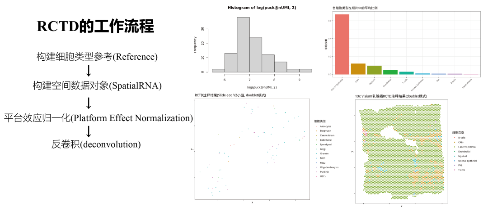
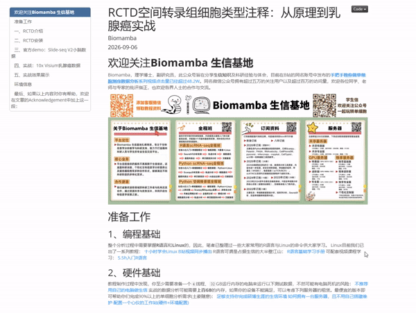
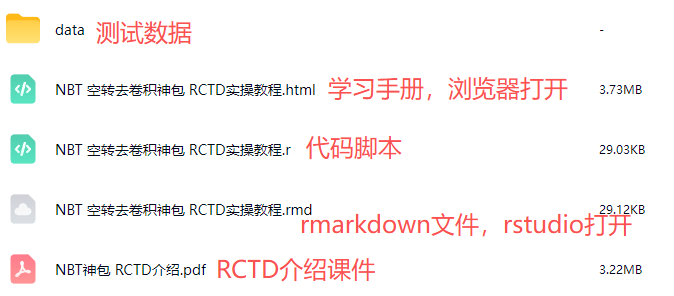
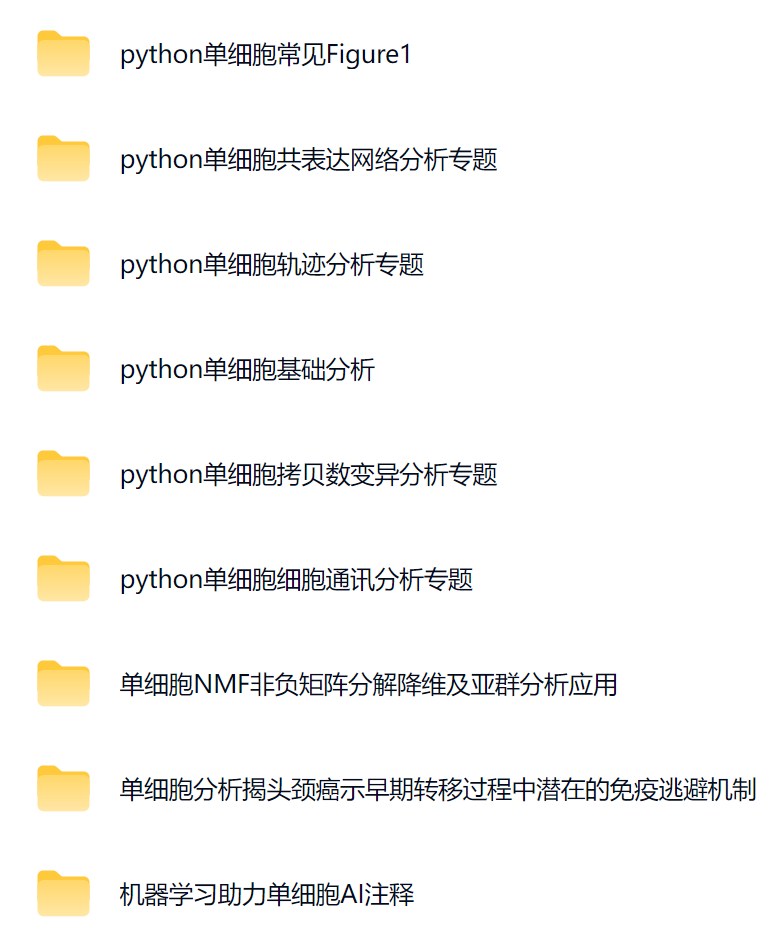

# RCTD空间转录组细胞类型注释：从原理到乳腺癌实战

> 原文：https://mp.weixin.qq.com/s/nMrM_le4stwBcA1CRvX4ig

* * *

RCTD空间转录组细胞类型注释：从原理到乳腺癌实战
随着10x Visium、Slide-seq、MERFISH等空间转录组技术的大规模应用，如何在空间维度上解读细胞组成成为了大家普遍关心的问题。与单细胞数据”一个barcode对应一个细胞”不同，空间转录组的一个测量点（spot/pixel/bead）往往包含多个细胞的转录本，属于混合转录本。直接对spot进行聚类分析很容易将不同细胞类型的信号混为一谈，难以获得可靠的细胞注释结果。因此，
参考scRNA-seq数据进行空间转录组的细胞类型反卷积（deconvolution）
就成了空间转录组分析的标准操作。
RCTD
（Robust Cell Type Decomposition，稳健细胞类型分解）正是这类方法中影响力最大的工具之一，于2021年3月在线发表于《Nature Biotechnology》（2022年4月正式见刊）[1]，由哈佛大学/Dana-Farber癌症研究所Rafael Irizarry课题组开发，目前已被引用超过千次。一句话总结就是：
RCTD利用scRNA-seq/snRNA-seq参考数据构建细胞类型表达谱，对空间转录组每个测量点中混合的细胞类型及其比例进行统计学推断
，并能够处理参考数据与空间数据之间的平台效应。
[1]Cable DM, Murray E, Zou LS, Goeva A, Macosko EZ, Chen F, Irizarry RA. Robust decomposition of cell type mixtures in spatial transcriptomics. Nat Biotechnol. 2022 Apr;40(4):517-526. doi: 10.1038/s41587-021-00830-w. PMID: 33603203. 链接：https://pubmed.ncbi.nlm.nih.gov/33603203/
[2]官方GitHub仓库（spacexr，含C-SIDE等功能）：https://github.com/dmcable/spacexr
[3]Bioconductor官方页面：https://bioconductor.org/packages/release/bioc/html/spacexr.html
1. RCTD解决什么问题
空间转录组spot包含混合细胞信号，直接聚类注释不准确；
传统反卷积方法（如非负最小二乘）对平台效应敏感——scRNA-seq与空间转录组测序技术差异大，基因捕获率不同，直接把两种技术的表达矩阵拼在一起做反卷积会产生偏差；
空间转录组数据高稀疏、低深度，spot间测序深度差异大，简单的比例估
计不稳定。
2.
RCTD的工作流程
RCTD的分析流程可以分为以下几步：
(1)、构建细胞类型参考(Reference)
输入带注释的scRNA-seq/snRNA-seq原始count矩阵与细胞类型标签，RCTD对每种细胞类型计算平均表达谱，构成参考矩阵。参考也可以来自bulk RNA-seq或细胞类型特异的表达谱。
(2)、构建空间数据对象(SpatialRNA)
输入空间转录组的count矩阵、spot坐标与每个spot的UMI总数。
(3)、平台效应归一化(Platform Effect Normalization)
RCTD的关键创新点之一。它估计一个与基因和细胞类型都相关的平台效应参数，用来解释scRNA-seq与空间转录组之间的技术差异，使得两种技术的基因表达可以直接比较。
(4)、反卷积(deconvolution)
对每一个spot，RCTD用泊松（Poisson）模型拟合观测到的混合表达，通过约束二次规划（quadratic programming）最大化似然，估计该spot中每种细胞类型的比例。根据对spot内细胞类型数量的假设，RCTD提供三种模式： - doublet模式（默认，推荐）：假设每个spot最多包含2种细胞类型。结果中每个spot会被标注为singlet（单一细胞类型）、doublet_certain（确定的双细胞类型）、doublet_uncertain（不确定的双细胞类型）或reject（无法判断）； - full模式：不限制spot中的细胞类型数量，输出每个spot中全部细胞类型的权重； - multi模式：介于二者之间，假设每个spot包含指定数量（如3或4种）的细胞类型。
3、RCTD的适用范围
RCTD已被验证适用于10x Visium、Slide-seq、MERFISH等多种空间转录组技术的数据。原则上，只要你能提供： - 一个与组织匹配的、带细胞类型注释的scRNA-seq/snRNA-seq参考（同物种、同组织最佳）； - 空间转录组的count矩阵与spot坐标；
就可以用RCTD完成细胞类型注释。除了细胞类型注释外，其后续扩展功能C-SIDE（Cell type-Specific Inference of Differential Expression，已并入spacexr包）还可以进行细胞类型特异的空间差异表达分析[4]。
[4]Cable DM, Murray E, Shanmugam V, et al. Cell type-specific inference of differential expression in spatial transcriptomics. Nat Methods. 2022 Sep;19(9):1076-1087. doi: 10.1038/s41592-022-01575-3. PMID: 36050488. 链接：https://pubmed.ncbi.nlm.nih.gov/36050488/
4、RCTD亮点
统计学框架严谨：泊松模型+平台效应归一化，显著优于直接使用非负最小二乘等方法；
三种运行模式灵活适配不同分辨率的空间数据；
官方文档完善，包内自带示例数据，安装即用；
提供完整的下游可视化函数（细胞类型空间分布、比例权重、doublet展示等）；
R包（spacexr）已托管于Bioconductor，安装方便。
需要注意的是，RCTD基于R语言实现，计算不涉及GPU，本教程的conda环境为纯CPU环境（多线程并行即可满足需求）。
资料&课表
学习资料图片集锦：
本次课程的学习资料可以联系客服微信
Biomamba_zhushou
领取：
RCTD空间转录组细胞类型注释：从原理到乳腺癌实战
1.
RCTD介绍
1.1
RCTD解决什么问题
1.2
RCTD的工作流程
1.3
RCTD的适用范围
1.
4 RCTD亮点
2. RCTD安装
2.1
conda环境搭建
2.2 安装spacexr
2.3
加载包
3. 官方demo：Slide-seq V2小脑数据
3.1 读取示例数据并构建Reference
3.2
构建SpatialRNA对象
3.3
运行RCTD（doublet模式）
3.4
结果解读
3.5 可视化
3.6
doublet信息
4. 实战：10x Visium乳腺癌数据
4.1
数据下载
4.2
读入scRNA-seq参考数据
4.3
构建Reference
4.4
构建SpatialRNA
4.5
运行RCTD（doublet模式）
4.6
结果概览
5. 实战效果展示
5.1 细胞类型空间分布图
5.2
细胞类型比例
5.3
doublet展示
5.4
与文献结论的一致性
6. 环境信息
7. 欢迎致谢
空间转录组保姆级教程
1、课程简介
继
《手把手教你做单细胞》
之后，我们正式推出第二个系列：《空间转录组保姆级教程》，本系列视频将为大家提供空间转录组测序数据分析的完备方案，本次内容基于Seurat进行空转数据分析基础操作的演示，最大限度的让我们学习R语言单细胞的用户能够快速的迁移学习空转分析。课程内容将持续更新(基于Giotto的教程已在制作中啦~)。视频可在全平台观看：
B站(已更十七集)：
https://www.bilibili.com/video/BV181wezqEgK/
视频号：
小红书：
http://xhslink.com/o/39Scgv66i0G
抖音：
https://v.douyin.com/GJGmDLUluig/
2、空间转录组介绍
空间转录组
（Spatial Transcriptomics, ST）是在
保留组织原位空间位置
的前提下，同时获取全基因组基因表达信息的技术，解决了传统 bulk 测序丢失异质性、单细胞测序丢失空间位置的痛点，还具有解析组织微环境中细胞互作机制离的核心
优势。这一技术
出现为高通量测序加上了空间的坐标信息，这是一场新的革命，为神经科学、发育学、植物学、病理学等领域提供了
强有力的研究手段。
我们在
2023订阅
、
2024龙年订阅
、
2025订阅
、
2026订阅
也更新不少关于空转的内容，现除了提供资料还手把手教大家学会空间转录组。
往期推送
Biomamba 生信基地
现已开放
终身订阅
，现已包含几十篇订阅资料，未来37年持续更新：
为什么我们敢开放终身订阅
2025年我们零差评完成订阅任务（
2026订阅须知
），2026已更新订阅内容：
单细胞Figure1的常见图表(Python版)
告别R依赖！一文搞定Python单细胞基础分析
风靡一时的scTenifoldKnk单细胞虚拟基因敲除,准不准?
scRNA拟时序分析三大Python包： palantir、PAGA、RNAvelocity
正刊都在用的AI驱动蛋白质从头设计流程：RFdiffusion+ProteinMPNN+AlphaFold3
CellphoneDB搞定细胞通讯分析
scRNA-seq肿瘤细胞药物敏感性预测分析
fastXXX、rapidXXX系列加速你的单细胞数据分析
转录因子、基因共表达网络分析手册：pySCENIC在脑、黑色素瘤中的应用
让你的scRNA数据变得更干净~
保姆级视频教程| 空间转录组分析手册(基于Seurat)
拷贝数变异分析的python实现及R语言对比
Ai驱动结合蛋白设计：Bindcraft全流程教学
千万级细胞预训练，如何用AI搞定单细胞注释与质控
空间转录组常见Figure1
免疫逃逸《NC》复现：scRNA-seq揭示头颈癌早期转移过程(Python版本)
单细胞NMF非负矩阵分解降维及亚群分析应用
TCGA与单细胞数据的解卷积生存分析与预后分析套路合集
单细胞代谢分析神器：mmease、scMetabolism、mebocost完整流程
CITE-seq单细胞表面蛋白组学一站式学习手册
scMLnet构建单细胞多层信号网络：配体→受体→TF→靶基因
scRNA-seq与空转数据中的病毒嵌合序列鉴定：ChimericSeq
最新版，RFdiffusion3+MPNN+RoseTTAFold 3的全流程教学
2026合集的最后几个月，你还想看什么内容？
持续更新中~

