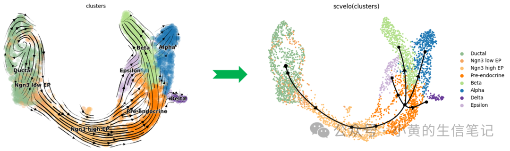
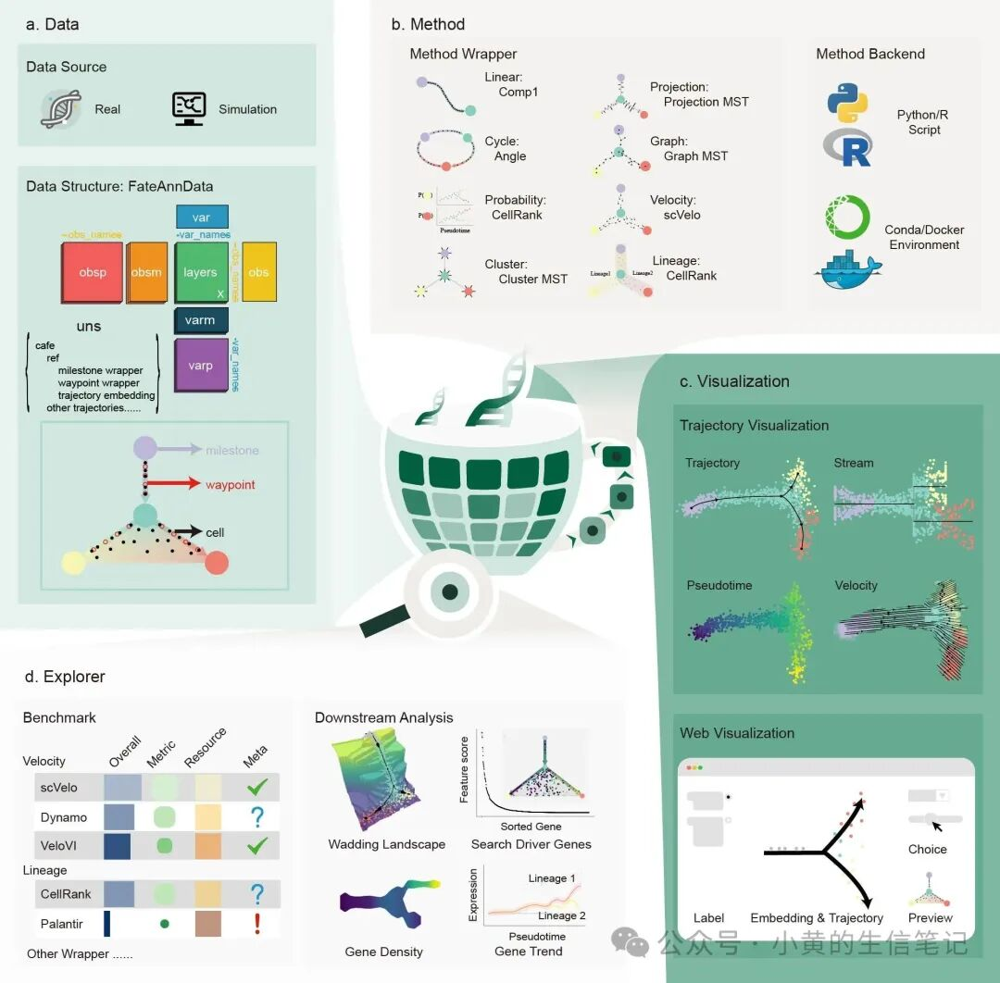
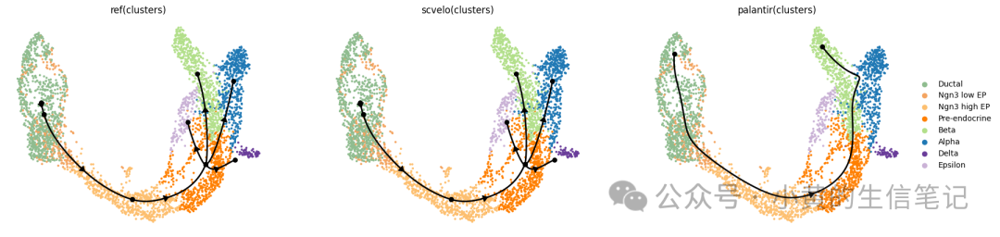
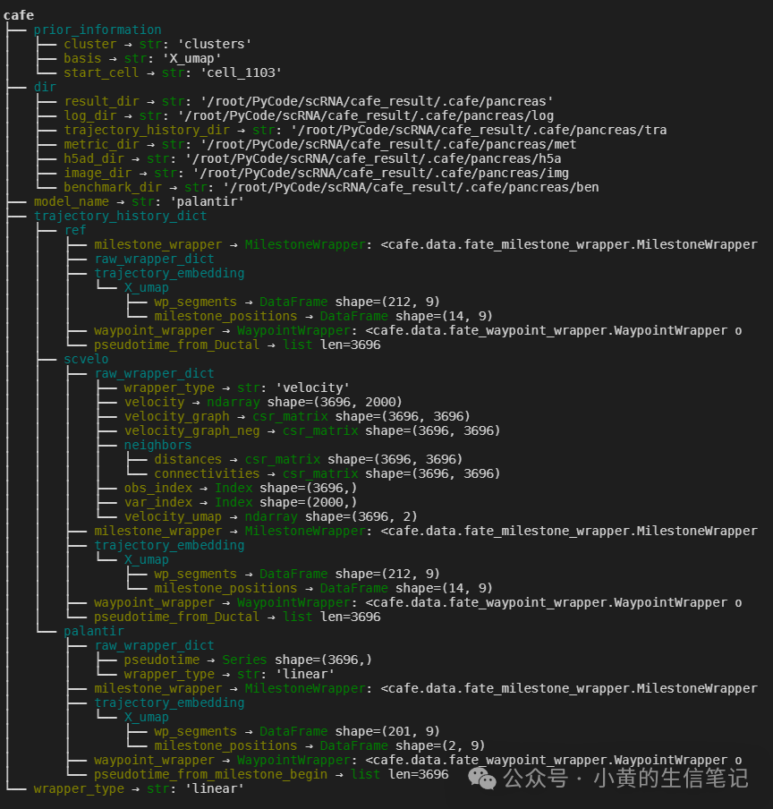

# Cafe 01｜单细胞数据 => 命运轨迹

> 原文：https://mp.weixin.qq.com/s/zy2fw_AueCPwq1GuYITJlg

* * *

Cafe 01｜单细胞数据 => 命运轨迹
作者｜Zhaoyang Huang
本文示例版本｜Cafe 0.2.1
视频教程：
https://www.bilibili.com/video/BV13TnB61EwW
单细胞数据 => 命运轨迹
单细胞 RNA 测序让我们能够同时观察成千上万个细胞，但这些数据本质上只是不同细胞在某一时刻的“静态快照”。如何从这些快照中恢复细胞状态变化的方向，识别发育起点、分支和终末状态，是细胞命运预测需要解决的核心问题。
围绕这一问题，研究者已经开发了大量轨迹推断和 RNA velocity 方法。然而，不同方法往往具有不同的输入要求、运行环境、结果结构和可视化接口。当我们希望在同一数据集上运行和比较多种方法时，环境配置与结果整理经常比分析本身更加耗时。
Cafe（Cellular Fate Explorer）
正是为了解决这些问题而开发的。它是一个面向单细胞 RNA 测序数据的细胞命运分析框架，提供从数据管理、轨迹推断、结果可视化到评价比较的统一工作流程。
本期是 Cafe 系列教程的第一篇。我们暂时不展开复杂的数据结构和算法原理，只完成一个最小但完整的目标：
在一个全新的环境中安装 Cafe，运行第一个quickstart notebokk，读取示例数据，执行scVelo与Palantir方法，并得到第一张细胞命运轨迹图。
Cafe 能做什么？
Cafe 当前主要包含四个部分。
1. 统一的数据管理
Cafe 在 AnnData 基础上构建了
FateAnnData
。除了常规的表达矩阵、细胞注释和低维嵌入外，它还可以保存轨迹拓扑、细胞在轨迹上的位置、分支区域以及航路点等细胞命运相关信息。
多个方法的推断结果可以同时保存在同一个
FateAnnData
对象中，便于后续展示和比较。
2. 统一的轨迹推断接口
不同方法产生的结果可能是伪时间、树、细胞图、终末状态概率或 RNA velocity。Cafe 通过多类 wrapper 将这些异构结果转换为统一的里程碑网络表示，并支持 Python、Conda 和 Docker 等不同运行后端。
3. 静态与交互式可视化
Cafe 提供轨迹骨架、细胞嵌入、伪时间、基因表达趋势和 velocity 等静态绘图工具，同时提供基于 CELLxGENE 的交互式网页可视化界面。
4. 评价与探索
Cafe 可以从拓扑结构、细胞排序、聚类一致性和 RNA velocity 等角度评价轨迹结果，并正在持续扩展谱系分析、驱动基因识别和调控机制探索等下游功能。
准备运行环境
Cafe 当前主要在 Linux 环境中完成测试。Linux 用户可以直接操作；Windows 用户推荐使用
WSL2 + Ubuntu
。本教程使用 Python 3.10，参考
环境下载文档
打开终端，创建独立的 Conda 环境：
bash
conda create -n cafe python=3.10 -y
conda activate cafe
pip install cafe-release
pip install palantir==1.3.6
# scvelo包内置在cafe包里，palantir需要单独下载
代码教程：Quick Start Notebook
下载
Quickstart Notebook文档
，推荐使用 jupyter notebook执行
1. 环境导入
首先导入cafe包
python
import
cafe
cafe.logger.setLevel(
"INFO"
)
cafe.settings.backend =
"python_function"
# python_function, conda, cafe_docker
# cafe.settings.data_dir = "/path/to/data" # use default data dir ("." or environment variable CAFE_DATA_DIR) if not set
2. 数据读取
读取 Cafe 提供的胰腺示例数据：
python
fadata = cafe.data.read_pancreas()
# Downloaded automatically on first use.
fadata
3. 使用scvelo和paga推断轨迹
直接选择方法并运行，这里选择scVelo、palantir两种方法运行
python
# scvelo method
method_name=
"scvelo"
method = cafe.method.FateMethod(method_name=method_name)
method.infer_trajectory(fadata,
id
=method_name)
python
# palantir method
method_name=
"palantir"
method = cafe.method.FateMethod(method_name=method_name)
method.infer_trajectory(fadata,
id
=method_name)
3. 轨迹可视化
在降维图上可视化该轨迹之后，第一幅图是参考的金标准结果，第二三幅图分别为scVelo和palantir方法的运行结果，从可视化效果来看scVelo更加接近金标准结果。
python
model_name_list = fadata.get_all_model_name()
cafe.plot.plot_trajectory(fadata, model_name=model_name_list)
python
#
TODO:
cellxgene-cafe web application for interactive visualization and exploration of trajectory inference results.
# fadata.launch_cellxgene()
4. 指标对比
指标上来看scVelo的效果也显著优于palantir
python
metrics = [
"pseudotime_correlation"
,
"him"
,
"F1_branches"
,
"correlation"
]
# "velocity_cbdir" need recalculate neighbors.
metric_df = cafe.metric.calculate_metrics(fadata, now_models=model_name_list[
1
:], metrics=metrics)
metric_df
pseudotime_correlation
him
F1_branches
correlation
scvelo
1.00
1.00
1.00
0.93
palantir
0.98
0.27
0.19
0.67
5. 打印轨迹数据
Cafe会保留全部细胞命运相关的数据：数据集的先验知识，相关文件的路径，当前模型的名称以及类型，历史的轨迹字典。
python
fadata.print_trajectory_data()
6. 保存结果
python
fadata.write_h5ad(
"pancrease_fadata.h5ad"
)
对比 Dynverse 与 Cafe
经过上述的介绍，熟悉细胞命运预测任务的同学已经发现Cafe与Dynverse高度相似。2019年，Saelens 等人在
Nature Biotechnology
发表
Dynverse
高度相似，研究团队将不同算法接入统一框架，在 110 个真实数据集和 229 个模拟数据集上比较了 45 种轨迹推断方法。这项工作不仅系统梳理了当时快速增长的方法生态，也建立了统一轨迹表示、标准数据接口、评价指标和方法选择指南。可以说，dynverse 让“不同轨迹方法如何公平比较”第一次有了较为系统的答案。既然该工作已经奠定此类工作的基础，为什么还需要有Cafe呢？作为Cafe项目的主要负责人，我认为有如下几个原因：
数据结构：近年来基于"Scverse生态+Scanpy分析框架+AnnData数据结构"的单细胞分析成为主流，而Cafe的数据结构FateAnnData设计之初就继承于AnnData，相较于Dynverse自身维护的字典形数据结构，Cafe在现有主流单细胞分析下具有天然优势。
方法数量：Dynverse仅对2019年之前的算法进行了封装，无法对19年之后新方法进行处理，以scVelo为代表的RNA速率系列方法，以CellRank为代表的命运概率系列方法等都从不同角度反映细胞命运的趋势，这需要新的转化策略。
编程语言：近年来深度学习逐渐融入细胞命运预测算法，主要依赖于Python语言的Pytorch/Tensorflow框架，Cafe同样基于Python调用相关工具更快且更加便捷。
Cafe 正是在这一背景下构建的。它继承了 dynverse
统一表示与系统评测
的思想，并面向 2019 年之后的单细胞方法生态继续扩展：
维度
dynverse（2019）
Cafe
核心定位
统一评测轨迹推断方法并提供方法选择指南
集成推断、存储、可视化、评价与下游探索
方法生态
系统覆盖当时的轨迹推断方法
持续接入轨迹推断、RNA velocity、命运概率和向量场方法
方向信息
原始评测以拓扑和伪时间结果为主
重点支持速度向量、定向转移和终末命运概率
数据组织
将不同方法输出转换为通用轨迹模型
使用
FateAnnData
在同一对象中管理数据和多个模型结果
运行方式
以 R 生态和容器化方法封装为基础
提供 Python 主接口，并支持 Python、Conda 和 Docker 后端
Cafe 不是对 dynverse 的简单替代，而是在其统一表示与系统评测思想基础上，面向新一代细胞命运方法所做的延伸。
项目链接
Cafe 目前仍处于快速开发和测试阶段。如果你在使用过程中遇到问题，或者希望 Cafe 支持新的算法、数据结构和分析功能，欢迎在 GitHub Issues 中留言。
如果 Cafe 对你的研究有帮助，也欢迎为项目点一个
Star
。你的反馈将帮助我们继续完善这个面向细胞命运研究的开放工具。
GitHub：
https://github.com/HuangDDU/cafe-release
在线文档：
https://cafe-release.readthedocs.io/en/latest/
预印本 DOI：
https://doi.org/10.1101/2025.02.04.636565
LOGO
Cafe的Logo也经过精心的设计：
杯体：表达矩阵，有点类似IE浏览器的图标对应浏览器Explorer。
杯臂：细胞分化轨迹（线性）
热气：驱动基因
底座：放大镜找到了干细胞，像眼镜一样探索。
下一期预告
这篇教程完成了从安装到第一张轨迹图的全过程，但还有一个重要问题没有解释：
scVelo、伪时间方法、树结构方法和细胞图方法产生的结果各不相同，Cafe 如何把它们保存到同一种数据结构中？
下一期我们将介绍 Cafe 的核心数据结构
FateAnnData
，并通过动画解释 milestone、cell、progression、divergence region 和 waypoint 如何共同描述一条细胞命运轨迹。
参考文献
Cafe: Huang Z, Ma H, Peng Y, et al. Cafe: An integrated platform for exploring cell fate[J]. bioRxiv, 2025: 2025.02. 04.636565.
Dynverse: Saelens W, Cannoodt R, Todorov H, et al. A comparison of single-cell trajectory inference methods[J]. Nature biotechnology, 2019, 37(5): 547-554.
scVelo: Bergen V, Lange M, Peidli S, et al. Generalizing RNA velocity to transient cell states through dynamical modeling[J]. Nature biotechnology, 2020, 38(12): 1408-1414.
Weiler P, Lange M, Klein M, et al. CellRank 2: unified fate mapping in multiview single-cell data[J]. Nature methods, 2024, 21(7): 1196-1205.

