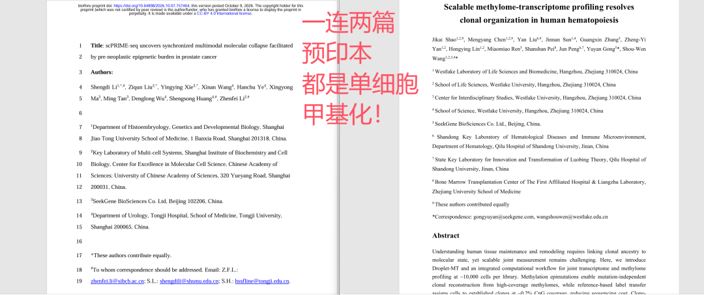
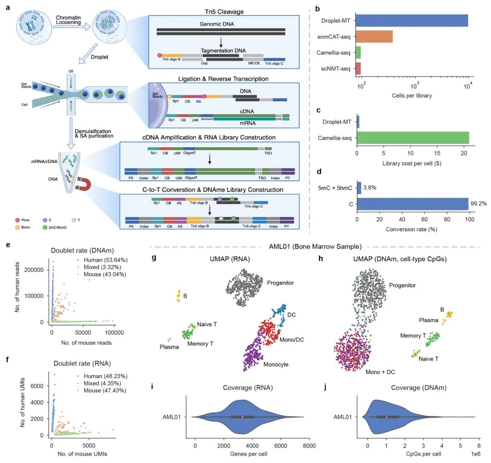
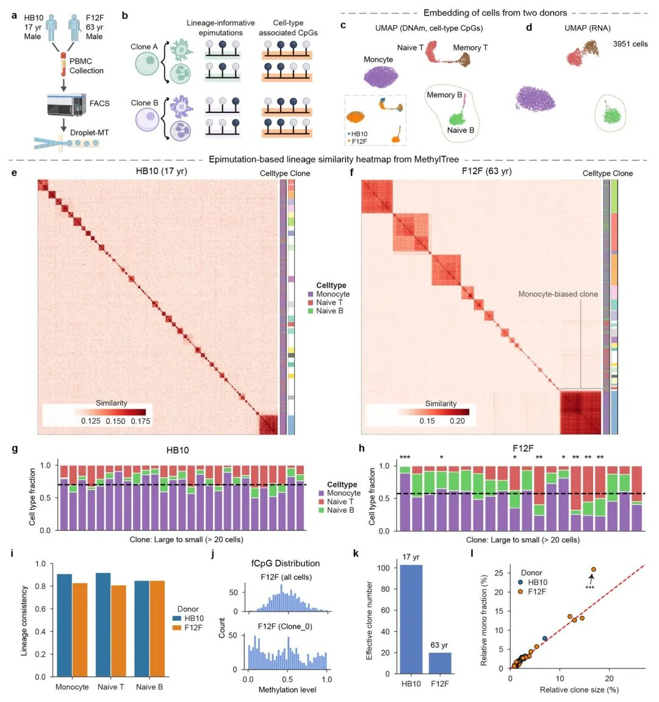
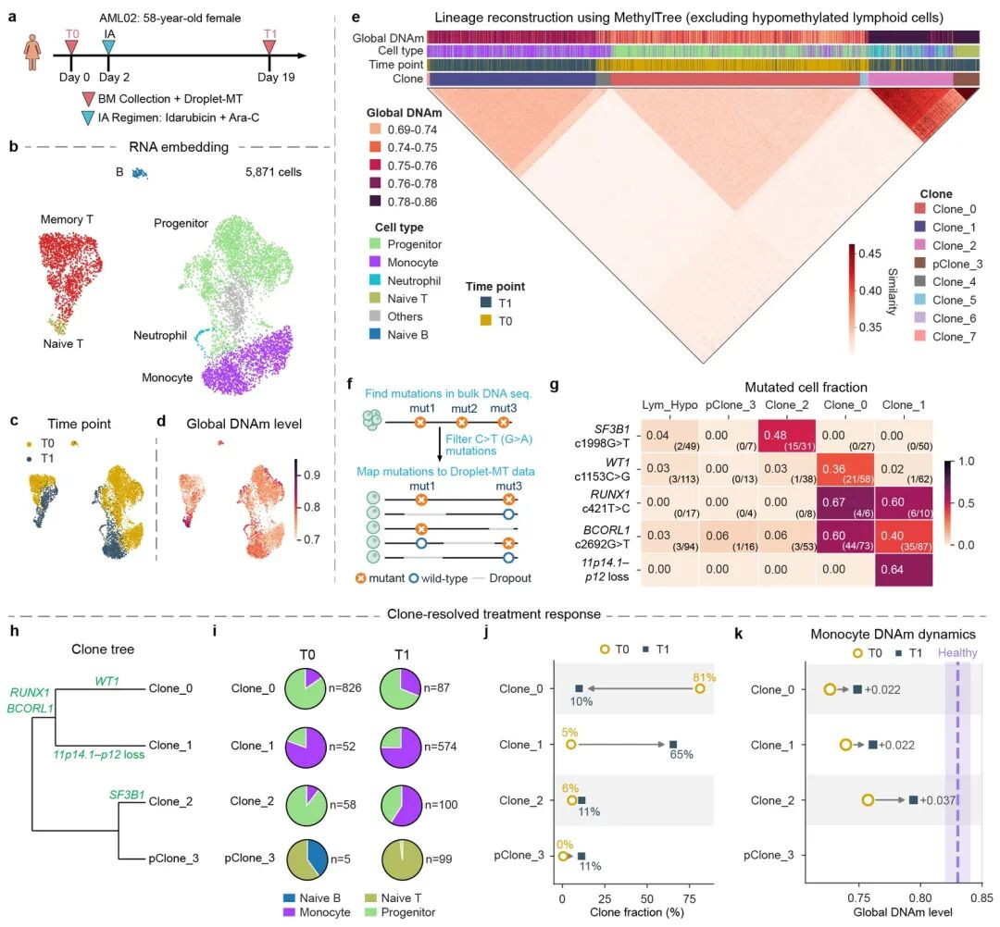
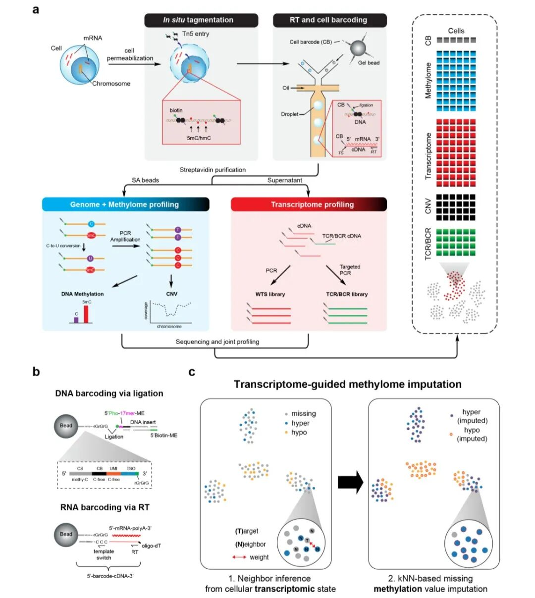
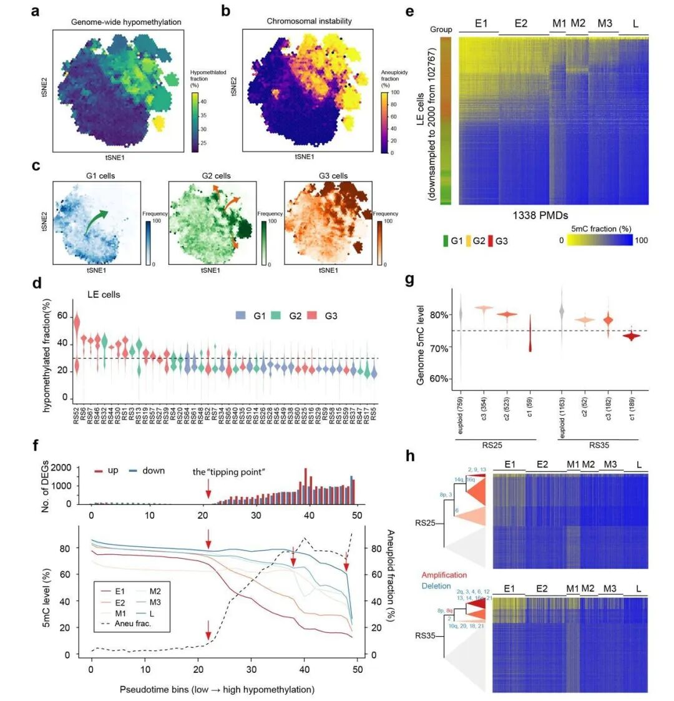
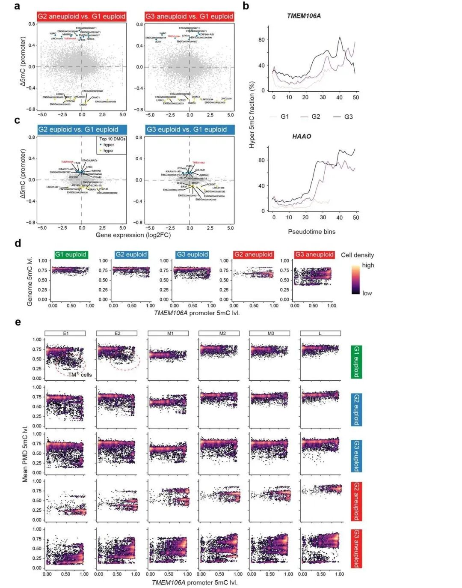

# 接连两篇预印，单细胞甲基化是8年前的单细胞转录组吗？

> 原文：https://mp.weixin.qq.com/s/iOXgj0U7uJ6hphxkII2XeA
> 合集：文献速递

* * *

一、写在前面

10月8日和9日，bioRxiv 相隔一天上线两篇预印本：

Droplet-MT

（西湖大学王寿文团队 ×

寻因生物

× 山东大学齐鲁医院）和

scPRIME-seq

（上海交通大学医学院 × 中科院分子细胞科学卓越创新中心 × 同济医院 ×

寻因生物

）。

这两篇文章都用了这个技术：

把"同一颗细胞里同时测RNA和全基因组DNA甲基化"

——区别是一个拿造血与白血病做验证，一个直接铺了44例前列腺癌。

把它们放回单细胞甲基化这13年的历史里看，你会发现这条曲线恰好走到了单细胞转录组2016年的位置。我们先看看这两篇文章，带着问题：

单细胞甲基化，是不是下一个增长点？

二

、两篇文章都做成了什么？

向下滑动查看

👇

两篇文章的技术底子高度相似：

甲醇固定透化替代交联固定

、

原位 Tn5 tagmentation

、

酶法 C→T 转化替代亚硫酸氢盐

（对 RNA 和细胞形态都更友好），再靠液滴 barcode 把同一颗细胞的 DNA 和 RNA 关联起来。区别在下游要回答的

生物学问题

。

1.1 Droplet-MT：甲基化的"克隆记忆"终于能规模化读取

图 1 · Droplet-MT 工作流程（a）、每文库通量对比（b）、每细胞文库成本（c）、转化效率（d）与 AML 骨髓样本的 RNA/甲基化双模态结果（g–j）。图源：Shao et al., bioRxiv 2026.10.08.757494，CC BY-NC-ND 4.0

先看下性价比：

每文库约10,000个细胞

，每细胞中位检出约

3,000个基因 + 100 万个CpG

，未甲基化胞嘧啶转化率

99.2%

，每细胞文库制备成本约

0.5美元

——对比上一个联合组学方法Camellia-seq的20美元，

低了40倍

。

图 2 · 两位健康供者的表观突变谱系重构：17 岁供者 HB10 与 63 岁供者 F12F 的有效克隆数分别为 103 和 20，老年供者出现显著髓系偏好的扩增克隆。图源：同上，CC BY-NC-ND 4.0

白血病部分数据则展示了甲基化数据低深度识别克隆的潜能

。先用高深度细胞建立克隆参考，之后的细胞只要

0.2%的CpG 覆盖度

（约 5 万个 CpG）就能通过 label transfer 归入已建库的克隆，3个标准差阈值下一致性99.0%。纵向跟踪白血病治疗时，这套设计直接省掉了大部分测序开销。

图 4 · AML02 患者确诊（T0）与化疗第 19 天（T1）：甲基化定义的克隆携带不同突变签名（BCORL1、RUNX1、WT1、SF3B1），治疗后 Clone_0 从 81% 降到 10%，Clone_1 从 5% 升到 65%。图源：同上，CC BY-NC-ND 4.0

更妙的是第三招：甲基化文库本身保留了基因组序列信息，

把突变证据按克隆聚合

（clone-level mutation fraction），不需要对每个细胞做单细胞基因分型，就能给每个克隆挂上遗传标签。

1.2 scPRIME-seq：43.7 万细胞，给前列腺癌画一条"分子崩塌"轨迹

图 1 · scPRIME-seq 工作流程：甲醇透化 + 原位 tagmentation，双功能磁珠 oligo（3′ 端 rGrGrG 既是逆转录的模板切换序列、又能通过 T4 RNA 连接酶 2 连接 DNA 片段），以及转录组引导的甲基化填补（PRIME-IMPUTE）。图源：Li et al., bioRxiv 2026.10.07.757464，CC BY 4.0

第二篇规模更大：

44例样本、436,908 个双模态细胞

（平均每例 11,285 个细胞），从良性前列腺组织一路做到Gleason ≥ 8的高危癌。PBMC基准测试的双模态捕获率68.7%，转录组中位每细胞1,307 个基因。

单细胞甲基化数据的本质问题是稀疏，这篇文章的答案是PRIME-IMPUTE：用转录组相似性找邻居、借邻居的甲基化填自己的坑，测试集上

有效覆盖

从16.6%提到

92.7%

，填补准确率70.2%。

图 4 · 以基因组整体低甲基化程度为轴重排 102,767 个腔路上皮细胞：全局低甲基化（a）、染色体不稳定性（b）与转录组剧变（c）在第 22 个 bin 同步发生——"tipping point"；1,338 个 PMD 按去甲基化时序分为早/中/晚三波（e、f）。图源：同上，CC BY 4.0

文章最核心的发现是这个

"tipping point"（崩塌临界点）

：把上皮细胞按基因组整体低甲基化程度排序，

全局低甲基化、非整倍体出现、转录组剧变三件事几乎同时发生

，且甲基化的丢失按1,338个部分甲基化域分早中晚三波推进。作者特意做了个对照实验：

只用转录组做pseudotime，找不到清晰的正常→恶性边界

——肿瘤转录组的患者间异质性太大，而PMD的位置和去甲基化时序在患者之间高度一致。

甲基化在这里成了比转录组更稳的"分子时钟"。

图 5 · TMEM106A 启动子高甲基化（b）与早期 PMD 低甲基化在良性组织（G1）中已经出现：TM+ 细胞在 5/15 例良性样本中检出，其中 2/2 例 HGPIN 全部阳性——表观遗传损伤先于基因组改变。图源：同上，CC BY 4.0

还有一个相当有临床味道的发现：

TMEM106A启动子高甲基化 + 早期PMD 低甲基化

这组"前肿瘤表观状态"（TM+），在5/15例

组织学良性

的前列腺样本里已经存在，其中2/2例 HGPIN（高级别上皮内瘤变）全阳性。也就是说

，表观损伤可能先于可检出的基因组改变和病理改变

——这是典型的、只有多组学联测才能看到的东西。

三

、

这13年，单细胞甲基化都发生了什么？

把时间线拉开看，会发现一个有意思的事实：

第一个做单细胞转录组和第一个做单细胞甲基化的都是辣个男人

——2009年汤富酬在Nature Methods上发表了第一篇单细胞转录组，2013 年又在Genome Research上发表了第一篇单细胞甲基组（scRRBS）。但是两个技术走了完全不同的路：

年份

方法 / 事件

期刊

意义

2009

单细胞 mRNA-Seq

Nat Methods

单细胞转录组第一篇

2013

scRRBS

Genome Research

单细胞甲基组第一篇（覆盖率仅 1–5%）

2014

scBS-seq

Nat Methods

全基因组覆盖；同年 Nature 报道人早期胚胎甲基化图谱

2015

单细胞 methylC-seq

Cell Reports

证明甲基组本身就能推断细胞状态

2016

scM&T-seq / scTrio-seq

Nat Methods / Cell Research

同细胞 RNA+甲基化 / 三组学首次联测

2017

snmC-seq

Science

甲基化分辨大脑神经元亚型

2018

scNMT-seq / sci-MET

Nat Commun / Nat Biotechnol

四模态联测 / 组合索引首次上高通量

2019

TAPS / 植入期胚胎图谱

Nat Biotechnol / Nature

无转化体系化学 / scTrio-seq2 规模应用

2019–22

Melissa、scMET、EpiScanpy、scTAM-seq、sciMETv2、snmCAT-seq

Genome Biology、Nat Commun 等

分析生态逐步成形

2023

DARLIN + Camellia-seq

Cell

首次同细胞测谱系+转录组+甲基化

2025

MethylTree（1 月）/ EPI-Clone（7 月）

Nat Methods / Nature

全基因组与靶向两条路线的表观突变谱系追踪

2025

人皮下脂肪组织甲基化+3D 基因组 atlas

Nat Genet

规模化 atlas 论文的通道打开

2026.10

Droplet-MT / scPRIME-seq

bioRxiv 预印本

液滴联合组学开闸

发文水平

可见这个

领域非同一般：文章数量很少，但方法文献几乎全部落在 CNS主刊或Nature系顶刊；应用文献则直奔 Nature、Nat Genet、Cell。原因不复杂：

能做出数据的实验室凤毛麟角，每篇都精。这个格局和2013–2015年的单细胞转录组、2016–2019 年的单细胞 ATAC 如出一辙——

瓶颈期的领域，文章少而重；开闸之后，才开始放量。

四、发文现状，历史总是惊人的相似

口说无凭，我们在PMC做了一组检索（标题/摘要含 "single-cell" 且分别含 RNA-seq、ATAC-seq/染色质可及性、methylome/DNA methylation，含预印本，截至 2026-10-13，收录存在数周滞后）：

年份

单细胞 RNA-seq

单细胞 ATAC/可及性

单细胞甲基化（宽口径）

2013

15

—

8

2015

70

7

24

2018

403

54

59

2020

845

162

96

2022

1,308

328

142

2023

1,496

402

168

2024

1,651

409

189

2025

2,054

536

241

2026（至 10-13）

2,125

608

321

2026 全年推算

≈2,720

≈780

≈410

同比增速

+33%

+45%

+71%

三个结论：

1、甲基化是三条曲线里增速最快的

按年内占比推算，2026 年将同比+71%，明显快于ATAC的+45%和RNA 的 +33%。

2、绝对量仍然很小

约为ATAC的一半、RNA的六分之一。这不是劣势，是空间——尤其是其中相当比例还是"bulk甲基化 + 单细胞 RNA拼接"的借配研究，真正的同细胞联合数据直到这个月才放量。

3、起点最早的反而最慢

单细胞甲基化 2013 年就起步，比 ATAC 还早两年，却被通量拖住了整整十年。

领域不是没被看见

，

是配套没到位，

那会的测序成本跟现在比可差远了

。

五、为什么说它是下一个增长点

复盘单细胞转录组的历史，一个领域真正起飞需要三件事：

方法开闸、成本下行、不可替代的应用场景

。对照看甲基化：

第一，方法刚刚开闸，而开闸的红利期从来都是发文红利期。

ATAC在2018–2019年被10x做进液滴后，2020年发文量就从94跳到162，随后连年近翻倍。甲基化现在正处在这个位置的起点：droplet 通量（1 万细胞/文库）、酶法转化、以及 Droplet-MT那套"高深度建参考 + 超浅层追踪"的两段式深度设计，把成本从每细胞 20 美元压到了0.5美元（文库制备过程）。

第二，甲基化有两个转录组给不了的东西。

其一是

克隆记忆

：表观突变是天然条形码，不用基因编辑、不依赖稀有体细胞突变就能做谱系追踪，EPI-Clone和 MethylTree在2025年把两条路线都趟通了。其二是

拷贝数读出

：甲基化文库的 reads 覆盖度本身就能推染色体臂级CNV，scPRIME-seq的162个肿瘤亚克隆、Droplet-MT 的 11p 缺失注释都是这么来的。

肿瘤演化、衰老、克隆性造血、治疗耐受——这些刚需问题，RNA 单模态在原理上就答不了。

scPRIME-seq的tipping point在转录组轨迹上找不到；Droplet-MT 里治疗后"看起来正常化"的恶性单核细胞，甲基化一测就追踪到了。

第三，商业化格局出现了空档。

10x至今没有把甲基化做进Chromium——这和当年ATAC、多组学（RNA+ATAC）先后被10x商业化带动技术下放不同，甲基化的最优方案目前握在国产平台手里（本文两篇的背后都是寻因生物的液滴平台）。对国内团队而言，这意味着

方法学和应用层面都还有卡位空间

。

第四，atlas竞赛还没有人跑。

Nat Genet 2025年那篇脂肪组织atlas是目前为数不多的规模化应用，绝大多数组织的人单细胞甲基化图谱仍是空白。对照 RNA 图谱竞赛的历史，这正是2016年的位置。

第五，分析门槛正在快速下降。

云平台已经把RNA+甲基化做成了标准模块（例如我们与寻因生物联合课程里用的

SeekSoul Online

，seekMethyl一胞双组模块），不需要自己搭流程就能跑完基础分析加高级模块。

当然，也不能过度神话单细胞甲基化：

两篇都是未经同行评审的预印本

，期待正式发表的期刊，Biomamba已插眼，正式发表后还会来报道；

数据稀疏没有消失，只是被绕开了

PRIME-IMPUTE是"借邻居的甲基化"，填补准确率70.2%，意味着

还有三成的填补位点不靠谱

；Droplet-MT 的浅层追踪依赖参考克隆的覆盖，参考里没有的克隆会被漏掉或误分（3个标准差阈值下1.8–3.6%误分配），作者自己也承认参考文库需要动态补充；

成本仍显著高于 RNA

0.5美元只是文库制备，全基因组甲基化的测序reads需求远大于RNA文库，一个 10,000细胞的建库参考样本，

测序开销

才是大头；

甲基化变化 ≠ 表达变化

scPRIME-seq自己的数据是整体只有6%的差异甲基化基因伴随反向表达变化，在活跃表达基因上才升到 40%——"甲基化变了基因就变了"这个

相关性其实很弱

；

谱系记忆有失真场景

免疫激活相关的全局低甲基化会污染表观突变信号，Droplet-MT把记忆性B/T 细胞排除在谱系重构之外；

分析生态没有Seurat/Scanpy级别的王牌工具库

每个实验室一套流程（下面的工具清单就是证据）。

六

、主流分析工具与流程

层级

工具

语言

出处 / 备注

比对与甲基化提取

Bismark（+Bowtie2）

Perl/Python

Krueger & Andrews, Bioinformatics 2011，亚硫酸盐比对事实标准

比对与甲基化提取

BWA-meth / BS-Seeker2

Python

更快，大数据量常用

提取与去重

MethylDackel / SNPsplit

C/R

与 Bismark 配套提取 CpG 水平、按 SNP 分样

无转化体系

TAPS

—

Liu et al., Nat Biotechnol 2019，酶法转化数据的专用 caller

DMR 定义

methylKit / DSS / metilene / DMRseq

R

先在 region 水平定义特征，再回到单细胞矩阵

单细胞 QC

scmeth

R

单细胞甲基化质控

异质性建模

scMET

R

贝叶斯建模 CpG 异质性，Genome Biology 2021

聚类与填补

Melissa

R

贝叶斯聚类+填补，Genome Biology 2019

统一分析框架

EpiScanpy

Python

可及性+甲基化统一进 AnnData 生态，Nat Commun 2021

大规模处理

ALLCools

Python

Luo 实验室（ALLC 格式），大规模脑甲基组 atlas 的主力框架

下游整合

Seurat / Scanpy

R/Python

把 region/CpG 特征矩阵当作表达矩阵接入熟悉流程

谱系追踪

EPI-Clone / MethylTree

—

靶向 ~500 CpG / 全基因组两条路线，Nature 2025 / Nat Methods

平台化

SeekSoul Online（seekMethyl 一胞双组模块）

云端

RNA+甲基化标准流程，含高级分析模块

两篇预印本给出的甲基化数据分析，很有可能就是未来两年的模板，记得喂给自己的AI：

Droplet-MT 工作流

：酶法转化数据 → Bismark 系比对提取 →

双特征集分离

（细胞间变异大的 CpG 做状态嵌入；细胞内变异大、细胞间保守的 fCpG 做谱系）→ MethylTree 重构 → 克隆伪 bulk + label transfer 降深度 → 按克隆聚合突变证据做遗传注释；

scPRIME-seq 工作流

：比对提取 → PRIME-IMPUTE 转录组引导填补 → PMD 分型与 CNV 亚克隆推断 → 以全局低甲基化为轴构建轨迹、定位 tipping point。

共性提示：

单细胞甲基化的分析核心不是"把 RNA 那套搬过来"，而是先解决"稀疏"和"状态信号与谱系信号的分离"这两个它自己的问题

——谁先把这两个问题做成顺手工具，谁就是这一轮的 Seurat。

七

、写在最后

单细胞转录组在 2009 年出现，真正的爆发却要等到2015–2016年液滴方案成熟——中间隔了六年，然后就是长达十年的爆发。单细胞甲基化 2013 年出现，等液滴方案等了十三年，现在方案刚一落地，一个月内就有两篇、合计近46 万个细胞的数据摆上了台面。

上一轮RNA开闸时抢跑的人，一个图谱就是一篇正刊。这一轮甲基化开闸，抢跑窗口就在这两三年——工具清单在上一节，方法红利期刚刚开始，而大多数组织的图谱还没人画。

参考

Shao J, Chen M, Liu Y, et al.

Scalable methylome-transcriptome profiling resolves clonal organization in human hematopoiesis.

bioRxiv 2026.10.08.757494（2026-10-11 上线，CC BY-NC-ND 4.0）. doi.org/10.64898/2026.10.08.757494

Li S, Liu Z, Xie Y, et al.

scPRIME-seq uncovers synchronized multimodal molecular collapse facilitated by pre-neoplastic epigenetic burden in prostate cancer.

bioRxiv 2026.10.07.757464（2026-10-09 上线，CC BY 4.0）. doi.org/10.64898/2026.10.07.757464

Tang F, Barbacioru C, Wang Y, et al.

mRNA-Seq whole-transcriptome analysis of a single cell.

Nat Methods 6:377–382 (2009). doi.org/10.1038/nmeth.1315

Guo H, Zhu P, Wu X, et al.

Single-cell methylome landscapes of mouse embryonic stem cells and early embryos analyzed using reduced representation bisulfite sequencing.

Genome Research 23:2126–2135 (2013). doi.org/10.1101/gr.161679.113

Smallwood SA, Lee HJ, Angermueller C, et al.

Single-cell genome-wide bisulfite sequencing for assessing epigenetic heterogeneity.

Nat Methods 11:817–820 (2014). doi.org/10.1038/nmeth.3035

Guo H, Zhu P, Yan L, et al.

The DNA methylation landscape of human early embryos.

Nature 511:606–610 (2014). doi.org/10.1038/nature13544

Farlik M, Sheffield NC, Nuzzo A, et al.

Single-cell DNA methylome sequencing and bioinformatic inference of epigenomic cell-state dynamics.

Cell Reports 10:1386–1397 (2015). doi.org/10.1016/j.celrep.2015.02.001

Angermueller C, Clark SJ, Lee HJ, et al.

Parallel single-cell sequencing links transcriptional and epigenetic heterogeneity.

Nat Methods 13:229–232 (2016). doi.org/10.1038/nmeth.3728

Hou Y, Guo H, Cao C, et al.

Single-cell triple omics sequencing reveals genetic, epigenetic, and transcriptomic heterogeneity in hepatocellular carcinomas.

Cell Research 26:304–319 (2016). doi.org/10.1038/cr.2016.23

Luo C, Keown CL, Jiang L, et al.

Single-cell methylomes identify neuronal subtypes and regulatory elements in mammalian cortex.

Science 357:600–604 (2017). doi.org/10.1126/science.aan3351

Clark SJ, Argelaguet R, Kapourani CA, et al.

scNMT-seq enables joint profiling of chromatin accessibility DNA methylation and transcription in single cells.

Nature Communications 9:781 (2018). doi.org/10.1038/s41467-018-03149-4

Mulqueen RM, Pokholok D, Norberg SJ, et al.

Highly scalable generation of DNA methylation profiles in single cells.

Nat Biotechnology 36:428–431 (2018). doi.org/10.1038/nbt.4112

Liu Y, Siejka-Zielińska P, Velikova G, et al.

Bisulfite-free direct detection of 5-methylcytosine and 5-hydroxymethylcytosine at base resolution.

Nat Biotechnology 37:424–429 (2019). doi.org/10.1038/s41587-019-0041-2

Kapourani CA, Sanguinetti G.

Melissa: Bayesian clustering and imputation of single-cell methylomes.

Genome Biology 20:61 (2019). doi.org/10.1186/s13059-019-1665-8

Kapourani CA, Argelaguet R, Sanguinetti G, Vallejos CA.

scMET: Bayesian modeling of DNA methylation heterogeneity at single-cell resolution.

Genome Biology 22:114 (2021). doi.org/10.1186/s13059-021-02329-8

Danese A, Richter ML, Chaichoompu K, Fischer DS, Theis FJ, Colomé-Tatché M.

EpiScanpy: integrated single-cell epigenomic analysis.

Nature Communications 12:5228 (2021). doi.org/10.1038/s41467-021-25131-3

Bianchi A, Scherer M, Zaurin R, Quililan K, Velten L, Beekman R.

scTAM-seq enables targeted high-confidence analysis of DNA methylation in single cells.

Genome Biology 23:229 (2022). doi.org/10.1186/s13059-022-02796-7

Nichols RV, O'Connell BL, Mulqueen RM, et al.

High-throughput robust single-cell DNA methylation profiling with sciMETv2.

Nature Communications 13:7627 (2022). doi.org/10.1038/s41467-022-35374-3

Li L, Bowling S, McGeary SE, et al.

A mouse model with high clonal barcode diversity for joint lineage, transcriptomic, and epigenomic profiling.

Cell 186:5183–5199.e22 (2023). doi.org/10.1016/j.cell.2023.09.019

Chen M, Fu R, Chen Y, Li L, Wang S-W.

High-resolution, noninvasive single-cell lineage tracing in mice and humans based on DNA methylation epimutations.

Nat Methods 22:488–498 (2025). doi.org/10.1038/s41592-024-02567-1

Scherer M, Singh I, Braun MM, et al.

Clonal tracing with somatic epimutations reveals dynamics of blood ageing.

Nature 643:478–487 (2025). doi.org/10.1038/s41586-025-09041-8

Chen ZJ, Das SS, Kar A, et al.

Single-cell DNA methylome and 3D genome atlas of human subcutaneous adipose tissue.

Nature Genetics 57:2238–2249 (2025). doi.org/10.1038/s41588-025-02300-4

Krueger F, Andrews SR.

Bismark: a flexible aligner and methylation caller for Bisulfite-Seq applications.

Bioinformatics 27:1571–1572 (2011). doi.org/10.1093/bioinformatics/btr167

发文量统计：Europe PMC 标题/摘要关键词检索（single-cell × RNA-seq / ATAC-seq+chromatin accessibility / methylome+DNA methylation，含预印本），检索日期 2026-10-13；2026 全年为按年内占比推算值，收录滞后可能导致低估。检索口径为近似统计，用于量级与趋势比较。

欢迎交流

留一个领取

资料

、

开箱即用的单细胞分析镜像

的

助手

[

Biomamba_zhushou

]，方便各位随时交流。同时我们也构建了

交流群矩阵

，

欢迎大家一起讨论。

您点的每个赞和在看，我都认真当成了喜欢

---

