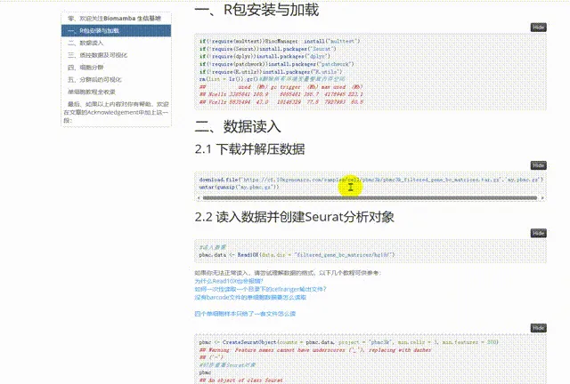
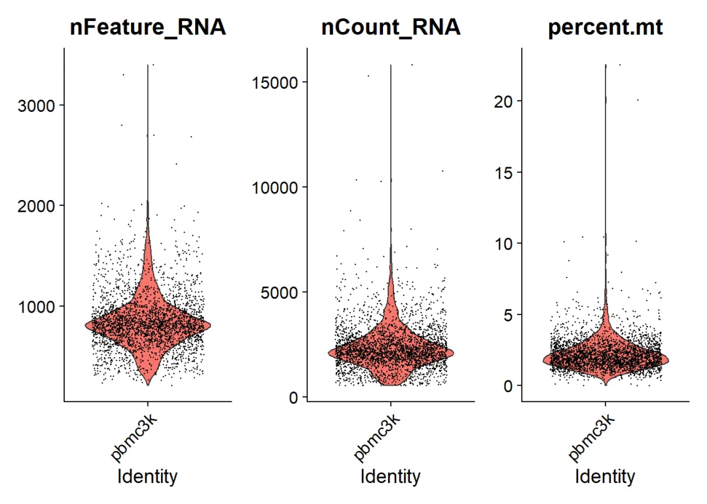
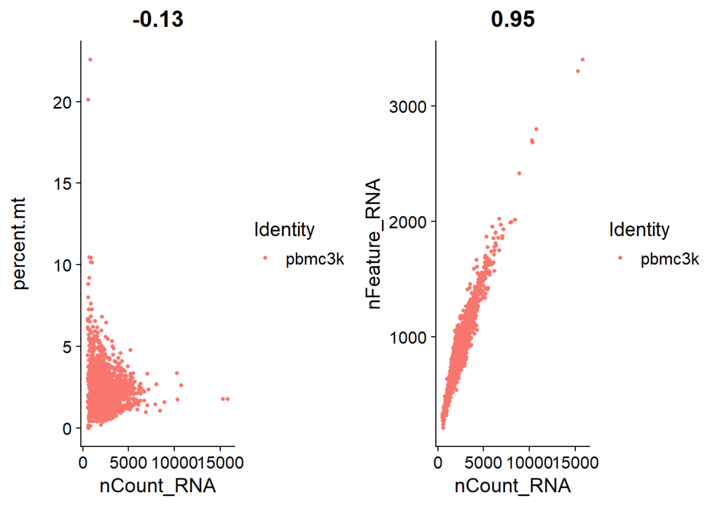
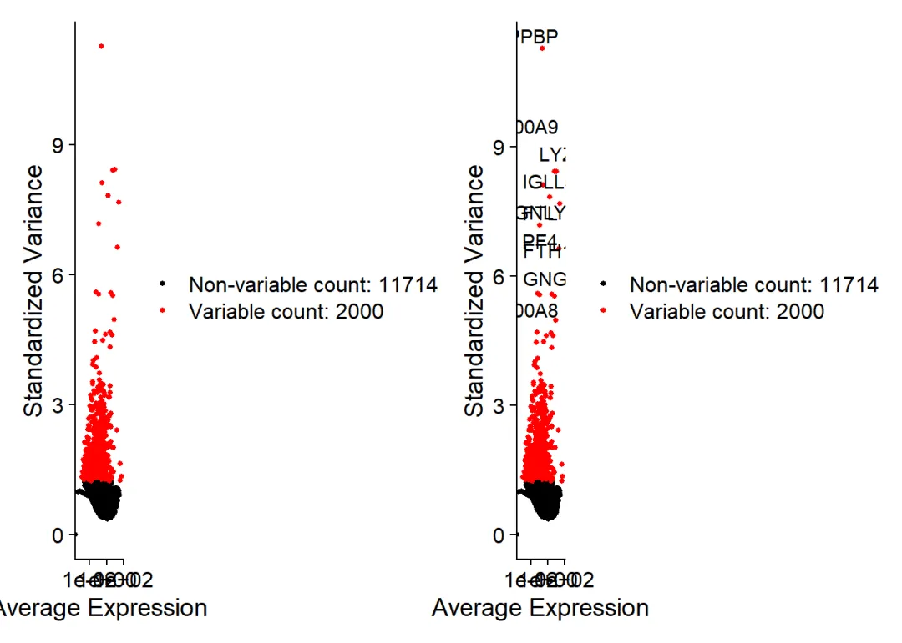

# 手把手教你做单细胞测序数据分析|3.单样本分析(2023年重置)

> 原文：https://mp.weixin.qq.com/s?__biz=MzAwMzIzOTk5OQ==&mid=2247500010&idx=2&sn=2f9fd1b0101d579bcd250fdc24e98bfc&chksm=9b3cb9baac4b30ac6f0ce28a6dd10470e73d1e1d6defece5636939a32a6db9b2cce0ff8688eb#rd
> 合集：单细胞教程全收录


视频教程

这一部分课程正式开始学习单细胞转录组测序的数据分析，大家无需担心自己的R语言方面的编程基础。本次课程将从分析工具包的**安装** 、加载开始，对脚本的参数进行全方位的讲解。具体分析内容方面，此次课程将详细的给大家介绍**Seurat对象** 的创建、过滤、数据结构特征及理解、存储、线粒体含量计算、分群、降维、Marker计算、各类可视化方法。并同时提醒大家不同物种处理时需要进行一些改动。此次课程为整个《单细胞转录组测序数据分析》课程的核心内容，其中代码的运行方式、数据结构的理解与处理均十分重要，后续的进阶分析都需以此课程作为基础。电脑配置不足的同学可以看看这里：([有root权限的共享服务器,注册即送200￥](<http://mp.weixin.qq.com/s?__biz=MzAwMzIzOTk5OQ==&mid=2247499707&idx=1&sn=1b1bb35069f6a86e50bc0866a22502b7&chksm=9b3c86ebac4b0ffd55d3cd9d8247eab6110481f1bf53e7fede84c0db29366910df8bd79dcc41&scene=21#wechat_redirect>))

视频中用到的可复制代码、测试文件可以在文末投微信豆或在后台回复“单样本分析”领取。我们也给大家准备好了可交互翻阅的html笔记文件：




图文教程


# 一、R包安装与加载

```
if(!require(multtest))BiocManager::install("multtest")
if(!require(Seurat))install.packages("Seurat")
if(!require(dplyr))install.packages("dplyr")
if(!require(patchwork))install.packages("patchwork")
if(!require(R.utils))install.packages("R.utils")
rm(list = ls());gc()#删除所有环境变量整理内存空间
##           used  (Mb) gc trigger  (Mb) max used  (Mb)
## Ncells 3385841 180.9    6865481 366.7  4176945 223.1
## Vcells 5635494  43.0   10146329  77.5  7927993  60.5
```

# 二、数据读入

## 2.1 下载并解压数据

```
download.file('https://cf.10xgenomics.com/samples/cell/pbmc3k/pbmc3k_filtered_gene_bc_matrices.tar.gz','my.pbmc.gz')
untar(gunzip("my.pbmc.gz"))
```

## 2.2 读入数据并创建Seurat分析对象

```r
#读入数据
pbmc.data <- Read10X(data.dir = "filtered_gene_bc_matrices/hg19/")
```

如果你无法正常读入，请尝试理解数据的格式，以下几个教程可供参考：
[为什么Read10X也会报错?](<https://mp.weixin.qq.com/s?__biz=MzAwMzIzOTk5OQ==&mid=2247485012&idx=1&sn=6007c8d7cb2a236dd7240a678dac0391&chksm=9b3f7f04ac48f612f811c1df9e9450dc8112d343e4bf245be5149c2e2a073d3e339cd0e3ff61&scene=21#wechat_redirect>)
[如何一次性读取一个目录下的cellranger输出文件？](<https://mp.weixin.qq.com/s?__biz=MzAwMzIzOTk5OQ==&mid=2247485145&idx=1&sn=402cb28c16aba0dc647037c9b7aba8f7&chksm=9b3f7f89ac48f69fe27cd427df3eff2e88c240bf20dfe92d8b522eecd7302d132d880bf29047&scene=21#wechat_redirect>)
[没有barcode文件的单细胞数据要怎么读取](<https://mp.weixin.qq.com/s?__biz=MzAwMzIzOTk5OQ==&mid=2247490952&idx=1&sn=364a3941e59e45234795c906a42fc9ab&chksm=9b3f64d8ac48edcec70384cf5c6a91224d0f7841ce3a7cfcade6513500c13673a6695d6f0299&scene=21#wechat_redirect>)
[四个单细胞样本只给了一套文件怎么读](<https://mp.weixin.qq.com/s?__biz=MzAwMzIzOTk5OQ==&mid=2247494879&idx=1&sn=c2287ab3684792747dfac53d6704462b&chksm=9b3c958fac4b1c994a4b075c4f8475816e121966fa8c52cb0a2ce8c14987988ab9bdb49bdf69&scene=21#wechat_redirect>)

```r
pbmc <- CreateSeuratObject(counts = pbmc.data, project = "pbmc3k", min.cells = 3, min.features = 200)
## Warning: Feature names cannot have underscores ('_'), replacing with dashes
## ('-')
#初步查看Seurat对象
pbmc
## An object of class Seurat
## 13714 features across 2700 samples within 1 assay
## Active assay: RNA (13714 features, 0 variable features)
ncol(pbmc)
## [1] 2700
ncol(pbmc.data)
## [1] 2700
lalala <- as.data.frame(pbmc[["RNA"]]@counts)
write.table(lalala,'mycount.txt',sep = '\t')#表达矩阵可以这么存出来
```

# 三、质控数据及可视化

```r
pbmc[["percent.mt"]] <- PercentageFeatureSet(pbmc, pattern = "^MT-")
#人源的数据为MT，鼠源的需要换成mt
head(pbmc@meta.data,5)
##                  orig.ident nCount_RNA nFeature_RNA percent.mt
## AAACATACAACCAC-1     pbmc3k       2419          779  3.0177759
## AAACATTGAGCTAC-1     pbmc3k       4903         1352  3.7935958
## AAACATTGATCAGC-1     pbmc3k       3147         1129  0.8897363
## AAACCGTGCTTCCG-1     pbmc3k       2639          960  1.7430845
## AAACCGTGTATGCG-1     pbmc3k        980          521  1.2244898
VlnPlot(pbmc, features = c("nFeature_RNA", "nCount_RNA", "percent.mt"), ncol = 3)
```



```r
plot1 <- FeatureScatter(pbmc, feature1 = "nCount_RNA", feature2 = "percent.mt")
plot2 <- FeatureScatter(pbmc, feature1 = "nCount_RNA", feature2 = "nFeature_RNA")
if(!require(patchwork))install.packages("patchwork")
CombinePlots(plots = list(plot1, plot2))
## Warning: CombinePlots is being deprecated. Plots should now be combined using
## the patchwork system.
```



```
VlnPlot(pbmc, features = c("nFeature_RNA", "nCount_RNA", "percent.mt"), ncol = 3)
```


```r
plot1 <- FeatureScatter(pbmc, feature1 = "nCount_RNA", feature2 = "percent.mt")
plot2 <- FeatureScatter(pbmc, feature1 = "nCount_RNA", feature2 = "nFeature_RNA")
if(!require(patchwork))install.packages("patchwork")
#CombinePlots这步需要你的绘图窗口足够大
CombinePlots(plots = list(plot1, plot2))
## Warning: CombinePlots is being deprecated. Plots should now be combined using
## the patchwork system.
```


```r
pbmc <- subset(pbmc, subset = nFeature_RNA > 200 & nFeature_RNA < 2500 & percent.mt < 5)
ncol(as.data.frame(pbmc[["RNA"]]@counts))
## [1] 2638
```

# 四、细胞分群

```r
#将表达数据标准化
pbmc <- NormalizeData(pbmc, normalization.method = "LogNormalize", scale.factor = 10000)

#pbmc[["RNA"]]@data

#寻找高变基因
pbmc <- FindVariableFeatures(pbmc, selection.method = "vst", nfeatures = 2000)

top10 <- head(VariableFeatures(pbmc), 10)#查看十个程度最强的高变基因

plot1 <- VariableFeaturePlot(pbmc)
plot2 <- LabelPoints(plot = plot1, points = top10, repel = TRUE)
## When using repel, set xnudge and ynudge to 0 for optimal results
plot1 + plot2# plot variable features with and without labels
## Warning: Transformation introduced infinite values in continuous x-axis
## Transformation introduced infinite values in continuous x-axis
```


