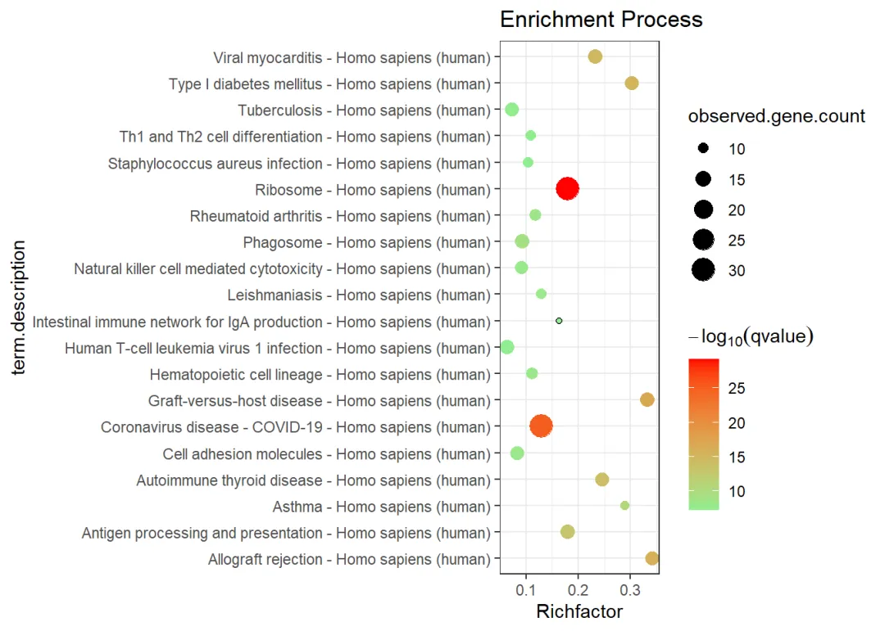

# 手把手教你做单细胞测序数据分析|7基因集富集分析

> 原文：https://mp.weixin.qq.com/s?__biz=MzAwMzIzOTk5OQ==&mid=2247500357&idx=2&sn=40034079b771c478b482e849ed4b216c&chksm=9b3cbb15ac4b3203d517ff71073ab0520fe144bc108b7a26f6b17e88fb63a78c5777946618e3#rd
> 合集：单细胞教程全收录


准备工作

上一讲中我们已经教会了大家如何对多样本的数据做差异分析，拿到差异基因列表。通常情况下差异基因数量是非常多的，显然拿着这么长的list直接撰文是不科学的。这时就需要我们利用一定的“先验”通路，去评估我们获得的差异基因集，从而帮助大家更好的了解自己手中的数据，解释好数据背后的生物学意义，继续向文章迈进!

在线做富集分析DAVID：
https://david.ncifcrf.gov/当然，我不是很推荐这种，原因在这里：
[都2022年了，还在用DAVID?](<http://mp.weixin.qq.com/s?__biz=MzI5NjUyNzkxMg==&mid=2247491623&idx=1&sn=dd7b3857a23fa99a5ea49a8219dc2ed0&chksm=ec405160db37d876de52bb489556f37f39d5a728fcd1aacaf04d8d329014fa88a15058e3fe4d&scene=21#wechat_redirect>)

PPI同样有这个功能，视频里我们也演示了：
[String：不仅仅是一个PPI分析平台](<http://mp.weixin.qq.com/s?__biz=MzAwMzIzOTk5OQ==&mid=2247484050&idx=1&sn=a7b99bc7b445acdc9b5d45f032d31ac9&chksm=9b3f7bc2ac48f2d4d9049e52a0c544bbfb46585383afe4b62e2331de7be8fad119038d7fd78d&scene=21#wechat_redirect>)

****
GSVA不用再多说了吧，花很多篇幅说过了：[ 文献阅读系列（九）、一文了解GSVA原理](<http://mp.weixin.qq.com/s?__biz=MzAwMzIzOTk5OQ==&mid=2247484632&idx=1&sn=a9926fd8d42c902b6c787738c40de9cb&chksm=9b3f7d88ac48f49ee34b23e69ad0911fcb03932187e46cc8218e95bbd7bd38f4525862750ec6&scene=21#wechat_redirect>)

[三行搞定GSVA分析](<http://mp.weixin.qq.com/s?__biz=MzAwMzIzOTk5OQ==&mid=2247484651&idx=1&sn=6ffa41e969eb35ba7d17e41732b73623&chksm=9b3f7dbbac48f4ad49a050e077420f0fe5f7c6a05769a7efc25494ea1601c9c979b2070cada0&scene=21#wechat_redirect>)

[一文搞定GSVA及下游分析的代码实现](<http://mp.weixin.qq.com/s?__biz=MzAwMzIzOTk5OQ==&mid=2247484653&idx=1&sn=08faf7fe2537747d395ca7521dafd87e&chksm=9b3f7dbdac48f4ab86752d83c5ca285d6460b42fac0511f5a27b9f867a84abee1a119195d4ff&scene=21#wechat_redirect>)

[单细胞中应该如何做GSVA？](<http://mp.weixin.qq.com/s?__biz=MzAwMzIzOTk5OQ==&mid=2247484701&idx=1&sn=ad90680f252d092a2e21f349c8f32cab&chksm=9b3f7c4dac48f55bf1d11337406ab0e1295e8e1731dbac0715eedc99d11beff7f380e42dd49b&scene=21#wechat_redirect>)

GSEA的内容也是更过的：
[答读者问 （一）单基因究竟能否进行GSEA](<http://mp.weixin.qq.com/s?__biz=MzAwMzIzOTk5OQ==&mid=2247484175&idx=1&sn=3e45ad62b045a541874e5ae7ca03f849&chksm=9b3f7a5fac48f349f8893500825d2c6b4ff581fbb0816c1074d88a0dbbb4a612c1e1bb3740bb&scene=21#wechat_redirect>)

单细胞基因集评分可以看这里：[一文搞定单细胞基因集评分](<http://mp.weixin.qq.com/s?__biz=MzAwMzIzOTk5OQ==&mid=2247497831&idx=2&sn=82fa51c76a381fba0b444e9b6b23eb5f&chksm=9b3c8137ac4b0821dfb62e9b365ea3c32abbbd80df42df63181c37ad9ed991c0183c2c7981d8&scene=21#wechat_redirect>)


视频教程

大家最喜欢的视频环节，看完就可以自己动手啦：

B站同步播出：

https://www.bilibili.com/video/BV1S44y1b76Z?p=8


图文教程

上一讲中刚教会大家如何进行差异基因的计算及可视化，然而大家拿着成千上百的差异基因直接调研、撰文显然是不现实的，因此需要通过富集分析去揭示这些基因群背后蕴含的**生物学意义**

## 1\. 视频及测试文件

### 1.1 视频教程

视频教程可见B站，方便查阅上下集：
点击跳转

### 1.2 测试文件

文末扫码下载

## 2\. 代码

```
suppressWarnings(suppressMessages(if(!require(rvcheck))devtools::install_version("rvcheck", version = "0.1.8", repos = "http://cran.us.r-project.org")))
suppressWarnings(suppressMessages(if(!require(clusterProfiler))BiocManager::install("clusterProfiler")))
suppressWarnings(suppressMessages(if(!require(org.Mm.eg.db))BiocManager::install("org.Mm.eg.db")))
suppressWarnings(suppressMessages(if(!require(org.Hs.eg.db))BiocManager::install("org.Hs.eg.db")))
suppressWarnings(suppressMessages(library(dplyr)))
```

### 2.1 准备基因和绘图函数

```r
# 读取marker列表
bcell.marker <- read.csv('第七讲.富集分析/bcell.marker.CSV',row.names = 1)
head(bcell.marker)
```
```
##             p_val avg_log2FC pct.1 pct.2    p_val_adj SYMBOL
## GZMB 3.186146e-97  -5.507567 0.017 0.961 4.369480e-93   GZMB
## NKG7 1.262672e-94  -6.262287 0.087 1.000 1.731628e-90   NKG7
## PRF1 1.835435e-93  -4.612813 0.029 0.948 2.517115e-89   PRF1
## GZMA 3.036581e-93  -4.466820 0.015 0.929 4.164367e-89   GZMA
## CTSW 3.151498e-93  -4.203776 0.070 0.987 4.321965e-89   CTSW
## CST7 9.767143e-92  -4.380031 0.038 0.948 1.339466e-87   CST7
```

```r
# 筛选出B细胞marker中p_val_adj最显著的100个基因用于下游分析
mygene <- bcell.marker %>% top_n(n = -100, wt = p_val_adj) %>% rownames()
mygene[1:10]
```
```
##  [1] "GZMB"   "NKG7"   "PRF1"   "GZMA"   "CTSW"   "CST7"   "GNLY"   "FGFBP2"
##  [9] "CD247"  "FCGR3A"
```

```r
# 利用org.Hs.eg.db整合基因名、 ENTREZID、ENSEMBL
gene.df <- bitr(mygene,fromType="SYMBOL",toType=c("ENTREZID","ENSEMBL"),
                OrgDb = org.Hs.eg.db)
```
```
## 'select()' returned 1:many mapping between keys and columns
```
```
## Warning in bitr(mygene, fromType = "SYMBOL", toType = c("ENTREZID", "ENSEMBL"),
## : 1% of input gene IDs are fail to map...
```

```r
# 自定义一个绘图函数，可以通过富集分析返回的数据框绘制气泡图
erich2plot <- function(data4plot){
  library(ggplot2)
  data4plot <- data4plot[order(data4plot$qvalue,decreasing = F)[1:20],]
  data4plot$BgRatio<-
    apply(data4plot,1,function(x){
      as.numeric(strsplit(x[3],'/')[[1]][1])
    })/apply(data4plot,1,function(x){
      as.numeric(strsplit(x[4],'/')[[1]][1])
    })

  p <- ggplot(data4plot,aes(BgRatio,Description))
  p<-p + geom_point()

  pbubble <- p + geom_point(aes(size=Count,color=-1*log10(qvalue)))

  pr <- pbubble + scale_colour_gradient(low="#90EE90",high="red") +
    labs(color=expression(-log[10](qvalue)),size="observed.gene.count",
         x="Richfactor", y="term.description",title="Enrichment Process")

  pr <- pr + theme_bw()
  pr
}
```

### 2.2 KEGG 与 GO 富集分析

```
dir.create('第七讲.富集分析')
```
```
## Warning in dir.create("第七讲.富集分析"): '第七讲.富集分析'已存在
```

```r
setwd('第七讲.富集分析')# 设置工作路径
#使用在线数据,可能会受域名限制
R.utils::setOption("clusterProfiler.download.method","auto")#这样可以修改下载协议

# 进行kegg富集分析
ekegg <- enrichKEGG(unique(gene.df$ENTREZID), organism='hsa',
                    pvalueCutoff=0.05,pAdjustMethod='BH',qvalueCutoff=0.2,
                    minGSSize=10,maxGSSize=500,use_internal_data=F)
```
```
## Reading KEGG annotation online: "https://rest.kegg.jp/link/hsa/pathway"...
```
```
## Reading KEGG annotation online: "https://rest.kegg.jp/list/pathway/hsa"...
```

```r
# 把ENTREZID转换为SYMBOL
ekegg <- setReadable(ekegg,'org.Hs.eg.db','ENTREZID')
write.csv(ekegg@result,'kegg.result.csv')

erich2plot(ekegg@result)
```
```
## Warning: 程辑包'ggplot2'是用R版本4.2.3 来建造的
```



```
# 保存图片
pdf(file = 'kegg.pdf',width = 10,height = 10)
erich2plot(ekegg@result)
dev.off()
```
```
## png
##   2
```

如果你在做KEGG富集分析时遇到这样的报错：

那么你的`clusterProfiler`需要更新一下：

```
remove.packages('clusterProfiler')
devtools::install_github("YuLab-SMU/clusterProfiler")
```

```r
#######GO over-representation test###########
#进行GO富集分析,GO富集分析分为molecular function、biological process、cell component三个类
ggoMF <- enrichGO(gene.df$SYMBOL, org.Hs.eg.db, keyType = "SYMBOL", ont = "MF",
                  pvalueCutoff = 0.05, pAdjustMethod = "BH", qvalueCutoff = 0.2, minGSSize = 10,
                  maxGSSize = 500, readable = FALSE, pool = FALSE)

#输出结果
write.csv(ggoMF@result,'GO.MF.result.csv')

pdf(file = 'GO.MF.pdf',width = 10,height = 10)
erich2plot(ggoMF@result)
dev.off()
```
```
## png
##   2
```

```r
ggoCC <- enrichGO(gene.df$SYMBOL, org.Hs.eg.db, keyType = "SYMBOL", ont = "CC",
                  pvalueCutoff = 0.05, pAdjustMethod = "BH", qvalueCutoff = 0.2, minGSSize = 10,
                  maxGSSize = 500, readable = FALSE, pool = FALSE)
write.csv(ggoCC@result,'GO.CC.result.csv')

pdf(file = 'ggoCC.pdf',width = 10,height = 10)
erich2plot(ggoCC@result)
dev.off()
```
```
## png
##   2
```

```r
ggoBP <- enrichGO(gene.df$SYMBOL, org.Hs.eg.db, keyType = "SYMBOL", ont = "BP",
                  pvalueCutoff = 0.05, pAdjustMethod = "BH", qvalueCutoff = 0.2, minGSSize = 10,
                  maxGSSize = 500, readable = FALSE, pool = FALSE)
write.csv(ggoBP@result,'GO.BP.result.csv')

pdf(file = 'ggoBP.pdf',width = 10,height = 10)
erich2plot(ggoBP@result)
dev.off()
```
