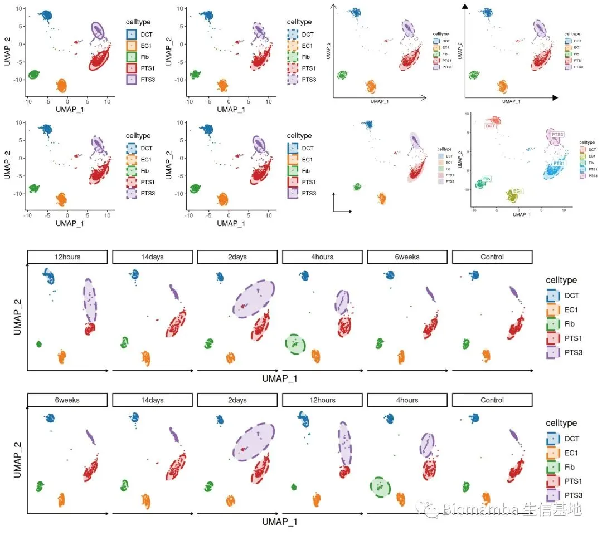

# 改造单细胞降维图| 2.ggplot2中的DIY

> 原文：https://mp.weixin.qq.com/s?__biz=MzAwMzIzOTk5OQ==&mid=2247496239&idx=1&sn=1fe6fd4a7fb88ecc0456b4f5710cb5d6&chksm=9b3c8b7fac4b0269e0abeab951ad6ae0ddd1464dd9d1867280eeb9755fda5ba8f5237d88a7a6#rd
> 合集：单细胞教程全收录

写在前面

随着我们课程的持续深入，以及各位小伙伴分析技能的日益提升，目前很多同学已经不满足于Seurat的可视化功能并希望能够做出一些**改进的可视化** 。我个人对可视化的方式改进其实并不感冒，画图嘛，跟翻译一样**信达雅** 即可，没必要盲目追求视觉效果。不过这也并不方案我给大家做这类的教程。我们准备出一系列**单细胞测图片改造计划** 的推送，大家如果有任何关于可视化的想法，也可以通过文末客服微信联系我们。
第一个系列就是对降维图的改造，上一讲我们与大家一起回顾了Seurat中DimPlot的内容([改造单细胞降维图| 1.DimPlot的探索](<http://mp.weixin.qq.com/s?__biz=MzAwMzIzOTk5OQ==&mid=2247496162&idx=1&sn=598c2920f7cc0697ee5a1fa6cadaee04&chksm=9b3c88b2ac4b01a415feeebbbec6c4891319439dc8dcdafd33cca7a1222e5adc723ae9d3a73d&scene=21#wechat_redirect>))。本次教程我们将会和大家一起在ggplot2中完成一些探索，代码与测试文件可在文末订阅或联系客服微信号(**Biomamba_kefu**)获取。

视频教程

B站同步播出，连播更方便，文末阅读原文可直达：https://www.bilibili.com/video/BV1S44y1b76Z?p=12

代码及测试文件
