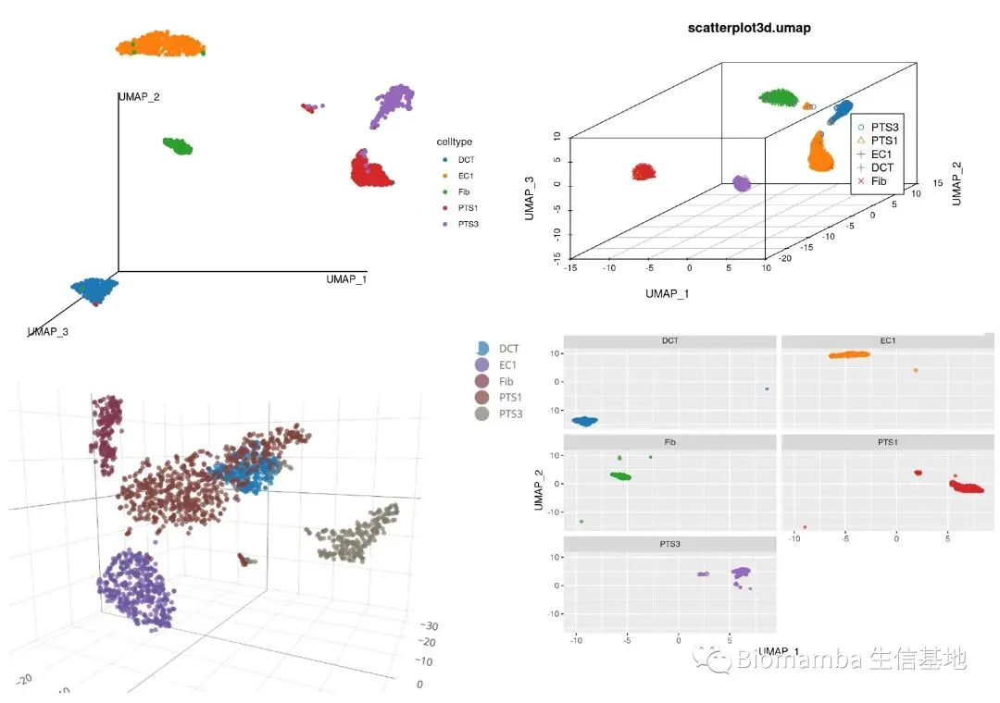
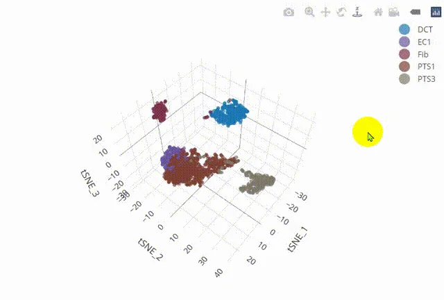

# 改造单细胞降维图| 3.3D降维图与动图绘制

> 原文：https://mp.weixin.qq.com/s?__biz=MzAwMzIzOTk5OQ==&mid=2247498080&idx=2&sn=a9bcf65e3ae34ba201e8d49ee33c0728&chksm=9b3c8030ac4b0926c3f059a9a5d23f1bcdbcaf8e5a562eba2b7e3bec3396c44573269bd08e7b#rd
> 合集：单细胞教程全收录

写在前面

随着我们课程的持续深入，以及各位小伙伴分析技能的日益提升，目前很多同学已经不满足于Seurat的可视化功能并希望能够做出一些**改进的可视化** 。我个人对可视化的方式改进其实并不感冒，画图嘛，跟翻译一样**信达雅** 即可，没必要盲目追求视觉效果。不过这也并不妨碍我给大家做这类的教程。我们准备出一系列**单细胞测图片改造计划** 的推送，大家如果有任何关于可视化的想法，也可以通过文末客服微信联系我们。
这次教程我们带来了一些有意思的内容，如下面两张图展示的那样，降维图也可以以可交互的3D形式、GIF动图形式绘制，代码与测试文件可在文末订阅或联系客服微信号(**Biomamba**)做转发任务获取。

视频教程

B站同步播出，连播更方便，文末阅读原文可直达：https://www.bilibili.com/video/BV1S44y1b76Z?p=13

代码及测试文件
