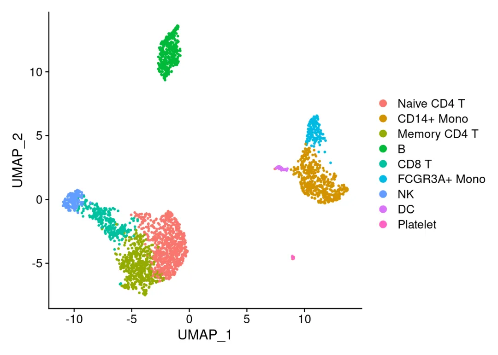
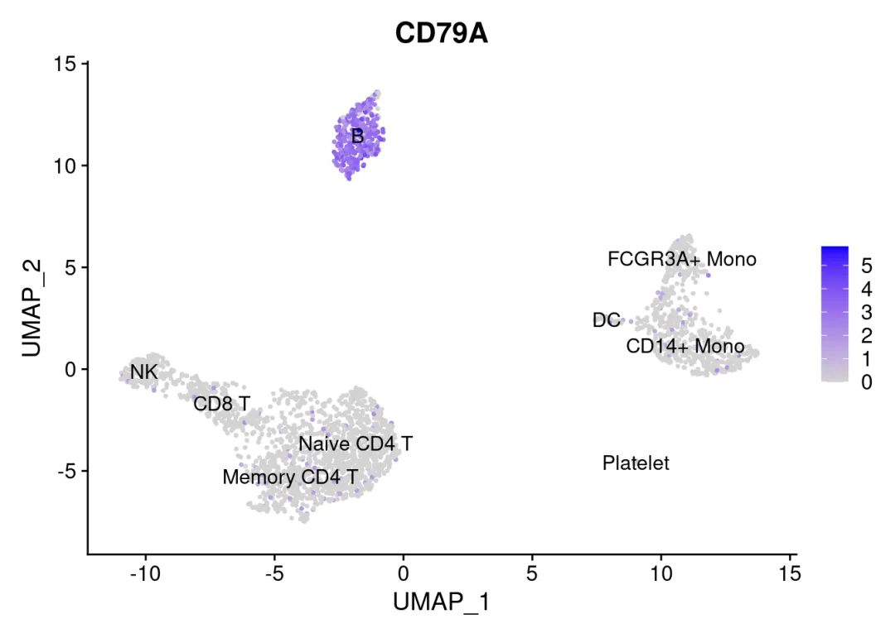
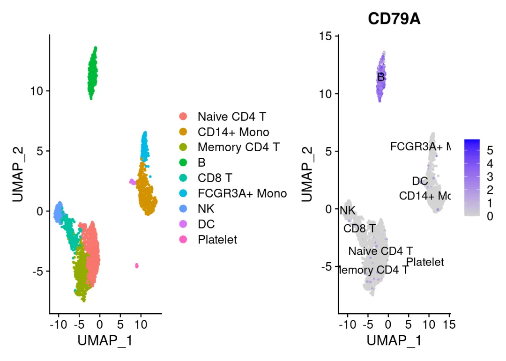
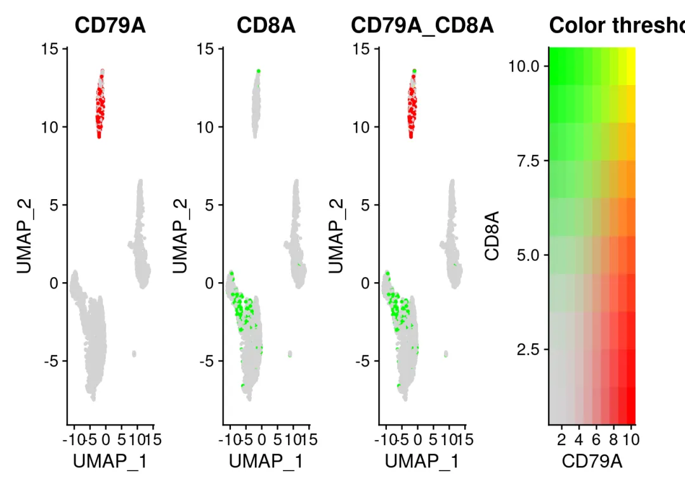
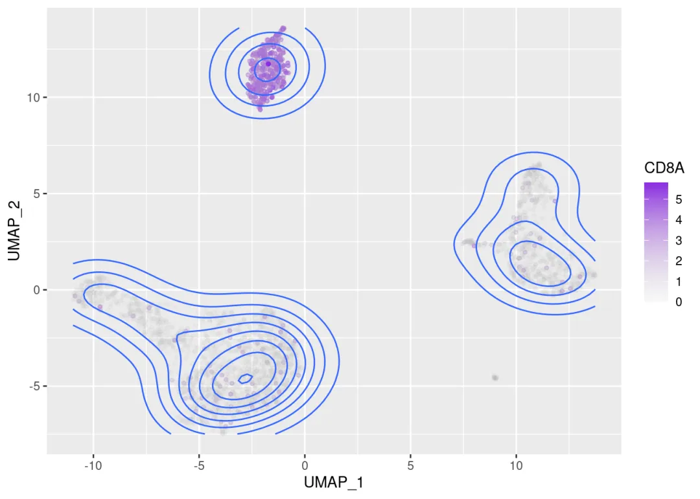
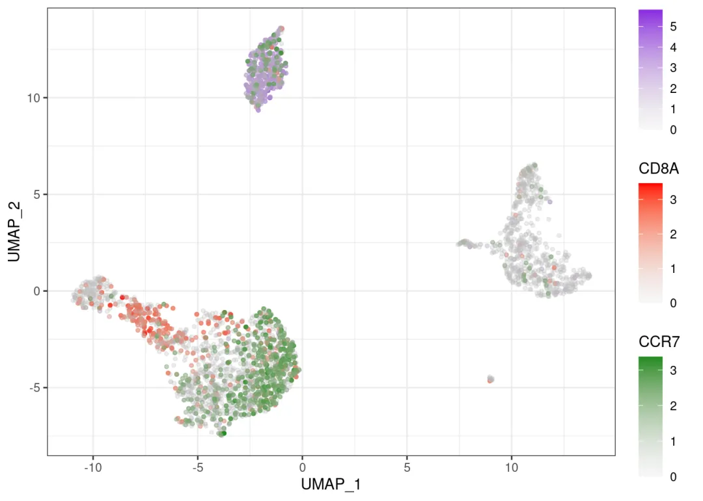
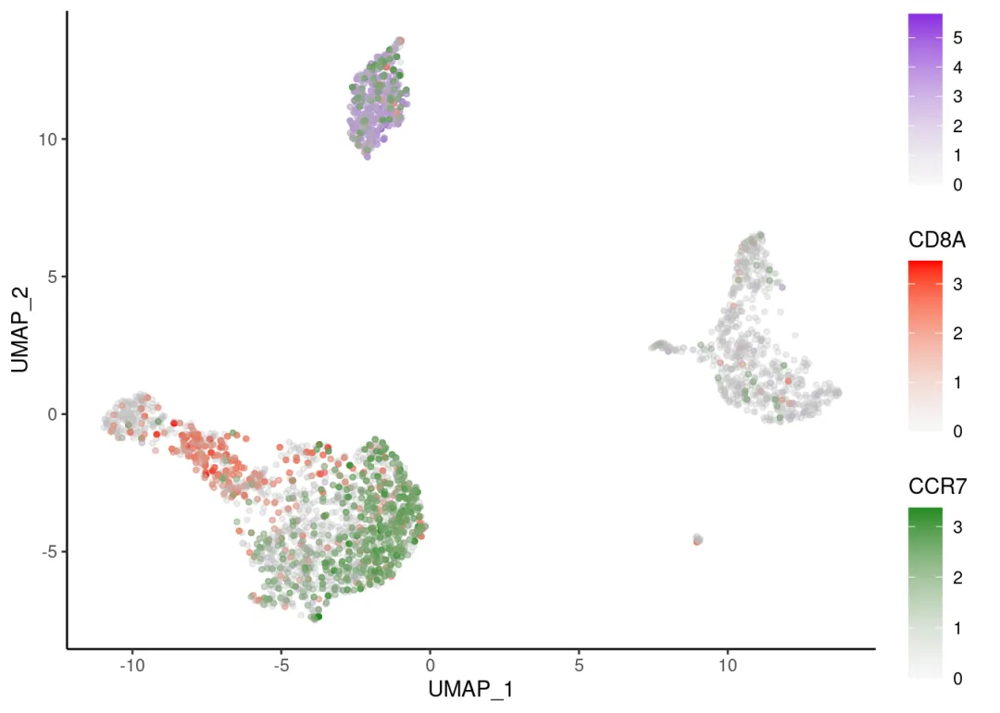
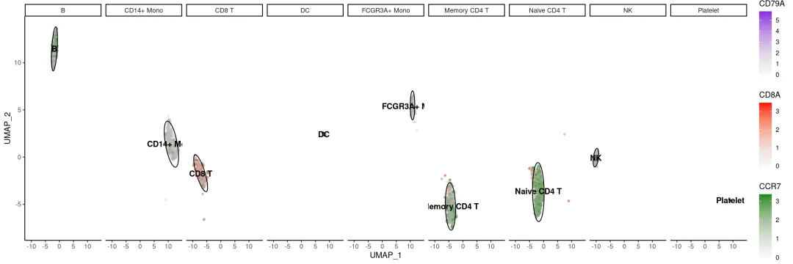

# 改造单细胞FeaturePlot

> 原文：https://mp.weixin.qq.com/s?__biz=MzAwMzIzOTk5OQ==&mid=2247504616&idx=1&sn=f7b4a0e6b25d224380cd803e3463a3e4&chksm=9b3cabb8ac4b22aeb65e0d6ec32a1f8674dcf907da078ccb3b61e06c4aa035864ebec092f571#rd
> 合集：单细胞教程全收录


写在前面

随着我们课程的持续深入，以及各位小伙伴分析技能的日益提升，目前很多同学已经不满足于Seurat的可视化功能并希望能够做出一些**改进的可视化** 。我个人对可视化的方式改进其实并不感冒，画图嘛，跟翻译一样**信达雅** 即可，没必要盲目追求视觉效果。不过这也并不方案我给大家做这类的教程。我们准备出一系列**单细胞测图片改造计划** 的推送，大家如果有任何关于可视化的想法，也可以通过文末客服微信联系我们。
本次推送我们进行FeaturePlot的用法介绍与改造，主要进行多基因FeaturePlot与等高线的绘制。


视频教程

B站同步播出，连播更方便，文末阅读原文可直达：https://www.bilibili.com/video/BV1iM4y127Ez?p=5


图文教程


# 一、读入并绘制`FeaturePlot`

```r
setwd('~/analysis/改造单细胞FeaturePlot/')
library(Seurat)
```
```
## Loading required package: SeuratObject
```
```
## Loading required package: sp
```
```
## The legacy packages maptools, rgdal, and rgeos, underpinning the sp package,
## which was just loaded, were retired in October 2023.
## Please refer to R-spatial evolution reports for details, especially
## https://r-spatial.org/r/2023/05/15/evolution4.html.
## It may be desirable to make the sf package available;
## package maintainers should consider adding sf to Suggests:.
```
```
##
## Attaching package: 'SeuratObject'
```
```
## The following objects are masked from 'package:base':
##
##     intersect, saveRDS
```
```
## Loading Seurat v5 beta version
## To maintain compatibility with previous workflows, new Seurat objects will use the previous object structure by default
## To use new Seurat v5 assays please run: options(Seurat.object.assay.version = 'v5')
```

测试文件可点击[单样本分析](<http://mp.weixin.qq.com/s?__biz=MzAwMzIzOTk5OQ==&mid=2247500010&idx=2&sn=2f9fd1b0101d579bcd250fdc24e98bfc&chksm=9b3cb9baac4b30ac6f0ce28a6dd10470e73d1e1d6defece5636939a32a6db9b2cce0ff8688eb&scene=21#wechat_redirect>)或联系文末客服微信获取

```r
scRNA <- readRDS('pbmc.rds')
DimPlot(scRNA)
```



```r
scRNA.markers <-
  FindAllMarkers(scRNA, only.pos = TRUE,
                 min.pct = 0.25, logfc.threshold = 0.25)
```
```
## Calculating cluster Naive CD4 T
```
```
## Calculating cluster CD14+ Mono
```
```
## Calculating cluster Memory CD4 T
```
```
## Calculating cluster B
```
```
## Calculating cluster CD8 T
```
```
## Calculating cluster FCGR3A+ Mono
```
```
## Calculating cluster NK
```
```
## Calculating cluster DC
```
```
## Calculating cluster Platelet
```

```r
#寻找每一个分类群与其他所有细胞之间的标记基因，并只显示positive结果
library(dplyr)
```
```
##
## Attaching package: 'dplyr'
```
```
## The following objects are masked from 'package:stats':
##
##     filter, lag
```
```
## The following objects are masked from 'package:base':
##
##     intersect, setdiff, setequal, union
```

```r
top1gene <- scRNA.markers %>% group_by(cluster) %>%
  top_n(n = 1, wt = avg_log2FC)

FeaturePlot(scRNA,features = 'CD79A',label = T)
```



```r
library(patchwork)
DimPlot(scRNA)|FeaturePlot(scRNA,features = 'CD79A',label = T)
```



# 二、张FeaturePlot上绘制多个基因

## 2.1 `Seurat`画法

```
FeaturePlot(scRNA,c('CD79A','CD8A'),blend = T)
```



```
try({FeaturePlot(scRNA,c('CD79A','CD8A','CCR7'),blend = T)})
```
```
## Error in FeaturePlot(scRNA, c("CD79A", "CD8A", "CCR7"), blend = T) :
##   Blending feature plots only works with two features
```

## 2.2 `ggplot2`画法

```r
### 数据整理 ###
library(dplyr)
mydata <- scRNA@reductions$umap@cell.embeddings
myexpr <- as.data.frame(scRNA@assays$RNA@data)[
  c('CD79A','CD8A','CCR7'),]%>%
  t()
mydata <- cbind(mydata,myexpr) %>% as.data.frame()
mydata$celltype <- Idents(scRNA)
head(mydata)
```
```
##                     UMAP_1     UMAP_2    CD79A     CD8A     CCR7     celltype
## AAACATACAACCAC-1 -4.611246 -3.0574470 0.000000 1.635873 1.635873 Memory CD4 T
## AAACATTGAGCTAC-1 -2.061398  9.7727327 1.962726 0.000000 0.000000            B
## AAACATTGATCAGC-1 -5.386918 -6.3924266 0.000000 0.000000 0.000000 Memory CD4 T
## AAACCGTGCTTCCG-1 10.931999  3.5166690 0.000000 0.000000 0.000000   CD14+ Mono
## AAACCGTGTATGCG-1 -9.780782  0.6403372 0.000000 0.000000 0.000000           NK
## AAACGCACTGGTAC-1 -3.459144 -4.8853937 0.000000 0.000000 0.000000 Memory CD4 T
```

```r
#### ggplot2 绘制 ####
# 加载包
library(ggplot2)
library(ggthemes)
library(ggnewscale)

# 绘制一个基因
p <- ggplot(mydata,aes(x=UMAP_1,y=UMAP_2))+
  geom_point(data = mydata,aes(x=UMAP_1,y=UMAP_2,
                               color=CD79A),size=1)+
  scale_color_gradient('CD8A',low = alpha('grey',0.1),#防止覆盖，把灰色的点透明度设置的高一些
                       high = alpha('#8A2BE2',1))

# 添加置信区间
p+stat_density2d(aes(colour=CD8A))
```



```r
# 同时绘制三个基因

p <- ggplot(mydata,aes(x=UMAP_1,y=UMAP_2))+
  geom_point(data = mydata,aes(x=UMAP_1,y=UMAP_2,
                               color=CD79A),size=1)+
  scale_color_gradient('CD79A',low = alpha('grey',0.1),#防止覆盖，把灰色的点透明度设置的高一些
                       high = alpha('#8A2BE2',1))+#喜欢什么颜色大家自己调吧
  new_scale('color')+
  geom_point(data = mydata,aes(x=UMAP_1,y=UMAP_2,
                               color=CD8A),size=1)+
  scale_color_gradient('CD8A',low = alpha('grey',0.1),
                       high = alpha('red',1))+
  new_scale('color')+
  geom_point(data = mydata,aes(x=UMAP_1,y=UMAP_2,
                               color=CCR7),size=1)+
  scale_color_gradient('CCR7',low = alpha('grey',0.1),
                       high = alpha('#228B22',1))+
  theme_bw()

p
```



```r
# 更改背景
p <- p+
  theme_bw()+
  theme_few()+
  theme_classic()

p
```



```r
# 添加置信区间
p <- p +
  stat_ellipse(aes(fill=celltype))
```
```
## Warning: Ignoring unknown aesthetics: fill
```

```r
# 整理label文件
my.label <- data.frame()
for (runcell in unique(mydata$celltype)) {
  UMAP_1 <- dplyr::filter(mydata,celltype == runcell) %>% pull(UMAP_1) %>%  mean()
  UMAP_2 <- dplyr::filter(mydata,celltype == runcell) %>% pull(UMAP_2) %>%  mean()
  my.label <- rbind(my.label,cbind(UMAP_1,UMAP_2))
}
rownames(my.label) <- unique(mydata$celltype)
my.label$celltype <- rownames(my.label)
my.label
```
```
##                  UMAP_1      UMAP_2     celltype
## Memory CD4 T  -4.422100 -5.19212111 Memory CD4 T
## B             -1.762446 11.47130215            B
## CD14+ Mono    11.158896  1.40641908   CD14+ Mono
## NK           -10.087909 -0.07843839           NK
## CD8 T         -7.148712 -1.72927666        CD8 T
## Naive CD4 T   -1.899778 -3.60795841  Naive CD4 T
## FCGR3A+ Mono  10.835906  5.39764747 FCGR3A+ Mono
## DC             7.929269  2.43682494           DC
## Platelet       8.998634 -4.56453389     Platelet
```

```r
# 添加label
p <- p+
  geom_text(aes(x = UMAP_1,y = UMAP_2,label=celltype),
            color='black', fontface="bold",
            data = my.label,show.legend = F)
```

```
# 分面
p+ facet_grid(~ celltype)# celltype可以改为你所需要的变量，但是需要在mydata中存在
```



**单细胞系列教程目录**

 单细胞数据分析系列教程：B站视频，先看一遍视频再去看推送操作，建议至少看三遍：https://www.bilibili.com/video/BV1S44y1b76Z/本公众号单细胞相关资料都可以在这里订阅：[scRNA-Seq学习手册2023_R语言版](<http://mp.weixin.qq.com/s?__biz=MzAwMzIzOTk5OQ==&mid=2247500516&idx=1&sn=3c0b9de505fcd232054e38b451fa1742&chksm=9b3cbbb4ac4b32a26b61f3a1f7941fff5852d3e6e744ec680aafd0b84ec976a33bf982fb5f79&scene=21#wechat_redirect>)

单细胞测序基础数据分析保姆级教程，代码部分整理在往期推送之中：[手把手教你做单细胞测序数据分析|1.绪论](<http://mp.weixin.qq.com/s?__biz=MzAwMzIzOTk5OQ==&mid=2247499776&idx=2&sn=7fc250d94ed88cfd5e2224f071bb1742&chksm=9b3cb950ac4b30467a082527547b91aec15b7d1f40d44e362894aedeb6a99e014518fa5e4743&scene=21#wechat_redirect>)
[手把手教你做单细胞测序数据分析|2.各类数据结构与读取方法](<http://mp.weixin.qq.com/s?__biz=MzAwMzIzOTk5OQ==&mid=2247499795&idx=2&sn=68e6298eb43633c71939c146d90230ff&chksm=9b3cb943ac4b3055e09739d77e037d679f3d9ec68780d1aa8c592f806fcc8d2322eaee78752d&scene=21#wechat_redirect>)[手把手教你做单细胞测序数据分析|3.单样本分析](<http://mp.weixin.qq.com/s?__biz=MzAwMzIzOTk5OQ==&mid=2247500010&idx=2&sn=2f9fd1b0101d579bcd250fdc24e98bfc&chksm=9b3cb9baac4b30ac6f0ce28a6dd10470e73d1e1d6defece5636939a32a6db9b2cce0ff8688eb&scene=21#wechat_redirect>)
[手把手教你做单细胞测序数据分析|4.多样本整合](<http://mp.weixin.qq.com/s?__biz=MzAwMzIzOTk5OQ==&mid=2247500117&idx=2&sn=cef0b0abec6d73a8c2615980ef68aec1&chksm=9b3cb805ac4b3113fdc820b9c9667f9554b2e39f90c45b5806021a415698b0a5141c521c64dc&scene=21#wechat_redirect>)
[手把手教你做单细胞测序数据分析|5.细胞类型注释，从入门到入土](<http://mp.weixin.qq.com/s?__biz=MzAwMzIzOTk5OQ==&mid=2247500167&idx=2&sn=8de136b938e8d4753042d23166a24026&chksm=9b3cb8d7ac4b31c19c843810c7fe4341515df8ba6fff86a0ebff9d830edfcd656a29d18011c9&scene=21#wechat_redirect>)[手把手教你做单细胞测序数据分析|6组间差异分析](<http://mp.weixin.qq.com/s?__biz=MzAwMzIzOTk5OQ==&mid=2247500270&idx=2&sn=d8c4ebf8f63d12bd2ac8e2607864f322&chksm=9b3cb8beac4b31a824e228b486f0d8dd21a8f4113a0a0bcbaf1b20eaade3a83c9c7c1184010b&scene=21#wechat_redirect>)
[手把手教你做单细胞测序数据分析|7基因集富集分析](<http://mp.weixin.qq.com/s?__biz=MzAwMzIzOTk5OQ==&mid=2247500357&idx=2&sn=40034079b771c478b482e849ed4b216c&chksm=9b3cbb15ac4b3203d517ff71073ab0520fe144bc108b7a26f6b17e88fb63a78c5777946618e3&scene=21#wechat_redirect>)
[Seurat中分类变量处理技巧](<http://mp.weixin.qq.com/s?__biz=MzAwMzIzOTk5OQ==&mid=2247486134&idx=1&sn=e581b8ac20bbc968aeef3f9cf56f3a0f&chksm=9b3f73e6ac48faf0f1c81752b0190abc617eb720a71806950e7851c7d19b7e3e092aa97bd005&scene=21#wechat_redirect>)
[沉浸式统计细胞比例](<http://mp.weixin.qq.com/s?__biz=MzAwMzIzOTk5OQ==&mid=2247490949&idx=1&sn=b8dbe07d901f7c24f82d078be7a2fc77&chksm=9b3f64d5ac48edc33980363c7bc862a9f6283b78dac407e9c082d80bd7d9669215eecac62347&scene=21#wechat_redirect>)

单细胞图片改造计划：[改造单细胞降维图| 1.DimPlot的探索](<http://mp.weixin.qq.com/s?__biz=MzAwMzIzOTk5OQ==&mid=2247496162&idx=1&sn=598c2920f7cc0697ee5a1fa6cadaee04&chksm=9b3c88b2ac4b01a415feeebbbec6c4891319439dc8dcdafd33cca7a1222e5adc723ae9d3a73d&scene=21#wechat_redirect>)
[改造单细胞降维图| 2.ggplot2中的DIY](<http://mp.weixin.qq.com/s?__biz=MzAwMzIzOTk5OQ==&mid=2247496239&idx=1&sn=1fe6fd4a7fb88ecc0456b4f5710cb5d6&chksm=9b3c8b7fac4b0269e0abeab951ad6ae0ddd1464dd9d1867280eeb9755fda5ba8f5237d88a7a6&scene=21#wechat_redirect>)
[改造单细胞降维图| 3.3D降维图与动图绘制](<http://mp.weixin.qq.com/s?__biz=MzAwMzIzOTk5OQ==&mid=2247496343&idx=1&sn=8ac1c511e1197e231c628649167bc26f&chksm=9b3c8bc7ac4b02d134495e000f349cdbd75458b429297f858dfd58d1b428d8256b7e5c5075b4&scene=21#wechat_redirect>)
[沉浸式统计细胞比例](<http://mp.weixin.qq.com/s?__biz=MzAwMzIzOTk5OQ==&mid=2247503971&idx=2&sn=7dafb1e743ebbb95e488d8d1b7024448&chksm=9b3ca933ac4b2025f922a325ec6893e93613f130ff1d4fd609e2d7274f7f1fdb5134092e28ad&scene=21#wechat_redirect>)

SCENIC转录因子分析：[SCENIC单细胞转录因子预测|1.绪论](<http://mp.weixin.qq.com/s?__biz=MzAwMzIzOTk5OQ==&mid=2247500098&idx=1&sn=8c31241bd259e303a6ac3c9740f298d9&chksm=9b3cb812ac4b31046fd298c8ee5f0bc0de445df62b234bd934c34ca655e61de3da54d81e2053&scene=21#wechat_redirect>)
[SCENIC单细胞转录因子预测|2.学习手册](<http://mp.weixin.qq.com/s?__biz=MzAwMzIzOTk5OQ==&mid=2247500439&idx=1&sn=d6b4874a8352f5b7a4165629c03058ce&chksm=9b3cbbc7ac4b32d158fd3c5c2f155c54c892d40eaae3718409936fc319f69705da32badf79d6&scene=21#wechat_redirect>)
[SCENIC单细胞转录因子预测|3.软件安装与数据准备](<http://mp.weixin.qq.com/s?__biz=MzAwMzIzOTk5OQ==&mid=2247500631&idx=1&sn=5d73db4dcc74b66de07dee9db910bb83&chksm=9b3cba07ac4b3311d1820bb305778aea707294f19fd6ff2631cd003da80bdcff8f8bc8ed34de&scene=21#wechat_redirect>)
[SCENIC单细胞转录因子预测|4.精简版流程](<http://mp.weixin.qq.com/s?__biz=MzAwMzIzOTk5OQ==&mid=2247501260&idx=1&sn=f1e2a165599e753e2959aad7c8a298cb&chksm=9b3cbc9cac4b358a9499654a2f95fa9010309ee4f408ef8b1f31ceb1a0f263ce22e8b511c430&scene=21#wechat_redirect>)
[SCENIC单细胞转录因子预测|5.step1+step2构建共表达网络与regulon](<http://mp.weixin.qq.com/s?__biz=MzAwMzIzOTk5OQ==&mid=2247501692&idx=1&sn=3f7e263a93942ad03faa1ba5f8694ec4&chksm=9b3cbe2cac4b373af9db74a50ffb08a9b8a3b958fc6385c937385f0f7323bc935cdb0fe5275c&scene=21#wechat_redirect>)
[SCENIC单细胞转录因子预测|6.Step3 利用AUCell对Regulon评分](<http://mp.weixin.qq.com/s?__biz=MzAwMzIzOTk5OQ==&mid=2247501989&idx=1&sn=2700bf779d7d261a4d751d1635fdce2c&chksm=9b3cb1f5ac4b38e3014476242fe956cf510cc45b9f4cef86070af8094fd5f884f9d5c3a3363f&scene=21#wechat_redirect>)
[SCENIC单细胞转录因子预测|7.Step4 二元矩阵的计算与可视化](<http://mp.weixin.qq.com/s?__biz=MzAwMzIzOTk5OQ==&mid=2247503995&idx=1&sn=26c7e9ec56af434e62b02853cfe667d6&chksm=9b3ca92bac4b203d7986645ab5a3fb574f44185c7ced8bd47957fa237d436a95bfa2579d052a&scene=21#wechat_redirect>)
[SCENIC单细胞转录因子预测|8.Step5 regulon聚类、分群、降维](<http://mp.weixin.qq.com/s?__biz=MzAwMzIzOTk5OQ==&mid=2247504024&idx=1&sn=143c0ec4d94b8fca0a4a47d3dc24415b&chksm=9b3ca9c8ac4b20de70a87acb2d3f810b0e1497071b1c6f14f1882a6d844fff016e9ba5581eb3&scene=21#wechat_redirect>)

上游fastq文件处理：
[单细胞分析的最上游——处理Fastq文件：cellranger](<http://mp.weixin.qq.com/s?__biz=MzAwMzIzOTk5OQ==&mid=2247501751&idx=2&sn=a79512f54db7456ea577de40f1a2d286&chksm=9b3cbee7ac4b37f1ce313d5eeb9a9ac9940640ab599ac5ab5d438fa86a8007796b768e4e68c2&scene=21#wechat_redirect>)
[单细胞分析的最上游——处理Fastq文件：dropseqRunner](<http://mp.weixin.qq.com/s?__biz=MzAwMzIzOTk5OQ==&mid=2247501812&idx=2&sn=7feb4d89ebc45ca7d64ad2dd5cd3c832&chksm=9b3cbea4ac4b37b2d2609172d58251076a6ab6a7043600613f0fb2ae0bea427de542b4dcf91e&scene=21#wechat_redirect>)
细胞通讯B站连续播放起来比较方便：
https://www.bilibili.com/video/BV1Ab4y1W7qx?p=1**往期推送**[《细胞通讯》1.概论](<http://mp.weixin.qq.com/s?__biz=MzAwMzIzOTk5OQ==&mid=2247501282&idx=2&sn=cd37ea80e0b92f5bfbc98ea286e363da&chksm=9b3cbcb2ac4b35a4258d21fe003374795619fc2356376ebbe4ff640233f4b4c6e3e3ead41370&scene=21#wechat_redirect>)[《细胞通讯》2.1CellChat基础分析教程](<http://mp.weixin.qq.com/s?__biz=MzAwMzIzOTk5OQ==&mid=2247501296&idx=2&sn=fb3e252d95ee8b50cd446e71335b1aa0&chksm=9b3cbca0ac4b35b621b4f51d2c3a130f00461faeeff067396222c2fc2eeb53f3544664d7d9bc&scene=21#wechat_redirect>)
[《细胞通讯》2.2CellChat多组别分析](<http://mp.weixin.qq.com/s?__biz=MzAwMzIzOTk5OQ==&mid=2247501523&idx=2&sn=6fa803f256c2e0b945f93ae7d8245f50&chksm=9b3cbf83ac4b3695b587e9817840f419104c8680f5ef08ee39aa149b79852f48b179f68e3397&scene=21#wechat_redirect>)
[《细胞通讯》CellChat学习手册](<http://mp.weixin.qq.com/s?__biz=MzAwMzIzOTk5OQ==&mid=2247501735&idx=2&sn=35fc792961507f4ae1cbae3a2882fba6&chksm=9b3cbef7ac4b37e1417d4108c8bd378c68c3907431ddfc52ad37c916e85649bb450d761a8e19&scene=21#wechat_redirect>)

拟时序分析B站连续播放起来比较方便：
https://www.bilibili.com/video/BV1br4y1x7Hf?p=1**往期推送**[《拟时序分析》1.概论](<http://mp.weixin.qq.com/s?__biz=MzAwMzIzOTk5OQ==&mid=2247486553&idx=1&sn=b689ec962a17ca1a1ada29ae8ff8c019&chksm=9b3f7509ac48fc1f0f81e288de8f15c86548215a1cd9d5c740dc63f2421371d13890398ab1df&scene=21#wechat_redirect>)
[《拟时序分析》2.monocle概论](<http://mp.weixin.qq.com/s?__biz=MzAwMzIzOTk5OQ==&mid=2247487001&idx=1&sn=329129e75f703e3f332e76af9c66871e&chksm=9b3f7749ac48fe5f081248c2a48c56685e3915015036c73f8f67ec3e6acc246ddf815daedb22&scene=21#wechat_redirect>)[《拟时序分析》3.monocle2实操：精简版拟时序](<http://mp.weixin.qq.com/s?__biz=MzAwMzIzOTk5OQ==&mid=2247487398&idx=1&sn=6621eed90157d8da06ef778c40bd5554&chksm=9b3f76f6ac48ffe081ddfee3a323e0e31c1fda33731012de73168cf2ab30a226cf70c848f769&scene=21#wechat_redirect>)
[《拟时序分析》4.monocle2实操：完整版](<http://mp.weixin.qq.com/s?__biz=MzAwMzIzOTk5OQ==&mid=2247501684&idx=2&sn=45c8b083e1094718d7fc4b97e370b01d&chksm=9b3cbe24ac4b3732e6eb04084fe3af4419c817755e4eb9a11ba1fb9f68488d12fe7bc865ad0b&scene=21#wechat_redirect>)
[单细胞测序数据进阶分析—《拟时序分析》5.初识monocle3](<http://mp.weixin.qq.com/s?__biz=MzAwMzIzOTk5OQ==&mid=2247489044&idx=1&sn=061dbfc34d200b73a8227d0bb28a1d27&chksm=9b3f6f44ac48e65251f7e5ecce84637c05d50ecb92769e8386f221f8e7b9bfeb719232def863&scene=21#wechat_redirect>)
[单细胞测序数据进阶分析—《拟时序分析》6.monocle3的降维、分群、聚类](<http://mp.weixin.qq.com/s?__biz=MzAwMzIzOTk5OQ==&mid=2247489494&idx=1&sn=44f0a44857c12fcf9a1ab84e4f2cbebf&chksm=9b3f6e86ac48e79026321de2fdca81a139d104d655884ffe87a68e0a1551ddffa5af7919d19e&scene=21#wechat_redirect>)[单细胞测序数据进阶分析—《拟时序分析》7.monocle3的拟时序分析](<http://mp.weixin.qq.com/s?__biz=MzAwMzIzOTk5OQ==&mid=2247490418&idx=1&sn=18ae0b6139fe1a2436dcf6cc47850297&chksm=9b3f6222ac48eb3450de0b02a34eb5fff2db89ab8f155460d554cbb23be0cd27fd349079e7b2&scene=21#wechat_redirect>)
[解决monocle2的orderCells报错的两种方法](<http://mp.weixin.qq.com/s?__biz=MzAwMzIzOTk5OQ==&mid=2247491083&idx=1&sn=c5697ab024193cb6595d27e4f4d3bfaf&chksm=9b3f675bac48ee4d7244d9819e14fe210f7e42e40fc7a6a8df7b95bfd92f06334d60d226cb93&scene=21#wechat_redirect>)
[一文搞定拟时序分析的下游可视化探索](<http://mp.weixin.qq.com/s?__biz=MzAwMzIzOTk5OQ==&mid=2247494479&idx=1&sn=32f39c79c4c9fc07aa829eed49016da3&chksm=9b3c921fac4b1b091efcdd151500b69d19f71d5ca518122af697fc37e87acd915f3be5f63fb8&scene=21#wechat_redirect>)

scFAST系列[scFAST分析| 01.绪论](<http://mp.weixin.qq.com/s?__biz=MzAwMzIzOTk5OQ==&mid=2247503875&idx=1&sn=2b5ca0c57e17e51abb52adfe199c5736&chksm=9b3ca953ac4b20450f643b94bcfc95aa2b04ded197ce93e455a281901d7ccba099b48cfd03d9&scene=21#wechat_redirect>)
[scFAST分析| 02.单细胞分析准备工作](<http://mp.weixin.qq.com/s?__biz=MzAwMzIzOTk5OQ==&mid=2247504023&idx=1&sn=4091a22e853242b4aae7a7d3b4008f5c&chksm=9b3ca9c7ac4b20d1bb0389fad5fe85a3c4cf49179747fe97dffaab1087b7d2793668d9f63aa4&scene=21#wechat_redirect>)
[scFAST分析| 03.fast模块](<http://mp.weixin.qq.com/s?__biz=MzAwMzIzOTk5OQ==&mid=2247504044&idx=1&sn=d37991280217dcc29280efa344f856bb&chksm=9b3ca9fcac4b20eab124ccd4ba6ad3f5eee640df314e7d8fec0225035f06178e3a51dbe2033f&scene=21#wechat_redirect>)
[scFAST分析| 04.Seurat分析及可视化](<http://mp.weixin.qq.com/s?__biz=MzAwMzIzOTk5OQ==&mid=2247504435&idx=1&sn=c6a6f7ca00684601f3cda49e53be5339&chksm=9b3cab63ac4b2275d993bbaa64c71652685065fa377be57319fc6a5c47eb958b3644c7459cd5&scene=21#wechat_redirect>)

其他单细胞相关技术贴也在这里：[细胞的数量由誰决定？](<http://mp.weixin.qq.com/s?__biz=MzAwMzIzOTk5OQ==&mid=2247484056&idx=1&sn=4967a054f5241ff3a1bd4a6fe9a502b1&chksm=9b3f7bc8ac48f2deca3141461be035deb8658be184d78597af28f8ba2092d12f020768275248&scene=21#wechat_redirect>)[单细胞中应该如何做GSVA？](<http://mp.weixin.qq.com/s?__biz=MzAwMzIzOTk5OQ==&mid=2247484701&idx=1&sn=ad90680f252d092a2e21f349c8f32cab&chksm=9b3f7c4dac48f55bf1d11337406ab0e1295e8e1731dbac0715eedc99d11beff7f380e42dd49b&scene=21#wechat_redirect>)[答读者问（三）：单细胞测序前景](<http://mp.weixin.qq.com/s?__biz=MzAwMzIzOTk5OQ==&mid=2247484280&idx=2&sn=844af02070012a1c2681880596ba51a2&chksm=9b3f7a28ac48f33e95eb906121be8953410ca4c572c8035cb801609a56caf9dcff57fa989602&scene=21#wechat_redirect>)[答读者问（四）：如何分析细胞亚群](<http://mp.weixin.qq.com/s?__biz=MzAwMzIzOTk5OQ==&mid=2247484316&idx=2&sn=e8d02fddc80d1137bb64c55541f1651d&chksm=9b3f7accac48f3da7df7fcad9c996291bc66967c04d16dde92ed391c56e610a7298ac8fb7dbb&scene=21#wechat_redirect>)[答读者问（八）：为什么Read10X也会报错?](<http://mp.weixin.qq.com/s?__biz=MzAwMzIzOTk5OQ==&mid=2247485012&idx=1&sn=6007c8d7cb2a236dd7240a678dac0391&chksm=9b3f7f04ac48f612f811c1df9e9450dc8112d343e4bf245be5149c2e2a073d3e339cd0e3ff61&scene=21#wechat_redirect>)
[答读者问（十）整合后的表达矩阵，如何拆分出分组信息？](<http://mp.weixin.qq.com/s?__biz=MzAwMzIzOTk5OQ==&mid=2247485134&idx=1&sn=13f5f8c47d8af2beeca4e103a5f5e26d&chksm=9b3f7f9eac48f688b454a1062ee4e41f7072ac9d58e5466fa7ed4bb05018adbfe167bb3a445a&scene=21#wechat_redirect>)
[答读者问（十一）如何一次性读取一个目录下的cellranger输出文件？](<http://mp.weixin.qq.com/s?__biz=MzAwMzIzOTk5OQ==&mid=2247485145&idx=1&sn=402cb28c16aba0dc647037c9b7aba8f7&chksm=9b3f7f89ac48f69fe27cd427df3eff2e88c240bf20dfe92d8b522eecd7302d132d880bf29047&scene=21#wechat_redirect>)
[给你安排一个懂生信的工具人（十）：不学编程 零代码完成单细胞测序数据分析：Loupe Browser](<http://mp.weixin.qq.com/s?__biz=MzAwMzIzOTk5OQ==&mid=2247485730&idx=1&sn=42b9b35026bec5359ac34750dea3bf44&chksm=9b3f7072ac48f964970f673a86e27ecd453a80b953168dc110e0ea6bfa4110eeed3350c9601a&scene=21#wechat_redirect>)
[什么？不做单细胞也能分析细胞类群和免疫浸润？](<http://mp.weixin.qq.com/s?__biz=MzAwMzIzOTk5OQ==&mid=2247485798&idx=1&sn=c849bc7a0093af92fc99e13b55842bb2&chksm=9b3f7036ac48f92048d726b38f2dd978d0b0cce779c1a4090aa4da5cb2df3ad30a5c5dbed27e&scene=21#wechat_redirect>)
[答读者问 （十三）查看Seurat对象时的ERROR：type='text'](<http://mp.weixin.qq.com/s?__biz=MzAwMzIzOTk5OQ==&mid=2247485859&idx=1&sn=a014c4cb6034551e57c70820c7781e49&chksm=9b3f70f3ac48f9e52620e3ff197eb98e58836e8bb6baad634387a521fdda1e4a194356517c73&scene=21#wechat_redirect>)
[各类单细胞对象（数据格式）转换大全（一）](<http://mp.weixin.qq.com/s?__biz=MzAwMzIzOTk5OQ==&mid=2247485925&idx=1&sn=14e08440200f0f5cb4dcc2dc615efeb8&chksm=9b3f70b5ac48f9a37a43cc2a8b2a5e485a3f84b4ef87949dfe99056bc6301b110e80800f6bb1&scene=21#wechat_redirect>)[批量整理好GEO中下载的单细胞数据](<http://mp.weixin.qq.com/s?__biz=MzAwMzIzOTk5OQ==&mid=2247486045&idx=1&sn=0b6874bcffc8abafb505cabce4c4fc0e&chksm=9b3f730dac48fa1b140ef01c07a7749e69df4fa7d2056deeed0673c668b6246724cd85741125&scene=21#wechat_redirect>)[答读者问 （十五）稀疏矩阵转matrix, as.matrix函数是下下策](<http://mp.weixin.qq.com/s?__biz=MzAwMzIzOTk5OQ==&mid=2247486259&idx=1&sn=97de5c9e15e48cb62c8a680376a4ee0d&chksm=9b3f7263ac48fb75a91b40416826fe35b340284cf38255925ac447443a62cdc1df082d20fb61&scene=21#wechat_redirect>)
[答读者问 （十六）做单细胞测序到底需要多少内存](<http://mp.weixin.qq.com/s?__biz=MzAwMzIzOTk5OQ==&mid=2247487923&idx=1&sn=15043c6d729b0d5493ab875b0e54a259&chksm=9b3f68e3ac48e1f5dae514a01c857f9a56a90e2977dd7862db28d06fe55888cd9bb4afbb14e0&scene=21#wechat_redirect>)[答读者问 （十七）调用的线程越多就算的越快嘛?](<http://mp.weixin.qq.com/s?__biz=MzAwMzIzOTk5OQ==&mid=2247488995&idx=1&sn=7140e0d037671542fb37dff3a3c94b28&chksm=9b3f6cb3ac48e5a5f54a02be9e6af9f5a4cf8da1de1770f9035130c84dedf059a024964fc15a&scene=21#wechat_redirect>)
[答读者问（十八）、一个我至少被问过30遍的monocle报错](<http://mp.weixin.qq.com/s?__biz=MzAwMzIzOTk5OQ==&mid=2247490010&idx=1&sn=24c55fa4bd5d7d829625cb67dbaf321a&chksm=9b3f608aac48e99c9f27e3423c8398034a1819d0ccebbf21170b955461d2c335132d6f3cce25&scene=21#wechat_redirect>)[没有barcode文件的单细胞数据要怎么读取](<http://mp.weixin.qq.com/s?__biz=MzAwMzIzOTk5OQ==&mid=2247490952&idx=1&sn=364a3941e59e45234795c906a42fc9ab&chksm=9b3f64d8ac48edcec70384cf5c6a91224d0f7841ce3a7cfcade6513500c13673a6695d6f0299&scene=21#wechat_redirect>)
[单细胞基因集评分之AUCell](<http://mp.weixin.qq.com/s?__biz=MzAwMzIzOTk5OQ==&mid=2247491761&idx=1&sn=41f5c1ceaacf6a1c4840567f8a349e06&chksm=9b3c99e1ac4b10f7ca158561e96fec76a49ff32b8412cb146ed3fb7aa9260c75172b4eb16f9a&scene=21#wechat_redirect>)
[粉丝来稿|1. Seurat4相较于Seurat3的几点改动](<http://mp.weixin.qq.com/s?__biz=MzAwMzIzOTk5OQ==&mid=2247494516&idx=1&sn=cb2d4e6b182428ce7b98e7fff2e8729a&chksm=9b3c9224ac4b1b32c4fe99758960305c4845395cfe03851d70a0407043ee36250e55d20106fc&scene=21#wechat_redirect>)
[如何加快Seurat的计算速度](<http://mp.weixin.qq.com/s?__biz=MzAwMzIzOTk5OQ==&mid=2247494116&idx=1&sn=f3dc577cbb464779062aada313191a05&chksm=9b3c90b4ac4b19a27a17f958e3437337d5b10b6ba7153e4dd43dedcb4df812d8c6b4d86fe970&scene=21#wechat_redirect>)
[一文搞定单细胞基因集评分](<http://mp.weixin.qq.com/s?__biz=MzAwMzIzOTk5OQ==&mid=2247493493&idx=1&sn=2cd725b2f04377f218955bafbcbb877d&chksm=9b3c9e25ac4b17330a9b9ff77302ab95a9dc5dc7e6fe7298f28d682112ee066c7d4bc1947982&scene=21#wechat_redirect>)[答读者问（二十）四个单细胞样本只给了一套文件怎么读](<http://mp.weixin.qq.com/s?__biz=MzAwMzIzOTk5OQ==&mid=2247494879&idx=1&sn=c2287ab3684792747dfac53d6704462b&chksm=9b3c958fac4b1c994a4b075c4f8475816e121966fa8c52cb0a2ce8c14987988ab9bdb49bdf69&scene=21#wechat_redirect>)
[人类单细胞测序数据中有哪些以"**-"开头的基因](<http://mp.weixin.qq.com/s?__biz=MzAwMzIzOTk5OQ==&mid=2247495019&idx=1&sn=f52ac22ca1ea47ecddaa3503bdc2c0b6&chksm=9b3c943bac4b1d2d521f7155ce8f499389dade23828017572a84cdce71e5d08d37d74e08512b&scene=21#wechat_redirect>)
[为什么总把分辨率调的很高](<http://mp.weixin.qq.com/s?__biz=MzAwMzIzOTk5OQ==&mid=2247495765&idx=1&sn=2ec5e3e26491e28c92e25c40630bffae&chksm=9b3c8905ac4b0013a23f9cda2cccd67cdf3c4a941bac161e3a15a12ab98cd4e5eca8aeedbe96&scene=21#wechat_redirect>)
[Seurat中如何让细胞听你指挥](<http://mp.weixin.qq.com/s?__biz=MzAwMzIzOTk5OQ==&mid=2247495938&idx=1&sn=2258390c97ec14f3cd336defede59cdb&chksm=9b3c8852ac4b01448fd3b84463d5ab6b697495db6ad57746e7f60e32f491547a3e35290c66ee&scene=21#wechat_redirect>)
[答读者问| 22.object 'CsparseMatrix_validate' not found](<http://mp.weixin.qq.com/s?__biz=MzAwMzIzOTk5OQ==&mid=2247496273&idx=1&sn=fd5a92dd7fdc349b1624784ca74b1220&chksm=9b3c8b01ac4b0217cf06d89bfea49c3fa0c9b580957338c0cc8f55ede3e8f65d6d7162ae27e3&scene=21#wechat_redirect>)
[单细胞数据在R中的读取及存储速度太慢怎么办？这个神包来帮你！](<http://mp.weixin.qq.com/s?__biz=MzAwMzIzOTk5OQ==&mid=2247500270&idx=1&sn=11bdf3c7f9042fc03f9ed237a9b9677b&chksm=9b3cb8beac4b31a8bf1d9fb862553ed32ac9a56f4a6e0f2d38c9478132f87327d8c6b6940573&scene=21#wechat_redirect>)
[单细胞分群分辨率选择困难症](<http://mp.weixin.qq.com/s?__biz=MzAwMzIzOTk5OQ==&mid=2247501241&idx=1&sn=9e15d23f721ad7f4ae1335ce5362031b&chksm=9b3cbce9ac4b35ff43434c0384afbbf5689f5b62a677e55e8a635d4812da57593d85a73cf48b&scene=21#wechat_redirect>)

单细胞文献阅读：[测序技术的发展与应用](<http://mp.weixin.qq.com/s?__biz=MzAwMzIzOTk5OQ==&mid=2247495792&idx=2&sn=1aecc80b68f65f8a44a899df524038c0&chksm=9b3c8920ac4b0036b23268331b457a335b22b4fa3aed1db287ab79e7a4613df8d195bd11421a&scene=21#wechat_redirect>)[Biomamba助推的第二篇文章!发表了！](<http://mp.weixin.qq.com/s?__biz=MzAwMzIzOTk5OQ==&mid=2247489823&idx=1&sn=6a5dddd53870395316d2b2e904c6ce72&chksm=9b3f604fac48e959e97e4b0317643efdcf117da7f8b75f1edbcd64dd8e2f07149e6031a94dd4&scene=21#wechat_redirect>)[又来了！Biomamba生信基地助推的第四篇文章!](<http://mp.weixin.qq.com/s?__biz=MzAwMzIzOTk5OQ==&mid=2247492532&idx=1&sn=cddb4691f23defc80b60da231790c53c&chksm=9b3c9ae4ac4b13f2334cc7f6b16eec1d8223800f6ecef71a93cfba21698ac5f4505dbd64f300&scene=21#wechat_redirect>)
[单细胞测序解析糖尿病肾病中肾小球的动态变化](<http://mp.weixin.qq.com/s?__biz=MzAwMzIzOTk5OQ==&mid=2247497682&idx=2&sn=7ef49191c5e334bb291ccdaa8ea444ae&chksm=9b3c8e82ac4b079425433938c831d528eddb9237efaca49acbc210e9cd715d057541589dc290&scene=21#wechat_redirect>)
[Cell metabolism| 单细胞测序技术解析健康人与T2D患者的胰岛差异](<http://mp.weixin.qq.com/s?__biz=MzAwMzIzOTk5OQ==&mid=2247497713&idx=1&sn=b7f8df758bc4d95b88969378c6dfbeee&chksm=9b3c8ea1ac4b07b7c6a0b5023ebf6c8ecd7d34741ab076baa0b564535d1d753bbf9dc5be5290&scene=21#wechat_redirect>)
[Science| 小鼠全肾单细胞测序开篇之作](<http://mp.weixin.qq.com/s?__biz=MzAwMzIzOTk5OQ==&mid=2247497713&idx=2&sn=554d6a4e1b28b2e5303695fae5942a34&chksm=9b3c8ea1ac4b07b72323ce25cd49474a9228ec1aaa56243f57dca3f2f668dc42ab9cd58dca21&scene=21#wechat_redirect>)
[一篇不花钱就能白嫖的文章](<http://mp.weixin.qq.com/s?__biz=MzAwMzIzOTk5OQ==&mid=2247497840&idx=2&sn=1dacbfb190e11d2ff104e32f238cf8c4&chksm=9b3c8120ac4b08367bfe3a0dd8d55f21f5d13528826de3144a9a85ce9b1c9f4c710de703edae&scene=21#wechat_redirect>)
[不会吧不会吧，Nature都能白嫖？](<http://mp.weixin.qq.com/s?__biz=MzAwMzIzOTk5OQ==&mid=2247497867&idx=2&sn=caeb8ed06ffd5239b58cebcd90843cf8&chksm=9b3c81dbac4b08cd9eec50978951a1b890ca08edec644ff75205a09ad1f067dff25d6ecb938e&scene=21#wechat_redirect>)
[高氧下小鼠肺发育损伤的ScRNA图谱](<http://mp.weixin.qq.com/s?__biz=MzAwMzIzOTk5OQ==&mid=2247498513&idx=2&sn=79845edf56a3023c59c73403d7b6494b&chksm=9b3c8241ac4b0b57793402686edc8c35aaa3b0959d3096b5122207fbb70ab809d1df5faee0d7&scene=21#wechat_redirect>)
[IgAN & STRT-Seq](<http://mp.weixin.qq.com/s?__biz=MzAwMzIzOTk5OQ==&mid=2247485376&idx=1&sn=02e228d0993d8a653c8bb1d531021cdb&chksm=9b3f7e90ac48f78686d6d5953aeb192db4f28bf577dbebd76d9fabbe797f135b7fb08fb42867&scene=21#wechat_redirect>)
[老树开新花—EGFR、肿瘤、免疫+scRNA-Seq](<http://mp.weixin.qq.com/s?__biz=MzAwMzIzOTk5OQ==&mid=2247498596&idx=2&sn=8f63f5856cdf90e15f1d19b4cfe6a39e&chksm=9b3c8234ac4b0b221a5d2c417558f0e63f742459c0a3f8c1cbb4cdf74ce25ddcaf0e48f4a7ce&scene=21#wechat_redirect>)
[癌前基质细胞驱动BRCA1肿瘤发生](<http://mp.weixin.qq.com/s?__biz=MzAwMzIzOTk5OQ==&mid=2247498597&idx=2&sn=9f5fee38d0821052c9c6b3753c2b3bed&chksm=9b3c8235ac4b0b238c4902ad7b3944b285baaa0a7ec6f5c7d08a596fdf89735dc7a7afab91f0&scene=21#wechat_redirect>)
[紧跟生信"钱"沿,胰腺癌&免疫多模态图谱](<http://mp.weixin.qq.com/s?__biz=MzAwMzIzOTk5OQ==&mid=2247498668&idx=2&sn=50cb239885bed65d3d3702c813d8e354&chksm=9b3c82fcac4b0beabece692f6e2d89c5fe4adf3a268e2944d8f0df4393cc554de5432086d6c1&scene=21#wechat_redirect>)
[原发头颈癌和肿瘤转移微生态](<http://mp.weixin.qq.com/s?__biz=MzAwMzIzOTk5OQ==&mid=2247498644&idx=2&sn=6293493263eeb2b4bf3f82cf526dea36&chksm=9b3c82c4ac4b0bd2a9f48b1326bbfbf2b8270ab79e5877f9bca21aa7883f60fb9cb235df2c36&scene=21#wechat_redirect>)
[《Cell Metabolism》：肾脏疾病&代谢&核受体ESRRA](<http://mp.weixin.qq.com/s?__biz=MzAwMzIzOTk5OQ==&mid=2247498860&idx=2&sn=156afeec25201c7baa880af8daac8c60&chksm=9b3c853cac4b0c2a2ca09f44fd487c6d8d9701cb447f318c89f83a53e1a7b712d6f10ff17c43&scene=21#wechat_redirect>)
[《Nature communication》：PD-1&急性髓细胞性白血病&T Cell](<http://mp.weixin.qq.com/s?__biz=MzAwMzIzOTk5OQ==&mid=2247498862&idx=2&sn=1ba36b54428198104c5168d84aba6c51&chksm=9b3c853eac4b0c2874eee3d90b5a989fdc2b366c40805b5041a6f1a588e99b45be14469bdd56&scene=21#wechat_redirect>)
[单细胞测序揭示鼻咽癌微环境的基质动力学和肿瘤特异性特征](<http://mp.weixin.qq.com/s?__biz=MzAwMzIzOTk5OQ==&mid=2247498926&idx=2&sn=3bbd43812d2dfcbbd9230c8cb50df36b&chksm=9b3c85feac4b0ce8225b6f77eec91ac9c8150bff171ac6874363b2617ccfe6042400777415c3&scene=21#wechat_redirect>)
[《Nature》：MYB调控衰竭性T细胞对检查点抑制的响应](<http://mp.weixin.qq.com/s?__biz=MzAwMzIzOTk5OQ==&mid=2247498939&idx=2&sn=b63958fb8f28af052036f4ffc05e2fc2&chksm=9b3c85ebac4b0cfdf3fda8f7236c50db168de20ff4795db7af9d6a0b45304e3f6fb3ba888694&scene=21#wechat_redirect>)[单细胞都能活检测序了？](<http://mp.weixin.qq.com/s?__biz=MzAwMzIzOTk5OQ==&mid=2247500846&idx=1&sn=d5e9782c0318e411771e746950f5b5f5&chksm=9b3cbd7eac4b3468ea93a5d6a28cfd05409660a532cc8df72ed9b58f30a76b0a8b6cec79934a&scene=21#wechat_redirect>)
[文献阅读(二十九)、单细胞测序做到什么程度能毕业|硕士篇](<http://mp.weixin.qq.com/s?__biz=MzAwMzIzOTk5OQ==&mid=2247493808&idx=1&sn=52c7d330ffdda47c3409d36fe9cbbcd8&chksm=9b3c91e0ac4b18f6edf59d171a0d982b1e3f842148046d8eed19343484feaa84dbd5b7682a11&scene=21#wechat_redirect>)
[文献阅读(三十)、单细胞测序做到什么程度能毕业|博士篇](<http://mp.weixin.qq.com/s?__biz=MzAwMzIzOTk5OQ==&mid=2247494017&idx=1&sn=a2dc4e2eef2bcdb40f5074b665dfa45f&chksm=9b3c90d1ac4b19c79ac5128f96d27789241357c9745bb0389ff5f79f96ab825d3e1c9b29e3af&scene=21#wechat_redirect>)[2022年了，都有哪些器官/组织有scRNA-Seq数据|小鼠篇](<http://mp.weixin.qq.com/s?__biz=MzAwMzIzOTk5OQ==&mid=2247494796&idx=1&sn=92c91a65719bdf39658814eb691a780f&chksm=9b3c95dcac4b1cca5547440a5881e650da3ea430bad3e6017cbd2891606b2ec40e3ec343bc0e&scene=21#wechat_redirect>)
[2022年了，都有哪些器官/组织有scRNA-Seq数据|人类篇](<http://mp.weixin.qq.com/s?__biz=MzAwMzIzOTk5OQ==&mid=2247494806&idx=1&sn=1d15ad9cb4d350a164d3b941bc715233&chksm=9b3c95c6ac4b1cd054cedbd3e8c8f57ee88cc59a6ebda2fd11ba8fea79f5e9e8c65d21ff338c&scene=21#wechat_redirect>)
[2023年了, 都哪些物种有scRNA-Seq数据](<http://mp.weixin.qq.com/s?__biz=MzAwMzIzOTk5OQ==&mid=2247496958&idx=1&sn=f34c69e2114d99fa25e2524411c028a2&chksm=9b3c8daeac4b04b80a5629433d5eec4d25b8ba7d2a74fa31cd499b98c36601ddfe436e2196eb&scene=21#wechat_redirect>)[终于读到一篇用monocle3做拟时序的文章](<http://mp.weixin.qq.com/s?__biz=MzAwMzIzOTk5OQ==&mid=2247496064&idx=1&sn=0be38306f9cd8c6b819d58cc2e779b87&chksm=9b3c88d0ac4b01c6773b6c4f1a063788509baa27c57e2098b16b8ebe38cc625a87b9d89272c7&scene=21#wechat_redirect>)
[单细胞转录组+亚细胞空间代谢组=25分文章](<http://mp.weixin.qq.com/s?__biz=MzAwMzIzOTk5OQ==&mid=2247496126&idx=1&sn=8cb6040a38eb844bb215c0d395196e3a&chksm=9b3c88eeac4b01f8dcb8f4c7a19c5a58841d5fe1623f0a4c585c6dcc281cbbdd2830a1150f6a&scene=21#wechat_redirect>)
[酸了，六个样本的scRNA-Seq+差异分析=9分文章](<http://mp.weixin.qq.com/s?__biz=MzAwMzIzOTk5OQ==&mid=2247496237&idx=1&sn=646cd85b62d08c1739a532242c8991ba&chksm=9b3c8b7dac4b026be9e65b64df8e830d1c2c882272165e64eec6eb258e4ed5342cf30f42dda5&scene=21#wechat_redirect>)[自测scRNA-Seq+scWGBS=3分三区文章？](<http://mp.weixin.qq.com/s?__biz=MzAwMzIzOTk5OQ==&mid=2247498939&idx=1&sn=1b33d219c795f2de8ff66a5c330a3d24&chksm=9b3c85ebac4b0cfd050a7c0abe11dead991a988aa5b790eac6fd57de2f76a85ef2191d8b9ca6&scene=21#wechat_redirect>)
[百万级单细胞多组学数据集成](<http://mp.weixin.qq.com/s?__biz=MzAwMzIzOTk5OQ==&mid=2247499336&idx=1&sn=864c535b38ce630487fccc602d893a80&chksm=9b3c8718ac4b0e0e8a0e2560a83546167a82616d99503606e3ac0ef29e90b01cc762e95d64e6&scene=21#wechat_redirect>)[空间转录组与单细胞转录组整合分析工具大比拼](<http://mp.weixin.qq.com/s?__biz=MzAwMzIzOTk5OQ==&mid=2247500243&idx=1&sn=b0e513e85a202ec7ca4041a700a7ae10&chksm=9b3cb883ac4b3195cffd0398d880468b12dd068f9a9fd96b7d0f8aed8961be34293e6ff4a2bb&scene=21#wechat_redirect>)
[<IF=27.4> IgG4相关性疾病中颌下腺和血液中的细胞和分子改变](<http://mp.weixin.qq.com/s?__biz=MzAwMzIzOTk5OQ==&mid=2247503081&idx=1&sn=29890957ab75f050d466ca659292b529&chksm=9b3cb5b9ac4b3cafe279783c49cf7928819c5caeffbc34e52ae0c79f5e701ce8a25dd6f0c913&scene=21#wechat_redirect>)
[微生物组研究技术——微生物也能做单细胞](<http://mp.weixin.qq.com/s?__biz=MzAwMzIzOTk5OQ==&mid=2247488278&idx=1&sn=3662cde0f439a7e7cad7fb0d50082c05&chksm=9b3f6a46ac48e350318b38f1bfe252dd4c315ad058dc4b9aa02fadf2be2291fd0dac50f24cc6&scene=21#wechat_redirect>)
[scRNA-Seq+WGCNA+铁死亡：IF=9.69](<http://mp.weixin.qq.com/s?__biz=MzAwMzIzOTk5OQ==&mid=2247503498&idx=1&sn=fcf38bd6fd1dbaf80e203926bb63d5c4&chksm=9b3cb7daac4b3ecca9f2dd590fc581f5b1ae67a7f89be6f76eb438a017b5c335d8a01830b6a5&scene=21#wechat_redirect>)
[《Nature》: 单细胞解析大脑感知流感过程](<http://mp.weixin.qq.com/s?__biz=MzAwMzIzOTk5OQ==&mid=2247503508&idx=1&sn=72781ff97ecae1c32815fe2c4d71b24e&chksm=9b3cb7c4ac4b3ed2b46c8c22f4ce8f93e3f93004ee76542bdd92039d301cec4a10077bb973db&scene=21#wechat_redirect>)
[两万字长文|当前单细胞 RNA-seq 分析的最佳实践](<http://mp.weixin.qq.com/s?__biz=MzAwMzIzOTk5OQ==&mid=2247503544&idx=1&sn=d563497cc912950d07c2284709f3aede&chksm=9b3cb7e8ac4b3efe66fa4e743f9d6c245a7dd6ea370cd0ee397e92761a2d680cac5c6dd4ea87&scene=21#wechat_redirect>)
[数百万级单细胞数据时代的多组学分析](<http://mp.weixin.qq.com/s?__biz=MzAwMzIzOTk5OQ==&mid=2247503603&idx=1&sn=c146eec4528f418226f0103030cb803c&chksm=9b3cb7a3ac4b3eb5bd8be7e41c8c440c80e8223fb10634bfc6d523fe389e3aa0bc14e5ea87d5&scene=21#wechat_redirect>)
[《Nature Methods》: NiCheNet, 能够考虑到胞内转录调控的细胞通讯软件](<http://mp.weixin.qq.com/s?__biz=MzAwMzIzOTk5OQ==&mid=2247503617&idx=1&sn=18389ffe1d201b1c0592ebc923aac851&chksm=9b3cb651ac4b3f4777cb0a6282ad99cd2aad711050d1590f20f970d843f05fb42f8cc02833e2&scene=21#wechat_redirect>)
[基于scRNA-Seq&空间转录组的AKI研究](<http://mp.weixin.qq.com/s?__biz=MzAwMzIzOTk5OQ==&mid=2247503664&idx=1&sn=39519d9cfa54e2d5b757f6c249ccbc86&chksm=9b3cb660ac4b3f768c8cfb708d8355c426b2d4ad39538acd5584aa9741ccdf1076b7112492df&scene=21#wechat_redirect>)
[自测蛋白质组+Bulk RNA-Seq & 挖掘scRNA-Seq=13.6分JASN](<http://mp.weixin.qq.com/s?__biz=MzAwMzIzOTk5OQ==&mid=2247504408&idx=1&sn=da427a6687b06a82d9dd58ae9f9aa474&chksm=9b3cab48ac4b225e8272d0475ae9295c1ea96172419aa604526f1b8a898748cb3897508d95a0&scene=21#wechat_redirect>)

单细胞注释复写[单细胞注释复写(一):Human Fetal Kidney](<http://mp.weixin.qq.com/s?__biz=MzAwMzIzOTk5OQ==&mid=2247490504&idx=1&sn=0066b2b33067cedb9d1c28689a53faab&chksm=9b3f6298ac48eb8e12cdc7bdd6263e5feb9039f549f7b9dbf4e258854ee61476d09f702f1447&scene=21#wechat_redirect>)[单细胞注释复写(二): human colorectal](<http://mp.weixin.qq.com/s?__biz=MzAwMzIzOTk5OQ==&mid=2247491642&idx=1&sn=2246fb702277ddc690f056fc8854142e&chksm=9b3c996aac4b107c059a403978eca7be1ae7987659626272c58430910ad75892ad470517aefb&scene=21#wechat_redirect>)
[单细胞复写|3.急性心肌梗塞(AMI)外周血scRNA-Seq分析实战(链接重置)](<http://mp.weixin.qq.com/s?__biz=MzAwMzIzOTk5OQ==&mid=2247501145&idx=2&sn=12c2e8d104ad343fc13acb8cda266e6c&chksm=9b3cbc09ac4b351f4ed708a0ed577a21f48ccb0d4173aed94a027b4170147ab85931ee51d1e5&scene=21#wechat_redirect>)
[单细胞复写|4. GSE157783数据集复现及差异分析](<http://mp.weixin.qq.com/s?__biz=MzAwMzIzOTk5OQ==&mid=2247503585&idx=1&sn=0035977a80621f09d0774d3c9b0a86cd&chksm=9b3cb7b1ac4b3ea76685ed44abcfb031c698835d9b9b42b269496f6104cd8c9d45467de7eddd&scene=21#wechat_redirect>)

硬件准备：
[生信分析为什么要使用服务器？](<http://mp.weixin.qq.com/s?__biz=MzAwMzIzOTk5OQ==&mid=2247503225&idx=1&sn=d07afe8ff1787f6226c2d64cc72508f9&chksm=9b3cb429ac4b3d3f06513c5b7e3a5e03b6dc347c3e4edff0544225b57e7f98e8425dff5242f3&scene=21#wechat_redirect>)
[有root权限的共享服务器,报我名字立减200￥](<http://mp.weixin.qq.com/s?__biz=MzAwMzIzOTk5OQ==&mid=2247503869&idx=1&sn=142f8c7ba8620815a8770773df077f12&chksm=9b3cb6adac4b3fbb1acdf7593df06af5ac77d1fe9c0144c999de7109bd063b76080a33c50e0d&scene=21#wechat_redirect>)
[独享服务器，生信分析不求人](<http://mp.weixin.qq.com/s?__biz=MzAwMzIzOTk5OQ==&mid=2247503618&idx=1&sn=ca47ca985aa8560f6b38f15f210519e2&chksm=9b3cb652ac4b3f44292560071b7e98e2f6fa6ec03581cd882a4d59b9d7fa063a5b9ac1b923f3&scene=21#wechat_redirect>)
[为实验室准备一份生物信息学不动产](<http://mp.weixin.qq.com/s?__biz=MzAwMzIzOTk5OQ==&mid=2247502932&idx=1&sn=401d384d47616029375224b2d0a3c933&chksm=9b3cb504ac4b3c1299aac5c9f0747ccc36777390d2a939e1ed4af37c2836c1f7e8b4af612989&scene=21#wechat_redirect>)


**如何联系我们**

 公众号后台消息更新不及时，超过48h便不许回复读者消息，这里给大家留一下领取资料及免费服务器([有root权限的共享服务器](<http://mp.weixin.qq.com/s?__biz=MzAwMzIzOTk5OQ==&mid=2247503869&idx=1&sn=142f8c7ba8620815a8770773df077f12&chksm=9b3cb6adac4b3fbb1acdf7593df06af5ac77d1fe9c0144c999de7109bd063b76080a33c50e0d&scene=21#wechat_redirect>))的**微信号** ，方便各位随时交流、提建议（科研任务繁重，回复不及时请见谅）。此外呼声一直很高的**交流群** 也建好了，欢迎大家入群讨论：

[永久免费的千人生信、科研交流群](<http://mp.weixin.qq.com/s?__biz=MzAwMzIzOTk5OQ==&mid=2247492981&idx=1&sn=aed903c4b853113d8c89e13848ea3365&chksm=9b3c9c25ac4b1533feb5f42f94ab4b6023a160313db4bc6a2f142e54d26627e3ea94b53e9031&scene=21#wechat_redirect>)

大家可以阅读完这几篇之后添加[给生信入门初学者的小贴士](<http://mp.weixin.qq.com/s?__biz=MzAwMzIzOTk5OQ==&mid=2247493329&idx=1&sn=597870b7f7ce10346da3561e7c281627&chksm=9b3c9f81ac4b169794088ce9abbcacb5f18e9fd174fc0d7e28da62d78facadf3100ef38aaf22&scene=21#wechat_redirect>)
[如何搜索公众号过往发布内容](<http://mp.weixin.qq.com/s?__biz=MzAwMzIzOTk5OQ==&mid=2247488966&idx=1&sn=9e9e7659b4cf00ac3173d21e88e1602b&chksm=9b3f6c96ac48e580efe53f966430f6598785e5c5c6bcc20f5eef019e723e49baaaea6d73fb7b&scene=21#wechat_redirect>)


您点的每个赞和在看，我都认真当成了喜欢
