# VlnPlot的ggplot改造

> 原文：https://mp.weixin.qq.com/s?__biz=MzAwMzIzOTk5OQ==&mid=2247504843&idx=1&sn=b795a3e36ae092d8f87abb5a87187828&chksm=9b3caa9bac4b238dd33e905c33924b58aa4ff14e83abbf08046fba7fe765ecb0204163cb6acf#rd
> 合集：单细胞教程全收录


写在前面

随着我们课程的持续深入，以及各位小伙伴分析技能的日益提升，目前很多同学已经不满足于Seurat的可视化功能并希望能够做出一些**改进的可视化** 。我个人对可视化的方式改进其实并不感冒，画图嘛，跟翻译一样**信达雅** 即可，没必要盲目追求视觉效果。不过这也并不方案我给大家做这类的教程。我们准备出一系列**单细胞测图片改造计划** 的推送，大家如果有任何关于可视化的想法，也可以通过文末客服微信联系我们。
本次推送我们进行VlnPlot的ggplot2改造，主要内容有堆积柱状图、坐标轴更改、海盗船图、箱线图、蜂群图、直方图等，主要结果图片可参考：

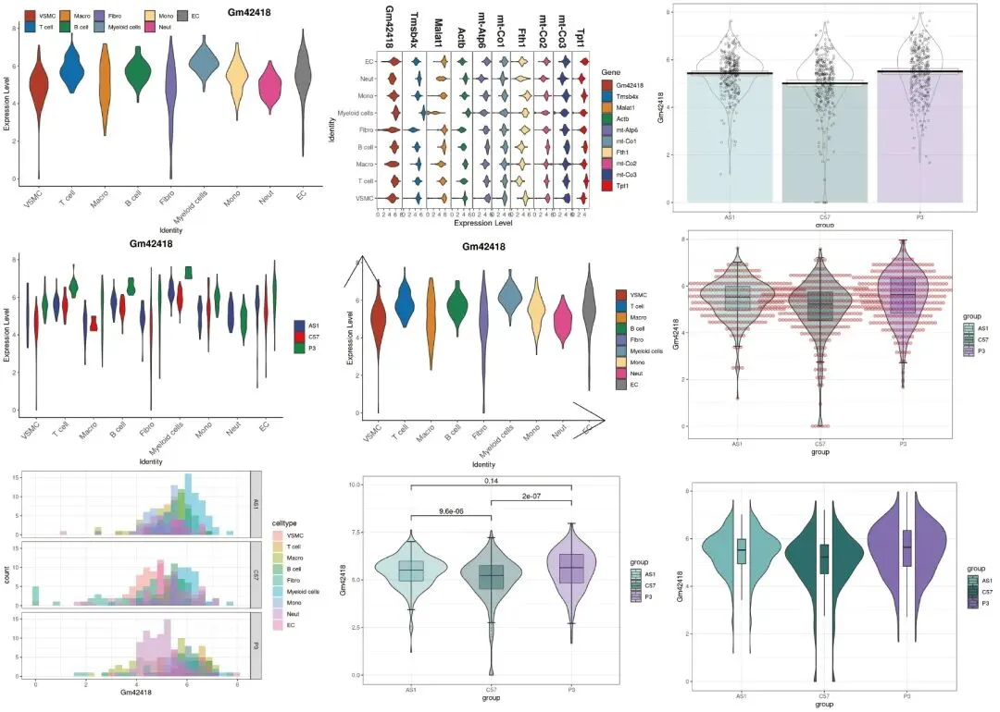

测试文件及可复制学习手册可在文末解锁或添加客服微信**Biomamba_kefu** 获取：

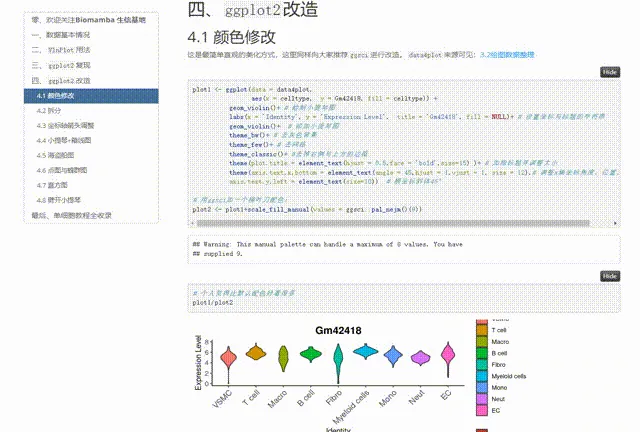


视频教程

B站同步播出，连播更方便，文末阅读原文可直达：https://www.bilibili.com/video/BV1iM4y127Ez?p=7


图文教程


# 三 绘图数据整理

`ggplot2`的图片绘制需要一个长格式的数据，我们以上面的高表达基因为例，整理出一个长格式数据框:

3.1 VlnPlot数据整理
```r
library(Seurat)
```
```r
scRNA <- readRDS('pbmcrenamed.rds')
```
```r
# 取出表达矩阵：
data4plot <- scRNA@assays$RNA@data[he_gene[1:5],] %>% as.data.frame() %>% t()

# 添加注释信息：
data4plot <- cbind(data4plot,scRNA@meta.data[,c('group','celltype')])

# 查看一下表头：
head(data4plot)
```
```
##                       Gm42418   Tmsb4x   Malat1     Actb  mt-Atp6 group
## AAAGGGCTCGCAGAGA-1_1 3.125663 5.191950 5.443660 4.880147 4.500693   C57
## AACACACAGCATCCCG-1_1 5.717602 4.747414 4.719490 4.166542 5.093166   C57
## AACAGGGTCAACACCA-1_1 4.716741 4.179333 5.849399 3.356926 3.870171   C57
## AACCCAAAGGCCTTGC-1_1 5.104691 3.290715 6.404316 4.364196 3.569047   C57
## AACCCAAAGTGGACGT-1_1 5.853611 7.403626 3.399781 5.316662 3.897164   C57
## AACCCAAGTCCGAAGA-1_1 4.562551 6.145295 4.913077 5.337041 3.646919   C57
##                           celltype
## AAAGGGCTCGCAGAGA-1_1          VSMC
## AACACACAGCATCCCG-1_1        T cell
## AACAGGGTCAACACCA-1_1         Fibro
## AACCCAAAGGCCTTGC-1_1            EC
## AACCCAAAGTGGACGT-1_1 Myeloid cells
## AACCCAAGTCCGAAGA-1_1        T cell
```

3.2 堆积小提琴图数据整理

```r
# 整理数据
library(reshape2)
data4stack <- as.data.frame(scRNA[["RNA"]]@data[he_gene,])
data4stack$Gene <- factor(he_gene,levels = he_gene)
data4stack[1:4,1:4]
```
```
##         AAAGGGCTCGCAGAGA-1_1 AACACACAGCATCCCG-1_1 AACAGGGTCAACACCA-1_1
## Gm42418             3.125663             5.717602             4.716741
## Tmsb4x              5.191950             4.747414             4.179333
## Malat1              5.443660             4.719490             5.849399
## Actb                4.880147             4.166542             3.356926
##         AACCCAAAGGCCTTGC-1_1
## Gm42418             5.104691
## Tmsb4x              3.290715
## Malat1              6.404316
## Actb                4.364196
```

```r
# 把宽格式的数据转换为长格式数据
data4stack <- melt(data4stack,id="Gene")
head(data4stack)
```
```
##      Gene             variable    value
## 1 Gm42418 AAAGGGCTCGCAGAGA-1_1 3.125663
## 2  Tmsb4x AAAGGGCTCGCAGAGA-1_1 5.191950
## 3  Malat1 AAAGGGCTCGCAGAGA-1_1 5.443660
## 4    Actb AAAGGGCTCGCAGAGA-1_1 4.880147
## 5 mt-Atp6 AAAGGGCTCGCAGAGA-1_1 4.500693
## 6  mt-Co1 AAAGGGCTCGCAGAGA-1_1 4.223976
```

```r
colnames(data4stack)[c(2,3)]=c("Cell","Expression")

my_meta=scRNA@meta.data[,c('group','celltype')]
my_meta$Cell <- rownames(my_meta)
data4stack=inner_join(data4stack,my_meta,by="Cell")

# 瞅一眼数据
head(data4stack)
```
```
##      Gene                 Cell Expression group celltype
## 1 Gm42418 AAAGGGCTCGCAGAGA-1_1   3.125663   C57     VSMC
## 2  Tmsb4x AAAGGGCTCGCAGAGA-1_1   5.191950   C57     VSMC
## 3  Malat1 AAAGGGCTCGCAGAGA-1_1   5.443660   C57     VSMC
## 4    Actb AAAGGGCTCGCAGAGA-1_1   4.880147   C57     VSMC
## 5 mt-Atp6 AAAGGGCTCGCAGAGA-1_1   4.500693   C57     VSMC
## 6  mt-Co1 AAAGGGCTCGCAGAGA-1_1   4.223976   C57     VSMC
```

# 四、`ggplot2`改造

## 4.1 颜色修改

这是最简单直观的美化方式，这里同样向大家推荐`ggsci`进行改造。`data4plot`来源可见：3.2绘图数据整理

```r
plot1 <- ggplot(data = data4plot,
                aes(x = celltype,  y = Gm42418, fill = celltype)) +
          geom_violin()+ # 绘制小提琴图
          labs(x = 'Identity', y = 'Expression Level',  title = 'Gm42418', fill = NULL)+ # 设置坐标与标题的字符串
          geom_violin()+  # 添加小提琴图
          theme_bw()+ # 去灰色背景
          theme_few()+ # 去网格
          theme_classic()+ #去掉右侧与上方的边框
          theme(plot.title = element_text(hjust = 0.5,face = 'bold',size=15) )+ # 加粗标题并调整大小
          theme(axis.text.x.bottom = element_text(angle = 45,hjust = 1,vjust = 1, size = 12),# 调整x轴坐标角度、位置、大小
          axis.text.y.left = element_text(size=10))  # 横坐标斜体45°

# 用ggsci加一个柳叶刀配色：
plot2 <- plot1+scale_fill_manual(values = ggsci::pal_nejm()(9))
```
```
## Warning: This manual palette can handle a maximum of 8 values. You have
## supplied 9.
```

```
# 个人觉得比默认配色好看很多
plot1/plot2
```

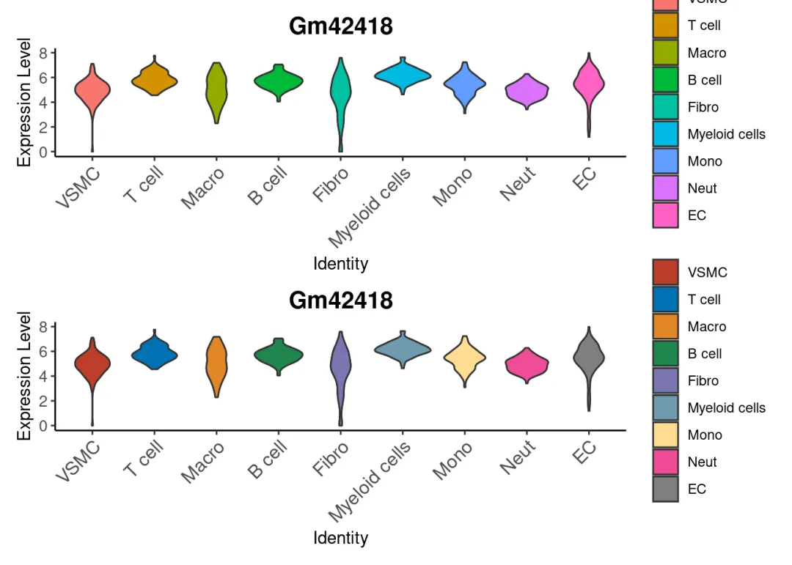

```
# 如果觉得图注多余，可以隐藏：
plot2+theme(legend.position = "none")
```

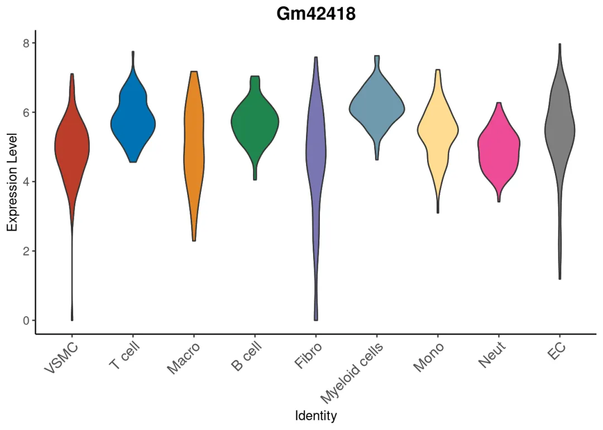

```
# 或者自定义图注的位置：
plot2+theme(legend.position = c(-0.05,-0.05)# 相对位置，整张图为c(1,1)
            )
```

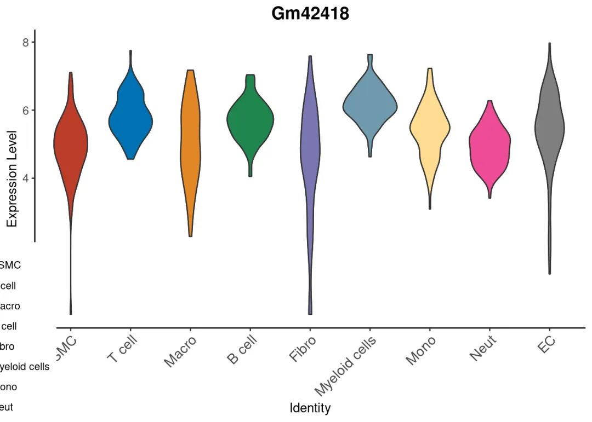

```
# 调整的舒服一些
plot2+theme(legend.position = c(0.3,1),# 相对位置，整张图为c(1,1)
            legend.background = element_blank(),# 让图注背景框透明
            legend.direction = 'horizontal',# 调整图例摆放方向
            plot.title = element_text(hjust = 0.8,face = 'bold',size=15)# 调整标题位置、字体、大小
            )
```

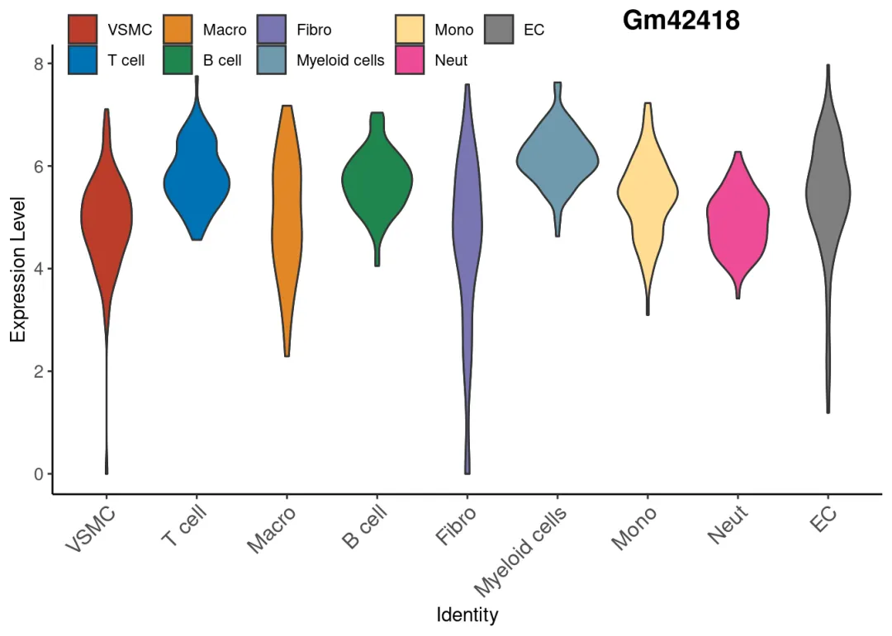

`stack VlnPlot`更改颜色：

```r
copy_stack <- ggplot(data4stack, aes(x = Expression, y =  celltype, fill = Gene)) +
  geom_violin() +
  labs(x = "Expression Level", y = "Identity") +
  facet_grid(.~Gene, scales = "free_x",space = 'free_x')+ # 按照基因拆分做stack，并使每个小提琴图的坐标按照真实极值生成，而非全部统一
                theme_bw()+ # 去灰色背景
    theme_few()+ # 去网格
    theme(panel.spacing.x = unit(0, "cm"))+# 去间隙
    theme(strip.background = element_blank(), # 去Gene标题的背景
  strip.text.x = element_text(angle = -90, hjust = 1,size=15,face='bold') # 旋转Gene标题的角度
        )
# 添加ggsci配色
copy_stack+scale_fill_manual(values = c(ggsci::pal_nejm()(8),ggsci::pal_aaas()(2)))
```

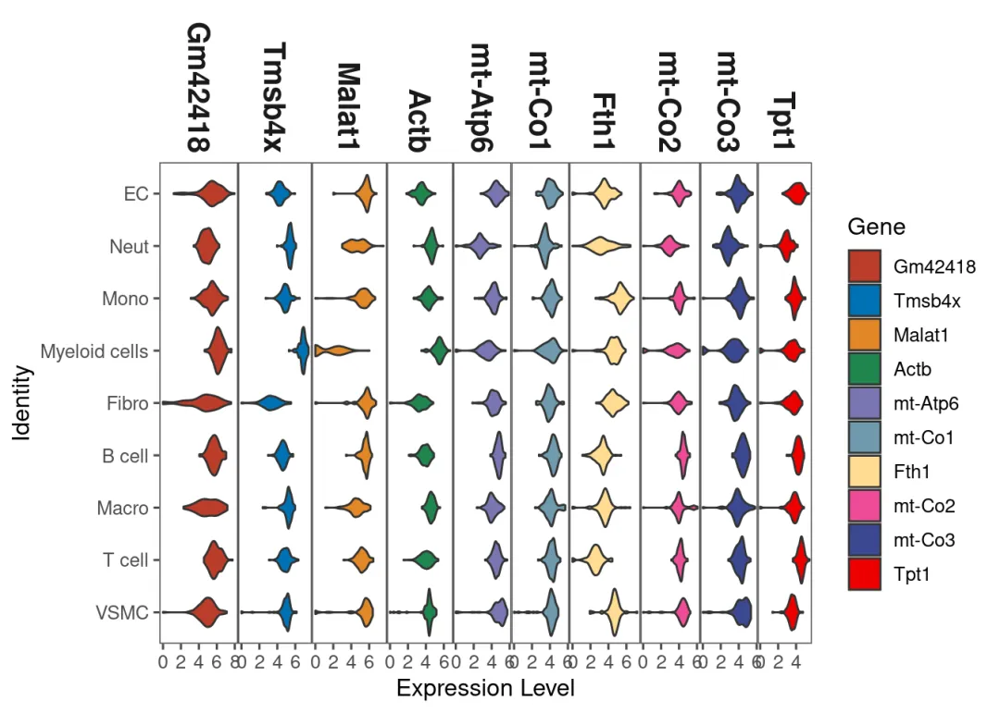

```r
# 把颜色填充由Gene改为Celltype：
copy_stack <- ggplot(data4stack, aes(x = Expression, y =  celltype, fill = celltype))+ # 改动fill即可
  geom_violin() +
  labs(x = "Expression Level", y = "Identity") +
  facet_grid(.~Gene, scales = "free_x",space = 'free_x')+ # 按照基因拆分做stack，并使每个小提琴图的坐标按照真实极值生成，而非全部统一
                theme_bw()+ # 去灰色背景
    theme_few()+ # 去网格
    theme(panel.spacing.x = unit(0, "cm"))+# 去间隙
    theme(strip.background = element_blank(), # 去Gene标题的背景
  strip.text.x = element_text(angle = -90, hjust = 1,size=15,face='bold') # 旋转Gene标题的角度
        )

copy_stack+scale_fill_manual(values = c(ggsci::pal_nejm()(8),ggsci::pal_aaas()(2)))
```

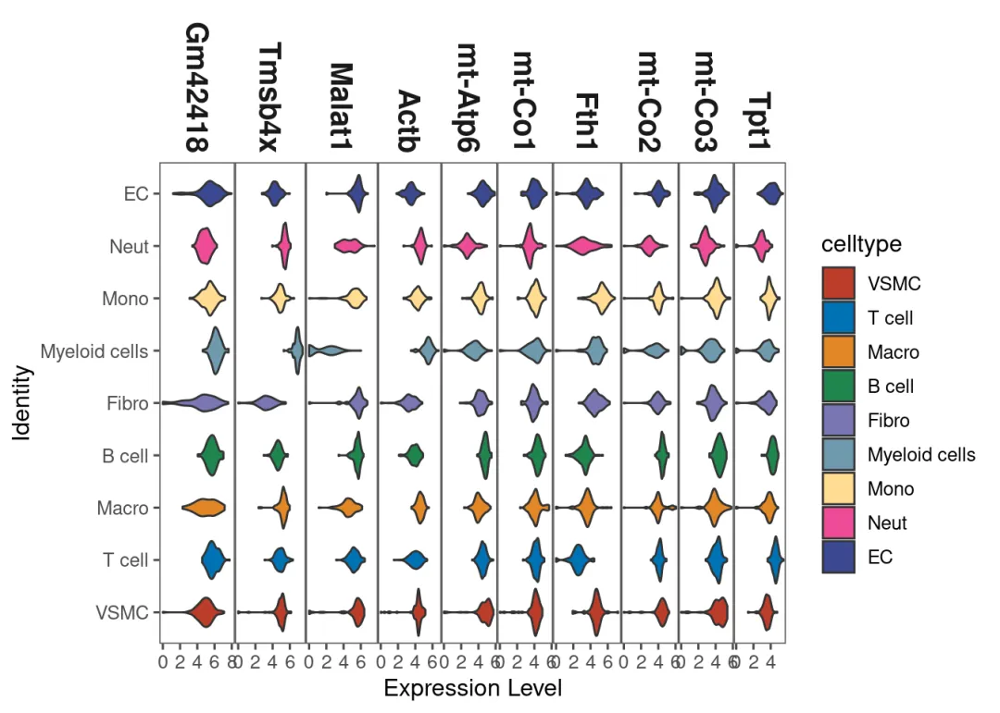

```r
# 交换x/y轴
copy_stack <- ggplot(data4stack, aes(x = celltype, y = Expression  , fill = Gene)) +
  geom_violin() +
  labs(x = "Expression Level", y = "Identity") +
  facet_grid(Gene~., scales = "free_y",space = 'free_y')+ #这一步也需要调整
                theme_bw()+ # 去灰色背景
  theme_few()+ # 去网格
  theme(panel.spacing.x = unit(0, "cm"))+# 去间隙
  theme(strip.background = element_blank(), # 去Gene标题的背景
        strip.text.x = element_text(angle = -90, hjust = 1,size=15,face='bold') # 旋转Gene标题的角度
        )
copy_stack
```

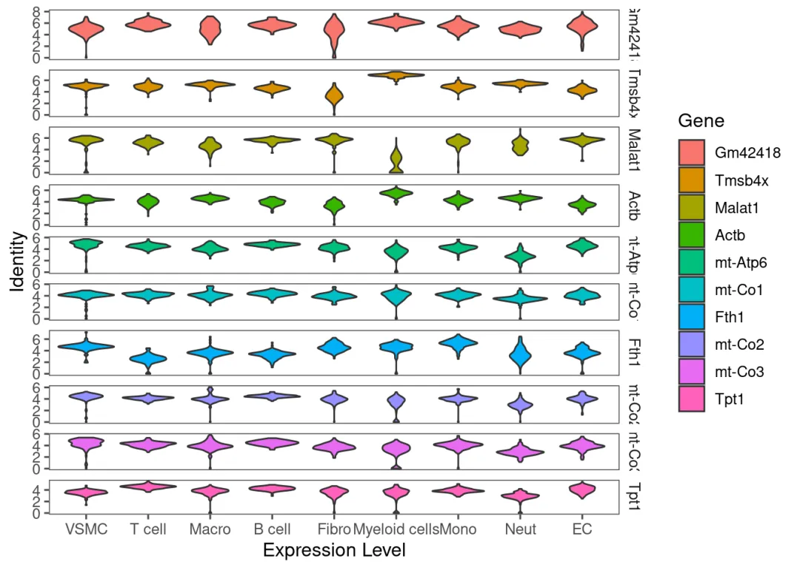

## 4.2 拆分

`VlnPlot`中能够做到按照一定的分类变量**拆分** 小提琴，我们同样可以在`ggplot2`中重现这一过程

```
# VlnPlot中的重现：
VlnPlot(scRNA,features = he_gene[1],split.by = 'group')
```

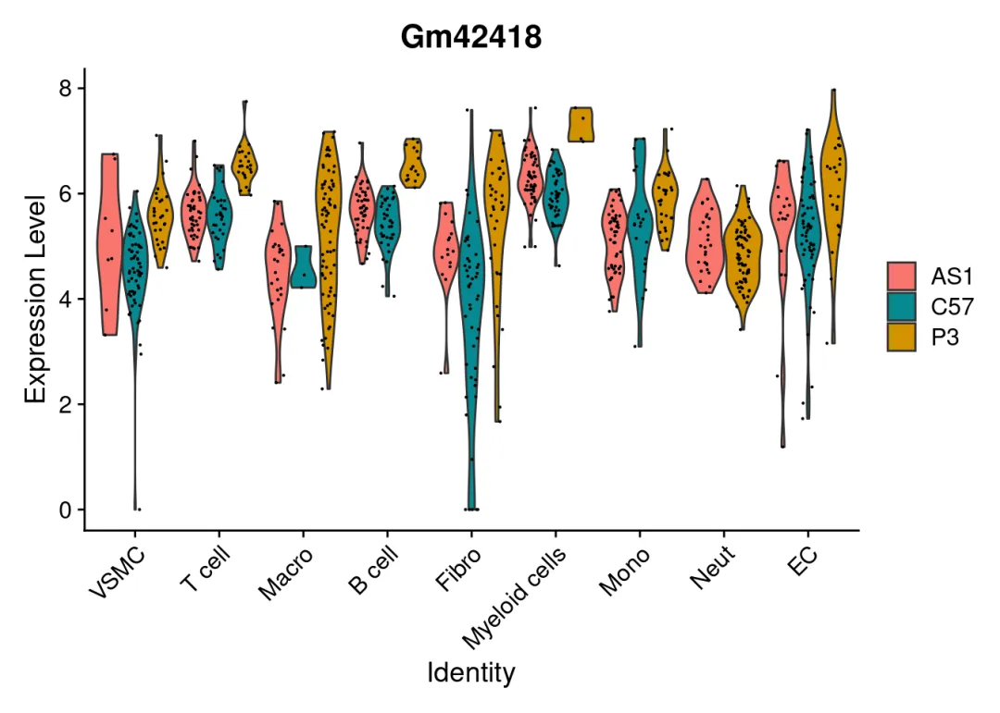

```
# 用ggplot拆一下：
ggplot(data = data4plot, aes(x = celltype, y = Gm42418, fill = group))+ # 同样是更改fill来实现
    geom_violin()+ # 绘制小提琴图
  labs(x = 'Identity', y = 'Expression Level',  title = 'Gm42418', fill = NULL)+ # 设置坐标与标题的字符串
  geom_violin()+  # 添加小提琴图
  theme_bw()+ # 去灰色背景
     theme_few()+ # 去网格
        theme_classic()+ #去掉右侧与上方的边框
          theme(plot.title = element_text(hjust = 0.5,face = 'bold',size=15) )+ # 加粗标题并调整大小
  theme(axis.text.x.bottom = element_text(angle = 45,hjust = 1,vjust = 1, size = 12),
        axis.text.y.left = element_text(size=10))  # 横坐标斜体45°
```

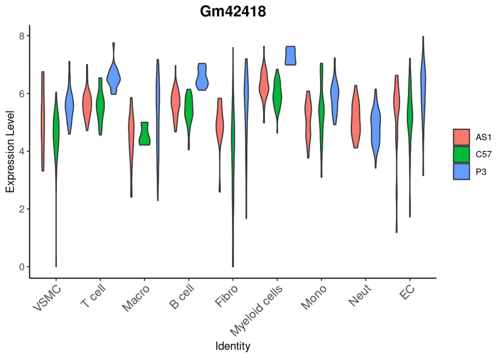

```
# 此时需要自定义颜色应该输入group对应的三个颜色
ggplot(data = data4plot, aes(x = celltype, y = Gm42418, fill = group)) +
    geom_violin()+ # 绘制小提琴图
    labs(x = 'Identity', y = 'Expression Level',  title = 'Gm42418', fill = NULL)+ # 设置坐标与标题的字符串
    geom_violin()+  # 添加小提琴图
      theme_bw()+ # 去灰色背景
      theme_few()+ # 去网格
      theme_classic()+ #去掉右侧与上方的边框
      theme(plot.title = element_text(hjust = 0.5,face = 'bold',size=15) )+ # 加粗标题并调整大小
      theme(axis.text.x.bottom = element_text(angle = 45,hjust = 1,vjust = 1, size = 12),
    axis.text.y.left = element_text(size=10)) + # 横坐标斜体45°
    scale_fill_manual(values = ggsci::pal_aaas()(3))
```

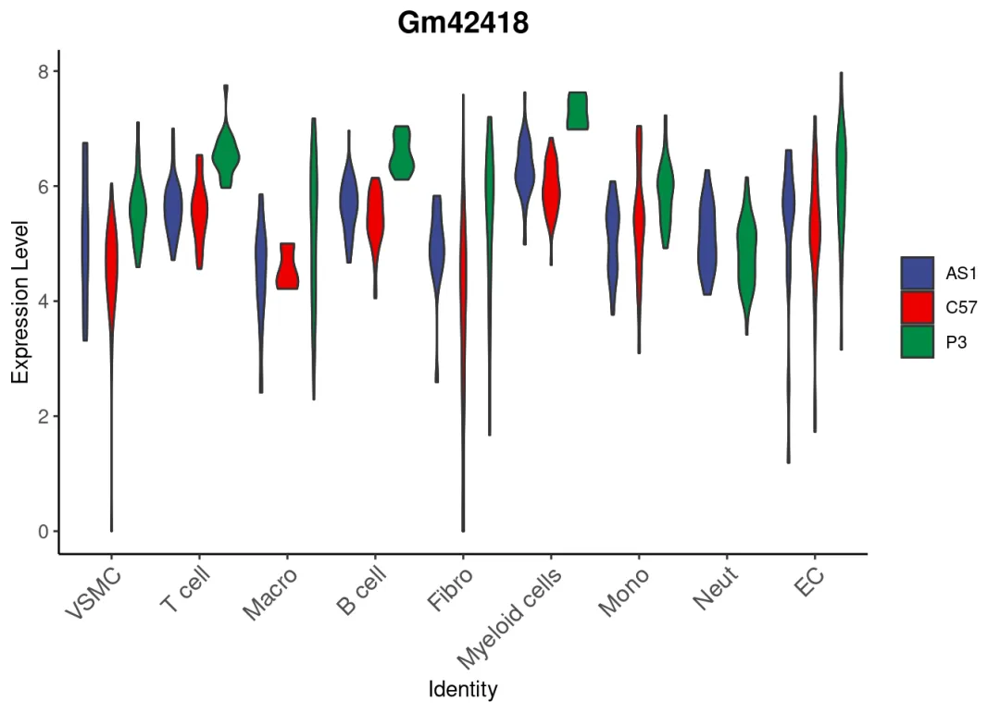
