# 改造单细胞DotPlot

> 原文：https://mp.weixin.qq.com/s?__biz=MzAwMzIzOTk5OQ==&mid=2247527750&idx=1&sn=55f4645a82ac055cc0bfdbed3375fc06&chksm=9b3c1416ac4b9d004ff72fa21006598211570ddfd6f0cde32d78f67388d260c00a5414a8980a#rd
> 合集：单细胞教程全收录


写在前面

随着我们课程的持续深入，以及各位小伙伴分析技能的日益提升，目前很多同学已经不满足于Seurat的可视化功能并希望能够做出一些**改进的可视化** 。我个人对可视化的方式改进其实并不感冒，画图嘛，跟翻译一样**信达雅** 即可，没必要盲目追求视觉效果。不过这也并不方案我给大家做这类的教程。我们准备出一系列[**单细胞测图片改造计划**](<https://mp.weixin.qq.com/mp/appmsgalbum?__biz=MzAwMzIzOTk5OQ==&action=getalbum&album_id=2707677276481814529#wechat_redirect>)的推送，大家如果有任何关于可视化的想法，也可以通过文末客服微信联系我们。
这次的内容为对DotPlot的改造，主要DIY的地方是加上了顶部的Celltype注释条与侧面的基因聚类树。本教程需要有一定的[R语言基础](<https://mp.weixin.qq.com/s?__biz=MzAwMzIzOTk5OQ==&mid=2247506720&idx=1&sn=fe897ba3c33a8e63bf6a4e35aeac1896&scene=21#wechat_redirect>)方可放心食用。本周末[R语言学习计划启动](<https://mp.weixin.qq.com/s?__biz=MzAwMzIzOTk5OQ==&mid=2247527337&idx=1&sn=6893269670fc98b41d6bb1decf5abadb&scene=21#wechat_redirect>)！


视频教程

B站同步播出，连播更方便，文末阅读原文可直达：https://www.bilibili.com/video/BV1S44y1b76Z?p=19


代码及测试文件

不要再说我的链接失效啦，我也不知道为啥腾讯和百度云不对付，微信页面或腾讯浏览器时常打不开百度云链接，链接最好在谷歌浏览器中打开或**扫码打开** ，真的失效了再提醒客服更换链接哦。也不要说我的链接里没代码，html格式的文件大家用浏览器打开就可以看到整理好的笔记：


通过网盘分享的文件：改造单细胞DotPlot

链接: https://pan.baidu.com/s/1Hfu_ROTeVg8xKRH5vZ-fdg?pwd=gdvk

提取码: gdvk


若链接失效可以文末联系客服领取~


图文教程


# 一、测试数据处理

经典的pbmc3k数据集 下面预处理的步骤看不懂的同学可以先补一下基础知识手把手教你做[单细胞测序数据分析（三）——单样本分析](<https://mp.weixin.qq.com/s?__biz=MzAwMzIzOTk5OQ==&mid=2247487976&idx=1&sn=8edd929256e609e4210a40df63fc1427&chksm=9b3f68b8ac48e1aefd3ff38dd5744c485cde5d7f28d79745b66863928d4614fafb2928b3f617&payreadticket=HMoAY_v8_rICSU7SWHmvxC0_zLzxhvZtkSG6IE0gCGU29Swy8TC2jTa2hBv3oc4ktoOPfGo&scene=21#wechat_redirect>)
```r
suppressMessages({
  library(Seurat)
  library(ggplot2)
  library(dplyr)
  library(tidyr)
  library(aplot)
  library(ggtree)
})
# 加载数据
sce = Read10X("./data/pbmc3k_filtered_gene_bc_matrices/filtered_gene_bc_matrices/hg19")
sce_final <- sce %>% CreateSeuratObject(min.cells = 3, min.features = 200) %>% PercentageFeatureSet(pattern = '^MT',col.name = 'percent.mt')
select_c <- WhichCells(sce_final,expression = nFeature_RNA > 200 & nFeature_RNA < 2500 & percent.mt < 5)
sce_final = subset(sce_final,cells = select_c)
dim(sce_final)
```
```
## [1] 13714  2626
```

```r
sce_final <- sce_final %>%
NormalizeData() %>%
FindVariableFeatures() %>%
ScaleData() %>% RunPCA() %>%
FindNeighbors(dims = 1:10) %>%
FindClusters(resolution = 0.5) %>%
RunTSNE(dims = 1:10) %>%
RunUMAP(dims = 1:10)
```
```
## Modularity Optimizer version 1.3.0 by Ludo Waltman and Nees Jan van Eck
##
## Number of nodes: 2626
## Number of edges: 95233
##
## Running Louvain algorithm...
## Maximum modularity in 10 random starts: 0.8722
## Number of communities: 9
## Elapsed time: 0 seconds
```

```
# 展示机械分群信息
DimPlot(sce_final, label=T)
```

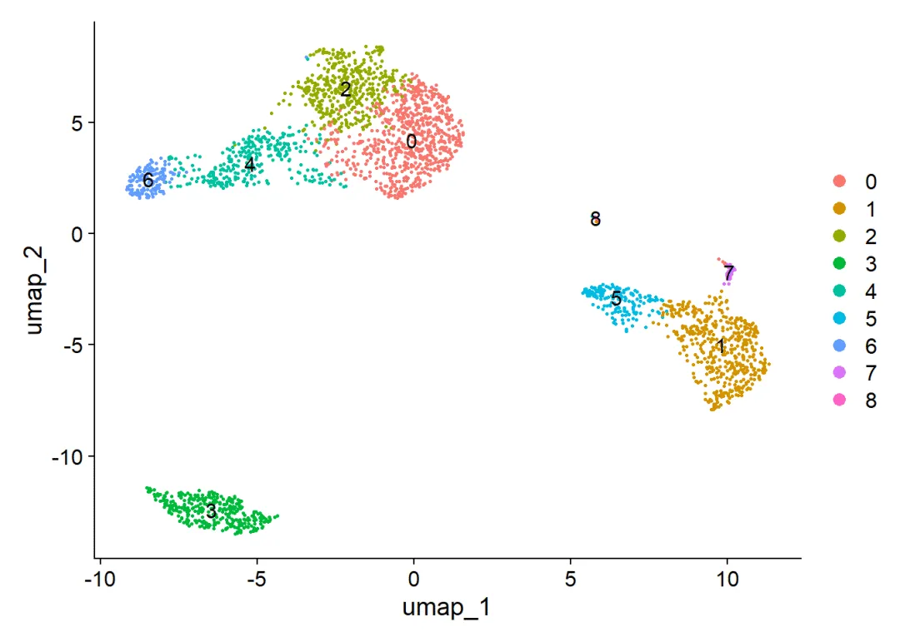
```r
#参考seurat官网添加细胞标签
new.cluster.ids <- c("TCells", "Myeloid", "TCells", "BCells", "TCells", "Myeloid", "TCells", "Myeloid", "Platelet")
names(new.cluster.ids) <- levels(sce_final)
sce_final <- RenameIdents(sce_final, new.cluster.ids)
sce_final@meta.data$celltype <- Idents(sce_final)
DimPlot(sce_final, label=T)
```

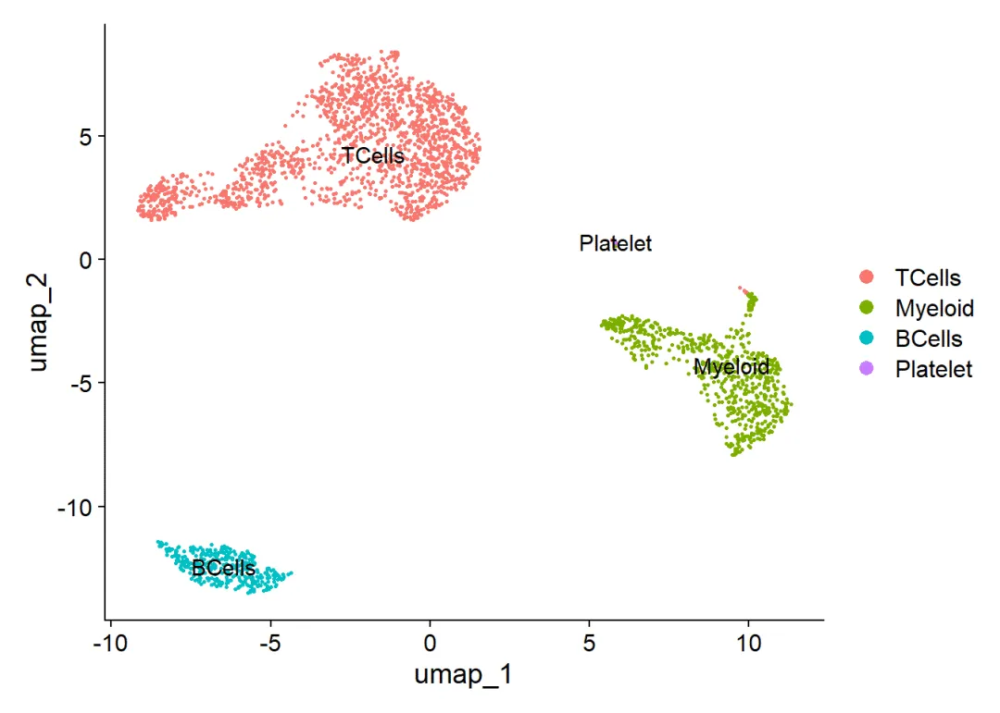

```r
# 计算每个机械分群的差异基因，并提取top3基因
Idents(sce_final) <- "seurat_clusters"
pbmc.markers <- FindAllMarkers(sce_final,only.pos = TRUE)
top3 <- pbmc.markers %>%
    group_by(cluster) %>%
    dplyr::filter(avg_log2FC > 1) %>%
    slice_head(n = 3) %>%
    ungroup()
marker <- unique(top3$gene)
```

# 二、DotPlot参数

```
DotPlot(
  object, #Seurat对象
  features, #需要展示的向量，例如基因名称组成的向量
  assay = NULL, #assay名称, 默认是active assay
  cols = c("lightgrey", "blue"), #绘图颜色，可以是RColorBrewer包中的调色板名称，也可以是自定义的渐变,默认是lightgrey到blue渐变
  col.min = -2.5, #缩放后平均表达的颜色最小阈值
  col.max = 2.5, #缩放后平均表达的颜色最大阈值
  dot.min = 0, #绘制最小点的细胞分数（默认为0），所有表达给定基因的细胞组少于此分数的将不绘制点
  dot.scale = 6, #气泡大小的缩放比例，类似于CEX参数，默认是6，可以通过这个参数调节各个气泡大小之间差异程度
  idents = NULL, #挑选idents中的部分展示
  group.by = NULL, #细胞分组信息
  split.by = NULL, #在group.by分组的基础上进一步划分子类
  cluster.idents = FALSE, #是否根据给定的特征按层次聚类排序标识，默认为FALSE
  scale = TRUE, #确定数据是否缩放，TRUE为默认
  scale.by = "radius", #通过'size'或'radius'两种方式缩放点的大小，默认为"radius"
  scale.min = NA, #设置缩放的下限，使用NA为默认值
  scale.max = NA #设置缩放的上限，使用NA为默认值
)
```

# 三、DotPlot及其自带参数美化

```
# 默认参数效果
DotPlot(sce_final, features = marker)
```

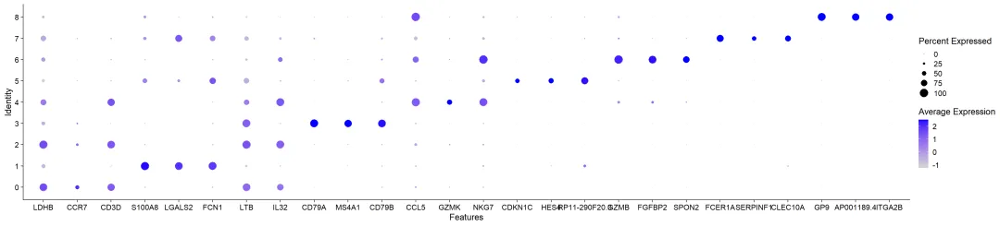

```
# 修改参数展示
# 一般比较常用的调整参数包括以下：idents / group.by / cols / features
# （1） 挑选部分细胞类型展示
DotPlot(sce_final, features = marker, idents = c("0", "2","4","6"))
```


```
# （2） 按照指定列作为分组信息展示，例如使用seurat_clusters分组
DotPlot(sce_final, features = marker, group.by = "celltype")
```

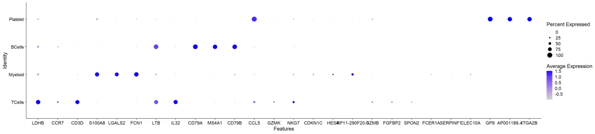

```
# （3） 修改渐变色
DotPlot(sce_final, features = marker, cols = c("white", "red"))
```

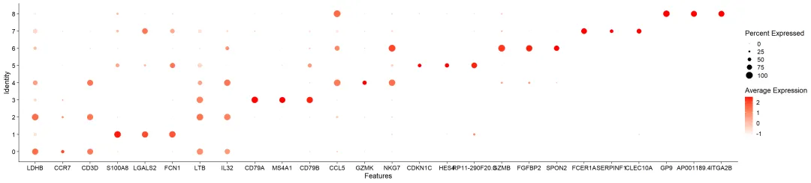

```r
# （4） 不同类别的features，分类展示
marker_split <- list(TCells=c("IL32","CD3D","CD3E","MALAT1","LDHB"),Myeloid=c("LST1","TYROBP","FCER1G","CST3","AIF1"),BCells=c("CD79A","MS4A1","CD79B","LINC00926","TCL1A"),Platelet=c("GP9","AP001189.4","ITGA2B","TMEM40","LY6G6F"))
DotPlot(sce_final, features = marker_split )
```

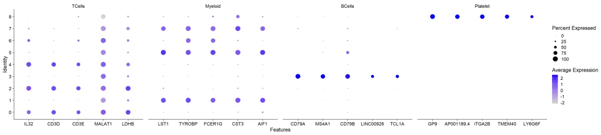

# 四、DotPlot联合ggplot2美化

```
# 在绘图过程中我们也可能遇到几十个基因同时绘制的情况，这时候避免出现字符重叠的情况，我们可以利用Seurat自带修饰主题或者ggplot2这个好帮手
# （1）Seurat自带修饰主题，调整坐标轴字符倾斜角度
DotPlot(sce_final, features = marker) + RotatedAxis()
```

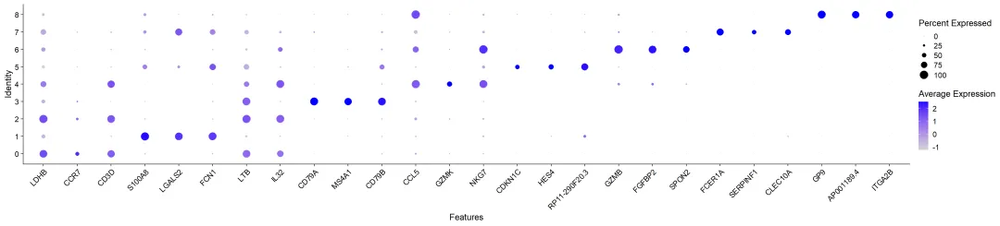

```
# （2）ggplot2的theme函数，调整坐标轴字符倾斜角度
DotPlot(sce_final, features = marker) + theme(axis.text.x=element_text(angle=45, hjust = 1))
```


```
# （3）ggplot2的coord_flip函数，坐标轴翻转
DotPlot(sce_final, features = marker) + coord_flip()
```

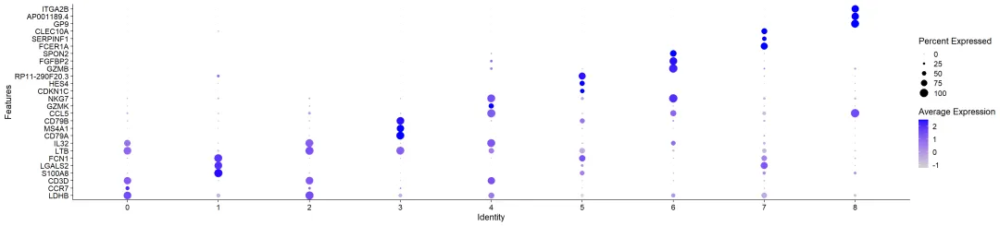

# 五、ggplot2复现DotPlot

DotPlot函数源码
```r
DotPlot <- function(
  object,
  features,
  assay = NULL,
  cols = c("lightgrey", "blue"),
  col.min = -2.5,
  col.max = 2.5,
  dot.min = 0,
  dot.scale = 6,
  idents = NULL,
  group.by = NULL,
  split.by = NULL,
  cluster.idents = FALSE,
  scale = TRUE,
  scale.by = 'radius',
  scale.min = NA,
  scale.max = NA
) {
  assay <- assay %||% DefaultAssay(object = object)
  DefaultAssay(object = object) <- assay
  split.colors <- !is.null(x = split.by) && !any(cols %in% rownames(x = brewer.pal.info))
  scale.func <- switch(
    EXPR = scale.by,
    'size' = scale_size,
    'radius' = scale_radius,
    stop("'scale.by' must be either 'size' or 'radius'")
  )
  feature.groups <- NULL
  if (is.list(features) | any(!is.na(names(features)))) {
    feature.groups <- unlist(x = sapply(
      X = 1:length(features),
      FUN = function(x) {
        return(rep(x = names(x = features)[x], each = length(features[[x]])))
      }
    ))
    if (any(is.na(x = feature.groups))) {
      warning(
        "Some feature groups are unnamed.",
        call. = FALSE,
        immediate. = TRUE
      )
    }
    features <- unlist(x = features)
    names(x = feature.groups) <- features
  }
  cells <- unlist(x = CellsByIdentities(object = object, cells = colnames(object[[assay]]), idents = idents))
  data.features <- FetchData(object = object, vars = features, cells = cells)
  data.features$id <- if (is.null(x = group.by)) {
    Idents(object = object)[cells, drop = TRUE]
  } else {
    object[[group.by, drop = TRUE]][cells, drop = TRUE]
  }
  if (!is.factor(x = data.features$id)) {
    data.features$id <- factor(x = data.features$id)
  }
  id.levels <- levels(x = data.features$id)
  data.features$id <- as.vector(x = data.features$id)
  if (!is.null(x = split.by)) {
    splits <- FetchData(object = object, vars = split.by)[cells, split.by]
    if (split.colors) {
      if (length(x = unique(x = splits)) > length(x = cols)) {
        stop(paste0("Need to specify at least ", length(x = unique(x = splits)), " colors using the cols parameter"))
      }
      cols <- cols[1:length(x = unique(x = splits))]
      names(x = cols) <- unique(x = splits)
    }
    data.features$id <- paste(data.features$id, splits, sep = '_')
    unique.splits <- unique(x = splits)
    id.levels <- paste0(rep(x = id.levels, each = length(x = unique.splits)), "_", rep(x = unique(x = splits), times = length(x = id.levels)))
  }
  data.plot <- lapply(
    X = unique(x = data.features$id),
    FUN = function(ident) {
      data.use <- data.features[data.features$id == ident, 1:(ncol(x = data.features) - 1), drop = FALSE]
      avg.exp <- apply(
        X = data.use,
        MARGIN = 2,
        FUN = function(x) {
          return(mean(x = expm1(x = x)))
        }
      )
      pct.exp <- apply(X = data.use, MARGIN = 2, FUN = PercentAbove, threshold = 0)
      return(list(avg.exp = avg.exp, pct.exp = pct.exp))
    }
  )
  names(x = data.plot) <- unique(x = data.features$id)
  if (cluster.idents) {
    mat <- do.call(
      what = rbind,
      args = lapply(X = data.plot, FUN = unlist)
    )
    mat <- scale(x = mat)
    id.levels <- id.levels[hclust(d = dist(x = mat))$order]
  }
  data.plot <- lapply(
    X = names(x = data.plot),
    FUN = function(x) {
      data.use <- as.data.frame(x = data.plot[[x]])
      data.use$features.plot <- rownames(x = data.use)
      data.use$id <- x
      return(data.use)
    }
  )
  data.plot <- do.call(what = 'rbind', args = data.plot)
  if (!is.null(x = id.levels)) {
    data.plot$id <- factor(x = data.plot$id, levels = id.levels)
  }
  ngroup <- length(x = levels(x = data.plot$id))
  if (ngroup == 1) {
    scale <- FALSE
    warning(
      "Only one identity present, the expression values will be not scaled",
      call. = FALSE,
      immediate. = TRUE
    )
  } else if (ngroup < 5 & scale) {
    warning(
      "Scaling data with a low number of groups may produce misleading results",
      call. = FALSE,
      immediate. = TRUE
    )
  }
  avg.exp.scaled <- sapply(
    X = unique(x = data.plot$features.plot),
    FUN = function(x) {
      data.use <- data.plot[data.plot$features.plot == x, 'avg.exp']
      if (scale) {
        data.use <- scale(x = log1p(data.use))
        data.use <- MinMax(data = data.use, min = col.min, max = col.max)
      } else {
        data.use <- log1p(x = data.use)
      }
      return(data.use)
    }
  )
  avg.exp.scaled <- as.vector(x = t(x = avg.exp.scaled))
  if (split.colors) {
    avg.exp.scaled <- as.numeric(x = cut(x = avg.exp.scaled, breaks = 20))
  }
  data.plot$avg.exp.scaled <- avg.exp.scaled
  data.plot$features.plot <- factor(
    x = data.plot$features.plot,
    levels = features
  )
  data.plot$pct.exp[data.plot$pct.exp < dot.min] <- NA
  data.plot$pct.exp <- data.plot$pct.exp * 100
  if (split.colors) {
    splits.use <- unlist(x = lapply(
      X = data.plot$id,
      FUN = function(x)
      sub(
        paste0(".*_(",
               paste(sort(unique(x = splits), decreasing = TRUE),
                     collapse = '|'
                     ),")$"),
        "\\1",
        x
        )
      )
      )
    data.plot$colors <- mapply(
      FUN = function(color, value) {
        return(colorRampPalette(colors = c('grey', color))(20)[value])
      },
      color = cols[splits.use],
      value = avg.exp.scaled
    )
  }
  color.by <- ifelse(test = split.colors, yes = 'colors', no = 'avg.exp.scaled')
  if (!is.na(x = scale.min)) {
    data.plot[data.plot$pct.exp < scale.min, 'pct.exp'] <- scale.min
  }
  if (!is.na(x = scale.max)) {
    data.plot[data.plot$pct.exp > scale.max, 'pct.exp'] <- scale.max
  }
  if (!is.null(x = feature.groups)) {
    data.plot$feature.groups <- factor(
      x = feature.groups[data.plot$features.plot],
      levels = unique(x = feature.groups)
    )
  }
  plot <- ggplot(data = data.plot, mapping = aes_string(x = 'features.plot', y = 'id')) +
    geom_point(mapping = aes_string(size = 'pct.exp', color = color.by)) +
    scale.func(range = c(0, dot.scale), limits = c(scale.min, scale.max)) +
    theme(axis.title.x = element_blank(), axis.title.y = element_blank()) +
    guides(size = guide_legend(title = 'Percent Expressed')) +
    labs(
      x = 'Features',
      y = ifelse(test = is.null(x = split.by), yes = 'Identity', no = 'Split Identity')
    ) +
    theme_cowplot()
  if (!is.null(x = feature.groups)) {
    plot <- plot + facet_grid(
      facets = ~feature.groups,
      scales = "free_x",
      space = "free_x",
      switch = "y"
    ) + theme(
      panel.spacing = unit(x = 1, units = "lines"),
      strip.background = element_blank()
    )
  }
  if (split.colors) {
    plot <- plot + scale_color_identity()
  } else if (length(x = cols) == 1) {
    plot <- plot + scale_color_distiller(palette = cols)
  } else {
    plot <- plot + scale_color_gradient(low = cols[1], high = cols[2])
  }
  if (!split.colors) {
    plot <- plot + guides(color = guide_colorbar(title = 'Average Expression'))
  }
  return(plot)
}
```

从中可以看到，DotPlot函数主要依赖于下面这段代码绘图，使用到的主要绘图函数是ggplot2


接下来我们尝试用终极大法“ggplot2”还原DotPlot的结果

```r
# DotPlot绘图数据获取
p1 <- DotPlot(sce_final, features = marker)
p1
```


```r
data <- p1$data
# 添加cluster对应细胞类型名称
data$celltype <- as.character(new.cluster.ids[data$id])
# 数据查看
head(data)
```
```
##           avg.exp   pct.exp features.plot id avg.exp.scaled celltype
## LDHB   13.9713527 91.654880          LDHB  0      1.5238116   TCells
## CCR7    2.9733578 43.988685          CCR7  0      2.0519729   TCells
## CD3D   10.6762348 85.714286          CD3D  0      1.2302176   TCells
## S100A8  0.4270673  8.628006        S100A8  0     -0.5937361   TCells
## LGALS2  0.1687629  3.536068        LGALS2  0     -0.6288274   TCells
## FCN1    0.5448712 10.891089          FCN1  0     -0.6319525   TCells
```

```r
# 设置展示顺序，将相同细胞类型的cluster放在一起展示
data$id <- factor(data$id, levels=c("0","2","4","6","1","5","7","3","8"))
# ggplot2绘图
p2 <- ggplot(data , aes(x = features.plot, y = id, size = pct.exp, color = avg.exp.scaled)) +
  geom_point(shape=16) +  #默认sahpe = 16实心圆
  theme_bw()+ #设置背景为更加简洁的黑白主题
  scale_colour_gradient2()+  #设置映射的颜色
  xlab(NULL) + ylab(NULL)+  #横纵坐标标题名称
  theme(axis.text.x = element_text(angle = 45, hjust = 1))+ #字体倾斜45°，并且对其方式为右对齐
  theme(panel.grid.major=element_blank()) + #删除背景灰色分割线
  geom_hline(yintercept=c(4.5,7.5,8.5),linewidth=.5) + #按照注释细胞类型划分区域
  theme(panel.border = element_rect(fill=NA,color="black", linewidth=1.5, linetype="solid")) + #外框分割线颜色为黑色，宽度为1.5， 线型为实心线
  coord_flip()
p2
```

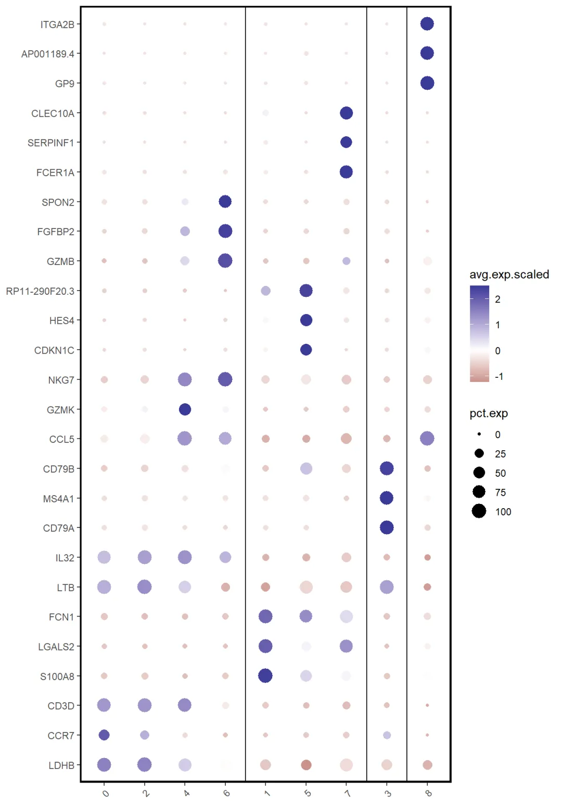

```r
#绘制细胞类型注释条
anno1 <- data.frame(new.cluster.ids)
anno1 <- anno1[c("0","2","4","6","1","5","7","3","8"),,drop=F]
anno1$cluster <- rownames(anno1)
anno1$cluster <- factor(anno1$cluster, levels=c("0","2","4","6","1","5","7","3","8"))
anno1$other <- "anno1" #辅助生成热图
anno1
```
```
##   new.cluster.ids cluster other
## 0          TCells       0 anno1
## 2          TCells       2 anno1
## 4          TCells       4 anno1
## 6          TCells       6 anno1
## 1         Myeloid       1 anno1
## 5         Myeloid       5 anno1
## 7         Myeloid       7 anno1
## 3          BCells       3 anno1
## 8        Platelet       8 anno1
```

```r
p2_anno <- ggplot(anno1,aes(x=cluster,y=other,fill=new.cluster.ids))+
  geom_tile()+
  scale_fill_manual(values = c("TCells" = "#5c9dbf", "Myeloid" = "#d32629", "BCells" = "#727995","Platelet"="#ed7a6e"))+
  scale_y_discrete(position = "right")+
  theme_bw()+
  theme(panel.grid.major=element_blank(),panel.border = element_blank()) +
  theme(axis.text.x = element_blank(),axis.text.y = element_blank(),
        axis.ticks.x=element_blank(), axis.ticks.y = element_blank())+
  labs(x="",y="")
p2_anno
```

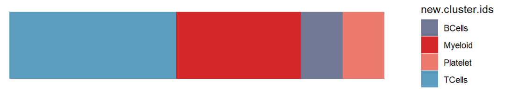

```
# 合并dotplot和细胞注释条
p2 %>% insert_top(p2_anno,height = .05)
```

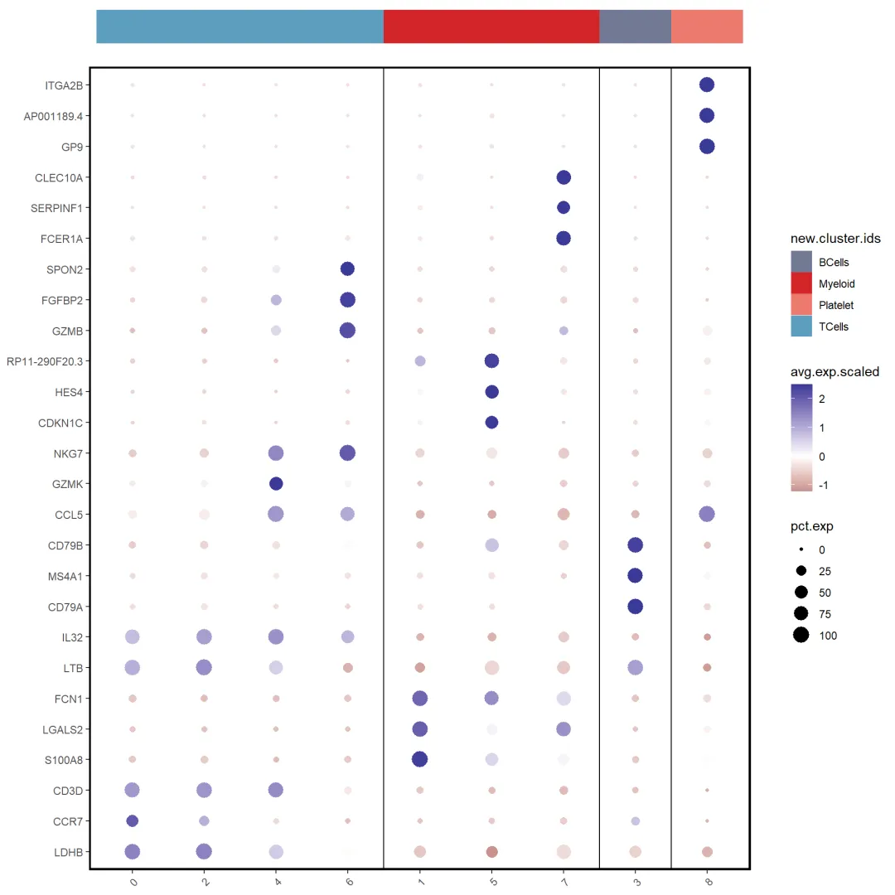

```r
#列（基因）聚类树
#根据细胞-基因表达矩阵对基因进行聚类
expr <- as.data.frame(sce_final@assays$RNA$data[marker,])
hc <- hclust(dist(expr))
ggtree(hc)
```

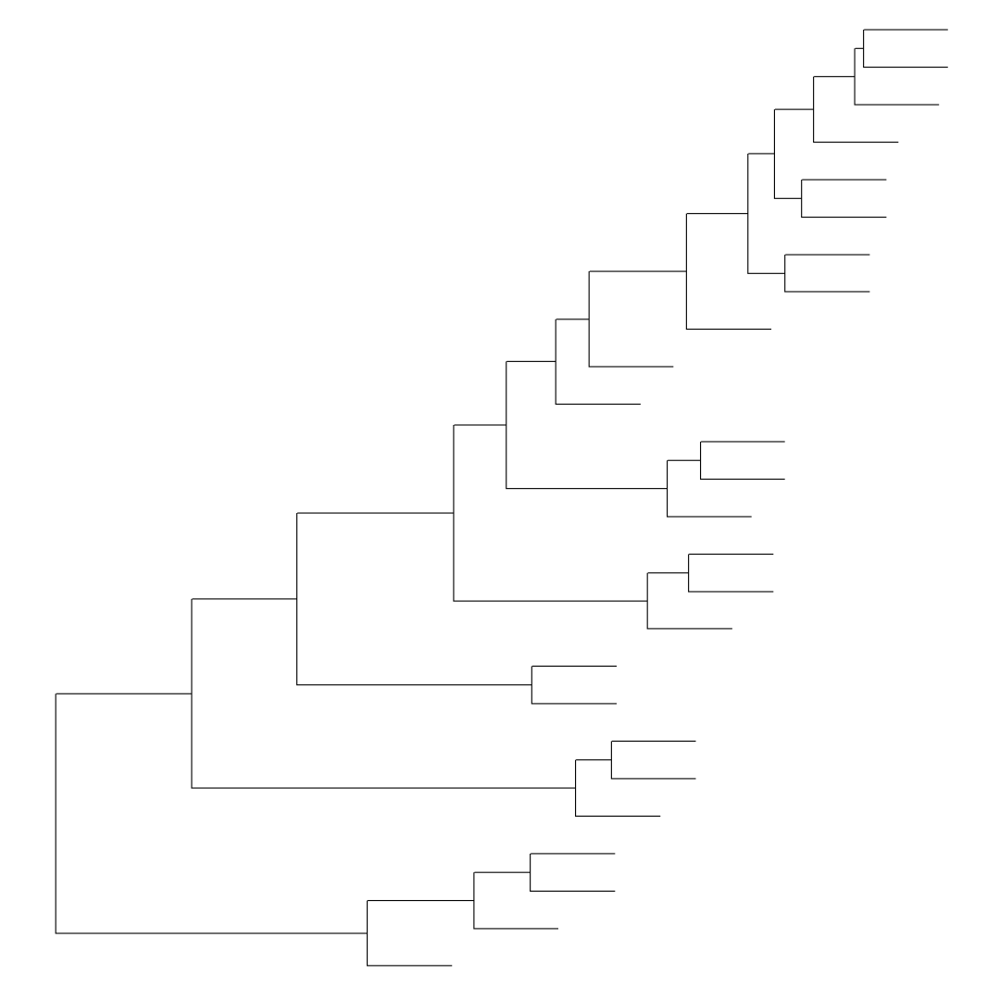

```
#查看所有的节点编号
ggtree(hc)+geom_text(aes(label = node), hjust = -0.3, vjust = -0.3)
```

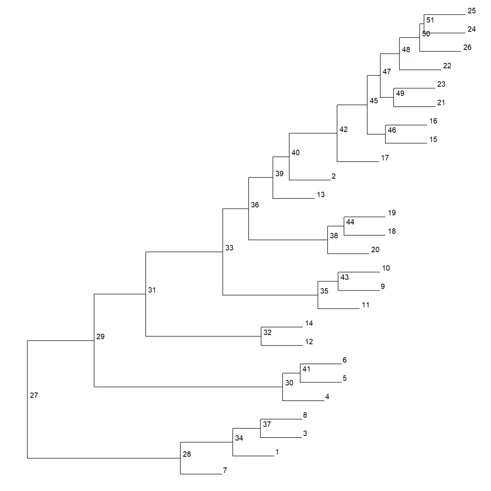

```r
#美化聚类树
hcc1 <- ggtree(hc) + geom_nodepoint(color="#b5e521", alpha=1/4, size=10) + geom_tippoint(color="#FDAC4F", shape=8, size=3)
hcc1
```

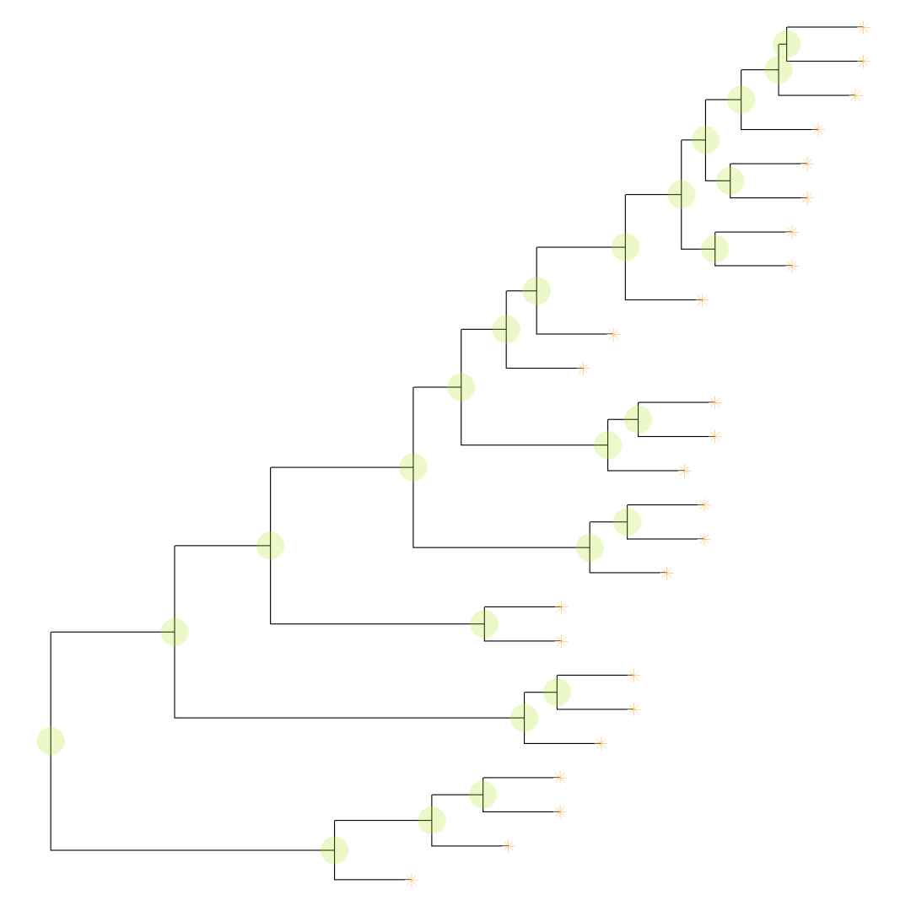

```r
#每个分支加不同的颜色区分
hcc2 <- ggtree(hc) +
          geom_point(aes(shape=isTip, color=isTip), size=3)+
          geom_hilight(node=28, fill="steelblue", alpha=.1) +
          geom_hilight(node=30, fill="darkgreen", alpha=.1) +
          geom_hilight(node=32, fill="#5c9dbf", alpha=.1) +
          geom_hilight(node=35, fill= "#d32629", alpha=.1) +
          geom_hilight(node=36, fill="#ed7a6e", alpha=.1)
hcc2
```

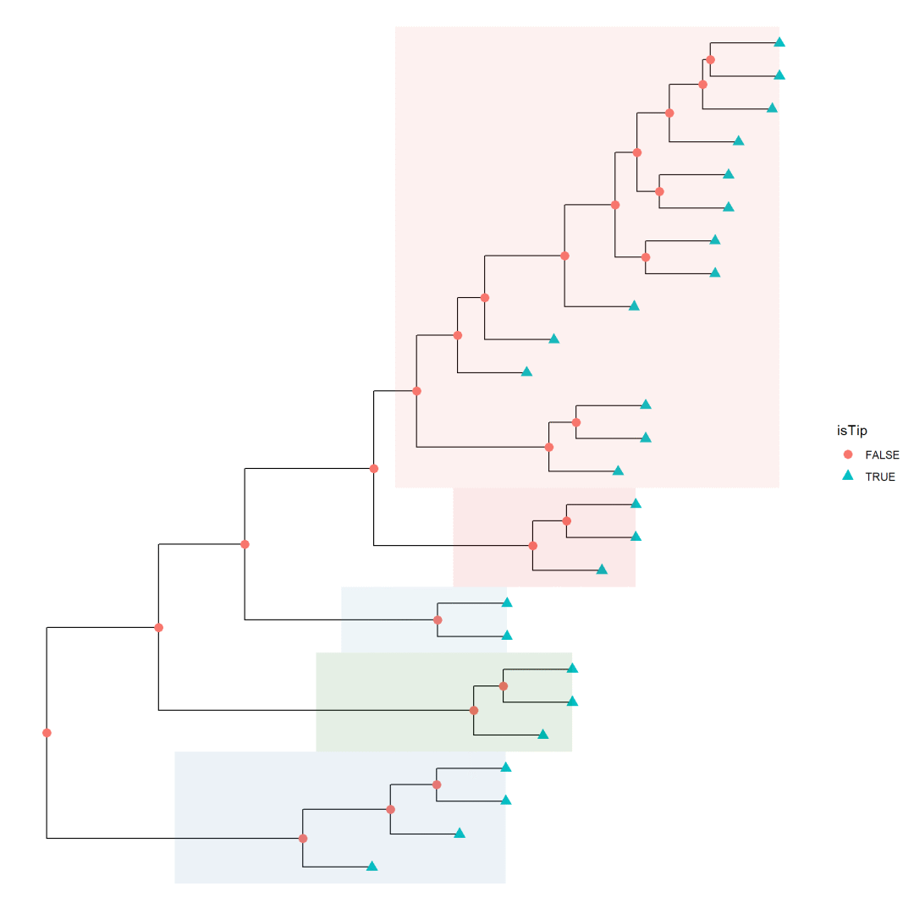

```
# 合并dotplot、细胞注释条和基因聚类树
p2 %>% insert_top(p2_anno,height = .05) %>%
  insert_left(hcc1, width = 1)
```

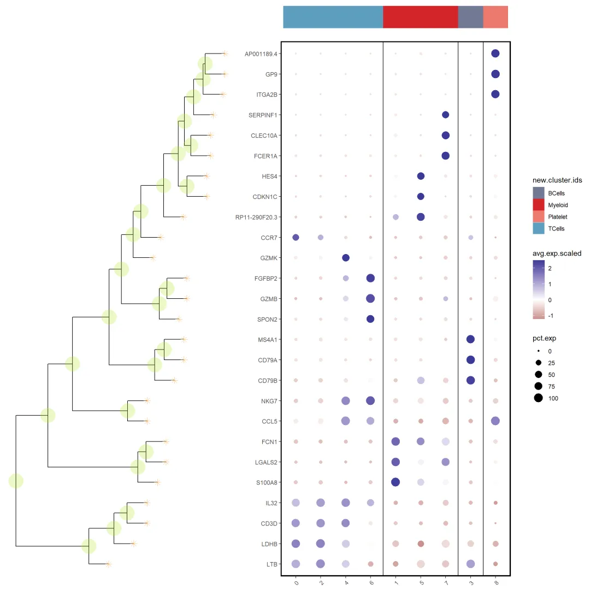

```
p2 %>% insert_top(p2_anno,height = .05) %>%
  insert_left(hcc2, width = 1)
```

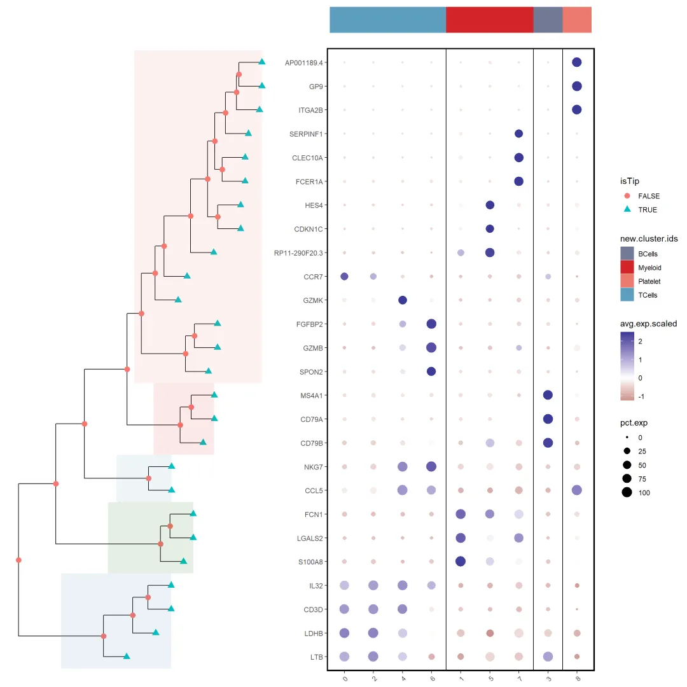


**如何联系我们**

 公众号后台消息回复不便，这里给大家留一下领取资料及免费服务器([足够支持你完成硕博生涯的生信环境](<http://mp.weixin.qq.com/s?__biz=MzAwMzIzOTk5OQ==&mid=2247507693&idx=1&sn=d9517a0803ad75cb7be430806834e7b8&chksm=9b3ca7bdac4b2eaba1ad01ed04ab1fbcbafcf4f6ddfe9e4f76ed9229707f545fe7d9c9ffd6ae&scene=21#wechat_redirect>))的**微信号** ，方便各位随时交流（别问在么，添加时直接说来意）。呼声很高的**交流群** 也建好了，欢迎大家入群讨论：

[永久免费的生信、科研交流群](<http://mp.weixin.qq.com/s?__biz=MzAwMzIzOTk5OQ==&mid=2247505868&idx=2&sn=20c81313eaef9a7031a84ef3a691d1b5&chksm=9b3cae9cac4b278a42c8de97e864c7664a37e9a4adb5973625fe3f8dd1093e55aeda88d443aa&scene=21#wechat_redirect>)

大家可以阅读完这几篇之后添加[给生信入门初学者的小贴士](<http://mp.weixin.qq.com/s?__biz=MzAwMzIzOTk5OQ==&mid=2247493329&idx=1&sn=597870b7f7ce10346da3561e7c281627&chksm=9b3c9f81ac4b169794088ce9abbcacb5f18e9fd174fc0d7e28da62d78facadf3100ef38aaf22&scene=21#wechat_redirect>)
[如何搜索公众号过往发布内容](<http://mp.weixin.qq.com/s?__biz=MzAwMzIzOTk5OQ==&mid=2247506266&idx=2&sn=22b1164bc9602c25620d058847785422&chksm=9b3ca00aac4b291c16d738271746ffb90149282a728f484e8a1952463c46a8e7dc4f883ab928&scene=21#wechat_redirect>)

**已有生信基地联系方式的同学****无需重复添加**

 您点的每个赞和在看，我都认真当成了喜欢
