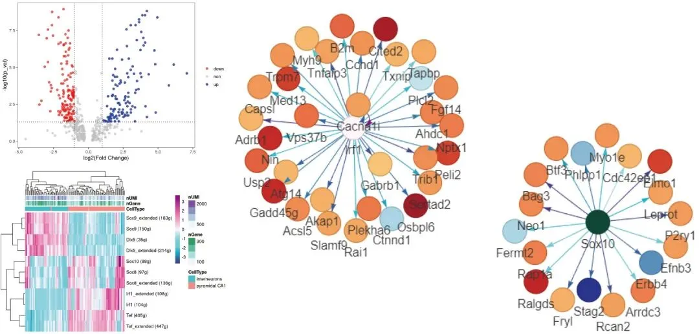
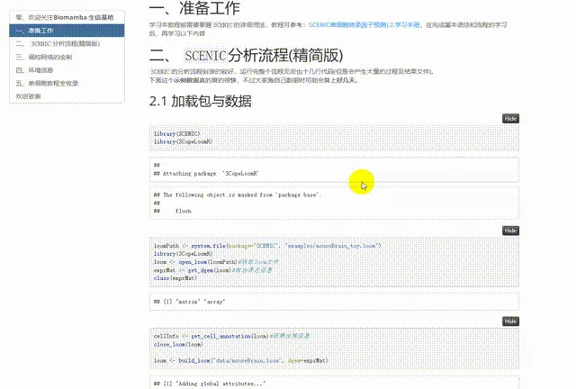
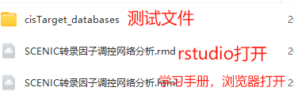

# SCENIC转录因子调控网络图

> 原文：https://mp.weixin.qq.com/s?__biz=MzAwMzIzOTk5OQ==&mid=2247520750&idx=1&sn=496bead1531a7eddd5c286030d350745&chksm=9b3ce8beac4b61a8589a1f8a66bd0571e09c0646655b6d805348bf6f4a0c7b52851615c22868#rd
> 合集：单细胞教程全收录

学习手册

SCENIC全称Single Cell rEgulatory Network Inference and Clustering，就像字面意思那样，功能是单细胞调控网络的推断与聚类。SCENIC能够完成许多转录因子相关的分析与可视化功能，我们此前也做过详细的教程：[SCENIC单细胞转录因子预测|学习手册](<http://mp.weixin.qq.com/s?__biz=MzAwMzIzOTk5OQ==&mid=2247500439&idx=1&sn=d6b4874a8352f5b7a4165629c03058ce&chksm=9b3cbbc7ac4b32d158fd3c5c2f155c54c892d40eaae3718409936fc319f69705da32badf79d6&scene=21#wechat_redirect>),有自学能力的同学也可以访问官网学习：https://github.com/aertslab/SCENIC。这里我们整合了在SCENIC完成标准分析后输出得**TF** 与**Target Gene** 信息，最终生成**调控网络图** 的可视化。

本教程可视化集锦：

**-Biomamba**

所见即所得

文末下载链接中包含的内容：

解锁前需阅读：[龙年订阅须知](<http://mp.weixin.qq.com/s?__biz=MzAwMzIzOTk5OQ==&mid=2247509093&idx=1&sn=d82ed3738bc25b922a4837016198951e&chksm=9b3cdd35ac4b5423f08cf6ab2f4afc5d815c2321991d880e8b7162e63fd1d7e4695cd7391022&scene=21#wechat_redirect>)

文末还可解锁以下内容

龙年订阅合集持续更新中，联系客服微信[Biomamba_kefu]可以119￥获取全部资料(包括今年后面更新的内容)。当然，付费不是目的，以下资料都可以通过**转发领取**(更推荐这种方式)。

[龙年订阅须知](<http://mp.weixin.qq.com/s?__biz=MzAwMzIzOTk5OQ==&mid=2247509093&idx=1&sn=d82ed3738bc25b922a4837016198951e&chksm=9b3cdd35ac4b5423f08cf6ab2f4afc5d815c2321991d880e8b7162e63fd1d7e4695cd7391022&scene=21#wechat_redirect>)
[单细胞Figure 1常见图表](<http://mp.weixin.qq.com/s?__biz=MzAwMzIzOTk5OQ==&mid=2247509260&idx=1&sn=9ff90a428c3f22d43a31ec864e2d8a94&chksm=9b3cdc5cac4b554a2f7cb2a6368f7df9a9a3f6e406eb070663f53d81841a76e188c0b50727de&scene=21#wechat_redirect>)
[快速上手Seurat V5](<http://mp.weixin.qq.com/s?__biz=MzAwMzIzOTk5OQ==&mid=2247509880&idx=1&sn=3b7cd169ccfe688d10cb1ca70dc91e91&chksm=9b3cde28ac4b573ec6d5f4bceafa4294c0e9a001b7d0c0b64f274a9978b1438eeccc747ca0c0&scene=21#wechat_redirect>)
[机器学习基础手册](<http://mp.weixin.qq.com/s?__biz=MzAwMzIzOTk5OQ==&mid=2247510121&idx=1&sn=87b53d350d9aedd5b3205d59e51356a0&chksm=9b3cd139ac4b582f23dd0ca65dcc66bed80b4240da76ee5abfbb61ec1bf62674ebfd2c50a45e&scene=21#wechat_redirect>)
[scRNA-Seq学习手册Seurat V4修订版](<http://mp.weixin.qq.com/s?__biz=MzAwMzIzOTk5OQ==&mid=2247510380&idx=1&sn=0eb2b0c519ef1dc25ee8821b736a0fde&chksm=9b3cd03cac4b592ad93149fb4847e6ba3dd03ab69e1ca594ddc64d323fb7496775789cae245d&scene=21#wechat_redirect>)
[Bulk RNASeq| 转录组实战](<http://mp.weixin.qq.com/s?__biz=MzAwMzIzOTk5OQ==&mid=2247510793&idx=1&sn=bfa69e8f261932d9bea74443fab732f0&chksm=9b3cd259ac4b5b4fd4b3bb80d0210a3396cda777b32ab49be1a45339453db314bb2a17fc438d&scene=21#wechat_redirect>)[scRNA-Seq双细胞过滤手册](<http://mp.weixin.qq.com/s?__biz=MzAwMzIzOTk5OQ==&mid=2247511622&idx=1&sn=60b35668e569267bab14ec8fbba8bd74&chksm=9b3cd716ac4b5e00122eac47f55085198040a4a0e97c56895bbc39f3a9f1a1eb4eba27048a8f&scene=21#wechat_redirect>)
[CellChat空转细胞通讯合辑](<http://mp.weixin.qq.com/s?__biz=MzAwMzIzOTk5OQ==&mid=2247512011&idx=1&sn=fbd41832c5995d79fead016931d3bfbd&chksm=9b3cd69bac4b5f8d16e7d8b8eeb5490e4938daf68902b06a8d60e25f150ec4ec459796f3aaac&scene=21#wechat_redirect>)
[scRNA-Seq学习手册Seurat V5更新版](<http://mp.weixin.qq.com/s?__biz=MzAwMzIzOTk5OQ==&mid=2247519711&idx=1&sn=d25d4f5daf609bda8367f16db676ecf3&chksm=9b3cf48fac4b7d99e65eba6d4c66c63e40b1d187fa1d9e6449d6cd07d5dec5127cff54886f93&scene=21#wechat_redirect>)

订阅后获取学习手册下载链接：

