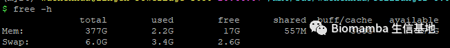

# 单细胞分析的最上游——处理Fastq文件：cellranger

> 原文：https://mp.weixin.qq.com/s?__biz=MzAwMzIzOTk5OQ==&mid=2247501751&idx=2&sn=a79512f54db7456ea577de40f1a2d286&chksm=9b3cbee7ac4b37f1ce313d5eeb9a9ac9940640ab599ac5ab5d438fa86a8007796b768e4e68c2#rd
> 合集：单细胞教程全收录

。

写在前面

原先我们将这一部分内容安排在了整个课程的最后，是考虑到这部分内容需要一定的Linux基础。这并不代表这是一个下游的内容，相反，这是单细胞测序整个生物信息学分析中最上游的内容。作为承前启后的一个步骤，实验的部分到Fastq文件终止，生信的部分由Fastq文件开始（如果这里你不知道我在说什么，建议去看一下我们这个系列的第一讲：[手把手教你做单细胞测序数据分析（一）——绪论](<http://mp.weixin.qq.com/s?__biz=MzAwMzIzOTk5OQ==&mid=2247484077&idx=1&sn=e329bf865493d46308985f4c111370ae&chksm=9b3f7bfdac48f2eb7e903510338bd772c6be34ccbcb681806d288e62a05eee28fa209d2f33b9&scene=21#wechat_redirect>)）。如果是10X genomics平台做的测序，那么用cellranger处理Fastq文件即可，另一种主流的平台——dropseq，我们在下篇推送也会给大家介绍。
这部分教程比较尴尬：掌握Linux知识并拥有服务器的同学可能不需要视频教程，而没有Linux基础和服务器的同学看了视频也无法自己操作。因此没有条件自己操作的同学也可以**在文末联系我** ，可以帮助大家完成cellranger定量的过程。学习本次内容需要各位具有一定的Linux基础：[跟着Biomamba一起学Linux| 一.计算机硬件组成](<http://mp.weixin.qq.com/s?__biz=MzAwMzIzOTk5OQ==&mid=2247491413&idx=1&sn=1252abc3bd5584bdf5d59487c8dd61e3&chksm=9b3f6605ac48ef13bf0bc605a9f3bba4b804f56b824a0b2a550f7c831516441e829f35ed9f69&scene=21#wechat_redirect>)
[Linux| 二.计算机软件组成与Linux](<http://mp.weixin.qq.com/s?__biz=MzAwMzIzOTk5OQ==&mid=2247492243&idx=1&sn=bbb06cfd7a0836943262bf4897a390d1&chksm=9b3c9bc3ac4b12d529d9e5173c1ef22f43db3dbffac9143384fb463f30da1ca6afeea8d987bb&scene=21#wechat_redirect>)[Linux| 三.免费获得Linux系统-WSL](<http://mp.weixin.qq.com/s?__biz=MzAwMzIzOTk5OQ==&mid=2247493279&idx=1&sn=ab7f430ea98de7f29d8f4bfb238eb0d6&chksm=9b3c9fcfac4b16d916ba186e658ffb8973043e85f2fd0cf524a1f27715056555ba0130b0c2d5&scene=21#wechat_redirect>)[Linux| 四.免费获得Linux系统-虚拟机](<http://mp.weixin.qq.com/s?__biz=MzAwMzIzOTk5OQ==&mid=2247493649&idx=1&sn=0b3070157cc16bb54424bec5b8641d32&chksm=9b3c9141ac4b18574a6a09a78749e40df7bbbb320fad2a593d7a61586526085ebbdabd148384&scene=21#wechat_redirect>)
[Linux| 五.免费获得Linux系统-服务器](<http://mp.weixin.qq.com/s?__biz=MzAwMzIzOTk5OQ==&mid=2247494994&idx=2&sn=0cecd945228792a6be108cca83e85779&chksm=9b3c9402ac4b1d14893b28d8618d437c0aec1ac6117154bd8ffeaac8f8f129ddefb0d4377cfb&scene=21#wechat_redirect>)
[Linux| 六.命令行与与基本命令](<http://mp.weixin.qq.com/s?__biz=MzAwMzIzOTk5OQ==&mid=2247495054&idx=2&sn=13d1f8d0c6b8c974e31a355ed7b997eb&chksm=9b3c94deac4b1dc81477c239380aea22aeac952fa0495f61cd769393d165d8122c42bab830af&scene=21#wechat_redirect>)
[Linux| 七.获取Linux命令帮助的几种方式](<http://mp.weixin.qq.com/s?__biz=MzAwMzIzOTk5OQ==&mid=2247495054&idx=1&sn=1a418b6877f7d8905902abe7f73ebf7a&chksm=9b3c94deac4b1dc8e1da4756108994ba6f4e0e385385df21d8fbc5a0947edef369592b9b1d3a&scene=21#wechat_redirect>)
[Linux| 八.Linux的文件目录系统](<http://mp.weixin.qq.com/s?__biz=MzAwMzIzOTk5OQ==&mid=2247496291&idx=2&sn=1813f6615aa2f5a8598851f43bfdafbf&chksm=9b3c8b33ac4b0225b397b56465d559ae80c1d6cc1ab6135bb12153b9beaa04ff1e0ca1ec4402&scene=21#wechat_redirect>)
[Linux| 九.路径查看与切换: pwd,cd,ls命令](<http://mp.weixin.qq.com/s?__biz=MzAwMzIzOTk5OQ==&mid=2247496291&idx=1&sn=e4afc3656c82173ff5ec8fa6b39c9d9f&chksm=9b3c8b33ac4b0225a50550199bb85c025667b2c104af270812e2baa81577789308572ac4da23&scene=21#wechat_redirect>)
[Linux| 十.通配符](<http://mp.weixin.qq.com/s?__biz=MzAwMzIzOTk5OQ==&mid=2247496442&idx=1&sn=3a60951daf331f134f2959b3e654d085&chksm=9b3c8baaac4b02bc952d526e498861efa4fabf0eb8fbdf6b7f291c7e80d0105aaff454323ccb&scene=21#wechat_redirect>)[Linux| 11.文件删除: rm命令](<http://mp.weixin.qq.com/s?__biz=MzAwMzIzOTk5OQ==&mid=2247496527&idx=1&sn=fe8eec0be5994a08496bf41d803abeb9&chksm=9b3c8a1fac4b030974c5c1bdc8ccd18cb96ba6e23c5aea29fe30353db0b433294d9952d765c1&scene=21#wechat_redirect>)
[Linux| 12.文件的复制(cp)与移动(mv)](<http://mp.weixin.qq.com/s?__biz=MzAwMzIzOTk5OQ==&mid=2247496599&idx=1&sn=648b97b3ffc0e7d37faf8b71f7ba2a8e&chksm=9b3c8ac7ac4b03d11c0bc81aa4c411d6bdad34e4c07cad476c792938844ae2d4e76e1c979c54&scene=21#wechat_redirect>)
[Linux| 13.用户与组群概念](<http://mp.weixin.qq.com/s?__biz=MzAwMzIzOTk5OQ==&mid=2247496613&idx=1&sn=463621761f8ebb28ae229c7a4eff809a&chksm=9b3c8af5ac4b03e37a3e959617a49fb0e7304b042dbd7a548cda620c682013632214e41ae911&scene=21#wechat_redirect>)
[Linux| 14.用户管理命令(useradd, passwd, userdel, su)](<http://mp.weixin.qq.com/s?__biz=MzAwMzIzOTk5OQ==&mid=2247496892&idx=1&sn=960dbca843a51a73c1b331abee5c127d&chksm=9b3c8decac4b04fa3fb1fec375e6c6950f277f6c128c9decf5c38a689086ef798f519cd10acd&scene=21#wechat_redirect>)
[Linux| 15.文件权限管理: chown, chmod](<http://mp.weixin.qq.com/s?__biz=MzAwMzIzOTk5OQ==&mid=2247496931&idx=1&sn=392e2b97f850374c96de50194b95bfbf&chksm=9b3c8db3ac4b04a5ddc57970bcb36f64587725d1ddcd9bec12e0902953483eeec314a5f4a3aa&scene=21#wechat_redirect>)
[Linux| 16.快捷键](<http://mp.weixin.qq.com/s?__biz=MzAwMzIzOTk5OQ==&mid=2247497180&idx=1&sn=e4d998d9c9d5a7672cba67654f7e8c1c&chksm=9b3c8c8cac4b059abd73e1e026f5d705d1bd2f25883b462cb09bdc72f140fe2727f93abb0c1f&scene=21#wechat_redirect>)
[Linux| 17.输出重定向](<http://mp.weixin.qq.com/s?__biz=MzAwMzIzOTk5OQ==&mid=2247497255&idx=1&sn=304d5492738068f33d377317c31bf75b&chksm=9b3c8f77ac4b0661a7e4306071f129f06a2ca680caeecaa9d6af1f24720170d9e1fa3a371de1&scene=21#wechat_redirect>)
[Linux| 18.管道符](<http://mp.weixin.qq.com/s?__biz=MzAwMzIzOTk5OQ==&mid=2247497261&idx=1&sn=8d4177937f7ff4ee7db2eb9a59878af9&chksm=9b3c8f7dac4b066b7ce3dd9f815d631bc43c8d7115c508c88c1b8038b2a5af5b6cfde6734148&scene=21#wechat_redirect>)
[Linux| 19.文件查找 find, locate, which](<http://mp.weixin.qq.com/s?__biz=MzAwMzIzOTk5OQ==&mid=2247497743&idx=1&sn=f8e9fda7d325262f129a80faf77217dd&chksm=9b3c815fac4b0849c12cfb926cef2eaed8e0c779cb50c92647c48230b99492dc12aed135e03f&scene=21#wechat_redirect>)
[Linux| 20.别名 alias](<http://mp.weixin.qq.com/s?__biz=MzAwMzIzOTk5OQ==&mid=2247498050&idx=1&sn=9f29a0c594743a6cd0ce2b2beaaef037&chksm=9b3c8012ac4b0904666979588c25b2025eded47d5f05885f9101d7d0e81a96d8feeff837859c&scene=21#wechat_redirect>)
[Linux| 21.软链接与硬链接 ln](<http://mp.weixin.qq.com/s?__biz=MzAwMzIzOTk5OQ==&mid=2247498073&idx=1&sn=658f9059b05cc2859deb3cd4f2b5df4b&chksm=9b3c8009ac4b091f9baea3f3ca640b138358edd768d906703004323622516c7af7fedb72c446&scene=21#wechat_redirect>)
[Linux| 22. (解)压缩与md5值校验](<http://mp.weixin.qq.com/s?__biz=MzAwMzIzOTk5OQ==&mid=2247499664&idx=1&sn=4864161942d45fedee2fa28e6d85460e&chksm=9b3c86c0ac4b0fd67ff1798290f95695b8284943d468aaa9ae2db38fe79927ef47dd7d73f7f6&scene=21#wechat_redirect>)
[Linux| 23. 文件查看 wc, cat, head, tail](<http://mp.weixin.qq.com/s?__biz=MzAwMzIzOTk5OQ==&mid=2247500401&idx=1&sn=e4270e426c7e1dcbc55ce9320955c21a&chksm=9b3cbb21ac4b3237b1be87b1ea466584fd996c18564b50b65a6ff7e66d0732530b0bf5e006eb&scene=21#wechat_redirect>)
[Linux| 24. 文件浏览器 more,less](<http://mp.weixin.qq.com/s?__biz=MzAwMzIzOTk5OQ==&mid=2247500554&idx=2&sn=3d20b135ac7f78500d439beac16f2067&chksm=9b3cba5aac4b334c89ad2b040b90f291118072bf3a6ee566591b42920163a965f3095e41a4e4&scene=21#wechat_redirect>)[Linux| 25. 文件编辑器 vim](<http://mp.weixin.qq.com/s?__biz=MzAwMzIzOTk5OQ==&mid=2247500900&idx=1&sn=f8e41737d22588beaeb6cfeea8865a7d&chksm=9b3cbd34ac4b3422ded73466e862117a5b4989eb0ca2125f2c1f45b67f9ca3772d40a1bb6835&scene=21#wechat_redirect>)

一、安装软件并查看帮助文档

  *   *   *   *   *   *   *   *   *   *

```
# 这个安装包网址已失效，大家需要自行去官网填邮箱申请下载地址：https://support.10xgenomics.com/single-cell-gene-expression/software/downloads/latestwget -O cellranger-5.0.1.tar.gz "https://cf.10xgenomics.com/releases/cell-exp/cellranger-5.0.1.tar.gz?Expires=1608489066&Policy=eyJTdGF0ZW1lbnQiOlt7IlJlc291cmNlIjoiaHR0cHM6Ly9jZi4xMHhnZW5vbWljcy5jb20vcmVsZWFzZXMvY2VsbC1leHAvY2VsbHJhbmdlci01LjAuMS50YXIuZ3oiLCJDb25kaXRpb24iOnsiRGF0ZUxlc3NUaGFuIjp7IkFXUzpFcG9jaFRpbWUiOjE2MDg0ODkwNjZ9fX1dfQ__&Signature=bhGO1dQOi6xmaSl-XHACRN6wUjjdau-85VHyNHtPAU6eG~6v3urfrkX5E5uShfjwgCuxsuykcWnn2nJrnRN9UyAVyFnIlrhiswDL0T5Jkox4EBqQ~tL2WTivBGe5G8EFPIxFsPoKYv0FIdDoCQYGRlDaIWIIyu7Cg7dkPPfer5hUBPp6KfmXE3st47O4LV8ZW7ghkjnIPU57NuQa3ZRlIJ2FiEmFwKCfSzy0r3o6cFIfZ~HcaIqxP1Snk5~U9sCVqSKGryFBW9uaP89mbb855hen4J4JD58lxkxp8qwKbL6qH1y5g1VlgydLg5AFllnrkKUaDSCB1gohq4hHwP5Efw__&Key-Pair-Id=APKAI7S6A5RYOXBWRPDA"#下载安装包tar -zxvf cellranger-5.0.1.tar.gz#解压echo 'export PATH=/cellranger-5.0.1/:$PATH' >> ~/.bashrc#把cellranger的路径加到$PATH中方便调用source  ~/.bashrc#更新系统配置文件cellranger count --help#查看cellranger使用说明
```

二、下载参考基因组

  *   *   *   *   *   *

```bash
wget https://cf.10xgenomics.com/supp/cell-exp/refdata-gex-GRCh38-2020-A.tar.gz#人类参考基因组数据集tar -xvf refdata-gex-GRCh38-2020-A.tar.gzwget https://cf.10xgenomics.com/supp/cell-exp/refdata-gex-mm10-2020-A.tar.gz#mouse参考基因组数据集下载tar -xvf refdata-gex-mm10-2020-A.tar.gz
```

三、下载测试数据集走一遍流程

  *   *   *   *   *   *   *   *   *   *   *   *   *   *   *   *   *   *   *

```bash
wget 'http://cf.10xgenomics.com/samples/cell-exp/2.1.0/neurons_900/neurons_900_fastqs.tar'#测试数据集下载tar -xvf neurons_900_fastqs.tarcellranger count --id=result --transcriptome=../refdata-gex-mm10-2020-A/ --fastqs=/neurons_900_fastqs --sample=neurons_900 --expect-cells=1000 --nosecondary #成功运行命令！！！ #这里解释一下cellranger的各个参数： cellranger count --id=sample \                   --transcriptome=/opt/refdata-cellranger-GRCh38-1.2.0 \                   --fastqs=/home/scRNA/runs/HAWT7ADXX/outs/fastq_path \                   --sample=mysample \                   --expect-cells=1000 \                   --nosecondary# id指定输出文件存放目录名# transcriptome指定与CellRanger兼容的参考基因组# fastqs指定mkfastq或者自定义的测序文件# sample要和fastq文件的前缀中的sample保持一致，作为软件识别的标志# expect-cells指定复现的细胞数量，这个要和实验设计结合起来# nosecondary 只获得表达矩阵，不进行后续的降维、聚类和可视化分析(反正后续要走Seurat，为了节省计算资源，建议加上)#count函数参数解释
```

四、硬件要求运行cellranger需要的内存可以参考这里：[做单细胞测序到底需要多少内存](<http://mp.weixin.qq.com/s?__biz=MzAwMzIzOTk5OQ==&mid=2247487923&idx=1&sn=15043c6d729b0d5493ab875b0e54a259&chksm=9b3f68e3ac48e1f5dae514a01c857f9a56a90e2977dd7862db28d06fe55888cd9bb4afbb14e0&scene=21#wechat_redirect>)，单细胞测序的数据动辄就是100G（压缩前），所以理论上靠自己的笔记本是必然跑不动的。我这里的服务器是377GB的内存([生信分析为什么要使用服务器？](<http://mp.weixin.qq.com/s?__biz=MzAwMzIzOTk5OQ==&mid=2247501099&idx=1&sn=78446147184292fad3417495926b3096&chksm=9b3cbc7bac4b356dcf0460781f9bf16df4ede481f8cc57282c7384b9d2baccaa820d64c89bab&scene=21#wechat_redirect>))，总之如果大家有这样配置的设备，跑正常深度的Fastq文件应该是没有问题。当然，如果你没有Linux基础或充足的计算资源，你也可以扫描下方的二维码寻求帮助。




如何联系我们

公众号后台消息更新不及时，超过48h便不允许回复读者消息，这里给大家留一下领取资料、免费服务器([有root权限的共享服务器,注册即送200￥](<http://mp.weixin.qq.com/s?__biz=MzAwMzIzOTk5OQ==&mid=2247500273&idx=1&sn=f600f10077f6298ea957e459b5f8a375&chksm=9b3cb8a1ac4b31b702838076dbceb077e9c8980d9cffe5c4ab10ebbeceaf5fe3e658003e66c4&scene=21#wechat_redirect>))的**微信号[Biomamba_kefu]** ，方便各位随时交流、提建议(科研任务繁重，回复不及时请见谅，**备注来意会优先通过**)。此外呼声一直很高的**交流群** 也建好了，欢迎大家入群讨论：[永久免费的千人生信、科研交流群](<http://mp.weixin.qq.com/s?__biz=MzAwMzIzOTk5OQ==&mid=2247492981&idx=1&sn=aed903c4b853113d8c89e13848ea3365&chksm=9b3c9c25ac4b1533feb5f42f94ab4b6023a160313db4bc6a2f142e54d26627e3ea94b53e9031&scene=21#wechat_redirect>)

大家可以阅读完这几篇之后添加[给生信入门初学者的小贴士](<http://mp.weixin.qq.com/s?__biz=MzAwMzIzOTk5OQ==&mid=2247493329&idx=1&sn=597870b7f7ce10346da3561e7c281627&chksm=9b3c9f81ac4b169794088ce9abbcacb5f18e9fd174fc0d7e28da62d78facadf3100ef38aaf22&scene=21#wechat_redirect>)
[如何搜索公众号过往发布内容](<http://mp.weixin.qq.com/s?__biz=MzAwMzIzOTk5OQ==&mid=2247488966&idx=1&sn=9e9e7659b4cf00ac3173d21e88e1602b&chksm=9b3f6c96ac48e580efe53f966430f6598785e5c5c6bcc20f5eef019e723e49baaaea6d73fb7b&scene=21#wechat_redirect>)


您点的每个赞和在看，我都认真当成了喜欢
