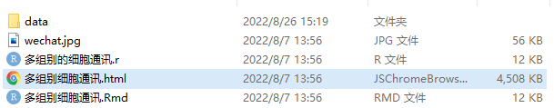
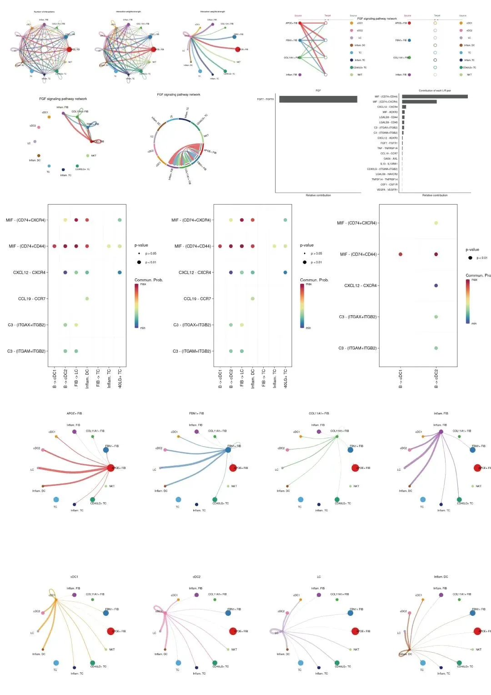
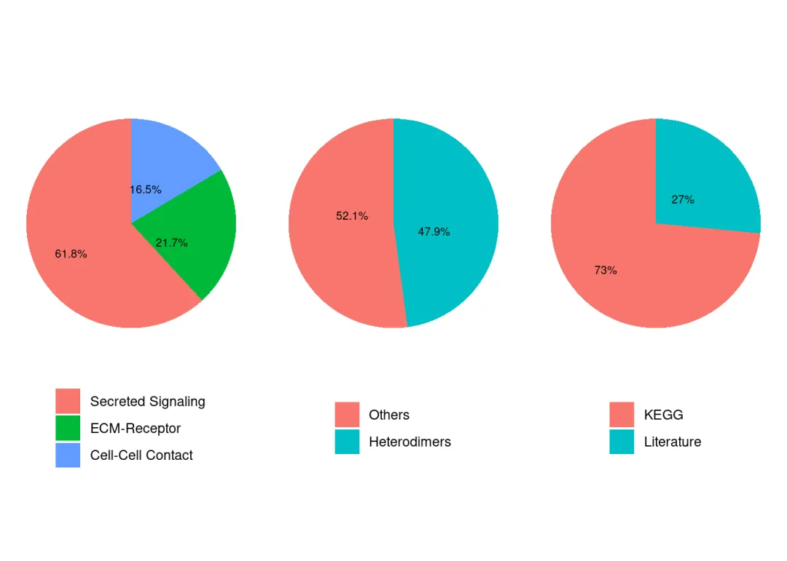
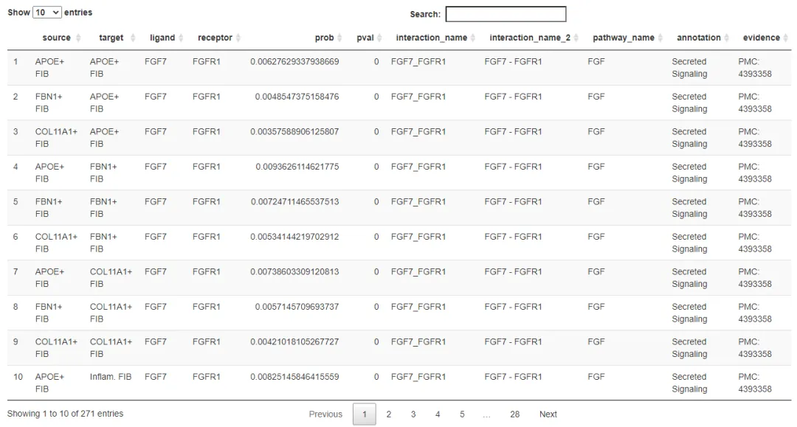
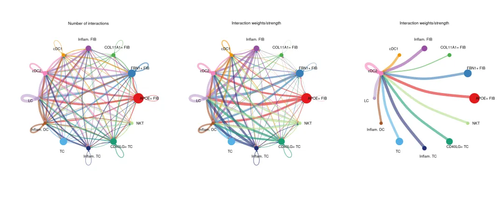
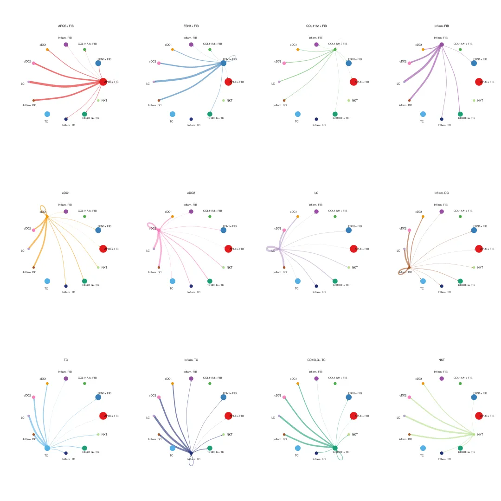
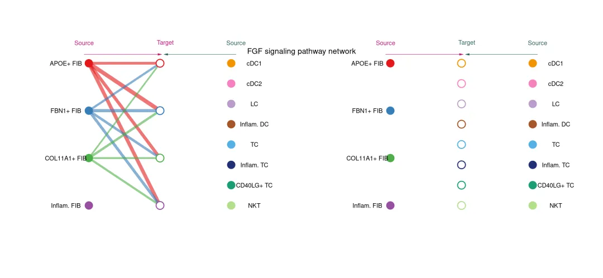
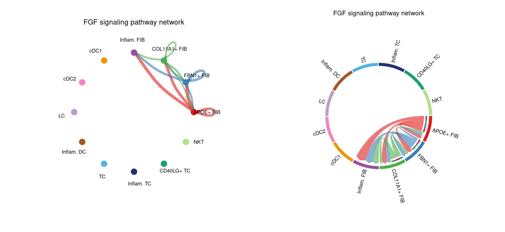

# 《细胞通讯》2.2CellChat多组别分析

> 原文：https://mp.weixin.qq.com/s?__biz=MzAwMzIzOTk5OQ==&mid=2247501523&idx=2&sn=6fa803f256c2e0b945f93ae7d8245f50&chksm=9b3cbf83ac4b3695b587e9817840f419104c8680f5ef08ee39aa149b79852f48b179f68e3397#rd
> 合集：单细胞教程全收录


前言

在前面的一讲内容里([《细胞通讯》2.CellChat基础分析教程](<http://mp.weixin.qq.com/s?__biz=MzAwMzIzOTk5OQ==&mid=2247501296&idx=2&sn=fb3e252d95ee8b50cd446e71335b1aa0&chksm=9b3cbca0ac4b35b621b4f51d2c3a130f00461faeeff067396222c2fc2eeb53f3544664d7d9bc&scene=21#wechat_redirect>))我们已经给大家介绍了CellChat单样本数据处理的实操。本讲的内容主要向大家展示如何挖掘细胞通讯在**不同组别中的差异** 。本次课程所涉及的可复制**代码** 、**测试文件** 可在文末订阅获取或转发找客服微信[Biomamba]领取，当然你也可以参考这里：https://github.com/sqjin/CellChat。后续的代码如果不出意外都会在服务器中演示（[生信分析为什么要使用服务器？](<http://mp.weixin.qq.com/s?__biz=MzAwMzIzOTk5OQ==&mid=2247501099&idx=1&sn=78446147184292fad3417495926b3096&chksm=9b3cbc7bac4b356dcf0460781f9bf16df4ede481f8cc57282c7384b9d2baccaa820d64c89bab&scene=21#wechat_redirect>)）。



分析图表展示：




视频教程

B站同步播出：https://www.bilibili.com/video/BV1Ab4y1W7qx?p=4


图文教程


### 安装并加载R包
```
suppressMessages(if(!require(CellChat))devtools::install_github("sqjin/CellChat"))
#需要安装rtools才能运行
#suppressMessages(reticulate::py_install(packages = 'umap-learn'))
###通过minicnda安装帮助后续评估通路间得相似性
suppressMessages(if(!require(ggplot2))install.packages('ggplot2'))
suppressMessages(if(!require(patchwork))install.packages('patchwork') )
suppressMessages(if(!require(ggalluvial))install.packages('ggalluvial'))
suppressMessages(if(!require(igraph))install.packages('igraph'))
suppressMessages(if(!require(dplyr))install.packages('dplyr'))
suppressMessages(options(stringsAsFactors = FALSE))
suppressMessages(options(futrue.globlas.Maxsize=2*1024**3))
suppressWarnings(suppressMessages(future::plan("multiprocess", workers = 8)))
#设置硬件参数，四线程
#win+r wmic cpu get numberOfLogicalProcessors
```

### 下载、读取、创建cellchat对象
```r
#load(url("https://ndownloader.figshare.com/files/25950872"))#读取示例数据集
#View(data_humanSkin)
#saveRDS(data_humanSkin,'data_humanSkin.rds')
data_humanSkin <- readRDS('data_humanSkin.rds')
class(data_humanSkin)
## [1] "list"
#示例数据：来源于人类皮肤
#作者发表文献 #https://www.nature.com/articles/s41467-021-21246-9.pdf
data.input <- data_humanSkin$data # normalized data matrix
#pbmc[["RNA"]]@data
meta <- data_humanSkin$meta # a dataframe with rownames containing cell mata data
unique(meta$condition)
## [1] "LS" "NL"
cell.use <- rownames(meta)[meta$condition == "LS"] # 按指定的变量提取细胞
data.input <- data.input[, cell.use]#取出对应细胞
meta = meta[cell.use, ]#取出对应细胞的meta信息
# meta = data.frame(labels = meta$labels[cell.use], row.names = colnames(data.input)) # manually create a dataframe consisting of the cell labels
unique(meta$labels)
##  [1] Inflam. FIB  FBN1+ FIB    APOE+ FIB    COL11A1+ FIB cDC2
##  [6] LC           Inflam. DC   cDC1         CD40LG+ TC   Inflam. TC
## [11] TC           NKT
## 12 Levels: APOE+ FIB FBN1+ FIB COL11A1+ FIB Inflam. FIB cDC1 cDC2 ... NKT
cellchat <- createCellChat(object = data.input, meta = meta, group.by = "labels")
## Create a CellChat object from a data matrix
## Set cell identities for the new CellChat object
## The cell groups used for CellChat analysis are  APOE+ FIB FBN1+ FIB COL11A1+ FIB Inflam. FIB cDC1 cDC2 LC Inflam. DC TC Inflam. TC CD40LG+ TC NKT
#创建celllchat对象，group.by指定通讯间的对象，用meta中的注释作为分组依据

######如果上述没有指定meta=meta，可以如下手动加入
#cellchat <- createCellChat(object = data.input, group.by = "labels")
cellchat <- addMeta(cellchat, meta = meta)
cellchat <- setIdent(cellchat, ident.use = "labels") # set "labels" as default cell identity
#Idents(pbmc) <- 'group'
levels(cellchat@idents) # show factor levels of the cell labels
##  [1] "APOE+ FIB"    "FBN1+ FIB"    "COL11A1+ FIB" "Inflam. FIB"  "cDC1"
##  [6] "cDC2"         "LC"           "Inflam. DC"   "TC"           "Inflam. TC"
## [11] "CD40LG+ TC"   "NKT"
groupSize <- as.numeric(table(cellchat@idents)) # number of cells in each cell group
groupSize
##  [1] 1228  813  181  484  121  294   67   81  765  266  630   81
```

### 载入数据库并开始计算
```r
CellChatDB <- CellChatDB.human # use CellChatDB.mouse if running on mouse data
showDatabaseCategory(CellChatDB)
```


```r
#展示细胞组成的比例:
dplyr::glimpse(CellChatDB$interaction)#展示互作的记录
## Rows: 1,939
## Columns: 11
## $ interaction_name   <chr> "TGFB1_TGFBR1_TGFBR2", "TGFB2_TGFBR1_TGFBR2", "TGFB…
## $ pathway_name       <chr> "TGFb", "TGFb", "TGFb", "TGFb", "TGFb", "TGFb", "TG…
## $ ligand             <chr> "TGFB1", "TGFB2", "TGFB3", "TGFB1", "TGFB1", "TGFB2…
## $ receptor           <chr> "TGFbR1_R2", "TGFbR1_R2", "TGFbR1_R2", "ACVR1B_TGFb…
## $ agonist            <chr> "TGFb agonist", "TGFb agonist", "TGFb agonist", "TG…
## $ antagonist         <chr> "TGFb antagonist", "TGFb antagonist", "TGFb antagon…
## $ co_A_receptor      <chr> "", "", "", "", "", "", "", "", "", "", "", "", "",…
## $ co_I_receptor      <chr> "TGFb inhibition receptor", "TGFb inhibition recept…
## $ evidence           <chr> "KEGG: hsa04350", "KEGG: hsa04350", "KEGG: hsa04350…
## $ annotation         <chr> "Secreted Signaling", "Secreted Signaling", "Secret…
## $ interaction_name_2 <chr> "TGFB1 - (TGFBR1+TGFBR2)", "TGFB2 - (TGFBR1+TGFBR2)…
#CellChatDB.use <- CellChatDB
CellChatDB.use <- subsetDB(CellChatDB, search = "Secreted Signaling")#取出相应分类用作分析数据库
#CellChatDB.use <- CellChatDB # simply use the default CellChatDB
cellchat@DB <- CellChatDB.use#将数据库内容载入cellchat对象中

#表达量预处理
cellchat <- subsetData(cellchat,features = NULL)#取出表达数据

cellchat <- identifyOverExpressedGenes(cellchat)#寻找高表达的基因#
#FindVariableFeatures()
cellchat <- identifyOverExpressedInteractions(cellchat)#寻找高表达的通路
cellchat <- projectData(cellchat, PPI.human)#投影到PPI
cellchat <- computeCommunProb(cellchat, raw.use = T)#默认计算方式为type = "truncatedMean",
#默认cutoff的值为20%，即表达比例在25%以下的基因会被认为是0， trim = 0.1可以调整比例阈值
cellchat <- filterCommunication(cellchat, min.cells = 10)
#去掉通讯数量很少的细胞
df.net <- subsetCommunication(cellchat)#将细胞通讯预测结果以数据框的形式取出

DT::datatable(df.net)
```



```r
write.csv(df.net,'01.df.net.csv')
#df.net <- subsetCommunication(cellchat,slot.name = "netP")
##这种方式只取通路，数据结构更简单
#df.net <- subsetCommunication(cellchat, sources.use = c(1,2), targets.use = c(4,5))
#source可以以细胞类型的名称定义，也可以按照细胞名称中的顺序以数值向量直接取
#指定输入与输出的细胞集群
#df.net <- subsetCommunication(cellchat, signaling = c("WNT", "TGFb"))#指定通路提取
cellchat <- computeCommunProbPathway(cellchat)
#每对配受体的预测结果存在net中，每条通路的预测结果存在netp中
cellchat <- aggregateNet(cellchat)
#计算联路数与通讯概率，可用sources.use and targets.use指定来源与去向
```

### 可视化
```r
##################可视化######################
groupSize
##  [1] 1228  813  181  484  121  294   67   81  765  266  630   81
library(patchwork)
par(mfrow = c(1,3), xpd=TRUE)
netVisual_circle(cellchat@net$count, vertex.weight = groupSize, weight.scale = T,
                 label.edge= F, title.name = "Number of interactions")

netVisual_circle(cellchat@net$weight, vertex.weight = groupSize, weight.scale = T,
                 label.edge= F, title.name = "Interaction weights/strength")

netVisual_circle(cellchat@net$weight, vertex.weight = groupSize, weight.scale = T,
                 label.edge= F, title.name = "Interaction weights/strength",
                 targets.use = 'cDC2')
```


```r
#互作数量与重要性图
mat <- cellchat@net$weight
par(mfrow = c(3,4), xpd=TRUE)
for (i in 1:nrow(mat)) {#
  mat2 <- matrix(0, nrow = nrow(mat), ncol = ncol(mat), dimnames = dimnames(mat))
  mat2[i, ] <- mat[i, ]
  netVisual_circle(mat2, vertex.weight = groupSize, weight.scale = T,
                   edge.weight.max = max(mat), title.name = rownames(mat)[i])
}#循环绘出每种与其他细胞之间互作的关系

for (i in 1:nrow(mat)) {
  mat2 <- matrix(0, nrow = nrow(mat), ncol = ncol(mat), dimnames = dimnames(mat))
  mat2[i, ] <- mat[i, ]

  netVisual_circle(mat2, vertex.weight = groupSize, weight.scale = T,
                   edge.weight.max = max(mat), title.name = rownames(mat)[i])
}#循环绘出每种与其他细胞之间互作的关系
```



### 进阶可视化
```r
pathways.show <- df.net$pathway_name#计算到的所有通路
# Hierarchy plot
par(mfrow = c(1,2), xpd=TRUE)
vertex.receiver = seq(1,4)
netVisual_aggregate(cellchat, signaling =pathways.show[1],
                    vertex.receiver = vertex.receiver,layout = 'hierarchy')
```


```
#左侧显示只当细胞的的通讯，右侧显示剩余细胞的通讯情况

# Circle plot
netVisual_aggregate(cellchat, signaling = pathways.show[1], layout = "circle")
#以circle的方式展示通讯

netVisual_aggregate(cellchat, signaling = pathways.show[1], layout = "chord")
```


```r
# Chord diagram
group.cellType <- c(rep("FIB", 4), rep("DC", 4), rep("TC", 4)) # grouping cell clusters into fibroblast, DC and TC cells
names(group.cellType) <- levels(cellchat@idents)
par(mfrow = c(1,2), xpd=TRUE)
netVisual_chord_cell(cellchat, signaling = pathways.show[1],
                     group = group.cellType, #分组展示的顺序
                     title.name = paste0(pathways.show[1], " signaling network"))
## Plot the aggregated cell-cell communication network at the signaling pathway level

netVisual_chord_cell(cellchat, signaling = pathways.show[1],
                     title.name = paste0(pathways.show[1], " signaling network"))
## Plot the aggregated cell-cell communication network at the signaling pathway level
```
