# 《拟时序分析》3.monocle2实操：完整版

> 原文：https://mp.weixin.qq.com/s?__biz=MzAwMzIzOTk5OQ==&mid=2247501684&idx=2&sn=45c8b083e1094718d7fc4b97e370b01d&chksm=9b3cbe24ac4b3732e6eb04084fe3af4419c817755e4eb9a11ba1fb9f68488d12fe7bc865ad0b#rd
> 合集：单细胞教程全收录

在之前的精简版里我们已经带领大家快速的走了一遍拟时序，这次我们更新了**四个视频** 在B站，带领大家从软件安装、数据创建及格式转换、降维聚类、拟时序分析方式的选择及最后的可视化等方面完整的演示了monocle2的所有主要功能，大家可以前往B站学习，连播起来比较方便：https://www.bilibili.com/video/BV1br4y1x7Hf?p=4主要分析结果：

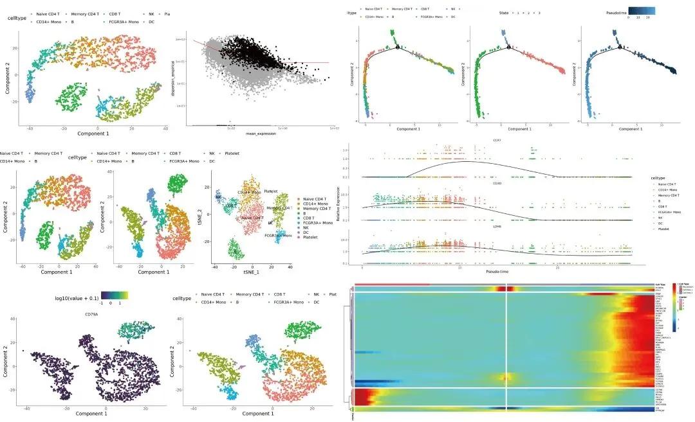

软件安装：
monocle对象的创建与转换：

初探monocle：
拟时序分析：

本次课程所涉及的可复制**代码** 、**测试文件** 可在文末订阅获取或转发找客服微信[Biomamba]领取，当然你也可以参考这里：https://cole-trapnell-lab.github.io/monocle-release/docs/。后续的代码如果不出意外都会在服务器中演示（[生信分析为什么要使用服务器？](<http://mp.weixin.qq.com/s?__biz=MzAwMzIzOTk5OQ==&mid=2247501099&idx=1&sn=78446147184292fad3417495926b3096&chksm=9b3cbc7bac4b356dcf0460781f9bf16df4ede481f8cc57282c7384b9d2baccaa820d64c89bab&scene=21#wechat_redirect>)）。


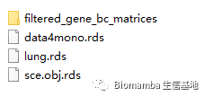


图文教程


本文所用代码可以参考：**https://cole-trapnell-lab.github.io/monocle-release/docs/**

其实在官方的主页上`monocle2`和`monocle3`的alpha版已经不再推荐使用了，由于monocle2还是服役了相当长的时间的，加上发文章需要时间周期，目前主流的文章还是以monocle2为主，不过最新发表的文章也逐渐转变为monocle3了。本人还是先带大家学习一下monocle2

monocle2的三大主要功能：

Clustering：划分细胞亚群

classifying：通过拟时序探索细胞亚群之间的细微差别与联系

counting：差异计算，查看基因表达量

### 一、monocle安装

1、一些已经弃用的安装方法
```
#这些会导致你不知道自己用的是什么版本
#if(!require(monocle))BiocManager::install('monocle')
#3.5以后的R已经不支持biocLite了
# if(!require(monocle)){
#   source("http://bioconductor.org/biocLite.R")
#   biocLite("monocle")
# }
```

2、这部分安装在linux里完成 conda的使用和R包安装安装可以参考： [如何在Linux中安装指定版本的R](<https://mp.weixin.qq.com/s?__biz=MzAwMzIzOTk5OQ==&mid=2247486877&idx=1&sn=9a829acd331a9075fb03881700d19fdd&chksm=9b3f74cdac48fddb9c6404473f4a7254d14811435e055d163ee4b595a5071cd47bf4c892aada&scene=21#wechat_redirect>)

[装着装着我R没了？](<https://mp.weixin.qq.com/s?__biz=MzAwMzIzOTk5OQ==&mid=2247486877&idx=1&sn=9a829acd331a9075fb03881700d19fdd&chksm=9b3f74cdac48fddb9c6404473f4a7254d14811435e055d163ee4b595a5071cd47bf4c892aada&scene=21#wechat_redirect>)
```r
#conda search monocle
#conda create -n monocle.2.18.0
# conda activate monocle.2.18.0
#conda install r-base==4.0.5
#conda install
# conda install bioconductor-monocle==2.18.0

library(monocle)
library(Seurat)
if(!require(dplyr))install.packages('dplyr')
#installed.packages() %>%as.data.frame() %>% filter(Package=='monocle') %>% View()
packageVersion('monocle')#不要用2.21.1以及2.40.0，ordercell的时候会出bug
```
```
## [1] '2.18.0'
```

二、monocle对象的格式:celldataset的创建、转换
```r
#官方给出的cds对象构建过程
# pd <- new("AnnotatedDataFrame", data = mycds_sample_sheet)
# pd <- new("AnnotatedDataFrame", data = sample_sheet)
# fd <- new("AnnotatedDataFrame", data = gene_annotation)
# cds <- newCellDataSet(expr_matrix, phenoData = pd, featureData = fd)

#官方给出的cds对象转换方法
sce.obj<- readRDS('test.data/sce.obj.rds')
class(sce.obj)
## [1] "Seurat"
## attr(,"package")
## [1] "SeuratObject"
try(importCDS(sce.obj))#快速将Seurat对象转换为monocle
## Error in importCDS(sce.obj) :
##   the object type you want to export to is not supported yet
try(importCDS(sce.obj, import_all = TRUE))#如果你想保留Seurat对象中的所有元素
## Error in importCDS(sce.obj, import_all = TRUE) :
##   the object type you want to export to is not supported yet

#lung <- load_lung()#可能有些版本冲突加载不进来
lung <- readRDS('test.data/lung.rds')#下载到本地读取
class(lung)
## [1] "CellDataSet"
## attr(,"package")
## [1] "monocle"
try(lung_seurat <- exportCDS(lung, 'Seurat'))#转换为Seurat对象
## Error in Seurat::CreateSeuratObject(raw.data = data, normalization.method = "LogNormalize",  :
##   argument "counts" is missing, with no default
try(lung_SCESet <- exportCDS(lung, 'Scater'))#转换为Scater对象
## Loading required namespace: scater
## Error in loadNamespace(name) : there is no package called 'scater'

# 这些封装好的函数容易出bug，我这里是通通无法运行，求人不如求自己，自己从Seurat对象里取：
data <- as(as.matrix(sce.obj@assays$RNA@counts), 'sparseMatrix')#直接输入稀疏矩阵比较省内存
data[1:4,1:4]
## 4 x 4 sparse Matrix of class "dgCMatrix"
##               AAACATACAACCAC-1 AAACATTGAGCTAC-1 AAACATTGATCAGC-1
## AL627309.1                   .                .                .
## AP006222.2                   .                .                .
## RP11-206L10.2                .                .                .
## RP11-206L10.9                .                .                .
##               AAACCGTGCTTCCG-1
## AL627309.1                   .
## AP006222.2                   .
## RP11-206L10.2                .
## RP11-206L10.9                .
pd <- new('AnnotatedDataFrame',
          data = sce.obj@meta.data)
fData <- data.frame(gene_short_name = row.names(data),
                    row.names = row.names(data))
fd <- new('AnnotatedDataFrame', data = fData)
mycds <- newCellDataSet(data,
                        phenoData = pd,
                        featureData = fd,
                        expressionFamily = negbinomial.size())
#expressionFamily 需要根据输入数据做出相应的选择
#negbinomial.size()与negbinomial()都是适用于UMI count的输入，而前者计算速度更快，后者运行的更加准确
#tobit() ，适用于截断正态分布(truncated normal distributions)的数据,如FPKM、TPM，monocle处理这类数据会先取log
#gaussianff()，看名字就知道，处理高斯分布的数据，通常是log后的FPKM、TPM，不推荐，因为你所normalization、log的方式未必与monocle相同

class(mycds)
## [1] "CellDataSet"
## attr(,"package")
## [1] "monocle"
#果然，完美运行

#再换回去 cds => seurat.obj
as.data.frame(mycds@phenoData@data)[1:4,1:4]
##                  orig.ident nCount_RNA nFeature_RNA percent.mt
## AAACATACAACCAC-1     pbmc3k       2419          779  3.0177759
## AAACATTGAGCTAC-1     pbmc3k       4903         1352  3.7935958
## AAACATTGATCAGC-1     pbmc3k       3147         1129  0.8897363
## AAACCGTGCTTCCG-1     pbmc3k       2639          960  1.7430845
names(mycds@phenoData@data)
## [1] "orig.ident"      "nCount_RNA"      "nFeature_RNA"    "percent.mt"
## [5] "RNA_snn_res.0.5" "seurat_clusters" "celltype"        "Size_Factor"
class(mycds@assayData$exprs)
## [1] "dgCMatrix"
## attr(,"package")
## [1] "Matrix"

m2seurat <- CreateSeuratObject(counts = mycds@assayData$exprs,
                               meta.data = mycds@phenoData@data)
class(m2seurat)#没问题
## [1] "Seurat"
## attr(,"package")
## [1] "SeuratObject"

#那就拿构建好的mycds开始浅学一下monocle
```

三、初探monocle

1、预处理、质控
```r
mycds <- estimateSizeFactors(mycds)
mycds <- estimateDispersions(mycds)#评估表达矩阵的离散度,这一步相当于Seurat::FindVariableFeatures()
## Warning: `group_by_()` was deprecated in dplyr 0.7.0.
## Please use `group_by()` instead.
## See vignette('programming') for more help
## This warning is displayed once every 8 hours.
## Call `lifecycle::last_lifecycle_warnings()` to see where this warning was generated.
## Warning: `select_()` was deprecated in dplyr 0.7.0.
## Please use `select()` instead.
## This warning is displayed once every 8 hours.
## Call `lifecycle::last_lifecycle_warnings()` to see where this warning was generated.
## Warning: glm.fit: algorithm did not converge
## Removing 276 outliers

#质控(可选) 去除死细胞、空液滴、碎细胞液滴、双液滴，提高计算准确度、降低运算时间
mycds <- detectGenes(mycds, min_expr = 0.1)
head(fData(mycds))
##               gene_short_name num_cells_expressed
## AL627309.1         AL627309.1                   9
## AP006222.2         AP006222.2                   3
## RP11-206L10.2   RP11-206L10.2                   5
## RP11-206L10.9   RP11-206L10.9                   3
## LINC00115           LINC00115                  18
## NOC2L                   NOC2L                 254
mycds_expressed_genes <- row.names(subset(fData(mycds),
                                          num_cells_expressed >= 10))
mycds_expressed_genes[1:5]
## [1] "LINC00115" "NOC2L"     "HES4"      "ISG15"     "C1orf159"
mycds <- mycds[mycds_expressed_genes,]

length(row.names(sce.obj))
## [1] 13714
length(mycds_expressed_genes)
## [1] 11095

#如果你有做过质控分析存在pd里，可以向下面这个取子集，
#这里我们用的不是参考数据，不做，质控我们会用专门的课程去讲解
# valid_cells <- row.names(subset(pData(mycds),
#                                 Cells.in.Well == 1 &
#                                   Control == FALSE &
#                                   Clump == FALSE &
#                                   Debris == FALSE &
#                                   Mapped.Fragments > 1000000))

# mycds <- mycds[,valid_cells]
```

2、细胞降维、分群、鉴定
```r
#我们说过monocle是可以用来鉴定细胞类型的
#如果你拥有一些先验知识，你可以通过设定一定的阈值来鉴定细胞
#比如我们之前命名好的Seurat.obj
future::plan("multiprocess", workers = 10)
## Warning: Strategy 'multiprocess' is deprecated in future (>= 1.20.0)
## [2020-10-30]. Instead, explicitly specify either 'multisession' (recommended) or
## 'multicore'. In the current R session, 'multiprocess' equals 'multisession'.
## Warning in supportsMulticoreAndRStudio(...): [ONE-TIME WARNING] Forked
## processing ('multicore') is not supported when running R from RStudio
## because it is considered unstable. For more details, how to control forked
## processing or not, and how to silence this warning in future R sessions, see ?
## parallelly::supportsMulticore
seu.marker <- FindAllMarkers(sce.obj)
## Calculating cluster Naive CD4 T
## Calculating cluster CD14+ Mono
## Calculating cluster Memory CD4 T
## Calculating cluster B
## Calculating cluster CD8 T
## Calculating cluster FCGR3A+ Mono
## Calculating cluster NK
## Calculating cluster DC
## Calculating cluster Platelet
top10gene <- seu.marker %>% group_by(cluster) %>% top_n(n = 10, wt = avg_log2FC)
top10gene %>% filter(cluster=='B')
## # A tibble: 10 × 7
## # Groups:   cluster [1]
##        p_val avg_log2FC pct.1 pct.2 p_val_adj cluster gene
##        <dbl>      <dbl> <dbl> <dbl>     <dbl> <fct>   <chr>
##  1 0               4.31 0.936 0.041 0         B       CD79A
##  2 0               3.38 0.855 0.053 0         B       MS4A1
##  3 2.66e-274       3.48 0.916 0.142 3.64e-270 B       CD79B
##  4 2.40e-272       2.84 0.564 0.009 3.29e-268 B       LINC00926
##  5 9.48e-271       3.59 0.622 0.022 1.30e-266 B       TCL1A
##  6 2.94e-266       3.06 0.89  0.118 4.04e-262 B       HLA-DQA1
##  7 1.17e-229       3.08 0.863 0.147 1.61e-225 B       HLA-DQB1
##  8 5.26e-185       2.92 1     0.821 7.21e-181 B       CD74
##  9 1.95e-183       2.76 1     0.494 2.68e-179 B       HLA-DRA
## 10 5.75e- 85       3.45 0.233 0.012 7.88e- 81 B       IGLL5
top10gene %>% filter(cluster=='NK')
## # A tibble: 10 × 7
## # Groups:   cluster [1]
##        p_val avg_log2FC pct.1 pct.2 p_val_adj cluster gene
##        <dbl>      <dbl> <dbl> <dbl>     <dbl> <fct>   <chr>
##  1 7.95e-269       4.83 0.961 0.068 1.09e-264 NK      GZMB
##  2 3.41e-237       4.05 0.877 0.062 4.67e-233 NK      FGFBP2
##  3 4.16e-219       3.30 0.729 0.039 5.71e-215 NK      SPON2
##  4 4.85e-206       4.00 0.948 0.107 6.65e-202 NK      PRF1
##  5 3.13e-191       5.32 0.961 0.131 4.30e-187 NK      GNLY
##  6 4.21e-155       3.25 0.948 0.149 5.77e-151 NK      CST7
##  7 5.93e-149       3.13 0.929 0.152 8.13e-145 NK      GZMA
##  8 6.09e-140       4.04 1     0.255 8.35e-136 NK      NKG7
##  9 5.29e-138       3.59 0.71  0.077 7.25e-134 NK      CCL4
## 10 3.67e-109       2.91 0.548 0.058 5.04e-105 NK      IGFBP7

CD79A_id <- row.names(subset(fData(mycds), gene_short_name == "CD79A"))
GZMB_id <- row.names(subset(fData(mycds),
                            gene_short_name == "GZMB"))

cth <- newCellTypeHierarchy()
cth <- addCellType(cth, "B", classify_func =
                     function(x) { x[CD79A_id,] >= 1 })
cth <- addCellType(cth, "NK", classify_func = function(x)
{ x[CD79A_id,] < 1 & x[GZMB_id,] > 1 })
class(cth)
## [1] "CellTypeHierarchy"
## attr(,"package")
## [1] "monocle"

mycds <- classifyCells(mycds, cth, 0.1)
table(pData(mycds)$CellType)
##
##       B      NK Unknown
##     417     198    2023
#没有NK，看来阈值选的不对，作者也表示这种标识方法是会受到单细胞测序的测序深度影响，那我们也就不继续往下标了，
#总之monocle的注释就图一乐吧，我们已经在Seurat中做了比较好的注释了

#这是monocle的，当然这里只是一个简单的尝试
pm <- ggplot(pData(mycds),
             aes(x = factor(1),
                 fill = factor(CellType))) + geom_bar(width = 1)+
  coord_polar(theta = "y") +
  theme(axis.title.x = element_blank(),
        axis.title.y = element_blank())

#这是seurat注释的
ps<-ggplot(pData(mycds),
           aes(x = factor(1),
               fill = factor(celltype))) + geom_bar(width = 1)+
  coord_polar(theta = "y") +
  theme(axis.title.x = element_blank(),
        axis.title.y = element_blank())
pm|ps#按表达量分群这种操作Seurat肯定也效果不好
```

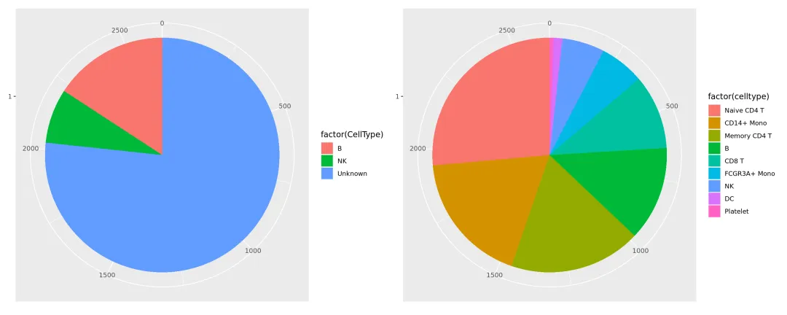
```r
#当然，monocle也可以用非监督式的方法进行分群：
#找出一些表达量高得高变基因来，这些基因可能是会参与细胞命运得决定得
disp_table <- dispersionTable(mycds)#这步其实有点像 Seurat::FindVariableFeatures()
unsup_clustering_genes <- subset(disp_table, mean_expression >= 0.1)
length(unsup_clustering_genes$gene_id)#大概两千多个“离散基因”
## [1] 2252
mycds <- setOrderingFilter(mycds, unsup_clustering_genes$gene_id)
plot_ordering_genes(mycds)
## Warning: Transformation introduced infinite values in continuous y-axis
## Warning: Transformation introduced infinite values in continuous y-axis
```

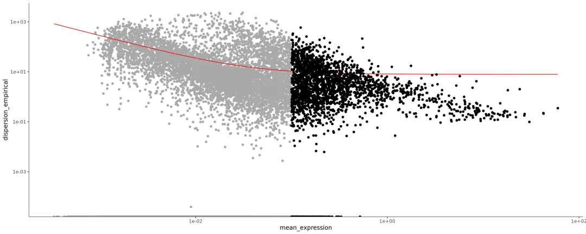
```
#平均表达值与离散度（可变性较高的基因被标为黑点，而灰色的点会被下游分析弃用）

plot_pc_variance_explained(mycds, return_all = F) #这其实就是Seurat里的肘图
```

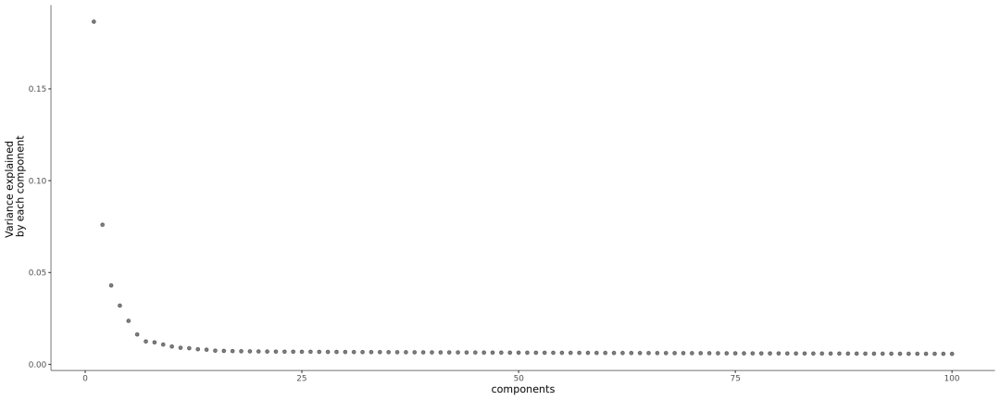
```r
mycds <- reduceDimension(mycds, max_components = 2, num_dim = 6,
                         reduction_method = 'tSNE', verbose = T)#降维
## Remove noise by PCA ...
## Reduce dimension by tSNE ...
#monocle分群可以指定分群的数量
cluster.num <- length(unique(sce.obj$celltype))
cluster.num
## [1] 9
mycds <- clusterCells(mycds, num_clusters = cluster.num)
## Distance cutoff calculated to 3.639641
mono.redu <- plot_cell_clusters(mycds, 1, 2, color = "celltype",
                                show_cell_names =T,
                                cell_name_size =5)
mono.redu
```

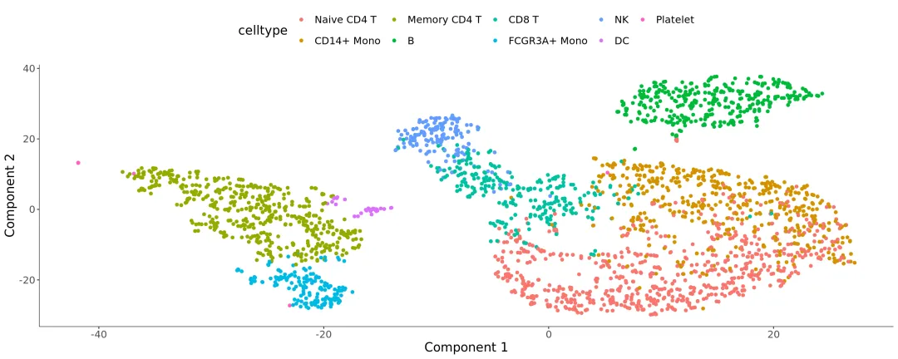
```r
library(patchwork)
plot_cell_clusters(mycds, 1, 2, color = "celltype",
                   markers = c("CD79A"),
                   show_cell_names =T,
                   cell_name_size =5)|mono.redu
```

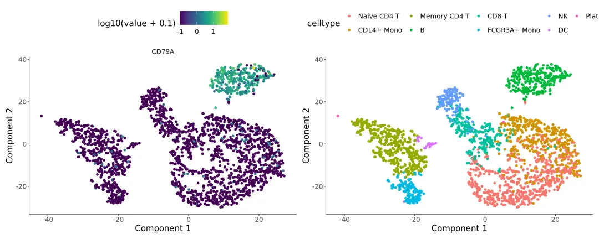
```
plot_cell_clusters(mycds, 1, 2, color = "celltype",
                   markers = c("GZMB"),
                   show_cell_names =T,
                   cell_name_size =5)|mono.redu
```

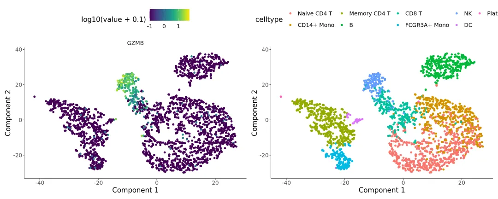
```r
#我看了一下输入参数里是有show_cell_names的，但是源码中没有用到，作者可能把这个参数遗忘了

#### 看一下与Seurat的差别，基本形状还是差不多的，但是人家的label是可以展示的
seu.tsne <- DimPlot(sce.obj,label = T,reduction = 'tsne')
plot_cell_clusters(mycds, 1, 2, color = "celltype",
                   show_cell_names =T,
                   cell_name_size =10)|seu.tsne
```

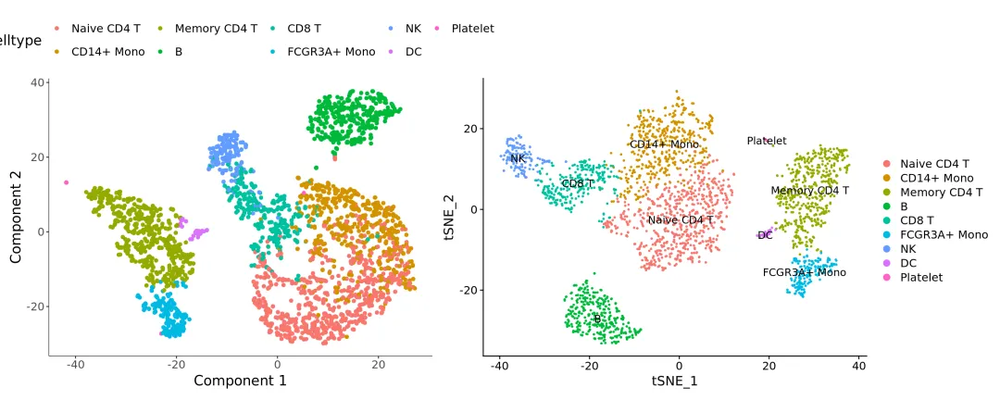
```r
#### 这里相当于Seurat regression，排除一些不想要的因素
names(pd@data)
## [1] "orig.ident"      "nCount_RNA"      "nFeature_RNA"    "percent.mt"
## [5] "RNA_snn_res.0.5" "seurat_clusters" "celltype"

mycds <- reduceDimension(mycds, max_components = 2, num_dim = 2,
                         reduction_method = 'tSNE',
                         residualModelFormulaStr = "~percent.mt",
                         verbose = T)
## Removing batch effects
## Remove noise by PCA ...
## Reduce dimension by tSNE ...
mycds <- clusterCells(mycds, num_clusters = 9)
## Distance cutoff calculated to 4.127304
reg.tsne <- plot_cell_clusters(mycds, 1, 2, color = "celltype")#感觉数据分布的更加不好了，看来nFeature_RNA
reg.tsne|mono.redu
```

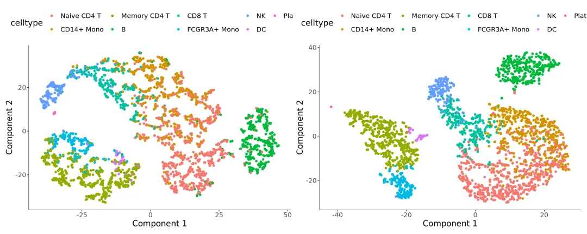
```r
mycds <- reduceDimension(mycds, max_components = 2, num_dim = 2,
                         reduction_method = 'tSNE',
                         residualModelFormulaStr = "~nFeature_RNA + percent.mt",#两个变量的影响一起排除
                         verbose = T)
## Removing batch effects
## Remove noise by PCA ...
## Reduce dimension by tSNE ...
mycds <- clusterCells(mycds, num_clusters = 9)
## Distance cutoff calculated to 4.515581
reg2.tsne<-plot_cell_clusters(mycds, 1, 2, color = "celltype")
#感觉数据分布的更加不好了，看来nFeature_RNA
mono.redu|reg.tsne|reg2.tsne
```

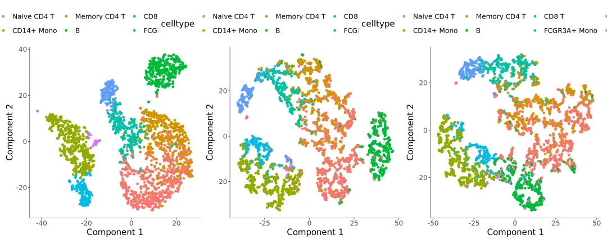
```
plot_cell_clusters(mycds, 1, 2, color = "celltype") +
  facet_wrap(~celltype)#可以分面展示，所以说其实monocle的图本质上也都是用ggplot2画的
```

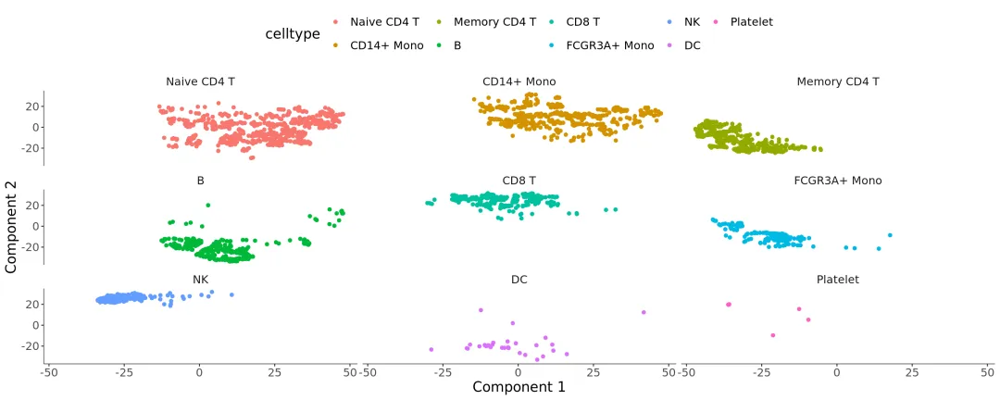
```r
#用monocle计算一下marker，看看降维效果如何
diff_test_res <- differentialGeneTest(mycds[mycds_expressed_genes,],
                                      fullModelFormulaStr = "~celltype")
#这一步就相当于Seurat里的findallmarker，不能多线程，狠麻烦，会算很久
diff_test_res[1:4,1:4]
##           status           family         pval         qval
## LINC00115     OK negbinomial.size 9.547089e-01 9.716102e-01
## NOC2L         OK negbinomial.size 4.047651e-01 5.783723e-01
## HES4          OK negbinomial.size 1.118682e-45 6.430970e-44
## ISG15         OK negbinomial.size 2.504851e-22 6.148523e-21

ordering_genes <- row.names (subset(diff_test_res, qval < 0.01))
mycds <- setOrderingFilter(mycds, ordering_genes)
plot_ordering_genes(mycds)#看的出来monocle和seurat对于高变基因的选择有所不同的
## Warning: Transformation introduced infinite values in continuous y-axis
## Transformation introduced infinite values in continuous y-axis
```

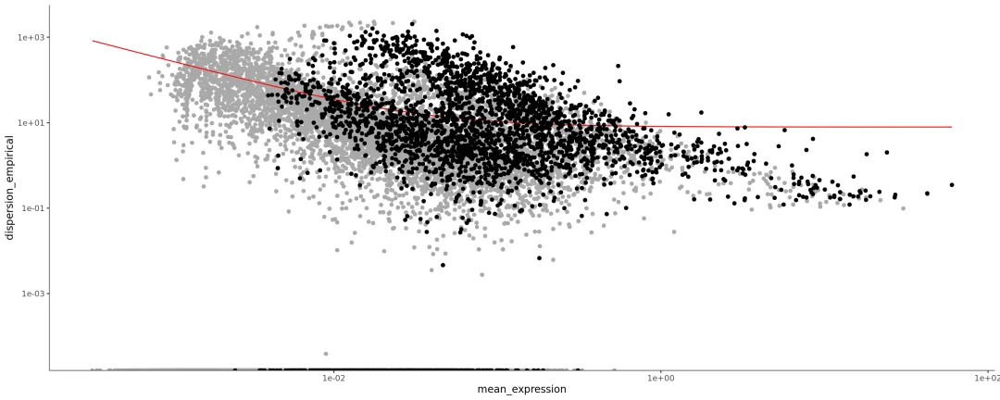
```r
mycds <- reduceDimension(mycds, max_components = 2, num_dim = 3,
                         norm_method = 'log',
                         reduction_method = 'tSNE',
                         # residualModelFormulaStr = "~Media + num_genes_expressed",
                         verbose = T)
## Remove noise by PCA ...
## Reduce dimension by tSNE ...
mycds <- clusterCells(mycds, num_clusters = 9)
## Distance cutoff calculated to 3.935338
mono.gene.tsne <-plot_cell_clusters(mycds, 1, 2, color = "celltype")

mono.gene.tsne|mono.redu|seu.tsne
```

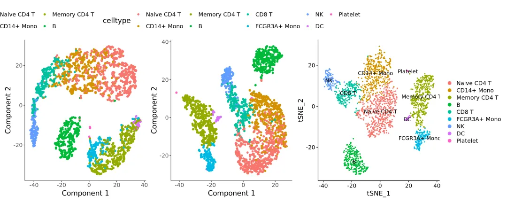
```r
#我们不用monocle内置的选择进行降维，如果我们适用Seurat里找出的高变基因进行降维会怎样呢
seu.var.gene <- Seurat::VariableFeatures(sce.obj)
length(seu.var.gene)
## [1] 2000
mycds <- setOrderingFilter(mycds, seu.var.gene)
mycds <- reduceDimension(mycds, max_components = 2, num_dim = 3,
                         norm_method = 'log',
                         reduction_method = 'tSNE',
                         # residualModelFormulaStr = "~Media + num_genes_expressed",
                         verbose = T)
## Remove noise by PCA ...
## Reduce dimension by tSNE ...
mycds <- clusterCells(mycds, num_clusters = 9)
## Distance cutoff calculated to 3.913686

seu.var.plot <- plot_ordering_genes(mycds)#看的出来monocle和seurat对于高变基因的选择有所不同的
mono.gene.tsne|seu.var.plot
## Warning: Transformation introduced infinite values in continuous y-axis
## Transformation introduced infinite values in continuous y-axis
```

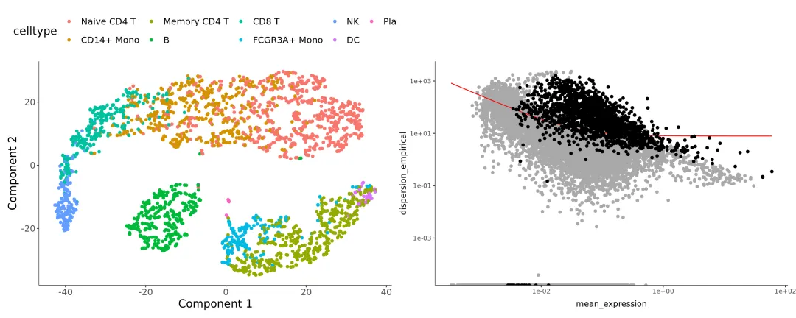
```
#说实话，seurat用惯了，用monocle处理这些分群和降维的信息，真的很难受
```

四、拟时序 有选择先验(半监督式)/高变基因(非监督式)两种机器学习供大家选择

1、半监督式拟时序
```r
##### 正式开始拟时序
#生物学意义就不多描述了，大家可以看一下前两讲
#第一步：，
#这一步主要作用是去噪、提取真正对拟时序有用的基因矩阵，这会影响拟时序的形状
#半监督式：寻找自己感兴趣的，这里我们先用各celltype之间的marker gene尝试一下
diff_test_res <- differentialGeneTest(mycds[mycds_expressed_genes,],
                                      fullModelFormulaStr = "~celltype")
diff_test_res[1:4,1:4]
##           status           family         pval         qval
## LINC00115     OK negbinomial.size 9.547089e-01 9.716102e-01
## NOC2L         OK negbinomial.size 4.047651e-01 5.783723e-01
## HES4          OK negbinomial.size 1.118682e-45 6.430970e-44
## ISG15         OK negbinomial.size 2.504851e-22 6.148523e-21
#这一步就相当于Seurat里的findallmarker，不能多线程，狠麻烦，会算很久
ordering_genes <- row.names (subset(diff_test_res, qval < 0.01))
ordering_genes[1:5]
## [1] "HES4"     "ISG15"    "TNFRSF18" "TNFRSF4"  "SDF4"

mycds <- setOrderingFilter(mycds, ordering_genes)
plot_ordering_genes(mycds)
## Warning: Transformation introduced infinite values in continuous y-axis
## Transformation introduced infinite values in continuous y-axis
```


```r
#第二步：利用Reversed Graph Embedding降维
mycds <- reduceDimension(mycds, max_components = 2,
                         method = 'DDRTree')
#第三步：计算细胞的拟时间
suppressWarnings(mycds <- orderCells(mycds))

#展示轨迹图的方法
plot_cell_trajectory(mycds, color_by = "celltype")|
  plot_cell_trajectory(mycds, color_by = "State")|#根据拟时间的顺序，可以将细胞分为不同的state
  plot_cell_trajectory(mycds, color_by = "Pseudotime")#来看看拟时间吧
```

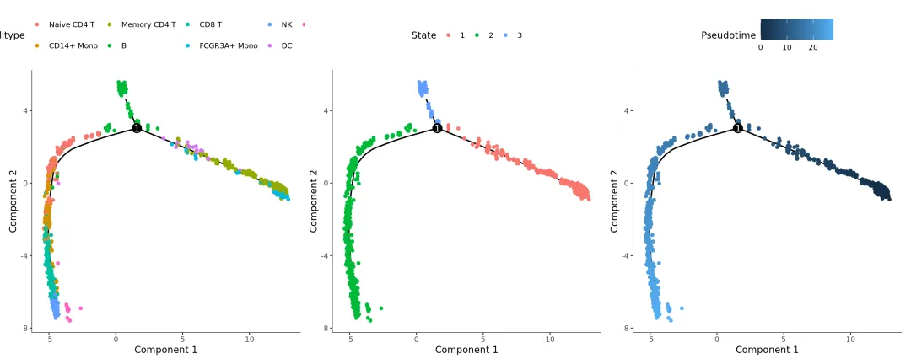
```r
# select.col <-c('#E5D2DD', '#53A85F', '#F1BB72', '#F3B1A0', '#D6E7A3', '#57C3F3', '#476D87',
#                '#E95C59', '#E59CC4', '#AB3282', '#23452F', '#BD956A', '#8C549C', '#585658',
#                '#9FA3A8', '#E0D4CA', '#5F3D69', '#C5DEBA', '#58A4C3', '#E4C755', '#F7F398',
#                '#AA9A59', '#E63863', '#E39A35', '#C1E6F3', '#6778AE', '#91D0BE', '#B53E2B',
#                '#712820', '#DCC1DD', '#CCE0F5',  '#CCC9E6', '#625D9E', '#68A180', '#3A6963',
#                '#968175'
# )
# plot_cell_trajectory(mycds, color_by = "celltype")

#####注意 拟时间可能会与实际的生物学方向相反，如果你具有一定的先验知识，那么你可以反转这一进程
ori.pse <- plot_cell_trajectory(mycds, color_by = "Pseudotime")
suppressWarnings(mycds <- orderCells(mycds,reverse = T))
revserse.pse <- plot_cell_trajectory(mycds, color_by = "Pseudotime")
ori.pse|revserse.pse#很明显，拟时序进行了一个重新排序
```

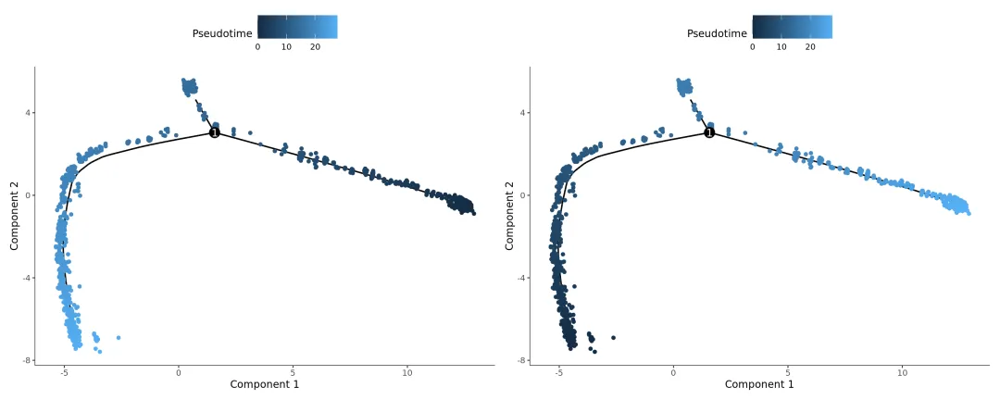
```
#如果你觉得混在一起看不清楚
plot_cell_trajectory(mycds, color_by = "State") +
  facet_wrap(~State, nrow = 1)
```

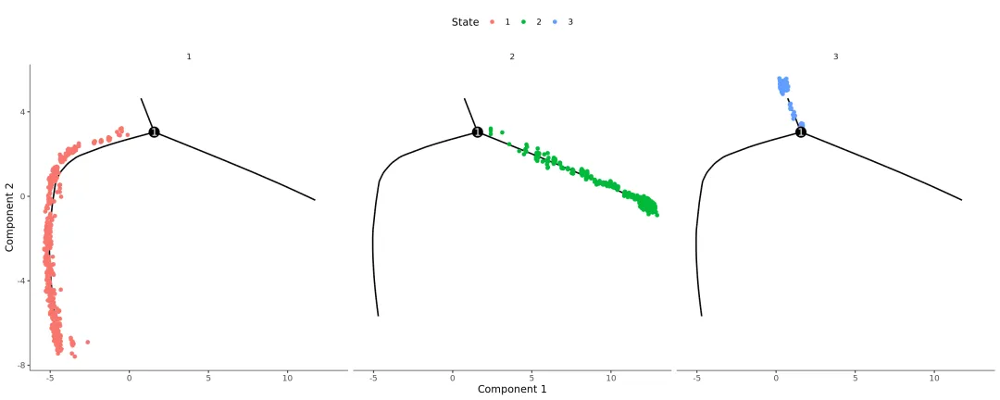
```
plot_cell_trajectory(mycds, color_by = "State") +
  facet_wrap(~celltype, nrow = 1)
```

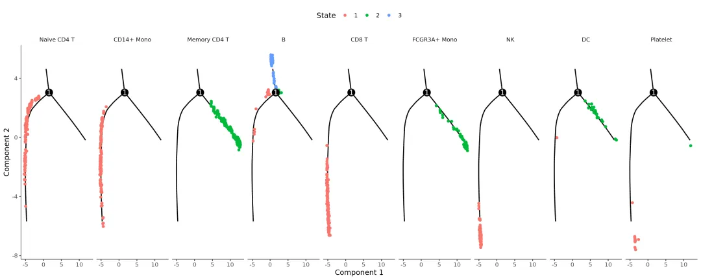
```r
blast_genes <- diff_test_res$gene_short_name[1:10]
plot_genes_jitter(mycds[blast_genes,],
                  grouping = "State",
                  min_expr = 0.1)#如果你觉得丑，没有拟合曲线，可以试试下面这个
```

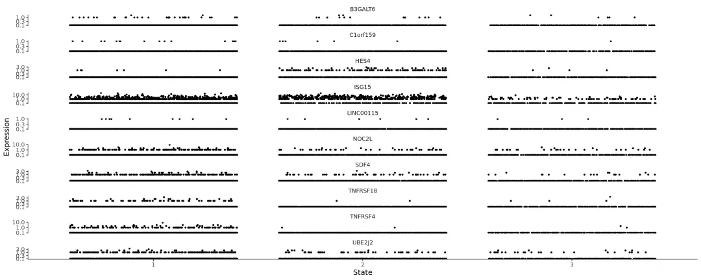
```r
mycds_expressed_genes <-  row.names(subset(fData(mycds),
                                           num_cells_expressed >= 10))
mycds_filtered <- mycds[mycds_expressed_genes,]

top10gene
## # A tibble: 90 × 7
## # Groups:   cluster [9]
##        p_val avg_log2FC pct.1 pct.2 p_val_adj cluster     gene
##        <dbl>      <dbl> <dbl> <dbl>     <dbl> <fct>       <chr>
##  1 1.96e-107      1.05  0.901 0.594 2.69e-103 Naive CD4 T LDHB
##  2 1.61e- 82      1.33  0.436 0.11  2.20e- 78 Naive CD4 T CCR7
##  3 4.20e- 77      0.952 0.838 0.406 5.76e- 73 Naive CD4 T CD3D
##  4 3.19e- 50      0.999 0.628 0.358 4.38e- 46 Naive CD4 T NOSIP
##  5 3.32e- 49      1.05  0.336 0.104 4.56e- 45 Naive CD4 T LEF1
##  6 2.50e- 44      1.03  0.331 0.11  3.43e- 40 Naive CD4 T PRKCQ-AS1
##  7 7.61e- 43      0.938 0.438 0.185 1.04e- 38 Naive CD4 T PIK3IP1
##  8 3.32e- 39      0.869 0.197 0.041 4.55e- 35 Naive CD4 T FHIT
##  9 6.49e- 33      0.926 0.263 0.088 8.89e- 29 Naive CD4 T MAL
## 10 7.37e- 30      1.10  0.245 0.084 1.01e- 25 Naive CD4 T LDLRAP1
## # … with 80 more rows
cds_subset <- mycds_filtered[c('LDHB','CCR7','CD3D'),]
plot_genes_in_pseudotime(cds_subset, color_by = "celltype")
```

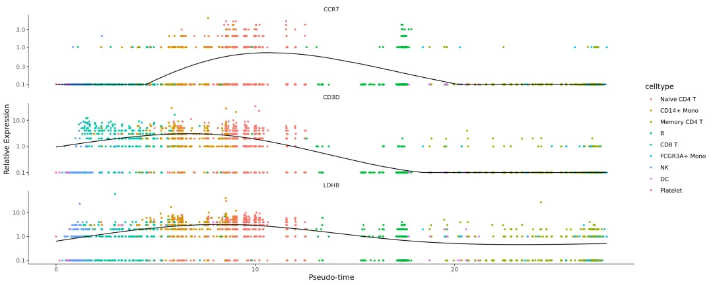

2、非监督式的
```r
##### 刚才是半监督式的，现在来个非监督式的
#重来
#1、按照cluster基因做拟时序
mycds <- newCellDataSet(data,
                        phenoData = pd,
                        featureData = fd,
                        expressionFamily = negbinomial.size())
mycds <- estimateSizeFactors(mycds)
mycds <- estimateDispersions(mycds, cores=10, relative_expr = TRUE)
## Warning: glm.fit: algorithm did not converge
## Removing 276 outliers

mycds <- detectGenes(mycds, min_expr = 0.1)#看看哪些基因表达了
fData(mycds)$use_for_ordering <-
  fData(mycds)$num_cells_expressed > 0.05 * ncol(mycds)
expr.genes <- fData(mycds)$gene_short_name[fData(mycds)$use_for_ordering]
mycds <- setOrderingFilter(mycds, ordering_genes =expr.genes )
mycds <- reduceDimension(mycds, max_components = 2, method = 'DDRTree')
#mycds <- orderCells(mycds)

plot_ordering_genes(mycds)
## Warning: Transformation introduced infinite values in continuous y-axis
## Warning: Transformation introduced infinite values in continuous y-axis
```

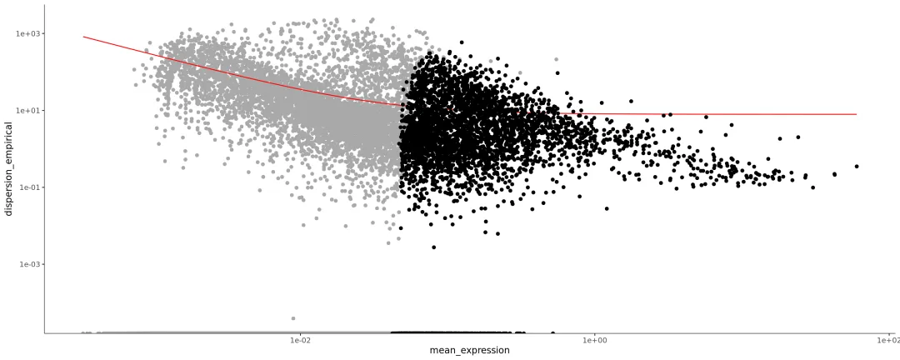
