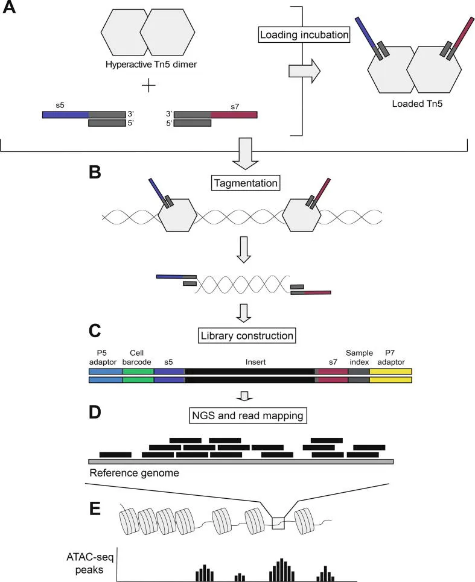
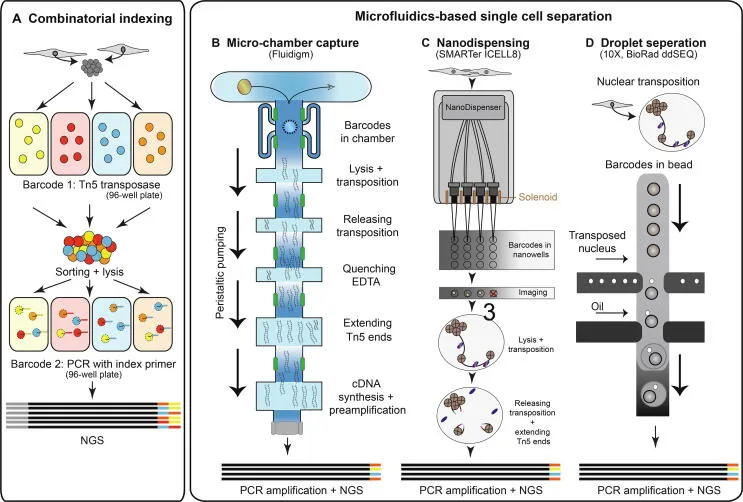
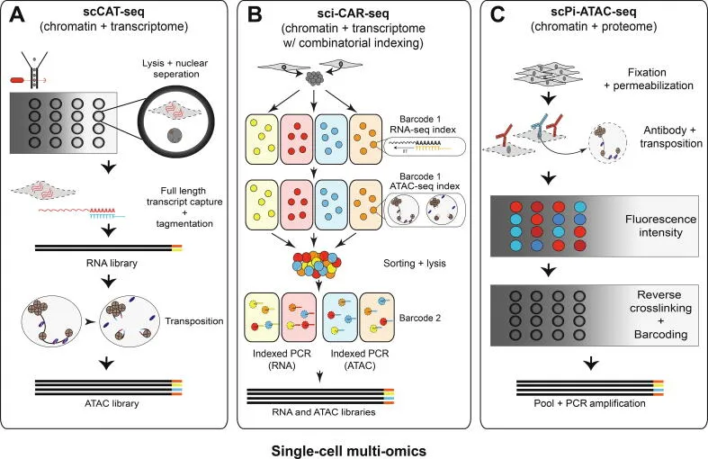
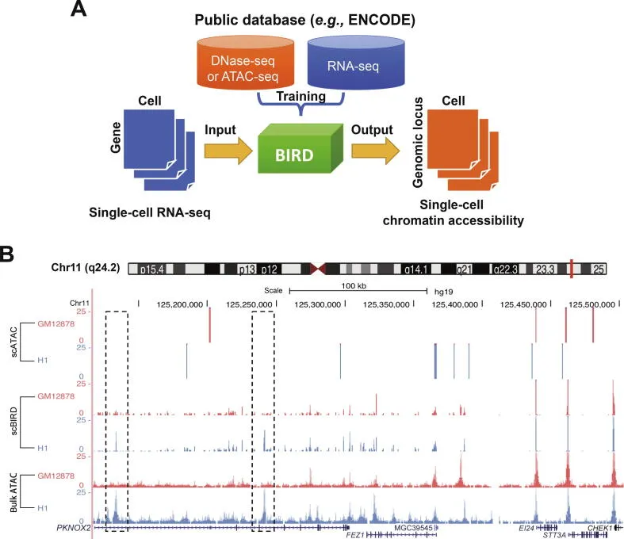

# 一文了解单细胞染色质及常见分析

> 原文：https://mp.weixin.qq.com/s?__biz=MzAwMzIzOTk5OQ==&mid=2247522998&idx=1&sn=843d378d3b679951ad3c8e5da7c32d87&chksm=9b3ce3e6ac4b6af02091a4bdd23c2366cb40e06637d74f0a1a634b125de3a9f76a68a2f141d5#rd
> 合集：单细胞教程全收录 / 文献速递

**一、写在前面**

`scRNA-seq`能够帮助我们解析细胞特异性表达模型，但基因调控的过程([SCENIC](<http://mp.weixin.qq.com/s?__biz=MzAwMzIzOTk5OQ==&mid=2247500439&idx=1&sn=d6b4874a8352f5b7a4165629c03058ce&chksm=9b3cbbc7ac4b32d158fd3c5c2f155c54c892d40eaae3718409936fc319f69705da32badf79d6&scene=21#wechat_redirect>)可以通过表达量来反推，但无法直接观察到)与染色质活动情况则是这项技术的盲区。我们都知道，细胞内的调控往往存在级联放大效应，对于染色质景观的研究更利于我们理解生物学现象，而染色质可及性便是其中的一种重要手段。在基因的表达过程中，染色质可及性会发生一系列的改变，通过暴露不同的启动子、增强子和其它顺式调控元件(这个过程中就涉及染色质可及性的改变)，可以使转录因子能够结合在染色质上调节相应基因的表达。染色质可及性（chromatin accessibility）是指染色质中DNA序列的可接触性和可转录性的程度。它涉及DNA如何被包裹在组蛋白和其他染色质蛋白质中，从而影响基因的表达和转录。染色质可及性越高，DNA区域越容易被转录因子和其他调控因子访问，从而更容易进行转录和表达。染色质可及性的变化对基因调控、细胞分化以及许多生物过程有重要影响。因此，染色质可及性的研究通常被用于基因表达调控或表观遗传学的研究之中。常用的染色质可及性测定技术包括染色质免疫沉淀测序（ChIP-seq）、ATAC-seq（Assay for Transposase-Accessible Chromatin with high-throughput sequencing）等。我们已经制作了scATAC的学习手册：[scATAC分析学习手册](<http://mp.weixin.qq.com/s?__biz=MzAwMzIzOTk5OQ==&mid=2247521636&idx=1&sn=208907010f3f7412c1c91343d7dfb0d3&chksm=9b3cec34ac4b6522977cb002919634af5334eec170b32f4961826dafb42f44f611144b159b2b&scene=21#wechat_redirect>)在制作每个教程时，我们都建议大家了解分析背后的背景知识，学习这部分数据分析之前，我们先和大家一起看一篇综述：
Sinha S, Satpathy AT, Zhou W, Ji H, Stratton JA, Jaffer A, Bahlis N, Morrissy S, Biernaskie JA. Profiling Chromatin Accessibility at Single-cell Resolution. Genomics Proteomics Bioinformatics. 2021 Apr;19(2):172-190.

**二、主要内容**

## **1、染色质可及性**

见写在前面部分

## **2、` scATAC-seq`文库构建**

细胞内的**Tn5转座酶** 能够通过“剪切和粘贴”机制催化转座子向基因组不同部分的运动。改造后的高活性版Tn5转座酶可用于`ATAC-seq` 中用于检测基因组中**无核小体区域**(正常处于非表达状态的异染色质以核小体为基本单位紧密堆积，从而形成很高的空间位阻，Tn5转座酶无法作用于这些部位。而转录前通常伴随着核小体的解聚，这种部位的染色质可及性更高，为Tn5转座酶的作用提供了可能)的关键元件。改造后的Tn5转座酶包含连接序列(测序的接头、样本标识符)(Figure 1A)，实验中导入细胞核后便能切割暴露的DNA并切割的序列，连接上Tn5转座酶所带上的标记序列(Figure 1C)。经过NGS测序后(Figure 1D)，我们通过对`reads`向基因组的比对，理论上来说获得`reads`数越多的区域，染色质可及性就越高(Figure 1E)。`DNase-seq`、`ChIP-seq`通常要几十个小时，而`ATAC-seq`的建库通常能够在几个小时内完成。

图1 ATAC-seq建库流程

对`scRNA-Seq`熟悉的同学可能已经想到了，把`ATAC-Seq`改造成`scATAC-Seq`，那在Tn5连接的核酸序列上加上细胞条形码(cell barcode)不就搞定了？事实也是如此，早期`Shendure`课题组使用组合的细胞标签在96孔板中标记`Tn5`转座酶，然后将15~25个细胞核分配到另外一个孔板进行`Tn5`转座酶的处理，新的孔板在PCR过程中也会加上新的标签，这样通过`Tn5`转座酶所带的标签、`PCR`引入的标签这两套”组合条形码”来区分`reads`的细胞来源(Figure 2A)，，最多一次性可以分析15000个细胞，每个细胞读数约2500。`Chang/Greenleaf`实验室则是用微流体芯片完成了类似的建库，这种建库方法通常能够捕获~1600个细胞，但每个细胞的读数平均可达73000个(Figure 2B)。目前应用最广泛的还是`10X Genomics`提供的方案，其利用微流控技术，可以将10000个细胞核分割在纳米级液滴中，体系中共包含750000个`UMI`，最多可以对6000个细胞进行标记(Figure2 B)。当然，`scATAC`现在有许多”升级版”，例如通过”向导条形码”可以完成靶向基因组特定区域的`ATAC`，即`Perturb-ATAC`。更多变种不再介绍，感兴趣的同学可以看一下原文。

Figure 2

## **3、` scATAC-seq`的多组学联合**

现如今，单一的组学越来越难以满足大家的科研需求，多组学的联合分析以及交叉验证成为了趋势。例如将`scATAC`与`scRNA`联用可揭示新的顺式调控元件，并揭示其对基因表达的影响。目前已有方法同时分析来自单个细胞的染色质和转录组，例如single-cell Chromatin Accessibility and Transcriptome Sequencing(scCAT-seq, Figure 4A)，能够将单细胞分选到96孔板中，使用物理方法使细胞膜破裂，这样细胞核与胞质就能够解离，这时可以分别对核进行`scATAC-seq`的建库与`Smart-seq2`的建库(获得单细胞全长转录组)。

Figure 4

## **4、scATAC-seq分析**

` scATAC-seq`面临着与`scRNA-seq`一样的难点——稀疏性。相对于`Bulk`级别的技术而言，`scATAC`中每个细胞能够获得的`reads`数大大减少。相比于转录组而言，scATAC-seq的位点更多、矩阵更大，稀疏性也更高。这就造成了，一个位点的0读数可能存在两种可能：1是这个染色质位点区域真的不开放，可及性很低；2是由于转座酶作用效率或测序深度的原因未能检出。当然，这些问题主要交给开发者来头疼，大家无需担心。`scATAC`的基础分析通常包括：
(1)**原始数据→矩阵**(测序接头去除、低质量序列过滤、双端`reads`匹配、基因组定量)
(2)**Feature定义**(将信号划分为预定义的TF基序/基因注释列表，可以降低数据集的方差)
(3)**异质性计算**(这里大家可以类比`scRNA-seq`中的高变基因选择，通过`Feature`的选择可以让下游的降维、分群等操作信噪比更高，例如`SCRAT` 可以聚集共激活位点以获得通路水平的可及性)
(4)**降维、聚类分群**(scATAC通常是一个很大的矩阵，约几千细胞`X`几万个位点，降维对后续的分析非常重要，单细胞常用的tSNE、UMAP在这里也同样可以使用。降维后的数据可用于分群，常用的方法为`k-medoid`)当然，`scATAC`也包含很多进阶分析的内容，常见的有：
(1)通过染色质协同可及性预测**DNA相互作用**
顺式调控序列能够参与长距离相互作用以募集转录机制和控制基因表达的机制，并且高度特定于细胞类型、状态和环境。Shendure/Trapnell实验室(没错就是上面那个开发`scATAC`建库流程的实验室)开发的`Cicero`，能够在通过映射启动子与其他监管位点的共同可及性来推断这些相互作用。结合`monocle`(B站教程点击跳转)中的轨迹推断算法， 能够探究基因程序的顺式调控过程随着拟时序的变化。(2)**TF预测**
相比于单细胞中使用`SCENIC`(B站教程可点击跳转)通过对转录组的表达反推TF活性，显然在`scATAC`数据中通过染色质可及性判断TF活动更加的直接。例如`cisTopic`可以将`Tn5`转座酶的访问区域分配给不同的调控过程，然后基于这些调控过程而不是信号位点进行细胞分组，能够更敏感的区分细胞类型与状态。(3)通过**转录组推测** 染色质可及性
这部分分析其实属于`scRNA-seq`的内容，有课题组通过联合`scRNA-seq`数据和的`Dnase-seq`与`RNA-seq`数据来训练模型，利用模型及Big Data Regression for Predicting DNase I hypersensitivity (RIRD)算法预测`scRNA-seq`数据的全基因组染色质可及性。使用包含30~100个细胞的`scRNA-seq`的染色质可及性预测结果甚至比来源于500个细胞的`ATAC-seq`数据重建细胞类型的能力更强。(Figure 5B)。不过这种预测需要依赖大量的预训练与训练数据，这就导致目前更适合应用在人类、小鼠这类发布数据量大的物种(SRA中94%的 `scRNA-seq`样本来源于小鼠与人类)。对这部分内容感兴趣的同学可以参考如下两瓶文章：
Zhou W, Ji Z, Fang W, Ji H. Global prediction of chromatin accessibility using small-cell-number and single-cell RNA-seq. Nucleic Acids Res 2019;47:e121.
Zhou W., Sherwood B., Ji Z., Xue Y., Du F., Bai J., et al. Genome-wide prediction of dnase i hypersensitivity using gene expression. Nat Commun. 2017;8:1038.

**Figure 5**

**如何联系我们**

 公众号后台消息回复不便，这里给大家留一下领取资料及免费服务器([足够支持你完成硕博生涯的生信环境](<http://mp.weixin.qq.com/s?__biz=MzAwMzIzOTk5OQ==&mid=2247507693&idx=1&sn=d9517a0803ad75cb7be430806834e7b8&chksm=9b3ca7bdac4b2eaba1ad01ed04ab1fbcbafcf4f6ddfe9e4f76ed9229707f545fe7d9c9ffd6ae&scene=21#wechat_redirect>))的**微信号** ，方便各位随时交流、提建议（别问在么，添加时直接说来意）。此外呼声一直很高的**交流群** 也建好了，欢迎大家入群讨论：

[永久免费的生信、科研交流群](<http://mp.weixin.qq.com/s?__biz=MzAwMzIzOTk5OQ==&mid=2247505868&idx=2&sn=20c81313eaef9a7031a84ef3a691d1b5&chksm=9b3cae9cac4b278a42c8de97e864c7664a37e9a4adb5973625fe3f8dd1093e55aeda88d443aa&scene=21#wechat_redirect>)

大家可以阅读完这几篇之后添加[给生信入门初学者的小贴士](<http://mp.weixin.qq.com/s?__biz=MzAwMzIzOTk5OQ==&mid=2247493329&idx=1&sn=597870b7f7ce10346da3561e7c281627&chksm=9b3c9f81ac4b169794088ce9abbcacb5f18e9fd174fc0d7e28da62d78facadf3100ef38aaf22&scene=21#wechat_redirect>)
[如何搜索公众号过往发布内容](<http://mp.weixin.qq.com/s?__biz=MzAwMzIzOTk5OQ==&mid=2247506266&idx=2&sn=22b1164bc9602c25620d058847785422&chksm=9b3ca00aac4b291c16d738271746ffb90149282a728f484e8a1952463c46a8e7dc4f883ab928&scene=21#wechat_redirect>)

您点的每个赞和在看，我都认真当成了喜欢
