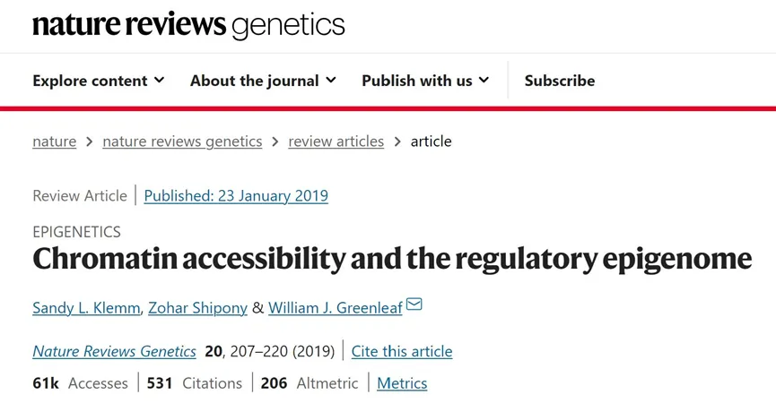
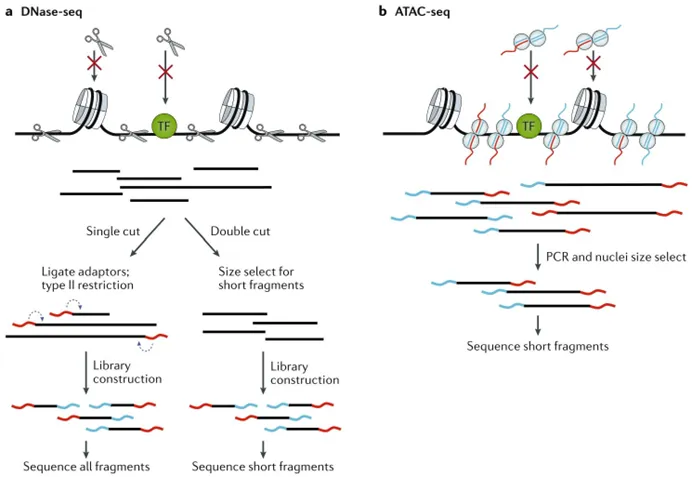
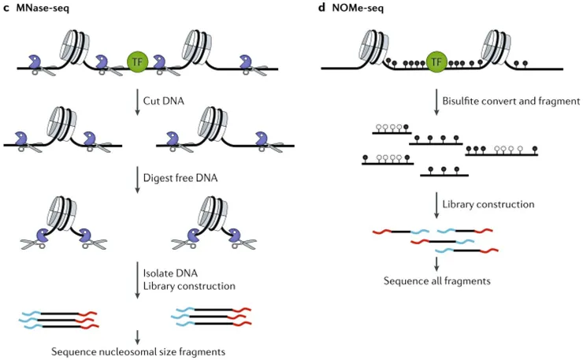
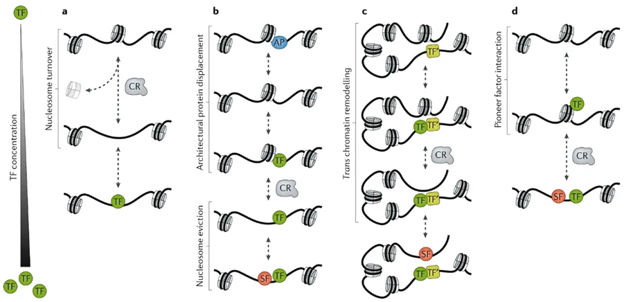

# 一文了解染色质可及性和表观基因组调控

> 原文：https://mp.weixin.qq.com/s?__biz=MzAwMzIzOTk5OQ==&mid=2247510114&idx=1&sn=f7e8b1df1804a6bba0d79b1ffec2467c&chksm=9b3cd132ac4b58243d6353871aba6648e3bdc3d36e17cac6235057c7a38a7f29ed7fd6159da3#rd
> 合集：单细胞教程全收录 / 文献速递 / 粉丝来稿

**写在前面**

染色质可及性（Chromatin Accessibility）是指染色质中的 DNA 区域对转录因子、染色质修饰酶和其他调控因子的可及性程度。在细胞核中，染色质是高度组织化的，由 DNA、蛋白质和 RNA 组成。染色质的可及性对基因表达和细胞功能起着重要的调节作用。调控表观基因组（Regulation of Epigenome）是指通过对染色质的化学修饰和结构调整来调节基因表达的过程。表观遗传学改变不涉及 DNA 序列的改变，而是通过 DNA 甲基化、组蛋白修饰、染色质重塑等方式影响基因的表达状态。这些表观遗传学改变对细胞功能、发育和疾病发生都具有重要的影响。染色质可及性和调控表观基因组之间存在着密切的关系。染色质的可及性直接影响了调控因子对基因的结合和转录的进行，从而影响了基因的表达水平。同时，表观遗传学修饰也可以调节染色质的结构和稳定性，进而影响染色质的可及性和基因的表达。因此，染色质可及性和调控表观基因组的研究对于理解基因调控机制、细胞功能的调节以及疾病发生的机理具有重要意义。近年来，随着高通量测序技术的发展，研究人员可以通过染色质免疫沉淀测序（ChIP-seq）、染色质可及性测序（ATAC-seq）、甲基化测序（MeDIP-seq）、RNA测序（RNA-seq）等方法来对染色质可及性和调控表观基因组进行全面的分析，从而揭示基因调控网络的复杂性和多样性，为疾病的诊断和治疗提供新的思路和方法。本文介绍的是发布于<Natrure Reviews Genetics>上题为”Chromatin accessibility and the regulatory epigenome"的文章，帮助大家一文了解染色质可及性与表观基因组。
原文链接：https://doi.org/10.1038/ s41576-018-0089-8

**一、 综述背景及科学问题**

对DNA的物理访问是染色质一种高度动态的特性，在建立和维持细胞身份中起着重要的作用。高度折叠的染色质结构在复制和转录时需要暴露出DNA序列，致密的核小体结构被破坏后，启动子、增强子、绝缘子、沉默子等顺式调控元件和反式作用因子可以接近的特性，叫染色质的可及性，也叫染色质开放性(chromatin accessibility ），这段区域叫开放染色质（open chromatin）。整个基因组中可及染色质反映了一种相互作用网络，通过这种网络，增强子、启动子、绝缘体和染色质结合因子协同调节基因表达。这种可及性在外部刺激和发育线索下动态变化，新的证据表明，可及性的稳态维持本身是通过染色质结合因子和核小体之间的竞争相互作用动态调节的。在这篇综述中，我们研究了如何测量可及性基因组，并探索了转录因子在启动可及性重构中的作用；我们的目标是说明染色质可及性如何定义基因组内的调控元件，以及这些表观遗传特征是如何动态建立来控制基因表达的。

**二、 综述内容**

**● 1、测量染色质可及性**

染色质可及性普遍是通过定量染色质对酶甲基化或其组成DNA裂解的敏感性来衡量的。自1985年引入PCR以来，人们开发了多种定量方法(如下所述)，使用内切酶和连接酶介导的PCR来测量位点特异性的染色质可及性。

  * **（1）DNase- seq**

DNase-seq 主要是利用DNase酶1对基因组上具有DNase敏感型的位置进行切割，即通过酶进行消化，然后对消化后的片段进行扩增，最后对测序出来的数据分析峰值，找到，有蛋白质保护的区域通常是转录因子以及核小体结合的位置。有单切割和双切割两种方式（如图1a）。

  * **（2）ATAC-seq**

ATAC-seq 使用高度活跃的Tn5转座酶将Illumina测序适配器插入可达染色质区域（图1b）。主要的原理就是利用Tn5转座酶复合体，将带有标记的标签，与DNA进行孵育，裸露的DNA片段，将在转座酶的作用下，被置换出来，然后通过特异的标签引物进行PCR扩增，进行后续的测序工作。图1（a、b）

  * **（3）MNase – seq**

金黄色葡萄球菌的微球菌核酸酶（MNase）通过切割消化暴露在外的基因组片段来工作，与核小体相关的DNA被恢复并测序(图1c)。MNase既作为内切酶裂解核间体DNA，又作为外切酶降解不受蛋白质保护的裂解产物DNA。MNase - seq与DNase - seq和ATAC - seq之间的显著区别是没有核小体DNA裂解事件。

  * **（4）NOMe- seq**

这种方法在全基因组的范围内产生关于核小体定位和DNA甲基化状态信息，由此将核小体的占位信息和甲基化的状态联合起来(图1d)。

图1（c、d）

**● 2、染色质可及性的生物物理决定因素**

在真核生物基因组中，对染色质化DNA的物理访问在不同的长度尺度上受到调控，并在很大程度上由核小体和DNA相关大分子(包括TF和结构蛋白)的组织和占有决定。例如，DNA结合蛋白(包括TF和聚合酶)所占据的位置通常远小于核小体所占据的约146 bp，因此，与完全构成的核小体相比，非组蛋白结合使更多的DNA可接近；分子间的相互作用基本上是随机的，非组蛋白在DNA复合体中的平均停留时间通常比核小体翻转的时间短，因此可以更频繁地访问未结合的DNA。

**● 3、染色质可及性重构**

染色质可及性会根据外部刺激和发育进程的变化而变化，发生重构。在这里，研究人员回顾了几个工作模型，这些模型解释了可及性状态是如何进行重构的。

  * **（1****）TF与核心组蛋白的被动竞争**

染色质可及性重构的最基本和最简单的模型提出，TFs通过与核小体的被动竞争来结合DNA。在这个模型中，TF通过利用核小体翻转事件中DNA的短时间可及性来结合DNA(图2a)。局部可及性随着组蛋白竞争因子浓度的增加而增加，为其他因子和辅助因子提供了稳定可及状态的机会。这种机制被认为是被动的，因为它不涉及TF和核小体之间的直接相互作用。代谢性组蛋白标记实验、细胞稳态和胚胎发育过程中的可及性重构为被动竞争模型提供了进一步的证据。

  * **（2）染色质通过近端连接组蛋白位移进行顺式重构**

染色质可及性重构的第二个机制涉及到一个多步骤的过程：TF首先结合到核小体间DNA并破坏近端核小体，随后通过结合稳定的TF建立对核心组蛋白结合DNA的访问(图2b)。

  * **（3）染色质通过可及的、远端调控元件进行反式重构**

染色质重构的第三种模式是让TF与可及的调节元件结合，并启动反式中远端染色质重构。该模型如图2c所示，其中远端结合的TF为诱导的TF维持一个可访问的结合位点，诱导的TF招募其他辅因子来驱逐反式中的核小体。

  * **（4）先导转录因子与核小体DNA的直接结合**

可及性重构的第四个机制认为一类先导TF-包括PU.1, FOXA(也称为HNF3)家族成员和GAL4 -直接与核小体DNA结合，建立开放染色质状态 (图2d)。

图2

上面列出的前两个模型(图2a,b)描述了组蛋白和结构蛋白周转率足够高的基因组位点是如何建立顺式可达性状态以提供对DNA的短暂访问。这些模型捕获了染色质和转录因子之间的一种主要相互作用模式，转录因子被动地与核心组蛋白复合体或核小体间结构蛋白竞争以获取DNA。后两个模型(图2c,d)说明了稳定和定位良好的核小体是如何通过与可及增强子的反式相互作用或TF直接与核小体DNA结合而被清除的。值得注意的是，这里描述的每个模型都依赖于染色质的内在动态组织来启动染色质重构。

**三、 综述结论和展望**

染色质可及性是通过组蛋白、转录因子和活性染色质重构因子之间的动态相互作用建立的。核小体的占据和定位是染色质可及性的主要决定因素，由序列特异性的TF和染色质重构因子不同程度地调节，这种调节是通过亚组蛋白级别的转录因子对核小体DNA的竞争或通过激活染色质重构因子来实现的，这些染色质重构因子动态地驱逐核小体。染色质可及性通过定义整个基因组的调控区域来揭示表观基因组的功能，了解这些调控域是如何在细胞在发育阶段和细胞激活状态之间的转变过程中动态建立的，以及控制调控元件如何调控基因表达程序，将是未来几年表观遗传学研究的一个重要焦点。

**如何联系我们**

 公众号后台消息回复不便，这里给大家留一下领取资料及免费服务器([足够支持你完成硕博生涯的生信环境](<http://mp.weixin.qq.com/s?__biz=MzAwMzIzOTk5OQ==&mid=2247507693&idx=1&sn=d9517a0803ad75cb7be430806834e7b8&chksm=9b3ca7bdac4b2eaba1ad01ed04ab1fbcbafcf4f6ddfe9e4f76ed9229707f545fe7d9c9ffd6ae&scene=21#wechat_redirect>))的**微信号** ，方便各位随时交流、提建议（别问在么，添加时直接说来意）。此外呼声一直很高的**交流群** 也建好了，欢迎大家入群讨论：

[永久免费的生信、科研交流群](<http://mp.weixin.qq.com/s?__biz=MzAwMzIzOTk5OQ==&mid=2247505868&idx=2&sn=20c81313eaef9a7031a84ef3a691d1b5&chksm=9b3cae9cac4b278a42c8de97e864c7664a37e9a4adb5973625fe3f8dd1093e55aeda88d443aa&scene=21#wechat_redirect>)

大家可以阅读完这几篇之后添加[给生信入门初学者的小贴士](<http://mp.weixin.qq.com/s?__biz=MzAwMzIzOTk5OQ==&mid=2247493329&idx=1&sn=597870b7f7ce10346da3561e7c281627&chksm=9b3c9f81ac4b169794088ce9abbcacb5f18e9fd174fc0d7e28da62d78facadf3100ef38aaf22&scene=21#wechat_redirect>)
[如何搜索公众号过往发布内容](<http://mp.weixin.qq.com/s?__biz=MzAwMzIzOTk5OQ==&mid=2247506266&idx=2&sn=22b1164bc9602c25620d058847785422&chksm=9b3ca00aac4b291c16d738271746ffb90149282a728f484e8a1952463c46a8e7dc4f883ab928&scene=21#wechat_redirect>)

您点的每个赞和在看，我都认真当成了喜欢
