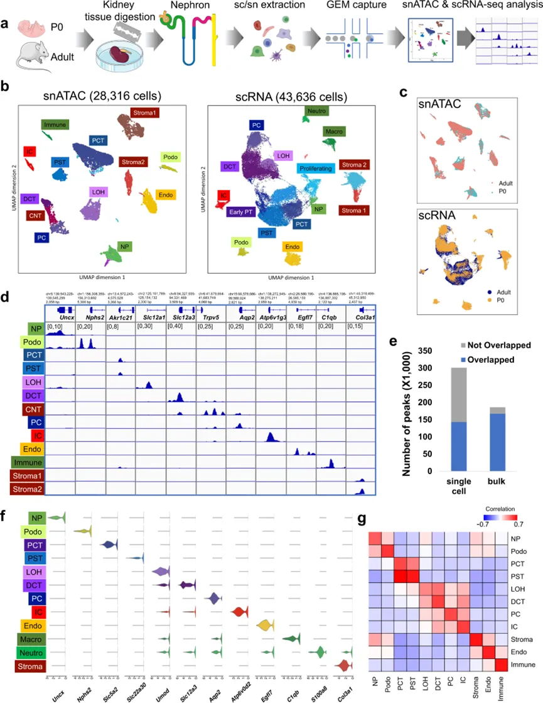
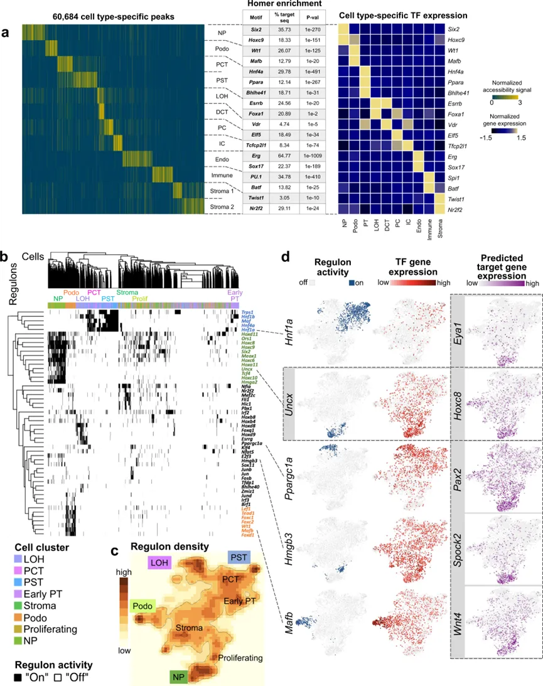
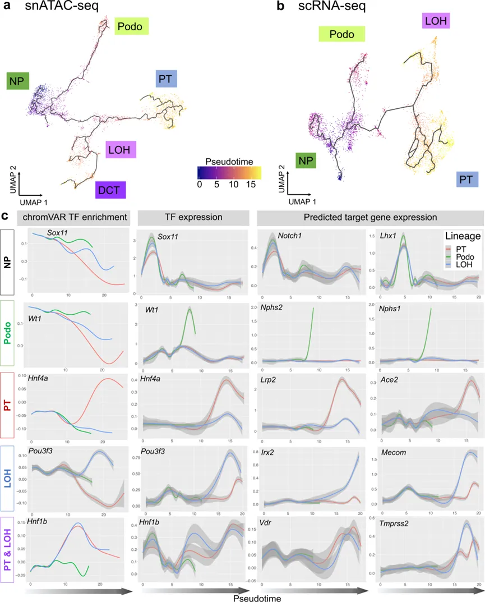
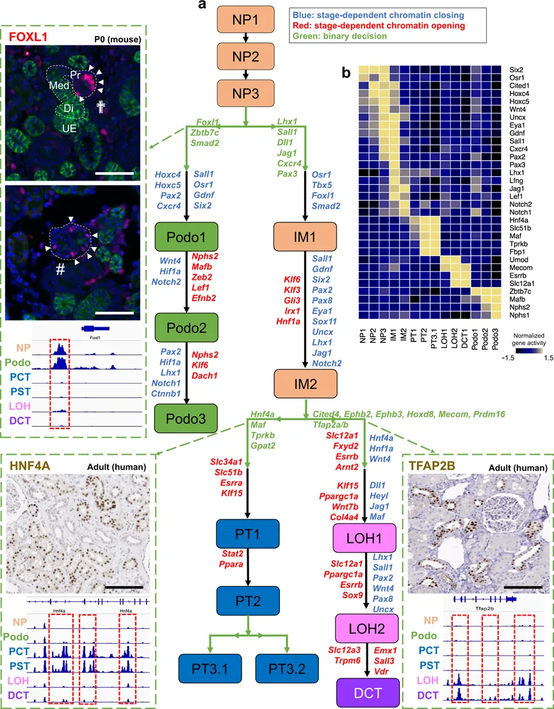
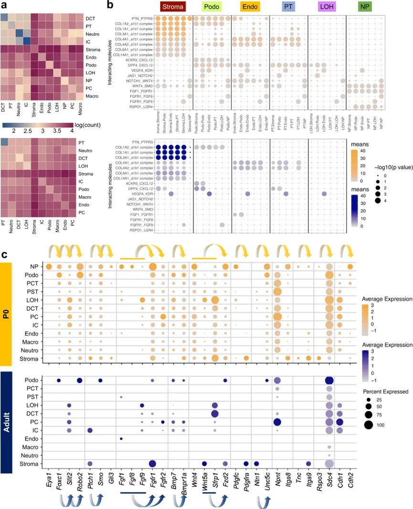
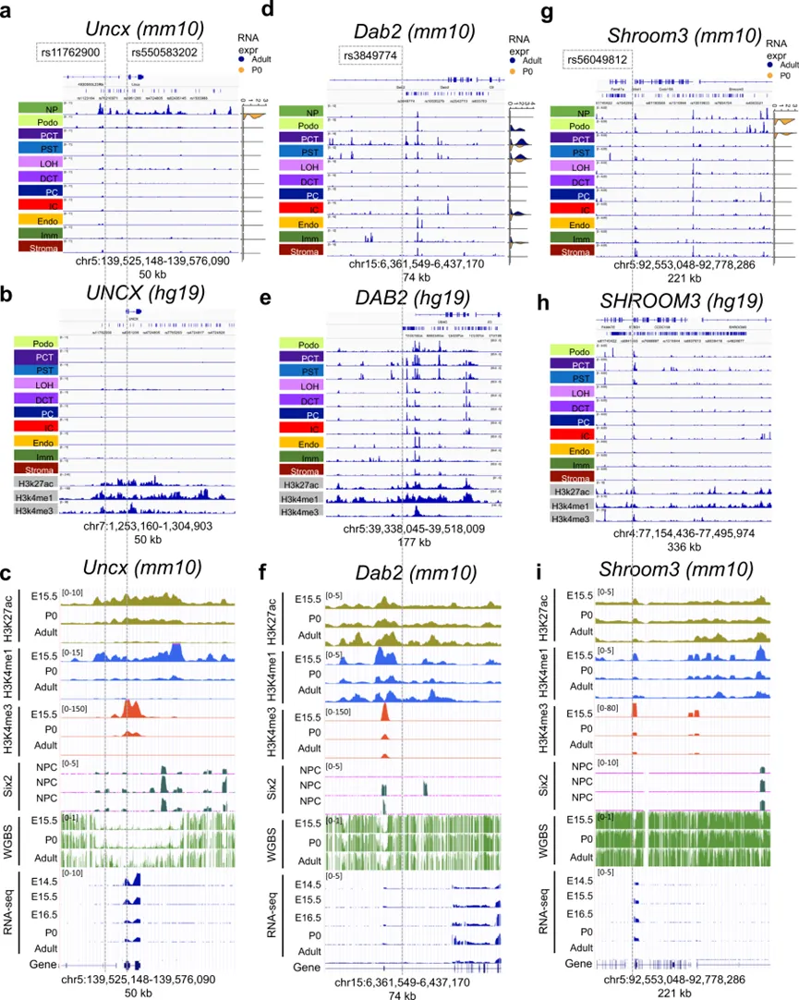

# snATAC联合scRNA揭示小鼠肾脏细胞分化程序和疾病靶点

> 原文：https://mp.weixin.qq.com/s?__biz=MzAwMzIzOTk5OQ==&mid=2247522324&idx=1&sn=62993c2354af1e793fcfd0e06586af17&chksm=9b3ce144ac4b6852aa1c38a44041ccf1bbf3353cfe515bcb28b434a184368e5888641690fd5b#rd
> 合集：单细胞教程全收录 / 文献速递

**一、写在前面**

本次分享的是2021年4月发布于《Nature Communications》的题为"Single cell regulatory landscape of the mouse kidney highlights cellular differentiation programs and disease targets"的文章。确定在肾脏中产生独特细胞类型的表观遗传程序对于理解组织稳态和损伤反应期间的细胞类型异质性至关重要。在这里，作者在单细胞分辨率下对发育中和成年小鼠肾脏的开放染色质([scATAC分析学习手册](<http://mp.weixin.qq.com/s?__biz=MzAwMzIzOTk5OQ==&mid=2247521636&idx=1&sn=208907010f3f7412c1c91343d7dfb0d3&chksm=9b3cec34ac4b6522977cb002919634af5334eec170b32f4961826dafb42f44f611144b159b2b&scene=21#wechat_redirect>))和基因表达([scRNA-Seq学习手册Seurat V4修订版](<http://mp.weixin.qq.com/s?__biz=MzAwMzIzOTk5OQ==&mid=2247510380&idx=1&sn=0eb2b0c519ef1dc25ee8821b736a0fde&chksm=9b3cd03cac4b592ad93149fb4847e6ba3dd03ab69e1ca594ddc64d323fb7496775789cae245d&scene=21#wechat_redirect>))进行了分析。作者展示了基因表达对远端调控元件（增强子）的关键依赖性。作者揭示了肾脏细胞的关键细胞类型特异性转录因子和主要基因调控回路。在肾小管前体细胞分化过程中，染色质和表达的动态变化表明足细胞的承诺发生得较早，并且与持续的Foxl1表达相关。肾小管细胞遵循更复杂的分化过程，其中Hfn4a与近端命运相关，而Tfap2b与远端命运相关。将与人类肾脏疾病相关的单核苷酸变异映射到关键细胞类型、发育阶段、基因和调控机制。单细胞多组学图谱揭示了与肾脏发育相关的关键染色质重塑事件和基因表达动态。感兴趣的同学可以看看原文：Miao Z, Balzer MS, Ma Z, Liu H, Wu J, Shrestha R, Aranyi T, Kwan A, Kondo A, Pontoglio M, Kim J, Li M, Kaestner KH, Susztak K. Single cell regulatory landscape of the mouse kidney highlights cellular differentiation programs and disease targets. Nat Commun. 2021 Apr 15;12(1):2277.

**二、背景知识**

哺乳动物肾脏维持体内液体、电解质和代谢物的平衡，在血压调节和红细胞稳态中发挥着至关重要的作用。人类肾脏每天产生大约180升的初级滤液，然后由长段肾小管重新吸收和修改。为了执行这种高度协调和复杂的功能，肾脏包含近20种高度专业化的上皮细胞。肾小球作为60kD大小选择性过滤器。肾小管的近端部分负责回收超过70%的初级滤液，这是通过非调节性的主动和被动细胞旁运输完成的，而亨氏环在尿液浓缩中起着重要作用。远曲小管对于调节性钠重吸收至关重要。肾小管的最后一个部分是集合管，通过调节水通道、酸或基础分泌来确定尿液的最终浓度。了解这些不同细胞类型在肾脏中的发育对于理解肾脏稳态、疾病和再生至关重要。
哺乳动物肾脏通过输尿管芽和后肾间质之间的复杂相互作用从中间中胚层发育而来。在小鼠肾脏中，Six2标记了自我更新的肾小管前体细胞群。肾小管前体细胞承诺并经历间充质到上皮的转变，产生肾小囊。然后肾小囊经历分割和延长，产生从足细胞到远曲小管的上皮，而输尿管芽变成集合管。无偏和假设驱动的研究强调了早期肾脏发育的关键阶段和驱动因素，这对于体外肾脏类器官分化协议的发展至关重要。然而，类器官中的细胞仍然分化不良，提高这些结构的细胞分化和成熟度仍然是一个主要挑战。因此，了解晚期肾脏发育，特别是细胞类型特异性驱动转录因子（TFs）非常重要。Wnt、Notch、Bmp和Egf信号的改变显著影响细胞分化，但只有少数直接驱动不同节段分化的TFs被鉴定出来，如Pou3f3、Lhx1、Irx2、Foxc2和Mafb。进一步了解末端分化程序可以帮助理解肾脏疾病的发生。虽然单细胞RNA测序（scRNA-seq）提高了作者对小鼠和人类肾脏发育的理解，但它提供了有限的TFs信息，这些通常在低水平表达。同样困难的是仅通过scRNA-seq数据了解基因是如何被调控的。另一方面，染色质状态分析可以确定基因表达潜力，并可以指出TF结合位点的可用性。结合基因表达，开放染色质分析可以定义基因调控逻辑，这是细胞身份的基本元素。然而，有关肾脏出生后发育的开放染色质信息，通过转座酶可及性染色质测序（ATAC-seq）或染色质免疫沉淀（ChIP）数据的ChIP-seq非常稀缺。此外，批量分析中观察到的表观遗传变化主要代表细胞组成的改变，而不是细胞类型特异性变化，这使得解释批量ATAC-seq数据具有挑战性。公开可用的小鼠肾脏ATAC-seq数据包含来自成人组织的有限数量的细胞，因此没有提供发育过程中染色质变化的见解。作者为发育中和成年小鼠肾脏生成了一个单细胞开放染色质和相应的表达调查，这些资料可以通过可搜索的网站提供给网站（susztaklab.com/developing_adult_kidney/snATAC/ 用于snATAC-seq数据，susztaklab.com/developing_adult_kidney/scRNA/ 用于scRNA-seq数据，susztaklab.com/developing_adult_kidney/igv/ 用于峰值轨迹的IGV视图）。利用这个图谱，作者产生了基于表观基因组的发育中和成熟细胞的分类，并定义了细胞类型特异性的调控网络。作者还研究了与发育细胞转变相关的关键TFs和细胞-细胞相互作用。最后，作者使用单细胞开放染色质信息来确定几种慢性肾脏疾病非编码基因组关联研究（GWAS）位点的假定目标基因和细胞类型。

**三、主要结果**

### **1、发育中和成年小鼠肾脏的单细胞可及染色质图谱**

为了在单细胞分辨率下表征发育中和成年小鼠肾脏的可及染色质景观，作者在出生后第0天（P0）、3周和8周（P21和P56）的小鼠肾脏上进行了单核ATAC-seq（snATAC-seq）分析（图1a）。在小鼠出生时，肾小管前体细胞仍然存在，肾小管的形成一直持续到大约第21天。同时，作者还对匹配的发育阶段进行了批量（整个肾脏）ATAC-seq分析。测序后，作者汇总了每个样本中的所有高质量映射读段。所有样本的联合snATAC-seq数据显示了预期的插入大小周期性（补充图1a），在转录起始位点（TSS）处有强烈的信号富集，表明数据质量高（补充图1b）。snATAC-seq数据与批量ATAC数据高度一致（匹配阶段之间的Spearman相关系数>0.84，见“方法”部分，补充图1c）。**Figure1**

**研究设计的示意图。P0和成年小鼠的肾脏经过snATAC-seq和scRNA-seq处理，随后进行数据处理和分析。b snATAC-seq数据和scRNA-seq数据的UMAP嵌入图。使用标记基因，细胞被注释为肾小管前体细胞（NP）、集合管间质细胞（IC）、集合管主细胞（PC）、近曲小管和直小管（PCT和PST）、亨氏环（LOH）、远曲小管（DCT）、基质细胞（Stroma）、足细胞（Podo）、内皮细胞（Endo）和免疫细胞（Immune）。在scRNA-seq数据中，识别了相同的细胞类型，另外还有一个增殖性细胞群，免疫细胞被聚类为中性粒细胞和巨噬细胞。c 按P0和成年批次着色的snATAC-seq和scRNA-seq数据的UMAP嵌入图。d 基因组浏览器视图，显示每个snATAC-seq簇在细胞类型标记基因转录起始位点处的读段密度。补充图3a中展示了额外的标记基因示例。e 从snATAC-seq数据和批量ATAC-seq数据中识别的峰值的比较。在两个数据集中都识别到的峰值以蓝色着色，特定于数据集的峰值以灰色显示。f 显示scRNA-seq数据中细胞类型特异性基因表达的小提琴图。g 热图显示P0数据中snATAC-seq基因活性分数和基因表达值之间的皮尔逊相关系数。每一行代表scRNA-seq数据中的一个细胞类型，每一列代表snATAC-seq数据中的一个细胞类型。成年数据集的相关性在补充图3b中显示。**

作者接下来从开放染色质信息中揭示了细胞类型的注释。在对独特片段数量、启动子比例和线粒体比例进行了严格的筛选后（见“方法”部分，补充图2a），作者保留了样本中的28,316个细胞（图1b）。然后使用SnapATAC对细胞进行聚类，该方法将整个基因组划分为5kb区域以解决数据的稀疏性问题（见“方法”部分）。在聚类之前，作者使用了Harmony，一种迭代批次校正方法，来校正样本间的变异性（补充图2b）。使用批次校正后的低维嵌入，作者保留了13个聚类，所有聚类在峰值数量、样本和读取深度配置文件上都有一致的表示（图1b和S2c、d）。为了确定每个聚类所代表的细胞类型，作者检查了已知细胞类型特异性标记基因的TSS和基因区域周围的染色质可及性。根据已知标记基因的可及性，作者识别了代表肾小管前体、内皮细胞、足细胞、近曲小管第1段和第3段细胞、亨氏环、远曲小管、连接小管、集合管主细胞、集合管间质细胞、基质和免疫细胞的聚类。图1d和补充图3展示了关键细胞类型标记基因的染色质可及性信息，例如 _Uncx_ 和 _Cited1_ 代表肾小管前体， _Nphs1_ 和 _Nphs2_ 代表足细胞， _Akr1c21_ 代表近曲小管的两个部分， _Slc34a1_ 和 _Slc5a2_ 代表近曲小管（PCT）， _Kap_ 代表近直小管（PST）， _Slc12a1_ 和 _Umod_ 代表亨氏环， _Slc12a3_ 和 _Pvalb_ 代表远曲小管， _Trpv5_ 代表连接小管， _Aqp2_ 和 _Fxyd4_ 代表主细胞， _Atp6v1g3_ 和 _Atp6v0d2_ 代表间质细胞， _Egfl7_ 代表内皮细胞， _C1qb_ 代表免疫细胞， _Col3a1_ 代表不同类型的基质细胞。正如预期，一些聚类如肾小管前体和基质细胞在发育中的肾脏（P0）中富集。为了识别细胞类型特异性的开放染色质区域，作者在每个细胞类型上单独使用MACS2进行了峰值分析。然后将峰值合并以获得全面的开放染色质集。作者发现，单核开放染色质集与批量ATAC-seq样本显示出良好的一致性，大部分批量ATAC-seq数据中的峰值被单核数据捕获。另一方面，单核染色质可及性数据比批量ATAC-seq数据大约多出50%的可及染色质峰值（总共300,693个峰值）（图1e，见“方法”部分）。正如预期，通常与常见细胞类型的重叠更大，如近曲小管和远曲小管，而不是稀有细胞类型，如免疫细胞，这表明snATAC-seq数据在识别单细胞类型中可及的开放染色质区域方面特别有力。同时，作者还为P0和P56的小鼠肾脏样本生成了一个单细胞RNA测序（scRNA-seq）图谱。严格的质量控制产生了一组43,636个单细胞（图1b和补充数据1）。质量控制指标如基因计数、UMI计数和线粒体基因百分比以及批次校正结果在补充图4a-d中显示。作者通过无偏聚类和批次效应校正获得了17个聚类（补充图4e、f）。根据标记基因表达，作者识别了肾脏上皮细胞、免疫细胞和内皮细胞（图1f和补充图5a-c），与snATAC-seq分析获得的聚类非常相似。然后作者对聚类进行了差异表达（DE）分析，并为每种细胞类型识别了关键标记基因（补充数据2）。使用SoupX校正环境RNA的基因表达矩阵产生了非常相似的聚类。在环境RNA校正前后的平均基因表达高度相关（补充图6和7，见“方法”部分）。校正环境RNA后检索到的细胞类型的DE基因可在补充数据3中获取。为了比较snATAC-seq数据和scRNA-seq数据中聚类分配的一致性，作者接下来合并了每个snATAC聚类，并为前3000个高度可变基因派生基因活性分数，并计算了每个snATAC聚类和scRNA聚类之间的皮尔逊相关系数（见“方法”部分）。这一分析表明两个数据集之间有很好的一致性（P0样本的相关性见图1g，成年样本见补充图8）。虽然基因表达和推断的基因活性分数之间的相关性很高，但作者注意到细胞比例存在一些差异，这可能与样本制备引起的细胞丢失有关（补充图2d和5a）。与之前观察到的单细胞制备比单核制备更倾向于免疫细胞的发现一致，作者注意到snATAC-seq数据集中免疫细胞的储备有限；另一方面，基质细胞通过核制备更好地捕获。对基质聚类的进一步子分析表明，P0和成年样本中都存在异质的基质细胞群体（补充图9和10）。作者的数据与最近强调发育中肾脏间质中存在相当异质性的发现一致。基质子聚类的DE基因显示在补充数据4中。需要额外的实验验证来确认和进一步描绘基质细胞。为了让社区能够交互式地使用这个数据集，作者不仅提供了原始数据，还提供了通过作者可搜索的网站处理的数据集（susztaklab.com/developing_adult_kidney/snATAC/用于snATAC-seq数据，susztaklab.com/developing_adult_kidney/scRNA/用于scRNA-seq数据，susztaklab.com/developing_adult_kidney/igv/用于峰值轨迹的IGV视图）。补充图11显示了网站上Ace2位点的一个示例。

## 细胞类型特异性的调控

为了表征snATAC-seq数据捕获的不同基因组元素，作者首先使用GENCODE注释将基因组分层为启动子、外显子、5'和3'非翻译区、内含子和远端区域（见“方法”部分）。作者注意到，与批量ATAC-seq数据一致，snATAC-seq数据中的大多数峰值位于被表征为远端元素或内含子的区域，相对较小的部分（<10%）位于启动子或5'非翻译区（补充图12a）。此外，有更多的发育阶段特异性的远端和内含子区域（补充图12b），这与肾脏的发育阶段特异性DNA去甲基化一致。此外，大约一半的开放染色质峰值与先前发表的P0或成年H3K27Ac ChIP-seq信号重叠（补充图12c，见“方法”部分）。综合这些结果，表明增强子元素的关键作用。为了研究细胞类型和发育阶段间的开放染色质异质性，作者通过对每个聚类之间的每个峰值进行成对Fisher精确检验，得出了细胞类型特异性的可及染色质景观（Benjamini-Hochberg校正q值≤0.05，见“方法”部分）。总共，作者鉴定了13种细胞类型中60,684个不同可及的开放染色质峰（DAPs）（补充数据5和图2a）。在这些峰值中，大多数对单一聚类表现出高特异性。然而，作者注意到PCT和PST段特异性峰值之间以及亨氏环和远曲小管段之间存在重叠，这与其生物学相似性一致。除了细胞类型特异性的峰值外，作者还发现了一些细胞类型非特异性的开放染色质区域（存在于肾小管前体、足细胞、近曲小管和亨氏环细胞中），可能包括基础管家基因和调控元件（补充图12d）。

**Figure2**

**a左图：热图显示所有细胞类型特异性的差异可及峰值（DAPs）（黄色：开放染色质，蓝色：关闭染色质）（峰值位置在补充数据5中提供）。中间图：使用Homer进行细胞类型特异性基序富集分析的示例（完整结果在补充数据6中显示）。右图：与每种细胞类型中的基序富集相对应的转录因子表达z分数热图。b 通过SCENIC算法推断的细胞类型特异性调控子的热图。调控子活性被二值化为“开启”（黑色）或“关闭”（白色）。c tSNE表示调控子密度的图示，作为SCENIC算法推断的调控子状态稳定性的替代指标。d tSNE图示展示了近曲小管（Hnf1a）、肾小管前体（Uncx）、亨氏环（Ppargc1a）、增殖细胞（Hmgb3）和足细胞（Mafb）的代表性调控子的活性（“开启-蓝色”，“关闭-灰色”）和转录因子基因表达（红色比例尺）。Uncx调控子的目标基因表达示例（ _Eye1、Hoxc8、Pax2、Spock2_ 和 _Wnt4_ ）以紫色比例尺显示。 _Hnf1a、Six2、Ppargc1a、Hmgb3_ 和 _Mafb_ 的目标基因表达在补充图15a中显示。**

作者注意到许多基因在其转录起始位点(TSS)处有强烈的细胞类型特异性差异可及峰值(DAPs)。然而，其他基因在其TSS处的多个细胞类型中显示出可及的染色质。例如， _Umod_ 作为亨氏环的标记基因，在多种小管细胞类型中TSS处显示出可及的染色质（补充图12e）。与其TSS相比， _Umod_ 的细胞类型特异性染色质可及性与上游峰值强烈相关，这很可能是增强子区域，正如H3K27Ac ChIP-seq信号所指示的。此外，作者注意到细胞类型特异性DAPs中内含子区域和远端元素的富集（补充图13a、b），表明它们在细胞类型特异性基因调控中的作用。这些观察结果激发了作者使用snATAC-seq数据和scRNA-seq数据研究顺式调控元件。作者推断，一部分细胞类型特异性的调控元件应该与细胞类型特异性的基因表达相关。受到Zhu等人的启发，作者将snATAC-seq和scRNA-seq数据集中的DAPs和差异表达基因(DEGs)进行了比对，并根据它们的接近程度推断出假定的调控峰-基因对（见“方法”部分）。通过与之前推断的顺式调控元件进行比较，证实了这些顺式调控元件预测的准确性，作者重新得到了他们分析中大约20%的元件。此外，作者的分析还能够识别几个已知的增强子，例如 _Six2_ 和Slc6a1831,32的增强子（补充图13c）。为了量化顺式调控元件的贡献，作者使用Cicero分析了峰值共可及性模式。使用启发式共可及性得分0.4作为截止值，作者分别在P0和成年数据中鉴定了232,380和206,701个顺式调控元件链接。然而，值得注意的是，基因组元素之间的相互作用是复杂的，不仅限于共可及峰值。鉴于基因组区域之间复杂的相互作用，作者接下来研究了占据细胞类型特异性开放染色质区域的关键转录因子(TFs)。到目前为止，关于肾脏中细胞类型特异性TFs的信息一直很稀缺。因此，作者使用HOMER在细胞类型特异性开放染色质区域上进行了基序富集分析（见“方法”部分）。细胞类型特异性TF结合基序的完整列表显示在补充数据6中。由于几个TF具有相同或相似的结合序列，作者接下来将基序富集与scRNA-seq TF表达相关联。使用这种结合基序富集和基因表达的方法，作者定义了小鼠肾脏细胞类型特异性TF景观。例如，在肾小管前体中 _Six2_ 和 _Hoxc9_ ，在足细胞中 _Wt1_ 和 _Mafb_ ，在近曲小管中 _Hnf4a、Ppara_ 和 _Bhle41_ ，在亨氏环中 _Esrrb_ 和 _Foxa1_ ，在远曲小管 _中_ Vdr，在主细胞中 _Elf5_ ，在间质细胞中 _Tcfcp2l1_ ，在内皮细胞中 _Erg_ 和 _Sox17_ ，在免疫细胞中 _Spi1_ 和Batf _，_ 在基质细胞中 _Twist1_ 和 _Nr2f2_ （图2a和补充图14）。为了研究TF的假定目标基因，作者使用单细胞调控网络推断和聚类(SCENIC)来检查TF调控子活性。SCENIC旨在揭示以TF为中心的基因共表达网络。通过推断基因相关网络，然后基于基序的过滤，SCENIC只保留了每个TF的潜在直接目标作为模块（调控子）。每个细胞中每个调控子的活性被量化，然后根据细胞间的活性分布二值化为“开启”或“关闭”（见“方法”部分）。SCENIC还能够根据每个细胞的调控子状态进行聚类。SCENIC结果（图2b-d）表明，在近曲小管中 _Trps1_ 、 _Hnf1b_ 、 _Maf_ 、 _Hnf1a_ 和 _Hnf4a_ 调控子活性强烈富集，在肾小管前体中 _Hmga2_ 、 _Hoxc6_ 、 _Hoxd11_ 、 _Meox1_ 、 _Six2_ 、 _Tcf4_ 和 _Uncx_ ，在亨氏环中 _Esrrg_ 和 _Ppargc1a_ ，在增殖细胞中Hmgb3以及在足细胞中 _Foxc1_ 、 _Foxc2_ 、 _Foxd1_ 、 _Lef1_ 和 _Mafb_ 。由于这些TF中的几个表达水平相对较低，可能进一步被转录本丢失加剧，它们没有显示出强烈的细胞类型富集。然而，基于调控子的分析显示出非常清晰的富集。SCENIC还成功推断了多个下游目标基因。调控子及其相应的预测目标基因的完整列表可以在补充数据7中找到，缩放和二值化的调控子活性在补充数据8中可用。调控子活性、相应的TF表达和预测目标基因表达的示例在图2d和补充图15a中描述。例如， _Eya1_ 、 _Hoxc8_ 、 _Hoxc9_ 、 _Pax2_ 、 _Spock2_ 和 _Wnt4_ 等TF是肾小管前体特异性TF Uncx调控子内的重要下游目标，表明肾小管发育的重要转录层次。这些预测目标基因的相应snATAC-seq轨迹以及TF基序在补充图15b中描述。通过比较HOMER和SCENIC报告的细胞类型特异性TF数量与RNA表达数据中的DEGs，很明显，作者的综合顺式调控分析与snATAC-seq和scRNA-seq数据集在发现TF-调控网络方面比单独分析转录数据有显著优势（补充图16a、b）。

## 肾小管前体细胞分化的调控轨迹

身体中的所有细胞都是从相同的遗传模板分化而来。与转录因子结合相关的细胞类型特异性染色质开放和关闭事件，建立了导致细胞类型确定和发育的细胞类型特异性调控景观。作者发现，在肾小管前体细胞分化过程中，开放染色质区域的关闭是主要事件（补充图12d）。然后，作者评估了snATAC-seq和scRNA-seq数据集中的细胞分化轨迹（见“方法”部分）。作者鉴定了多个肾小管前体亚群（图3a、b），这些亚群将需要仔细地映射到先前基于基因表达和解剖位置的肾小管前体亚群亚分类。一致地，在两种数据模式中，作者都确定足细胞前体细胞早期从肾小管前体池中分化出来（图3a、b）。小管细胞的轨迹更为复杂，有一个共享的中间阶段，随后分化为近曲小管和远曲小管/亨氏环（图3a、b和补充图17a-c）。作者还整合了snATAC-seq和scRNA-seq数据以获得单一轨迹（见“方法”部分）。这个数据集中的细胞类型被正确映射，轨迹类似于在单独分析中观察到的路径（补充图17e-g）。发育轨迹的稳健性得到了使用Velocyto的RNA速率分析的进一步支持（补充图17d），并通过与先前的人和小鼠肾脏发育研究9,13,14的比较得到支持。

**Figure 3**

**a 使用Cicero推断的snATAC-seq肾小管前体细胞分化轨迹的UMAP表示，分别朝向足细胞、近曲小管、亨氏环和远曲小管，细胞按拟时间着色。b 使用Monocle3推断的scRNA-seq肾小管前体细胞分化轨迹的UMAP表示，分别朝向足细胞、近曲小管和亨氏环，细胞按拟时间着色。c 沿近曲小管（红色）、足细胞（绿色）和亨氏环（蓝色）细胞系的拟时间依赖性染色质可及性和基因表达变化。第一列显示了chromVAR TF富集分数的动态，第二列显示了TF基因表达值的动态，第三和第四列分别代表相应TF的SCENIC报告的目标基因表达值的动态。误差条表示局部多项式回归拟合的95%置信区间。补充图18b中给出了其他示例。**

利用SCENIC生成的基因调控网络和snATAC-seq及scRNA-seq数据集中稳健的分化轨迹，作者接下来旨在理解染色质动态，识别细胞类型特异性的转录因子和驱动途径。为此，作者首先使用ChromVAR确定了沿三条分化轨迹的染色质可及性变化。ChromVAR估计snATAC-seq数据中基序的可及性动态（见“方法”部分）。细胞类型特异性的转录因子富集分数矩阵显示在补充图18a和补充数据9中。在分析感兴趣的基因时，作者观察到三种不同的模式（图3c）：（1）所有谱系中转录因子基序可及性的减少。例如， _Sox11_ 基序富集分数在所有三条轨迹开始时的肾小管前体细胞中很高。然后它在所有三条谱系中同时减少，强调了 _Sox11_ 在早期肾脏发育中的作用。其他几个转录因子也遵循这一模式，如Six2和 _Sox9_ 。（2）随着分化的推进，细胞类型特异性的染色质可及性维持。作者观察到 _Wt1_ 基序的染色质可及性最初很高，但在近曲小管和亨氏环谱系中下降，而其在足细胞谱系中的表达增加。这与 _Wt1_ 在肾小管前体和足细胞中的重要角色一致。遵循这一模式的其他转录因子包括 _Foxc2_ 和 _Foxl1_ 。（3）随着细胞类型承诺和分化的推进，染色质可及性从头增加。例如， _Hnf4a_ 和 _Pou3f3_ 基序的染色质可及性分别在近曲小管和亨氏环轨迹中增加，与细胞分化程序相一致。许多转录因子遵循这一模式，如 _Mafb_ （在足细胞中）、 _Hnf4a_ 和 _Hnf1a_ （在近曲小管中）、 _Hnf1b_ （在近曲小管和亨氏环中）以及 _Esrrb_ 和 _Tfap2b_ （在亨氏环中）。作者将基于染色质可及性的转录因子基序富集与转录因子表达及其各自的预测目标基因沿轨迹的变化相关联。为此，作者研究了在scRNA-seq拟时间上有差异表达的转录因子和目标基因（补充数据10）。作者注意到，转录因子和预测目标基因表达的时间依赖性变化与基序富集有很好的一致性，包括足细胞谱系（例如， _Foxc2、Foxl1、Mafb、Magi2、Nphs1、Nphs2、Plat、Synpo、Thsd7a、Wt1_ 和 _Zbtb7c_ ）、近曲小管（例如， _Ace2、Atp1a1、Dab2、Hnf1a、Hnf4a、Hsd17b2、Lrp2、Maf、Slc12a3、Slc22a12、Slc34a1和Wnt9b_ ）、亨氏环（例如， _Cyfip2、Cytip、Esrrb、Esrrg、Irx1、Irx2、Mecom、Pla2g4a、Pou3f3、Ppargc1a、Stat3、Sytl2、Tfap2b、Thsd4_ 和 _Umod_ ），以及近曲小管和亨氏环（例如， _Bhlhe40、Hnf1b_ 和 _Tmprss2_ ）的谱系（图3c和补充图18b）。作者注意到基因表达与染色质可及性相关的两种不同模式。虽然转录因子的基因表达随着拟时间的增加而增加，但其相应的基序可及性要么平行增加（如 _Hnf4a_ 和 _Pou3f3_ ），要么以谱系特异性的方式维持（如 _Wt1_ ）。这可能表明分化过程中的不同调控机制。作者旨在询问已确定的分化轨迹沿线的阶段依赖性染色质动态。分化轨迹被分为15个基于拟时间推断中的谱系特异性的发育阶段（补充图17b、c）。这些阶段被标记为 _NP1-3_ （肾小管前体）、 _IM1-2_ （中间细胞）、 _Podo1-3_ （足细胞）、 _PT1-3_ （近曲小管）、 _LOH1-2_ （亨氏环）和 _DCT_ （远曲小管）。通过研究基于先前细胞标记的注释的基因活性分数富集，作者展示了 _NP3_ 与肾小囊标志物匹配， _IM1-2_ 和 _Podo1_ 分别与承诺成为小管和足细胞命运的逗号形和S形体匹配（图4b）。为了研究染色质的开放和关闭，作者进行了连续阶段之间的差异染色质可及性分析。为了理解表观遗传变化控制的生物过程，作者检查了附近基因并对这些峰进行了功能注释（见“方法”部分）。作者发现，在早期前体阶段如 _NP1_ 至 _NP3_ ，开放染色质轮廓相对稳定，鉴定出少于70个差异可及峰（ _DAPs_ ）（补充数据11和补充图19）。足细胞分化分支与DAPs数量的显著增加有关（ _NP3_ 和 _Podo1_ 之间有796个DAPs）。这主要代表了围绕肾小管前体特异性基因（如 _Osr1、Gdnf、Sall1、Pax2_ ）的染色质区域的关闭，以及围绕足细胞特异性基因和关键转录因子（如 _Foxc2_ 和 _Efnb2_ ）的区域的开放，两者都被验证对早期足细胞分化很重要。在后期阶段，作者观察到与典型近曲小管功能相关的基因活性分数上调的峰值富集，包括依赖钠的磷运输、维持亨氏环中的渗透反应和远曲小管中的主动钠运输（补充图19，完整列表可在补充数据11、12和13中找到）。从NP3到中间细胞1（IM1）的染色质变化主要与 _Osr1_ 周围的染色质关闭和围绕小管细胞特异性转录因子（如 _Lhx1_ 和 _Pax3_ ）的开放有关（图4）。 _Six2_ 表达的下降仅发生在IM2阶段，作者也观察到小管特异性基因（如 _Hnf1a_ ）的增加。从PT1到IM2之间820个上调峰之间的基因本体分析显示与典型近曲小管功能相关，包括钠依赖性磷运输、维持亨氏环中的渗透反应和远曲小管中的主动钠运输的富集（补充图19，完整列表可在补充数据11、12和13中找到）。

**Figure 4**

**a从Cicero轨迹推断得出的有向图，表示细胞类型和谱系分化。肾小管前体（NP）、足细胞（Podo）、中间阶段（IM）、近曲小管（PT）、亨氏环（LOH）和远曲小管（DCT）与其发育前体阶段相连，并按递增编号表示。箭头表示细胞沿相应轨迹的分化。紧邻轨迹列出的基因是从分析两个阶段之间差异可及峰（DAPs）的基因富集中得出的。红色字体的基因是从两个阶段之间开放的DAPs中得出的，蓝色字体的基因是从两个阶段之间关闭的DAPs中得出的，绿色字体的基因是从两个分支之间开放的DAPs中得出的。三个重要基因，Foxl1、Hnf4a和Tfap2b，以及它们细胞类型特异性的可及性峰值和免疫染色结果一起展示。在特定细胞类型发育期间开放的峰值以红色框显示。P0小鼠肾脏的免疫荧光染色显示FOXL1在晚期S形体（十字）的近端部分（Pr）以红色显示，在原始肾小球内的足细胞中以井号标记；绿色染色表示E-钙粘蛋白，蓝色DAPI；Med，S形体的中部；Di，S形体的远端部分；UE，输尿管上皮；图像代表三次独立实验，比例尺 = 25微米。HNF4A和TFAP2B在人类成年肾脏样本中（分别来自人类蛋白质图谱版本19.3的图像CAB019417和HPA034683，http://www.proteinatlas.org83，https://creativecommons.org/licenses/by-sa/3.0/）以棕色通过免疫组化显示，比例尺 = 25微米。此外，GREAT分析识别的基因表达变化沿三个轨迹，这些基因被识别为附近的染色质关闭和开放事件，证明与染色质信息一致，示例在右上角的小图中可视化。b 热图显示了15个发育阶段中线系标记基因的标准化基因活性分数。**

除了分析沿轨迹的变化，作者还通过比较两个后代谱系来检查细胞命运分叉事件。作者发现，从肾小管前体细胞的足细胞分化与足细胞谱系中 _Foxl1、Zbt7c_ 和 _Smad2_ 的差异开放有关，另一谱系中则与 _Lhx1、Sall1、Dll1、Jag1、Cxcr3_ 和 _Pax3_ 有关。虽然一些转录因子在足细胞分化中的作用已经被确定，但直到现在，Foxl1在肾脏中的表达尚未被描述（图4）。作者的分析确定，在 _Foxl1_ 附近的四个峰值仅在足细胞谱系中可及，分别位于 _Foxl1_ TSS的+53,381 bp、+152,832 bp、+237,019 bp和+268,550 bp。为了确认 _Foxl1_ 在肾小管前体和足细胞中的表达，作者在发育中的肾脏（E13.5、P0和P6）上进行了免疫荧光研究。与计算分析一致，作者发现在肾小管前体（E13.5）中有 _FOXL1_ 的强烈表达。在后期阶段，通过与WT1的共定位确认了肾小球足细胞中 _FOXL1_ 的表达（补充图20）。 _Foxl1_ 的早期和晚期表达也在scRNA-seq数据中得到确认（补充图21）。虽然进一步的实验验证将很重要，但作者的研究已经展示了开放染色质状态信息和动态在细胞分化中的关键作用。中间细胞（IM）产生了代表近曲小管、亨氏环以及远曲小管段的近端和远端分支。近曲小管区域的特点是 _Hnf4a、Maf、Tprkb_ 和 _Gpat2_ 周围染色质的开放。亨氏环和远曲小管段的特点是 _Tfap2a、Tfap2b、Cited4、Ephb2、Ephb3、Hoxd8、Mecom_ 和 _Prmd16_ 附近有多个差异可及峰（DAPs），表明这些转录因子在远曲小管分化中的关键作用（图3c和4以及补充图21）。一致地，作者在所有三条轨迹（足细胞、近曲小管和亨氏环）中观察到Six2启动子和增强子的染色质可及性降低（补充图22）。在亨氏环的远端部分， _Jag1_ 和 _Heyl_ 的可及性也有所降低，这与 _Notch_ 驱动近曲小管命运的假定作用一致（补充数据14）。另一个显著的观察结果是，通过 _Lhx1、Hnf1a_ 和 _Hnf4a_ 以及 _Maf_ 对近曲小管和 _Tfap2b_ 对亨氏环的染色质可及性增加，小管的分段和特化很早就发生了。近曲小管和亨氏环细胞的末端分化与调节代谢的核受体有很强的联系，如近曲小管中的 _Esrra_ 和 _Ppara_ ，以及亨氏环段中的 _Esrra_ 和 _Ppargc1a_ ，再次表明代谢在驱动基因表达和分化中的关键作用。

## 基质与上皮细胞间的通讯在发育中和成年肾脏中至关重要

以往的研究表明，肾小管前体的存活、更新和分化主要通过与其相邻的输尿管芽的交叉通讯来调节。为了研究复杂的细胞间通讯网络，作者使用CellPhoneDB系统地推断发育中和成年肾脏中潜在的细胞间通讯。CellPhoneDB提供了一个全面的数据库和一种统计方法，用于在单细胞RNA测序(scRNA-seq)数据中识别配体-受体相互作用。对作者的scRNA-seq数据集的分析表明，发育中肾脏的细胞间交互对数量比成年肾脏多（图5a）。在发育中的肾脏中，基质显示出所有细胞类型中最多的交互，这与众所周知的上皮-基质交互在推动肾脏发育中的作用相一致。在已识别的交互中，许多与基质分泌的分子有关，如胶原蛋白1、3、4、6和14（图5b）。有趣的是，肾小管前体簇显示出 _FGF1、FGF8_ 以及 _FGF9_ 与相应受体 _FGFR1_ 之间重要的配体-受体交互，这与 _FGF_ 信号在肾脏发育中的已知作用一致。在胎儿肾脏中识别出的多种交互中，基质交互和涉及 _VEGF_ 的交互在成年数据集中仍然显著，强调了内皮细胞到上皮细胞通讯的重要性。

**Figure 5**

**a 热图显示了通过CellPhoneDB推断的P0（上部）和成年（下部）肾脏scRNA-seq数据集中的细胞间交互数量。深蓝色和深红色分别表示细胞间交互数量的低和高。b CellPhoneDB衍生的细胞间交互得分和p值。每一行显示一个配体-受体对，每一列显示两种相互作用的细胞类型，按细胞类型分组。列首先按相互作用的细胞类型排序为基质、足细胞、内皮细胞、近曲小管、亨氏环和肾小管前体。颜色尺度表示所有交互伙伴的平均值，其中平均值指的是在相互作用的细胞类型对中各个伙伴的平均表达值的总平均。橙色尺度表示P0，蓝色尺度表示成年。点的大小表示相应的（单侧）置换检验的p值，进行了1000次置换。c 点阵图显示了 _Gdnf-Ret、Sonic hedgehog、Fgf、Bmp、Wnt_ 以及其他途径中重要细胞间通讯候选者的RNA表达，在P0（上部）和成年（下部）肾脏中的表达。点的大小表示表达标记的细胞百分比。颜色尺度代表平均基因表达值，橙色表示P0，蓝色表示成年。箭头指示配体-受体对。**

**
**

作者单独检查了在肾脏发育中已知发挥重要作用的几条关键信号通路的表达情况，如 _Gdnf-Ret、Sonic hedgehog、FGF、Bmp、Wnt_ 等。这些关键配体-受体对的表达显示出强烈的细胞类型特异性（图5c）。例如，在 _Gdnf-Ret_ 信号通路中的 _Robo2_ 在P0和成年肾脏的肾小管前体和足细胞中表达。然而， _Eya1_ 在遗传上位于Gdnf的上游，并作为其激活的正向调节因子。一致地，作者注意到 _Eya1_ 在肾小管前体中的表达具有明显的细胞类型特异性，这也适用于 _Sonic hedgehog_ 信号通路中的其他重要信号分子，如 _Ptch1、Smo_ 和 _Gli3_ 。 _Fgfr1_ 在肾小管前体以及胎儿和成年基质中显示出最高的表达，强调了FGF信号在发育中和已发育的肾脏中细胞间交互的重要性。由于对这些标记物中的一些了解不多，这些推定交互的意义需要进一步研究。例如， _Rspo3_ 已被牵涉到与肾小管前体相关的肾发生期间的交互。已知 _Itga8_ 基因的突变会导致人类肾脏和尿路的孤立性先天性异常。小鼠单细胞染色质可及性涉及潜在的人类肾脏GWAS机制、目标调控区域、基因和细胞类型作者检验了单细胞水平的染色质可及性数据是否可以帮助推断人类肾脏疾病相关细胞和基因靶点。GWAS在识别与特定疾病或特征相关的核苷酸变异方面取得了巨大成功。然而，大多数已识别的遗传变异位于基因组的非编码区域。初步的表观基因组注释研究表明，GWAS发现的变异富集在组织特异性的增强子区域。由于肾脏中有许多不同功能的细胞类型，理解这些增强子的真正细胞类型特异性至关重要。作者推断小鼠单细胞可及染色质信息可能有助于提名潜在的细胞类型特异性调控区域，从而确定GWAS发现的目标细胞类型。作者结合了三项最近的肾脏疾病GWAS研究，并获得了26,637个通过了全基因组显著性水平的单核苷酸多态性(SNPs)。经过lift-over处理后，作者通过从人类到小鼠的同源映射识别了7923个变异。首先，作者检查了eGFR GWAS位点，功能验证研究报告了在目标细胞类型和目标基因方面的矛盾结果（图6）。首先，作者检查了Uncx周围的区域，该区域在多个肾脏功能GWAS中显示了与肾脏功能的可重复关联。有趣的是，同源GWAS位点在小鼠（图6a）和人类（图6b）肾脏的肾小管前体中显示出强烈的开放染色质区域，但在任何其他分化的细胞类型中则没有。一致地，通过检查表观基因组数据（包括H3K27ac、H3K4me1、H3K4me3以及多个阶段的ChIP-seq数据），作者观察到该位点富集了H3K27ac、H3Kme1和Six2的结合。作者还检测到Uncx基因在胎儿肾脏样本中的表达，但在成年肾脏中没有（图6c）。

**Figure 6**

**a, d, g 基因组浏览器视图显示了Shroom3、Dab2和Uncx位点；从上到下：eGFR GWAS显著SNPs的小鼠同源体（经过lift-over处理）、小鼠肾脏单核染色质可及性，针对肾小管前体（NP）、足细胞（Podo）、近曲小管和直小管（PCT和PST）、亨氏环（LOH）、远曲小管（DCT）、集合管间质细胞（IC）、集合管主细胞类型（PC）、内皮细胞（Endo）、免疫细胞（Immune）和基质细胞（Stroma）。所有轨道的数据范围都设置为相同的比例。与显著SNPs重叠的细胞类型特异性可及染色质示例用虚线标出。右侧子图显示了P0（橙色）和成年（蓝色）肾脏中scRNA-seq数据集中细胞类型特异性基因表达的小提琴图。b, e, h 成年人类（hg19）肾脏snATAC-seq数据的相应基因组浏览器视图；从上到下：eGFR GWAS显著SNPs、成年人类肾脏单核染色质可及性景观、全肾脏H3K27ac、H3K4me1和H3K4me3 ChIP-seq轨道。人类基因组位置与小鼠同源体匹配。（f），图像被镜像反转以便于沿着基因组读取方向进行比较。补充图23中有更放大位置的替代基因组浏览器视图。c, f, i 来自E14.5、E15.5、E16.5、P0和成年小鼠的全小鼠肾脏表观遗传学轨道。从上到下：H3K27ac、H3K4me1、H3K4me3和 _Six2_ ChIP-seq；全基因组亚硫酸盐测序（WGBS）；以及批量RNA-seq。底部的Refseq可视化对应于a, d, g中顶部的Refseq轨道。 _Six2_ 在肾小管前体细胞中的结合信号。**

接下来，作者分析了 _Dab2_ 周围的15号染色体GWAS区域，作者鉴定了多个肾脏细胞中的开放染色质区域。另一方面， _Dab2_ 的表达与近曲小管细胞中开放的远端增强子区域强烈相关（图6d）。更重要的是，这个区域在人类近曲小管细胞中也是可及的（图6e）。这与早期出版物一致，指出近曲小管特异性DAB2表达在肾脏疾病发展中的作用。有趣的是，虽然单细胞分析表明在间质细胞中有额外的远端增强子，但GWAS显著区域与近曲小管特异性增强子区域相符，并且开放的染色质区域显示出强烈的共同调控（图6f）。整体肾脏（ChIP-Seq）调控注释表明成年肾脏中有增强子标记富集，而不是在胎儿肾脏中。作者还检查了功能验证研究报告在目标细胞类型和目标基因方面存在矛盾结果的位点。 _SHROOM3_ 位点在多个GWAS中显示了与肾脏功能的可重复关联。虽然一项研究表明遗传变异与小管细胞中 _SHROOM3_ 水平的增加有关，诱导肾脏纤维化，另一项则表明该变异与足细胞中 _SHROOM3_ 水平降低有关，导致慢性肾脏疾病的发展。作者注意到成年肾脏中 _SHROOM3_ 的表达很低（图6g）。作者观察到包括肾小管前体、足细胞和近曲小管在内的多种细胞类型中存在开放的染色质区域（图6g）。人类肾脏细胞类型特异性开放染色质景观在多种细胞类型中与多个SNPs一致重叠（图6h）。值得注意的是，一个具有强烈肾小管前体特异性富集的SNP也与 _Six2_ 结合区域相符（图6i）。虽然这一发现很有吸引力，但需要进一步的实验验证以揭示机制上的见解。所有三个位点的更近距离视图显示在补充图23中。最后，作者还将所有与疾病相关的SNPs（经过lift-over处理）与snATAC-seq数据中的峰值重叠。包括最近基因的完整表格提供在补充数据15中。这些结果表明，与肾脏疾病发展相关的变异位于具有小鼠细胞类型特异性和发育阶段特异性调控活性的区域，并且说明了snATAC-seq在提名GWAS变异的目标基因和目标细胞类型方面的潜力。

**三、最后聊聊**

总结来说，作者在这里展示了首个具有细胞分辨率的小鼠肾脏开放染色质图谱，涵盖了发育中和成年小鼠肾脏。利用这个数据集，作者鉴定了关键的细胞类型特异性调控网络，定义了细胞分化轨迹，表征了调控动态，并鉴定了肾小管发展的关键驱动转录因子，尤其是上皮细胞的末端分化。此外，作者的结果为与肾脏疾病相关的遗传变异的潜在细胞类型和目标基因提供了见解。通过大规模并行的单细胞染色质状态分析，作者能够通过研究顺式调控元件、基序富集和转录因子-目标基因共表达来定义每种肾脏细胞类型的调控逻辑。这些分析有助于鉴定不同肾脏细胞类型的关键转录因子。在scRNA-seq数据中鉴定转录因子是具有挑战性的，因为一些细胞类型特异性转录因子的表达水平很低。作者展示了通过提取基序信息，snATAC-seq数据为转录因子鉴定提供了关键的补充信息。在作者的数据集中，作者还观察到，即使在发育中的肾脏中，单细胞开放染色质图谱也能够比scRNA-seq分析定义更多不同的细胞类型。鉴于RNA表达的连续性质，解析发育中肾脏中的具体细胞类型一直非常困难。此外，确定在scRNA-seq数据中低水平表达的转录本的细胞类型起源一直很困难。然而，在作者的snATAC-seq数据中，低维嵌入显示了不同的聚类。此外，snATAC-seq数据能够捕获染色质状态，而与基因表达水平无关。有几个例子表明，即使对于在低水平表达的基因，如Shroom3，也能在特定细胞类型中鉴定出可及的峰值。作者的研究揭示了与肾脏细胞分化相关的动态染色质可及性。这些状态可能揭示了在发育过程中建立细胞命运的机制。作者发现基因表达和开放染色质信息之间存在一致的模式，其中肾小管前体分化为两个分支，分别代表足细胞和小管细胞。作者发现足细胞的承诺较早发生，而小管分化更为复杂。足细胞的特异性与Foxc2和Foxl1的持续表达相关，这一点通过免疫荧光得到了证实。虽然已知Foxc2在肾小管前体和足细胞中发挥作用，但这是首次描述Foxl1在肾脏和足细胞发育中的作用。作者确认了Hnf4a在近曲小管中的关键作用，并鉴定了如Tfap2a等转录调控因子，用于肾小管的远端部分。此外，近曲小管细胞的末端分化与Ppara和Esrra表达的增加相关，这两种都是已知的氧化磷酸化和脂肪酸氧化的调控因子。亨氏环的分化与Esrrb和Ppargc1a的表达强烈相关。这些研究可能表明细胞规格事件很早就发生了，代谢控制了小管细胞的末端分化。近曲小管的代谢适应不良一直是肾脏功能障碍的关键因素，解释了与小管代谢和功能的关键关联。此外，作者展示了小鼠单细胞水平和分化阶段水平的表观基因组注释对于人类GWAS注释的潜在强大能力。需要人类肾脏组织的数据来理解从小鼠同源体转移过来的知识是否适用于人类，然而，作者的分析强调了在获取人类样本（特别是在发育阶段）的伦理和实践问题背景下，小鼠分析的有用性。大多数已识别的GWAS信号位于基因组的非编码区域，目标基因以及目标细胞类型仍然未知。作者的结果表明，多个GWAS区域在小鼠和人类之间是保守的。单细胞开放染色质信息不仅能够推断受影响细胞类型的含义，还能够帮助理解开放染色质区域的共同调控，这有助于推断目标基因。在这里，作者展示了GWAS变异只映射到那些在肾小管前体中染色质开放的区域，而在后期分化阶段，如Uncx，染色质变得不可及。这是一个有趣且重要的潜在机制，表明这个基因的表达改变可能在肾脏发育重连中发挥作用。这种机制与已知在胎儿阶段表达、而不是在成人阶段表达的与自闭症相关的基因类似，强调了在分化的多个阶段理解染色质可及性的关键作用。虽然作者已经生成了大量的高质量数据，但这些信息将需要进一步的实验验证。此外，需要意识到在解释不同计算分析时的限制，例如，由HOMER、SCENIC和chromVAR实现的基序富集分析无法区分具有相似结合位点的转录因子。未来的高通量研究，分析来自相同细胞的开放染色质和基因表达信息，将非常有助于沿着分化轨迹相关联开放染色质和基因表达信息。总结来说，作者的数据集为细胞类型特异性基因调控网络、细胞分化程序和与人类复杂疾病相关基因提供了关键见解。

**四、学习手册**

对scATAC、scRNA-seq分析及联合分析感兴趣的同学可参考：
[scATAC分析学习手册](<http://mp.weixin.qq.com/s?__biz=MzAwMzIzOTk5OQ==&mid=2247521636&idx=1&sn=208907010f3f7412c1c91343d7dfb0d3&chksm=9b3cec34ac4b6522977cb002919634af5334eec170b32f4961826dafb42f44f611144b159b2b&scene=21#wechat_redirect>)
[scRNA-Seq学习手册Seurat V5更新版](<http://mp.weixin.qq.com/s?__biz=MzAwMzIzOTk5OQ==&mid=2247519711&idx=1&sn=d25d4f5daf609bda8367f16db676ecf3&chksm=9b3cf48fac4b7d99e65eba6d4c66c63e40b1d187fa1d9e6449d6cd07d5dec5127cff54886f93&scene=21#wechat_redirect>)

**如何联系我们**

 公众号后台消息更新不及时，超过48h便不许回复读者消息，这里给大家留一下领取资料及免费服务器([生信分析为什么要使用服务器？](<http://mp.weixin.qq.com/s?__biz=MzAwMzIzOTk5OQ==&mid=2247504843&idx=2&sn=c2ba75edc0382855cfc914c3bb713e7e&chksm=9b3caa9bac4b238d0690d2aa5a236c18c8ad8f0d7a23421eb63b5236ff1201c9ec99e12efc8f&scene=21#wechat_redirect>))的**微信号** ，方便各位随时交流、提建议（科研任务繁重，回复不及时请见谅）。此外呼声一直很高的**交流群** 也建好了，欢迎大家入群讨论：

[永久免费的千人生信、科研交流群](<http://mp.weixin.qq.com/s?__biz=MzAwMzIzOTk5OQ==&mid=2247492981&idx=1&sn=aed903c4b853113d8c89e13848ea3365&chksm=9b3c9c25ac4b1533feb5f42f94ab4b6023a160313db4bc6a2f142e54d26627e3ea94b53e9031&scene=21#wechat_redirect>)

大家可以阅读完这几篇之后添加[给生信入门初学者的小贴士](<http://mp.weixin.qq.com/s?__biz=MzAwMzIzOTk5OQ==&mid=2247493329&idx=1&sn=597870b7f7ce10346da3561e7c281627&chksm=9b3c9f81ac4b169794088ce9abbcacb5f18e9fd174fc0d7e28da62d78facadf3100ef38aaf22&scene=21#wechat_redirect>)
[如何搜索公众号过往发布内容](<http://mp.weixin.qq.com/s?__biz=MzAwMzIzOTk5OQ==&mid=2247488966&idx=1&sn=9e9e7659b4cf00ac3173d21e88e1602b&chksm=9b3f6c96ac48e580efe53f966430f6598785e5c5c6bcc20f5eef019e723e49baaaea6d73fb7b&scene=21#wechat_redirect>)

您点的每个赞和在看，我都认真当成了喜欢
