# 单细胞必修课——Seurat流程

> 原文：https://mp.weixin.qq.com/s?__biz=MzAwMzIzOTk5OQ==&mid=2247512220&idx=1&sn=c71bc3f1ef007eb29be8b3b4ec10f0af&chksm=9b3cc9ccac4b40da749d2388dc2d885239a1e4f6ea0989f36b031c7253ce103b061e2605ad8c#rd
> 合集：单细胞教程全收录


# 先设置一下清华镜像

```
options(repos = "https://mirrors.tuna.tsinghua.edu.cn/CRAN/")
```

# 1\. 简介

Seurat是一个R包（更新到5.0.2版本），专为单细胞RNA-seq数据的质量控制、分析和探索而设计。Seurat旨在使用户能够识别和解释单细胞转录组测量的异质性来源，并整合不同类型的单细胞数据。

官网：https://satijalab.org/seurat/index.html.

# 2\. 准备工作

```
install.packages("Seurat")
```

```r
library(Seurat)
```
```
## Loading required package: SeuratObject
```
```
## Loading required package: sp
```
```
##
## Attaching package: 'SeuratObject'
```
```
## The following object is masked from 'package:base':
##
##     intersect
```

```r
library(dplyr)
```
```
##
## Attaching package: 'dplyr'
```
```
## The following objects are masked from 'package:stats':
##
##     filter, lag
```
```
## The following objects are masked from 'package:base':
##
##     intersect, setdiff, setequal, union
```

# 3\. 读取单细胞测序数据

## 3.1 针对从cellranger count输出的标准数据

读取cellranger的count输出结果中的**filtered_feature_bc_matrix** ，该文件主要包含3个压缩包：barcodes.tsv.gz，genes.tsv.gz和matrix.mtx.gz，或者是它们的解压形式：barcodes.tsv，genes.tsv和matrix.mtx；分别对应barcodes、基因信息和基因的表达矩阵。

读取**filtered_feature_bc_matrix** ，得到其稀疏矩阵：

```r
pbmc.data <- Read10X(data.dir = "filtered_feature_bc_matrix")
#注意这里是由于我们使用的是project，因此直接用待读取的文件名，这里也可以用绝对路径
```

查看”CD3D”, “TCL1A”, “MS4A1”这三个基因的前30个细胞的表达情况：

```
pbmc.data[c("CD3D", "TCL1A", "MS4A1"), 1:30]
```
```
## 3 x 30 sparse Matrix of class "dgCMatrix"
```
```
##   [[ suppressing 30 column names 'AAACATACAACCAC-1', 'AAACATTGAGCTAC-1', 'AAACATTGATCAGC-1' ... ]]
```
```
##
## CD3D  4 . 10 . . 1 2 3 1 . . 2 7 1 . . 1 3 . 2  3 . . . . . 3 4 1 5
## TCL1A . .  . . . . . . 1 . . . . . . . . . . .  . 1 . . . . . . . .
## MS4A1 . 6  . . . . . . 1 1 1 . . . . . . . . . 36 1 2 . . 2 . . . .
```

其中0用点来表示，这是稀疏矩阵的一个特点。

## 3.2 h5文件的读取

用Read10X_h5()进行读取：

```r
data1 <- Read10X_h5("5k_mouse_liver_CNIK_3pv3_filtered_feature_bc_matrix.h5")
```

## 3.3 csv格式的文件读取

针对一些从网上下载下来的csv格式的数据，先将csv格式文件读取进来：

```r
data2 <- read.csv("matrix.csv",stringsAsFactors = FALSE, row.names = 1)
```

读取后要先转化为matrix，再转换为稀疏矩阵，dgCMatrix：

```r
library(Matrix)
data2 <- as(as.matrix(data2),"dgCMatrix")
```

# 4\. 创建Seurat对象

利用CreateSeuratObject函数

```r
pbmc <- CreateSeuratObject(counts = pbmc.data, project = "pbmc3k", min.cells = 3, min.features = 200)
```
```
## Warning: Feature names cannot have underscores ('_'), replacing with dashes
## ('-')
```

min.cell=3：保留大于等于3个细胞中表达的基因（保留基因的参数）

min.features = 200：保留大于等于200个基因表达的细胞（保留细胞的参数）

project = “pbmc3k”：对这个project进行命名为”pbmc3k”，也可以命名为其他

# 5\. 数据质量检验

一般用线粒体基因表达百分比来检验细胞质量，线粒体基因表达百分比越高说明细胞状态越差，较差状态的细胞需要将其过滤去除

## 5.1 计算线粒体基因表达含量来检验细胞质量

识别以MT开头所有表达基因的百分比，人源基因用MT，鼠源基因用mt，注意大小写：

```r
pbmc[["percent.mt"]] <- PercentageFeatureSet(pbmc, pattern = "^MT-")
```

结果保存在：pbmc–meta.data–percent.mt

注：“^MT-”是一种正则表达式，如果识别其它基因，则需根据某类基因的共同特点，结合正则表达式的规则去写。

并用小提琴图直观展示：

```
VlnPlot(pbmc, features = c("nFeature_RNA", "nCount_RNA", "percent.mt"), ncol = 3)
```
```
## Warning: Default search for "data" layer in "RNA" assay yielded no results;
## utilizing "counts" layer instead.
```

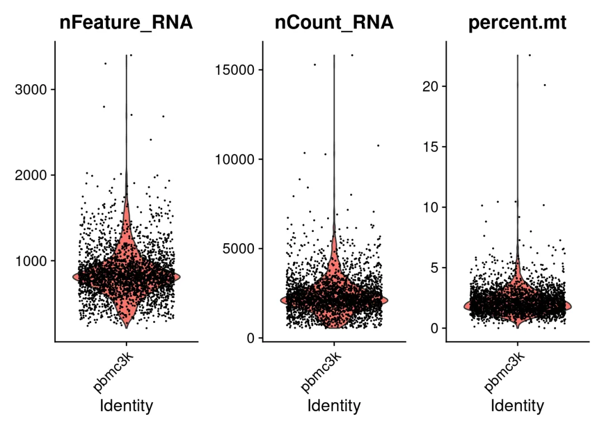

三张图分别是：每个细胞基因的表达情况，转录本的表达情况和线粒体基因百分比。这里可以看到大部分细胞的线粒体百分比在5%以下，因此将5%以上的细胞过滤掉。

## 5.2 关系图

FeatureScatter分别查看转录本表达和线粒体表达百分比相关图，转录本表达和基因表达相关图：

```r
plot1 <- FeatureScatter(pbmc, feature1 = "nCount_RNA", feature2 = "percent.mt")
plot2 <- FeatureScatter(pbmc, feature1 = "nCount_RNA", feature2 = "nFeature_RNA")
plot1 + plot2
```

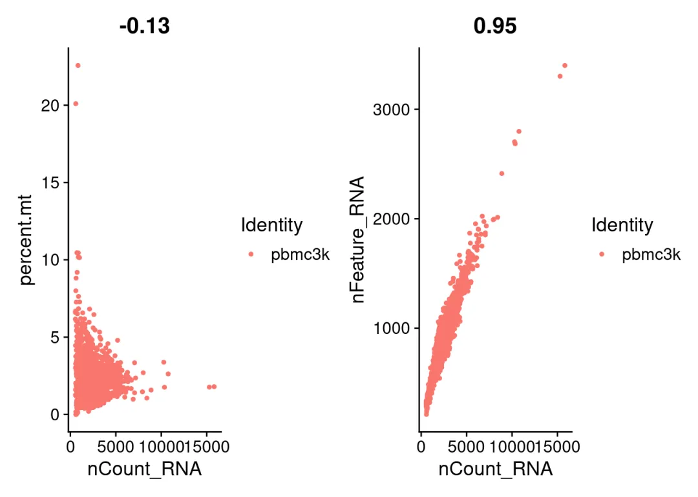

左图：转录本表达对应的线粒体百分比较低，大部分在5%下

右图：基因表达和转录本表达呈线性，正常

# 6\. 过滤细胞

取子集(subset)，转录本表达范围为200-2500，超过2500的表达可能是多细胞，线粒体表达低于5% (5表示5%，)的细胞:

```r
pbmc <- subset(pbmc, subset = nFeature_RNA > 200 & nFeature_RNA < 2500 & percent.mt < 5)
VlnPlot(pbmc, features = c("nFeature_RNA", "nCount_RNA", "percent.mt"), ncol = 3)
```
```
## Warning: Default search for "data" layer in "RNA" assay yielded no results;
## utilizing "counts" layer instead.
```

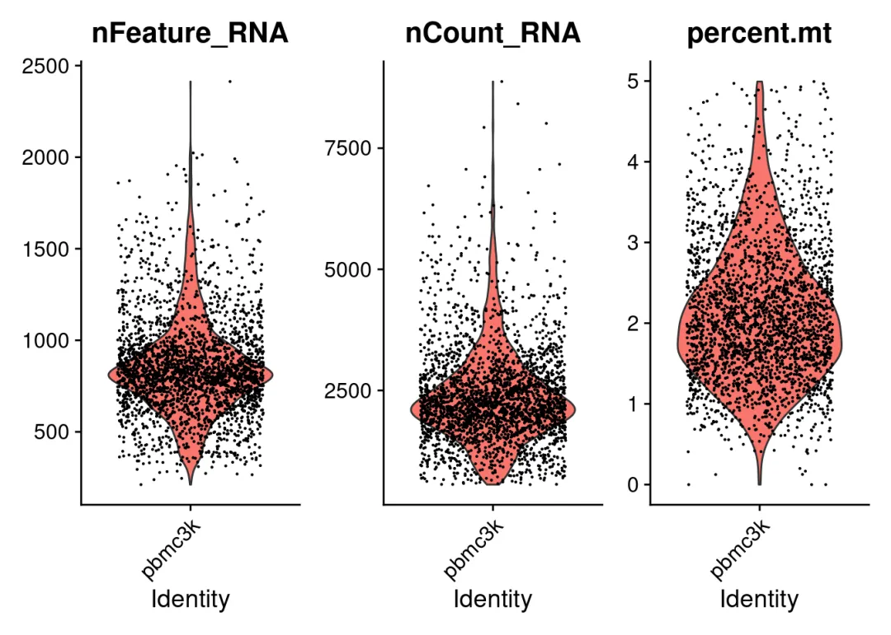

# 7\. 数据标准化

```r
pbmc <- NormalizeData(pbmc, normalization.method = "LogNormalize")
```
```
## Normalizing layer: counts
```

标准化后的数据保存在：pbmc–assays–data

# 8\. 计算高可变基因(hvg)并查看

## 8.1 计算高可变基因

高可变基因，是指在细胞间变化差异大的基因，高可变基因是后续分群降维的基础。这里计算前2000个高可变基因并查看：

```r
pbmc <- FindVariableFeatures(pbmc, selection.method = "vst", nfeatures = 2000)
```
```
## Finding variable features for layer counts
```

```
VariableFeatures(pbmc)
```
```
##    [1] "PPBP"                "LYZ"                 "S100A9"
##    [4] "IGLL5"               "GNLY"                "FTL"
##    [7] "PF4"                 "FTH1"                "GNG11"
##   [10] "S100A8"              "FCER1A"              "HLA-DRA"
##   [13] "CD74"                "CLU"                 "NKG7"
##   [16] "GZMB"                "CST3"                "CCL4"
##   [19] "C1QA"                "HLA-DPB1"            "SDPR"
##   [22] "C1QB"                "AL928768.3"          "TUBB1"
##   [25] "GUSB"                "C10orf32"            "GP9"
##   [28] "LYPD2"               "LYAR"                "HAGH"
##   [31] "FUS"                 "HLA-DPA1"            "DSCR3"
##   [34] "SLA"                 "SMIM7"               "KIF5B"
##   [37] "APOBEC3B"            "PPP6C"               "HBP1"
##   [40] "HBA1"                "TMX2"                "CCL3"
##   [43] "INTS12"              "HLA-DRB1"            "GIMAP5"
##   [46] "CA2"                 "CD79A"               "LILRA4"
##   [49] "CCL5"                "PRKCB"               "LST1"
##   [52] "SERPINF1"            "MYL9"                "SIVA1"
##   [55] "NDUFA12"             "C16orf13"            "IGJ"
##   [58] "MLLT11"              "PRDX1"               "THOC7"
##   [61] "RABL6"               "SDHB"                "CLDN5"
##   [64] "IFI27"               "UBLCP1"              "STK38"
##   [67] "TREML1"              "PRF1"                "SPARC"
##   [70] "RALY"                "TNFRSF17"            "PTGDS"
##   [73] "IL8"                 "HIST1H2AC"           "FCGR3A"
##   [76] "C14orf1"             "TNFSF10"             "TYROBP"
##   [79] "CLEC2B"              "ODC1"                "STAMBP"
##   [82] "FCER1G"              "CWC15"               "FGFBP2"
##   [85] "GMPR"                "AIF1"                "DNASE1L3"
##   [88] "ITGA2B"              "HLA-DQA1"            "IDH2"
##   [91] "CXCL3"               "CORO1B"              "NXT2"
##   [94] "FCN1"                "PTCRA"               "STK17A"
##   [97] "KLRG1"               "BMPR2"               "NT5C3A"
##  [100] "IFITM3"              "PHACTR4"             "ABT1"
##  [103] "MMD"                 "TSC22D1"             "CCT7"
##  [106] "MZB1"                "DNAJC15"             "RXRA"
##  [109] "PSMD14"              "STMN1"               "VAMP5"
##  [112] "CISD1"               "TCL1A"               "TNFRSF9"
##  [115] "SAT1"                "CLEC1B"              "COTL1"
##  [118] "ACRBP"               "CLEC10A"             "OSCAR"
##  [121] "NOP58"               "FAM32A"              "FERMT3"
##  [124] "LUC7L"               "ALDH2"               "SH3GLB1"
##  [127] "MPP1"                "COQ7"                "PACS1"
##  [130] "NPC2"                "GGNBP2"              "SSBP1"
##  [133] "TYMS"                "CARS"                "UBA5"
##  [136] "CIR1"                "UBE2D1"              "PGM1"
##  [139] "RRAGC"               "ZBP1"                "STX11"
##  [142] "TMEM205"             "MTERFD2"             "PTPN7"
##  [145] "STX18"               "REXO2"               "C19orf52"
##  [148] "NUP54"               "HIST1H2BJ"           "MESDC2"
##  [151] "RRM2"                "CMTM5"               "ABRACL"
##  [154] "PACSIN2"             "FH"                  "ACTB"
##  [157] "HNRNPH3"             "EMB"                 "SHOC2"
##  [160] "KCNQ1OT1"            "CST7"                "HDAC1"
##  [163] "WARS"                "ADSL"                "THYN1"
##  [166] "ELOF1"               "DNAJC2"              "TMEM208"
##  [169] "CCT2"                "ZNF688"              "OXLD1"
##  [172] "HDAC5"               "RDH14"               "FKBP5"
##  [175] "CDC42EP3"            "C21orf33"            "RIOK2"
##  [178] "ECHDC1"              "PSMG2"               "NPRL2"
##  [181] "PRDX3"               "WDR55"               "UNC45A"
##  [184] "VPS25"               "ISCA2"               "PPIL2"
##  [187] "DCAF5"               "RBM7"                "FAM107B"
##  [190] "NEMF"                "PITPNA-AS1"          "GGA3"
##  [193] "PSMB6"               "RNF113A"             "S100B"
##  [196] "HLA-DMA"             "MS4A6A"              "GPKOW"
##  [199] "NAT9"                "PRKD2"               "ADD1"
##  [202] "ITPA"                "TNFSF13B"            "NSA2"
##  [205] "NCOR2"               "MYCBP2"              "ASB8"
##  [208] "ZNF493"              "HLA-DQB1"            "DERL1"
##  [211] "MRPS12"              "PPP1R14A"            "UBE2Q1"
##  [214] "CD9"                 "NRGN"                "LGALS2"
##  [217] "SURF6"               "SUMO3"               "VPS28"
##  [220] "FAM96A"              "PHF14"               "RPUSD2"
##  [223] "ABI3"                "C17orf62"            "GPR183"
##  [226] "BIRC5"               "TSSC1"               "TTC14"
##  [229] "ACD"                 "RBM39"               "SH3KBP1"
##  [232] "TAF12"               "KARS"                "LGALSL"
##  [235] "IDO1"                "RPN2"                "ALKBH7"
##  [238] "SLC48A1"             "GZMH"                "ZC3H15"
##  [241] "S100A12"             "KDM3B"               "UBXN4"
##  [244] "ACP1"                "FKBP2"               "CLNS1A"
##  [247] "CCDC115"             "FEM1B"               "IL1B"
##  [250] "C1QC"                "IDI1"                "STUB1"
##  [253] "TMEM242"             "GCA"                 "LGALS1"
##  [256] "MMADHC"              "FPR1"                "PRPF31"
##  [259] "TRAPPC3"             "RNF213"              "GATA2"
##  [262] "IRF9"                "CHTF8"               "LCN2"
##  [265] "GDI2"                "TMEM165"             "CD160"
##  [268] "LRRC26"              "GADD45B"             "CTNNBL1"
##  [271] "GZMK"                "IFIT2"               "FYB"
##  [274] "CTSS"                "ZNF263"              "CLEC4C"
##  [277] "TALDO1"              "CDA"                 "CAT"
##  [280] "RER1"                "TIGIT"               "FOLR3"
##  [283] "KIAA0101"            "ENHO"                "PPA1"
##  [286] "TMEM140"             "AATF"                "CHMP4A"
##  [289] "HNRNPM"              "G0S2"                "NCF2"
##  [292] "TOMM22"              "BOLA1"               "EIF2B1"
##  [295] "IRF8"                "PARP1"               "SH3BP1"
##  [298] "SNX17"               "VDAC3"               "IDH3G"
##  [301] "GINM1"               "IGFBP7"              "ICAM2"
##  [304] "PPP2CA"              "AC147651.3"          "SF3B5"
##  [307] "LTB"                 "DDT"                 "S100A4"
##  [310] "HLA-DRB5"            "TNFRSF1A"            "PYCARD"
##  [313] "CD2"                 "VMO1"                "CDC40"
##  [316] "CEBPB"               "CLYBL"               "ZUFSP"
##  [319] "FKBP3"               "EWSR1"               "CARHSP1"
##  [322] "EIF5"                "MAP3K7CL"            "METTL23"
##  [325] "CMTM7"               "AQP3"                "RIC3"
##  [328] "VTI1B"               "MFSD10"              "RP11-879F14.2"
##  [331] "RNF139"              "LY6G6F"              "PPM1N"
##  [334] "GSTO1"               "COMMD10"             "NDUFB10"
##  [337] "SCP2"                "RPL7L1"              "LGALS3BP"
##  [340] "MS4A7"               "BSDC1"               "UXS1"
##  [343] "SAT2"                "JAK1"                "DNAJA3"
##  [346] "SCT"                 "PMVK"                "SMIM5"
##  [349] "RGS18"               "METTL3"              "ING5"
##  [352] "IFI35"               "SRM"                 "PLA2G12A"
##  [355] "RBM4"                "RNF187"              "POMT1"
##  [358] "TTC3"                "C14orf166"           "MYOM2"
##  [361] "BAZ2A"               "SRSF6"               "STOML2"
##  [364] "APOBEC3A"            "SNX9"                "RP5-887A10.1"
##  [367] "CTD-2006K23.1"       "MAL"                 "IFI30"
##  [370] "AHNAK"               "NUDT1"               "PTAFR"
##  [373] "ANAPC13"             "IL23A"               "CXCL2"
##  [376] "RTN4"                "SCPEP1"              "UQCRC1"
##  [379] "ARRB2"               "TMEM40"              "KCTD10"
##  [382] "ZCCHC9"              "SPG7"                "QRICH1"
##  [385] "TMEM50A"             "ATP5H"               "CD79B"
##  [388] "PLBD1"               "SEPT5"               "C1orf162"
##  [391] "FAM96B"              "SURF1"               "C19orf33"
##  [394] "NIT2"                "MAEA"                "ITSN2"
##  [397] "ISOC2"               "PSMA7"               "OARD1"
##  [400] "MED30"               "PPIE"                "SLC16A3"
##  [403] "HP1BP3"              "CD1C"                "H2AFY"
##  [406] "YWHAE"               "TIMP1"               "MRPL20"
##  [409] "DNAJA1"              "PSMC4"               "CFD"
##  [412] "GOLGB1"              "DPH5"                "GPS1"
##  [415] "ANXA1"               "MYLK"                "CTD-2302E22.4"
##  [418] "VKORC1"              "ARRDC3"              "REEP3"
##  [421] "AP2S1"               "FCGR3B"              "RUFY1"
##  [424] "DIAPH1"              "MRPL9"               "CSNK2B"
##  [427] "JAKMIP1"             "FN3KRP"              "MAFB"
##  [430] "FAM212A"             "GPX1"                "DAB2"
##  [433] "NAA20"               "XCL2"                "SAFB2"
##  [436] "EPN1"                "IFFO1"               "S1PR4"
##  [439] "MT-ND6"              "CCDC91"              "RP11-428G5.5"
##  [442] "DUSP10"              "PITHD1"              "LAMTOR1"
##  [445] "PLEKHA3"             "TMEM14B"             "NDUFB5"
##  [448] "IFIT1"               "POLR2G"              "CD47"
##  [451] "FCRLA"               "BTN3A1"              "LMAN2"
##  [454] "CYFIP1"              "FBXO41"              "ATP1B3"
##  [457] "GP1BA"               "AP001189.4"          "RFNG"
##  [460] "GID8"                "ACAP1"               "ITGB3"
##  [463] "TUBA8"               "ARL2"                "NFE2"
##  [466] "TTC38"               "FCGR2A"              "CPQ"
##  [469] "BCDIN3D"             "UBE2L6"              "KIFC1"
##  [472] "STK32C"              "CYB5B"               "C5orf15"
##  [475] "HSD17B11"            "GNB2"                "KCNG1"
##  [478] "BBS2"                "RBCK1"               "SPOCD1"
##  [481] "PDZK1IP1"            "NT5C"                "FBXO21"
##  [484] "ERP44"               "EVI2B"               "YWHAB"
##  [487] "SMARCC2"             "AHSA1"               "GFI1B"
##  [490] "CTC-260E6.6"         "CHI3L2"              "EXOSC8"
##  [493] "ERGIC3"              "WDR45"               "HMGB2"
##  [496] "PINK1"               "CEPT1"               "GSTP1"
##  [499] "ICOSLG"              "SETD1B"              "SAAL1"
##  [502] "CGRRF1"              "PCNA"                "SENP2"
##  [505] "ISG15"               "PITPNM1"             "CTA-217C2.1"
##  [508] "FCGR1A"              "S100A11"             "GIMAP4"
##  [511] "MLTK"                "GNS"                 "CTC-378H22.1"
##  [514] "PRR5"                "DHX8"                "ATXN10"
##  [517] "ATP5SL"              "TCP1"                "EFHD2"
##  [520] "APOBEC3G"            "RELT"                "ADAL"
##  [523] "SMARCA4"             "CTC-444N24.11"       "RP11-390E23.6"
##  [526] "C16orf58"            "STK11IP"             "ATG4C"
##  [529] "DAGLB"               "BTN3A2"              "LIG1"
##  [532] "DENND5A"             "PRR12"               "KLHL6"
##  [535] "ASGR1"               "ZNF467"              "TMEM141"
##  [538] "DNAJA2"              "MRPL12"              "RILPL2"
##  [541] "PSAP"                "LINC00936"           "LDOC1L"
##  [544] "SRGN"                "RPL39L"              "AP4S1"
##  [547] "TMEM91"              "KLRB1"               "IL4I1"
##  [550] "STRA13"              "BLNK"                "ZNF559"
##  [553] "TGFB1"               "C5AR1"               "CD82"
##  [556] "TMEM194A"            "NUDT16L1"            "AC113189.5"
##  [559] "HSP90AA1"            "ERCC6L2"             "CLIC3"
##  [562] "CTSZ"                "UBAC2"               "ARL6IP5"
##  [565] "CRIP2"               "MDS2"                "MS4A1"
##  [568] "CCDC12"              "CIDEB"               "SGK1"
##  [571] "CAPZA2"              "STT3A"               "MAFF"
##  [574] "ACTN4"               "MRPL47"              "AL928742.12"
##  [577] "PGM2"                "NOG"                 "C12orf45"
##  [580] "CTSW"                "ENKUR"               "RP5-827C21.4"
##  [583] "HGD"                 "DNAJB14"             "ZNF195"
##  [586] "SMPDL3A"             "JUND"                "RP11-706O15.1"
##  [589] "ST20"                "SPTSSB"              "TK1"
##  [592] "TAOK2"               "GFER"                "PFDN2"
##  [595] "USP19"               "PHF12"               "CDK19"
##  [598] "ORAI1"               "URGCP"               "TYW5"
##  [601] "DENND6A"             "METTL8"              "KRT7"
##  [604] "MVD"                 "PPIG"                "TYMP"
##  [607] "GZMA"                "PTPRN2"              "FGL2"
##  [610] "DNMT3A"              "PEX16"               "WTAP"
##  [613] "CRELD2"              "CPNE2"               "TMEM116"
##  [616] "TRIP12"              "YTHDF2"              "TOP1MT"
##  [619] "GMPR2"               "RAB34"               "P2RX5"
##  [622] "LSM6"                "GBP1"                "NFATC1"
##  [625] "PEX26"               "HMG20A"              "C16orf52"
##  [628] "PACRGL"              "PCP2"                "ARG2"
##  [631] "ANKEF1"              "ATG7"                "SIGLEC14"
##  [634] "ZFYVE28"             "LRRC8C"              "TMEM9B"
##  [637] "CDT1"                "RP11-367G6.3"        "RGMB"
##  [640] "DHRS4L2"             "AP003733.1"          "SLC31A2"
##  [643] "LPIN1"               "ARHGDIA"             "RIT1"
##  [646] "AKAP8"               "HAVCR2"              "ANAPC4"
##  [649] "B4GALT4"             "CDK16"               "BLOC1S1"
##  [652] "EGFL7"               "C15orf48"            "RP5-1028K7.2"
##  [655] "OBSCN"               "DHRS4"               "HOPX"
##  [658] "NFAT5"               "PLD6"                "TMEM104"
##  [661] "SPIN1"               "TMEM62"              "RCL1"
##  [664] "MRPS33"              "TARSL2"              "PPA2"
##  [667] "ZNF3"                "RNF26"               "RP11-138A9.2"
##  [670] "ATP6V0E1"            "ERV3-1"              "CYB561"
##  [673] "URB2"                "RHEBL1"              "ZNF528"
##  [676] "BANP"                "ZNF394"              "NDUFS1"
##  [679] "POLR3E"              "HELQ"                "DIS3"
##  [682] "NDUFA2"              "DIDO1"               "ATXN7L3B"
##  [685] "NSMAF"               "TSPAN15"             "AGO4"
##  [688] "ID2"                 "GRAP"                "RP11-70P17.1"
##  [691] "EDC3"                "PLA2G7"              "GPR171"
##  [694] "TMSB4X"              "PRPF8"               "ANXA5"
##  [697] "TERF2IP"             "AIM2"                "FBXO33"
##  [700] "SLC4A7"              "PCYT1A"              "CYTL1"
##  [703] "GTPBP2"              "MFF"                 "CISD3"
##  [706] "RP11-349A22.5"       "TCTA"                "USP20"
##  [709] "TNFAIP2"             "THAP2"               "MINA"
##  [712] "ZFX"                 "LYPLA1"              "ZNF836"
##  [715] "TBC1D23"             "DTX3"                "FHL1"
##  [718] "RMND5A"              "MYADM"               "IL1RAP"
##  [721] "ARSG"                "CD84"                "STAU2"
##  [724] "DDAH2"               "MYO9B"               "PICALM"
##  [727] "TAF6L"               "SMARCD3"             "PASK"
##  [730] "TANGO6"              "GSTA4"               "MRPL28"
##  [733] "HDAC2"               "SUV420H2"            "PQBP1"
##  [736] "EIF4E"               "ST3GAL2"             "SAMD4B"
##  [739] "USP33"               "LAT2"                "RPUSD4"
##  [742] "USP3"                "BRAT1"               "ELL"
##  [745] "LYSMD4"              "SRSF7"               "PHACTR1"
##  [748] "USP7"                "SLC6A6"              "FAAH"
##  [751] "GPR35"               "AC093323.3"          "ARIH2OS"
##  [754] "HNRNPF"              "SPEN"                "RFC2"
##  [757] "AP3M1"               "SKAP2"               "NMNAT3"
##  [760] "HARS"                "GSTZ1"               "UBE2D2"
##  [763] "TMEM102"             "MANBA"               "MRE11A"
##  [766] "CLPX"                "PTGES2"              "IL4R"
##  [769] "TMEM138"             "RBP7"                "CEP85L"
##  [772] "RP11-792A8.4"        "IQCE"                "PTX3"
##  [775] "AP3M2"               "CCL4L1"              "PUM1"
##  [778] "NAAA"                "DAK"                 "MBOAT7"
##  [781] "ASXL2"               "GIMAP2"              "TIMM17A"
##  [784] "MOB2"                "ALG13"               "LILRB2"
##  [787] "PAICS"               "GLB1"                "SNX3"
##  [790] "SMCO4"               "FRAT1"               "NOL7"
##  [793] "EMC7"                "SMC4"                "TRMT61A"
##  [796] "PRR5L"               "CDC123"              "ANTXR2"
##  [799] "CITED4"              "UBXN1"               "GLRX3"
##  [802] "DDB2"                "RAB21"               "C1orf198"
##  [805] "TFAM"                "METTL13"             "FRY-AS1"
##  [808] "LGALS3"              "SSR3"                "VIL1"
##  [811] "UGT2B17"             "LINC01003"           "CAMK2G"
##  [814] "JARID2"              "RP11-509J21.2"       "C5AR2"
##  [817] "TNS1"                "JAZF1"               "USP25"
##  [820] "ARRDC4"              "CDC16"               "NAA25"
##  [823] "ADA"                 "ADH5"                "ZNF106"
##  [826] "TMX3"                "CFP"                 "CDC37"
##  [829] "HVCN1"               "PIGF"                "PCNX"
##  [832] "P2RY10"              "RFC5"                "PGRMC2"
##  [835] "RALBP1"              "C9orf69"             "GTF2F2"
##  [838] "CBX5"                "C8orf44"             "ESYT1"
##  [841] "OSBPL7"              "MRPL19"              "HN1"
##  [844] "RAB2A"               "NARS"                "CAPN12"
##  [847] "TRUB2"               "CCDC107"             "OAS1"
##  [850] "ANKRD44"             "VPS13A"              "TNNI2"
##  [853] "CHD2"                "KIAA1429"            "CXXC1"
##  [856] "DLST"                "PSMC5"               "KLF11"
##  [859] "RP5-1073O3.7"        "BTK"                 "SMIM14"
##  [862] "PMEPA1"              "CD93"                "CCDC22"
##  [865] "ADPRM"               "SLC39A1"             "GOT2"
##  [868] "CCND3"               "TM7SF3"              "TBC1D15"
##  [871] "RP11-421L21.3"       "NIFK"                "ATP5C1"
##  [874] "RHBDD3"              "AAR2"                "SLC25A14"
##  [877] "SEPT11"              "SPG20"               "DUSP22"
##  [880] "GUCD1"               "FOSL2"               "NFYC"
##  [883] "GYS1"                "PNO1"                "LTV1"
##  [886] "PRNP"                "TNFRSF25"            "RAB4B"
##  [889] "ZNF92"               "HENMT1"              "PRAF2"
##  [892] "HECTD1"              "POU2F2"              "LSM14A"
##  [895] "HEXIM2"              "RMDN3"               "INO80C"
##  [898] "DCTN3"               "DYNLT1"              "ADAM10"
##  [901] "CHERP"               "C2orf76"             "PLAGL2"
##  [904] "HDGF"                "KIAA1430"            "IFT57"
##  [907] "TMEM60"              "ATG16L2"             "IFITM2"
##  [910] "NARG2"               "XXbac-BPGBPG55C20.2" "GDPD1"
##  [913] "INIP"                "CHIC2"               "RAB27B"
##  [916] "FBXO4"               "RPL26L1"             "SMU1"
##  [919] "CYTH4"               "PPIL4"               "TXNDC17"
##  [922] "DDX54"               "ANKRD18A"            "BABAM1"
##  [925] "EMG1"                "RWDD4"               "RBM3"
##  [928] "UBE3A"               "TMEM80"              "C1GALT1C1"
##  [931] "MANF"                "TPM2"                "RP11-432I5.1"
##  [934] "COMMD5"              "PCGF1"               "ARAP1"
##  [937] "LARS"                "QSOX1"               "RUNDC1"
##  [940] "ATG16L1"             "CD2AP"               "MAP3K7"
##  [943] "PTPN4"               "ACTR1B"              "HMGXB4"
##  [946] "MLLT10"              "LRRC47"              "MAP3K8"
##  [949] "GARS"                "TGFBR2"              "RP11-400F19.6"
##  [952] "BBX"                 "ARID5B"              "UTP6"
##  [955] "MED9"                "TDG"                 "SDAD1"
##  [958] "MAP2K7"              "C9orf16"             "POLD2"
##  [961] "TMEM87A"             "NDUFAF4"             "ZFAND4"
##  [964] "ACTR6"               "ATF7IP2"             "GPATCH4"
##  [967] "KIAA0040"            "FBXO25"              "SNAPIN"
##  [970] "IDH1"                "C16orf74"            "COMMD4"
##  [973] "MAX"                 "CCDC66"              "TMEM177"
##  [976] "PEX19"               "HDDC3"               "SLC35A2"
##  [979] "CCP110"              "AGPAT1"              "ZNF232"
##  [982] "ANKAR"               "DESI1"               "MAF1"
##  [985] "USP36"               "ARF4"                "COA6"
##  [988] "IP6K1"               "RARA"                "NIT1"
##  [991] "ARHGAP6"             "VSIG4"               "RP11-314N13.3"
##  [994] "CASC4"               "AP3S1"               "RBBP6"
##  [997] "ZYX"                 "POLR3K"              "PRSS57"
## [1000] "HRASLS2"             "ADI1"                "SNRNP27"
## [1003] "MTCH2"               "ARPC5"               "SPNS1"
## [1006] "GNG3"                "LAMP2"               "CRTAP"
## [1009] "COMMD3"              "PNPLA8"              "NR2C1"
## [1012] "MTERFD1"             "FBXW4"               "ZBTB8OS"
## [1015] "OLA1"                "CNEP1R1"             "CTNNBIP1"
## [1018] "TPD52L2"             "ARMC7"               "SLFN5"
## [1021] "LEPROT"              "IRAK4"               "LAIR1"
## [1024] "HCCS"                "MRPL42"              "ADAM8"
## [1027] "FOPNL"               "CAND1"               "NUDT5"
## [1030] "TGFBRAP1"            "CRLS1"               "NAPRT1"
## [1033] "SSBP3"               "MPV17"               "PI4KB"
## [1036] "PTTG1"               "GLYCTK"              "DCAF8"
## [1039] "CSRNP1"              "CNPY3"               "SERPINE2"
## [1042] "C20orf27"            "PKN2"                "TNFAIP8"
## [1045] "PRKACA"              "ACBD3"               "USF2"
## [1048] "MPHOSPH10"           "THOC6"               "CCDC25"
## [1051] "GOSR2"               "ATP6V1D"             "ACOT13"
## [1054] "PRKACB"              "C16orf80"            "WARS2"
## [1057] "DDX1"                "S100A6"              "REEP5"
## [1060] "DENND1C"             "GGA2"                "NKIRAS2"
## [1063] "MRPL1"               "PBRM1"               "NABP1"
## [1066] "RBM5"                "MVB12A"              "ISOC1"
## [1069] "USP5"                "RFC1"                "AC010642.1"
## [1072] "TIMM10B"             "SEPHS2"              "ITM2A"
## [1075] "C1orf63"             "CHN2"                "CTBP2"
## [1078] "DOCK10"              "SETX"                "DMTN"
## [1081] "GTPBP6"              "MKKS"                "ADIPOR2"
## [1084] "MOCS2"               "SNX14"               "hsa-mir-1199"
## [1087] "C1orf35"             "ATP5A1"              "ECSIT"
## [1090] "SNRPB"               "NGFRAP1"             "RNF25"
## [1093] "ZNF276"              "LDLRAP1"             "IL24"
## [1096] "EMC10"               "RGL2"                "FNTA"
## [1099] "GYG1"                "TMEM199"             "ZNF593"
## [1102] "TMEM55A"             "C9orf37"             "AAGAB"
## [1105] "DDX17"               "OCIAD1"              "C15orf61"
## [1108] "C9orf142"            "EIF4E2"              "KPNA1"
## [1111] "MTIF3"               "POP7"                "RNF125"
## [1114] "POLDIP2"             "ETS1"                "ILF3"
## [1117] "WIBG"                "TRIM14"              "ACADM"
## [1120] "LBR"                 "UQCC1"               "FXN"
## [1123] "PAFAH1B1"            "DCP2"                "ZFP36L1"
## [1126] "ABHD5"               "SAMM50"              "ZAP70"
## [1129] "DOK3"                "SLC20A2"             "INTS2"
## [1132] "ZNF175"              "NKAP"                "SAMD3"
## [1135] "FAM120A"             "CAMK1D"              "MGAT1"
## [1138] "ZNF468"              "RHOG"                "SCAPER"
## [1141] "PPP2R3C"             "TMEM126B"            "PIK3R1"
## [1144] "SPRTN"               "NNT-AS1"             "UBE2K"
## [1147] "TMEM18"              "TMCO1"               "TSPAN33"
## [1150] "SEC31A"              "CNDP2"               "UIMC1"
## [1153] "FASTKD1"             "RRS1"                "CCNB1"
## [1156] "HMBOX1"              "VAPA"                "CCDC94"
## [1159] "EOGT"                "SIAH2"               "GPBP1L1"
## [1162] "OAT"                 "MX2"                 "PHPT1"
## [1165] "THUMPD3"             "XPOT"                "PTGDR"
## [1168] "KLHL24"              "METTL21A"            "ANKRA2"
## [1171] "MID1IP1"             "MORF4L2"             "ISY1"
## [1174] "PPP1R8"              "RAB1B"               "NFKBIL1"
## [1177] "LYN"                 "TCEAL4"              "ILF3-AS1"
## [1180] "GALK1"               "SNAP47"              "UBIAD1"
## [1183] "RNF168"              "RORA"                "ATXN3"
## [1186] "GLTP"                "NANS"                "CTA-29F11.1"
## [1189] "AKTIP"               "NRBF2"               "ARHGEF2"
## [1192] "SNX5"                "CDC5L"               "SYCE1"
## [1195] "PWP1"                "COMMD8"              "DNAJC10"
## [1198] "SNX20"               "BOLA3"               "NUDCD1"
## [1201] "PPT1"                "C5orf56"             "FAM212B"
## [1204] "RP11-532F6.3"        "BEX4"                "NDUFB6"
## [1207] "PIGU"                "TASP1"               "ST7L"
## [1210] "DIMT1"               "ALG5"                "CD96"
## [1213] "ZNF350"              "HMGCL"               "BNIP2"
## [1216] "RASD1"               "PDCD2L"              "SYVN1"
## [1219] "ZNF561"              "POLR2E"              "GNPAT"
## [1222] "SERPINA1"            "GALT"                "RASGRP2"
## [1225] "RELB"                "C4orf3"              "RCHY1"
## [1228] "CPSF3L"              "U2SURP"              "TIMMDC1"
## [1231] "VPS13C"              "CKB"                 "EXOC6"
## [1234] "C14orf80"            "CYLD"                "TMEM248"
## [1237] "FAM173A"             "PAXIP1-AS1"          "RP11-139H15.1"
## [1240] "TNFRSF13B"           "MDP1"                "STX4"
## [1243] "EREG"                "DUS3L"               "BAG5"
## [1246] "HOOK2"               "NR3C1"               "CCDC69"
## [1249] "PDIA3"               "LYRM2"               "DEDD"
## [1252] "THEM4"               "SRPR"                "DECR1"
## [1255] "ATP6V0E2"            "ARPC5L"              "SNRNP35"
## [1258] "NFU1"                "SDCCAG8"             "PRDM2"
## [1261] "TRABD2A"             "SH3BGRL"             "NOS3"
## [1264] "GBP4"                "ITGB7"               "CRTC2"
## [1267] "CHPF2"               "ZNF330"              "YPEL3"
## [1270] "CDV3"                "IFI44"               "SSX2IP"
## [1273] "ZNF32"               "FADS1"               "PDXDC1"
## [1276] "DHX36"               "TNRC6B"              "SPPL2A"
## [1279] "DICER1"              "MADD"                "EIF2AK4"
## [1282] "RP11-432J24.2"       "SLC19A1"             "ARID4A"
## [1285] "MAPK1IP1L"           "NELFB"               "TANK"
## [1288] "NEFH"                "ARPP19"              "CYTH2"
## [1291] "XRRA1"               "C1orf123"            "LMF2"
## [1294] "PCNP"                "RETN"                "RP11-589C21.6"
## [1297] "NEXN"                "DUSP23"              "TRIT1"
## [1300] "MAP2K3"              "MIS18BP1"            "RAB9A"
## [1303] "BLZF1"               "RBPJ"                "CHD7"
## [1306] "MAGEH1"              "KRBOX4"              "PEMT"
## [1309] "SFR1"                "COG4"                "SAMSN1"
## [1312] "GRAP2"               "TREX1"               "XXbac-BPG299F13.17"
## [1315] "BRWD1"               "STX16"               "AC073072.5"
## [1318] "P2RY6"               "GP6"                 "DHX15"
## [1321] "ATG12"               "DPY30"               "ETHE1"
## [1324] "SF3B1"               "YTHDC1"              "WNK1"
## [1327] "SPON2"               "CD55"                "DNTTIP1"
## [1330] "C7orf26"             "BLCAP"               "TMEM14C"
## [1333] "ARL4A"               "CUL4B"               "NPHP3"
## [1336] "RABEP2"              "SCFD1"               "CORO7"
## [1339] "CACNA2D3"            "NOC4L"               "SLBP"
## [1342] "ENY2"                "LRRC59"              "STAU1"
## [1345] "MRPL21"              "ORC2"                "PIGT"
## [1348] "C15orf57"            "ZBED5-AS1"           "TRIP11"
## [1351] "KLF13"               "NAP1L4"              "SNW1"
## [1354] "CR1"                 "FRMD3"               "SMARCB1"
## [1357] "WHAMM"               "DHX9"                "NOL11"
## [1360] "CIAPIN1"             "C12orf10"            "KCNK6"
## [1363] "TMEM222"             "CELF1"               "SHARPIN"
## [1366] "R3HDM2"              "FEM1A"               "IFT20"
## [1369] "ORMDL2"              "FNBP4"               "NFIC"
## [1372] "UCK1"                "TMCC2"               "RP11-219B4.7"
## [1375] "CCNG1"               "HBEGF"               "CORO1C"
## [1378] "TAL1"                "RP4-561L24.3"        "TPO"
## [1381] "LINC01119"           "AC009501.4"          "NCKAP1"
## [1384] "RP13-131K19.2"       "RP13-131K19.7"       "TMCC1-AS1"
## [1387] "AC195454.1"          "SERPINE1"            "Y-RNA"
## [1390] "ARC"                 "C9orf147"            "RP11-416N2.4"
## [1393] "KRTAP5-AS1"          "OVCH1-AS1"           "SRGAP1"
## [1396] "PGF"                 "MEG3"                "CTRL"
## [1399] "CDH1"                "C19orf77"            "ZNF763"
## [1402] "WDR62"               "LINC00884"           "MMRN1"
## [1405] "SEPP1"               "RANBP17"             "TNFRSF21"
## [1408] "LCNL1"               "FAM106A"             "KRT23"
## [1411] "RAB12"               "TGFBR3L"             "RIOK1"
## [1414] "ARHGAP24"            "VPS26B"              "RFXANK"
## [1417] "TTC1"                "NME6"                "PTGES3"
## [1420] "ACADVL"              "HPRT1"               "MICU1"
## [1423] "TGOLN2"              "ACTL6A"              "CTNNB1"
## [1426] "PSMB8"               "RP11-178G16.4"       "POLE4"
## [1429] "EFCAB14"             "TRIM23"              "ARGLU1"
## [1432] "CCDC124"             "RAB32"               "PRPS2"
## [1435] "RGS14"               "ATP6AP1"             "DMAP1"
## [1438] "SMCHD1"              "PLRG1"               "RBM25"
## [1441] "PCSK7"               "IMPDH2"              "SMIM12"
## [1444] "DDX56"               "RP11-468E2.4"        "PLEKHA1"
## [1447] "PIGX"                "MTIF2"               "PRDX4"
## [1450] "GIT2"                "HERPUD2"             "UFD1L"
## [1453] "EIF2S1"              "SIK1"                "TBPL1"
## [1456] "COX5A"               "SRA1"                "MRPL43"
## [1459] "MRPS23"              "MRPL51"              "PHF5A"
## [1462] "SMAP2"               "MRPS16"              "PARL"
## [1465] "MPLKIP"              "DNAJC7"              "OAZ1"
## [1468] "MT-CO2"              "TCEAL8"              "RAD23A"
## [1471] "ERI3"                "R3HDM1"              "NFE2L2"
## [1474] "DEXI"                "SLC25A12"            "ARSD"
## [1477] "ELP6"                "UBE2D4"              "NDUFA9"
## [1480] "ARID4B"              "GRPEL1"              "TBCB"
## [1483] "GMPPA"               "CNIH4"               "RNASEH2B"
## [1486] "RNF14"               "ECHS1"               "SRP72"
## [1489] "CWC27"               "MKLN1"               "TAF7"
## [1492] "C17orf59"            "ZNF45"               "VTI1A"
## [1495] "CCT6A"               "RARS"                "TMED5"
## [1498] "RCN2"                "LINC00926"           "N4BP2L1"
## [1501] "IFNGR2"              "SMS"                 "SDHAF2"
## [1504] "CASC7"               "NDUFA10"             "ARL2BP"
## [1507] "HES1"                "CSRP1"               "ESAM"
## [1510] "DRAM2"               "FLNA"                "EIF5B"
## [1513] "GTF2B"               "RP11-488C13.5"       "MALT1"
## [1516] "HSPB11"              "AK2"                 "CALCOCO2"
## [1519] "NDUFA5"              "ZNF277"              "TBCC"
## [1522] "TRAF3IP3"            "FGR"                 "VIPR1"
## [1525] "SUCLG2"              "CIRH1A"              "DNAJC8"
## [1528] "TBXA2R"              "POLR2K"              "ARL6"
## [1531] "TXNDC5"              "GABARAPL2"           "STX5"
## [1534] "CCNA2"               "MED28"               "C4orf33"
## [1537] "TRPM4"               "YPEL2"               "PELI1"
## [1540] "LAMTOR5"             "IL16"                "NBR1"
## [1543] "PLEKHJ1"             "ANKHD1"              "HCFC2"
## [1546] "ABHD17B"             "UBE2B"               "TMEM219"
## [1549] "ARMCX5"              "PSMC6"               "CEP68"
## [1552] "MGMT"                "NCR3"                "EVA1B"
## [1555] "IL6"                 "SREK1"               "RP11-301O19.1"
## [1558] "BIK"                 "MRPL14"              "LRRFIP1"
## [1561] "KDELR2"              "ANKRD27"             "ANKRD54"
## [1564] "BUB3"                "VPS51"               "EIF1AY"
## [1567] "BET1"                "CD247"               "TOP2A"
## [1570] "AATK"                "DOHH"                "TAF10"
## [1573] "MNAT1"               "TOP2B"               "TBCK"
## [1576] "CEACAM4"             "RNF7"                "FAM43A"
## [1579] "MUM1"                "BBC3"                "TMEM229B"
## [1582] "TBC1D8"              "DYNC2LI1"            "PDZD4"
## [1585] "SLC2A13"             "C1orf54"             "ZNF747"
## [1588] "VPS72"               "LIN52"               "CTTN"
## [1591] "NAPSA"               "ATXN1L"              "CCM2"
## [1594] "CEP164"              "SMOX"                "ABHD12"
## [1597] "MIS18A"              "MGST2"               "PCMT1"
## [1600] "OAZ2"                "RWDD1"               "RP11-1070N10.3"
## [1603] "GAS6"                "MX1"                 "TIMM22"
## [1606] "ATP6V0B"             "APOBEC3H"            "RP11-701P16.5"
## [1609] "WDYHV1"              "PSMA1"               "DHRS7"
## [1612] "ZMAT2"               "WDR83"               "PDK2"
## [1615] "CES4A"               "DPH6"                "HCAR3"
## [1618] "RP3-325F22.5"        "HAX1"                "IL32"
## [1621] "ENTPD3-AS1"          "PJA1"                "VAMP8"
## [1624] "PRELID1"             "RAD21"               "NECAB3"
## [1627] "PARS2"               "SREBF1"              "ZSWIM6"
## [1630] "IL17RA"              "F13A1"               "PDE6B"
## [1633] "LYRM4"               "LINC00662"           "KIAA0196"
## [1636] "TTN-AS1"             "GIMAP7"              "SIRT1"
## [1639] "DHX34"               "DNAJB9"              "TMEM234"
## [1642] "ZBTB10"              "SCAI"                "CTD-2537I9.12"
## [1645] "CD1E"                "TROAP"               "LAMP5"
## [1648] "CYTIP"               "ATP6V1A"             "MED7"
## [1651] "TUBA4A"              "NAT14"               "TCL1B"
## [1654] "TAOK3"               "TMEM87B"             "NRROS"
## [1657] "CEP120"              "PURA"                "HDAC9"
## [1660] "ASAH1"               "ID1"                 "ABCC10"
## [1663] "SPI1"                "PRUNE"               "LUC7L3"
## [1666] "AMDHD2"              "C1orf50"             "MLEC"
## [1669] "TWF2"                "TAF1"                "IL27RA"
## [1672] "PXMP4"               "ERH"                 "MPC2"
## [1675] "SMC2"                "COLGALT1"            "PDIK1L"
## [1678] "GNAZ"                "KRT1"                "YPEL5"
## [1681] "PGM2L1"              "AKR1C3"              "LAMP3"
## [1684] "USP30"               "FAM210B"             "MARCH5"
## [1687] "LRCH4"               "SDHA"                "KLRC1"
## [1690] "EHMT2"               "USP38"               "MLX"
## [1693] "C1orf86"             "BACE2"               "CLSTN3"
## [1696] "SNHG8"               "MYC"                 "FAM221A"
## [1699] "KIR2DL3"             "ITCH"                "PNRC1"
## [1702] "ATP1A1"              "RGS16"               "NUDC"
## [1705] "FGFR1OP2"            "TADA2A"              "SLC40A1"
## [1708] "MTRF1"               "SRPK1"               "RP11-10K16.1"
## [1711] "ALKBH4"              "IFIT5"               "MALAT1"
## [1714] "CCPG1"               "PLD4"                "TRADD"
## [1717] "DRAXIN"              "APOOL"               "MT3"
## [1720] "CPLX1"               "GPRC5C"              "CLPP"
## [1723] "GPR153"              "RP3-467K16.4"        "C1orf186"
## [1726] "RP11-443B7.3"        "ASAP2"               "TMPRSS11E"
## [1729] "CTD-2353F22.1"       "CAV1"                "CLCN5"
## [1732] "BAMBI"               "RP11-324I22.4"       "HKDC1"
## [1735] "SCD"                 "WNT5B"               "C1R"
## [1738] "SUOX"                "RP11-511B23.1"       "LINC01146"
## [1741] "FAM154B"             "RP11-1151B14.4"      "SIGLEC12"
## [1744] "DSCR9"               "AP001046.6"          "REPS2"
## [1747] "ACAT2"               "BEX2"                "S100A10"
## [1750] "IRF7"                "CXCL10"              "ANKRD49"
## [1753] "DGUOK"               "DEPTOR"              "AFAP1L2"
## [1756] "FFAR3"               "ZRANB3"              "TP53BP2"
## [1759] "ITM2C"               "LMNB1"               "ATP5O"
## [1762] "ZWINT"               "IFI6"                "CD302"
## [1765] "CASP4"               "CTSC"                "MEF2D"
## [1768] "UBE2F"               "FBXW5"               "HEMK1"
## [1771] "RPL22L1"             "SARS"                "RBM26-AS1"
## [1774] "TRIOBP"              "HLA-DMB"             "TRIP13"
## [1777] "CEP55"               "RP11-110I1.14"       "EAPP"
## [1780] "RAD51B"              "SLC27A1"             "SIRT6"
## [1783] "E2F3"                "MRM1"                "ZNF799"
## [1786] "TIMM13"              "SEC11C"              "VIM"
## [1789] "TCEA1"               "CKS1B"               "CAMK2N1"
## [1792] "NEK8"                "RASGRP4"             "EPC1"
## [1795] "DDI2"                "DPY19L4"             "C3orf38"
## [1798] "RP11-247A12.2"       "RPUSD3"              "WBP2"
## [1801] "KIAA0930"            "FAM98A"              "SWAP70"
## [1804] "OSBPL1A"             "GBGT1"               "GPR42"
## [1807] "EIF3D"               "ACY3"                "RP6-91H8.3"
## [1810] "ZNF503"              "RP3-395M20.9"        "ANKRD22"
## [1813] "ZBTB32"              "TNFSF4"              "SLC16A5"
## [1816] "ARHGAP11A"           "RGS1"                "SEPW1"
## [1819] "DNPH1"               "GNAI2"               "XRCC5"
## [1822] "ARPC1B"              "IDUA"                "IL7R"
## [1825] "NKTR"                "MRPL23"              "CMTM3"
## [1828] "YIPF3"               "NDUFA11"             "TINF2"
## [1831] "RFPL2"               "MYCL"                "AEBP1"
## [1834] "SYNE2"               "CDKN2A"              "USP8"
## [1837] "WLS"                 "KCNC3"               "OLFM1"
## [1840] "RP11-598F7.3"        "SPATA7"              "HLA-DQA2"
## [1843] "SEC11A"              "FCGRT"               "SH3BGRL3"
## [1846] "TOB1"                "OSTC"                "SRSF3"
## [1849] "GOLT1B"              "TUBA1B"              "DDX24"
## [1852] "NAIP"                "C19orf24"            "C6orf25"
## [1855] "UBB"                 "HMOX1"               "PLAC8"
## [1858] "TNNT1"               "POLR2I"              "CCR10"
## [1861] "ABCC3"               "ZSCAN5A"             "MRPS18A"
## [1864] "CD14"                "NENF"                "GSK3A"
## [1867] "SH3BP5"              "ISCU"                "DEGS1"
## [1870] "GOLGA7"              "NDFIP1"              "EGLN3"
## [1873] "FAM110A"             "RGS19"               "ZNF428"
## [1876] "NELL2"               "EARS2"               "NAPA-AS1"
## [1879] "BLVRA"               "TXN2"                "RP11-164H13.1"
## [1882] "LTC4S"               "HIST1H2BC"           "TAPBP"
## [1885] "MAPK14"              "DPM1"                "DENND5B"
## [1888] "MNDA"                "AC005082.12"         "MCOLN3"
## [1891] "AMIGO1"              "C1orf51"             "RP11-307C12.12"
## [1894] "CENPF"               "OTOF"                "CNRIP1"
## [1897] "SEMA4F"              "IL1R2"               "FAM3D"
## [1900] "PVRL3"               "TXNRD3"              "CENPU"
## [1903] "ALDH7A1"             "RP11-393I2.4"        "GPR63"
## [1906] "RP5-894D12.3"        "PAK3"                "GFRA2"
## [1909] "RP11-297B17.3"       "RP11-305L7.3"        "NIPSNAP3B"
## [1912] "MEIG1"               "TMEM86A"             "YPEL4"
## [1915] "SLC6A12"             "PLEK2"               "CTD-2547L24.4"
## [1918] "DUOX1"               "GPT2"                "AC137932.6"
## [1921] "RNF165"              "SNPH"                "ATP9A"
## [1924] "RP3-508I15.21"       "XCL1"                "NF1"
## [1927] "GTF2H2"              "EXOC4"               "ATAD3C"
## [1930] "RPUSD1"              "RP11-290F20.3"       "DUT"
## [1933] "KLRC2"               "CTA-250D10.23"       "RP11-493L12.4"
## [1936] "NCKAP1L"             "PMF1"                "COPS6"
## [1939] "SCGB1C1"             "SIGLEC10"            "SEC61B"
## [1942] "KLC4"                "RAB40C"              "PPIF"
## [1945] "BIRC3"               "HAUS1"               "ZNHIT3"
## [1948] "PRPF6"               "ACSM3"               "SAMD1"
## [1951] "KLF6"                "QPRT"                "GUCY1B3"
## [1954] "NUDT11"              "ZFAT"                "B2M"
## [1957] "PPP2R1B"             "EPSTI1"              "LAS1L"
## [1960] "RP11-111M22.3"       "C16orf54"            "PRPF18"
## [1963] "PPP1R14B"            "RP11-430B1.2"        "NDNL2"
## [1966] "NFKBIA"              "ICOS"                "TRIM8"
## [1969] "EIF3M"               "GALNT1"              "FCGR2B"
## [1972] "MED27"               "SLC2A3"              "ZNF397"
## [1975] "C19orf59"            "CD37"                "GRN"
## [1978] "CCDC109B"            "POLG"                "SNHG12"
## [1981] "KIF3A"               "SELL"                "NONO"
## [1984] "EIF3H"               "TMEM176B"            "CTB-152G17.6"
## [1987] "LZTS2"               "UPK3A"               "APMAP"
## [1990] "CTD-2012J19.3"       "GADD45G"             "MKNK1"
## [1993] "AURKC"               "VOPP1"               "RHOC"
## [1996] "CISH"                "CD27"                "LILRA3"
## [1999] "CLIC2"               "HEMGN"
```

## 8.2 选出变化最大的前十个基因

```r
top10 <- head(VariableFeatures(pbmc), 10)
```

## 8.3 可视化hvg，并列出前十hvg

```r
plot1 <- VariableFeaturePlot(pbmc)
plot2 <- LabelPoints(plot = plot1, points = top10, repel = TRUE)
```
```
## When using repel, set xnudge and ynudge to 0 for optimal results
```

```
plot1
```
```
## Warning in scale_x_log10(): log-10 transformation introduced infinite values.
```

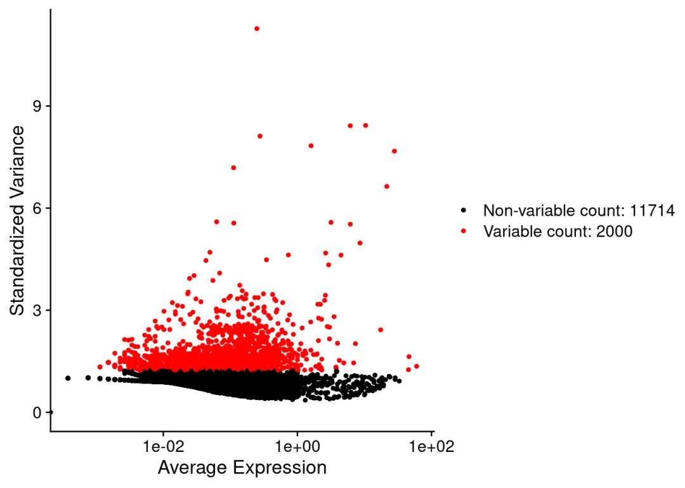

```
plot2
```
```
## Warning in scale_x_log10(): log-10 transformation introduced infinite values.
```

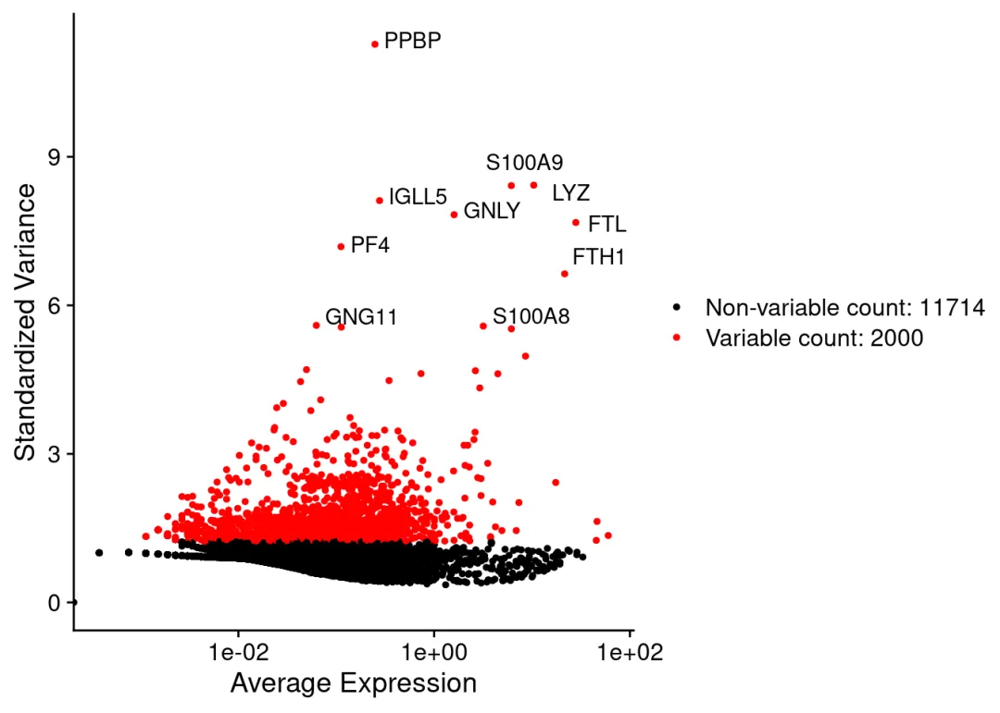

## 8.4 hvg的存放位置

hvg存放在：pbmc@assays$RNA@meta.features

查看：

```
head(pbmc@assays$RNA@meta.features)
```
```
## Error in h(simpleError(msg, call)): error in evaluating the argument 'x' in selecting a method for function 'head': no slot of name "meta.features" for this object of class "Assay5"
```

# 9\. 数据中心化(scale)

将数据变换为均值为0，方差为1，数据存放在：pbmc@assaysRNA@layers���@������scale.data

```r
all.genes <- rownames(pbmc)
```

```r
pbmc <- ScaleData(pbmc, features=all.genes)
```
```
## Centering and scaling data matrix
```

结果存放于： 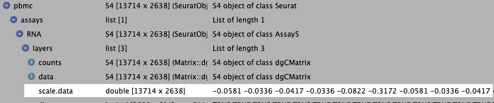

# 10\. 数据降

## 10.1 主成分分析

  1. 计算主成分：

```r
pbmc <- RunPCA(pbmc, features = VariableFeatures(object = pbmc))
```
```
## PC_ 1
## Positive:  CST3, TYROBP, LST1, AIF1, FTL, FTH1, LYZ, FCN1, S100A9, TYMP
##     FCER1G, CFD, LGALS1, S100A8, CTSS, LGALS2, SERPINA1, IFITM3, SPI1, CFP
##     PSAP, IFI30, SAT1, COTL1, S100A11, NPC2, GRN, LGALS3, GSTP1, PYCARD
## Negative:  MALAT1, LTB, IL32, IL7R, CD2, B2M, ACAP1, CD27, STK17A, CTSW
##     CD247, GIMAP5, AQP3, CCL5, SELL, TRAF3IP3, GZMA, MAL, CST7, ITM2A
##     MYC, GIMAP7, HOPX, BEX2, LDLRAP1, GZMK, ETS1, ZAP70, TNFAIP8, RIC3
## PC_ 2
## Positive:  CD79A, MS4A1, TCL1A, HLA-DQA1, HLA-DQB1, HLA-DRA, LINC00926, CD79B, HLA-DRB1, CD74
##     HLA-DMA, HLA-DPB1, HLA-DQA2, CD37, HLA-DRB5, HLA-DMB, HLA-DPA1, FCRLA, HVCN1, LTB
##     BLNK, P2RX5, IGLL5, IRF8, SWAP70, ARHGAP24, FCGR2B, SMIM14, PPP1R14A, C16orf74
## Negative:  NKG7, PRF1, CST7, GZMB, GZMA, FGFBP2, CTSW, GNLY, B2M, SPON2
##     CCL4, GZMH, FCGR3A, CCL5, CD247, XCL2, CLIC3, AKR1C3, SRGN, HOPX
##     TTC38, APMAP, CTSC, S100A4, IGFBP7, ANXA1, ID2, IL32, XCL1, RHOC
## PC_ 3
## Positive:  HLA-DQA1, CD79A, CD79B, HLA-DQB1, HLA-DPB1, HLA-DPA1, CD74, MS4A1, HLA-DRB1, HLA-DRA
##     HLA-DRB5, HLA-DQA2, TCL1A, LINC00926, HLA-DMB, HLA-DMA, CD37, HVCN1, FCRLA, IRF8
##     PLAC8, BLNK, MALAT1, SMIM14, PLD4, LAT2, IGLL5, P2RX5, SWAP70, FCGR2B
## Negative:  PPBP, PF4, SDPR, SPARC, GNG11, NRGN, GP9, RGS18, TUBB1, CLU
##     HIST1H2AC, AP001189.4, ITGA2B, CD9, TMEM40, PTCRA, CA2, ACRBP, MMD, TREML1
##     NGFRAP1, F13A1, SEPT5, RUFY1, TSC22D1, MPP1, CMTM5, RP11-367G6.3, MYL9, GP1BA
## PC_ 4
## Positive:  HLA-DQA1, CD79B, CD79A, MS4A1, HLA-DQB1, CD74, HLA-DPB1, HIST1H2AC, PF4, TCL1A
##     SDPR, HLA-DPA1, HLA-DRB1, HLA-DQA2, HLA-DRA, PPBP, LINC00926, GNG11, HLA-DRB5, SPARC
##     GP9, AP001189.4, CA2, PTCRA, CD9, NRGN, RGS18, GZMB, CLU, TUBB1
## Negative:  VIM, IL7R, S100A6, IL32, S100A8, S100A4, GIMAP7, S100A10, S100A9, MAL
##     AQP3, CD2, CD14, FYB, LGALS2, GIMAP4, ANXA1, CD27, FCN1, RBP7
##     LYZ, S100A11, GIMAP5, MS4A6A, S100A12, FOLR3, TRABD2A, AIF1, IL8, IFI6
## PC_ 5
## Positive:  GZMB, NKG7, S100A8, FGFBP2, GNLY, CCL4, CST7, PRF1, GZMA, SPON2
##     GZMH, S100A9, LGALS2, CCL3, CTSW, XCL2, CD14, CLIC3, S100A12, CCL5
##     RBP7, MS4A6A, GSTP1, FOLR3, IGFBP7, TYROBP, TTC38, AKR1C3, XCL1, HOPX
## Negative:  LTB, IL7R, CKB, VIM, MS4A7, AQP3, CYTIP, RP11-290F20.3, SIGLEC10, HMOX1
##     PTGES3, LILRB2, MAL, CD27, HN1, CD2, GDI2, ANXA5, CORO1B, TUBA1B
##     FAM110A, ATP1A1, TRADD, PPA1, CCDC109B, ABRACL, CTD-2006K23.1, WARS, VMO1, FYB
```

  2. 显示前两个主成分的相关基因:

```
print(pbmc[["pca"]], dims = 1:2, nfeatures = 5)
```
```
## PC_ 1
## Positive:  CST3, TYROBP, LST1, AIF1, FTL
## Negative:  MALAT1, LTB, IL32, IL7R, CD2
## PC_ 2
## Positive:  CD79A, MS4A1, TCL1A, HLA-DQA1, HLA-DQB1
## Negative:  NKG7, PRF1, CST7, GZMB, GZMA
```

  3. 主成分相关基因热图:

```
DimHeatmap(pbmc, dims = 1:2, cells = 500, balanced = TRUE)
```

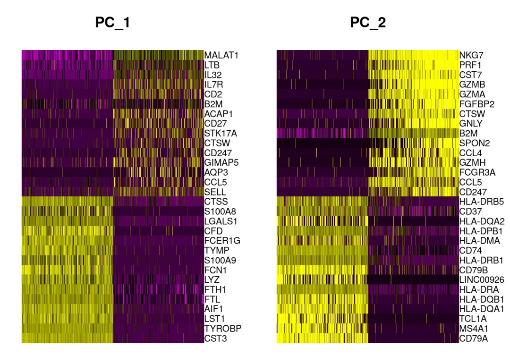

  4. 使用肘图确定采用的主成分:

```
ElbowPlot(pbmc,ndims = 50)
```

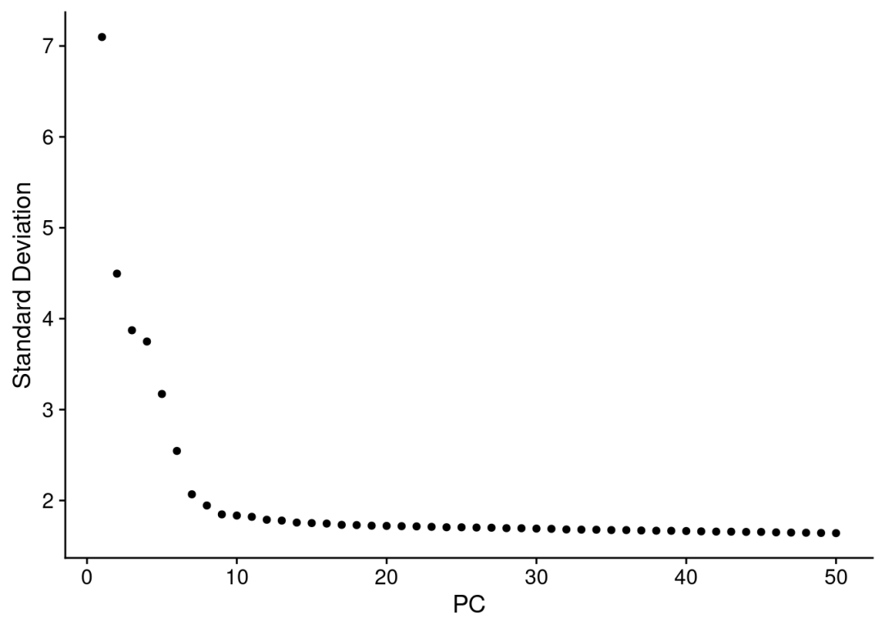

从这张图可以看到从第10个主成分之后的主成分对数据的解释度基本不变了，因此我们截取到前10个主成分。

# 11\. 聚类及可视化

## 11.1 生成SNN图

```r
pbmc <- FindNeighbors(pbmc, dims = 1:10)
```
```
## Computing nearest neighbor graph
```
```
## Computing SNN
```

## 11.2 louvain算法根据SNN图进行聚类

resolution图像清晰度，越高越清晰

```r
pbmc <- FindClusters(pbmc, resolution = 0.5)
```
```
## Modularity Optimizer version 1.3.0 by Ludo Waltman and Nees Jan van Eck
##
## Number of nodes: 2638
## Number of edges: 95965
##
## Running Louvain algorithm...
## Maximum modularity in 10 random starts: 0.8723
## Number of communities: 9
## Elapsed time: 0 seconds
```

## 11.3 显示聚类结果

```
head(Idents(pbmc), 5)
```
```
## AAACATACAACCAC-1 AAACATTGAGCTAC-1 AAACATTGATCAGC-1 AAACCGTGCTTCCG-1
##                2                3                2                1
## AAACCGTGTATGCG-1
##                6
## Levels: 0 1 2 3 4 5 6 7 8
```

结果保存在：pbmc–meta.data–seurat_clusters

## 11.4 再次降维可视化(降到二维来做数据的展示)

### 11.4.1 umap降维可视化(用的较多)

```r
pbmc <- RunUMAP(pbmc, dims = 1:10)
```
```
## Warning: The default method for RunUMAP has changed from calling Python UMAP via reticulate to the R-native UWOT using the cosine metric
## To use Python UMAP via reticulate, set umap.method to 'umap-learn' and metric to 'correlation'
## This message will be shown once per session
```
```
## 15:21:15 UMAP embedding parameters a = 0.9922 b = 1.112
```
```
## 15:21:15 Read 2638 rows and found 10 numeric columns
```
```
## 15:21:15 Using Annoy for neighbor search, n_neighbors = 30
```
```
## 15:21:15 Building Annoy index with metric = cosine, n_trees = 50
```
```
## 0%   10   20   30   40   50   60   70   80   90   100%
```
```
## [----|----|----|----|----|----|----|----|----|----|
```
```
## **************************************************|
## 15:21:16 Writing NN index file to temp file /tmp/RtmpOD68s0/filecd3a054220417
## 15:21:16 Searching Annoy index using 1 thread, search_k = 3000
## 15:21:17 Annoy recall = 100%
## 15:21:17 Commencing smooth kNN distance calibration using 1 thread with target n_neighbors = 30
## 15:21:19 Initializing from normalized Laplacian + noise (using RSpectra)
## 15:21:19 Commencing optimization for 500 epochs, with 105124 positive edges
## 15:21:23 Optimization finished
```

```
DimPlot(pbmc, reduction = "umap")
```

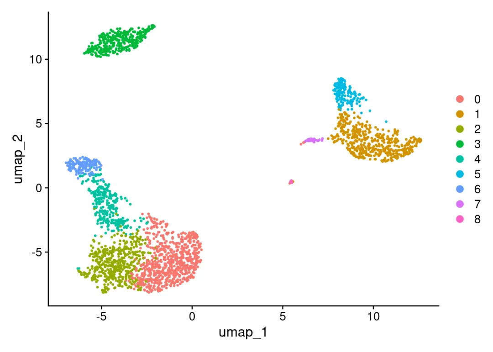

### 11.4.2 tsne降维可视化

```r
pbmc <- RunTSNE(pbmc, dims = 1:10)
DimPlot(pbmc, reduction = "tsne")
```

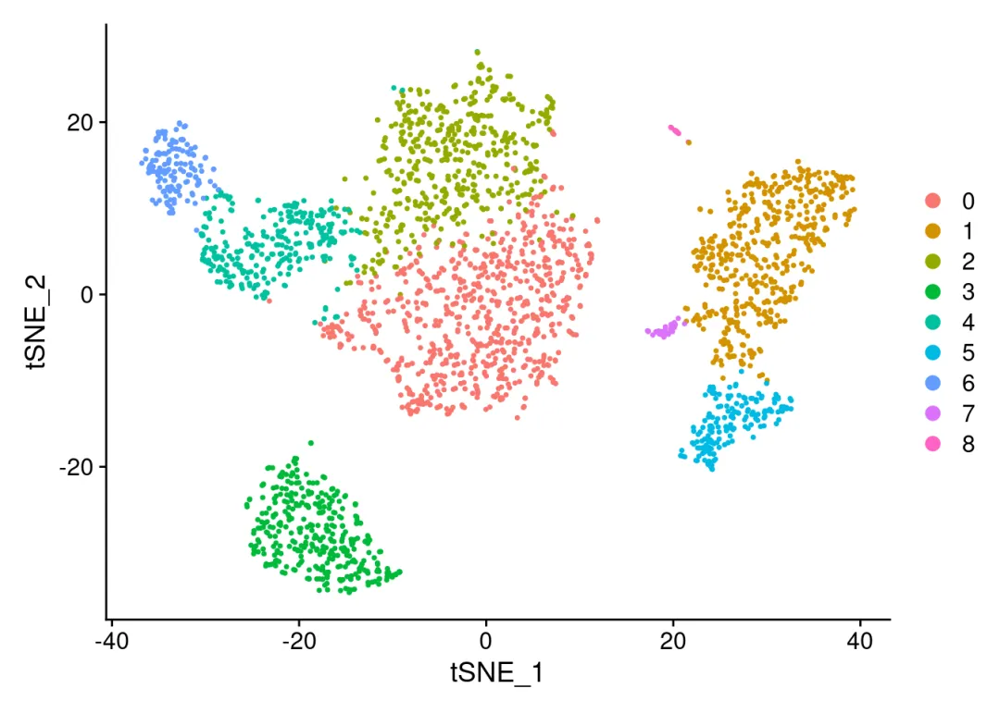

# 12\. 计算差异基因

## 12.1 计算某个细胞类群与其他所有细胞类群之间的差异基因

用FindMarkers()函数：计算某一个细胞类型相对于其他一个或多个细胞类型的差异基因，ident.1=2:表示计算cluster2相对于其他clusters的差异基因，min.pct=0.25表示：这些差异基因至少在cluster2的25%的细胞中表达，这里0.25也可以更改为其他的值。

```r
cluster2.markers <- FindMarkers(pbmc, ident.1 = 2, min.pct = 0.25)
```
```
## For a (much!) faster implementation of the Wilcoxon Rank Sum Test,
## (default method for FindMarkers) please install the presto package
## --------------------------------------------
## install.packages('devtools')
## devtools::install_github('immunogenomics/presto')
## --------------------------------------------
## After installation of presto, Seurat will automatically use the more
## efficient implementation (no further action necessary).
## This message will be shown once per session
```

```
head(cluster2.markers, n = 4)
```
```
##             p_val avg_log2FC pct.1 pct.2    p_val_adj
## IL32 2.593535e-91   1.322117 0.949 0.466 3.556774e-87
## LTB  7.994465e-87   1.345038 0.981 0.644 1.096361e-82
## CD3D 3.922451e-70   1.056210 0.922 0.433 5.379250e-66
## IL7R 1.130870e-66   1.425694 0.748 0.327 1.550876e-62
```

结果中的pct.1和pct.2分别表示这个差异基因在该cluster中和在其他clusters中表达？

## 12.2 计算某两个细胞类群之间的差异基因

```r
cluster5.markers <- FindMarkers(pbmc, ident.1 = 5, ident.2 = c(0,3), min.pct = 0.25)
head(cluster5.markers, n = 5)
```
```
##                       p_val avg_log2FC pct.1 pct.2     p_val_adj
## FCGR3A        2.150929e-209   6.832372 0.975 0.039 2.949784e-205
## IFITM3        6.103366e-199   6.181000 0.975 0.048 8.370156e-195
## CFD           8.891428e-198   6.052575 0.938 0.037 1.219370e-193
## CD68          2.374425e-194   5.493138 0.926 0.035 3.256286e-190
## RP11-290F20.3 9.308287e-191   6.335402 0.840 0.016 1.276538e-186
```

## 12.3 计算所有细胞类群与其他细胞类群之间的差异基因

用FindAllMarkers()函数，only.pos = TRUE：只计算高表达的基因；logfc.threshold = 0.25：差异倍数调整为0.25。

```r
pbmc.markers <- FindAllMarkers(pbmc, only.pos = TRUE, min.pct = 0.25, logfc.threshold = 0.25)
```
```
## Calculating cluster 0
```
```
## Calculating cluster 1
```
```
## Calculating cluster 2
```
```
## Calculating cluster 3
```
```
## Calculating cluster 4
```
```
## Calculating cluster 5
```
```
## Calculating cluster 6
```
```
## Calculating cluster 7
```
```
## Calculating cluster 8
```

```
pbmc.markers %>% group_by(cluster) %>% top_n(n = 2, wt = avg_log2FC)
```
```
## # A tibble: 18 × 7
## # Groups:   cluster [9]
##        p_val avg_log2FC pct.1 pct.2 p_val_adj cluster gene
##        <dbl>      <dbl> <dbl> <dbl>     <dbl> <fct>   <chr>
##  1 1.17e- 83       2.37 0.435 0.108 1.60e- 79 0       CCR7
##  2 3.28e- 49       2.10 0.333 0.103 4.50e- 45 0       LEF1
##  3 3.10e-139       7.28 0.3   0.004 4.25e-135 1       FOLR3
##  4 1.63e-121       6.74 0.277 0.006 2.23e-117 1       S100A12
##  5 2.61e- 59       2.11 0.424 0.111 3.58e- 55 2       AQP3
##  6 1.94e- 35       1.90 0.267 0.069 2.66e- 31 2       CD40LG
##  7 2.40e-272       7.38 0.564 0.009 3.29e-268 3       LINC00926
##  8 2.75e-237       7.14 0.488 0.007 3.76e-233 3       VPREB3
##  9 4.93e-169       4.37 0.595 0.056 6.76e-165 4       GZMK
## 10 3.51e- 93       3.59 0.437 0.06  4.82e- 89 4       GZMH
## 11 1.69e-212       5.43 0.506 0.01  2.32e-208 5       CDKN1C
## 12 8.23e-168       5.88 0.37  0.005 1.13e-163 5       CKB
## 13 1.05e-265       6.01 0.986 0.071 1.44e-261 6       GZMB
## 14 7.57e-183       6.21 0.493 0.014 1.04e-178 6       AKR1C3
## 15 1.48e-220       7.63 0.812 0.011 2.03e-216 7       FCER1A
## 16 1.46e-207       8.03 0.5   0.002 2.00e-203 7       SERPINF1
## 17 0              14.3  0.571 0     0         8       LY6G6F
## 18 4.36e-206      13.8  0.357 0     5.98e-202 8       RP11-879F14.2
```

```
#根据avg_log2FC)进行分组，每组取前两个差异基因
```

# 13\. 差异基因可视化

## 13.1 小提琴图

```
VlnPlot(pbmc, features = "MS4A1")
```

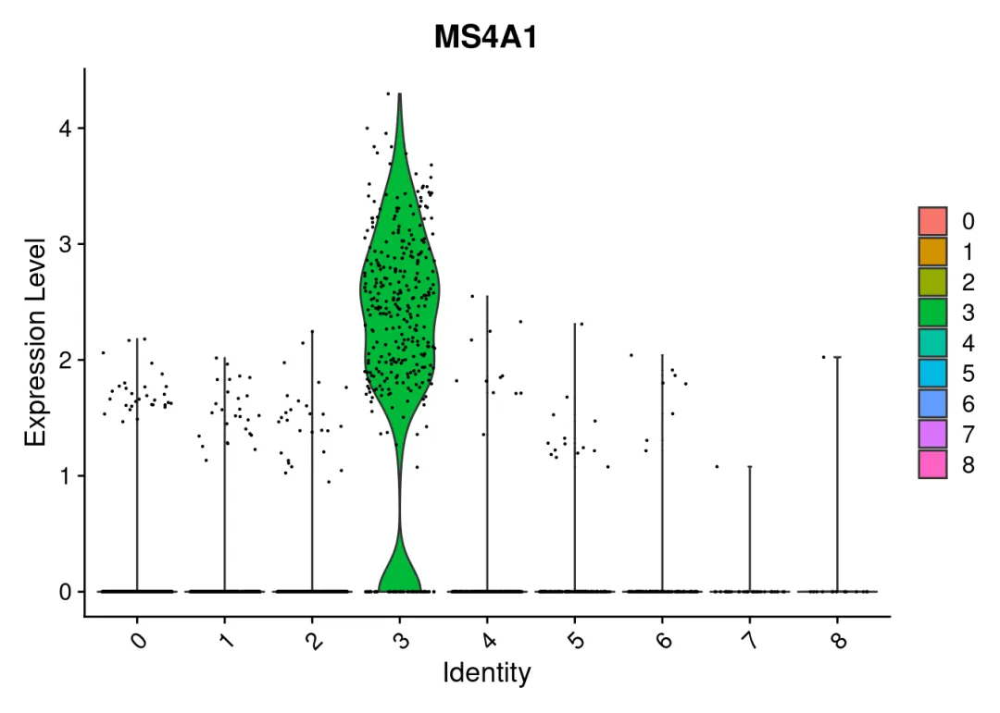

## 13.2 在umap图中展示marker基因

```
FeaturePlot(pbmc, features = c("MS4A1","CD3E"))
```

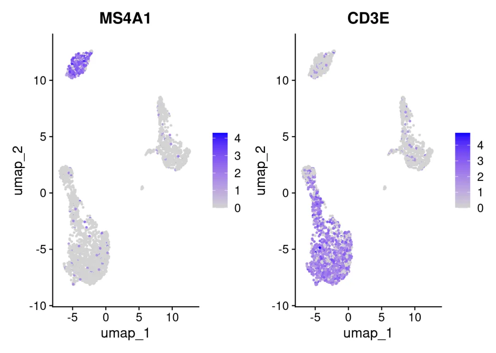

## 13.3 热图展示所有细胞类群的前4个marker基因

```r
top4 <- pbmc.markers %>% group_by(cluster) %>% top_n(n = 4, wt = avg_log2FC)
DoHeatmap(pbmc, features = top4$gene) + NoLegend()
```

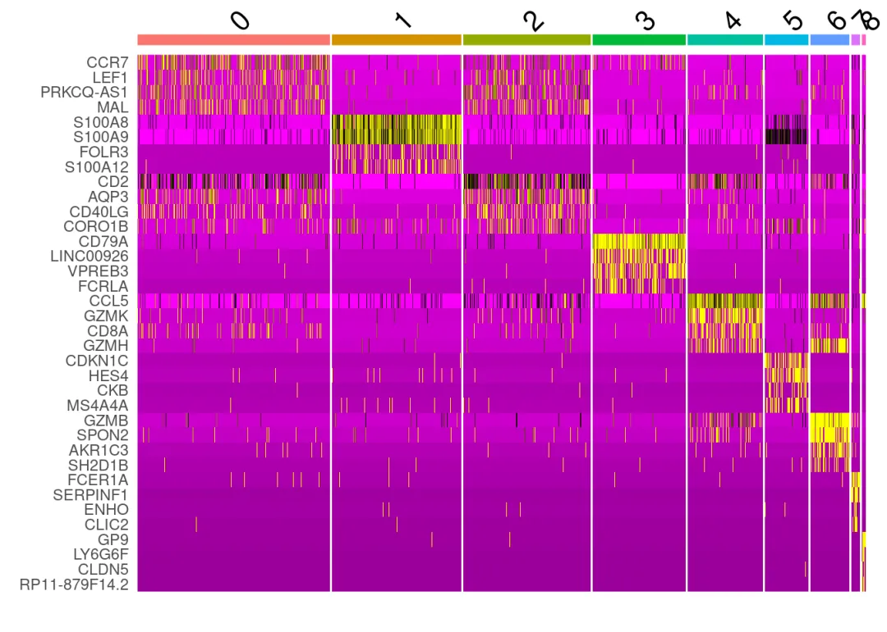

## 13.4 dotplot展示所有细胞类群的前4个marker基因

```
DotPlot(pbmc, features = unique(top4$gene), cols = c("#008B8B", "red"), dot.scale = 5) + RotatedAxis()
```

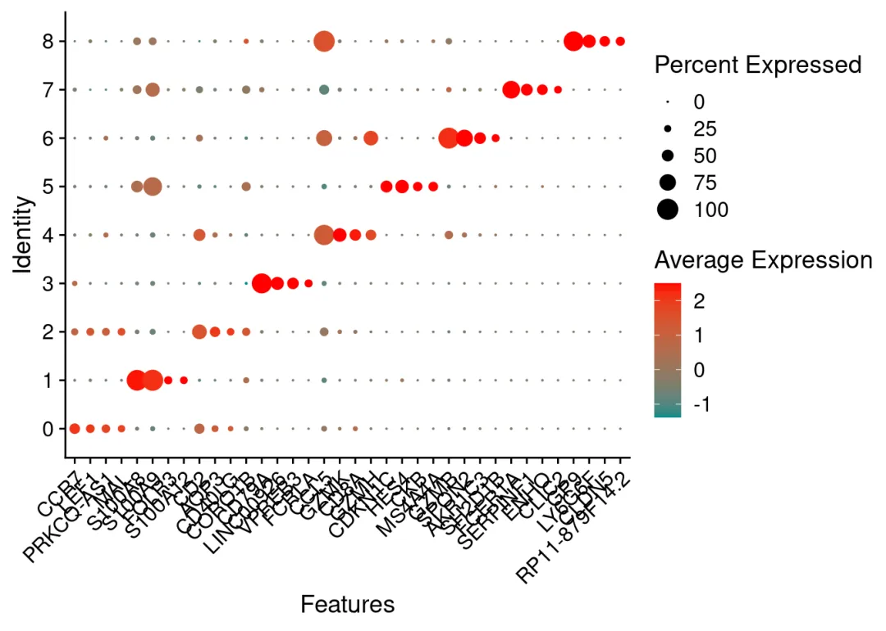

# 14 对各cluster标注细胞类型

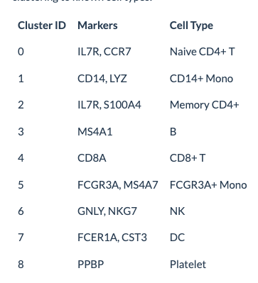

```r
new.cluster.ids <- c("Naive CD4 T", "CD14+ Mono", "Memory CD4 T", "B", "CD8 T", "FCGR3A+ Mono",
    "NK", "DC", "Platelet")
names(new.cluster.ids) <- levels(pbmc)
pbmc <- RenameIdents(pbmc, new.cluster.ids)
DimPlot(pbmc, reduction = "umap", label = TRUE, pt.size = 0.5) + NoLegend()
```

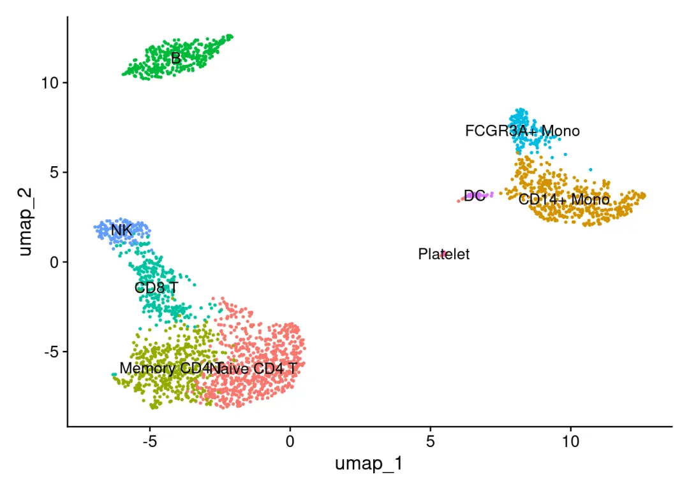

```r
library(ggplot2)
plot <- DimPlot(pbmc, reduction = "umap", label = TRUE, label.size = 4.5) + xlab("UMAP 1") + ylab("UMAP 2") +
    theme(axis.title = element_text(size = 18), legend.text = element_text(size = 18)) + guides(colour = guide_legend(override.aes = list(size = 10)))
ggsave(filename = "/home/wangyan/peixun/seurat/Seurat/pbmc3k_umap.jpg", height = 7, width = 12, plot = plot, quality = 50)
```

`
`

**单细胞系列教程目录**

 单细胞数据分析系列教程：B站视频，先看一遍视频再去看推送操作，建议至少看三遍：https://www.bilibili.com/video/BV1S44y1b76Z/本公众号单细胞相关资料都可以在这里订阅：[scRNA-Seq学习手册2023_R语言版](<http://mp.weixin.qq.com/s?__biz=MzAwMzIzOTk5OQ==&mid=2247500516&idx=1&sn=3c0b9de505fcd232054e38b451fa1742&chksm=9b3cbbb4ac4b32a26b61f3a1f7941fff5852d3e6e744ec680aafd0b84ec976a33bf982fb5f79&scene=21#wechat_redirect>)
[scRNA-Seq学习手册Python版](<http://mp.weixin.qq.com/s?__biz=MzAwMzIzOTk5OQ==&mid=2247504877&idx=2&sn=2b56a9cfa19fcc918ee6c2ed88fed017&chksm=9b3caabdac4b23ab6e28425a4a5eb4d40ee3612e51f84f5d1e53ac91bef93f717e9e754398e3&scene=21#wechat_redirect>)

单细胞测序基础数据分析保姆级教程，代码部分整理在往期推送之中：[手把手教你做单细胞测序数据分析|1.绪论](<http://mp.weixin.qq.com/s?__biz=MzAwMzIzOTk5OQ==&mid=2247499776&idx=2&sn=7fc250d94ed88cfd5e2224f071bb1742&chksm=9b3cb950ac4b30467a082527547b91aec15b7d1f40d44e362894aedeb6a99e014518fa5e4743&scene=21#wechat_redirect>)
[手把手教你做单细胞测序数据分析|2.各类数据结构与读取方法](<http://mp.weixin.qq.com/s?__biz=MzAwMzIzOTk5OQ==&mid=2247499795&idx=2&sn=68e6298eb43633c71939c146d90230ff&chksm=9b3cb943ac4b3055e09739d77e037d679f3d9ec68780d1aa8c592f806fcc8d2322eaee78752d&scene=21#wechat_redirect>)[手把手教你做单细胞测序数据分析|3.单样本分析](<http://mp.weixin.qq.com/s?__biz=MzAwMzIzOTk5OQ==&mid=2247500010&idx=2&sn=2f9fd1b0101d579bcd250fdc24e98bfc&chksm=9b3cb9baac4b30ac6f0ce28a6dd10470e73d1e1d6defece5636939a32a6db9b2cce0ff8688eb&scene=21#wechat_redirect>)
[手把手教你做单细胞测序数据分析|4.多样本整合](<http://mp.weixin.qq.com/s?__biz=MzAwMzIzOTk5OQ==&mid=2247500117&idx=2&sn=cef0b0abec6d73a8c2615980ef68aec1&chksm=9b3cb805ac4b3113fdc820b9c9667f9554b2e39f90c45b5806021a415698b0a5141c521c64dc&scene=21#wechat_redirect>)
[手把手教你做单细胞测序数据分析|5.细胞类型注释，从入门到入土](<http://mp.weixin.qq.com/s?__biz=MzAwMzIzOTk5OQ==&mid=2247500167&idx=2&sn=8de136b938e8d4753042d23166a24026&chksm=9b3cb8d7ac4b31c19c843810c7fe4341515df8ba6fff86a0ebff9d830edfcd656a29d18011c9&scene=21#wechat_redirect>)[手把手教你做单细胞测序数据分析|6组间差异分析](<http://mp.weixin.qq.com/s?__biz=MzAwMzIzOTk5OQ==&mid=2247500270&idx=2&sn=d8c4ebf8f63d12bd2ac8e2607864f322&chksm=9b3cb8beac4b31a824e228b486f0d8dd21a8f4113a0a0bcbaf1b20eaade3a83c9c7c1184010b&scene=21#wechat_redirect>)
[手把手教你做单细胞测序数据分析|7基因集富集分析](<http://mp.weixin.qq.com/s?__biz=MzAwMzIzOTk5OQ==&mid=2247500357&idx=2&sn=40034079b771c478b482e849ed4b216c&chksm=9b3cbb15ac4b3203d517ff71073ab0520fe144bc108b7a26f6b17e88fb63a78c5777946618e3&scene=21#wechat_redirect>)
[Seurat中分类变量处理技巧](<http://mp.weixin.qq.com/s?__biz=MzAwMzIzOTk5OQ==&mid=2247486134&idx=1&sn=e581b8ac20bbc968aeef3f9cf56f3a0f&chksm=9b3f73e6ac48faf0f1c81752b0190abc617eb720a71806950e7851c7d19b7e3e092aa97bd005&scene=21#wechat_redirect>)
[沉浸式统计细胞比例](<http://mp.weixin.qq.com/s?__biz=MzAwMzIzOTk5OQ==&mid=2247490949&idx=1&sn=b8dbe07d901f7c24f82d078be7a2fc77&chksm=9b3f64d5ac48edc33980363c7bc862a9f6283b78dac407e9c082d80bd7d9669215eecac62347&scene=21#wechat_redirect>)

单细胞图片改造计划：[改造单细胞降维图| 1.DimPlot的探索](<http://mp.weixin.qq.com/s?__biz=MzAwMzIzOTk5OQ==&mid=2247496162&idx=1&sn=598c2920f7cc0697ee5a1fa6cadaee04&chksm=9b3c88b2ac4b01a415feeebbbec6c4891319439dc8dcdafd33cca7a1222e5adc723ae9d3a73d&scene=21#wechat_redirect>)
[改造单细胞降维图| 2.ggplot2中的DIY](<http://mp.weixin.qq.com/s?__biz=MzAwMzIzOTk5OQ==&mid=2247496239&idx=1&sn=1fe6fd4a7fb88ecc0456b4f5710cb5d6&chksm=9b3c8b7fac4b0269e0abeab951ad6ae0ddd1464dd9d1867280eeb9755fda5ba8f5237d88a7a6&scene=21#wechat_redirect>)
[改造单细胞降维图| 3.3D降维图与动图绘制](<https://mp.weixin.qq.com/s?__biz=MzAwMzIzOTk5OQ==&mid=2247498080&idx=2&sn=a9bcf65e3ae34ba201e8d49ee33c0728&chksm=9b3c8030ac4b0926c3f059a9a5d23f1bcdbcaf8e5a562eba2b7e3bec3396c44573269bd08e7b&scene=21&cur_album_id=2707677276481814529#wechat_redirect>)
[改造单细胞降维图| 4.一些造好的轮子](<http://mp.weixin.qq.com/s?__biz=MzAwMzIzOTk5OQ==&mid=2247498191&idx=1&sn=952312a6b26232d460bf787cc276543f&chksm=9b3c809fac4b098972c8c1dd83b9f954a38fe5b5f6bc7e295f3f3a7ba6c4c3d32951679ac24d&scene=21#wechat_redirect>)
[沉浸式统计细胞比例](<http://mp.weixin.qq.com/s?__biz=MzAwMzIzOTk5OQ==&mid=2247503971&idx=2&sn=7dafb1e743ebbb95e488d8d1b7024448&chksm=9b3ca933ac4b2025f922a325ec6893e93613f130ff1d4fd609e2d7274f7f1fdb5134092e28ad&scene=21#wechat_redirect>)
[改造单细胞FeaturePlot](<http://mp.weixin.qq.com/s?__biz=MzAwMzIzOTk5OQ==&mid=2247504616&idx=1&sn=f7b4a0e6b25d224380cd803e3463a3e4&chksm=9b3cabb8ac4b22aeb65e0d6ec32a1f8674dcf907da078ccb3b61e06c4aa035864ebec092f571&scene=21#wechat_redirect>)
[VlnPlot用法及ggplot复现](<http://mp.weixin.qq.com/s?__biz=MzAwMzIzOTk5OQ==&mid=2247504768&idx=1&sn=4fc5eb47037d3a80178e32975488d70b&chksm=9b3caad0ac4b23c61147cfb0f46ecd846568f37ce89c963eb5f069d3e89a8ba285897726bb3d&scene=21#wechat_redirect>)
[VlnPlot的ggplot改造](<http://mp.weixin.qq.com/s?__biz=MzAwMzIzOTk5OQ==&mid=2247504843&idx=1&sn=b795a3e36ae092d8f87abb5a87187828&chksm=9b3caa9bac4b238dd33e905c33924b58aa4ff14e83abbf08046fba7fe765ecb0204163cb6acf&scene=21#wechat_redirect>)

SCENIC转录因子分析：[SCENIC单细胞转录因子预测|1.绪论](<http://mp.weixin.qq.com/s?__biz=MzAwMzIzOTk5OQ==&mid=2247500098&idx=1&sn=8c31241bd259e303a6ac3c9740f298d9&chksm=9b3cb812ac4b31046fd298c8ee5f0bc0de445df62b234bd934c34ca655e61de3da54d81e2053&scene=21#wechat_redirect>)
[SCENIC单细胞转录因子预测|2.学习手册](<http://mp.weixin.qq.com/s?__biz=MzAwMzIzOTk5OQ==&mid=2247500439&idx=1&sn=d6b4874a8352f5b7a4165629c03058ce&chksm=9b3cbbc7ac4b32d158fd3c5c2f155c54c892d40eaae3718409936fc319f69705da32badf79d6&scene=21#wechat_redirect>)
[SCENIC单细胞转录因子预测|3.软件安装与数据准备](<http://mp.weixin.qq.com/s?__biz=MzAwMzIzOTk5OQ==&mid=2247500631&idx=1&sn=5d73db4dcc74b66de07dee9db910bb83&chksm=9b3cba07ac4b3311d1820bb305778aea707294f19fd6ff2631cd003da80bdcff8f8bc8ed34de&scene=21#wechat_redirect>)
[SCENIC单细胞转录因子预测|4.精简版流程](<http://mp.weixin.qq.com/s?__biz=MzAwMzIzOTk5OQ==&mid=2247501260&idx=1&sn=f1e2a165599e753e2959aad7c8a298cb&chksm=9b3cbc9cac4b358a9499654a2f95fa9010309ee4f408ef8b1f31ceb1a0f263ce22e8b511c430&scene=21#wechat_redirect>)
[SCENIC单细胞转录因子预测|5.step1+step2构建共表达网络与regulon](<http://mp.weixin.qq.com/s?__biz=MzAwMzIzOTk5OQ==&mid=2247501692&idx=1&sn=3f7e263a93942ad03faa1ba5f8694ec4&chksm=9b3cbe2cac4b373af9db74a50ffb08a9b8a3b958fc6385c937385f0f7323bc935cdb0fe5275c&scene=21#wechat_redirect>)
[SCENIC单细胞转录因子预测|6.Step3 利用AUCell对Regulon评分](<http://mp.weixin.qq.com/s?__biz=MzAwMzIzOTk5OQ==&mid=2247501989&idx=1&sn=2700bf779d7d261a4d751d1635fdce2c&chksm=9b3cb1f5ac4b38e3014476242fe956cf510cc45b9f4cef86070af8094fd5f884f9d5c3a3363f&scene=21#wechat_redirect>)
[SCENIC单细胞转录因子预测|7.Step4 二元矩阵的计算与可视化](<http://mp.weixin.qq.com/s?__biz=MzAwMzIzOTk5OQ==&mid=2247503995&idx=1&sn=26c7e9ec56af434e62b02853cfe667d6&chksm=9b3ca92bac4b203d7986645ab5a3fb574f44185c7ced8bd47957fa237d436a95bfa2579d052a&scene=21#wechat_redirect>)
[SCENIC单细胞转录因子预测|8.Step5 regulon聚类、分群、降维](<http://mp.weixin.qq.com/s?__biz=MzAwMzIzOTk5OQ==&mid=2247504024&idx=1&sn=143c0ec4d94b8fca0a4a47d3dc24415b&chksm=9b3ca9c8ac4b20de70a87acb2d3f810b0e1497071b1c6f14f1882a6d844fff016e9ba5581eb3&scene=21#wechat_redirect>)
[SCENIC单细胞转录因子预测|9.下游探索](<http://mp.weixin.qq.com/s?__biz=MzAwMzIzOTk5OQ==&mid=2247505276&idx=1&sn=949c753feb85d5877121433caaa33013&chksm=9b3cac2cac4b253affb587a937d3f5e0576851a4f4e1570cb7510a594d155873961bbd91758d&scene=21#wechat_redirect>)

上游fastq文件处理：
[单细胞分析的最上游——处理Fastq文件：cellranger](<http://mp.weixin.qq.com/s?__biz=MzAwMzIzOTk5OQ==&mid=2247501751&idx=2&sn=a79512f54db7456ea577de40f1a2d286&chksm=9b3cbee7ac4b37f1ce313d5eeb9a9ac9940640ab599ac5ab5d438fa86a8007796b768e4e68c2&scene=21#wechat_redirect>)
[单细胞分析的最上游——处理Fastq文件：dropseqRunner](<http://mp.weixin.qq.com/s?__biz=MzAwMzIzOTk5OQ==&mid=2247501812&idx=2&sn=7feb4d89ebc45ca7d64ad2dd5cd3c832&chksm=9b3cbea4ac4b37b2d2609172d58251076a6ab6a7043600613f0fb2ae0bea427de542b4dcf91e&scene=21#wechat_redirect>)[Cellranger报错：Unable to distinguish between [SC5P-R2, SC3Pv2] ...](<http://mp.weixin.qq.com/s?__biz=MzAwMzIzOTk5OQ==&mid=2247504739&idx=2&sn=e4e6ad0559b9b6a703d6ab37c2a8fdb0&chksm=9b3caa33ac4b23257424184bda44dd600ad98bc0dfdfa90ab0e3ebaf208e598b0b710fbafa4b&scene=21#wechat_redirect>)
[BD Rhapsody平台单细胞转录组定量流程](<http://mp.weixin.qq.com/s?__biz=MzAwMzIzOTk5OQ==&mid=2247506542&idx=1&sn=99cf7af7fc0d56b0d6fe7ea3596df2b6&chksm=9b3ca33eac4b2a28e6682a7cf0b2091a387a06ecf89ee10737cf2194286ec0bba472ef1c2b90&scene=21#wechat_redirect>)

细胞通讯B站连续播放起来比较方便：
https://www.bilibili.com/video/BV1Ab4y1W7qx?p=1**往期推送**[《细胞通讯》1.概论](<http://mp.weixin.qq.com/s?__biz=MzAwMzIzOTk5OQ==&mid=2247501282&idx=2&sn=cd37ea80e0b92f5bfbc98ea286e363da&chksm=9b3cbcb2ac4b35a4258d21fe003374795619fc2356376ebbe4ff640233f4b4c6e3e3ead41370&scene=21#wechat_redirect>)[《细胞通讯》2.1CellChat基础分析教程](<http://mp.weixin.qq.com/s?__biz=MzAwMzIzOTk5OQ==&mid=2247501296&idx=2&sn=fb3e252d95ee8b50cd446e71335b1aa0&chksm=9b3cbca0ac4b35b621b4f51d2c3a130f00461faeeff067396222c2fc2eeb53f3544664d7d9bc&scene=21#wechat_redirect>)
[《细胞通讯》2.2CellChat多组别分析](<http://mp.weixin.qq.com/s?__biz=MzAwMzIzOTk5OQ==&mid=2247501523&idx=2&sn=6fa803f256c2e0b945f93ae7d8245f50&chksm=9b3cbf83ac4b3695b587e9817840f419104c8680f5ef08ee39aa149b79852f48b179f68e3397&scene=21#wechat_redirect>)
[《细胞通讯》CellChat学习手册](<http://mp.weixin.qq.com/s?__biz=MzAwMzIzOTk5OQ==&mid=2247501735&idx=2&sn=35fc792961507f4ae1cbae3a2882fba6&chksm=9b3cbef7ac4b37e1417d4108c8bd378c68c3907431ddfc52ad37c916e85649bb450d761a8e19&scene=21#wechat_redirect>)

拟时序分析B站连续播放起来比较方便：
https://www.bilibili.com/video/BV1br4y1x7Hf?p=1**往期推送**[《拟时序分析》1.概论](<http://mp.weixin.qq.com/s?__biz=MzAwMzIzOTk5OQ==&mid=2247486553&idx=1&sn=b689ec962a17ca1a1ada29ae8ff8c019&chksm=9b3f7509ac48fc1f0f81e288de8f15c86548215a1cd9d5c740dc63f2421371d13890398ab1df&scene=21#wechat_redirect>)
[《拟时序分析》2.monocle概论](<http://mp.weixin.qq.com/s?__biz=MzAwMzIzOTk5OQ==&mid=2247487001&idx=1&sn=329129e75f703e3f332e76af9c66871e&chksm=9b3f7749ac48fe5f081248c2a48c56685e3915015036c73f8f67ec3e6acc246ddf815daedb22&scene=21#wechat_redirect>)[《拟时序分析》3.monocle2实操：精简版拟时序](<http://mp.weixin.qq.com/s?__biz=MzAwMzIzOTk5OQ==&mid=2247487398&idx=1&sn=6621eed90157d8da06ef778c40bd5554&chksm=9b3f76f6ac48ffe081ddfee3a323e0e31c1fda33731012de73168cf2ab30a226cf70c848f769&scene=21#wechat_redirect>)
[《拟时序分析》4.monocle2实操：完整版](<http://mp.weixin.qq.com/s?__biz=MzAwMzIzOTk5OQ==&mid=2247501684&idx=2&sn=45c8b083e1094718d7fc4b97e370b01d&chksm=9b3cbe24ac4b3732e6eb04084fe3af4419c817755e4eb9a11ba1fb9f68488d12fe7bc865ad0b&scene=21#wechat_redirect>)
[单细胞测序数据进阶分析—《拟时序分析》5.初识monocle3](<http://mp.weixin.qq.com/s?__biz=MzAwMzIzOTk5OQ==&mid=2247489044&idx=1&sn=061dbfc34d200b73a8227d0bb28a1d27&chksm=9b3f6f44ac48e65251f7e5ecce84637c05d50ecb92769e8386f221f8e7b9bfeb719232def863&scene=21#wechat_redirect>)
[单细胞测序数据进阶分析—《拟时序分析》6.monocle3的降维、分群、聚类](<http://mp.weixin.qq.com/s?__biz=MzAwMzIzOTk5OQ==&mid=2247489494&idx=1&sn=44f0a44857c12fcf9a1ab84e4f2cbebf&chksm=9b3f6e86ac48e79026321de2fdca81a139d104d655884ffe87a68e0a1551ddffa5af7919d19e&scene=21#wechat_redirect>)[单细胞测序数据进阶分析—《拟时序分析》7.monocle3的拟时序分析](<http://mp.weixin.qq.com/s?__biz=MzAwMzIzOTk5OQ==&mid=2247490418&idx=1&sn=18ae0b6139fe1a2436dcf6cc47850297&chksm=9b3f6222ac48eb3450de0b02a34eb5fff2db89ab8f155460d554cbb23be0cd27fd349079e7b2&scene=21#wechat_redirect>)
[解决monocle2的orderCells报错的两种方法](<http://mp.weixin.qq.com/s?__biz=MzAwMzIzOTk5OQ==&mid=2247491083&idx=1&sn=c5697ab024193cb6595d27e4f4d3bfaf&chksm=9b3f675bac48ee4d7244d9819e14fe210f7e42e40fc7a6a8df7b95bfd92f06334d60d226cb93&scene=21#wechat_redirect>)
[一文搞定拟时序分析的下游可视化探索](<http://mp.weixin.qq.com/s?__biz=MzAwMzIzOTk5OQ==&mid=2247494479&idx=1&sn=32f39c79c4c9fc07aa829eed49016da3&chksm=9b3c921fac4b1b091efcdd151500b69d19f71d5ca518122af697fc37e87acd915f3be5f63fb8&scene=21#wechat_redirect>)

scFAST系列[scFAST分析| 01.绪论](<http://mp.weixin.qq.com/s?__biz=MzAwMzIzOTk5OQ==&mid=2247503875&idx=1&sn=2b5ca0c57e17e51abb52adfe199c5736&chksm=9b3ca953ac4b20450f643b94bcfc95aa2b04ded197ce93e455a281901d7ccba099b48cfd03d9&scene=21#wechat_redirect>)
[scFAST分析| 02.单细胞分析准备工作](<http://mp.weixin.qq.com/s?__biz=MzAwMzIzOTk5OQ==&mid=2247504023&idx=1&sn=4091a22e853242b4aae7a7d3b4008f5c&chksm=9b3ca9c7ac4b20d1bb0389fad5fe85a3c4cf49179747fe97dffaab1087b7d2793668d9f63aa4&scene=21#wechat_redirect>)
[scFAST分析| 03.fast模块](<http://mp.weixin.qq.com/s?__biz=MzAwMzIzOTk5OQ==&mid=2247504044&idx=1&sn=d37991280217dcc29280efa344f856bb&chksm=9b3ca9fcac4b20eab124ccd4ba6ad3f5eee640df314e7d8fec0225035f06178e3a51dbe2033f&scene=21#wechat_redirect>)
[scFAST分析| 04.Seurat分析及可视化](<http://mp.weixin.qq.com/s?__biz=MzAwMzIzOTk5OQ==&mid=2247504435&idx=1&sn=c6a6f7ca00684601f3cda49e53be5339&chksm=9b3cab63ac4b2275d993bbaa64c71652685065fa377be57319fc6a5c47eb958b3644c7459cd5&scene=21#wechat_redirect>)
[scFAST分析| 05.mut模块](<http://mp.weixin.qq.com/s?__biz=MzAwMzIzOTk5OQ==&mid=2247504878&idx=1&sn=2c5d9fc694eaf3e264c38b0691cd3a43&chksm=9b3caabeac4b23a87d201009137572c02ba1ea0dd747bcd8b8c02878b45917b6e235551c41cb&scene=21#wechat_redirect>)
[一文学会scFAST-seq数据分析](<http://mp.weixin.qq.com/s?__biz=MzAwMzIzOTk5OQ==&mid=2247505213&idx=1&sn=5f4ed0587dd96149d127a98d36f721f0&chksm=9b3cac6dac4b257bbc00c4647382d27883139bf06ab3071947bf1cccde8d1d501006dabab5f1&scene=21#wechat_redirect>)

其他单细胞相关技术贴也在这里：[scRNA-Seq双细胞过滤手册](<http://mp.weixin.qq.com/s?__biz=MzAwMzIzOTk5OQ==&mid=2247511622&idx=1&sn=60b35668e569267bab14ec8fbba8bd74&chksm=9b3cd716ac4b5e00122eac47f55085198040a4a0e97c56895bbc39f3a9f1a1eb4eba27048a8f&scene=21#wechat_redirect>)
[scRNA-Seq学习手册Seurat V4修订版](<http://mp.weixin.qq.com/s?__biz=MzAwMzIzOTk5OQ==&mid=2247510380&idx=1&sn=0eb2b0c519ef1dc25ee8821b736a0fde&chksm=9b3cd03cac4b592ad93149fb4847e6ba3dd03ab69e1ca594ddc64d323fb7496775789cae245d&scene=21#wechat_redirect>)[快速上手Seurat V5](<http://mp.weixin.qq.com/s?__biz=MzAwMzIzOTk5OQ==&mid=2247509880&idx=1&sn=3b7cd169ccfe688d10cb1ca70dc91e91&chksm=9b3cde28ac4b573ec6d5f4bceafa4294c0e9a001b7d0c0b64f274a9978b1438eeccc747ca0c0&scene=21#wechat_redirect>)
[单细胞Figure 1常见图表](<http://mp.weixin.qq.com/s?__biz=MzAwMzIzOTk5OQ==&mid=2247509260&idx=1&sn=9ff90a428c3f22d43a31ec864e2d8a94&chksm=9b3cdc5cac4b554a2f7cb2a6368f7df9a9a3f6e406eb070663f53d81841a76e188c0b50727de&scene=21#wechat_redirect>)[细胞的数量由誰决定？](<http://mp.weixin.qq.com/s?__biz=MzAwMzIzOTk5OQ==&mid=2247484056&idx=1&sn=4967a054f5241ff3a1bd4a6fe9a502b1&chksm=9b3f7bc8ac48f2deca3141461be035deb8658be184d78597af28f8ba2092d12f020768275248&scene=21#wechat_redirect>)[单细胞中应该如何做GSVA？](<http://mp.weixin.qq.com/s?__biz=MzAwMzIzOTk5OQ==&mid=2247484701&idx=1&sn=ad90680f252d092a2e21f349c8f32cab&chksm=9b3f7c4dac48f55bf1d11337406ab0e1295e8e1731dbac0715eedc99d11beff7f380e42dd49b&scene=21#wechat_redirect>)[答读者问（三）：单细胞测序前景](<http://mp.weixin.qq.com/s?__biz=MzAwMzIzOTk5OQ==&mid=2247484280&idx=2&sn=844af02070012a1c2681880596ba51a2&chksm=9b3f7a28ac48f33e95eb906121be8953410ca4c572c8035cb801609a56caf9dcff57fa989602&scene=21#wechat_redirect>)[答读者问（四）：如何分析细胞亚群](<http://mp.weixin.qq.com/s?__biz=MzAwMzIzOTk5OQ==&mid=2247484316&idx=2&sn=e8d02fddc80d1137bb64c55541f1651d&chksm=9b3f7accac48f3da7df7fcad9c996291bc66967c04d16dde92ed391c56e610a7298ac8fb7dbb&scene=21#wechat_redirect>)[答读者问（八）：为什么Read10X也会报错?](<http://mp.weixin.qq.com/s?__biz=MzAwMzIzOTk5OQ==&mid=2247485012&idx=1&sn=6007c8d7cb2a236dd7240a678dac0391&chksm=9b3f7f04ac48f612f811c1df9e9450dc8112d343e4bf245be5149c2e2a073d3e339cd0e3ff61&scene=21#wechat_redirect>)
[答读者问（十）整合后的表达矩阵，如何拆分出分组信息？](<http://mp.weixin.qq.com/s?__biz=MzAwMzIzOTk5OQ==&mid=2247485134&idx=1&sn=13f5f8c47d8af2beeca4e103a5f5e26d&chksm=9b3f7f9eac48f688b454a1062ee4e41f7072ac9d58e5466fa7ed4bb05018adbfe167bb3a445a&scene=21#wechat_redirect>)
[答读者问（十一）如何一次性读取一个目录下的cellranger输出文件？](<http://mp.weixin.qq.com/s?__biz=MzAwMzIzOTk5OQ==&mid=2247485145&idx=1&sn=402cb28c16aba0dc647037c9b7aba8f7&chksm=9b3f7f89ac48f69fe27cd427df3eff2e88c240bf20dfe92d8b522eecd7302d132d880bf29047&scene=21#wechat_redirect>)
[给你安排一个懂生信的工具人（十）：不学编程 零代码完成单细胞测序数据分析：Loupe Browser](<http://mp.weixin.qq.com/s?__biz=MzAwMzIzOTk5OQ==&mid=2247485730&idx=1&sn=42b9b35026bec5359ac34750dea3bf44&chksm=9b3f7072ac48f964970f673a86e27ecd453a80b953168dc110e0ea6bfa4110eeed3350c9601a&scene=21#wechat_redirect>)
[什么？不做单细胞也能分析细胞类群和免疫浸润？](<http://mp.weixin.qq.com/s?__biz=MzAwMzIzOTk5OQ==&mid=2247485798&idx=1&sn=c849bc7a0093af92fc99e13b55842bb2&chksm=9b3f7036ac48f92048d726b38f2dd978d0b0cce779c1a4090aa4da5cb2df3ad30a5c5dbed27e&scene=21#wechat_redirect>)
[答读者问 （十三）查看Seurat对象时的ERROR：type='text'](<http://mp.weixin.qq.com/s?__biz=MzAwMzIzOTk5OQ==&mid=2247485859&idx=1&sn=a014c4cb6034551e57c70820c7781e49&chksm=9b3f70f3ac48f9e52620e3ff197eb98e58836e8bb6baad634387a521fdda1e4a194356517c73&scene=21#wechat_redirect>)
[各类单细胞对象（数据格式）转换大全（一）](<http://mp.weixin.qq.com/s?__biz=MzAwMzIzOTk5OQ==&mid=2247485925&idx=1&sn=14e08440200f0f5cb4dcc2dc615efeb8&chksm=9b3f70b5ac48f9a37a43cc2a8b2a5e485a3f84b4ef87949dfe99056bc6301b110e80800f6bb1&scene=21#wechat_redirect>)[批量整理好GEO中下载的单细胞数据](<http://mp.weixin.qq.com/s?__biz=MzAwMzIzOTk5OQ==&mid=2247486045&idx=1&sn=0b6874bcffc8abafb505cabce4c4fc0e&chksm=9b3f730dac48fa1b140ef01c07a7749e69df4fa7d2056deeed0673c668b6246724cd85741125&scene=21#wechat_redirect>)[答读者问 （十五）稀疏矩阵转matrix, as.matrix函数是下下策](<http://mp.weixin.qq.com/s?__biz=MzAwMzIzOTk5OQ==&mid=2247486259&idx=1&sn=97de5c9e15e48cb62c8a680376a4ee0d&chksm=9b3f7263ac48fb75a91b40416826fe35b340284cf38255925ac447443a62cdc1df082d20fb61&scene=21#wechat_redirect>)
[答读者问 （十六）做单细胞测序到底需要多少内存](<http://mp.weixin.qq.com/s?__biz=MzAwMzIzOTk5OQ==&mid=2247487923&idx=1&sn=15043c6d729b0d5493ab875b0e54a259&chksm=9b3f68e3ac48e1f5dae514a01c857f9a56a90e2977dd7862db28d06fe55888cd9bb4afbb14e0&scene=21#wechat_redirect>)[答读者问 （十七）调用的线程越多就算的越快嘛?](<http://mp.weixin.qq.com/s?__biz=MzAwMzIzOTk5OQ==&mid=2247488995&idx=1&sn=7140e0d037671542fb37dff3a3c94b28&chksm=9b3f6cb3ac48e5a5f54a02be9e6af9f5a4cf8da1de1770f9035130c84dedf059a024964fc15a&scene=21#wechat_redirect>)
[答读者问（十八）、一个我至少被问过30遍的monocle报错](<http://mp.weixin.qq.com/s?__biz=MzAwMzIzOTk5OQ==&mid=2247490010&idx=1&sn=24c55fa4bd5d7d829625cb67dbaf321a&chksm=9b3f608aac48e99c9f27e3423c8398034a1819d0ccebbf21170b955461d2c335132d6f3cce25&scene=21#wechat_redirect>)[没有barcode文件的单细胞数据要怎么读取](<http://mp.weixin.qq.com/s?__biz=MzAwMzIzOTk5OQ==&mid=2247490952&idx=1&sn=364a3941e59e45234795c906a42fc9ab&chksm=9b3f64d8ac48edcec70384cf5c6a91224d0f7841ce3a7cfcade6513500c13673a6695d6f0299&scene=21#wechat_redirect>)
[单细胞基因集评分之AUCell](<http://mp.weixin.qq.com/s?__biz=MzAwMzIzOTk5OQ==&mid=2247491761&idx=1&sn=41f5c1ceaacf6a1c4840567f8a349e06&chksm=9b3c99e1ac4b10f7ca158561e96fec76a49ff32b8412cb146ed3fb7aa9260c75172b4eb16f9a&scene=21#wechat_redirect>)
[粉丝来稿|1. Seurat4相较于Seurat3的几点改动](<http://mp.weixin.qq.com/s?__biz=MzAwMzIzOTk5OQ==&mid=2247494516&idx=1&sn=cb2d4e6b182428ce7b98e7fff2e8729a&chksm=9b3c9224ac4b1b32c4fe99758960305c4845395cfe03851d70a0407043ee36250e55d20106fc&scene=21#wechat_redirect>)
[如何加快Seurat的计算速度](<http://mp.weixin.qq.com/s?__biz=MzAwMzIzOTk5OQ==&mid=2247494116&idx=1&sn=f3dc577cbb464779062aada313191a05&chksm=9b3c90b4ac4b19a27a17f958e3437337d5b10b6ba7153e4dd43dedcb4df812d8c6b4d86fe970&scene=21#wechat_redirect>)
[一文搞定单细胞基因集评分](<http://mp.weixin.qq.com/s?__biz=MzAwMzIzOTk5OQ==&mid=2247493493&idx=1&sn=2cd725b2f04377f218955bafbcbb877d&chksm=9b3c9e25ac4b17330a9b9ff77302ab95a9dc5dc7e6fe7298f28d682112ee066c7d4bc1947982&scene=21#wechat_redirect>)[答读者问（二十）四个单细胞样本只给了一套文件怎么读](<http://mp.weixin.qq.com/s?__biz=MzAwMzIzOTk5OQ==&mid=2247494879&idx=1&sn=c2287ab3684792747dfac53d6704462b&chksm=9b3c958fac4b1c994a4b075c4f8475816e121966fa8c52cb0a2ce8c14987988ab9bdb49bdf69&scene=21#wechat_redirect>)
[人类单细胞测序数据中有哪些以"**-"开头的基因](<http://mp.weixin.qq.com/s?__biz=MzAwMzIzOTk5OQ==&mid=2247495019&idx=1&sn=f52ac22ca1ea47ecddaa3503bdc2c0b6&chksm=9b3c943bac4b1d2d521f7155ce8f499389dade23828017572a84cdce71e5d08d37d74e08512b&scene=21#wechat_redirect>)
[为什么总把分辨率调的很高](<http://mp.weixin.qq.com/s?__biz=MzAwMzIzOTk5OQ==&mid=2247495765&idx=1&sn=2ec5e3e26491e28c92e25c40630bffae&chksm=9b3c8905ac4b0013a23f9cda2cccd67cdf3c4a941bac161e3a15a12ab98cd4e5eca8aeedbe96&scene=21#wechat_redirect>)
[Seurat中如何让细胞听你指挥](<http://mp.weixin.qq.com/s?__biz=MzAwMzIzOTk5OQ==&mid=2247495938&idx=1&sn=2258390c97ec14f3cd336defede59cdb&chksm=9b3c8852ac4b01448fd3b84463d5ab6b697495db6ad57746e7f60e32f491547a3e35290c66ee&scene=21#wechat_redirect>)
[答读者问| 22.object 'CsparseMatrix_validate' not found](<http://mp.weixin.qq.com/s?__biz=MzAwMzIzOTk5OQ==&mid=2247496273&idx=1&sn=fd5a92dd7fdc349b1624784ca74b1220&chksm=9b3c8b01ac4b0217cf06d89bfea49c3fa0c9b580957338c0cc8f55ede3e8f65d6d7162ae27e3&scene=21#wechat_redirect>)
[单细胞数据在R中的读取及存储速度太慢怎么办？这个神包来帮你！](<http://mp.weixin.qq.com/s?__biz=MzAwMzIzOTk5OQ==&mid=2247500270&idx=1&sn=11bdf3c7f9042fc03f9ed237a9b9677b&chksm=9b3cb8beac4b31a8bf1d9fb862553ed32ac9a56f4a6e0f2d38c9478132f87327d8c6b6940573&scene=21#wechat_redirect>)
[单细胞分群分辨率选择困难症](<http://mp.weixin.qq.com/s?__biz=MzAwMzIzOTk5OQ==&mid=2247501241&idx=1&sn=9e15d23f721ad7f4ae1335ce5362031b&chksm=9b3cbce9ac4b35ff43434c0384afbbf5689f5b62a677e55e8a635d4812da57593d85a73cf48b&scene=21#wechat_redirect>)
[一文搞定空间转录组与单细胞测序的整合分析](<http://mp.weixin.qq.com/s?__biz=MzAwMzIzOTk5OQ==&mid=2247507210&idx=1&sn=f32037ffefd60b0d1bcca7bf9c3e0823&chksm=9b3ca45aac4b2d4cf0c68299db3a2891130d89d9e0fe2a9ecb34b394736550bcf7d7c51090cc&scene=21#wechat_redirect>)
[一文掌握十个单细胞数据库](<http://mp.weixin.qq.com/s?__biz=MzAwMzIzOTk5OQ==&mid=2247507979&idx=1&sn=e94225b592733f2e22b4b09245027365&chksm=9b3cd95bac4b504df8dc25d9c5cfddf56d3b47e7cc6f33a7ef369bc916c60abb6b49277b79f7&scene=21#wechat_redirect>)
[如何将已经构建好的Seurat空转对象转存为原始文件？](<http://mp.weixin.qq.com/s?__biz=MzAwMzIzOTk5OQ==&mid=2247508133&idx=1&sn=297b8fb9cc8f33a1d19167dba1104e97&chksm=9b3cd9f5ac4b50e36df53e3e18bb2990d9635d88a725f1e54fc5eb5967ac9f0934b79cbb8b34&scene=21#wechat_redirect>)
[一文学会零代码单细胞分析](<http://mp.weixin.qq.com/s?__biz=MzAwMzIzOTk5OQ==&mid=2247511007&idx=1&sn=e7be3d9775890e5717889714629cfaf5&chksm=9b3cd28fac4b5b9936428d5f74d8b581b5cddc18d0fc42e2a5d75604cce080588d50f1304a17&scene=21#wechat_redirect>)
[SeekSpace| 会单细胞就会空间转录组](<http://mp.weixin.qq.com/s?__biz=MzAwMzIzOTk5OQ==&mid=2247511779&idx=1&sn=23868525d86a9ed7867a3837ed18612c&chksm=9b3cd7b3ac4b5ea502950d0278d68da978f6011b2597c3ec90fb77e79320883fb4a5be2d5399&scene=21#wechat_redirect>)

单细胞文献阅读：[13分+文章利用scRNA-Seq揭示地铁细颗粒物引起肺部炎症的分子机制](<http://mp.weixin.qq.com/s?__biz=MzAwMzIzOTk5OQ==&mid=2247511886&idx=1&sn=31c712d00377b0f0ed33703b5b4fbfd8&chksm=9b3cd61eac4b5f084fde14a2eb50356f2f40a66c608d38909f12a3d81f48cff029a09ce2ee8c&scene=21#wechat_redirect>)
[测序技术的发展与应用](<http://mp.weixin.qq.com/s?__biz=MzAwMzIzOTk5OQ==&mid=2247495792&idx=2&sn=1aecc80b68f65f8a44a899df524038c0&chksm=9b3c8920ac4b0036b23268331b457a335b22b4fa3aed1db287ab79e7a4613df8d195bd11421a&scene=21#wechat_redirect>)[Biomamba助推的第二篇文章!发表了！](<http://mp.weixin.qq.com/s?__biz=MzAwMzIzOTk5OQ==&mid=2247489823&idx=1&sn=6a5dddd53870395316d2b2e904c6ce72&chksm=9b3f604fac48e959e97e4b0317643efdcf117da7f8b75f1edbcd64dd8e2f07149e6031a94dd4&scene=21#wechat_redirect>)[又来了！Biomamba生信基地助推的第四篇文章!](<http://mp.weixin.qq.com/s?__biz=MzAwMzIzOTk5OQ==&mid=2247492532&idx=1&sn=cddb4691f23defc80b60da231790c53c&chksm=9b3c9ae4ac4b13f2334cc7f6b16eec1d8223800f6ecef71a93cfba21698ac5f4505dbd64f300&scene=21#wechat_redirect>)
[单细胞测序解析糖尿病肾病中肾小球的动态变化](<http://mp.weixin.qq.com/s?__biz=MzAwMzIzOTk5OQ==&mid=2247497682&idx=2&sn=7ef49191c5e334bb291ccdaa8ea444ae&chksm=9b3c8e82ac4b079425433938c831d528eddb9237efaca49acbc210e9cd715d057541589dc290&scene=21#wechat_redirect>)
[Cell metabolism| 单细胞测序技术解析健康人与T2D患者的胰岛差异](<http://mp.weixin.qq.com/s?__biz=MzAwMzIzOTk5OQ==&mid=2247497713&idx=1&sn=b7f8df758bc4d95b88969378c6dfbeee&chksm=9b3c8ea1ac4b07b7c6a0b5023ebf6c8ecd7d34741ab076baa0b564535d1d753bbf9dc5be5290&scene=21#wechat_redirect>)
[Science| 小鼠全肾单细胞测序开篇之作](<http://mp.weixin.qq.com/s?__biz=MzAwMzIzOTk5OQ==&mid=2247497713&idx=2&sn=554d6a4e1b28b2e5303695fae5942a34&chksm=9b3c8ea1ac4b07b72323ce25cd49474a9228ec1aaa56243f57dca3f2f668dc42ab9cd58dca21&scene=21#wechat_redirect>)
[一篇不花钱就能白嫖的文章](<http://mp.weixin.qq.com/s?__biz=MzAwMzIzOTk5OQ==&mid=2247497840&idx=2&sn=1dacbfb190e11d2ff104e32f238cf8c4&chksm=9b3c8120ac4b08367bfe3a0dd8d55f21f5d13528826de3144a9a85ce9b1c9f4c710de703edae&scene=21#wechat_redirect>)
[不会吧不会吧，Nature都能白嫖？](<http://mp.weixin.qq.com/s?__biz=MzAwMzIzOTk5OQ==&mid=2247497867&idx=2&sn=caeb8ed06ffd5239b58cebcd90843cf8&chksm=9b3c81dbac4b08cd9eec50978951a1b890ca08edec644ff75205a09ad1f067dff25d6ecb938e&scene=21#wechat_redirect>)
[高氧下小鼠肺发育损伤的ScRNA图谱](<http://mp.weixin.qq.com/s?__biz=MzAwMzIzOTk5OQ==&mid=2247498513&idx=2&sn=79845edf56a3023c59c73403d7b6494b&chksm=9b3c8241ac4b0b57793402686edc8c35aaa3b0959d3096b5122207fbb70ab809d1df5faee0d7&scene=21#wechat_redirect>)
[IgAN & STRT-Seq](<http://mp.weixin.qq.com/s?__biz=MzAwMzIzOTk5OQ==&mid=2247485376&idx=1&sn=02e228d0993d8a653c8bb1d531021cdb&chksm=9b3f7e90ac48f78686d6d5953aeb192db4f28bf577dbebd76d9fabbe797f135b7fb08fb42867&scene=21#wechat_redirect>)
[老树开新花—EGFR、肿瘤、免疫+scRNA-Seq](<http://mp.weixin.qq.com/s?__biz=MzAwMzIzOTk5OQ==&mid=2247498596&idx=2&sn=8f63f5856cdf90e15f1d19b4cfe6a39e&chksm=9b3c8234ac4b0b221a5d2c417558f0e63f742459c0a3f8c1cbb4cdf74ce25ddcaf0e48f4a7ce&scene=21#wechat_redirect>)
[癌前基质细胞驱动BRCA1肿瘤发生](<http://mp.weixin.qq.com/s?__biz=MzAwMzIzOTk5OQ==&mid=2247498597&idx=2&sn=9f5fee38d0821052c9c6b3753c2b3bed&chksm=9b3c8235ac4b0b238c4902ad7b3944b285baaa0a7ec6f5c7d08a596fdf89735dc7a7afab91f0&scene=21#wechat_redirect>)
[紧跟生信"钱"沿,胰腺癌&免疫多模态图谱](<http://mp.weixin.qq.com/s?__biz=MzAwMzIzOTk5OQ==&mid=2247498668&idx=2&sn=50cb239885bed65d3d3702c813d8e354&chksm=9b3c82fcac4b0beabece692f6e2d89c5fe4adf3a268e2944d8f0df4393cc554de5432086d6c1&scene=21#wechat_redirect>)
[原发头颈癌和肿瘤转移微生态](<http://mp.weixin.qq.com/s?__biz=MzAwMzIzOTk5OQ==&mid=2247498644&idx=2&sn=6293493263eeb2b4bf3f82cf526dea36&chksm=9b3c82c4ac4b0bd2a9f48b1326bbfbf2b8270ab79e5877f9bca21aa7883f60fb9cb235df2c36&scene=21#wechat_redirect>)
[《Cell Metabolism》：肾脏疾病&代谢&核受体ESRRA](<http://mp.weixin.qq.com/s?__biz=MzAwMzIzOTk5OQ==&mid=2247498860&idx=2&sn=156afeec25201c7baa880af8daac8c60&chksm=9b3c853cac4b0c2a2ca09f44fd487c6d8d9701cb447f318c89f83a53e1a7b712d6f10ff17c43&scene=21#wechat_redirect>)
[《Nature communication》：PD-1&急性髓细胞性白血病&T Cell](<http://mp.weixin.qq.com/s?__biz=MzAwMzIzOTk5OQ==&mid=2247498862&idx=2&sn=1ba36b54428198104c5168d84aba6c51&chksm=9b3c853eac4b0c2874eee3d90b5a989fdc2b366c40805b5041a6f1a588e99b45be14469bdd56&scene=21#wechat_redirect>)
[单细胞测序揭示鼻咽癌微环境的基质动力学和肿瘤特异性特征](<http://mp.weixin.qq.com/s?__biz=MzAwMzIzOTk5OQ==&mid=2247498926&idx=2&sn=3bbd43812d2dfcbbd9230c8cb50df36b&chksm=9b3c85feac4b0ce8225b6f77eec91ac9c8150bff171ac6874363b2617ccfe6042400777415c3&scene=21#wechat_redirect>)
[《Nature》：MYB调控衰竭性T细胞对检查点抑制的响应](<http://mp.weixin.qq.com/s?__biz=MzAwMzIzOTk5OQ==&mid=2247498939&idx=2&sn=b63958fb8f28af052036f4ffc05e2fc2&chksm=9b3c85ebac4b0cfdf3fda8f7236c50db168de20ff4795db7af9d6a0b45304e3f6fb3ba888694&scene=21#wechat_redirect>)[单细胞都能活检测序了？](<http://mp.weixin.qq.com/s?__biz=MzAwMzIzOTk5OQ==&mid=2247500846&idx=1&sn=d5e9782c0318e411771e746950f5b5f5&chksm=9b3cbd7eac4b3468ea93a5d6a28cfd05409660a532cc8df72ed9b58f30a76b0a8b6cec79934a&scene=21#wechat_redirect>)
[文献阅读(二十九)、单细胞测序做到什么程度能毕业|硕士篇](<http://mp.weixin.qq.com/s?__biz=MzAwMzIzOTk5OQ==&mid=2247493808&idx=1&sn=52c7d330ffdda47c3409d36fe9cbbcd8&chksm=9b3c91e0ac4b18f6edf59d171a0d982b1e3f842148046d8eed19343484feaa84dbd5b7682a11&scene=21#wechat_redirect>)
[文献阅读(三十)、单细胞测序做到什么程度能毕业|博士篇](<http://mp.weixin.qq.com/s?__biz=MzAwMzIzOTk5OQ==&mid=2247494017&idx=1&sn=a2dc4e2eef2bcdb40f5074b665dfa45f&chksm=9b3c90d1ac4b19c79ac5128f96d27789241357c9745bb0389ff5f79f96ab825d3e1c9b29e3af&scene=21#wechat_redirect>)[2022年了，都有哪些器官/组织有scRNA-Seq数据|小鼠篇](<http://mp.weixin.qq.com/s?__biz=MzAwMzIzOTk5OQ==&mid=2247494796&idx=1&sn=92c91a65719bdf39658814eb691a780f&chksm=9b3c95dcac4b1cca5547440a5881e650da3ea430bad3e6017cbd2891606b2ec40e3ec343bc0e&scene=21#wechat_redirect>)
[2022年了，都有哪些器官/组织有scRNA-Seq数据|人类篇](<http://mp.weixin.qq.com/s?__biz=MzAwMzIzOTk5OQ==&mid=2247494806&idx=1&sn=1d15ad9cb4d350a164d3b941bc715233&chksm=9b3c95c6ac4b1cd054cedbd3e8c8f57ee88cc59a6ebda2fd11ba8fea79f5e9e8c65d21ff338c&scene=21#wechat_redirect>)
[2023年了, 都哪些物种有scRNA-Seq数据](<http://mp.weixin.qq.com/s?__biz=MzAwMzIzOTk5OQ==&mid=2247496958&idx=1&sn=f34c69e2114d99fa25e2524411c028a2&chksm=9b3c8daeac4b04b80a5629433d5eec4d25b8ba7d2a74fa31cd499b98c36601ddfe436e2196eb&scene=21#wechat_redirect>)[终于读到一篇用monocle3做拟时序的文章](<http://mp.weixin.qq.com/s?__biz=MzAwMzIzOTk5OQ==&mid=2247496064&idx=1&sn=0be38306f9cd8c6b819d58cc2e779b87&chksm=9b3c88d0ac4b01c6773b6c4f1a063788509baa27c57e2098b16b8ebe38cc625a87b9d89272c7&scene=21#wechat_redirect>)
[单细胞转录组+亚细胞空间代谢组=25分文章](<http://mp.weixin.qq.com/s?__biz=MzAwMzIzOTk5OQ==&mid=2247496126&idx=1&sn=8cb6040a38eb844bb215c0d395196e3a&chksm=9b3c88eeac4b01f8dcb8f4c7a19c5a58841d5fe1623f0a4c585c6dcc281cbbdd2830a1150f6a&scene=21#wechat_redirect>)
[酸了，六个样本的scRNA-Seq+差异分析=9分文章](<http://mp.weixin.qq.com/s?__biz=MzAwMzIzOTk5OQ==&mid=2247496237&idx=1&sn=646cd85b62d08c1739a532242c8991ba&chksm=9b3c8b7dac4b026be9e65b64df8e830d1c2c882272165e64eec6eb258e4ed5342cf30f42dda5&scene=21#wechat_redirect>)[自测scRNA-Seq+scWGBS=3分三区文章？](<http://mp.weixin.qq.com/s?__biz=MzAwMzIzOTk5OQ==&mid=2247498939&idx=1&sn=1b33d219c795f2de8ff66a5c330a3d24&chksm=9b3c85ebac4b0cfd050a7c0abe11dead991a988aa5b790eac6fd57de2f76a85ef2191d8b9ca6&scene=21#wechat_redirect>)
[百万级单细胞多组学数据集成](<http://mp.weixin.qq.com/s?__biz=MzAwMzIzOTk5OQ==&mid=2247499336&idx=1&sn=864c535b38ce630487fccc602d893a80&chksm=9b3c8718ac4b0e0e8a0e2560a83546167a82616d99503606e3ac0ef29e90b01cc762e95d64e6&scene=21#wechat_redirect>)[空间转录组与单细胞转录组整合分析工具大比拼](<http://mp.weixin.qq.com/s?__biz=MzAwMzIzOTk5OQ==&mid=2247500243&idx=1&sn=b0e513e85a202ec7ca4041a700a7ae10&chksm=9b3cb883ac4b3195cffd0398d880468b12dd068f9a9fd96b7d0f8aed8961be34293e6ff4a2bb&scene=21#wechat_redirect>)
[<IF=27.4> IgG4相关性疾病中颌下腺和血液中的细胞和分子改变](<http://mp.weixin.qq.com/s?__biz=MzAwMzIzOTk5OQ==&mid=2247503081&idx=1&sn=29890957ab75f050d466ca659292b529&chksm=9b3cb5b9ac4b3cafe279783c49cf7928819c5caeffbc34e52ae0c79f5e701ce8a25dd6f0c913&scene=21#wechat_redirect>)
[微生物组研究技术——微生物也能做单细胞](<http://mp.weixin.qq.com/s?__biz=MzAwMzIzOTk5OQ==&mid=2247488278&idx=1&sn=3662cde0f439a7e7cad7fb0d50082c05&chksm=9b3f6a46ac48e350318b38f1bfe252dd4c315ad058dc4b9aa02fadf2be2291fd0dac50f24cc6&scene=21#wechat_redirect>)
[scRNA-Seq+WGCNA+铁死亡：IF=9.69](<http://mp.weixin.qq.com/s?__biz=MzAwMzIzOTk5OQ==&mid=2247503498&idx=1&sn=fcf38bd6fd1dbaf80e203926bb63d5c4&chksm=9b3cb7daac4b3ecca9f2dd590fc581f5b1ae67a7f89be6f76eb438a017b5c335d8a01830b6a5&scene=21#wechat_redirect>)
[《Nature》: 单细胞解析大脑感知流感过程](<http://mp.weixin.qq.com/s?__biz=MzAwMzIzOTk5OQ==&mid=2247503508&idx=1&sn=72781ff97ecae1c32815fe2c4d71b24e&chksm=9b3cb7c4ac4b3ed2b46c8c22f4ce8f93e3f93004ee76542bdd92039d301cec4a10077bb973db&scene=21#wechat_redirect>)
[两万字长文|当前单细胞 RNA-seq 分析的最佳实践](<http://mp.weixin.qq.com/s?__biz=MzAwMzIzOTk5OQ==&mid=2247503544&idx=1&sn=d563497cc912950d07c2284709f3aede&chksm=9b3cb7e8ac4b3efe66fa4e743f9d6c245a7dd6ea370cd0ee397e92761a2d680cac5c6dd4ea87&scene=21#wechat_redirect>)
[数百万级单细胞数据时代的多组学分析](<http://mp.weixin.qq.com/s?__biz=MzAwMzIzOTk5OQ==&mid=2247503603&idx=1&sn=c146eec4528f418226f0103030cb803c&chksm=9b3cb7a3ac4b3eb5bd8be7e41c8c440c80e8223fb10634bfc6d523fe389e3aa0bc14e5ea87d5&scene=21#wechat_redirect>)
[《Nature Methods》: NiCheNet, 能够考虑到胞内转录调控的细胞通讯软件](<http://mp.weixin.qq.com/s?__biz=MzAwMzIzOTk5OQ==&mid=2247503617&idx=1&sn=18389ffe1d201b1c0592ebc923aac851&chksm=9b3cb651ac4b3f4777cb0a6282ad99cd2aad711050d1590f20f970d843f05fb42f8cc02833e2&scene=21#wechat_redirect>)
[基于scRNA-Seq&空间转录组的AKI研究](<http://mp.weixin.qq.com/s?__biz=MzAwMzIzOTk5OQ==&mid=2247503664&idx=1&sn=39519d9cfa54e2d5b757f6c249ccbc86&chksm=9b3cb660ac4b3f768c8cfb708d8355c426b2d4ad39538acd5584aa9741ccdf1076b7112492df&scene=21#wechat_redirect>)
[自测蛋白质组+Bulk RNA-Seq & 挖掘scRNA-Seq=13.6分JASN](<http://mp.weixin.qq.com/s?__biz=MzAwMzIzOTk5OQ==&mid=2247504408&idx=1&sn=da427a6687b06a82d9dd58ae9f9aa474&chksm=9b3cab48ac4b225e8272d0475ae9295c1ea96172419aa604526f1b8a898748cb3897508d95a0&scene=21#wechat_redirect>)
[非监督式聚类在scRNA-Seq应用中的挑战](<http://mp.weixin.qq.com/s?__biz=MzAwMzIzOTk5OQ==&mid=2247505257&idx=1&sn=a524a42b966007defbb2529d300d4c28&chksm=9b3cac39ac4b252f9f88181b932fdc279507c2affc765b53dbccf73084f86f0de25ab1af39bc&scene=21#wechat_redirect>)
[Seurat V5的《Nature Biotechnology》](<http://mp.weixin.qq.com/s?__biz=MzAwMzIzOTk5OQ==&mid=2247505826&idx=1&sn=5b9e4aeb41fc2f2943aeac9e22d4d038&chksm=9b3caef2ac4b27e4d57e75a508f00b5605ab99a7b51024110f54778683e14ed8bbcd743f0588&scene=21#wechat_redirect>)
[当空转遇上单细胞~](<http://mp.weixin.qq.com/s?__biz=MzAwMzIzOTk5OQ==&mid=2247505721&idx=1&sn=19d02b3858ebcf483d9e071b8ba00092&chksm=9b3cae69ac4b277f5b90fd75819ac8435226ad6daaf744f367d49ceb8099408e097d48656e2f&scene=21#wechat_redirect>)
[人类肾脏参考组织图谱](<http://mp.weixin.qq.com/s?__biz=MzAwMzIzOTk5OQ==&mid=2247506567&idx=1&sn=e895c0d5a6dde49be76429e9961e61bf&chksm=9b3ca3d7ac4b2ac15dc4e2665e5d624b92bf85d8c94ac70c26e476444451c40a5286c853628f&scene=21#wechat_redirect>)
[有免疫特征的基质细胞，有没有可能是双细胞？](<http://mp.weixin.qq.com/s?__biz=MzAwMzIzOTk5OQ==&mid=2247506493&idx=1&sn=ed65c6b0738a1fb8492da0b4ecdc9c63&chksm=9b3ca36dac4b2a7b4ca45f169526c6ed51777e20811d50c2892e683eee405c25607a42cc7a66&scene=21#wechat_redirect>)
[CAR-T治疗急性髓细胞性白血病的scRNA-Seq图谱](<http://mp.weixin.qq.com/s?__biz=MzAwMzIzOTk5OQ==&mid=2247506371&idx=1&sn=a9f44bdfd795a4d04615bc307cd23cf5&chksm=9b3ca093ac4b29853f7f068e3969384ed07cd2cf4d64a55c423cd74bce83b914c96844a4cb3d&scene=21#wechat_redirect>)
[临床样本+单细胞+空转=IF4.8？](<http://mp.weixin.qq.com/s?__biz=MzAwMzIzOTk5OQ==&mid=2247508744&idx=1&sn=1bc02443acab6d1720fe64e0334ce57a&chksm=9b3cda58ac4b534e3bf7ed2ab225d104d9976c5dc21b8443f88d3a555c5db67449b622ac91b4&scene=21#wechat_redirect>)
[鼻咽癌的Bulk RNA-Seq与scRNA-Seq联合分析](<http://mp.weixin.qq.com/s?__biz=MzAwMzIzOTk5OQ==&mid=2247510548&idx=1&sn=58048c46e837b1d56dffa282272c6d96&chksm=9b3cd344ac4b5a52369e91b4e61fa0a2c951b82cc21165b99f42ba2c2191d4add803bd73c928&scene=21#wechat_redirect>)
[GPTCelltype：玩GPT4玩出Nature](<http://mp.weixin.qq.com/s?__biz=MzAwMzIzOTk5OQ==&mid=2247510790&idx=1&sn=b56acf349e417f4ce1a09485256a5f87&chksm=9b3cd256ac4b5b400af5a809c5f595c8e1442513d277501c5bca1c80ce85f18a06a1d8994a9c&scene=21#wechat_redirect>)

单细胞注释复写[单细胞注释复写(一):Human Fetal Kidney](<http://mp.weixin.qq.com/s?__biz=MzAwMzIzOTk5OQ==&mid=2247490504&idx=1&sn=0066b2b33067cedb9d1c28689a53faab&chksm=9b3f6298ac48eb8e12cdc7bdd6263e5feb9039f549f7b9dbf4e258854ee61476d09f702f1447&scene=21#wechat_redirect>)[单细胞注释复写(二): human colorectal](<http://mp.weixin.qq.com/s?__biz=MzAwMzIzOTk5OQ==&mid=2247491642&idx=1&sn=2246fb702277ddc690f056fc8854142e&chksm=9b3c996aac4b107c059a403978eca7be1ae7987659626272c58430910ad75892ad470517aefb&scene=21#wechat_redirect>)
[单细胞复写|3.急性心肌梗塞(AMI)外周血scRNA-Seq分析实战(链接重置)](<http://mp.weixin.qq.com/s?__biz=MzAwMzIzOTk5OQ==&mid=2247501145&idx=2&sn=12c2e8d104ad343fc13acb8cda266e6c&chksm=9b3cbc09ac4b351f4ed708a0ed577a21f48ccb0d4173aed94a027b4170147ab85931ee51d1e5&scene=21#wechat_redirect>)
[单细胞复写|4. GSE157783数据集复现及差异分析](<http://mp.weixin.qq.com/s?__biz=MzAwMzIzOTk5OQ==&mid=2247503585&idx=1&sn=0035977a80621f09d0774d3c9b0a86cd&chksm=9b3cb7b1ac4b3ea76685ed44abcfb031c698835d9b9b42b269496f6104cd8c9d45467de7eddd&scene=21#wechat_redirect>)
[CellRank的教程重现](<http://mp.weixin.qq.com/s?__biz=MzAwMzIzOTk5OQ==&mid=2247507012&idx=1&sn=fb01cca63326fd6e8c682434a53fc2ea&chksm=9b3ca514ac4b2c02115ae5dea368190ce74997ac16a07fdc29f76cef815600b1e5b813c71163&scene=21#wechat_redirect>)
[人类肾脏scRNA-seq图谱](<http://mp.weixin.qq.com/s?__biz=MzAwMzIzOTk5OQ==&mid=2247507501&idx=2&sn=dec30ee34e483c3695613b3e41488a78&chksm=9b3ca77dac4b2e6b1734f1fd3d0134468b2ca8bc9f9118edc6e114a37f7ceea7dc4fa41b4556&scene=21#wechat_redirect>)
[小鼠纹状体单细胞基因变化图谱](<http://mp.weixin.qq.com/s?__biz=MzAwMzIzOTk5OQ==&mid=2247506900&idx=1&sn=83774f3062e42ca0eee1df2cf19144f0&chksm=9b3ca284ac4b2b9221736162ac44280d6184c9f8b0cc13bbcc4c914c14b707fe13a850c6418e&scene=21#wechat_redirect>)
[T Cell单细胞参考图谱](<http://mp.weixin.qq.com/s?__biz=MzAwMzIzOTk5OQ==&mid=2247506779&idx=1&sn=dc97a74cfac6caeabaa838160385c3b2&chksm=9b3ca20bac4b2b1da51998764b22ac3c08415298a47ded14283337386f18f9548749de70725e&scene=21#wechat_redirect>)
[MLP模型鉴定免疫细胞发育和瘤内T细胞耗竭的单细胞染色质图谱](<http://mp.weixin.qq.com/s?__biz=MzAwMzIzOTk5OQ==&mid=2247506754&idx=1&sn=3e3e9b4857bb0371b7c1113df792df2e&chksm=9b3ca212ac4b2b043baf0c72684d186a1c065ff7b3d865c308aff4f3483ab5923638fda8d1ff&scene=21#wechat_redirect>)
[干细胞样CD4+ T细胞与自身免疫性血管炎](<http://mp.weixin.qq.com/s?__biz=MzAwMzIzOTk5OQ==&mid=2247506684&idx=1&sn=c27703a05d4fffae6a5e9e54b4fa7dfe&chksm=9b3ca3acac4b2abaa1e5d4f4a7e4d0730f2e5c4d72c7b3d3d29a653c3bae6590d90e31908dde&scene=21#wechat_redirect>)
[小鼠与人类的空间表观单细胞图谱](<http://mp.weixin.qq.com/s?__biz=MzAwMzIzOTk5OQ==&mid=2247507501&idx=1&sn=94c2a38b98957a9526d510798f791419&chksm=9b3ca77dac4b2e6b40d37e73f54791d55a919f50992bf62ac557ecbac919fb6415dca468dba4&scene=21#wechat_redirect>)
[人类肾脏scRNA-seq图谱](<http://mp.weixin.qq.com/s?__biz=MzAwMzIzOTk5OQ==&mid=2247507501&idx=2&sn=dec30ee34e483c3695613b3e41488a78&chksm=9b3ca77dac4b2e6b1734f1fd3d0134468b2ca8bc9f9118edc6e114a37f7ceea7dc4fa41b4556&scene=21#wechat_redirect>)
[胰腺导管腺癌的内异质性和恶性进展scRNA-seq图谱](<http://mp.weixin.qq.com/s?__biz=MzAwMzIzOTk5OQ==&mid=2247507450&idx=1&sn=ee9b7d482ad9a88c6da18341c7ec5254&chksm=9b3ca4aaac4b2dbc83fc6cc4c084636fb397e56d0057dfb5b546acf402661ab64d241f985073&scene=21#wechat_redirect>)
[肝脏发育、成熟的单细胞图谱](<http://mp.weixin.qq.com/s?__biz=MzAwMzIzOTk5OQ==&mid=2247507353&idx=1&sn=f2922ce2337c31a781a690ea59c5abde&chksm=9b3ca4c9ac4b2ddfc267838fe6d794027643e89fe054a5ca4d48e51976ea825af7fed285e26b&scene=21#wechat_redirect>)
[微环境中肿瘤免疫屏障决定了免疫治疗的效果](<http://mp.weixin.qq.com/s?__biz=MzAwMzIzOTk5OQ==&mid=2247507337&idx=1&sn=e23d849663a6cfcad19bacdaeeb85b5f&chksm=9b3ca4d9ac4b2dcf8ce4d9720bf7588a30e932adea4297862927ebfe20c29f8961436f761b8c&scene=21#wechat_redirect>)
[scRNA揭示T1D骨髓与骨质减少的关系](<http://mp.weixin.qq.com/s?__biz=MzAwMzIzOTk5OQ==&mid=2247507144&idx=1&sn=ed6e95f16601e6196cea7179b88db250&chksm=9b3ca598ac4b2c8ecfd1025246eb79c6aa8bf5703f8698d23f1d1f673121e3bf8168a32dba07&scene=21#wechat_redirect>)
[肝癌单细胞分群marker](<http://mp.weixin.qq.com/s?__biz=MzAwMzIzOTk5OQ==&mid=2247507136&idx=2&sn=16f8afe29fb59b9a8e9cac265098709c&chksm=9b3ca590ac4b2c86c9554bf20edd587f5d758636f55cf9e390220249d3338b1fde7717fb3c6e&scene=21#wechat_redirect>)
[胶质瘤相关巨噬细胞scRNA图谱](<http://mp.weixin.qq.com/s?__biz=MzAwMzIzOTk5OQ==&mid=2247507096&idx=1&sn=98e42a5768074d2766f2ce64214ac391&chksm=9b3ca5c8ac4b2cdebe68a8519a087e41a4c88a7e465c5ddc107f633a5fbf3fcc8bbff6aa8821&scene=21#wechat_redirect>)
[人类乳腺癌scRNA-seq数据](<http://mp.weixin.qq.com/s?__biz=MzAwMzIzOTk5OQ==&mid=2247507792&idx=2&sn=52dc1c2e5a23910ca0d8330ea917b60d&chksm=9b3ca600ac4b2f16a04624c74f2bcd3d24d300a835053a6f76ac4e1421b90c34b2ea01f1e7c8&scene=21#wechat_redirect>)
[肢端黑色素瘤细胞scRNA-seq图谱&免疫治疗](<http://mp.weixin.qq.com/s?__biz=MzAwMzIzOTk5OQ==&mid=2247507783&idx=1&sn=6ca5dc13a6aefbe78cce3f938fe04e40&chksm=9b3ca617ac4b2f01fb6e4677668f052f6361282ff394745394d363b54ea4c1eb58d2f30da30a&scene=21#wechat_redirect>)
[皮质神经注释复写](<http://mp.weixin.qq.com/s?__biz=MzAwMzIzOTk5OQ==&mid=2247507783&idx=2&sn=d1e28f5f4bddb3a3e4f1a85db1feac7f&chksm=9b3ca617ac4b2f01b40ae6adbe48e9371e50f9df543638e8c3e8e57bf9312b5daf731041ee16&scene=21#wechat_redirect>)
[非小细胞肺癌免疫治疗后肿瘤微环境重塑scRNA图谱](<http://mp.weixin.qq.com/s?__biz=MzAwMzIzOTk5OQ==&mid=2247507757&idx=1&sn=1045b58a64b4602881e9853d2a908012&chksm=9b3ca67dac4b2f6b4d33f10e71da2a6287968512677e77017b3820bf9aedfcd60301bb14d401&scene=21#wechat_redirect>)
[小鼠脑动脉瘤模型的scRNA-Seq分析](<http://mp.weixin.qq.com/s?__biz=MzAwMzIzOTk5OQ==&mid=2247507717&idx=2&sn=1d99c171cbfedc11f11fc827b643c89d&chksm=9b3ca655ac4b2f4360790bde80bc1452e9e314c6a0ae2dc6f9d19edbcc580e81ace3080dbb5f&scene=21#wechat_redirect>)
[儿童白血病的单细胞数据读取](<http://mp.weixin.qq.com/s?__biz=MzAwMzIzOTk5OQ==&mid=2247507693&idx=2&sn=8d45c680ad78f52043d4ce4cbbf3c67a&chksm=9b3ca7bdac4b2eab2405773b5d71ff1f5495250ef813b24429e1b920c1b96a4ee391507d011b&scene=21#wechat_redirect>)
[疟疾中免疫细胞亚群的调控响应](<http://mp.weixin.qq.com/s?__biz=MzAwMzIzOTk5OQ==&mid=2247507659&idx=2&sn=a6860bb0eb8d3854a37acd0342777956&chksm=9b3ca79bac4b2e8dc0c3aa83c000894a53e2b316388495703e58d42ab205dd093bf578807b74&scene=21#wechat_redirect>)

硬件准备：
[生信分析为什么要使用服务器？](<http://mp.weixin.qq.com/s?__biz=MzAwMzIzOTk5OQ==&mid=2247504843&idx=2&sn=c2ba75edc0382855cfc914c3bb713e7e&chksm=9b3caa9bac4b238d0690d2aa5a236c18c8ad8f0d7a23421eb63b5236ff1201c9ec99e12efc8f&scene=21#wechat_redirect>)[足够支持你完成硕博生涯的生信环境](<http://mp.weixin.qq.com/s?__biz=MzAwMzIzOTk5OQ==&mid=2247511780&idx=1&sn=3acc0874f7d2fa75f1abbe7a9a9b4069&chksm=9b3cd7b4ac4b5ea27d4d53964e4a4a9fa8c806a19103729dd4ff0fa72e621411f46a251d269f&scene=21#wechat_redirect>)
[独享服务器，生信分析不求人](<http://mp.weixin.qq.com/s?__biz=MzAwMzIzOTk5OQ==&mid=2247503618&idx=1&sn=ca47ca985aa8560f6b38f15f210519e2&chksm=9b3cb652ac4b3f44292560071b7e98e2f6fa6ec03581cd882a4d59b9d7fa063a5b9ac1b923f3&scene=21#wechat_redirect>)
[为实验室准备一份生物信息学不动产](<http://mp.weixin.qq.com/s?__biz=MzAwMzIzOTk5OQ==&mid=2247502932&idx=1&sn=401d384d47616029375224b2d0a3c933&chksm=9b3cb504ac4b3c1299aac5c9f0747ccc36777390d2a939e1ed4af37c2836c1f7e8b4af612989&scene=21#wechat_redirect>)


**如何联系我们**

 公众号后台消息回复不便，这里给大家留一下领取资料及免费服务器([足够支持你完成硕博生涯的生信环境](<http://mp.weixin.qq.com/s?__biz=MzAwMzIzOTk5OQ==&mid=2247507693&idx=1&sn=d9517a0803ad75cb7be430806834e7b8&chksm=9b3ca7bdac4b2eaba1ad01ed04ab1fbcbafcf4f6ddfe9e4f76ed9229707f545fe7d9c9ffd6ae&scene=21#wechat_redirect>))的**微信号** ，方便各位随时交流、提建议（别问在么，添加时直接说来意）。此外呼声一直很高的**交流群** 也建好了，欢迎大家入群讨论：

[永久免费的生信、科研交流群](<http://mp.weixin.qq.com/s?__biz=MzAwMzIzOTk5OQ==&mid=2247505868&idx=2&sn=20c81313eaef9a7031a84ef3a691d1b5&chksm=9b3cae9cac4b278a42c8de97e864c7664a37e9a4adb5973625fe3f8dd1093e55aeda88d443aa&scene=21#wechat_redirect>)

大家可以阅读完这几篇之后添加[给生信入门初学者的小贴士](<http://mp.weixin.qq.com/s?__biz=MzAwMzIzOTk5OQ==&mid=2247493329&idx=1&sn=597870b7f7ce10346da3561e7c281627&chksm=9b3c9f81ac4b169794088ce9abbcacb5f18e9fd174fc0d7e28da62d78facadf3100ef38aaf22&scene=21#wechat_redirect>)
[如何搜索公众号过往发布内容](<http://mp.weixin.qq.com/s?__biz=MzAwMzIzOTk5OQ==&mid=2247506266&idx=2&sn=22b1164bc9602c25620d058847785422&chksm=9b3ca00aac4b291c16d738271746ffb90149282a728f484e8a1952463c46a8e7dc4f883ab928&scene=21#wechat_redirect>)


您点的每个赞和在看，我都认真当成了喜欢
