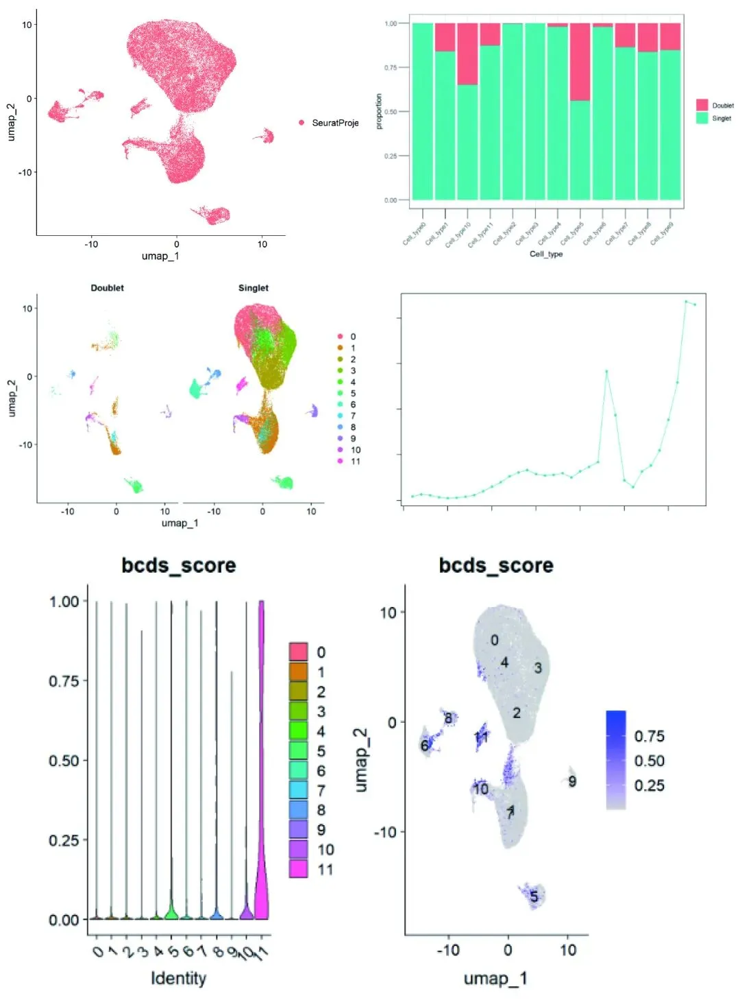
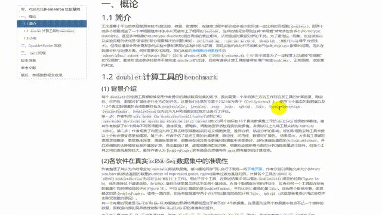

# scRNA-Seq双细胞过滤手册

> 原文：https://mp.weixin.qq.com/s?__biz=MzAwMzIzOTk5OQ==&mid=2247511622&idx=1&sn=60b35668e569267bab14ec8fbba8bd74&chksm=9b3cd716ac4b5e00122eac47f55085198040a4a0e97c56895bbc39f3a9f1a1eb4eba27048a8f#rd
> 合集：单细胞教程全收录

学习手册

无论是哪个平台的单细胞测序技术(微流控、微室、微滴等)，在建库过程中都会或多或少的形成一定比例的**双细胞**(doublets)，即**两个或多个** 细胞混进了一个单细胞建库体系中从而被带上了**相同的barcode** 。这样的情况会导致这种”单细胞”常常会包含多个(homotypic doublets)、甚至多种细胞(heterotypic doublets)混合而成的表达矩阵，从而造成对数据分析的干扰。为了避免这一现象，反应体系以及实验流程的优化是”湿实验”部分需要解决的问题(例如：cell hashing、species mixture、demuxlet、MULTI-seq等平台或技术)。但是这通常会带来更复杂的实验步骤和更高的实验时间与花费，而且实验的优化并不能解决已包含doublets数据的问题。因此**在数据分析与处理** 方面，同样需要优化流程。。简单的过滤很多时候并不能完成doublets的过滤，目前有诸多计算工具能够帮助用户完成doublets、正常细胞、空液滴的判定。本次学习手册，我们先从**绪论** 说起，带大家一同比较doubletCells, Scrublet, cxds, bcds, hybrid, Solo, DoubletDetection, DoubletFinder等工具在**双细胞预测表现中的优劣**(benchmarking)，再进行DoubletFinder与cxds工具的**实操流程讲解** 。不熟悉分析过程的同学可以先行学习：[scRNA-Seq学习手册Seurat V4修订版](<http://mp.weixin.qq.com/s?__biz=MzAwMzIzOTk5OQ==&mid=2247510380&idx=1&sn=0eb2b0c519ef1dc25ee8821b736a0fde&chksm=9b3cd03cac4b592ad93149fb4847e6ba3dd03ab69e1ca594ddc64d323fb7496775789cae245d&scene=21#wechat_redirect>)另外本手册涉及到的包比较占内存，硬件跟不上的同学可以参考：[足够支持你完成硕博生涯的生信环境](<http://mp.weixin.qq.com/s?__biz=MzAwMzIzOTk5OQ==&mid=2247507693&idx=1&sn=d9517a0803ad75cb7be430806834e7b8&chksm=9b3ca7bdac4b2eaba1ad01ed04ab1fbcbafcf4f6ddfe9e4f76ed9229707f545fe7d9c9ffd6ae&scene=21#wechat_redirect>)
分析图片集锦

**-Biomamba**

所见即所得

学习手册可直接用浏览器打开：

下载的资料内容：

解锁前需阅读：[龙年订阅须知](<http://mp.weixin.qq.com/s?__biz=MzAwMzIzOTk5OQ==&mid=2247509093&idx=1&sn=d82ed3738bc25b922a4837016198951e&chksm=9b3cdd35ac4b5423f08cf6ab2f4afc5d815c2321991d880e8b7162e63fd1d7e4695cd7391022&scene=21#wechat_redirect>)

文末还可解锁以下内容

，龙年订阅合集持续更新中，联系客服微信[Biomamba_yunying]可以以119￥获取全部资料(包括今年后面更新的内容)。当然，付费不是目的，以下资料都可以通过**转发领取**(更推荐这种方式)。

[龙年订阅须知](<http://mp.weixin.qq.com/s?__biz=MzAwMzIzOTk5OQ==&mid=2247509093&idx=1&sn=d82ed3738bc25b922a4837016198951e&chksm=9b3cdd35ac4b5423f08cf6ab2f4afc5d815c2321991d880e8b7162e63fd1d7e4695cd7391022&scene=21#wechat_redirect>)
[单细胞Figure 1常见图表](<http://mp.weixin.qq.com/s?__biz=MzAwMzIzOTk5OQ==&mid=2247509260&idx=1&sn=9ff90a428c3f22d43a31ec864e2d8a94&chksm=9b3cdc5cac4b554a2f7cb2a6368f7df9a9a3f6e406eb070663f53d81841a76e188c0b50727de&scene=21#wechat_redirect>)
[快速上手Seurat V5](<http://mp.weixin.qq.com/s?__biz=MzAwMzIzOTk5OQ==&mid=2247509880&idx=1&sn=3b7cd169ccfe688d10cb1ca70dc91e91&chksm=9b3cde28ac4b573ec6d5f4bceafa4294c0e9a001b7d0c0b64f274a9978b1438eeccc747ca0c0&scene=21#wechat_redirect>)
[机器学习基础手册](<http://mp.weixin.qq.com/s?__biz=MzAwMzIzOTk5OQ==&mid=2247510121&idx=1&sn=87b53d350d9aedd5b3205d59e51356a0&chksm=9b3cd139ac4b582f23dd0ca65dcc66bed80b4240da76ee5abfbb61ec1bf62674ebfd2c50a45e&scene=21#wechat_redirect>)
[scRNA-Seq学习手册Seurat V4修订版](<http://mp.weixin.qq.com/s?__biz=MzAwMzIzOTk5OQ==&mid=2247510380&idx=1&sn=0eb2b0c519ef1dc25ee8821b736a0fde&chksm=9b3cd03cac4b592ad93149fb4847e6ba3dd03ab69e1ca594ddc64d323fb7496775789cae245d&scene=21#wechat_redirect>)
[Bulk RNASeq| 转录组实战](<http://mp.weixin.qq.com/s?__biz=MzAwMzIzOTk5OQ==&mid=2247510793&idx=1&sn=bfa69e8f261932d9bea74443fab732f0&chksm=9b3cd259ac4b5b4fd4b3bb80d0210a3396cda777b32ab49be1a45339453db314bb2a17fc438d&scene=21#wechat_redirect>)

订阅后获取学习手册下载链接：

