# 为什么总把分辨率调的很高

> 原文：https://mp.weixin.qq.com/s?__biz=MzAwMzIzOTk5OQ==&mid=2247495765&idx=1&sn=2ec5e3e26491e28c92e25c40630bffae&chksm=9b3c8905ac4b0013a23f9cda2cccd67cdf3c4a941bac161e3a15a12ab98cd4e5eca8aeedbe96#rd
> 合集：单细胞教程全收录


写在前面

最近在群里总是发现有些同学在做细胞分群时把分辨率调的很高，从而获得了几十个cluster，但是这些cluster又展示出了相似的表达模式，因此便一筹莫展，不知下一步如何是好。看的我密恐都犯了：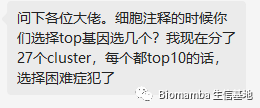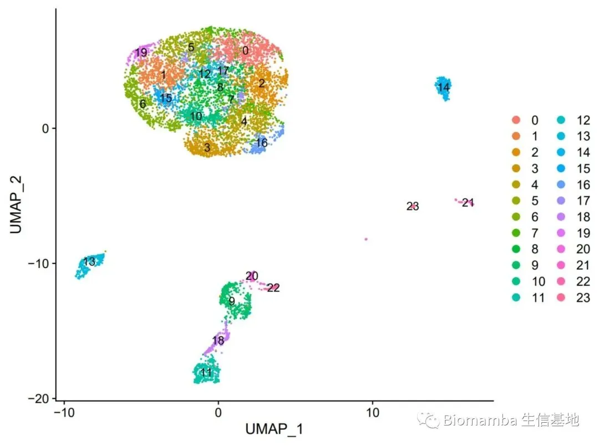
很多人都觉得获得的cluster数量越多越好，实则不然，一味的调高分辨率并不会使你显得技术超群。`FindClusters()`只是一个数字游戏，根据各cluster的表达特征找到合适的分辨率才是一个精巧的活。有足够marker支撑的cluster才能被称为是一种细胞类型。我们来一起探索一番。


开整

一、预处理
以经典的pbmc3k来演示这个过程，这一步做到分群前，下面代码不理解的同学可以看一下这一讲：[手把手教你做单细胞测序数据分析（三）——单样本分析](<https://mp.weixin.qq.com/s?__biz=MzAwMzIzOTk5OQ==&mid=2247487976&idx=1&sn=8edd929256e609e4210a40df63fc1427&chksm=9b3f68b8ac48e1aefd3ff38dd5744c485cde5d7f28d79745b66863928d4614fafb2928b3f617&scene=21#wechat_redirect>)

```
if(!require(Seurat))install.packages("Seurat")
if(!require(dplyr))install.packages("dplyr")
if(!require(patchwork))install.packages("patchwork")
if(!require(R.utils))install.packages("R.utils")
rm(list = ls())
```

```r
pbmc.data <- Read10X(data.dir = "filtered_gene_bc_matrices/hg19/")
# Load the PBMC dataset
pbmc <- CreateSeuratObject(counts = pbmc.data, project = "pbmc3k", min.cells = 3, min.features = 200)
# Initialize the Seurat object with the raw (non-normalized data).
pbmc
## An object of class Seurat
## 13714 features across 2700 samples within 1 assay
## Active assay: RNA (13714 features, 0 variable features)
pbmc[["percent.mt"]] <- PercentageFeatureSet(pbmc, pattern = "^MT-")
#鼠源的需要换成mt
head(pbmc@meta.data,5)
##                  orig.ident nCount_RNA nFeature_RNA percent.mt
## AAACATACAACCAC-1     pbmc3k       2419          779  3.0177759
## AAACATTGAGCTAC-1     pbmc3k       4903         1352  3.7935958
## AAACATTGATCAGC-1     pbmc3k       3147         1129  0.8897363
## AAACCGTGCTTCCG-1     pbmc3k       2639          960  1.7430845
## AAACCGTGTATGCG-1     pbmc3k        980          521  1.2244898
plot1 <- FeatureScatter(pbmc, feature1 = "nCount_RNA", feature2 = "percent.mt")
plot2 <- FeatureScatter(pbmc, feature1 = "nCount_RNA", feature2 = "nFeature_RNA")
if(!require(patchwork))install.packages("patchwork")
pbmc <- subset(pbmc, subset = nFeature_RNA > 200 & nFeature_RNA < 2500 & percent.mt < 5)
ncol(as.data.frame(pbmc[["RNA"]]@counts))
## [1] 2638
pbmc <- NormalizeData(pbmc, normalization.method = "LogNormalize", scale.factor = 10000)
pbmc <- FindVariableFeatures(pbmc, selection.method = "vst", nfeatures = 2000)
pbmc <- ScaleData(pbmc, features = rownames(pbmc))
pbmc <- RunPCA(pbmc, features = VariableFeatures(object = pbmc))
pbmc <- FindNeighbors(pbmc, dims = 1:10)
pbmc <- RunUMAP(pbmc,dims = 1:10)
```

# 二、计算分群

```r
#先极端一点
pbmc <- FindClusters(pbmc, resolution = 1.5)
## Modularity Optimizer version 1.3.0 by Ludo Waltman and Nees Jan van Eck
##
## Number of nodes: 2638
## Number of edges: 95965
##
## Running Louvain algorithm...
## Maximum modularity in 10 random starts: 0.7464
## Number of communities: 13
## Elapsed time: 0 seconds
DimPlot(pbmc)
```

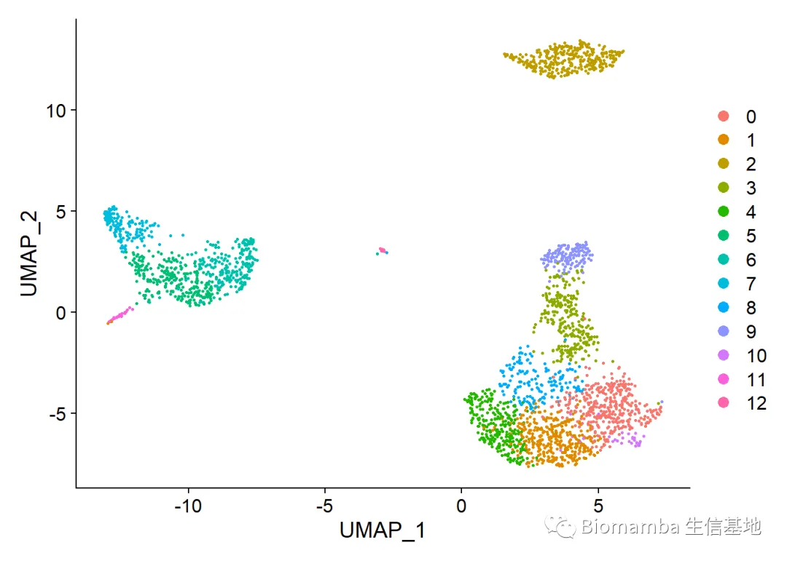

```r
#再回归到正常的分辨率
pbmc <- FindClusters(pbmc, resolution = 0.5)
## Modularity Optimizer version 1.3.0 by Ludo Waltman and Nees Jan van Eck
##
## Number of nodes: 2638
## Number of edges: 95965
##
## Running Louvain algorithm...
## Maximum modularity in 10 random starts: 0.8723
## Number of communities: 9
## Elapsed time: 0 seconds
DimPlot(pbmc)
```

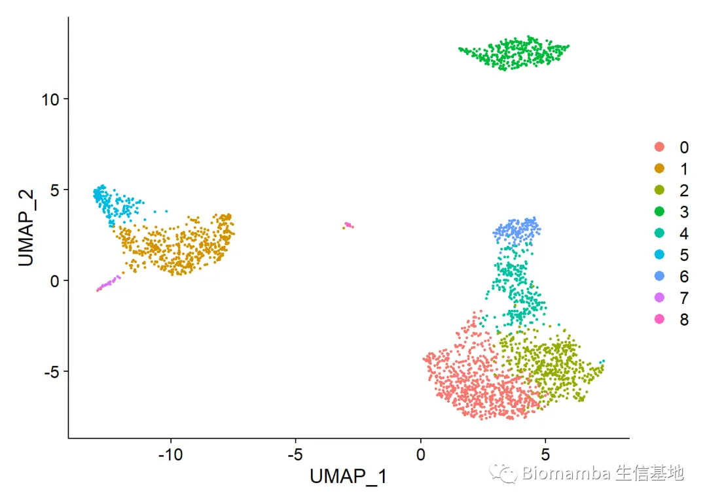 高分辨率时：
```r
Idents(pbmc) <- 'RNA_snn_res.1.5'
high.res.marker <-  FindAllMarkers(pbmc, only.pos = TRUE, min.pct = 0.25, logfc.threshold = 0.25)  %>% group_by(cluster) %>% top_n(n = 10, wt = avg_log2FC)
```
```
## Calculating cluster 0
```
```
## Calculating cluster 1
```
```
## Calculating cluster 2
```
```
## Calculating cluster 3
```
```
## Calculating cluster 4
```
```
## Calculating cluster 5
```
```
## Calculating cluster 6
```
```
## Calculating cluster 7
```
```
## Calculating cluster 8
```
```
## Calculating cluster 9
```
```
## Calculating cluster 10
```
```
## Calculating cluster 11
```
```
## Calculating cluster 12
```

```
DoHeatmap(pbmc,features = high.res.marker$gene)#可以看出很多基因的表达矩阵非常相似，很多同学这时就不知道怎么注释了，但很多时候这些cluster基本可以被认为是同一种细胞类型
```

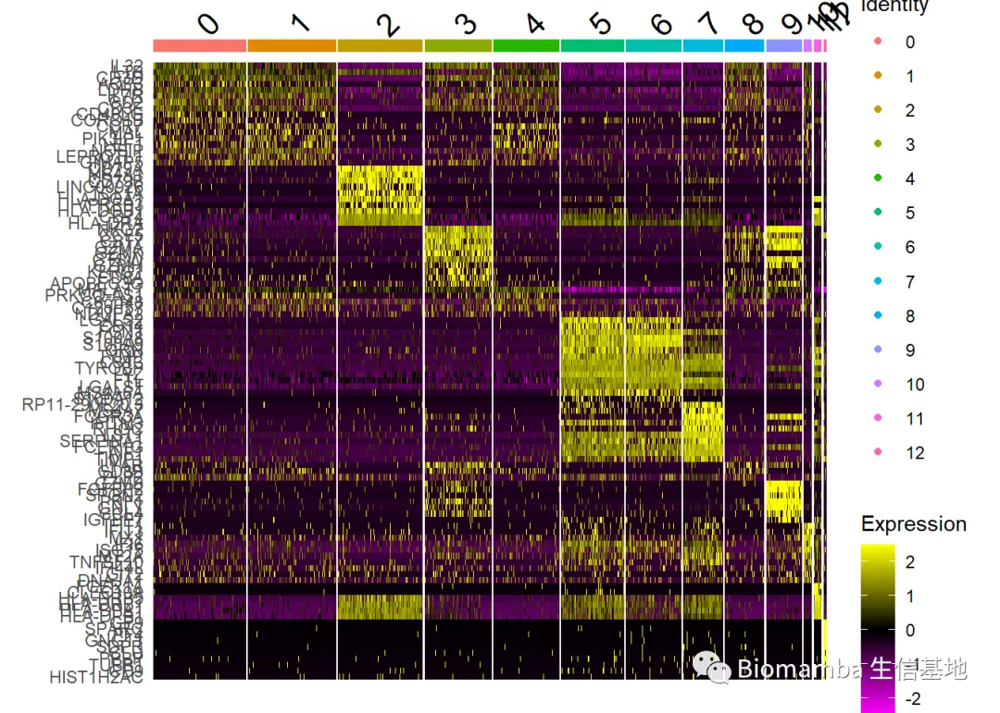低分辨率时：
```r
Idents(pbmc) <- 'RNA_snn_res.0.5'
low.res.marker <-  FindAllMarkers(pbmc, only.pos = TRUE, min.pct = 0.25, logfc.threshold = 0.25)  %>% group_by(cluster) %>% top_n(n = 10, wt = avg_log2FC)
```
```
## Calculating cluster 0
```
```
## Calculating cluster 1
```
```
## Calculating cluster 2
```
```
## Calculating cluster 3
```
```
## Calculating cluster 4
```
```
## Calculating cluster 5
```
```
## Calculating cluster 6
```
```
## Calculating cluster 7
```
```
## Calculating cluster 8
```

```
DoHeatmap(pbmc,features = low.res.marker$gene)#所以分辨率降低时会自动把一些类似的cluster合并为一个，这时仍有少量的细胞类型具有相似的表达矩阵，这时的分辨率就比较理想，若真的每个cluster的表达矩阵都完全不同，这时反而应该怀疑有不同的细胞混为一个cluster，需要调高分辨率重新观察。
```

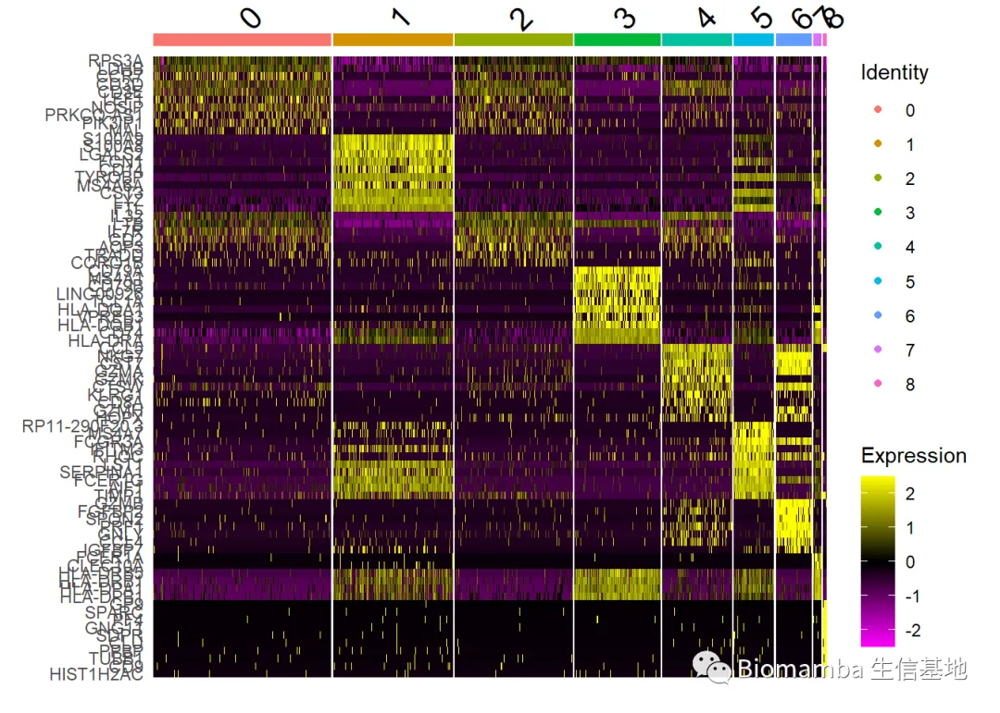大家可以对着上面的热图比较一番，确实是相似的`cluster`随着分辨率的高低而被拆分、合并
```r
library(gplots)
balloonplot(table(pbmc$RNA_snn_res.0.5,pbmc$RNA_snn_res.1.5))
```

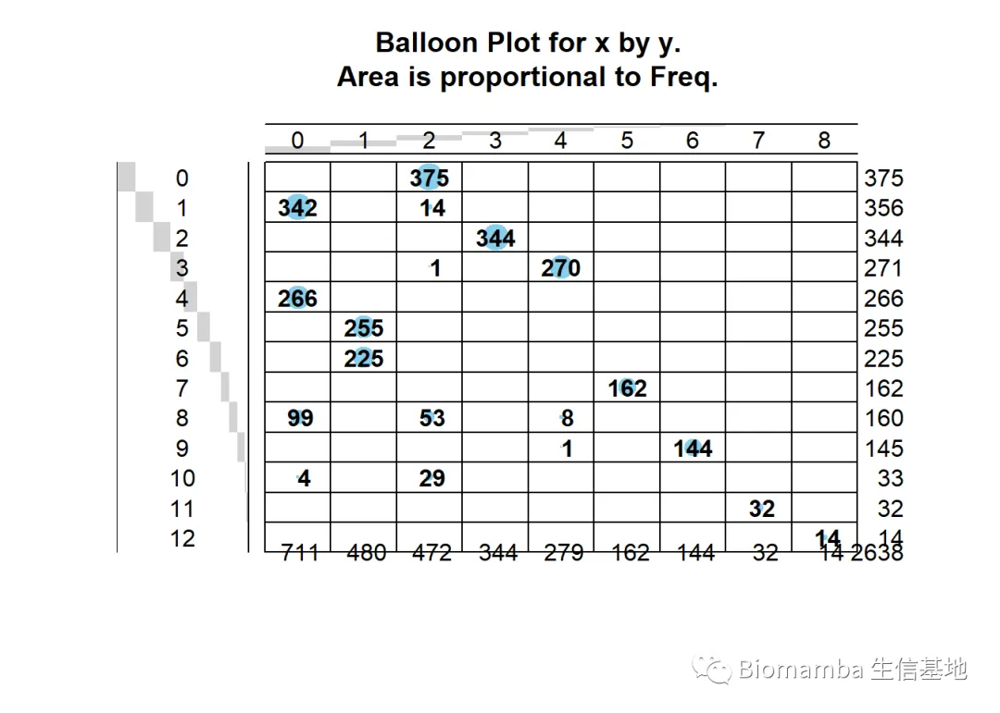**三、最佳的分群与注释方案**
其实这些内容我们之前也提到过，下面过程不理解的同学可以看看这一讲：
[手把手教你做单细胞测序数据分析（五）——细胞类型注释](<https://mp.weixin.qq.com/s?__biz=MzAwMzIzOTk5OQ==&mid=2247488597&idx=1&sn=6123d348db245774d4a0db4134a839d4&chksm=9b3f6d05ac48e4132f92ca6c32dab29d2a4e1eb00d1db3b6e10eba7ffc7154e8554a70938583&scene=21#wechat_redirect>)
`Seurat`给出的注释
```r
Idents(pbmc) <- pbmc$RNA_snn_res.0.5
new.cluster.ids <- c("Naive CD4 T", "CD14+ Mono", "Memory CD4 T", "B", "CD8 T", "FCGR3A+ Mono", "NK", "DC", "Platelet")
names(new.cluster.ids) <- levels(pbmc)
pbmc <- RenameIdents(pbmc, new.cluster.ids)
DimPlot(pbmc, reduction = "umap", label = TRUE, pt.size = 0.5) + NoLegend()
```

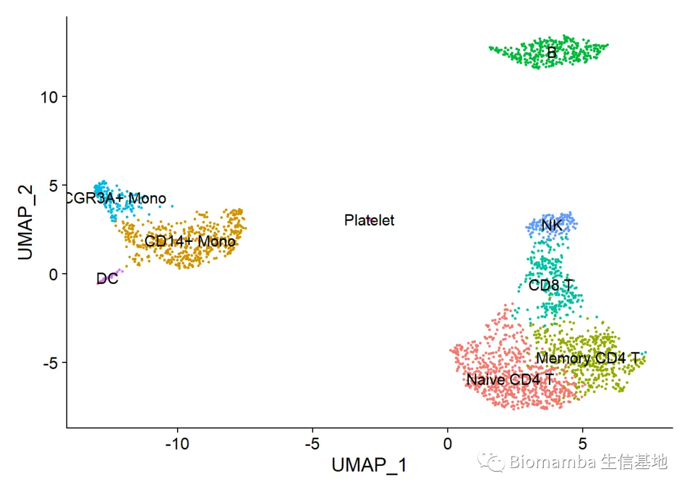

```r
pbmc$celltype <- Idents(pbmc)
```

#

# `Biomamba`的看法

根据`Seurat`作者给出的流程和注释，其实在第一轮分析中就分析得到诸如`Naive CD4 T`, `Memory CD4 T`, `CD8 T`这些详细的T Cell亚群和`CD14+ Mono`、`FCGR3A+ Mono`不是很现实，这里的注释成功是依赖于作者强大的先验知识。如果是我分这个数据，根据上面的热图，我会把`0`和`2`做合并、`4`和`6`做合并，然后再进行亚群的细分。

```r
Idents(pbmc) <- pbmc$RNA_snn_res.0.5
new.cluster.ids <- c("02", "Mono", "02", "B", "46", "Mono", "46", "DC", "Platelet")
names(new.cluster.ids) <- levels(pbmc)
pbmc <- RenameIdents(pbmc, new.cluster.ids)

my.marker <-  FindAllMarkers(pbmc, only.pos = TRUE, min.pct = 0.25, logfc.threshold = 0.25)  %>% group_by(cluster) %>% top_n(n = 10, wt = avg_log2FC)
```
```
## Calculating cluster 02
```
```
## Calculating cluster Mono
```
```
## Calculating cluster B
```
```
## Calculating cluster 46
```
```
## Calculating cluster DC
```
```
## Calculating cluster Platelet
```

```
DoHeatmap(pbmc,features = my.marker$gene)
```

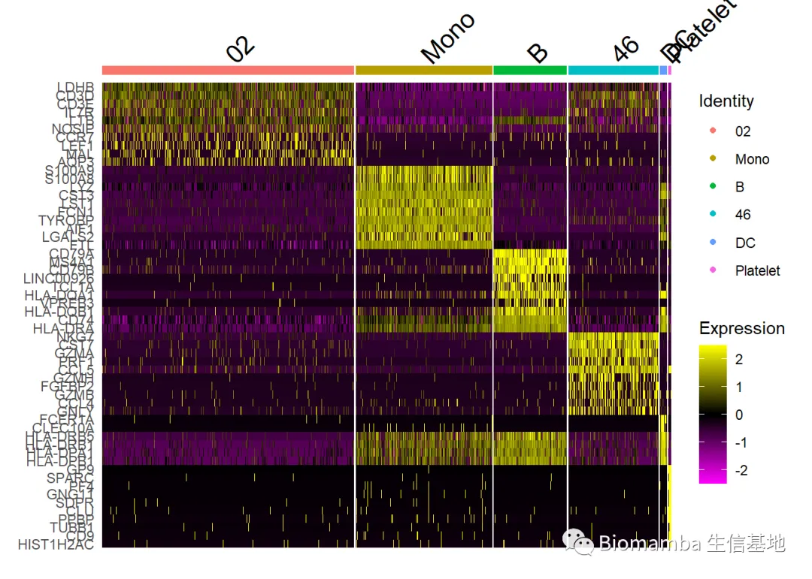 那么这里的`02`、`Mono`、`46`，就可以用于大家分亚群

```r
#我们先调整分辨率分为两个亚群看一下
pbmc <- FindSubCluster(pbmc,cluster = 'Mono',graph.name = 'RNA_nn',resolution = 0.15)
```
```
## Modularity Optimizer version 1.3.0 by Ludo Waltman and Nees Jan van Eck
##
## Number of nodes: 642
## Number of edges: 6132
##
## Running Louvain algorithm...
## Maximum modularity in 10 random starts: 0.8810
## Number of communities: 2
## Elapsed time: 0 seconds
```

```r
Idents(pbmc) <- pbmc$sub.cluster
DimPlot(pbmc,label = T)
```

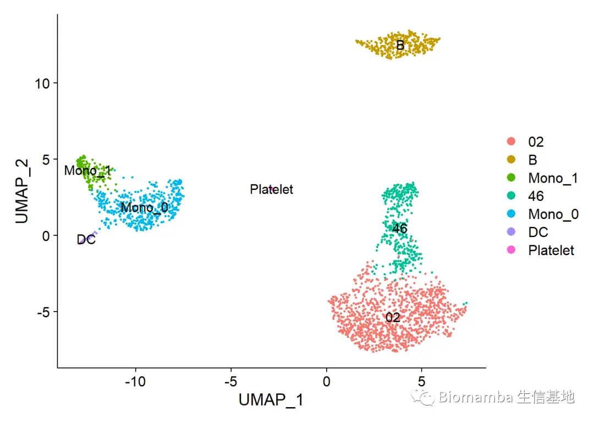

```r
mono.sub.marker <- FindMarkers(pbmc,ident.1 = 'Mono_0',ident.2 = 'Mono_1')
top10 <- rbind(top_n(mono.sub.marker,5,wt = avg_log2FC),
               top_n(mono.sub.marker,-5,wt = avg_log2FC))
VlnPlot(pbmc,features = rownames(top10),pt.size = 0,idents = c('Mono_0','Mono_1'),ncol  = 5)
```

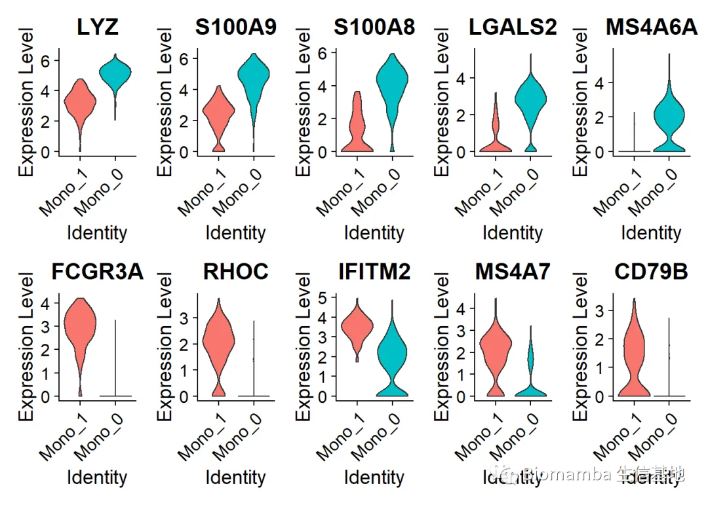 可以看出这两种`monocyte`具有自己的`marker`，大家可以去cellmarker搜搜看，这分别都属于什么亚群，感兴趣的同学也可以尝试分一分更多的亚群


代码与测试文件


不要再说我的链接失效啦，我也不知道为啥腾讯和百度云不对付，微信页面或腾讯浏览器时常打不开百度云链接，链接最好在谷歌浏览器中打开，真的失效了再提醒客服更换链接哦。也不要说我的链接里没代码，html格式的文件大家用浏览器打开就可以看到整理好的笔记。

链接:

https://pan.baidu.com/s/1VNbXtIS4SSzy9cqlHVz7iw?pwd=ptps


若链接失效可以文末联系客服领取~

**单细胞系列教程目录**

 单细胞数据分析系列教程：B站视频，先看一遍视频再去看推送操作，建议至少看三遍：https://www.bilibili.com/video/BV1S44y1b76Z/以下的资料都可以在这里订阅：[单细胞数据基础分析学习手册](<http://mp.weixin.qq.com/s?__biz=MzAwMzIzOTk5OQ==&mid=2247492295&idx=1&sn=d4e81588c0ac2906849c8bc44d079209&chksm=9b3c9b97ac4b1281ab462f866538f096ba2473a3d1426a27d8d97ccc636bfd081e1ba8934dfd&scene=21#wechat_redirect>)

单细胞测序基础数据分析保姆级教程，代码部分整理在往期推送之中：[手把手教你做单细胞测序数据分析（一）——绪论](<http://mp.weixin.qq.com/s?__biz=MzAwMzIzOTk5OQ==&mid=2247484077&idx=1&sn=e329bf865493d46308985f4c111370ae&chksm=9b3f7bfdac48f2eb7e903510338bd772c6be34ccbcb681806d288e62a05eee28fa209d2f33b9&scene=21#wechat_redirect>)
[手把手教你做单细胞测序数据分析（二）——各类输入文件读取](<http://mp.weixin.qq.com/s?__biz=MzAwMzIzOTk5OQ==&mid=2247484086&idx=1&sn=7346a09ba350d6fb7c806dcb7509a1ef&chksm=9b3f7be6ac48f2f02cb948140381ad2a0e3818cc0eefc53cb7a1ad7459aacdc1e90a1ce0af8b&scene=21#wechat_redirect>)
[手把手教你做单细胞测序数据分析（三）——单样本分析](<http://mp.weixin.qq.com/s?__biz=MzAwMzIzOTk5OQ==&mid=2247487976&idx=1&sn=8edd929256e609e4210a40df63fc1427&chksm=9b3f68b8ac48e1aefd3ff38dd5744c485cde5d7f28d79745b66863928d4614fafb2928b3f617&scene=21#wechat_redirect>)
[手把手教你做单细胞测序数据分析（四）——多样本整合](<http://mp.weixin.qq.com/s?__biz=MzAwMzIzOTk5OQ==&mid=2247488539&idx=1&sn=73c538e31907b8d82437cc063b2a2a15&chksm=9b3f6d4bac48e45dcc737ee5a7529f58803fdbaa9ef49aca3c76af0f2e7e374247266b0d16cb&scene=21#wechat_redirect>)[手把手教你做单细胞测序数据分析（五）——细胞类型注释](<http://mp.weixin.qq.com/s?__biz=MzAwMzIzOTk5OQ==&mid=2247488597&idx=1&sn=6123d348db245774d4a0db4134a839d4&chksm=9b3f6d05ac48e4132f92ca6c32dab29d2a4e1eb00d1db3b6e10eba7ffc7154e8554a70938583&scene=21#wechat_redirect>)
[手把手教你做单细胞测序数据分析（六）——组间差异分析及可视化](<http://mp.weixin.qq.com/s?__biz=MzAwMzIzOTk5OQ==&mid=2247488675&idx=1&sn=c1f4ac08b87baf625c7aafa8f073ed79&chksm=9b3f6df3ac48e4e53ef11776bda8a5f75f1d465e4e2d6cccd5e4e1aff5f26eaa34cdea3aabb8&scene=21#wechat_redirect>)[手把手教你做单细胞测序数据分析（七）——基因集富集分析](<http://mp.weixin.qq.com/s?__biz=MzAwMzIzOTk5OQ==&mid=2247488717&idx=1&sn=6ba02599dda33eb6cff751c1d92055d9&chksm=9b3f6d9dac48e48ba334f031ce7874b4383a45be271acc9f0e6a714934ab7c7d945a513efdec&scene=21#wechat_redirect>)

上游fastq文件处理：
[单细胞分析的最上游——处理Fastq文件：cellranger](<http://mp.weixin.qq.com/s?__biz=MzAwMzIzOTk5OQ==&mid=2247484923&idx=1&sn=b5876af14fbee68d1e9db4b0f70cd1c8&chksm=9b3f7cabac48f5bdb3aac7d20201d89121a83720b41a10017564fedbb8c4a13df0da92daffd7&scene=21#wechat_redirect>)
[单细胞分析的最上游——处理Fastq文件：dropseqRunner](<http://mp.weixin.qq.com/s?__biz=MzAwMzIzOTk5OQ==&mid=2247484937&idx=1&sn=4fe1fa518202bdaf462bb93a2614ed32&chksm=9b3f7f59ac48f64fafaf34bac2c80f06d3a86b6a84ccf12566c7eac25bb71c7edd3d74004cf7&scene=21#wechat_redirect>)[有奖提问,这个smart-Seq2数据实战的比对率为何如此低？](<http://mp.weixin.qq.com/s?__biz=MzAwMzIzOTk5OQ==&mid=2247488441&idx=1&sn=dac4efc4a8901a4abb133f9e5c80831e&chksm=9b3f6ae9ac48e3fff5a7112a0127726441ccb9dc2c3369d4a0fe98a2120df991954ff0567732&scene=21#wechat_redirect>)

细胞通讯B站连续播放起来比较方便：
https://www.bilibili.com/video/BV1Ab4y1W7qx?p=1**往期推送**[单细胞测序数据进阶分析—《细胞通讯》1.概论](<http://mp.weixin.qq.com/s?__biz=MzAwMzIzOTk5OQ==&mid=2247485403&idx=1&sn=e148e2d09556a85333cd9c212a880aaa&chksm=9b3f7e8bac48f79d6288977f3a67ebed5813dfe92e4a227a2e304eb68321771b3511fdaf5ba5&scene=21#wechat_redirect>)
[单细胞测序数据进阶分析—《细胞通讯》2.1CellChat基础分析教程](<http://mp.weixin.qq.com/s?__biz=MzAwMzIzOTk5OQ==&mid=2247485680&idx=1&sn=8168685ab9bbf772dce24e8673994033&chksm=9b3f71a0ac48f8b6554aa6f30a81f7e622fd8bf2f6a83701839290b7dd8f1c90343592603413&scene=21#wechat_redirect>)
[单细胞测序数据进阶分析—《细胞通讯》2.2CellChat多组别分析](<http://mp.weixin.qq.com/s?__biz=MzAwMzIzOTk5OQ==&mid=2247485706&idx=1&sn=2d39360b41733b0be6f88d2922388507&chksm=9b3f705aac48f94cc478210f7f11d37294156517c489dedb333d8647ca287134a29944f39a3d&scene=21#wechat_redirect>)
[给你们申请到了免费的128GB云服务器](<http://mp.weixin.qq.com/s?__biz=MzAwMzIzOTk5OQ==&mid=2247485734&idx=1&sn=32c75f6d07b49084e518af6d18099e8b&chksm=9b3f7076ac48f9600593b319d2e0b36bf5a62399a9835caa5783ad36fbdec6004e04cb656db9&scene=21#wechat_redirect>)
拟时序分析B站连续播放起来比较方便：
https://www.bilibili.com/video/BV1br4y1x7Hf?p=1**往期推送**[单细胞测序数据进阶分析—《拟时序分析》1.概论](<http://mp.weixin.qq.com/s?__biz=MzAwMzIzOTk5OQ==&mid=2247486553&idx=1&sn=b689ec962a17ca1a1ada29ae8ff8c019&chksm=9b3f7509ac48fc1f0f81e288de8f15c86548215a1cd9d5c740dc63f2421371d13890398ab1df&scene=21#wechat_redirect>)
[单细胞测序数据进阶分析—《拟时序分析》2.monocle概论](<http://mp.weixin.qq.com/s?__biz=MzAwMzIzOTk5OQ==&mid=2247487001&idx=1&sn=329129e75f703e3f332e76af9c66871e&chksm=9b3f7749ac48fe5f081248c2a48c56685e3915015036c73f8f67ec3e6acc246ddf815daedb22&scene=21#wechat_redirect>)[单细胞测序数据进阶分析—《拟时序分析》3.monocle2实操：完整版](<http://mp.weixin.qq.com/s?__biz=MzAwMzIzOTk5OQ==&mid=2247487400&idx=1&sn=223a96a245c408c31e2c3c16afac88fc&chksm=9b3f76f8ac48ffee769dc76870e15bbd0275647dcfb9bf21bf499b7eaee86121b254e4b2da54&scene=21#wechat_redirect>)
[单细胞测序数据进阶分析—《拟时序分析》4.初识monocle3](<http://mp.weixin.qq.com/s?__biz=MzAwMzIzOTk5OQ==&mid=2247489044&idx=1&sn=061dbfc34d200b73a8227d0bb28a1d27&chksm=9b3f6f44ac48e65251f7e5ecce84637c05d50ecb92769e8386f221f8e7b9bfeb719232def863&scene=21#wechat_redirect>)
[单细胞测序数据进阶分析—《拟时序分析》5.monocle3的降维、分群、聚类](<http://mp.weixin.qq.com/s?__biz=MzAwMzIzOTk5OQ==&mid=2247489494&idx=1&sn=44f0a44857c12fcf9a1ab84e4f2cbebf&chksm=9b3f6e86ac48e79026321de2fdca81a139d104d655884ffe87a68e0a1551ddffa5af7919d19e&scene=21#wechat_redirect>)[单细胞测序数据进阶分析—《拟时序分析》6.monocle3的拟时序分析](<http://mp.weixin.qq.com/s?__biz=MzAwMzIzOTk5OQ==&mid=2247490418&idx=1&sn=18ae0b6139fe1a2436dcf6cc47850297&chksm=9b3f6222ac48eb3450de0b02a34eb5fff2db89ab8f155460d554cbb23be0cd27fd349079e7b2&scene=21#wechat_redirect>)
[解决monocle2的orderCells报错的两种方法](<http://mp.weixin.qq.com/s?__biz=MzAwMzIzOTk5OQ==&mid=2247491083&idx=1&sn=c5697ab024193cb6595d27e4f4d3bfaf&chksm=9b3f675bac48ee4d7244d9819e14fe210f7e42e40fc7a6a8df7b95bfd92f06334d60d226cb93&scene=21#wechat_redirect>)
[一文搞定拟时序分析的下游可视化探索](<http://mp.weixin.qq.com/s?__biz=MzAwMzIzOTk5OQ==&mid=2247494479&idx=1&sn=32f39c79c4c9fc07aa829eed49016da3&chksm=9b3c921fac4b1b091efcdd151500b69d19f71d5ca518122af697fc37e87acd915f3be5f63fb8&scene=21#wechat_redirect>)

其他单细胞相关技术贴也在这里：[细胞的数量由誰决定？](<http://mp.weixin.qq.com/s?__biz=MzAwMzIzOTk5OQ==&mid=2247484056&idx=1&sn=4967a054f5241ff3a1bd4a6fe9a502b1&chksm=9b3f7bc8ac48f2deca3141461be035deb8658be184d78597af28f8ba2092d12f020768275248&scene=21#wechat_redirect>)[单细胞中应该如何做GSVA？](<http://mp.weixin.qq.com/s?__biz=MzAwMzIzOTk5OQ==&mid=2247484701&idx=1&sn=ad90680f252d092a2e21f349c8f32cab&chksm=9b3f7c4dac48f55bf1d11337406ab0e1295e8e1731dbac0715eedc99d11beff7f380e42dd49b&scene=21#wechat_redirect>)[答读者问（三）：单细胞测序前景](<http://mp.weixin.qq.com/s?__biz=MzAwMzIzOTk5OQ==&mid=2247484280&idx=2&sn=844af02070012a1c2681880596ba51a2&chksm=9b3f7a28ac48f33e95eb906121be8953410ca4c572c8035cb801609a56caf9dcff57fa989602&scene=21#wechat_redirect>)[答读者问（四）：如何分析细胞亚群](<http://mp.weixin.qq.com/s?__biz=MzAwMzIzOTk5OQ==&mid=2247484316&idx=2&sn=e8d02fddc80d1137bb64c55541f1651d&chksm=9b3f7accac48f3da7df7fcad9c996291bc66967c04d16dde92ed391c56e610a7298ac8fb7dbb&scene=21#wechat_redirect>)[答读者问（六）：Seurat中如何让细胞听你指挥](<http://mp.weixin.qq.com/s?__biz=MzAwMzIzOTk5OQ==&mid=2247484376&idx=2&sn=9fda8a5261e86f889a58d607163ce0fd&chksm=9b3f7a88ac48f39ea9c19e256a513c9ae80c6f6dc1724b7783884e23981e2061c78fa67071c9&scene=21#wechat_redirect>)[答读者问（八）：为什么Read10X也会报错?](<http://mp.weixin.qq.com/s?__biz=MzAwMzIzOTk5OQ==&mid=2247485012&idx=1&sn=6007c8d7cb2a236dd7240a678dac0391&chksm=9b3f7f04ac48f612f811c1df9e9450dc8112d343e4bf245be5149c2e2a073d3e339cd0e3ff61&scene=21#wechat_redirect>)
[答读者问（十）整合后的表达矩阵，如何拆分出分组信息？](<http://mp.weixin.qq.com/s?__biz=MzAwMzIzOTk5OQ==&mid=2247485134&idx=1&sn=13f5f8c47d8af2beeca4e103a5f5e26d&chksm=9b3f7f9eac48f688b454a1062ee4e41f7072ac9d58e5466fa7ed4bb05018adbfe167bb3a445a&scene=21#wechat_redirect>)
[答读者问（十一）如何一次性读取一个目录下的cellranger输出文件？](<http://mp.weixin.qq.com/s?__biz=MzAwMzIzOTk5OQ==&mid=2247485145&idx=1&sn=402cb28c16aba0dc647037c9b7aba8f7&chksm=9b3f7f89ac48f69fe27cd427df3eff2e88c240bf20dfe92d8b522eecd7302d132d880bf29047&scene=21#wechat_redirect>)
[给你安排一个懂生信的工具人（十）：不学编程 零代码完成单细胞测序数据分析：Loupe Browser](<http://mp.weixin.qq.com/s?__biz=MzAwMzIzOTk5OQ==&mid=2247485730&idx=1&sn=42b9b35026bec5359ac34750dea3bf44&chksm=9b3f7072ac48f964970f673a86e27ecd453a80b953168dc110e0ea6bfa4110eeed3350c9601a&scene=21#wechat_redirect>)
[什么？不做单细胞也能分析细胞类群和免疫浸润？](<http://mp.weixin.qq.com/s?__biz=MzAwMzIzOTk5OQ==&mid=2247485798&idx=1&sn=c849bc7a0093af92fc99e13b55842bb2&chksm=9b3f7036ac48f92048d726b38f2dd978d0b0cce779c1a4090aa4da5cb2df3ad30a5c5dbed27e&scene=21#wechat_redirect>)
[答读者问 （十三）查看Seurat对象时的ERROR：type='text'](<http://mp.weixin.qq.com/s?__biz=MzAwMzIzOTk5OQ==&mid=2247485859&idx=1&sn=a014c4cb6034551e57c70820c7781e49&chksm=9b3f70f3ac48f9e52620e3ff197eb98e58836e8bb6baad634387a521fdda1e4a194356517c73&scene=21#wechat_redirect>)
[各类单细胞对象（数据格式）转换大全（一）](<http://mp.weixin.qq.com/s?__biz=MzAwMzIzOTk5OQ==&mid=2247485925&idx=1&sn=14e08440200f0f5cb4dcc2dc615efeb8&chksm=9b3f70b5ac48f9a37a43cc2a8b2a5e485a3f84b4ef87949dfe99056bc6301b110e80800f6bb1&scene=21#wechat_redirect>)[批量整理好GEO中下载的单细胞数据](<http://mp.weixin.qq.com/s?__biz=MzAwMzIzOTk5OQ==&mid=2247486045&idx=1&sn=0b6874bcffc8abafb505cabce4c4fc0e&chksm=9b3f730dac48fa1b140ef01c07a7749e69df4fa7d2056deeed0673c668b6246724cd85741125&scene=21#wechat_redirect>)
[答读者问 （十四）Seurat中分类变量处理技巧](<http://mp.weixin.qq.com/s?__biz=MzAwMzIzOTk5OQ==&mid=2247486134&idx=1&sn=e581b8ac20bbc968aeef3f9cf56f3a0f&chksm=9b3f73e6ac48faf0f1c81752b0190abc617eb720a71806950e7851c7d19b7e3e092aa97bd005&scene=21#wechat_redirect>)
[答读者问 （十五）稀疏矩阵转matrix, as.matrix函数是下下策](<http://mp.weixin.qq.com/s?__biz=MzAwMzIzOTk5OQ==&mid=2247486259&idx=1&sn=97de5c9e15e48cb62c8a680376a4ee0d&chksm=9b3f7263ac48fb75a91b40416826fe35b340284cf38255925ac447443a62cdc1df082d20fb61&scene=21#wechat_redirect>)
[答读者问 （十六）做单细胞测序到底需要多少内存](<http://mp.weixin.qq.com/s?__biz=MzAwMzIzOTk5OQ==&mid=2247487923&idx=1&sn=15043c6d729b0d5493ab875b0e54a259&chksm=9b3f68e3ac48e1f5dae514a01c857f9a56a90e2977dd7862db28d06fe55888cd9bb4afbb14e0&scene=21#wechat_redirect>)[答读者问 （十七）调用的线程越多就算的越快嘛?](<http://mp.weixin.qq.com/s?__biz=MzAwMzIzOTk5OQ==&mid=2247488995&idx=1&sn=7140e0d037671542fb37dff3a3c94b28&chksm=9b3f6cb3ac48e5a5f54a02be9e6af9f5a4cf8da1de1770f9035130c84dedf059a024964fc15a&scene=21#wechat_redirect>)
[答读者问（十八）、一个我至少被问过30遍的monocle报错](<http://mp.weixin.qq.com/s?__biz=MzAwMzIzOTk5OQ==&mid=2247490010&idx=1&sn=24c55fa4bd5d7d829625cb67dbaf321a&chksm=9b3f608aac48e99c9f27e3423c8398034a1819d0ccebbf21170b955461d2c335132d6f3cce25&scene=21#wechat_redirect>)[沉浸式统计细胞比例](<http://mp.weixin.qq.com/s?__biz=MzAwMzIzOTk5OQ==&mid=2247490949&idx=1&sn=b8dbe07d901f7c24f82d078be7a2fc77&chksm=9b3f64d5ac48edc33980363c7bc862a9f6283b78dac407e9c082d80bd7d9669215eecac62347&scene=21#wechat_redirect>)[没有barcode文件的单细胞数据要怎么读取](<http://mp.weixin.qq.com/s?__biz=MzAwMzIzOTk5OQ==&mid=2247490952&idx=1&sn=364a3941e59e45234795c906a42fc9ab&chksm=9b3f64d8ac48edcec70384cf5c6a91224d0f7841ce3a7cfcade6513500c13673a6695d6f0299&scene=21#wechat_redirect>)
[单细胞基因集评分之AUCell](<http://mp.weixin.qq.com/s?__biz=MzAwMzIzOTk5OQ==&mid=2247491761&idx=1&sn=41f5c1ceaacf6a1c4840567f8a349e06&chksm=9b3c99e1ac4b10f7ca158561e96fec76a49ff32b8412cb146ed3fb7aa9260c75172b4eb16f9a&scene=21#wechat_redirect>)
[粉丝来稿|1. Seurat4相较于Seurat3的几点改动](<http://mp.weixin.qq.com/s?__biz=MzAwMzIzOTk5OQ==&mid=2247494516&idx=1&sn=cb2d4e6b182428ce7b98e7fff2e8729a&chksm=9b3c9224ac4b1b32c4fe99758960305c4845395cfe03851d70a0407043ee36250e55d20106fc&scene=21#wechat_redirect>)
[如何加快Seurat的计算速度](<http://mp.weixin.qq.com/s?__biz=MzAwMzIzOTk5OQ==&mid=2247494116&idx=1&sn=f3dc577cbb464779062aada313191a05&chksm=9b3c90b4ac4b19a27a17f958e3437337d5b10b6ba7153e4dd43dedcb4df812d8c6b4d86fe970&scene=21#wechat_redirect>)
[一文搞定单细胞基因集评分](<http://mp.weixin.qq.com/s?__biz=MzAwMzIzOTk5OQ==&mid=2247493493&idx=1&sn=2cd725b2f04377f218955bafbcbb877d&chksm=9b3c9e25ac4b17330a9b9ff77302ab95a9dc5dc7e6fe7298f28d682112ee066c7d4bc1947982&scene=21#wechat_redirect>)[答读者问（二十）四个单细胞样本只给了一套文件怎么读](<http://mp.weixin.qq.com/s?__biz=MzAwMzIzOTk5OQ==&mid=2247494879&idx=1&sn=c2287ab3684792747dfac53d6704462b&chksm=9b3c958fac4b1c994a4b075c4f8475816e121966fa8c52cb0a2ce8c14987988ab9bdb49bdf69&scene=21#wechat_redirect>)
[人类单细胞测序数据中有哪些以"**-"开头的基因](<http://mp.weixin.qq.com/s?__biz=MzAwMzIzOTk5OQ==&mid=2247495019&idx=1&sn=f52ac22ca1ea47ecddaa3503bdc2c0b6&chksm=9b3c943bac4b1d2d521f7155ce8f499389dade23828017572a84cdce71e5d08d37d74e08512b&scene=21#wechat_redirect>)

单细胞文献阅读：[Biomamba助推的第二篇文章!发表了！](<http://mp.weixin.qq.com/s?__biz=MzAwMzIzOTk5OQ==&mid=2247489823&idx=1&sn=6a5dddd53870395316d2b2e904c6ce72&chksm=9b3f604fac48e959e97e4b0317643efdcf117da7f8b75f1edbcd64dd8e2f07149e6031a94dd4&scene=21#wechat_redirect>)[又来了！Biomamba生信基地助推的第四篇文章!](<http://mp.weixin.qq.com/s?__biz=MzAwMzIzOTk5OQ==&mid=2247492532&idx=1&sn=cddb4691f23defc80b60da231790c53c&chksm=9b3c9ae4ac4b13f2334cc7f6b16eec1d8223800f6ecef71a93cfba21698ac5f4505dbd64f300&scene=21#wechat_redirect>)
文献阅读（三）、单细胞测序解析糖尿病肾病中肾小球的动态变化
[文献阅读（四）、](<http://mp.weixin.qq.com/s?__biz=MzAwMzIzOTk5OQ==&mid=2247484204&idx=1&sn=ee2119c172e6e917998f3781ed20f550&chksm=9b3f7a7cac48f36a97e3bd13660c34f8001032a87a17e98cccb835de3583bbf2d928128a277e&scene=21#wechat_redirect>)单细胞测序技术解析健康人与T2D患者的胰岛差异[文献阅读（六）、](<http://mp.weixin.qq.com/s?__biz=MzAwMzIzOTk5OQ==&mid=2247484204&idx=1&sn=ee2119c172e6e917998f3781ed20f550&chksm=9b3f7a7cac48f36a97e3bd13660c34f8001032a87a17e98cccb835de3583bbf2d928128a277e&scene=21#wechat_redirect>)小鼠全肾单细胞测序开篇之作[文献阅读（七）、](<http://mp.weixin.qq.com/s?__biz=MzAwMzIzOTk5OQ==&mid=2247484204&idx=1&sn=ee2119c172e6e917998f3781ed20f550&chksm=9b3f7a7cac48f36a97e3bd13660c34f8001032a87a17e98cccb835de3583bbf2d928128a277e&scene=21#wechat_redirect>)一篇不花钱就能白嫖的文章[文献阅读（八）、不会吧不会吧，Nature都能白嫖？](<http://mp.weixin.qq.com/s?__biz=MzAwMzIzOTk5OQ==&mid=2247484204&idx=1&sn=ee2119c172e6e917998f3781ed20f550&chksm=9b3f7a7cac48f36a97e3bd13660c34f8001032a87a17e98cccb835de3583bbf2d928128a277e&scene=21#wechat_redirect>)[文献阅读（十一）、高氧下小鼠肺发育损伤的ScRNA图谱](<http://mp.weixin.qq.com/s?__biz=MzAwMzIzOTk5OQ==&mid=2247485097&idx=1&sn=6e3e63fff6f26332b6a8b393608686d9&chksm=9b3f7ff9ac48f6efc5477c57f3ab38e6c7dbd48b503a731cb08ac5f430fdab98d0d7e21da11a&scene=21#wechat_redirect>)[文献阅读（十二）、IgAN & STRT-Seq](<http://mp.weixin.qq.com/s?__biz=MzAwMzIzOTk5OQ==&mid=2247485376&idx=1&sn=02e228d0993d8a653c8bb1d531021cdb&chksm=9b3f7e90ac48f78686d6d5953aeb192db4f28bf577dbebd76d9fabbe797f135b7fb08fb42867&scene=21#wechat_redirect>)
[文献阅读（十三）、老树开新花——EGFR、肿瘤、免疫+scRNA-Seq](<http://mp.weixin.qq.com/s?__biz=MzAwMzIzOTk5OQ==&mid=2247486192&idx=1&sn=6b40bb3bb1ef590a477514a4400f4642&chksm=9b3f73a0ac48fab6044850ae09b4e340f08b1b19e2c180ae1c25808104886fc544311d167396&scene=21#wechat_redirect>)
[文献阅读（十五）、癌前基质细胞驱动BRCA1肿瘤发生](<http://mp.weixin.qq.com/s?__biz=MzAwMzIzOTk5OQ==&mid=2247486417&idx=1&sn=5dfa5b46e7626a1d3e327cb4fc3df3d5&chksm=9b3f7281ac48fb9721b5ac0b8fd323a44018ba9d3ff3a872be2c36f141c2e02f9761df95708e&scene=21#wechat_redirect>)[文献阅读（十八）、紧跟生信"钱"沿,胰腺癌&免疫多模态图谱](<http://mp.weixin.qq.com/s?__biz=MzAwMzIzOTk5OQ==&mid=2247489045&idx=1&sn=29feb00f094a9a7e20418b22aa54dd8c&chksm=9b3f6f45ac48e653d4223838eb1d96e65e5ee51ac3f7782841d9b33013bdb67b5e22e9599fac&scene=21#wechat_redirect>)
[文献阅读（十九）、原发头颈癌和肿瘤转移微生态](<http://mp.weixin.qq.com/s?__biz=MzAwMzIzOTk5OQ==&mid=2247489511&idx=1&sn=76ec706ebd97e3edd08687f5cf3b6816&chksm=9b3f6eb7ac48e7a10bb81aec5332ecc0544a683f576ea680c8baa621e504816bf65c7d331bdf&scene=21#wechat_redirect>)
[文献阅读（二十一）、肾脏疾病&代谢&核受体ESRRA](<http://mp.weixin.qq.com/s?__biz=MzAwMzIzOTk5OQ==&mid=2247490575&idx=1&sn=b931a1d50ddcfc4e34999763139695a0&chksm=9b3f655fac48ec49eb2fb01ce8acb15e230091ab3c29ce1471747850be5dae54dbe97fd103b0&scene=21#wechat_redirect>)[文献阅读(二十二)、PD-1&急性髓细胞性白血病&T Cell](<http://mp.weixin.qq.com/s?__biz=MzAwMzIzOTk5OQ==&mid=2247490929&idx=1&sn=82bf93ccbd9dd906caad8ec709c86153&chksm=9b3f6421ac48ed37117794e7c5b878fa78760627e8bced9c37a2c7c67fd8afd58d0cf0add17e&scene=21#wechat_redirect>)
[文献阅读（二十三）、鼻咽癌&肿瘤微环境&scRNA-Seq](<http://mp.weixin.qq.com/s?__biz=MzAwMzIzOTk5OQ==&mid=2247491084&idx=1&sn=e450844d4f102caa88cab6deb630a3f4&chksm=9b3f675cac48ee4a6883559859a21d77256479bb8d030c54a91240827d85b925066bc4f8ebb6&scene=21#wechat_redirect>)[文献阅读 (二十四)、《Nature》：MYB调控衰竭性T细胞对检查点抑制的响应](<http://mp.weixin.qq.com/s?__biz=MzAwMzIzOTk5OQ==&mid=2247491909&idx=1&sn=5d47d2917397248dd6a3a9e85f2acd6d&chksm=9b3c9815ac4b11037e52ba00215a0b6cd23b554139955123ef21ac2cd07a646e97309e7def78&scene=21#wechat_redirect>)[文献阅读(二十八)、单细胞都能活检测序了？](<http://mp.weixin.qq.com/s?__biz=MzAwMzIzOTk5OQ==&mid=2247493604&idx=1&sn=d0f8738e26a4b1c870d329b6a4a7b689&chksm=9b3c9eb4ac4b17a2d0b04d72c350c20f575701de7179f77fcd3567f4b1533cf35df4157f67e1&scene=21#wechat_redirect>)[文献阅读(二十九)、单细胞测序做到什么程度能毕业|硕士篇](<http://mp.weixin.qq.com/s?__biz=MzAwMzIzOTk5OQ==&mid=2247493808&idx=1&sn=52c7d330ffdda47c3409d36fe9cbbcd8&chksm=9b3c91e0ac4b18f6edf59d171a0d982b1e3f842148046d8eed19343484feaa84dbd5b7682a11&scene=21#wechat_redirect>)
[文献阅读(三十)、单细胞测序做到什么程度能毕业|博士篇](<http://mp.weixin.qq.com/s?__biz=MzAwMzIzOTk5OQ==&mid=2247494017&idx=1&sn=a2dc4e2eef2bcdb40f5074b665dfa45f&chksm=9b3c90d1ac4b19c79ac5128f96d27789241357c9745bb0389ff5f79f96ab825d3e1c9b29e3af&scene=21#wechat_redirect>)[2022年了，都有哪些器官/组织有scRNA-Seq数据|小鼠篇](<http://mp.weixin.qq.com/s?__biz=MzAwMzIzOTk5OQ==&mid=2247494796&idx=1&sn=92c91a65719bdf39658814eb691a780f&chksm=9b3c95dcac4b1cca5547440a5881e650da3ea430bad3e6017cbd2891606b2ec40e3ec343bc0e&scene=21#wechat_redirect>)
[2022年了，都有哪些器官/组织有scRNA-Seq数据|人类篇](<http://mp.weixin.qq.com/s?__biz=MzAwMzIzOTk5OQ==&mid=2247494806&idx=1&sn=1d15ad9cb4d350a164d3b941bc715233&chksm=9b3c95c6ac4b1cd054cedbd3e8c8f57ee88cc59a6ebda2fd11ba8fea79f5e9e8c65d21ff338c&scene=21#wechat_redirect>)

单细胞注释复写[单细胞注释复写(一):Human Fetal Kidney](<http://mp.weixin.qq.com/s?__biz=MzAwMzIzOTk5OQ==&mid=2247490504&idx=1&sn=0066b2b33067cedb9d1c28689a53faab&chksm=9b3f6298ac48eb8e12cdc7bdd6263e5feb9039f549f7b9dbf4e258854ee61476d09f702f1447&scene=21#wechat_redirect>)[单细胞注释复写(二): human colorectal](<http://mp.weixin.qq.com/s?__biz=MzAwMzIzOTk5OQ==&mid=2247491642&idx=1&sn=2246fb702277ddc690f056fc8854142e&chksm=9b3c996aac4b107c059a403978eca7be1ae7987659626272c58430910ad75892ad470517aefb&scene=21#wechat_redirect>)

非技术帖：[关于单细胞的事 谈谈后面的计划](<http://mp.weixin.qq.com/s?__biz=MzAwMzIzOTk5OQ==&mid=2247484798&idx=1&sn=120eada9b02ea2f81f93cd4cfa5eb964&chksm=9b3f7c2eac48f538e2f95166dbe576b029dcb3ad7d321a4d9f346c9a51416d777f4cffb9aa84&scene=21#wechat_redirect>)[趁机预告一波](<http://mp.weixin.qq.com/s?__biz=MzAwMzIzOTk5OQ==&mid=2247485614&idx=1&sn=f63ab5d759bdcb933f334be6333f9493&chksm=9b3f71feac48f8e8cece92812e0c26d7c03130359451a89ce7db22b7022506371269e1fc2af0&scene=21#wechat_redirect>)[生信分析为什么要使用服务器？](<http://mp.weixin.qq.com/s?__biz=MzAwMzIzOTk5OQ==&mid=2247489314&idx=1&sn=fe66765836fe0d7b3450b30117415ce8&chksm=9b3f6e72ac48e7642725b22bafbece9c37277f56e3958be57d9702240c3b63dbeb1aedf61cf9&scene=21#wechat_redirect>)
[为实验室准备一份生物信息学不动产](<http://mp.weixin.qq.com/s?__biz=MzAwMzIzOTk5OQ==&mid=2247492383&idx=1&sn=b8d912877cb38e8d8c9084d1d9370ded&chksm=9b3c9a4fac4b135926091a8af972c45a17a2fa1f94c704779c60df5f733847036c3797894c1c&scene=21#wechat_redirect>)


如何联系我们

公众号后台消息更新不及时，超过48h便不允许回复消息，这里留一下领取资料、免费服务器的**微信号** ，方便各位随时交流、提建议（由助理接待）。此外呼声一直很高的交流群也建好了，欢迎大家入群讨论：[永久免费的千人生信、科研交流群](<http://mp.weixin.qq.com/s?__biz=MzAwMzIzOTk5OQ==&mid=2247490936&idx=1&sn=850dfc45b10a6bd538c81cfbf1d7af37&chksm=9b3f6428ac48ed3e4199dbfdec2fce4324d3226af19e335b8e5c0143cf8f0881667e36074d83&scene=21#wechat_redirect>)

大家可以阅读完这几篇之后添加[给生信入门初学者的小贴士](<http://mp.weixin.qq.com/s?__biz=MzAwMzIzOTk5OQ==&mid=2247493329&idx=1&sn=597870b7f7ce10346da3561e7c281627&chksm=9b3c9f81ac4b169794088ce9abbcacb5f18e9fd174fc0d7e28da62d78facadf3100ef38aaf22&scene=21#wechat_redirect>)
[如何搜索公众号过往发布内容](<http://mp.weixin.qq.com/s?__biz=MzAwMzIzOTk5OQ==&mid=2247488966&idx=1&sn=9e9e7659b4cf00ac3173d21e88e1602b&chksm=9b3f6c96ac48e580efe53f966430f6598785e5c5c6bcc20f5eef019e723e49baaaea6d73fb7b&scene=21#wechat_redirect>)
您点的每个赞和在看，我都认真当成了喜欢
