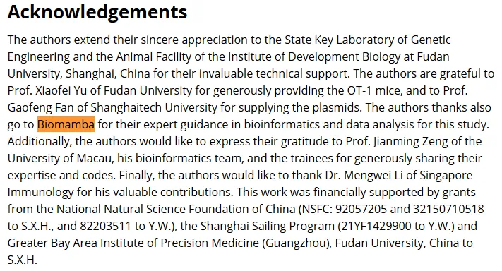
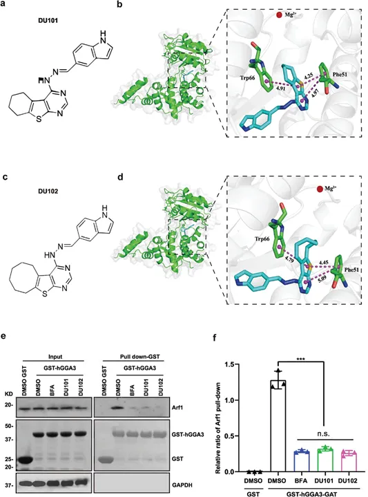
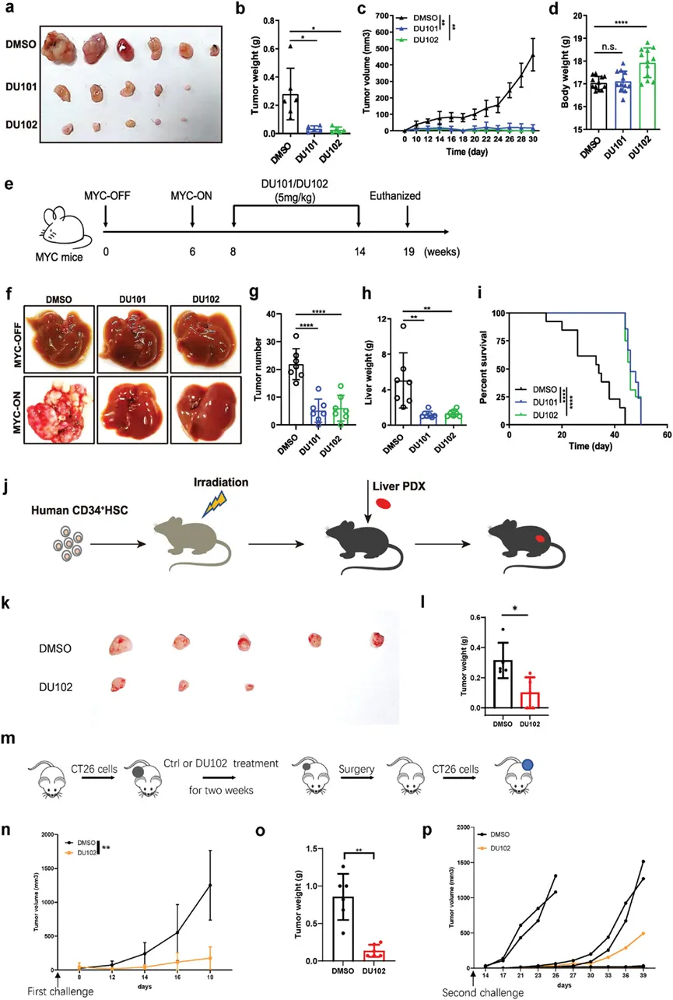
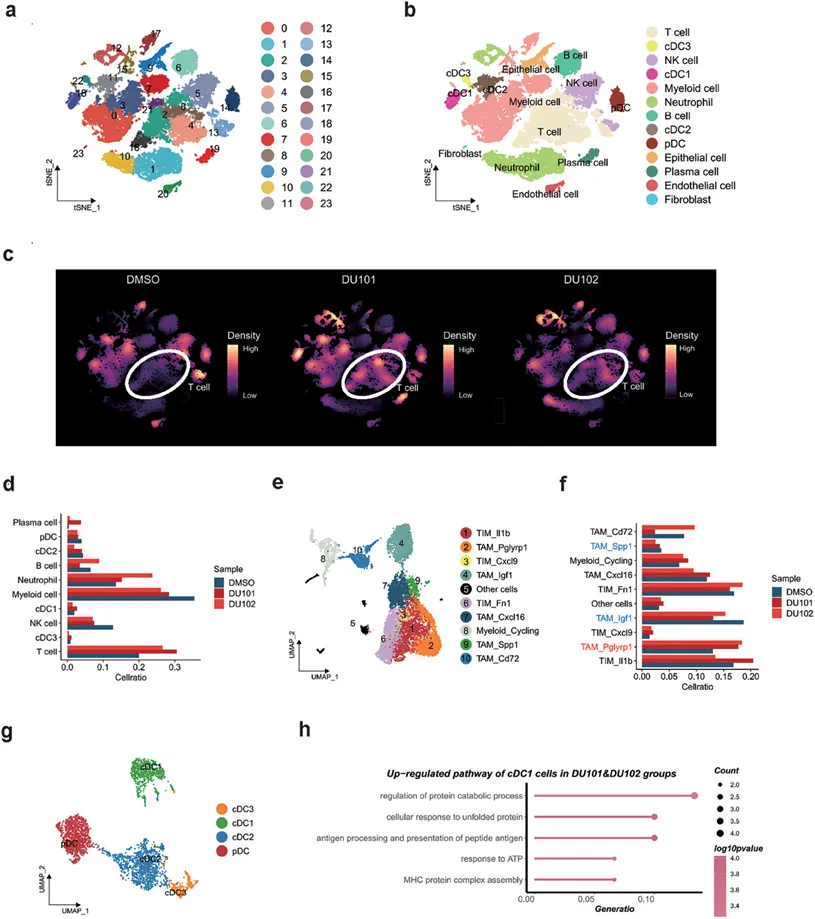
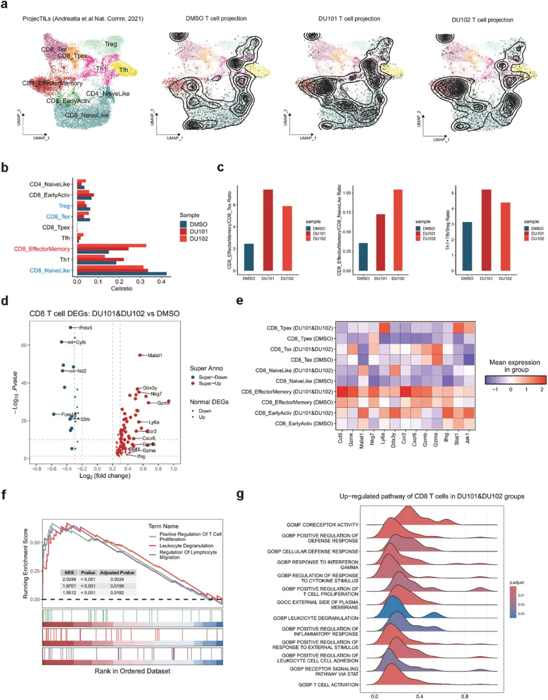
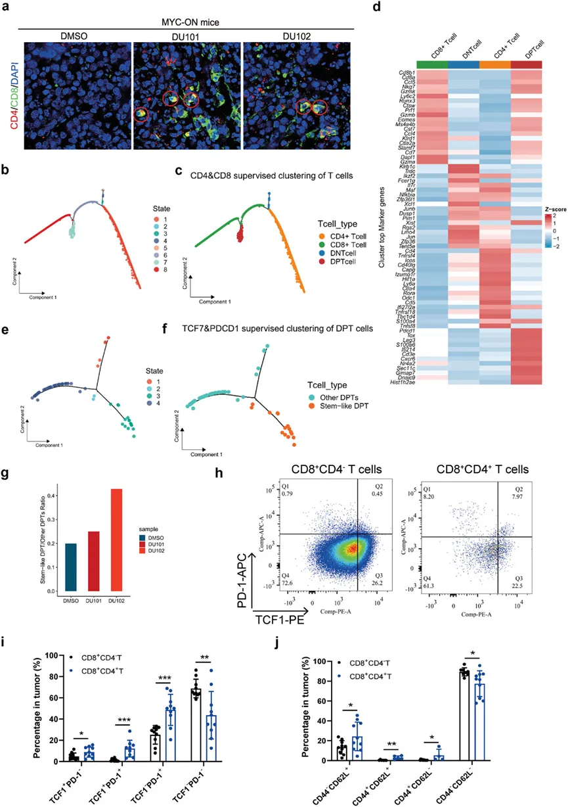
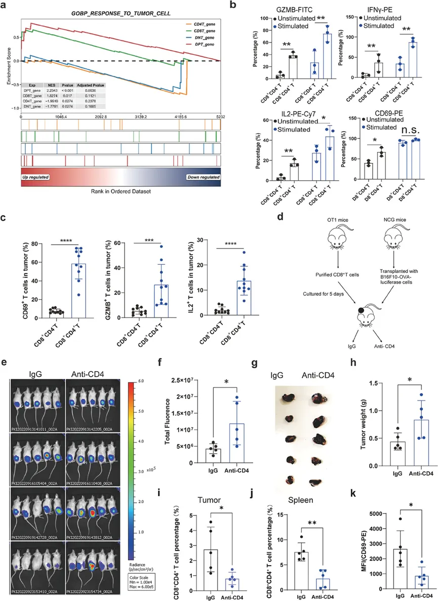
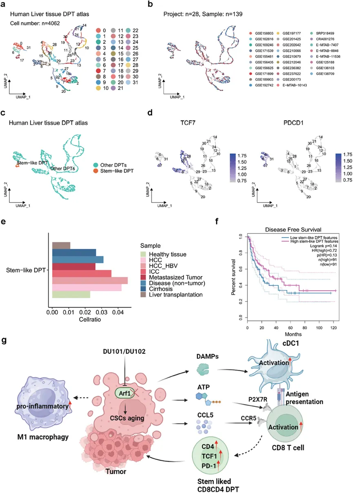

# 《Advanced Science》新型Arf1抑制剂促进癌症干细胞衰老并增强抗肿瘤免疫

> 原文：https://mp.weixin.qq.com/s?__biz=MzAwMzIzOTk5OQ==&mid=2247522233&idx=1&sn=287a380de741ff55f0ce78dc9c727985&chksm=9b3ceee9ac4b67ffd925abafeba2cb215a5984e6dc85f0d8607340a07ec9208f1d19eae0e04b#rd
> 合集：单细胞教程全收录 / 文献速递

**写在前面**

这又是一篇在Acknowledgement对我们进行**致谢** 的文章：



**内容简介**

小G蛋白Arf1已被发现在维持癌症干细胞（CSCs）方面发挥着重要作用，这使得它成为癌症治疗的一个极具吸引力的靶点。复旦大学生命科学学院及代谢与整合生物学研究院的侯宪玉教授及其研究团队，最近介绍了两种新型的强效Arf1小分子抑制剂——DU101和DU102，它们在癌症治疗领域展现出巨大的潜力。临床前肿瘤模型的研究结果表明，这些抑制剂能够触发CSCs的衰老，并在小鼠癌症模型及患者源肿瘤异种移植（PDX）模型中增强抗肿瘤免疫反应。通过单细胞测序技术，研究团队深入分析了这些新型Arf1抑制剂如何重塑肿瘤免疫微环境，并发现肿瘤相关的CD8+CD4+双阳性T细胞（DPT细胞）数量有所增加。这些DPT细胞不仅表现出活性CD8单阳性T细胞的优异特性，而且具有较高比例的TCF1+PD-1+细胞，这是干细胞样T细胞的一个显著特征。更重要的是，肿瘤中浸润的干细胞样DPT细胞的频率与癌症患者更好的无病生存期（DFS）密切相关。这一发现表明，这些Arf1抑制剂通过将冷肿瘤的免疫微环境转变为热免疫微环境，为癌症免疫治疗提供了一种全新的策略，有望显著提升癌症患者对免疫疗法的响应潜力。

期刊：Advanced Science

IF：16.806

文章来源：

https://onlinelibrary.wiley.com/doi/10.1002/advs.202404442

这里也预祝我们的粉丝们早日命中心仪的期刊，若是大家觉得我平时分享的代码或生信教程**有那么点** 好用，可以在文章里以这种格式致谢Biomamba，希望咱们这个系列也能**更新个百八十篇** :

  *

```
Since Biomamba and his wechat public account team produce bioinformatics tutorials elaborately and share code with annotation, we thank Biomamba for their guidance in bioinformatics and data analysis for the current study.
```

如果需要数据分析**指导** 、生信热点**全文复现** 、自测数据**个性化分析** 辅导，欢迎联系客服微信[**Biomamba_kefu**]

**一、摘要**

小G蛋白Arf1被确认在支持癌症干细胞（CSCs）方面发挥选择性作用，使其成为癌症治疗的一个有吸引力的靶点。然而，目前的Arf1抑制剂由于高毒性和低特异性而限制了其转化潜力。最近的研究中，复旦大学的研究团队介绍了两种新型强效Arf1小分子抑制剂DU101和DU102，用于癌症治疗。这些抑制剂在临床前肿瘤模型中显示出能够触发癌症干细胞的衰老级联反应，并增强小鼠肿瘤和患者衍生肿瘤（PDX）模型中的抗肿瘤免疫。通过单细胞测序分析，这些新型Arf1抑制剂还诱导了肿瘤免疫微环境的重塑，并发现肿瘤相关的CD8+ CD4+双阳性T细胞（DPT细胞）增加。这些DPT细胞表现出活化的CD8单阳性T细胞特征，并且TCF1+PD-1+的比例较高，显示出干细胞样T细胞的特征。研究还表明，肿瘤浸润的干细胞样DPT细胞频率与癌症患者的无病生存期（DFS）呈正相关，表明这些抑制剂可能通过将冷肿瘤免疫微环境转变为热肿瘤免疫微环境，从而提供一种新的癌症免疫治疗策略，扩大癌症患者的免疫治疗潜力。

**二、前言**

小G蛋白Arf1是ADP-核糖基化因子（Arf）小G蛋白家族的成员，位于多种细胞器的结合部位。其功能包括协调细胞器间的通讯、脂肪酸代谢以及维持线粒体稳态。研究发现，Arf1在多种人类癌症中表达量较高，包括但不限于乳腺癌、肝细胞癌、结肠癌和前列腺癌。并且，Arf1表达水平的升高与被诊断患有癌症的个体的预后呈负相关。作者的最新研究揭示了Arf1调控的脂质代谢在有选择性地维持癌症干细胞和神经元的稳态中发挥着至关重要的作用。在果蝇中，敲除肠道和马氏管（相当于肾脏）分化细胞中的Arf1并不会引发明显的表型变化。然而，如果在干细胞中敲除Arf1，则会触发细胞器老化的一系列连锁反应，表现为衰老的标志，包括脂质滴积累、线粒体损伤、活性氧产生、内质网应激和溶酶体蛋白聚集。在果蝇体内，异常的干细胞通过传递危险信号激活邻近的肠上皮细胞，导致受损的干细胞通过杀伤、吞噬和清除过程被消灭。在小鼠体内，敲除特定细胞中的Arf1会引发类似的细胞器老化连锁反应。这些异常的癌症干细胞随后会发送危险信号，激活肿瘤免疫微环境中的抗原呈递树突状细胞。与当前的治疗方法不同，Arf1靶向疗法通过促进癌症干细胞的老化和增强免疫细胞的抗肿瘤活性，提供了一种双重抗癌机制。尽管如此，作者仍需要进一步的研究来深入了解Arf1靶向疗法如何调控抗肿瘤免疫反应。现有的 Arf1 抑制剂，如 Golgicide A（GCA）、Brefeldin A（BFA）和 Exo2，因其高毒性和低特异性，极大限制了它们的转化潜力和相关研究。在模式生物中，基因筛选已被广泛用于研究基因的生物学功能。截至目前，利用此类筛选来识别与肿瘤免疫相关的靶基因的研究仍然有限。作者之前的研究表明，在果蝇的马尔皮基管（MT，果蝇的肾脏）中，通过敲低COPI/Arf1-脂解通路，可以选择性地消灭 RasV12 转化的干细胞肿瘤，这一过程保留了分化细胞。值得注意的是，向果蝇施用现有的Arf1 抑制剂能够精准消灭肿瘤干细胞，而不损害正常干细胞。在果蝇干细胞肿瘤系统中，通过对超过100种化学物质的筛选，研究人员发现了两种新的强效小分子Arf1抑制剂，命名为DU101和DU102，用于癌症治疗。这些新设计的Arf1抑制剂在多种小鼠肿瘤模型中，包括肝脏、结肠、乳腺和黑色素瘤，以及PDX肿瘤模型中，展现出了低毒性和强大的抗肿瘤活性。治疗过程中，这些抑制剂显著增强了T细胞对肿瘤的浸润，并激活了CD8+ T细胞，同时诱导了肿瘤相关的PD-1+ TCF1+ CD8+ CD4+干性双阳性T（DPT）细胞的形成。因此，这些新型Arf1抑制剂为癌症免疫治疗提供了一种充满希望的策略，并且目前正在进行针对晚期实体瘤患者的临床试验评估。

**三、结果**

**新型 Arf1 抑制剂的发现**

利用果蝇干细胞肿瘤系统，作者筛选并发现了两种新型强效小分子Arf1抑制剂，分别为DU101和DU102（图1a–d；图S1a–c，详细信息见STAR方法），它们能够特异性和有效地杀死癌症干细胞。作者首先验证了DU101和DU102对Arf1的生化和生物物理效应。研究表明，高尔基体相关的Arf-GEF（GBF1）的Sec7结构域 与GDP结合的Arf1相互作用，以调节Arf1的GDP-GTP交换，从而激活Arf1。作者进行了高精度的分子对接分析，发现DU101和DU102均与Arf1-GDP-Sec7复合体的催化口袋结合，结合距离为2.40 Å（图1b,d）。接着，作者通过等温滴定量热法直接检测了DU101或DU102与GBF1的Sec7结构域的结合效率，发现这两种抑制剂均能有效结合纯化的Arf1-GDP-Sec7结构域（图S2a,b，详细信息见Supporting Information）。药物亲和力响应靶标稳定性（DARTS）用于追踪和识别靶标蛋白，基于靶标蛋白与小分子结合时稳定性变化的原理。通过DARTS，作者显示DU101和DU102能够显著增强Arf1的稳定性，并且这种增强效果是剂量依赖的。如图S2c,d所示（Supporting Information），只有在与蛋白酶共同处理的细胞中，DU101或DU102处理组的Arf1蛋白水平有所增加，表明这些抑制剂对Arf1稳定性具有特定的保护作用。而作者测试的其他ARF同源物，包括Arf3、Arf5、Arf6和泛Ras，在与DU101或DU102处理组相比，蛋白水平在蛋白酶处理的细胞中没有明显差异（图S2c,d，Supporting Information）。对于Arf1活性检测，GST-GGA3-PBD融合蛋白能够选择性结合激活形式的GTP结合Arf1，通过沉淀GST-hGGA3-Arf1可以检测细胞中的Arf1活性。作者发现DU101或DU102处理显著抑制了Arf1的活性（图1e,f）。这些结果表明，作者的新型Arf1抑制剂可以通过与Arf1和Arf-GEF结合来抑制Arf1的活性。为了评估DU101和DU102的细胞毒性，研究人员检测了果蝇正常干细胞以及CT26、4T1、B16-F10和LLC细胞在DMSO和DU101或DU102处理后的细胞活性，发现这两种新型Arf1抑制剂展现了较低的细胞毒性。此外，为了评估体内毒性，研究人员还比较了接受DU102治疗和未治疗小鼠不同器官的组织学变化，通过苏木精-伊红（HE）染色，未发现明显的组织学改变。综合这些结果，表明DU101和DU102不仅毒性低，而且可能是有效的Arf1抑制剂。研究还发现，Arf1抑制剂能够诱导抗肿瘤M1型巨噬细胞的浸润、激活树突状细胞（DCs），并减少促肿瘤M2型巨噬细胞的浸润，从而促进了促炎性肿瘤微环境（TME）的重塑，支持了抗肿瘤免疫。这些发现表明，DU101和DU102作为一种新的癌症免疫治疗策略，具有很大的潜力，目前这些抑制剂正在进行临床前研究，并计划在晚期实体瘤患者中进行临床试验评估。



图1.DU101和DU102是新型强效的Arf1抑制剂。DU101的化学结构和其与Arf1-GEF的Sec7结构域的对接情况已被详细描述。研究表明，DU101和DU102显著降低了GBF1依赖的Arf1活性。在Huh7细胞中，使用DMSO、BFA、DU101或DU102处理后，通过GGA3拉下和西方印迹实验评估了Arf1的活性。结果显示，DU101和DU102的处理显著抑制了Arf1的活性，数据以均值±标准误表示，统计分析采用学生t检验，结果显示***p < 0.001；n.s.，无显著性。

**新型 Arf1抑制剂诱导肿瘤退缩并延长了多种小鼠和PDX肿瘤模型的生存期。**为了探究DU101和DU102对肿瘤的治疗作用，研究人员在C57小鼠中生成了小鼠肝癌细胞Hepa1-6的异种移植瘤，并分别用DMSO、DU101或DU102对小鼠进行治疗。结果观察到，与使用DMSO治疗的小鼠相比，使用DU101和DU102治疗的小鼠在2周内，以5 mg/kg的剂量通过口服给药，肿瘤的大小和体积显著减小（图2a–c），但体重没有减少（图2d）。这些发现表明，DU101和DU102在抑制肿瘤生长方面具有显著效果，并且对小鼠的体重没有负面影响，显示出良好的治疗潜力和安全性。为了进一步探究DU101和DU102的抗肿瘤效果，研究人员在先前使用的Axin2-CreER驱动的MYC-ON小鼠肝癌模型中进行了实验。在小鼠6周龄时，通过正常饮食诱导肿瘤形成，随后分别用DMSO、DU101或DU102进行治疗，剂量为每公斤体重5毫克，通过口服灌胃的方式持续治疗6周（图2e）。研究发现，与DMSO处理的小鼠相比，DU101和DU102治疗显著减小了肝脏肿瘤（图2f–h），并且延长了MYC-ON小鼠的寿命（图2i）。这些结果表明，这两种新型Arf1抑制剂DU101和DU102具有较低的毒性，并且可能成为有效的Arf1抑制剂，为癌症治疗提供了新的策略和希望。为了检验这些抑制剂的广泛应用潜力，研究人员还对小鼠结肠癌细胞CT-26异种移植瘤、小鼠乳腺癌4T1细胞、小鼠黑色素瘤B16-F10细胞进行了处理，这些细胞中分别含有98.3%、40.1%和76.6%的CD133+CD44hi细胞（潜在的癌症干细胞标记）。研究发现，使用DU101或DU102处理的肿瘤显著缩小，但与使用DMSO处理的小鼠相比，小鼠的体重没有受到影响，在三种小鼠异种移植瘤模型中均观察到了这一现象（详细信息见支持材料中的图S3a–i）。这些结果表明，这两种新型Arf1抑制剂DU101和DU102具有较低的毒性，并且可能成为有效的Arf1抑制剂。为了探究新型Arf1抑制剂对人类肿瘤的抗肿瘤效果，研究人员在人源化HSC-NCG小鼠中植入了新鲜的人类肝癌样本，进而培育出肝癌患者源性异种移植瘤（PDX）。这些PDX模型保留了原始人类肿瘤的主要特征以及肿瘤免疫微环境。随后，研究人员对这些人类化小鼠使用DMSO或DU102进行了为期一周的治疗，剂量为每公斤体重5毫克，通过口服灌胃的方式给药。与DMSO处理组相比，DU102处理组的肝癌PDX模型显示出显著减小的肿瘤体积（图2k–l；支持信息中的图S4a），并且对小鼠的体重没有影响（支持信息中的图S4b）。这些发现表明，DU101和DU102这两种新型Arf1抑制剂具有较低的毒性，并且可能成为有效的Arf1抑制剂，为癌症治疗提供了新的策略和希望。为了测试DU102治疗是否能够产生免疫记忆，研究人员在经过DU102治疗的小鼠中进行了第二次肿瘤挑战，实验方案如图2m所示。研究结果显示，DU102治疗在第一次肿瘤挑战后能有效抑制肿瘤生长（图2n–o）。在切除肿瘤后，进行了第二次肿瘤挑战。接受DU102治疗的小鼠肿瘤发生率较低（5只中只有1只，与DMSO治疗组的5只中有4只相比，图2p）。因此，DU102治疗支持免疫记忆的形成。为了证明DU101和DU102的特异性，研究人员还用Arf1缺失的CT26细胞、对照CT26细胞、Arf4缺失的CT26细胞、Arf5缺失的CT26细胞和Arf6缺失的CT26细胞处理了BALB/c小鼠的异种移植瘤（详细信息见支持材料中的图S4c–e、图S4f,j、图S4g,h,l、图S4g,i,m、图S4g,j,n）。DU101或DU102治疗对Arf1缺失的CT26细胞携带的肿瘤小鼠的肿瘤和体重没有进一步影响，这表明DU101和DU102是特异性的Arf1抑制剂。而在其他组中，DU102治疗仍然能有效抑制肿瘤生长。总体而言，上述结果表明，新型特异性Arf1抑制剂DU101和DU102能在多种小鼠和肝脏PDX模型中显著缩小肿瘤，并最小化毒性效应，因此这些抑制剂可能具有很大的转化潜力。



图2.DU101和DU102在小鼠和PDX肝癌模型中诱导肿瘤退缩并延长了寿命。（a) 展示了移植了Hepa1-6细胞的C57BL/6J小鼠的肿瘤大小图片，以及用指定试剂处理后的效果。（b–d) 柱状图显示了肿瘤重量（b）、肿瘤体积曲线（c）和（a) 中描述的小鼠体重的柱状图。每组有6只小鼠。（e) MYC-ON小鼠的实验设置。（f–i) 展示了用DMSO、DU101或DU102处理的MYC-OFF或MYC-ON小鼠的肝脏图片（f）、肝脏表面肿瘤计数（g）、肝脏重量（h）和指定处理的MYC-ON小鼠的生存曲线（i）每组有10只小鼠。（j) 用于生成人源化免疫和肝癌PDX小鼠的实验设置（k–l) 展示了用指定试剂处理的人源化免疫和肝癌PDX小鼠的代表性肿瘤图片（k）和肿瘤重量（l）每组有5只小鼠。（m) 第二次肿瘤挑战实验的设置。n-o) 展示了第一次CT26肿瘤细胞挑战后用指定试剂处理的小鼠的代表性肿瘤生长曲线（n）和肿瘤重量（o）每组有5只小鼠。（p) 展示了第二次CT26肿瘤细胞挑战后每只小鼠的肿瘤生长曲线。每组有5只小鼠。数据表示为均值 ± 标准误差。使用学生t检验，D-Kaplan‒Meier和log-rank检验（i）*p < 0.05, **p < 0.01, ****p < 0.0001; n.s., 无显著性差异。

**新的 Arf1抑制剂诱导肿瘤细胞老化级联反应**作者之前报道过，在果蝇干细胞和小鼠癌症干细胞中遗传敲除Arf1会导致细胞老化级联反应，包括脂滴积累、活性氧产生、线粒体损伤、内质网应激和溶酶体蛋白聚集。然后作者将Arf1抑制剂的效果与遗传敲除进行了比较，发现用DU101和DU102处理CT26细胞显著降低了线粒体膜电位，增加了活性氧产生（通过提高Mitosox水平检测），诱导溶酶体蛋白LAMP1的表达，以及增加了蛋白聚集（通过增加Proteostat染料染色显示），与用DMSO处理的CT26细胞相比。由Arf1敲除触发的细胞器老化级联与众所周知的细胞衰老有一些相似之处。衰老相关的β-半乳糖苷酶（SA-β-gal）是衰老细胞的分子标记。作者对SA-β-gal进行了染色，发现与用DMSO处理的细胞相比，用Arf1抑制剂处理的细胞没有变化。这些数据表明，与遗传敲除Arf1的先前报道效果一致，新的Arf1抑制剂DU101和DU102也促进了细胞老化级联，这可能与通常所知的细胞衰老不同。**新型 Arf1抑制剂促进T细胞浸润、激活和记忆T细胞群的形成**在之前的研究中，作者发现通过Lgr5-CreER和Axin2-CreER在小鼠癌症干细胞中敲除Arf1通路，激活了一种系统性的抗肿瘤免疫反应来摧毁肿瘤。为了证明DU101和DU102的抗肿瘤活性特别依赖于免疫反应，作者首先用CT26细胞的异体移植瘤处理裸鼠，发现DU101或DU102处理并不影响肿瘤重量。进一步的流式细胞仪分析显示，在用DU101或DU102处理后的MYC-ON小鼠的肝脏肿瘤中，CD3+ T细胞显著增加，同样在Arf1敲除后也是如此。在用DU101或DU102处理的Hepa1-6异体移植瘤中，CD3+ T细胞也显著升高。这些数据表明，DU101和DU102的处理促进了T细胞渗入肿瘤。作者还报告说，在肿瘤细胞中通过Lgr5-CreER和Axin2-CreER降低Arf1通路的活性，可以导致系统性的抗肿瘤免疫反应，从而破坏肿瘤。为了证明DU101和DU102的抗肿瘤活性特别依赖于免疫反应，作者首先用CT26细胞的异体移植瘤处理裸鼠，发现DU101或DU102处理并不影响肿瘤重量。进一步的流式细胞仪分析显示，在用DU101或DU102处理后的MYC-ON小鼠的肝脏肿瘤中，CD3+ T细胞显著增加，同样在Arf1敲除后也是如此。在用DU101或DU102处理的Hepa1-6异体移植瘤中，CD3+ T细胞也显著升高。这些数据表明，DU101和DU102的处理促进了T细胞渗入肿瘤。**新型 Arf1抑制剂激发了肿瘤微环境的炎症反应**接下来，作者系统地分析了DU101和DU102处理对肿瘤浸润免疫细胞以及细胞间相互作用的影响，使用了单细胞转录组分析。为此，作者对经DU101处理、DU102处理和DMSO处理的小鼠MYC-ON肝脏肿瘤中分选的CD45+免疫细胞和CD45−非免疫细胞进行了单细胞RNA测序（scRNA-seq）。作者在每组中以10:1的比例混合分选的CD45+免疫细胞和CD45−非免疫细胞进行scRNA-seq，并在质量控制和去除双细胞后，总共获得了35,468个细胞。为了找出肿瘤微环境（TME）的主要组成部分，作者整合了不同处理组的样本，进行了无监督聚类，并得到了24个细胞簇。然后作者使用经典和众所周知的标记对这些细胞进行注释，并将其定义为13种细胞类型。比较不同处理组之间的细胞比例，作者发现与DMSO处理相比，经DU101或DU102处理后T细胞的比例显著增加，而髓系细胞的比例减少。这些结果表明，Arf1抑制剂增强了杀伤肿瘤的T细胞。



图3.新型Arf1抑制剂激发肿瘤微环境中的炎症反应。a) 肿瘤微环境中免疫细胞和非免疫细胞的UMAP（均匀流形近似和投影）。b) 肿瘤微环境中免疫细胞和非免疫细胞的注释。c) 每种处理组中免疫细胞和非免疫细胞的细胞密度投影。d) 柱状图显示每种处理组中不同类型免疫细胞的比例。e) 基于选定的细胞标记物对肿瘤微环境中的髓系细胞进行注释。f) 柱状图显示每种处理组中不同亚型的髓系细胞的比例。g) 基于选定的细胞标记物对肿瘤微环境中的树突细胞进行注释。h) 对DU101和DU102处理组中cDC1s的上调基因进行GO（基因本体）分析。

作者进一步检查了髓系细胞，它们是除了T细胞之外占最大比例的免疫细胞。作者获得了髓系细胞并进行了无监督聚类，得到了23个细胞簇。然后作者基于它们的特征基因对髓系细胞进行了注释，并得到了10个亚型。作者观察到，在DU101和DU102处理后，表达Pglyrp1的TAMs（肿瘤相关巨噬细胞）数量增加，而表达Spp1和Igf1的TAMs数量减少。增加的表达Pglyrp1的TAMs表现出促炎特征，并在T细胞招募和激活方面表现出强大的能力，因为它们高度表达T细胞趋化因子Cxcl9和Cxcl10，以及I型IFN途径基因Isg15和Ifit2。相比之下，减少的TAM_Spp1和TAM_Igf1群体表现出免疫抑制特征，因为它们高度表达与血管生成和免疫调节因子相关的基因，如Arg1和Spp1。为了进一步评估髓系细胞的功能，作者收集了先前报道的巨噬细胞M1和M2极化基因列表[25]，并从GSEA数据库下载了IFN产生和响应基因列表。作者发现，在DU101和DU102处理后，M1极化基因、I型和II型IFN产生和响应途径的表达上调，而M2极化基因在DU101和DU102处理后下调。最后，作者对DU101和DU102处理后的髓系细胞的DEGs进行了GO分析，发现与防御反应、细胞因子信号通路和IFNβ途径相关的途径被富集。树突状细胞（DCs）在抗原呈递和先天免疫反应中发挥着至关重要的作用。作者进行了无监督聚类分析，并注释了19个细胞簇为cDC1、cDC2、cDC3和pDC。由于cDC1是主要向CD8 T细胞呈递抗原的细胞类型，作者对DU101和DU102处理后cDC1的上调差异表达基因（DEGs）进行了GO分析，并观察到抗原呈递途径的富集，表明cDC1向CD8 T细胞的抗原呈递能力得到了增强。此外，作者选择了与DC激活、抗原呈递和IFN信号通路相关的几个基因，并观察到它们在不同亚型的DCs中的上调。这些结果表明，在DU101和DU102处理后，髓系细胞极化为M1促炎类型，DCs被激活并增强了抗原呈递能力，Arf1抑制剂将髓系细胞亚群编程为具有炎症性肿瘤微环境（TME）特征的促炎表型。上述数据共同表明，Arf1抑制剂诱导了抗肿瘤M1型巨噬细胞的浸润、激活了树突状细胞（DC），并减少了促进肿瘤的M2型巨噬细胞的浸润。因此，Arf1抑制剂促进了肿瘤微环境（TME）的促炎性重构，以支持抗肿瘤免疫。**新型 Arf1抑制剂重新编程了具有更强抗肿瘤活性的T细胞**为了进一步研究新型Arf1抑制剂处理后T细胞的变化，作者获得了注释的T细胞，并使用ProjecTILs将它们投影到参考小鼠T细胞图谱上。作者发现，具有效应和记忆特征的CD8 T细胞比例（CD8_EffectorMemory）增加了，而具有耗竭相关特征的CD8 T细胞（CD8_Tex）和Tregs在DU101或DU102处理后减少了。CD8_EffectorMemory T细胞与CD8_Tex细胞的比例、CD8_EffectorMemory T细胞与CD8_NaiveLike细胞的比例，以及Th1细胞和Tfh细胞总和与Tregs的比例也明显增加，这表明T细胞除了整体浸润增加外，激活程度更高，具有更好的杀伤肿瘤能力。接下来，作者分析了CD8 T细胞中的差异表达基因，并发现细胞毒性相关基因如Gzma、Gzmb、Gzmk和Nkg7、T细胞激活相关基因Stat1和Ifng，以及T细胞趋化相关基因Cxcr6的表达显著增加。作者发现，细胞毒性相关基因和T细胞激活相关基因在CD8_EarlyActiv和CD8_EffectorMemory T细胞中最上调。在对DU101和DU102处理组的上调DEGs进行GSEA通路富集分析后，作者发现T细胞增殖、白细胞细胞毒性、淋巴细胞迁移、对IFNγ的反应、JAK-STAT通路激活等方面有显著富集。因此，DU101和DU102处理将CD8+ T细胞重新编程为更具激活性的T细胞，具有提高的效应功能、减少的耗竭、增加的增殖和更强的细胞毒性活动。



图4.新型Arf1抑制剂的处理诱导了T细胞的激活，并阻断了T细胞的耗竭。a)通过ProjecTILs将T细胞投影到参考T细胞图谱上。从左到右：参考T细胞图谱中T细胞亚群的标准注释，DMSO处理组的T细胞投影，DU101处理组的T细胞投影，以及DU102处理组的T细胞投影。轮廓线显示了投影T细胞的细胞密度。b) 柱状图显示了每种处理组中不同亚型T细胞的比例。c) 不同处理组中不同亚型T细胞比例的比率。左图：CD8_T_EffectorMemory细胞与CD8_Tex细胞的比例。中间：CD8_T_EffectorMemory细胞与CD8_NaiveLike细胞的比例。右图：Th1和Tfh细胞与Treg细胞的比例。d) 火山图显示了DU101和DU102处理组中CD8 T细胞的上调和下调基因。超级注释的阈值：|avg_log2FC| > 0.3 和 -Log10. p值 ≥ 5。正常DEGs的阈值：0.2 ≤ |avg_log2FC| ≤0.3 和 p值 < 0.05。e) 热图显示了每种处理组中不同T细胞亚群选定基因的表达。f,g) 对DU101和DU102处理组中CD8 T细胞的上调基因进行GSEA分析。f) DU101和DU102处理组中CD8 T细胞最有代表性的三条上调途径。g) 岭图显示了DU101和DU102处理组中CD8 T细胞的其他13条上调途径。**新型 Arf1抑制剂促进了在肝肿瘤中表达PD-1和TCF1的CD8+ CD4+干细胞样T细胞群体的形成**有趣的是，在作者的单细胞RNA测序分析中，作者注意到在用DU101或DU102处理的组中，一种特殊的CD4和CD8双阳性的T细胞亚群也显著增加了。首先，作者通过FACS分析确认了在DU101和DU102处理或Arf1基因敲除后，MYC-ON肝脏肿瘤中特殊CD4和CD8双阳性细胞（DPT细胞）的显著增加，但在脾脏中没有。对MYC-ON小鼠的肿瘤进行免疫荧光组织染色也验证了在用DU101或DU102处理的小鼠的肿瘤中，DPT细胞的数量显著增加，与用载体处理的小鼠相比。然后作者对CD8+ CD4+ T细胞亚群进行了系统分析。为了获得一个纯净的CD8+ CD4+ T细胞簇，作者仅使用Cd4、Cd8a和Cd8b1重新对所有T细胞进行了受监督的伪时间排序分析。T细胞被聚类为2种CD8单阳性T（SPT）细胞的状态，1种CD4 SPT细胞的状态，1种CD8+ CD4+ T细胞的状态，以及几种CD8 CD4双阴性T（DNT）细胞的状态。根据特征基因比较，DPT细胞与CD8 SPT细胞更为相似。具体来说，DPT细胞高度表达细胞毒性基因（Nkg7、Gzmk、Prf1、Eomes）、T细胞趋化因子受体（Cxcr6）和干细胞样T细胞标记（Tcf7）。值得注意的是，作者发现在用DU101或DU102处理后，干细胞样T细胞（PD-1+ TCF1+）的比例在DPT细胞中显著增加。一致地，在CT26同种异体移植中，DPT细胞中PD-1+ TCF1+干细胞样T细胞的比例高于CD8 SPT细胞。此外，作者发现与CD8 SPT细胞相比，DPT细胞在体内表现出更大的中心记忆T细胞分化潜力。



图5.新型Arf1抑制剂在肝肿瘤中促进了PD-1+TCF1+CD8+ CD4+干细胞样T细胞群体的形成。免疫荧光染色（IF）显示，与用DMSO处理的小鼠相比，经DU101或DU102处理的MYC-ON小鼠肝肿瘤中，CD8+ CD4+ T细胞的数量显著增加。红色代表CD4，绿色代表CD8，DAPI为蓝色。白色虚线圈出了CD8+ CD4+ T细胞。比例尺，50微米。(n = 3只小鼠)。数据表示为平均值 ± 标准误差。学生t检验。*p < 0.05，**p < 0.01，***p < 0.001；n.s.，无显著性差异。a) 根据Cd4、Cd8a和Cd8b1的表达进行T细胞的受监督聚类。b)根据Cd4、Cd8a和Cd8b1的表达对T细胞状态进行注释。c)热图显示CD8 SPT、CD4 SPT、DPT和DNT细胞的顶级特征基因。d) 根据Tcf7和Pdcd1的表达对DPT细胞进行受监督聚类。e) 根据Tcf7和Pdcd1的表达对DPT细胞状态进行注释。f) 每种处理组中干细胞样DPT细胞与其他DPT细胞的比例。g) 流式细胞术分析肿瘤浸润的CD8+ CD4− T细胞和CD8+ CD4+ T细胞中PD-1+ TCF1+干细胞样T细胞。h)分析肿瘤浸润的CD8+ CD4− T细胞和CD8+ CD4+ T细胞中PD-1+ TCF1+干细胞样T细胞。i) 分析肿瘤浸润的CD8+ CD4− T细胞和CD8+ CD4+ T细胞中CD62L+ CD44+中央记忆T细胞

总之，作者发现新型Arf1抑制剂DU101和DU102的处理丰富了CD8CD4 DPT细胞群体。DPT细胞在表达干细胞样T细胞标记TCF1和T细胞耗竭标记PD-1方面有更高的阳性百分比（PD-1+ TCF1+ CD8+ CD4+），并且也有记忆T细胞标记（包括Sell/CD62L、CCR7、CD27、CD28和IL7R）以及活化T细胞标记（包括CD44、CD69、EOMES和GZMB）的协同表达。PD-1+TCF1+CD8+ CD4+ T细胞，据作者所知，首次在这里报道，可能包含一种新型的超级抗肿瘤T细胞。**CD8+CD4+ T****细胞表现出比 CD8+CD4− T细胞更高的活性和更强的细胞毒性功能**作者进一步对这四种（CD8 SPT、CD4 SPT、DPT和DNT）T细胞类型的特征基因进行了GSEA分析，发现DPT细胞在对肿瘤细胞的反应、MHC蛋白结合、αβ T细胞激活和T细胞选择方面具有优越的特征，这表明DPT细胞更加活化，可能具有更强的抗肿瘤能力。为了验证DPT细胞的活性，作者比较了DPT细胞与CD8 SPT细胞在体外有或没有抗TCR刺激下的活化标记表达水平和细胞因子表达水平。DPT细胞显示出比SPT细胞更高的CD69、GZMB和IL-2的表达，无论是在体外还是在CT26同种异体移植瘤中。尽管在体外抗TCR刺激下，DPT细胞与CD8 SPT细胞的CD69百分比没有差异，但在抗TCR激活后，DPT细胞的平均荧光强度更高。这些数据共同表明，DPT细胞是比CD8 SPT细胞更活跃的、具有更强细胞毒性的T细胞。



图6.CD8+CD4+ T细胞表现出比CD8+ CD4− T细胞更高的活性和更强的细胞毒性功能。a) 对CD8 SPT、CD4 SPT、DPT和DNT细胞的顶级特征基因进行GSEA分析。b) 在用抗CD3和抗CD28抗体刺激24小时后，定量检测CD8+ CD4−或CD8+ CD4+ T细胞中的CD69、GZMB、IFNγ和IL-2。(n = 3)。c) 在CT26同种异体移植瘤中，定量检测CD8+ CD4−或CD8+ CD4+ T细胞中CD69+ T细胞、GZMB+ T细胞和IL-2+ T细胞的百分比。(n = 10)。d) 过继T细胞实验和抗CD4处理的设置。e) B16-F10同种异体移植瘤两组治疗组中标记有荧光素酶的肿瘤荧光的代表性图像。(n = 5)。f) 第10天总肿瘤荧光的定量。g) 经IgG或抗CD4处理后B16-F10-OVA-荧光素酶同种异体移植瘤的肿瘤图像。(n = 5)。h) IgG或抗CD4处理的B16-F10-OVA-荧光素酶同种异体移植瘤的肿瘤重量。(n = 5)。i) 肿瘤中CD8+ CD4+ T细胞百分比的定量。(j) 脾脏中CD8+ CD4+ T细胞百分比的定量。k) 肿瘤中CD69+ T细胞平均荧光的定量。数据表示为平均值 ± 标准误差。学生t检验。*p < 0.05，**p < 0.01，***p < 0.001，****p < 0.0001；n.s.，无显著性差异。

为了探究DPT细胞在体内T细胞介导的抗肿瘤免疫中的作用，作者将从OT1小鼠纯化的CD8+ T细胞移植到带有B16F10-OVA肿瘤的免疫缺陷小鼠中，然后通过抗CD4处理消除DPT细胞。作者发现，抗CD4处理显著降低了T细胞的杀伤肿瘤功能，与用IgG处理的小鼠相比，用抗CD4处理的小鼠肿瘤消退速度较慢。抗CD4处理的小鼠的肿瘤大小和重量也更大。相应地，与IgG处理相比，抗CD4处理的小鼠的脾脏和肿瘤中DPT细胞的百分比都降低了。此外，通过CD69表达水平评估的肿瘤浸润T细胞的活化水平，在用抗CD4处理的小鼠中比用IgG处理的小鼠降低了。**干细胞样的 DPT细胞存在于人类肝脏肿瘤中，并与更好的无病生存期（DFS）相关**接下来，作者试图揭示这种DPT细胞是否也存在于肝癌患者的样本中。作者利用了深度整合的人类单细胞组学数据（DISCO），这是一个公开的人类单细胞RNA测序数据集。作者从DISCO下载了肝脏组织单细胞RNA测序数据，筛选了低质量的细胞，去除了双细胞，并基于CD3、CD4和CD8的阳性表达隔离了潜在的DPT细胞。然后作者构建了第一个人类肝脏组织DPT细胞图谱，包含来自28个项目和139个样本的4062个高质量DPT细胞。基于CD4、CD8A、CD8B、TCF7、PDCD1的表达进行了受监督的聚类，并将所有DPT细胞分为32个簇。簇17中的DPT细胞表达了TCF7和PDCD1，被鉴定为干细胞样DPT细胞。作者对样本进行了聚类，并将它们分为八组，发现干细胞样DPT细胞在肿瘤样本中的浸润率高于正常组织，这可能是肿瘤抗原刺激的结果。作者使用了干细胞样DPT细胞的前十个特征基因的表达，连同CD3D、CD3E、CD3G、CD4、CD8A和CD8B作为基因签名，分析了它与人类肝脏肿瘤中肝细胞癌（LIHC）患者的预后的关联。作者发现表达干细胞样DPT基因签名更高的患者倾向于拥有更好的无病生存期（DFS），这表明人类肝脏肿瘤中的干细胞样DPT细胞也可能介导抗肿瘤免疫反应。



图7.构建人类肝脏组织DPT细胞图谱a) 基于CD4、CD8A、CD8B、TCF7和PDCD1的表达水平对人类肝脏DPT图谱进行受监督的聚类。b) 参与人类肝脏DPT图谱的项目。c) 基于TCF7和PDCD1的表达对DPT亚型进行注释，如图d所示。d) 特征图显示了人类肝脏DPT图谱中TCF7和PDCD1的基因表达。e) 条形图显示了每种类型患者样本中干细胞样DPT的比例。f) Kaplan–Meier曲线图显示了干细胞样DPT细胞特征基因表达与肝细胞癌（LIHC）患者无病生存（DFS）预后之间的关联。g) 模型显示了靶向肿瘤细胞中的Arf1以诱导系统性抗肿瘤免疫。

**四、讨论**

**潜在的新型双重抗癌疗法**

在这项研究中，作者在果蝇干细胞肿瘤系统中进行了一项强有力的遗传筛选，测试了来自Exo2的100多种改良化学物质。这项努力导致了DU101和DU102的发现，它们是两种针对癌症治疗的强效小分子Arf1抑制剂。在小鼠癌症模型和临床前PDX肿瘤模型中，DU102的治疗显著增强了抗肿瘤免疫力。作者证明了DU102诱导癌症干细胞老化，并触发释放多种重塑肿瘤免疫微环境的因素。因此，它导致抗肿瘤M1型巨噬细胞的浸润、激活的树突状细胞（DC）具有增强的抗原呈递能力，以及CD8效应T细胞的增加。此外，DU102减少了促进肿瘤的M2型巨噬细胞和耗竭的CD8 T细胞的浸润。而且，DU102增强了T细胞的细胞毒性，并促进了T细胞向CD8CD4双阳性T（DPT）细胞的转化。**DU101****和 DU102的作用可能针对具有干细胞特征的肿瘤细胞**癌症干细胞（CSCs）的比例通常在大多数肿瘤中不到1%。目前的问题是，新的Arf1抑制剂如何在少量的CSC细胞中触发强大的系统性抗肿瘤反应。在最近的一项研究中，发现不到15%的肿瘤细胞发生焦亡（pyroptosis）就足以根除整个植入的4T1乳腺肿瘤。然而，目前尚不确定新的Arf1抑制剂是否专门针对癌症干细胞（CSCs）以诱导系统性抗肿瘤免疫，因为关于CSC标记和它们的身份仍在争论中。观察到的DU101和DU102的效果可能源于CSC应激或细胞器老化危机，这可能导致了危险信号或因子的释放。这些可能触发了细胞毒性CD8+ T细胞的激活，导致CSCs的消除，并将免疫抑制性的肿瘤微环境（TME）转变为有利的免疫原性状态。此外，最初死亡的细胞释放的癌症相关抗原（CAAs）可能重新激活了TME中的免疫细胞，启动了新的免疫反应，并随着每一轮后续反应增强了它们的幅度。**新型干细胞样双阳性 T细胞表现出强大的抗肿瘤功能**之前，由于干细胞样T细胞的显著自我更新能力、多向分化能力以及在过继疗法中对抗肿瘤的持久效应功能，人们已经将注意力转向了这类细胞。TCF1+ PD-1+ CD8+干细胞样T细胞已被确定为在治疗动物模型和患有肿瘤的人类受试者中维持对免疫检查点抑制剂（ICBs）和过继细胞转移（ACT）的增强反应。基于有力的证据，很明显，CD8+和CD4+ T细胞都是身体抗肿瘤免疫反应的重要组成部分。DPT细胞被认为可能具有相加效应。然而，最近的研究表明，这些细胞存在于各种人类肿瘤中，特别是在前沿区域，该区域位于人类肝细胞癌（HCC）的恶性-良性边界旁边。人类肝细胞癌（HCC）DPT细胞表现出PD-1的高表达，并展现出激活表型以及强大的功能。生存分析表明，具有更多DPT细胞和PD-1+ DPT细胞的HCC患者经历了显著改善的总体生存率和无复发生存率，这表明DPT细胞是更优越的抗肿瘤T细胞。关于DPT细胞的谱系研究，目前还没有明确的结论。在肿瘤发展的背景下，将CD8+ T细胞引入B16小鼠后，发现DPT细胞的分化和功能存在明显差异，这强调了在外周环境中谱系承诺机制的适应性。对肝癌（HCC）患者样本中肿瘤浸润T细胞的TCR分析表明，DPT细胞可能与CD8 SPT细胞来自相同的谱系，这表明DPT细胞可能从肿瘤内的SPT细胞转化而来。在作者的研究中，作者比较了细胞标记和差异表达基因。作者的发现表明，DPT细胞表现出与CD8 SPT细胞而非CD4 SPT细胞更密切相关的基因表达谱。此外，作者受监督的伪时间细胞轨迹分析揭示了DPT细胞与CCD8 SPT细胞相比CCD4 SPT细胞在表达模式上有更强的相似性。这表明DPT细胞和CD8 SPT细胞之间存在灵活的分化，并为使用小分子化学物质增强DPT细胞提供了潜在策略。鉴于DPT细胞的低百分比，探索促进DPT分化的策略对于潜在的临床应用至关重要。需要进一步分析DPT细胞与CD8 SPT细胞之间分化的调控，并在患者样本的TILs测序和分析中仔细考虑它们的包含。总之，这项研究中新开发的Arf1抑制剂作为癌症免疫治疗的新策略，展现出了巨大的潜力。它们在临床前毒理学研究中显示出强大的药理作用和良好的安全性。目前，DU101和DU102的一个改良衍生物（AOB01）正在进行临床前研究，它既作为单一疗法，也与抗PD-1药物联合治疗实体瘤。据作者所知，这种新型的Arf1抑制剂是首个通过促进癌干细胞衰老和增强抗肿瘤免疫来激活双重抗癌疗法的药物，这可能为针对这一双重过程的其他治疗方法奠定基础。

**五、实验部分**

**实验模型和受试者详细信息 ——小鼠**

在这项研究中，通过将B6.Cg-Tg(Cebpb-Tta)5Bjd/J（JAX:003563）和FVB/N-Tg(tetO-MYC)36aBop/J（JAX:019376）小鼠进行交配，产生了MYC过表达的肝癌小鼠，这两种小鼠均从杰克逊实验室获得。此外，还从中国南京的GemPharmatech购买了NOD/ShiLtJGpt-Prkdcem26Cd52Il2rgem26Cd22Hrem1Cin8936/Gpt小鼠（货号T003257），并使CD34+ HSC-NOD/ShiLtJGpt-Prkdcem26Cd52Il2rgem26Cd22/Gpt小鼠（货号T037620）人源化。另外，OT1小鼠由复旦大学的于晓飞教授慷慨提供。所有实验均使用年龄匹配的雄性和雌性小鼠，所有实验的起始点为6周龄的小鼠。此外，使用12周龄的人源化小鼠进行PDX移植。所有动物都被饲养在特定病原体自由的设施中，所有程序都按照复旦大学动物护理和使用委员会（ACUC）的规定进行。**实验模型和受试者详细信息 ——细胞**小鼠结直肠癌细胞CT26（货号CRL-2638）来源于BALB/c小鼠，小鼠黑色素瘤B16-F10细胞（货号CRL-6475）来源于C57BL/6J小鼠，小鼠IV期乳腺癌4T1细胞（货号CRL-2539）来源于BALB/c小鼠，人胚肾HEK 293T/17细胞（货号CRL-11268），小鼠肝癌Hepa1-6细胞（货号CRL-1830）来源于C57BL/6J小鼠，以及小鼠刘易斯肺癌LLC1细胞（货号CRL-1642）来源于C57BL/6J小鼠，所有细胞均从美国细胞库（ATCC）获得。表达OVA抗原的B16-F10细胞由上海科技大学范高峰博士慷慨提供。CT26细胞和4T1细胞在含有10%胎牛血清（FBS）（HyClone，货号SH30396.03）和100单位/毫升青霉素/链霉素（Gibco，货号15140122）的RPMI 1640（SIGMA，批次号RNBK0103）中培养。B16-F10细胞、HEK 293T/17细胞、Hepa1-6细胞和LLC1细胞在补充有10% FBS和100单位/毫升青霉素/链霉素的DMEM（Sigma，批次号RNBK3466）中培养。所有细胞在含有5% CO2的湿润气氛中，37°C下培养。如前所述，进行小鼠脾脏T细胞的原代培养。8-12周龄的雄性和雌性小鼠通过CO2安乐死，收集脾脏并通过研磨进行解剖。使用EasySepTM小鼠CD8 T细胞分离试剂盒（Stemcell，货号19853）分离CD8+ T细胞。T细胞重新悬浮并在抗CD3和抗CD28单抗涂层板（invivomab）中激活48小时。激活的T细胞用IL-2（10 ng/mL）和2-巯基乙醇维持，并用新鲜的完全培养基培养。**基因组小鼠模型** 在小鼠肝癌模型中，如之前科学文献中记录的PubMed ID：31924786，使用Cebpb-tTA/tet-o-MYC/Axin2-CreER/Arf1f/f小鼠模型来特异性敲除Axin2+肝癌细胞中的Arf1基因，使用的是MYC-ON小鼠中的Axin2-CreER。交配笼和断奶笼中的饲料均含有200 mg/kg的强力霉素（Bio-Serv，货号14-727-450）。通过转变为正常饮食在6周龄的小鼠中启动肿瘤形成。在Cebpb-Tta/tet-o-MYC/Axin2-CreER/Arf1f/f小鼠中，通过每天连续五天腹腔注射10 mg/kg的他莫昔芬（Sigma–Aldrich，货号T5648）来实现从干细胞中切除Arf1基因。小鼠在肿瘤出现后，即10-12周时，进行安乐死。**移植肿瘤模型** 对于在BALB/c或C57BL/6J背景小鼠中移植小鼠肿瘤细胞的实验，将同窝小鼠分成不同的组，并将5 × 10^5个CT26细胞、5 × 10^5个4T1细胞、5 × 10^5个B16-F10细胞或5 × 10^5个Hepa1-6细胞皮下注射到小鼠的左侧或右侧。每天通过胃管给予小鼠DU101或DU102（5 mg/kg或1% DMSO）。每隔2-3天使用数字卡尺（ULINE，货号H-7352）测量一次肿瘤体积，并通过以下公式计算肿瘤体积：1/2 × 纵向直径（长度）× 最大横向直径（宽度）。[2] 当肿瘤体积达到2000 mm^3时，对小鼠实施安乐死。**患者来源异种移植（ PDX）植入**肝肿瘤患者来源的异种移植（PDX）实验严格遵循伦理准则，遵循《赫尔辛基宣言》中列出的原则。所有患者或其法定监护人均已获得知情同意。肝肿瘤样本来自在中国上海复旦大学中山医院接受临床手术的肝癌患者。在手术切除后，肝肿瘤被切割成1 mm³的小块，并浸泡在无菌的1xPBS中。这些微小的肿瘤碎片随后被亚麻醉移植到11周龄的人源化小鼠皮下。这些小鼠被安置在控制的无病原环境中，保持12小时的明暗循环，并每日监测肿瘤生长情况。

**针对杀死果蝇干细胞肿瘤的小分子的表型筛选**

如之前所展示的，通过敲低COPI/Arf1-脂肪分解途径，可以选择性地杀死果蝇马氏管（MT，果蝇的肾脏）中的RasV12转化的干细胞肿瘤，通过坏死作用，但不会伤害分化的细胞。给果蝇喂食现有的Arf1抑制剂可以选择性地杀死肿瘤干细胞，而不会伤害正常干细胞。使用果蝇干细胞肿瘤系统，开发了一种使用荧光共聚焦显微镜的表型检测方法，筛选了能够杀死RasV12诱导的干细胞肿瘤的新化合物。筛选是在96孔板中进行的，该方法修改自之前在成年果蝇中成功进行的筛选程序。简而言之，i) 在成年果蝇中使用正向标记的镶嵌谱系（PMML）标记技术进行克隆诱导（ACI），培养带有RasV12转化的肾脏和肾盂干细胞（RNSCs）的果蝇4天，以促进肿瘤生长；ii) 将果蝇食物煮沸，冷却至37°C，分装到孔板中，每孔100微升；(iii)每孔添加0.5微升药物，并用移液器上下混合五次，最终化合物浓度约为50微摩尔；iv) 食物凝固后，将带有RasV12转化的RNSCs的果蝇添加到孔中（每孔三只雌性果蝇），在29°C下培养3天。孵化后，将果蝇解剖并在解剖显微镜下观察，使用数码相机捕捉肿瘤的白光和GFP荧光图像。使用MetaMorph（Molecular Devices）分析数据，手动设置像素强度阈值，包括GFP标记的肿瘤但不包括背景荧光。每个化合物的数据存储在Microsoft Access数据库中。能够使GFP水平降低50%或更多的药物在三个孔中重新测试，每个孔中有九只果蝇。与DMSO相比，能够使GFP水平降低50%或更多的药物在所有三个重复中被判定为有效。经典的Arf1抑制剂Brefeldin A（BFA）和新小分子4-hydroxy-3-methoxybenzaldehyde (5,6,7,8-tetrahydro[1]benzothieno[2,3-d]pyrimidin-4-yl) hydrazone（Exo2）刺激的生物变化几乎无法区分。Exo2更适合于化学修饰。筛选了一系列现有的和新合成的Exo2类似物，发现DU101和DU102有效并且毒性相对较低（专利号 PCT/CN2021/110373）。

**细胞系的建立**

shRNA寡核苷酸的详细序列列在表S1中。双寡核苷酸在95°C下退火20分钟，然后克隆到pLKO.1-Puro慢病毒载体中。测序后，获得了含有不同shRNA的pLKO.1质粒。然后通过将HEK293T细胞与两个辅助质粒pVSVG和pMD2.G共转染，生产携带pLKO.1质粒的慢病毒。共转染48小时后，从培养基中收集慢病毒颗粒。细胞培养基通过0.22微米滤器过滤，慢病毒收集到Eppendorf管中，短期储存在-20°C或长期储存在-80°C。细胞被感染并以5微克/毫升的普鲁霉素处理（ThermoFisher，货号A1113803）筛选2天。稳定细胞系在1.0微克/毫升的普鲁霉素中培养。

**免疫组化（ IHC）和免疫荧光（IF）分析**

小鼠组织和肿瘤在二氧化碳处死小鼠20分钟后，被解剖并固定在4%的甲醛中，在4°C下过夜。肿瘤通过梯度酒精或30%蔗糖脱水，然后包埋在石蜡或OCT（Tissue-Tek；Sakura Finetek USA，货号4583）中。使用Leica RM2125切片机制作5微米的石蜡切片。使用Leica CM1950制作10微米的冷冻切片。石蜡切片用二甲苯脱蜡，并用梯度酒精水化。抗原通过100°C的锅中的柠檬酸钠溶液（Solarbio，货号C1032）修复25分钟。切片在1xPBS中洗涤三次，每次5分钟，并在3% FBS中封闭1小时。然后，切片在4°C下与一抗孵育过夜。第二天，切片在1xPBS中洗涤三次，每次5分钟。对于IHC，石蜡切片在室温下与二抗孵育1小时，然后使用DAB辣根过氧化物酶显色试剂盒（Beyotime，货号P0202）染色。对于IF染色，与一抗孵育过的冷冻切片然后在室温下与荧光二抗孵育1小时，并避光保护。切片用Olympus倒置荧光显微镜（NEW IX73）或Zeiss（LSM710）共聚焦显微镜检查。

**T****细胞耗竭**

小鼠分别用200微克/只的大鼠抗CD4（克隆GK1.5，BioXcell，货号BP0003-1）或200微克/只的大鼠IgG（BioXcell，货号BP0090）同型对照抗体处理。所有抗体均用PBS稀释，并通过腹腔注射（i.p.）给小鼠每周连续3天注射，连续两周。

**T****细胞分离和培养**

为了分离脾细胞，将小鼠用二氧化碳处死20分钟，取出脾脏，将其切成小块，放入RPMI 1640培养基中。将切碎的脾脏用5毫升注射器芯反复上下通过移液管进行解离。然后将细胞通过40微米滤网（JET BIOFIL，货号CSS013040），接着进行红细胞溶解。分离的细胞在细胞染色缓冲液（0.5% BSA在1×PBS中）中洗涤两次。使用EasySep小鼠CD8+ T细胞分离试剂盒（Stemcell，货号19853）纯化CD8阳性T细胞。离心后，T细胞在RPMI 1640培养基、10% FBS、100单位/毫升青霉素/链霉素、4 mM L-谷氨酰胺（Gibco，货号25030081）、1 mM 丙酮酸钠（Gibco，货号11360070）、50 µM 2-巯基乙醇（Sigma–Aldrich，货号M3180）、25 mM HEPES（Gibco，货号15630130）和1×MEM非必需氨基酸溶液（Gibco，货号11140050）中悬浮。T细胞悬浮液被放置在前一天已经用抗CD3和抗CD28抗体以3 µg mL−1的最终浓度孵化的培养板上。两天后，向培养基中添加重组小鼠IL-2（Genescript，货号Z02764），最终浓度为10 ng mL−1。小鼠T细胞在含有5% CO2的湿润气氛中，在37°C下培养。

**T****细胞激活实验**

肿瘤细胞用10 µM的DU101或DU102培养24小时，然后换入正常培养基再培养24小时。然后收集细胞培养基，以1,000 rpm的速度离心3分钟，并储存在4°C。为了消化ATP，细胞培养基用10 U mL−1的Apyrase（NEB，货号M0398）在30°C下处理30分钟。T细胞（6 × 10^6）与细胞条件培养基共培养24小时。然后，通过500 × g离心3分钟收集T细胞，用不含FBS的600 µL RPMI 1640培养基重悬，并在37°C下培养60分钟。T细胞被分成3份，并在37°C下用抗CD3抗体刺激30秒。然后，T细胞用含有钠正磷酸盐的二抗（Thermo Fisher，货号A18891）处理指定的时间。T细胞用RIPA缓冲液裂解，并在95°C下煮沸20分钟。蛋白质样品在4°C下以12,000 rpm的速度离心10分钟，然后进行西方印迹实验。

**T****细胞过继实验**

从OT1小鼠中分离出的CD8+ T细胞用抗CD3和抗CD28处理2天。然后在NCG小鼠皮下注射1 × 10^6 B16-F10-OVA-Luciferase细胞。4天后，通过尾静脉注射将1 × 10^6 CD8+ T细胞过继转移至荷瘤小鼠中。

**荧光激活细胞分选（ FACS）**

细胞被悬浮在细胞染色缓冲液（4abio，货号FXP005）中。使用DAPI（Sigma‒Aldrich，货号D9542）或者Zombie NIR Fixable kit（Biolegend，货号423105）来识别活细胞或死细胞。细胞表面染色是通过向细胞中添加适当结合荧光的一抗，并在黑暗中室温孵育1小时来完成的。对于细胞内染色，首先将细胞固定在4%的甲醛中，并用0.1% Triton X-100（Beyotime，货号ST795）进行渗透，然后根据相应的协议进行细胞内染色。染色后，悬浮的细胞通过流式细胞仪进行分析。流式细胞仪使用的是LSR Fortessa（BD）。数据通过FlowJo_V10软件进行分析和展示。所使用的抗体列在支持信息的表S2中

**质粒**

pET21b pVSVG、pMD2.G 和 pLKO.1-puro 质粒是由上海科技大学的范高峰博士友情提供的。其他的质粒是本实验室内生成的；详细的序列信息显示在支持信息的表S1中。简而言之，所有的shRNA由Sangon公司合成，pLKO.1-Puro质粒被AgeI-HF（New England Biolabs，货号R3552S）和EcoRI-HF（New England Biolabs，货号R3101S）酶双酶切消化。shRNA和载体通过T4 DNA ligase（New England Biolabs，货号M0202S）连接。阳性克隆由Sangon公司测序以验证连接是否正确。

**蛋白质印迹**

细胞蛋白通过含有1 mM PMSF（Beyotime，货号ST505）的RIPA裂解缓冲液（0.1% SDS，150 mM NaCl，0.5% 脱氧胆酸钠，1 mM EDTA，1 mM EGTA，1.0%曲拉通X-100和50 mM Tris pH 8.0）释放。然后，蛋白质在4°C下以12,000 × g的速度离心3分钟。裂解液中的上清蛋白浓度通过蛋白质检测试剂盒（Bio-Rad，货号5000006）测定。所有样品调整到相等的浓度，加入5倍SDS加载缓冲液，并在100°C下煮沸15分钟。等体积的蛋白质样品被加载到蛋白凝胶上，并通过电泳分离，使用80 V PowerPac Basic电源（Bio-Rad）进行100分钟，然后转移到硝酸纤维素膜（GE Healthcare，货号10600014）。膜用5.0%脱脂奶粉封闭1小时，然后与适当的一抗在4°C下过夜摇动孵育。第二天，用1×PBST洗涤膜三次，每次5分钟，并在5%牛奶中与适当的二抗HRP在4°C下孵育1小时。然后，使用Omni-ECLFemto光化学发光试剂盒（Epizyme，货号SQ201 L）显影，并使用成像系统（Tanon 5200）成像。

**RNA****提取和定量实时逆转录聚合酶链反应**

对于定量逆转录聚合酶链反应（qRT-PCR），使用试剂盒（Beyotime，货号R0011）从细胞中提取总RNA，并使用Hifair V一步RT-gDNA消化超导混合物（Yeason，货号11142ES60）合成cDNA。qRT-PCR使用的引物列在支持信息的表S1中。总cDNA通过Hieff qPCR SYBR Green Master Mix（无Rox）（Yeason，货号11201ES08）在一个CFX96 Touch实时PCR检测系统（Bio-Rad）上进行扩增。18S基因被用作内参。结果通过2−ΔCT计算得出。

**移植肿瘤的成像**

小鼠黑色素瘤B16F10-OVA细胞被转染了pmeLUC质粒，并通过200 µg mL−1 G418（Beyotime，货号ST082）筛选20天以产生稳定细胞系。NCG小鼠皮下移植了1 × 10^6 B16F10-OVA-LUC细胞。在成像前10分钟，向小鼠腹腔注射D-荧光素（100 mg kg−1）。使用复旦大学发育生物学与分子医学研究所（中国上海）动物设施的Xenogen IVIS Spectrum对小鼠肿瘤部位进行拍照。使用Living ImageH软件对肿瘤区域的体内生物发光进行了定量。

**细胞外 ATP检测**
细胞在RPMI164培养基中培养过夜，第二天用10 µM的DU102或DU101处理细胞。处理48小时后，收集细胞培养基，然后在4°C下以1000 rpm的速度离心10分钟，以清除死亡的细胞。根据制造商的说明书，收集上清液进行ATP测试。简而言之，向100 µL的样品中加入10 µL的CCK-8溶液。然后，将样品在37°C下孵育1小时。使用酶标仪在450 nm处测量吸光度****

**蛋白质纯化**

为了准备Sec7和Arf1蛋白，Sec7或Arf1的基因片段被连接到pET-21b(+)载体中。验证正确的序列后，将重组质粒转化到BL21(DE3)感受态细胞（Transgen，货号CD601）中。当OD600达到0.6时，向细菌中添加异丙基-β-D-硫代半乳糖苷（IPTG）至最终浓度为1 mM以诱导蛋白表达。在16°C下孵育16小时后，收集细菌，并使用蛋白质纯化试剂盒（Beyotime，货号P2229S）按照制造商的说明书提取带有His标签的蛋白。

**Arf1****活性检测**

细胞在RPMI 1640培养基中过夜培养，第二天转染p23-GGA3-FLAG质粒。24小时后，细胞用GCA、BFA、DU101或DU102处理。处理24小时后，用1X PBS洗涤细胞，并用IP缓冲液（25 mM Tris-HCl, pH 7.4）、150 mM NaCl、1% NP-40、1 mM EDTA、5%甘油和蛋白酶抑制剂裂解。细胞裂解液在13,000 × g下离心10分钟，上清液转移到新的1.5 mL离心管中。用BCA蛋白检测试剂盒（Beyotime，货号P0012）检测蛋白浓度。GGA3-IP实验使用等量蛋白。500 µL上清液与10 µL的0.5 M EDTA pH 8.0、5 µL的10 mM GTPγS和5 µL的100 mM GDP混合并涡旋。混合物在30 °C下持续搅动孵育15分钟。用32 µL的1 M MgCl2终止反应并涡旋。然后加入Flag标记的磁珠（Beyotime，货号P2181M）并4 °C过夜孵育。孵育后，磁珠洗涤3次，重新悬浮在蛋白上样缓冲液中，并通过免疫印迹用抗Arf1抗体（Proteintech，货号10790-1-AP）检测。蛋白条带用Omni-ECL Femto Light化学发光试剂盒（Epizyme，货号SQ201 L）在Bio-Rad ChemiDoc Touch（美国）上可视化。

**单细胞测序**

MYC-ON小鼠用DU101、DU102或DMSO处理6周后被安乐死。肝脏肿瘤被切成小块，并使用小鼠肿瘤解离试剂盒（Miltenyi Biotec，货号130-096-730）解离。单细胞悬浮液在室温下以2000 rpm的速度离心5分钟。这个沉淀物用RBC溶解缓冲液（Beyotime，货号C3702）洗涤3分钟，细胞在4°C下以2000 rpm的速度离心5分钟。然后，细胞用可固定活性染料ZomBie NIR和抗小鼠CD45-PE抗体以及抗小鼠CD326 (Ep-CAM)-FITC染色，并通过BECKMAN COULTER MoFlo XDP进行分选。FACS分选的CD45+细胞和CD45-细胞以10:1的比例，细胞通过10x Genomics Chromium单细胞平台进行测序。按照制造商的指南准备带条码的文库。随后，创建了3' mRNA文库，并在一个NextSeq运行和一个NovaSeq SP运行中进行测序。每个样本在测序过程中产生了超过3.15亿个读数。测序在NovaSeq上设置为28个周期+75个周期的非对称运行。进行了去多路复用，允许条形码中有一个不匹配。超过97.2%的碱基在独特的分子标识符（UMI）中具有Q30或以上。

**单细胞 RNA测序数据的质量控制**

计算分析是在R（版本4.2.1）和Python（版本3.10）中进行的。在质量控制方面，首先使用SoupX[38]在Cellranger处理后量化并去除由环境mRNAs引起的污染[39]。然后使用Scrublet[40]检测单细胞RNA测序数据中的双细胞。然后使用Seurat（版本4.2.0）创建Seurat对象，并只保留Scrublet预测为“FALSE”的细胞。在进行层次聚类之前，为了排除低质量细胞和红细胞，只保留了满足以下要求的细胞：i) 250 < nFeature_RNA < 6000，ii) percent.mt < 15，iii) percent.hb < 0.5。为了排除表达极低的基因，只保留了有超过10个TRUE值的基因。

**多样本整合与无监督聚类**

对于所有肿瘤驻留细胞的无监督聚类，使用NormalizeData对Seurat对象进行归一化处理。使用FindVariableFeatures选择了2000个高变异基因。然后使用ScaleData对所有基因进行缩放，并使用RunPCA进行主成分分析（PCA）。使用Harmony整合了三个样本（DU101、DU102和DMSO）。在前40个主成分上执行FindNeighbors，并使用RunTSNE或RunUMAP进行数据可视化。

**有监督聚类分析**

Monocle 2 被用于基于Cd4、Cd8a和Cd8b1的表达对T细胞进行有监督聚类，以分离DPT细胞，并且基于Tcf7和Pdcd1的表达对DPT细胞进行有监督聚类，以分离出类干细胞的DPT细胞。具体来说，将order_genes设置为Cd4、Cd8a和Cd8b1，或者Tcf7和Pdcd1，并运行setOrderingFilter，参数为ordering_genes。

**公共单细胞 RNA测序数据集分析和DPT图谱构建**

DISCOtoolkit（https://github.com/JinmiaoChenLab/DISCOtoolkit）被用来从DISCO数据集中过滤和下载数据。使用FilterDiscoMetadata函数，参数设置为tissue = liver，使用DownloadDiscoData下载数据。首先排除低质量细胞，只保留“percent.mt”小于15的细胞。然后基于CD3D、CD3E或CD3G的非零表达来分离T细胞。接下来，使用DoubletFinder去除双细胞。最后，基于CD4和CD8基因（CD8A或CD8B）的非零表达从总T细胞中分离出DPT细胞。按照小鼠数据分析的方法进行，执行无监督和有监督聚类分析，构建了人肝脏组织DPT细胞图谱。

**药物亲和力响应靶标稳定性（ DARTS）**

药物亲和力响应靶标稳定性实验（DARTS）的执行方法如先前报道的。简单来说，来自独立生物学重复的细胞裂解液被分装成等量的体积，每个体积包含100微克的蛋白质，并在25°C下与DU101或DU102一起孵育30分钟，或者不与它们一起孵育。同时向所有样品中加入蛋白酶K（来自Tritrirachium album，Sigma–Aldrich，St. Louis, MO, USA），蛋白酶K与底物质量比为1:100，并在25°C下孵育30分钟。

**分子对接**

相关靶标被输入到UniProt网站（https://www.uniprot.org/）上进行搜索，并下载了带有共晶分子（PDB ID: 1RE0）的人类蛋白结构作为对接受体，然后使用AutoDock Tools 1.5.6软件对蛋白进行脱水、加氢、计算Gasteiger电荷，并将其保存为PDBQT文件。小分子化合物从PubChem（https://pubchem.ncbi.nlm.nih.gov/）下载2D结构，并使用ChemBio3D进行能量最小化，以及AutoDock Tools 1.5.6软件为化合物添加原子电荷和原子类型分布。选择旋转中心，并默认旋转所有灵活键，以PDBQT格式保存为对接配体。以蛋白质作为受体和小分子作为配体，根据目标蛋白复合物中配体的坐标确定分子对接的活性位点。中心坐标为 Center_x = 42.01, center_y = 7.38, center_z = 38.49，尺寸为 size_x = 43, size_y = 52, size_z = 40，使用AutoDock Vina进行半柔性对接。其他参数使用默认值，除非另有说明。最后，使用Discovery Studio Visualizer 2019分析得分最高的构象结果，并使用PyMOL制作相关图。

**定量和统计分析**

有关全面的实验细节，包括样本（细胞、小鼠）描述和统计信息，请参考图表说明。图表注释中指明了使用的实验小鼠数量，而细胞实验使用了三个重复样本，并在两个独立的实验中进行。数据分析是使用GraphPad Prism 8.0软件（GraphPad Software）进行的。数据以均值 ± SEM（均值的标准误差）呈现。使用双尾学生t检验和单向方差分析（Bonferroni事后检验）来检验统计差异，显著性水平设定为p值 ≤ 0.05。


**如何联系我们**

 公众号后台消息更新不及时，超过48h便不许回复读者消息，这里给大家留一下领取资料及免费服务器([生信分析为什么要使用服务器？](<http://mp.weixin.qq.com/s?__biz=MzAwMzIzOTk5OQ==&mid=2247504843&idx=2&sn=c2ba75edc0382855cfc914c3bb713e7e&chksm=9b3caa9bac4b238d0690d2aa5a236c18c8ad8f0d7a23421eb63b5236ff1201c9ec99e12efc8f&scene=21#wechat_redirect>))的**微信号** ，方便各位随时交流、提建议（科研任务繁重，回复不及时请见谅）。此外呼声一直很高的**交流群** 也建好了，欢迎大家入群讨论：

[永久免费的千人生信、科研交流群](<http://mp.weixin.qq.com/s?__biz=MzAwMzIzOTk5OQ==&mid=2247492981&idx=1&sn=aed903c4b853113d8c89e13848ea3365&chksm=9b3c9c25ac4b1533feb5f42f94ab4b6023a160313db4bc6a2f142e54d26627e3ea94b53e9031&scene=21#wechat_redirect>)

大家可以阅读完这几篇之后添加[给生信入门初学者的小贴士](<http://mp.weixin.qq.com/s?__biz=MzAwMzIzOTk5OQ==&mid=2247493329&idx=1&sn=597870b7f7ce10346da3561e7c281627&chksm=9b3c9f81ac4b169794088ce9abbcacb5f18e9fd174fc0d7e28da62d78facadf3100ef38aaf22&scene=21#wechat_redirect>)
[如何搜索公众号过往发布内容](<http://mp.weixin.qq.com/s?__biz=MzAwMzIzOTk5OQ==&mid=2247488966&idx=1&sn=9e9e7659b4cf00ac3173d21e88e1602b&chksm=9b3f6c96ac48e580efe53f966430f6598785e5c5c6bcc20f5eef019e723e49baaaea6d73fb7b&scene=21#wechat_redirect>)


您点的每个赞和在看，我都认真当成了喜欢
