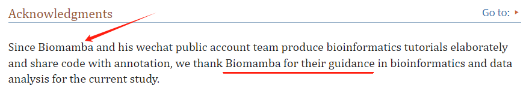
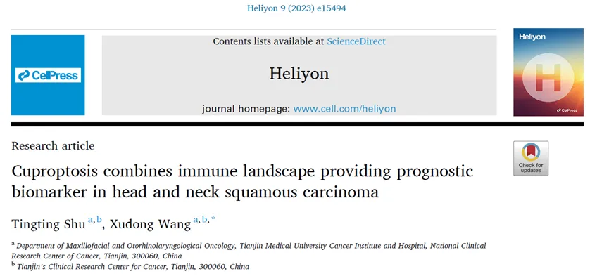
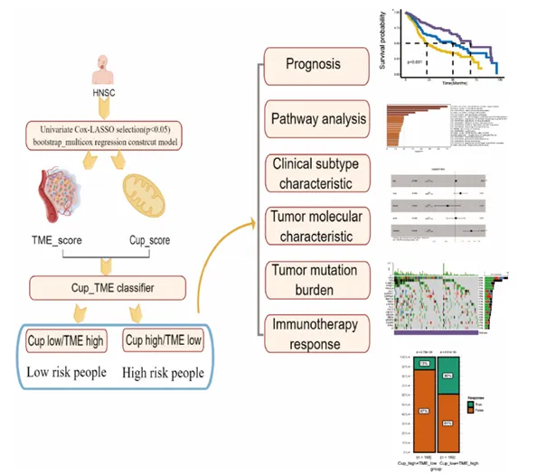
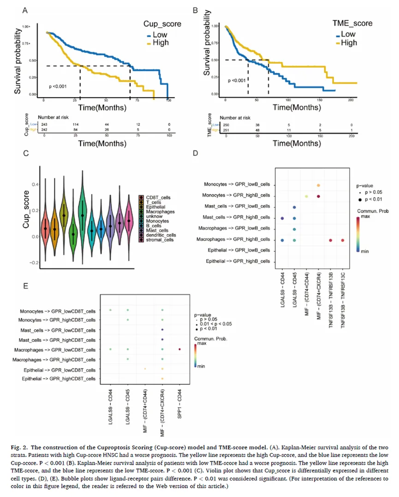
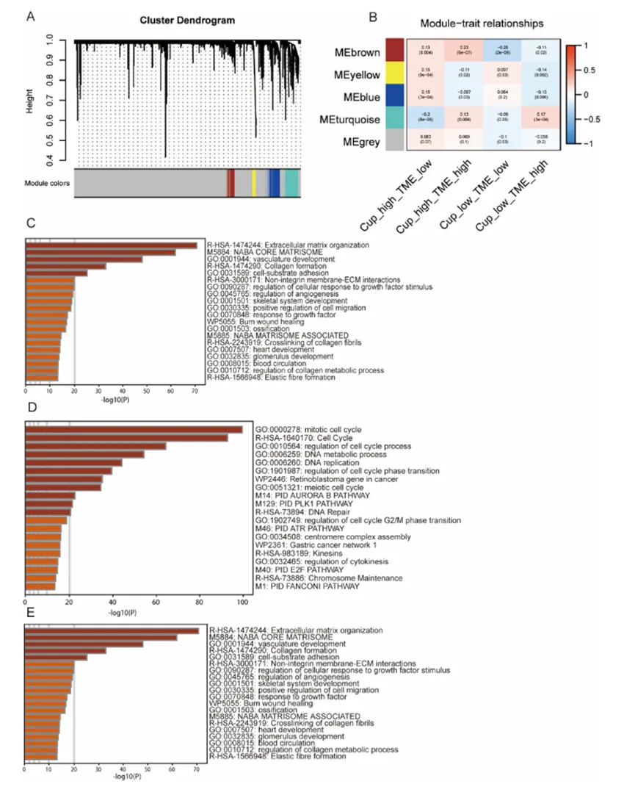
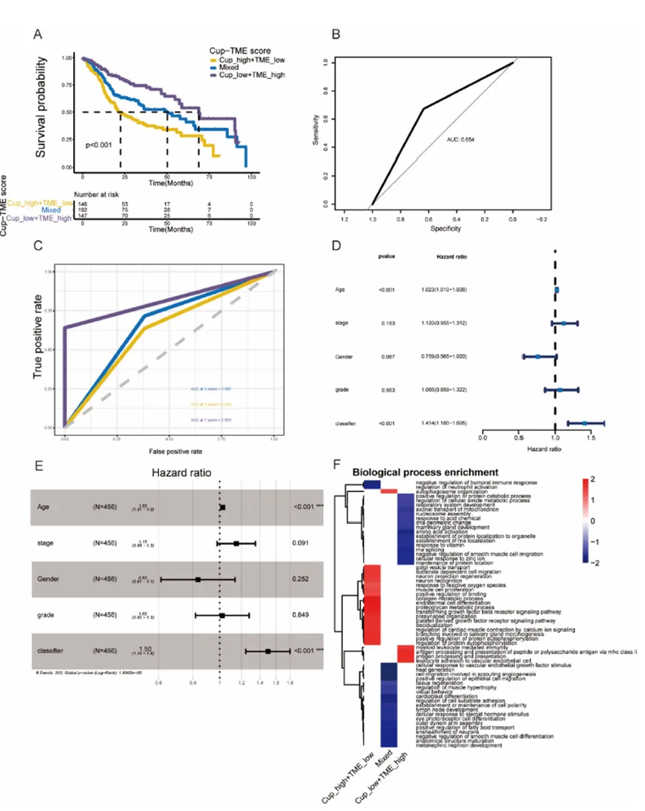
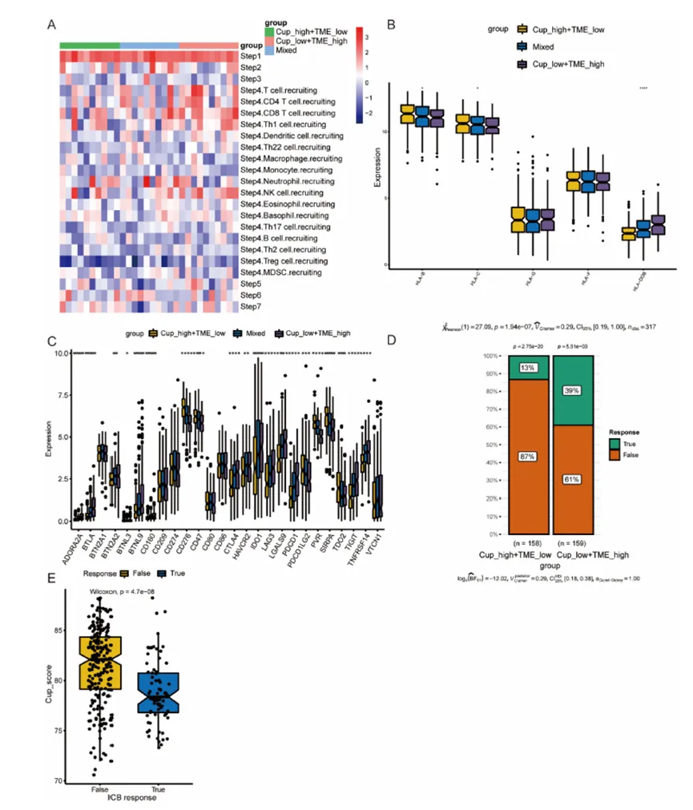
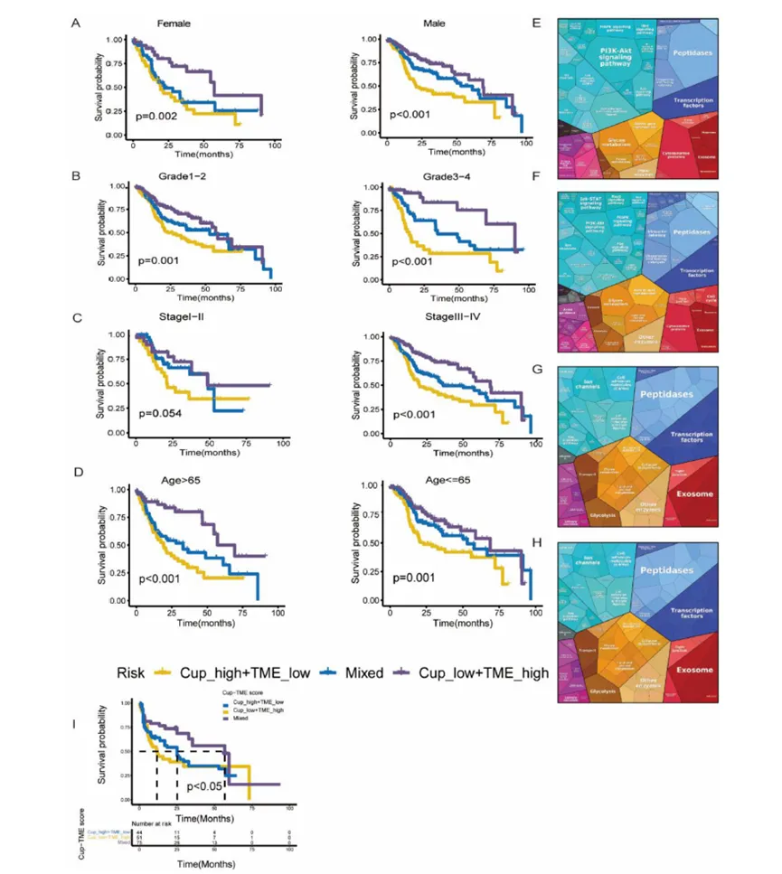

# 除了铁死亡，还有铜死亡？！

> 原文：https://mp.weixin.qq.com/s?__biz=MzAwMzIzOTk5OQ==&mid=2247518144&idx=1&sn=d036f1bb04b09eb73f53e2104d69404c&chksm=9b3cfe90ac4b77862f2f463b42132c7bfdb687a1b61d350dcf656117b1331271e179710fd4fa#rd
> 合集：单细胞教程全收录 / 文献速递

**写在前面**

这又是一篇在Acknowledgement对我们进行**致谢** 的文章：



近年来铁死亡已被作为研究热点，但除了铁死亡外，科学家发现细胞中竟也存在铜死亡，与铁相似，铜也是所有生物体内不可缺少的一种微量元素，通常在哺乳动物细胞内维持极低的水平。细胞内的铜离子浓度超过了维持稳态机制的阈值时，同样会表现出细胞毒性。今天给大家分享的这篇文章首次关注到了铜死亡与癌症间的关系，题目为“铜死亡结合免疫学研究为头颈部麟状癌提供预后标志物”，感兴趣的话让我们一起来学习作者是怎样进行数据挖掘和生物信息学分析的。**链接：**

https://pubmed.ncbi.nlm.nih.gov/37215927/

**DOI:** 10.1016/j.heliyon.2023.e15494

**IF：** 4.0


这里也预祝我们的粉丝们早日命中心仪的期刊，若是大家觉得我平时分享的代码或生信教程**有那么点** 好用，可以在文章里以这种格式致谢Biomamba，希望咱们这个系列也能**更新个百八十篇** :

  *

```
Since Biomamba and his wechat public account team produce bioinformatics tutorials elaborately and share code with annotation, we thank Biomamba for their guidance in bioinformatics and data analysis for the current study.
```

如果需要数据分析**指导** 、生信热点**全文复现** 、自测数据**个性化分析** 辅导，欢迎联系客服微信[**Biomamba_yunying**]

**一、工作流程**



**二、结果**

**● 1、铜死亡/TME预后评估**

如流程图所示，作者首先从TCGA数据库中找到了头颈部麟状癌（HNSC）患者的测序信息，并根据GEO数据库中的临床数据和文献报道找到了398个与铜死亡相关的基因和22个TME中主要的细胞类型，之后对铜相关基因和TME细胞类型进行Bootstrap-multicox回归分析寻找了14个潜在的铜死亡相关基因和6种潜在的TME细胞类型，以此标准对每个HNSC患者进行Cup和TME评分（Fig. 2A, 2B），Cup低/TME高临床预后更好，被认为是低风险人群，选择口腔癌样本的单细胞测序数据对此发现进行验证；发现了T细胞和树突状细胞与Cup评分呈正相关的关系（Fig. 2C）；看来细胞通讯在疾病中也发挥着关键的作用，因此进行各个细胞间受体配体的统计，作者发现相比于Cup高评分免疫细胞，Cup低评分免疫细胞与其他免疫细胞存在更多的交流（Fig. 2D, 2E）。



****● 2、**铜死亡/TME不同亚组功能学分析**根据预后进行评分分类后，接下来作者对于不同亚组进行GO和KEGG功能分析，其中Cup评分低而TME评分高的组别被认为是Cup低/TME高亚组，使用加权基因共表达网络(WGCNA），选择热图中TME与Cup的相关性评分分类的MEbrown、MEyellow、MEblue三组模块，应用于Metascape 数据库进行功能分析，结果显示预后较差的Cup高/TME低组与细胞外基质组织、脉管系统发育和细胞-底物粘附显著相关（Fig. 3A-E）。



****● 3、**评估****铜死亡/TME不同亚组预后价值** 对不同亚组功能进行分析后，接下来为了确定亚组分类的可行性，作者进行了分组对于预后价值的评估，选择Cup低/TME低和Cup高/TME高样本，使用Kaplan-Meier曲线进行生存率分析（Fig. 4A），结论与之前一致；同时受试者特征ROC曲线和时间依赖的ROC分析，显示3年、5年和7年生存时间的AUC值分别为0.667、0.628和0.820（Fig. 4B, 4C）。以上结果证实了铜死亡/TME不同亚组的预后价值，铜死亡/TME不同亚组与总生存率密切相关（Fig. 4D, 4E）。再对于不同亚组进行FGSEA富集分析后，发现Cup低/TME高与抗原加工和呈递显著相关，但Cup高/TME低与血管生成或细胞迁移有很强的相关性（Fig. 4F）。



****● 4、**亚组肿瘤免疫表型及免疫表达谱分析**TIP网站（http://biocc.hrbmu.edu.cn/TIP/ )主要用于分析患者的免疫活性评分和免疫细胞浸润结果。为跟踪分析不同亚组中抗肿瘤免疫活性，作者使用TIP网站进行了可视化， Cup低/TME高组主要与CD8 T细胞募集、T细胞募集和NK细胞募集相关，也正解释了为什么这一组别预后最好（Fig. 5A）;同时当对免疫识别相关基因进行分析时，发现Cup低/TME高组中MHC表达较高（Fig. 5B）;免疫检查点在肿瘤的发生发展中也发挥着重要的作用，而结果显示Cup低/TME高组中有13个免疫检查点相关基因的高表达（Fig. 5C）;最后，关注不同亚组患者的免疫反应时，经 TIDE网站分析，发现Cup低/TME高免疫应答最为显著 (Fig. 5D)。且Cup评分与免疫应答反应呈负相关的关系（Fig. 5F）。



****● 5、**Cup****低/TME高亚组临床特点** 既然Cup低/TME高亚组已被认为风险最低，那其在临床上具有什么特点呢，最后作者按照患者性别、年龄、分级、分期进行各亚组的Kaplan-Meier生存曲线分析，以评估总生存率，得到与之前一致的结论，Cup低/TME高组拥有最高的生存率（Fig. 6A-D）；当进行Cup低/TME高亚组和免疫应答患者的功能分析比较时，蛋白谱图显示出两组的相似性，告诉了我们Cup低/TME高亚组在免疫治疗机制方面的适用性（Fig. 6E-H）。但此亚组分类是否具有普遍性呢？作者选择GEO数据库中的样本信息进行此亚组分类的验证，进一步展示了Cup评分低与良好预后的正相关性（Fig. 6I）。



**三、结束语**

这篇文章，作者通过一系列数据挖掘和生信分析将铜死亡与肿瘤预后价值联系起来，为临床上患者预后的判断提供了新的见解，文中采用的多种数据库和多种分析方法可谓是让人眼花缭乱，工作流程整体来看也比较清晰严谨，思路值得我们学习。感兴趣的读者可以阅读一下原文，零成本也可以发SCI。


**如何联系我们**

 公众号后台消息回复不便，这里给大家留一下领取资料及免费服务器([足够支持你完成硕博生涯的生信环境](<http://mp.weixin.qq.com/s?__biz=MzAwMzIzOTk5OQ==&mid=2247507693&idx=1&sn=d9517a0803ad75cb7be430806834e7b8&chksm=9b3ca7bdac4b2eaba1ad01ed04ab1fbcbafcf4f6ddfe9e4f76ed9229707f545fe7d9c9ffd6ae&scene=21#wechat_redirect>))的**微信号** ，方便各位随时交流、提建议（别问在么，添加时直接说来意）。此外呼声一直很高的**交流群** 也建好了，欢迎大家入群讨论：

[永久免费的生信、科研交流群](<http://mp.weixin.qq.com/s?__biz=MzAwMzIzOTk5OQ==&mid=2247505868&idx=2&sn=20c81313eaef9a7031a84ef3a691d1b5&chksm=9b3cae9cac4b278a42c8de97e864c7664a37e9a4adb5973625fe3f8dd1093e55aeda88d443aa&scene=21#wechat_redirect>)

大家可以阅读完这几篇之后添加[给生信入门初学者的小贴士](<http://mp.weixin.qq.com/s?__biz=MzAwMzIzOTk5OQ==&mid=2247493329&idx=1&sn=597870b7f7ce10346da3561e7c281627&chksm=9b3c9f81ac4b169794088ce9abbcacb5f18e9fd174fc0d7e28da62d78facadf3100ef38aaf22&scene=21#wechat_redirect>)
[如何搜索公众号过往发布内容](<http://mp.weixin.qq.com/s?__biz=MzAwMzIzOTk5OQ==&mid=2247506266&idx=2&sn=22b1164bc9602c25620d058847785422&chksm=9b3ca00aac4b291c16d738271746ffb90149282a728f484e8a1952463c46a8e7dc4f883ab928&scene=21#wechat_redirect>)


您点的每个赞和在看，我都认真当成了喜欢
