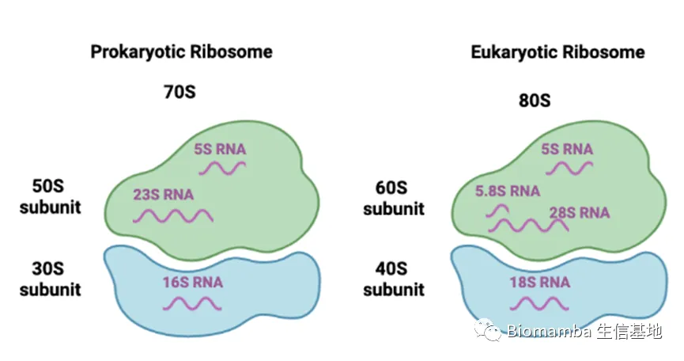
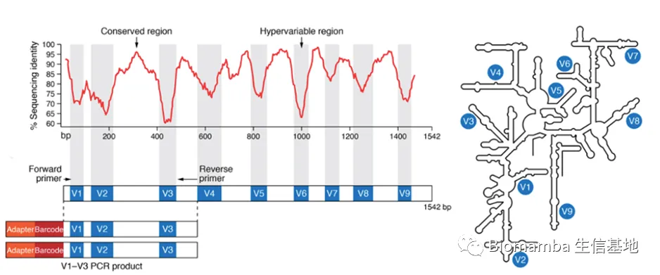
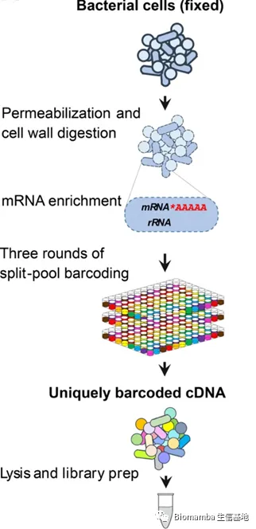
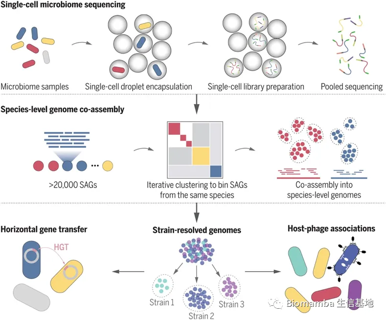

# 微生物组研究技术——微生物也能做单细胞

> 原文：https://mp.weixin.qq.com/s?__biz=MzAwMzIzOTk5OQ==&mid=2247488278&idx=1&sn=3662cde0f439a7e7cad7fb0d50082c05&chksm=9b3f6a46ac48e350318b38f1bfe252dd4c315ad058dc4b9aa02fadf2be2291fd0dac50f24cc6#rd
> 合集：单细胞教程全收录 / 文献速递

表观遗传、非编码RNA和微生物组，目前可以称之为生物与医药界的“量子力学”。总之，找不到机制时往这些东西上研究研究总能有所斩获。鉴于本人在**微生物组学** 与表观遗传学领域有一丝丝的研究经验，今后也会制作这些领域的**系列教程与推送** 。这里也正好借单细胞微生物技术做一个过渡，希望它们可以像我们的单细胞系列课程一样蓬勃发展！本文就目前微生物组学的三种主要研究技术开展一番简单的介绍。

一、背景

越来越多证据表明微生物群是心血管、神经系统、呼吸系统、代谢、肝脏和胃肠道等疾病的危险因素，过去十年里测序技术和计算机生物为研究人类中影响健康和疾病的**微生物组** 成提供了基础。随着 15 年前 NGS（next-generation sequencing） 的出现，让我们对人类相关微生物群的组成、动力学和功能的了解急剧扩大。 **Metagenomic** NGS（mNGS）提供了一个可以分析微生物和宿主细胞以及混合物微生物基因组的通用工作流程。随着技术可用性的提高、样品处理流程的简化、成本的下降、处理速度提高、用户体验优化以及分析工具的综合化等因素使得mNGS得以加速发展。由于这些进步，微生物群分析的研究和诊断工作现在主要基于mNGS。由于从基础研究到临床对于微生物的研究越来越多，因此对于该技术要求准确性、可重复性高。

二、方法

目前，用于微生物检测的手段层出不穷，这里主要介绍三种，分别是**扩增子测序** 、**基因组测序** （宏基因组）和微生物单细胞测序。前两种具有一定的历史，发展相对成熟；而由于单细胞测序（主要用于真核细胞）的飞速发展，使得越来越多的科学家努力将单细胞测序用于微生物研究，故微生物单细胞测序是目前微生物测序手段中较为前沿的技术。

**1. ****扩增子测序** 扩增子测序即通过将细菌标记基因（通常是线粒体16s rRNA编码的基因，即16s rDNA）的 PCR 扩增与由此产生的扩增产物的 NGS（为扩增子测序）相结合对细菌群落进行全面、高分辨率的分析。长度约为**1500bp** 的**16s rRNA** 在原核生物中的普遍存在，进化缓慢且保守性高，这些特点使得它被广泛用于细菌鉴定分类的标志。16s rRNA基因在1980时代中期首次被提出用于基于测序的细菌鉴定。16s r**D** NA 由9 个高变区组成，而这些高变区被保守区隔开，这是 16s rRNA 维持其二级结构所必需的。保守区反映了物种间的亲缘关系，而可变区则反映了物种间的差异。这种交替模式使得可以用16s rRNA 基因的保守区域作为 PCR 引物进行扩增，而对高变区域进行测序得以分类。自上世纪 90 年代初以来，诊断实验室已采用 **16s r****D****NA** 测序，用于通过Sanger测序鉴定分离的细菌菌落。由于**V3-V4 可变区**的特异性好，数据库信息全，一般对16s rDNA的V3-V4可变区(图2)进行测序，以此来研究微生物多样性。类似的、基于标记基因的方法也可用于真菌鉴定。然而，真核小亚基 (SSU, 18S) rRNA 基因不太适合作为单一靶标，因为它更高度保守，限制了分类分辨率。相反，真菌大亚基 (LSU, 28S) rRNA 基因内的 2 个内部转录间隔区 (ITS1, ITS2) 序列和高变区 D1 和 D2 应用的更广泛。

图1\. 核糖体示意图

图2\. 16s rDNA示意图

********●****** 16s r DNA****测序的优点：**

经济：目前该技术成熟，很多公司和实验室均可完成，成本较低，测序深度通常在数万到数十万次测序读数。

********●****** 16s r DNA****测序的缺点：**

**1 ）**病毒（包括噬菌体）不包含通用标记基因，并且病毒名称不遵循其他细菌通用的林奈双名格式，故不能用于病毒；

**2 ）**PCR扩增过程引入偏差，比如保守区域也会发生测序改变，引物结合位点不匹配导致区分的代表性不足；

**3 ）**参考序列数据库不完整。

**2. ****宏基因组学**

病毒、细菌和许多真菌的基因组相对较小，这使得确定它们的整个基因构成成为可能。利用深度测序（数百万到数千万测序读数）可以直接从标本中分析微生物基因组。这种对任何 DNA（宿主、微生物、环境等）进行测序的方法通常称为**鸟枪法宏基因组测序**(图3)。由于该过程基于随机抽样，因此检测丰度较低分类群时的灵敏度和基因组序列的完整性由测序深度决定。测序读数越多，灵敏度越大。 与基于标记基因（16s rDNA）的方法相比，鸟枪法宏基因组学的优势包括：

**1 ）**检测所有微生物类别（病毒、细菌、真菌、寄生虫）；

**2 ）**更高的分类分辨率；

**3 ）**具有菌株分型和基因型的分析能力；

**4 ）**能用于耐药性 (AMR) 基因和致病因子的鉴定；

**5 ）**微生物群落的功能预测潜力。

宏基因组数据分析一般将重叠的原始 DNA 序列（“reads”）组装成更长的连续序列（重叠群，contigs），然后再进行下游分析。相同细菌种类的菌株通常仅共享其基因的一个子集，这种所有相同菌株共有的基因称为“核心基因组”，其余基因组成可有可无的基因组，进一步分为辅助基因（仅在某些菌株中存在）和独特的基因组或菌株特异性基因（在单个菌株中发现）。核心和可有可无的基因组的组合是泛基因组。核心和泛基因组的相对大小按物种和测序菌株的数量而变化。例如，发现 186 个大肠杆菌基因组包含总共 16000 个基因（泛基因组），所有菌株（核心基因组）中仅存在 1700 个（10.4%）。

********●****** 宏基因组应用：**

**1 ）**病原体识别（临床宏基因组学）

**2 ）**鉴定致病因子：区分致病和非致病菌株

**3 ）**检测RNA病毒或噬菌体。

图3\. 宏基因组测序流程图

**3.****微生物单细胞测序**

单细胞 RNA 测序 (scRNA-seq) 已成为表征真核生物基因表达的重要工具，但技术挑战长期以来一直阻碍 scRNA-seq 技术适应微生物。主要原因有：

**1 ）**细菌的mRNA含量低，比真核细胞低2个数量级，并且细菌mRNA没有被多聚腺苷酸化，这使得与rRNA分离困难；

**2 ）**细菌具有各种细胞壁和细胞膜，会干扰scRNA-seq必需的裂解、透化等步骤；

**3 ）**细菌体积较小会阻碍微流体单细胞分离。目前科学家们也在聚焦这些问题，试图攻克这些问题实现微生物单细胞测序，这里介绍2种在这一领域的研究进展：

**1. **microSPLiT（Microbial Split-Pool Ligation Transcriptomics）微生物分裂池连接转录组学：由来自华盛顿大学的电气与计算机工程系、生物工程系及医学院微生物组科学与治疗中心的Anna Kuchina, Leandra M. Brettner等人研究创新，他们将microSPLiT 应用于超过 25000 个在不同生长阶段取样的枯草芽孢杆菌细胞，创建了新陈代谢和生活方式变化的图谱。SPLiT-seq ，一种真核 scRNA-seq 方法，主要步骤包括细胞被固定、透化，并通过带条形码的 poly-T 和随机六聚体引物在多孔格式中通过细胞内逆转录 (RT) 将 mRNA 转化为 cDNA。然后将细胞汇集起来，随机分成一个新的 96 孔板，并通过连接将一个孔特异性条形码附加到 cDNA 上。重复这种分离-连接-池循环，并在测序文库制备过程中添加第四个可选**条形码** ，以确保每个细胞以高可能性获得独特的条形码组合。MicroSPLiT 是建立在 SPLiT-seq（一种真核 scRNA-seq 方法） 基础上的。

MicroSPLiT基本流程（图4）：

**1）** 固定细菌：用Tween-20和溶菌酶浸润；

**2）** mRNA富集，用大肠杆菌Poly(A)聚合酶I（PAP）在细胞内对mRNA进行多聚腺苷酸化；

**3）** 对细胞RNA进行三轮组合条形码，包括细胞内转录（RT）和两次细胞内连接反应（转录之前的涡旋和双重过滤和转录之后的超声双重过滤以减少聚集体形成）；

**4）** 独特的条形码 cDNA裂解RNA和文库制备及测序。

以上用的Tween-20和溶菌酶对革兰氏阳性枯草芽孢杆菌和革兰氏阴性大肠杆菌具有最佳捕获效率；针对细菌mRNA没有被多聚腺苷酸化，与rRNA分离困难的问题利用PAP在细胞内对mRNA进行多聚腺苷酸化，并能够提高mRNA读数富集。

为了验证 microSPLiT 在革兰氏阳性和革兰氏阴性菌混合物上的性能，Anna Kuchina等人将大肠杆菌MW1255和枯草芽孢杆菌PY79细胞培养至OD600=0.5，每种各取一半进行47°C短暂热休克，另一半不做热休克处理，使用第一个条形码作为样本识别码，对两个样本进行microSPLiT实验，并从热休克和对照菌（未热休克）中测序制备了一个cDNA文库。 结果发现多种亚群表现出选择代谢、应激反应或发育途径的差异基因表达。特别是一种肌醇分解代谢途径。说明microSPLiT 可广泛用于识别更多不同环境中的异质细胞状态，例如多物种生物膜和天然微生物群。另外，能够检测到 0.142% 的稀有细胞亚群，这表明 microSPLiT 有可能发现生理相关的稀有细胞状态，例如持久性，这些状态很难通过批量或低通量方法研究。 当然，microSPLiT还需进一步优化，由于细菌细胞壁和细胞膜组成差异较大，渗透和mRNA富集步骤还需进一步优化。另外，在RT步骤和子库制备的细胞保留约25%，因此该方法适用于稀疏的自然群落而非实验室培养物，因此需要增加细胞保留。

图4\. MicroSPLiT 流程图

**2. **哈佛大学和麻省理工学院的研究团队也发明了另一种微生物高通量单细胞基因组学技术：Microbe-seq。Microbe-seq技术集成了多种液滴微流控操作技术和定制开发的生物信息学分析手段，不需要培养即可从复杂微生物群落中获取成千上万个单细胞微生物的基因组信息，并组装出高质量的菌株水平基因组，从而能够在不损失分辨率或广泛物种适用性的基础上探究微生物群落的基因组。该方法应用面广泛，可用于具有复杂微生物群落的样本，如粪便、土壤和海洋等。

其分析原理如下（图5）：

**1 ）**利用液滴微流控技术(也就是说与10X Genomics原理类似)，研究团队将成千上万的微生物单独地包裹在液中；

**2 ）**在每个液滴中，裂解微生物并释放DNA；

**3 ）**进行全基因组扩增，将扩增出来的DNA打断并连上接头，随后在液滴中用带有特定序列的标签标记液滴内DNA；

**4 ）**将所有液滴内的DNA合并，进行建库测序。

由于液滴内DNA标记的标签对于每一个液滴都是不同的，因而将测序后的序列按照DNA标签进行区分，即可得到每一个液滴内单个微生物的基因组信息。这些具有相同barcode的测序序列的集合即称为一个single amplified genome (SAG)。 对于复杂微生物群落，其中大多数微生物的参考基因组一般是未知的。而单个SAG涵盖的基因组信息一般在全基因组的50%以内，无法直接被用于参考基因组。这为微生物组的单细胞基因组分析带来了一个独特的难题，为了得到高质量的微生物群落的参考基因组，研究团队还发展了一套通用的生信分析流程：

**1 ）**通过提取并比对各单细胞的基因组标志性信息（genomic signature），将样品中来自同一物种的单细胞微生物识别出来，然后合并在一起来组装出物种水平的参考基因组；

**2 ）**进一步将单个微生物的基因组和参考基因组对比，识别来自于不同菌株的单细胞微生物并进行基因组组装。

**3 ）**通过这种方法，研究人员获得了样品中多种不同物种及物种中不同菌株的基因组。

图5\. Microbe-seq流程图

三、微生物研究的挑战

**1 ）**样本收集和运输要求较高（一般要求-80°C冷冻保存，或者使用试剂阻止微生物的生长和降解）；

**2 ）**核酸提取要求高（例如去宿主细胞或核酸，以增加分析灵敏度），高质量数量的核酸提取是高质量测序的前提保证；

**3 ）**文库制备，如低丰度mRNA的cDNA克隆所占的比例比较低，分离比较困难；

**4 ）**NGS：序深度和读取长度的选择，较低的测序深度或较高丰度的宿主核酸将限制微生物组分析的准确性并在低丰度水平上引入偏差。

**5 ）**数据分析——分类算法：基因组学应用的准确性、完整性及宏转录组研究的质量取决于序列分类算法和参考测序数据库。减少数据大小可以帮助节约计算机资源并缩短分析时间。但这样的方法也存在一些限制。例如，从头组装虽然减少了下游分析步骤的查询序列（即重叠群）的数量，但也限制了分析灵敏度，因为在低覆盖（低丰度）设置中组装效率会降低。

**6 ）**数据分析——参考序列数据库：综合和精选的参考序列数据库是有意义的微生物组测试的核心。数据库需要尽可能完整，因为缺少参考序列可能导致假阴性（即未识别出正确的生物体）和假阳性结果（即生物体被识别为数据库中的下一个最佳匹配）。这里列举一些较为被认可的公共数据库，如RefSeq（参考序列数据库），CARD、ResFinder（AMR基因数据库），fluDB（特定人类病原体数据库），FDA- ARGOS（一个具有公共质量控制参考基因组的数据库，用于诊断用途和监管科学）。

参考文献

Schlaberg R. Microbiome Diagnostics. Clin Chem. 2020 Jan 1;66(1):68-76. doi: 10.1373/clinchem.2019.303248.

Kuchina A, Brettner LM, Paleologu L, Roco CM, Rosenberg AB, Carignano A, Kibler R, Hirano M, DePaolo RW, Seelig G. Microbial single-cell RNA sequencing by split-pool barcoding. Science. 2021 Feb 19;371(6531). doi: 10.1126/science.aba5257.

Zheng W, Zhao S, Yin Y, Zhang H, Needham DM, Evans ED, Dai CL, Lu PJ, Alm EJ, Weitz DA. High-throughput, single-microbe genomics with strain resolution, applied to a human gut microbiome. Science. 2022 Jun 3;376(6597). doi: 10.1126/science.abm1483.

larridge JE 3rd. Impact of 16s rDNA gene sequence analysis for identification of bacteria on clinical microbiology and infectious diseases. Clin Microbiol Rev. 2004 Oct;17(4):840-62. doi: 10.1128/CMR.17.4.840-862.2004.

Wensel CR, Pluznick JL, Salzberg SL, Sears CL. Next-generation sequencing: insights to advance clinical investigations of the microbiome. J Clin Invest. 2022 Apr 1;132(7):e154944. doi: 10.1172/JCI154944.

如何联系我们

公众号后台中消息更新不及时，超过48h后便不允许回复读者消息，这里给大家留一下领取资料、咨询服务器的**微信号** ，方便大家随时交流、提建议（由助理接待）。此外，呼声一直很高的交流群也建好了，欢迎大家入群讨论：[你们要的微信、交流群，来了！](<http://mp.weixin.qq.com/s?__biz=MzAwMzIzOTk5OQ==&mid=2247487083&idx=1&sn=312a8435f6b938602624a7e9028ad3c6&chksm=9b3f773bac48fe2d3a2886988b35b006bbd05da11e2d7f735afc78c02ffbd179ebc9722a97cd&scene=21#wechat_redirect>)大家可以阅读完这几篇之后添加[笑一笑也就算了](<http://mp.weixin.qq.com/s?__biz=MzAwMzIzOTk5OQ==&mid=2247484685&idx=1&sn=3b47c0bcad97a265650b5f34c00a6a3c&chksm=9b3f7c5dac48f54be9cde50ab7a1147c55a36b980ffa0e721c02c05cbb88fef41a8fbc13d599&scene=21#wechat_redirect>)[有关提高"Biomamba 生信基地"运行效率事宜](<http://mp.weixin.qq.com/s?__biz=MzAwMzIzOTk5OQ==&mid=2247486435&idx=1&sn=c61124eb7c0fd6cc0eaefb639b551092&chksm=9b3f72b3ac48fba5c0091fd843c98d504d4aefe0ba01a2fed966f897f58d8924ace8df07955e&scene=21#wechat_redirect>)

