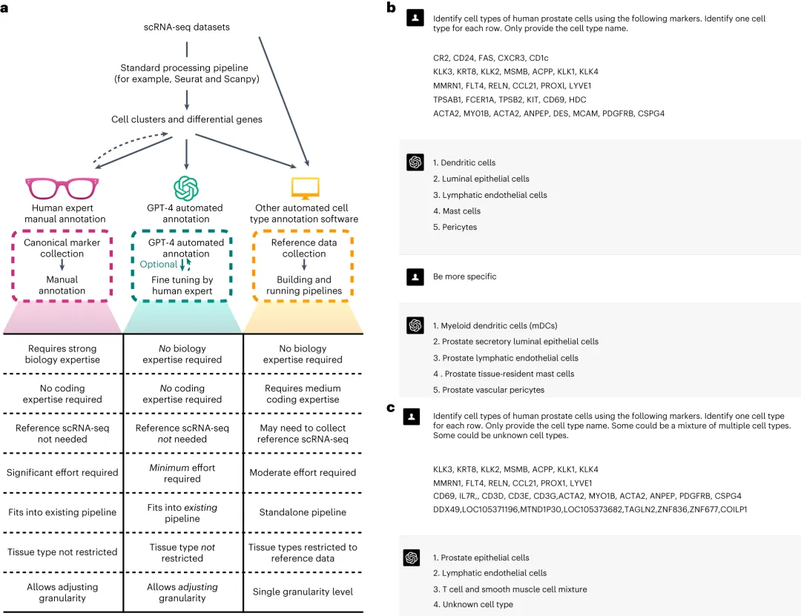
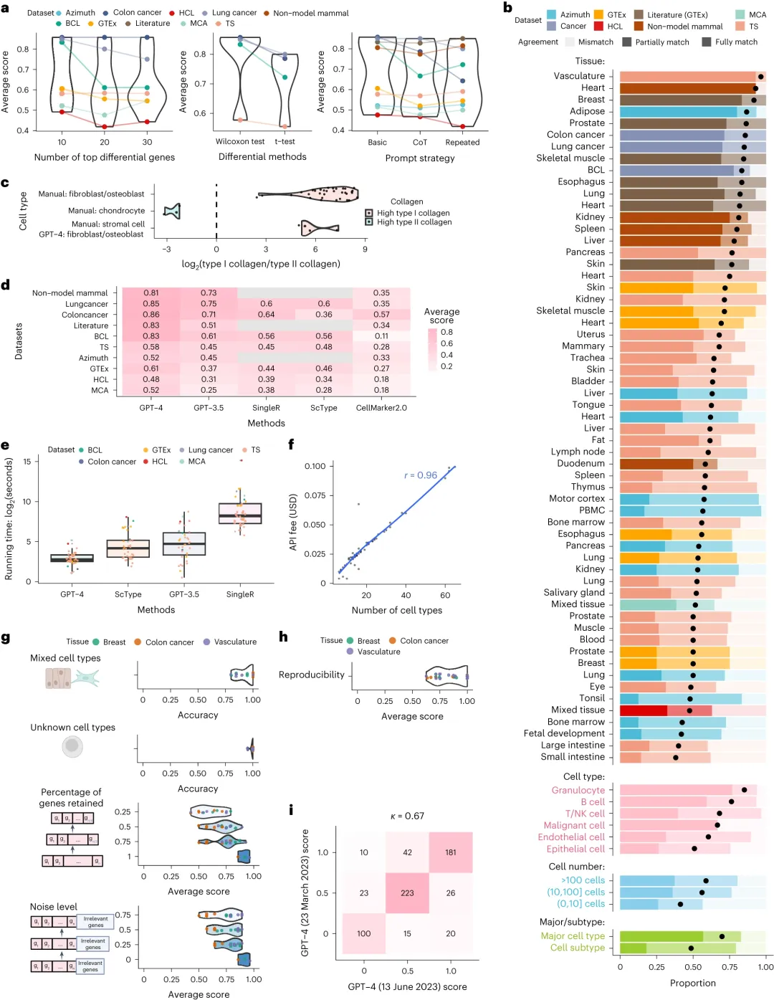

# GPTCelltype：玩GPT4玩出Nature

> 原文：https://mp.weixin.qq.com/s?__biz=MzAwMzIzOTk5OQ==&mid=2247510790&idx=1&sn=b56acf349e417f4ce1a09485256a5f87&chksm=9b3cd256ac4b5b400af5a809c5f595c8e1442513d277501c5bca1c80ce85f18a06a1d8994a9c#rd
> 合集：单细胞教程全收录 / 文献速递

**一、写在前面**

相信GPT4凭借及强大的Debug能力与文字润色能力已经成为大家在生信分析与文章撰写时的好帮手。在本菜鸡还在拿GPT4帮自己写代码的时候，已经有大佬将GPT4的API接入自己写的R包用于帮助单细胞数据的注释，并且顺手发了一篇《**Nature Methods** 》。学过我们此前课程([细胞类型注释，从入门到入土](<http://mp.weixin.qq.com/s?__biz=MzAwMzIzOTk5OQ==&mid=2247500167&idx=2&sn=8de136b938e8d4753042d23166a24026&chksm=9b3cb8d7ac4b31c19c843810c7fe4341515df8ba6fff86a0ebff9d830edfcd656a29d18011c9&scene=21#wechat_redirect>))的同学都知道，人工注释费时费力，需要分析人员对于组织中的细胞特征拥有**专业级别** 的了解；用singleR这类软件进行**自动注释** ，又很**依赖** 软件**算法** 的准确性与**参考数据集** 的适配性。相信这些问题已经困扰大家很久了，那么这篇题为"Assessing GPT-4 for cell type annotation in single-cell RNA-seq analysis"的文章能够一定程度上医好大家的头疼。

原文链接：https://www.nature.com/articles/s41592-024-02235-4

**二、主要内容**

细胞注释是single-cell RNA suquencing(scRNA-seq)的基本步骤，这一步基本不能直接产生对文章论题有用的信息与图表，但是却十分耗时、耗力、耗专业知识。GPT-3.5与**GPT-4** 可以说在近年的大语言模型中独领风骚，并被迅速的应用在生物医药领域。考虑到GPT-4可以高效、无缝的整合到现有的单细胞分析流程中去，因此作者开发了**GPTCelltype** 并系统性评估了GPT-4在十个数据集(包含正常细胞与肿瘤细胞)中的细胞注释表现情况。从示意图(Figure 1a)可以看出，依赖GPT4进行scRNA-Seq的细胞注释**好处有** ：无需生物学专业知识、无需代码知识、无需参考数据集、人工成本低、分析流程适配性高、无组织类型限制、注释分辨率/粒度高。
在研究过程中，作者重点考察了Top差异基因(marker)来源与数量、数据来源、数据集大小等因素对GPT-4的细胞注释能力进行了**评估** ，并用数据集原先的人工注释结果作为参考进行准确率计算。结果显示在利用Top10marker进行细胞注释时准确性最高(Figure 2a)。在大部分数据集与组织中，GPT的细胞注释及亚群注释结果能保证大于**75%** 的准确率(这个下限其实不高)，且对于**免疫细胞** 的注释比其它细胞类型更加精准。在肺癌与结肠癌数据集中，其能够精准的识别肿瘤细胞，但在B淋巴瘤细胞的识别上有些不足，建议结合**拷贝数变异分析** 进一步推断。

在GPT-4与ScType、CPT3.5、SingleR的横向比较中，无论是**准确性** 还是**计算速度** ，GPT-4均**大幅领先**(Figure 2d&2e)。GPTCelltype的计算效率高得益于其依赖[Seurat](<http://mp.weixin.qq.com/s?__biz=MzAwMzIzOTk5OQ==&mid=2247510380&idx=1&sn=0eb2b0c519ef1dc25ee8821b736a0fde&chksm=9b3cd03cac4b592ad93149fb4847e6ba3dd03ab69e1ca594ddc64d323fb7496775789cae245d&scene=21#wechat_redirect>)进行Top marker的计算，而另外几种工具需要自行对表达矩阵进行处理。此外，作者还使用了包含93%真实细胞与7%混合细胞的模拟数据集进行了测试，结果显示GPTCelltype对于已知和未知细胞类型的注释准确率高达99%(Figure.2g)。在重现性表现方面，GPTCelltype同样表现优秀(Figure 2H&I)。

需要注意的是GPT4的训练截止日期是2021年9月，这个时间对于快速发展的scRNA-Seq与生物信息学领域而言，有些久远。虽然GPTCelltype的使用门槛很低，但作者并不推荐使用top marker少于5的细胞类型以及数量少于10个的细胞注释。另外一个需要考虑的因素是，GPT-4并不是用爱发电的，大约需要**$20** 一个月的订阅成本，但按照GPT-4的流量限制来说，注释本文作者提到的所有细胞类型，花费不会超过**0.1$** 。大家可以自行学习一下分析教程，流程很简单，但是需要科学上网(https://user.by.ltd/aff.php?aff=23313)和Open AI的账号：

https://winnie09.github.io/Wenpin_Hou/pages/gptcelltype.html

**如何联系我们**

 公众号后台消息回复不便，这里给大家留一下领取资料及免费服务器([足够支持你完成硕博生涯的生信环境](<http://mp.weixin.qq.com/s?__biz=MzAwMzIzOTk5OQ==&mid=2247507693&idx=1&sn=d9517a0803ad75cb7be430806834e7b8&chksm=9b3ca7bdac4b2eaba1ad01ed04ab1fbcbafcf4f6ddfe9e4f76ed9229707f545fe7d9c9ffd6ae&scene=21#wechat_redirect>))的**微信号** ，方便各位随时交流、提建议（别问在么，添加时直接说来意）。此外呼声一直很高的**交流群** 也建好了，欢迎大家入群讨论：

[永久免费的生信、科研交流群](<http://mp.weixin.qq.com/s?__biz=MzAwMzIzOTk5OQ==&mid=2247505868&idx=2&sn=20c81313eaef9a7031a84ef3a691d1b5&chksm=9b3cae9cac4b278a42c8de97e864c7664a37e9a4adb5973625fe3f8dd1093e55aeda88d443aa&scene=21#wechat_redirect>)

大家可以阅读完这几篇之后添加[给生信入门初学者的小贴士](<http://mp.weixin.qq.com/s?__biz=MzAwMzIzOTk5OQ==&mid=2247493329&idx=1&sn=597870b7f7ce10346da3561e7c281627&chksm=9b3c9f81ac4b169794088ce9abbcacb5f18e9fd174fc0d7e28da62d78facadf3100ef38aaf22&scene=21#wechat_redirect>)
[如何搜索公众号过往发布内容](<http://mp.weixin.qq.com/s?__biz=MzAwMzIzOTk5OQ==&mid=2247506266&idx=2&sn=22b1164bc9602c25620d058847785422&chksm=9b3ca00aac4b291c16d738271746ffb90149282a728f484e8a1952463c46a8e7dc4f883ab928&scene=21#wechat_redirect>)

您点的每个赞和在看，我都认真当成了喜欢
