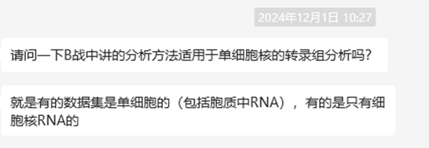
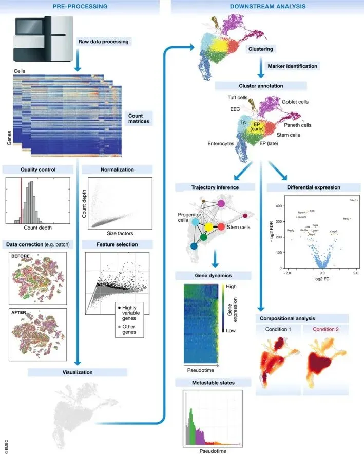
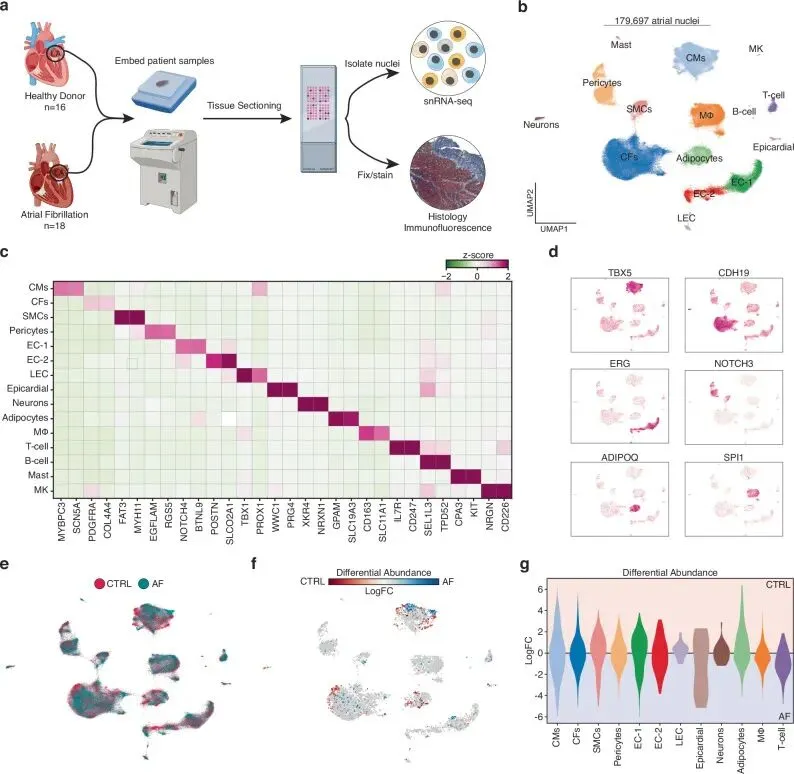
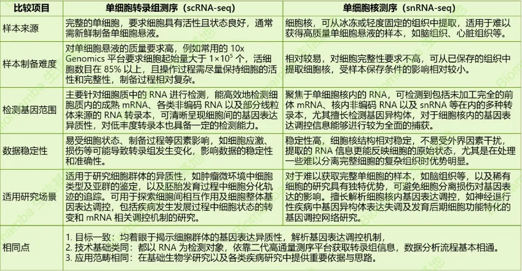

# 一文了解sc与sn的异同

> 原文：https://mp.weixin.qq.com/s?__biz=MzAwMzIzOTk5OQ==&mid=2247526966&idx=1&sn=9b2aaa1059e6ed68ada65fe004190108&chksm=9b3c1366ac4b9a708b44e51a4a5488a0a74ed6887b080ccac57a19ddfd0f856b86629a239c58#rd
> 合集：单细胞教程全收录 / 文献速递

**提问**

**有粉丝提问我们的B站单细胞课程是否适用于单细胞核RNA-seq：**

问答过程可以简化为如下内容：

Q：普通单细胞转录组的代码适用于单细胞核测序吗?

A：单细胞转录组和单细胞核测序在基本的分析流程和代码逻辑方面都是**相通** 的。但毕竟研究的对象不同，样本的制备方法不同，在分析过程中还是需要**根据具体的研究问题和生物学背景** ，对分析方法和参数进行适当的调整，如**线粒体基因比例** 这类因样本特性而可能产生显著差异的分析指标，在sn的数据中根本不存在，就需特别留意。当然，即使同样都是单细胞转录组测序，由于不同的研究情景下细胞类型、实验条件等因素的变化，其相应的参数也是需要根据实际情况灵活变动的。大家要学**理解代码** ，而**不是搬运** 哦~

下面就带大家去深入了解一下这两种方法有什么异同吧~

**基本介绍**

传统基因表达分析依赖细胞组织匀浆RNA 提取(例如bulk RNA-seq)，易掩盖**细胞间差异** 。单细胞测序（Single-cell sequencing）与单细胞核测序（Single-nucleus sequencing）是现代基因组学的革命性技术，为解析细胞基因表达带来高精度和深度。随着技术发展，二者在生命科学研究中的作用愈发重要，尤其在揭示**细胞异质性** 和**功能** 方面成效显著。

scRNA-seq通过解析单个细胞中的基因表达谱，能够揭示细胞类型、亚型以及它们在不同生理或病理状态下的动态变化。Luecken MD, Theis FJ. 2019. Molecular Systems BiologyscRNA-seq流程图
snRNA-seq是一种通过提取单个细胞核中的 RNA 进行转录组分析的方法。它适用于难获取活细胞或细胞膜受损组织（如脑、心脏、肝脏组织）及固定保存样本(例如FFPE)，这种情况下snRNA-seq能为这些样本研究提供转录组信息(而scRNA-seq对细胞活率有要求，这些组织无法参与建库)。但得局限性在于会**遗漏****细胞质RNA** 信息，影响对细胞转录调控网络的全面解析(毕竟胞质中成熟的mRNA含量更高)。因此利用其数据时，要考虑此特性并结合其他方法，以准确阐释细胞状态和分子机制。Hill MC, Simonson B, Roselli C, et al. 2024. Nat CommunsnRNA-seq流程图

**一图搞懂两者异同**

**数据分析过程中的注意事项**

**scRNA-seq**

  * 低质量细胞的去除：细胞在分离或处理过程中可能会受到损伤或应激，导致细胞质量下降，其 RNA 表达谱可能不能真实反映细胞的生理状态。因此，需要通过严格的质量控制指标，如细胞活力检测、RNA完整性评估等，去除低质量细胞，确保数据的可靠性。

  * 过滤线粒体基因污染：一方面线粒体本身就反应了细胞的活性程度，过高的线粒体含量可能意味着细胞活性过低(肝、肾、骨骼肌这类线粒体含量原本就很高的组织除外)。线粒体RNA可能会对基因表达分析产生干扰，在数据预处理阶段，需要采用合适的方法过滤线粒体基因污染，如根据线粒体基因的特征序列或表达模式进行筛选和去除(**例如scaleData的时候用percent.mt做regression**)，但要注意避免过度过滤导致有效信息的丢失。

**snRNA-seq**

  * 低质量核的去除：与 scRNA-seq 中去除低质量细胞类似，snRNA-seq也需要去除低质量的细胞核，这些核可能存在RNA降解、核膜破裂等问题，影响数据质量。可通过检测核的形态、RNA 含量及质量等指标进行筛选。

  * 背景噪声的处理：由于 snRNA-seq 实验过程中可能会引入一些背景噪声，如核碎片中的 RNA、非特异性捕获的 RNA 等，需要采用适当的方法进行去除或校正(例如可以参考以下教程去除双细胞/空细胞：[scRNA-Seq双细胞过滤手册](<https://mp.weixin.qq.com/s?__biz=MzAwMzIzOTk5OQ==&mid=2247511622&idx=1&sn=60b35668e569267bab14ec8fbba8bd74&scene=21#wechat_redirect>))。常见的方法包括设置合理的阈值、采用统计模型进行背景估计和校正等。

总之，无论是 scRNA-seq 还是 snRNA-seq，在研究过程中都需要充分考虑**RNA 来源的特点** 以及数据分析过程中的各个细节，才能充分发挥这两项技术的优势。
如果你想要详细学习单&核细胞测序，请点击以下超链接：
[手把手教会你单细胞测序](<https://mp.weixin.qq.com/s?__biz=MzAwMzIzOTk5OQ==&mid=2247522475&idx=1&sn=84dd9a65348528be9aa2b8d2711d776c&scene=21#wechat_redirect>)

**如何联系我们**

 公众号后台消息回复不便，这里给大家留一下领取资料及免费服务器([足够支持你完成硕博生涯的生信环境](<http://mp.weixin.qq.com/s?__biz=MzAwMzIzOTk5OQ==&mid=2247507693&idx=1&sn=d9517a0803ad75cb7be430806834e7b8&chksm=9b3ca7bdac4b2eaba1ad01ed04ab1fbcbafcf4f6ddfe9e4f76ed9229707f545fe7d9c9ffd6ae&scene=21#wechat_redirect>))的**微信号** ，方便各位随时交流、提建议（别问在么，添加时直接说来意）。此外呼声一直很高的**交流群** 也建好了，欢迎大家入群讨论：

[永久免费的生信、科研交流群](<http://mp.weixin.qq.com/s?__biz=MzAwMzIzOTk5OQ==&mid=2247505868&idx=2&sn=20c81313eaef9a7031a84ef3a691d1b5&chksm=9b3cae9cac4b278a42c8de97e864c7664a37e9a4adb5973625fe3f8dd1093e55aeda88d443aa&scene=21#wechat_redirect>)

大家可以阅读完这几篇之后添加[给生信入门初学者的小贴士](<http://mp.weixin.qq.com/s?__biz=MzAwMzIzOTk5OQ==&mid=2247493329&idx=1&sn=597870b7f7ce10346da3561e7c281627&chksm=9b3c9f81ac4b169794088ce9abbcacb5f18e9fd174fc0d7e28da62d78facadf3100ef38aaf22&scene=21#wechat_redirect>)
[如何搜索公众号过往发布内容](<http://mp.weixin.qq.com/s?__biz=MzAwMzIzOTk5OQ==&mid=2247506266&idx=2&sn=22b1164bc9602c25620d058847785422&chksm=9b3ca00aac4b291c16d738271746ffb90149282a728f484e8a1952463c46a8e7dc4f883ab928&scene=21#wechat_redirect>)

您点的每个赞和在看，我都认真当成了喜欢
