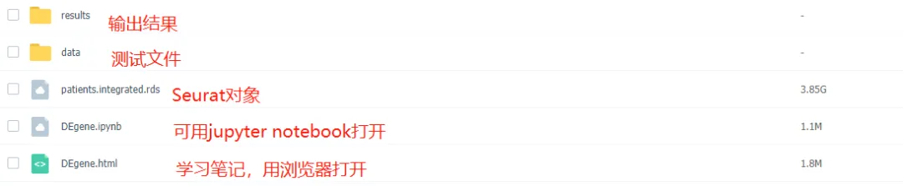

# 单细胞复写|4. GSE157783数据集复现及差异分析

> 原文：https://mp.weixin.qq.com/s?__biz=MzAwMzIzOTk5OQ==&mid=2247503585&idx=1&sn=0035977a80621f09d0774d3c9b0a86cd&chksm=9b3cb7b1ac4b3ea76685ed44abcfb031c698835d9b9b42b269496f6104cd8c9d45467de7eddd#rd
> 合集：单细胞教程全收录 / 全文复现 / 粉丝来稿

# **写在前面：**

 我反复的谈过，细胞类型注释才是单细胞测序中最难的环节，这主要是不同单细胞测序项目中的**取样形式** 、**建库方法** 、**测序平台** 、**分析工具** 、**函数参数** 等多方面因素造成的。拿笔者的第一个单细胞数据集来说，光是调整过滤参数、分辨率、寻找marker加以注释就花了一个月的时间，属实是既枯燥又乏味，为了给大家提供方便，以后会不定期带领大家复现一些已发表数据集中的细胞类型注释过程，有需要的同学可以持续关注，若有感兴趣的物种、组织器官也可以在文末客服处登记；当然，如果您有好的注释结果，也欢迎以**Rmarkdown** 与工程文件Rdata的形式来稿，可以为大家提供稿费。本期测试文件下载：

链接：https://pan.baidu.com/s/1AXmoz0SHx4-rEcC6-nn1mw?pwd=ix7z


包含文件：



# **复现图文教程**


```r
rm(list=ls())
library(Seurat)
library(Matrix)
library(tidyverse)
```
```
Attaching SeuratObject

── Attaching core tidyverse packages ──────────────────────── tidyverse 2.0.0 ──
✔ dplyr     1.1.2     ✔ readr     2.1.4
✔ forcats   1.0.0     ✔ stringr   1.5.0
✔ ggplot2   3.4.2     ✔ tibble    3.2.1
✔ lubridate 1.9.2     ✔ tidyr     1.3.0
✔ purrr     1.0.1
── Conflicts ────────────────────────────────────────── tidyverse_conflicts() ──
✖ tidyr::expand() masks Matrix::expand()
✖ dplyr::filter() masks stats::filter()
✖ dplyr::lag()    masks stats::lag()
✖ tidyr::pack()   masks Matrix::pack()
✖ tidyr::unpack() masks Matrix::unpack()
ℹ Use the conflicted package (<http://conflicted.r-lib.org/>) to force all conflicts to become errors
```

## 1.load data from GSE157783 and create Seurat object

这里作者提供了类似10x上游定量流程后的三个文件，但注意UMI文件并非mtx格式而是tsv文本格式。
UMI文件为稀疏矩阵,若用read.table读取太慢,这里推荐使用data.table包的fread函数,用法类似。

In [4]:
```r
# 0.load data and create Seurat object ####
cells=read.table('./data/IPDCO_hg_midbrain_cell.tsv',header=T,sep='\t')
genes=read.table('./data/IPDCO_hg_midbrain_genes.tsv',header=T,sep='\t')
umi=data.table::fread('./data/IPDCO_hg_midbrain_UMI.tsv',header=T,sep='\t')
umi=as.data.frame(umi)
rownames(umi)<-genes$gene#umi文件并未提供基因名
(colnames(umi)==cells$barcode)%>%table()#检查列名是否与cells文件对应
umi<-as(as.matrix(umi),'dgCMatrix')# 转换成稀疏矩阵格式
colnames(umi)%>%head()# 注意列为cell
rownames(umi)%>%head()# 行为gene, 注意这里基因名是ENSEMBL格式并非SYMBOL

GSE157783<-CreateSeuratObject(counts=umi)#创建Seurat对象
GSE157783# 26737 genes x 41435 cells
(rownames(GSE157783@meta.data)==cells$barcode)%>%table()
GSE157783@meta.data<-cbind(GSE157783@meta.data,cells)#将cells文件中的作者注释好的信息存入meta.data
saveRDS(GSE157783,'./data/GSE157783_raw.rds')# 保存一下初始Seurat对象
```
```
.
 TRUE
41435
```

  1. 'AAACCCACACATTGTG-1_1'

  2. 'AAACCCAGTAAGATTG-1_1'

  3. 'AAACGAACACCGCTGA-1_1'

  4. 'AAACGAAGTGCTTATG-1_1'

  5. 'AAACGAATCAATCTCT-1_1'

  6. 'AAACGAATCCAGTGCG-1_1'

  1. 'ENSG00000238009'

  2. 'ENSG00000235146'

  3. 'ENSG00000237491'

  4. 'ENSG00000225880'

  5. 'ENSG00000230368'

  6. 'ENSG00000272438'

```
An object of class Seurat
26737 features across 41435 samples within 1 assay
Active assay: RNA (26737 features, 0 variable features)
```
```
.
 TRUE
41435
```

## 2\. Normalization and integration

查看meta.data可知已经提供了注释和样本信息，因此，若只是基于文章注释进行下一步分析的话，这一步整合可以跳过。
感兴趣的也可以复现一下，代码如下。

In [9]:
```
head(GSE157783@meta.data)
```

A data.frame: 6 × 6
| orig.ident| nCount_RNA| nFeature_RNA| barcode| cell_ontology| patient
---|---|---|---|---|---|---

| <fct>| <dbl>| <int>| <chr>| <chr>| <chr>
AAACCCACACATTGTG-1_1| SeuratProject| 8519| 3229| AAACCCACACATTGTG-1_1| Oligodendrocytes| PD3
AAACCCAGTAAGATTG-1_1| SeuratProject| 17263| 5731| AAACCCAGTAAGATTG-1_1| Excitatory| PD3
AAACGAACACCGCTGA-1_1| SeuratProject| 10977| 3864| AAACGAACACCGCTGA-1_1| Oligodendrocytes| PD3
AAACGAAGTGCTTATG-1_1| SeuratProject| 2957| 1739| AAACGAAGTGCTTATG-1_1| Microglia| PD3
AAACGAATCAATCTCT-1_1| SeuratProject| 3832| 1915| AAACGAATCAATCTCT-1_1| Oligodendrocytes| PD3
AAACGAATCCAGTGCG-1_1| SeuratProject| 5450| 2647| AAACGAATCCAGTGCG-1_1| Oligodendrocytes| PD3

### 1.1 首先将数据根据样本来源分开，分别进行SCTransform和FindVariableFeatures以便下一步SelectIntegrationFeatures。

In [7]:
```r
patients<-SplitObject(GSE157783,split.by='patient')
patients<-lapply(X=patients,FUN=function(x){
x<-SCTransform(x)
x<-FindVariableFeatures(x,selection.method="vst",verbose=FALSE)
})
```
```
Calculating cell attributes from input UMI matrix: log_umi

Variance stabilizing transformation of count matrix of size 21494 by 3345

Model formula is y ~ log_umi

Get Negative Binomial regression parameters per gene

Using 2000 genes, 3345 cells
```
```
  |======================================================================| 100%
```
```
Found 66 outliers - those will be ignored in fitting/regularization step

Second step: Get residuals using fitted parameters for 21494 genes
```
```
  |======================================================================| 100%
```
```
Computing corrected count matrix for 21494 genes
```
```
  |======================================================================| 100%
```
```
Calculating gene attributes

Wall clock passed: Time difference of 1.372707 mins

Determine variable features

Place corrected count matrix in counts slot

Centering data matrix

Set default assay to SCT

Calculating cell attributes from input UMI matrix: log_umi

Variance stabilizing transformation of count matrix of size 24770 by 5706

Model formula is y ~ log_umi

Get Negative Binomial regression parameters per gene

Using 2000 genes, 5000 cells
```
```
  |======================================================================| 100%
```
```
Found 71 outliers - those will be ignored in fitting/regularization step

Second step: Get residuals using fitted parameters for 24770 genes
```
```
  |======================================================================| 100%
```
```
Computing corrected count matrix for 24770 genes
```
```
  |======================================================================| 100%
```
```
Calculating gene attributes

Wall clock passed: Time difference of 2.864306 mins

Determine variable features

Place corrected count matrix in counts slot

Centering data matrix

Set default assay to SCT

Calculating cell attributes from input UMI matrix: log_umi

Variance stabilizing transformation of count matrix of size 20582 by 1943

Model formula is y ~ log_umi

Get Negative Binomial regression parameters per gene

Using 2000 genes, 1943 cells
```
```
  |======================================================================| 100%
```
```
Found 63 outliers - those will be ignored in fitting/regularization step

Second step: Get residuals using fitted parameters for 20582 genes
```
```
  |======================================================================| 100%
```
```
Computing corrected count matrix for 20582 genes
```
```
  |======================================================================| 100%
```
```
Calculating gene attributes

Wall clock passed: Time difference of 51.42109 secs

Determine variable features

Place corrected count matrix in counts slot

Centering data matrix

Set default assay to SCT

Calculating cell attributes from input UMI matrix: log_umi

Variance stabilizing transformation of count matrix of size 23932 by 5758

Model formula is y ~ log_umi

Get Negative Binomial regression parameters per gene

Using 2000 genes, 5000 cells
```
```
  |======================================================================| 100%
```
```
Found 56 outliers - those will be ignored in fitting/regularization step

Second step: Get residuals using fitted parameters for 23932 genes
```
```
  |======================================================================| 100%
```
```
Computing corrected count matrix for 23932 genes
```
```
  |======================================================================| 100%
```
```
Calculating gene attributes

Wall clock passed: Time difference of 2.450417 mins

Determine variable features

Place corrected count matrix in counts slot

Centering data matrix

Set default assay to SCT

Calculating cell attributes from input UMI matrix: log_umi

Variance stabilizing transformation of count matrix of size 22905 by 4199

Model formula is y ~ log_umi

Get Negative Binomial regression parameters per gene

Using 2000 genes, 4199 cells
```
```
  |======================================================================| 100%
```
```
Found 73 outliers - those will be ignored in fitting/regularization step

Second step: Get residuals using fitted parameters for 22905 genes
```
```
  |======================================================================| 100%
```
```
Computing corrected count matrix for 22905 genes
```
```
  |======================================================================| 100%
```
```
Calculating gene attributes

Wall clock passed: Time difference of 1.834298 mins

Determine variable features

Place corrected count matrix in counts slot

Centering data matrix

Set default assay to SCT

Calculating cell attributes from input UMI matrix: log_umi

Variance stabilizing transformation of count matrix of size 20374 by 2318

Model formula is y ~ log_umi

Get Negative Binomial regression parameters per gene

Using 2000 genes, 2318 cells
```
```
  |======================================================================| 100%
```
```
Found 80 outliers - those will be ignored in fitting/regularization step

Second step: Get residuals using fitted parameters for 20374 genes
```
```
  |======================================================================| 100%
```
```
Computing corrected count matrix for 20374 genes
```
```
  |======================================================================| 100%
```
```
Calculating gene attributes

Wall clock passed: Time difference of 51.37818 secs

Determine variable features

Place corrected count matrix in counts slot

Centering data matrix

Set default assay to SCT

Calculating cell attributes from input UMI matrix: log_umi

Variance stabilizing transformation of count matrix of size 21787 by 3753

Model formula is y ~ log_umi

Get Negative Binomial regression parameters per gene

Using 2000 genes, 3753 cells
```
```
  |======================================================================| 100%
```
```
Found 72 outliers - those will be ignored in fitting/regularization step

Second step: Get residuals using fitted parameters for 21787 genes
```
```
  |======================================================================| 100%
```
```
Computing corrected count matrix for 21787 genes
```
```
  |======================================================================| 100%
```
```
Calculating gene attributes

Wall clock passed: Time difference of 1.641075 mins

Determine variable features

Place corrected count matrix in counts slot

Centering data matrix

Set default assay to SCT

Calculating cell attributes from input UMI matrix: log_umi

Variance stabilizing transformation of count matrix of size 19762 by 2047

Model formula is y ~ log_umi

Get Negative Binomial regression parameters per gene

Using 2000 genes, 2047 cells
```
```
  |======================================================================| 100%
```
```
Found 79 outliers - those will be ignored in fitting/regularization step

Second step: Get residuals using fitted parameters for 19762 genes
```
```
  |======================================================================| 100%
```
```
Computing corrected count matrix for 19762 genes
```
```
  |======================================================================| 100%
```
```
Calculating gene attributes

Wall clock passed: Time difference of 53.42488 secs

Determine variable features

Place corrected count matrix in counts slot

Centering data matrix

Set default assay to SCT

Calculating cell attributes from input UMI matrix: log_umi

Variance stabilizing transformation of count matrix of size 23378 by 4358

Model formula is y ~ log_umi

Get Negative Binomial regression parameters per gene

Using 2000 genes, 4358 cells
```
```
  |======================================================================| 100%
```
```
Found 108 outliers - those will be ignored in fitting/regularization step

Second step: Get residuals using fitted parameters for 23378 genes
```
```
  |======================================================================| 100%
```
```
Computing corrected count matrix for 23378 genes
```
```
  |======================================================================| 100%
```
```
Calculating gene attributes

Wall clock passed: Time difference of 1.80972 mins

Determine variable features

Place corrected count matrix in counts slot

Centering data matrix

Set default assay to SCT

Calculating cell attributes from input UMI matrix: log_umi

Variance stabilizing transformation of count matrix of size 23619 by 5925

Model formula is y ~ log_umi

Get Negative Binomial regression parameters per gene

Using 2000 genes, 5000 cells
```
```
  |======================================================================| 100%
```
```
Found 78 outliers - those will be ignored in fitting/regularization step

Second step: Get residuals using fitted parameters for 23619 genes
```
```
  |======================================================================| 100%
```
```
Computing corrected count matrix for 23619 genes
```
```
  |======================================================================| 100%
```
```
Calculating gene attributes

Wall clock passed: Time difference of 2.699005 mins

Determine variable features

Place corrected count matrix in counts slot

Centering data matrix

Set default assay to SCT

Calculating cell attributes from input UMI matrix: log_umi

Variance stabilizing transformation of count matrix of size 20074 by 2083

Model formula is y ~ log_umi

Get Negative Binomial regression parameters per gene

Using 2000 genes, 2083 cells
```
```
  |======================================================================| 100%
```
```
Found 93 outliers - those will be ignored in fitting/regularization step

Second step: Get residuals using fitted parameters for 20074 genes
```
```
  |======================================================================| 100%
```
```
Computing corrected count matrix for 20074 genes
```
```
  |======================================================================| 100%
```
```
Calculating gene attributes

Wall clock passed: Time difference of 55.76409 secs

Determine variable features

Place corrected count matrix in counts slot

Centering data matrix

Set default assay to SCT
```

### 1.2 根据文章描述，作者还进行了细胞周期分析以消除细胞周期带来的差异：

`Cell-cycle phase assignment was performed based on this normalized expression matrix. We used the Seurat CellCycleScoring function and the Seurat v3 reference genes for the S and G2/M cell-cycle phases`

这里Cell-cycle相关基因用的是v4版本，本着用新不用旧原则，不做更改（应该差别也不大）
另外注意这里的基因名是ENSEMBL格式，而Seurat reference genes是SYMBOL格式，需要进行转换。

In [7]:
```r
library(org.Hs.eg.db)
```
```r
Loading required package: AnnotationDbi

Loading required package: stats4

Loading required package: BiocGenerics

Attaching package: ‘BiocGenerics’

The following objects are masked from ‘package:lubridate’:

    intersect, setdiff, union

The following objects are masked from ‘package:dplyr’:

    combine, intersect, setdiff, union

The following objects are masked from ‘package:stats’:

    IQR, mad, sd, var, xtabs

The following objects are masked from ‘package:base’:

    anyDuplicated, aperm, append, as.data.frame, basename, cbind,
    colnames, dirname, do.call, duplicated, eval, evalq, Filter, Find,
    get, grep, grepl, intersect, is.unsorted, lapply, Map, mapply,
    match, mget, order, paste, pmax, pmax.int, pmin, pmin.int,
    Position, rank, rbind, Reduce, rownames, sapply, setdiff, sort,
    table, tapply, union, unique, unsplit, which.max, which.min

Loading required package: Biobase

Welcome to Bioconductor

    Vignettes contain introductory material; view with
    'browseVignettes()'. To cite Bioconductor, see
    'citation("Biobase")', and for packages 'citation("pkgname")'.

Loading required package: IRanges

Loading required package: S4Vectors

Attaching package: ‘S4Vectors’

The following objects are masked from ‘package:lubridate’:

    second, second<-

The following objects are masked from ‘package:dplyr’:

    first, rename

The following object is masked from ‘package:tidyr’:

    expand

The following objects are masked from ‘package:Matrix’:

    expand, unname

The following objects are masked from ‘package:base’:

    expand.grid, I, unname

Attaching package: ‘IRanges’

The following object is masked from ‘package:lubridate’:

    %within%

The following objects are masked from ‘package:dplyr’:

    collapse, desc, slice

The following object is masked from ‘package:purrr’:

    reduce

Attaching package: ‘AnnotationDbi’

The following object is masked from ‘package:dplyr’:

    select
```

In [8]:
```
s.genes=select(org.Hs.eg.db,keys=cc.genes$s.genes,
columns=c('ENSEMBL','SYMBOL'),keytype='SYMBOL')%>%drop_na(.,ENSEMBL)%>%pull(ENSEMBL)
g2m.genes=select(org.Hs.eg.db,keys=cc.genes$g2m.genes,
columns=c('ENSEMBL','SYMBOL'),keytype='SYMBOL')%>%drop_na(.,ENSEMBL)%>%pull(ENSEMBL)
```
```
'select()' returned 1:many mapping between keys and columns

'select()' returned 1:1 mapping between keys and columns
```

对每个样本进行细胞周期分析并在归一化数据过程中消除其影响
然后这里也预先进行了PCA分析(which is required for running the alternative reciprocal PCA workflow) 能够减少后续整合的计算量

In [12]:
```r
patients<-lapply(X=patients,FUN=function(x){
x<-CellCycleScoring(x,s.features=s.genes,g2m.features=g2m.genes)
x<-ScaleData(x,vars.to.regress=c("S.Score","G2M.Score"),verbose=FALSE)
x<-RunPCA(x,verbose=FALSE)
})
```
```
Warning message:
“The following features are not present in the object: ENSG00000168496, ENSG00000278787, ENSG00000051180, ENSG00000171848, ENSG00000288475, ENSG00000129173, not searching for symbol synonyms”
Warning message:
“The following features are not present in the object: ENSG00000175063, ENSG00000148773, ENSG00000178999, ENSG00000123485, ENSG00000117650, not searching for symbol synonyms”
Warning message:
“The following features are not present in the object: ENSG00000168496, ENSG00000278787, ENSG00000051180, ENSG00000171848, ENSG00000288475, not searching for symbol synonyms”
Warning message:
“The following features are not present in the object: ENSG00000168496, ENSG00000144354, ENSG00000143476, ENSG00000278787, ENSG00000051180, ENSG00000171848, ENSG00000094804, ENSG00000288475, ENSG00000129173, not searching for symbol synonyms”
Warning message:
“The following features are not present in the object: ENSG00000170312, ENSG00000175063, ENSG00000148773, ENSG00000169607, ENSG00000178999, ENSG00000123485, ENSG00000112742, ENSG00000117650, not searching for symbol synonyms”
Warning message:
“The following features are not present in the object: ENSG00000168496, ENSG00000278787, ENSG00000051180, ENSG00000171848, ENSG00000288475, ENSG00000129173, not searching for symbol synonyms”
Warning message:
“The following features are not present in the object: ENSG00000175063, ENSG00000148773, ENSG00000178999, ENSG00000123485, ENSG00000117650, not searching for symbol synonyms”
Warning message:
“The following features are not present in the object: ENSG00000168496, ENSG00000278787, ENSG00000051180, ENSG00000171848, ENSG00000288475, not searching for symbol synonyms”
Warning message:
“The following features are not present in the object: ENSG00000170312, ENSG00000175063, ENSG00000148773, ENSG00000178999, ENSG00000123485, ENSG00000112742, ENSG00000117650, not searching for symbol synonyms”
Warning message:
“The following features are not present in the object: ENSG00000168496, ENSG00000278787, ENSG00000051180, ENSG00000171848, ENSG00000288475, ENSG00000129173, not searching for symbol synonyms”
Warning message:
“The following features are not present in the object: ENSG00000170312, ENSG00000175063, ENSG00000080986, ENSG00000123975, ENSG00000148773, ENSG00000178999, ENSG00000123485, ENSG00000111665, ENSG00000112742, ENSG00000126787, ENSG00000117650, not searching for symbol synonyms”
Warning message:
“The following features are not present in the object: ENSG00000168496, ENSG00000278787, ENSG00000051180, ENSG00000171848, ENSG00000288475, ENSG00000129173, not searching for symbol synonyms”
Warning message:
“The following features are not present in the object: ENSG00000175063, ENSG00000148773, ENSG00000178999, ENSG00000123485, ENSG00000117650, not searching for symbol synonyms”
Warning message:
“The following features are not present in the object: ENSG00000168496, ENSG00000278787, ENSG00000051180, ENSG00000171848, ENSG00000093009, ENSG00000094804, ENSG00000288475, ENSG00000129173, not searching for symbol synonyms”
Warning message:
“The following features are not present in the object: ENSG00000175063, ENSG00000080986, ENSG00000148773, ENSG00000169607, ENSG00000178999, ENSG00000169679, ENSG00000123485, ENSG00000126787, ENSG00000117650, not searching for symbol synonyms”
Warning message:
“The following features are not present in the object: ENSG00000168496, ENSG00000278787, ENSG00000051180, ENSG00000171848, ENSG00000288475, ENSG00000129173, not searching for symbol synonyms”
Warning message:
“The following features are not present in the object: ENSG00000170312, ENSG00000175063, ENSG00000148773, ENSG00000178999, ENSG00000123485, ENSG00000112742, ENSG00000117650, not searching for symbol synonyms”
Warning message:
“The following features are not present in the object: ENSG00000168496, ENSG00000278787, ENSG00000051180, ENSG00000171848, ENSG00000288475, ENSG00000129173, not searching for symbol synonyms”
Warning message:
“The following features are not present in the object: ENSG00000175063, ENSG00000178999, not searching for symbol synonyms”
Warning message:
“The following features are not present in the object: ENSG00000168496, ENSG00000143476, ENSG00000278787, ENSG00000051180, ENSG00000171848, ENSG00000093009, ENSG00000094804, ENSG00000174371, ENSG00000288475, ENSG00000129173, not searching for symbol synonyms”
Warning message:
“The following features are not present in the object: ENSG00000175063, ENSG00000131747, ENSG00000080986, ENSG00000148773, ENSG00000169607, ENSG00000178999, ENSG00000123485, ENSG00000112742, ENSG00000126787, ENSG00000137807, not searching for symbol synonyms”
```

### 1.3 进行整合

根据文章描述，nfeatures = 4000

`To determine the inter-sample anchors for integration, we used the FindIntegrationAnchors Seurat function with the top 4000 consistent highly variable genes across the samples, identified with the SelectIntegrationFeatures function. We then used the IntegrateData Seurat function to obtain a combined and centred expression matrix.`

In [13]:
```r
features<-SelectIntegrationFeatures(object.list=patients,nfeatures=4000)
patients<-PrepSCTIntegration(object.list=patients,assay='SCT',anchor.features=features)
```

In [14]:
```r
anchors<-FindIntegrationAnchors(object.list=patients,anchor.features=features,
scale=False,normalization.method='SCT',reduction='rpca')
```
```
Computing within dataset neighborhoods

Finding all pairwise anchors

Projecting new data onto SVD

Projecting new data onto SVD

Finding neighborhoods

Finding anchors

	Found 1254 anchors

Projecting new data onto SVD

Projecting new data onto SVD

Finding neighborhoods

Finding anchors

	Found 1598 anchors

Projecting new data onto SVD

Projecting new data onto SVD

Finding neighborhoods

Finding anchors

	Found 1091 anchors

Projecting new data onto SVD

Projecting new data onto SVD

Finding neighborhoods

Finding anchors

	Found 1285 anchors

Projecting new data onto SVD

Projecting new data onto SVD

Finding neighborhoods

Finding anchors

	Found 1136 anchors

Projecting new data onto SVD

Projecting new data onto SVD

Finding neighborhoods

Finding anchors

	Found 1164 anchors

Projecting new data onto SVD

Projecting new data onto SVD

Finding neighborhoods

Finding anchors

	Found 1564 anchors

Projecting new data onto SVD

Projecting new data onto SVD

Finding neighborhoods

Finding anchors

	Found 958 anchors

Projecting new data onto SVD

Projecting new data onto SVD

Finding neighborhoods

Finding anchors

	Found 1195 anchors

Projecting new data onto SVD

Projecting new data onto SVD

Finding neighborhoods

Finding anchors

	Found 1609 anchors

Projecting new data onto SVD

Projecting new data onto SVD

Finding neighborhoods

Finding anchors

	Found 943 anchors

Projecting new data onto SVD

Projecting new data onto SVD

Finding neighborhoods

Finding anchors

	Found 700 anchors

Projecting new data onto SVD

Projecting new data onto SVD

Finding neighborhoods

Finding anchors

	Found 883 anchors

Projecting new data onto SVD

Projecting new data onto SVD

Finding neighborhoods

Finding anchors

	Found 1224 anchors

Projecting new data onto SVD

Projecting new data onto SVD

Finding neighborhoods

Finding anchors

	Found 1765 anchors

Projecting new data onto SVD

Projecting new data onto SVD

Finding neighborhoods

Finding anchors

	Found 1338 anchors

Projecting new data onto SVD

Projecting new data onto SVD

Finding neighborhoods

Finding anchors

	Found 1484 anchors

Projecting new data onto SVD

Projecting new data onto SVD

Finding neighborhoods

Finding anchors

	Found 1306 anchors

Projecting new data onto SVD

Projecting new data onto SVD

Finding neighborhoods

Finding anchors

	Found 1610 anchors

Projecting new data onto SVD

Projecting new data onto SVD

Finding neighborhoods

Finding anchors

	Found 1441 anchors

Projecting new data onto SVD

Projecting new data onto SVD

Finding neighborhoods

Finding anchors

	Found 1141 anchors

Projecting new data onto SVD

Projecting new data onto SVD

Finding neighborhoods

Finding anchors

	Found 906 anchors

Projecting new data onto SVD

Projecting new data onto SVD

Finding neighborhoods

Finding anchors

	Found 711 anchors

Projecting new data onto SVD

Projecting new data onto SVD

Finding neighborhoods

Finding anchors

	Found 770 anchors

Projecting new data onto SVD

Projecting new data onto SVD

Finding neighborhoods

Finding anchors

	Found 899 anchors

Projecting new data onto SVD

Projecting new data onto SVD

Finding neighborhoods

Finding anchors

	Found 1013 anchors

Projecting new data onto SVD

Projecting new data onto SVD

Finding neighborhoods

Finding anchors

	Found 832 anchors

Projecting new data onto SVD

Projecting new data onto SVD

Finding neighborhoods

Finding anchors

	Found 998 anchors

Projecting new data onto SVD

Projecting new data onto SVD

Finding neighborhoods

Finding anchors

	Found 1287 anchors

Projecting new data onto SVD

Projecting new data onto SVD

Finding neighborhoods

Finding anchors

	Found 1344 anchors

Projecting new data onto SVD

Projecting new data onto SVD

Finding neighborhoods

Finding anchors

	Found 1080 anchors

Projecting new data onto SVD

Projecting new data onto SVD

Finding neighborhoods

Finding anchors

	Found 1590 anchors

Projecting new data onto SVD

Projecting new data onto SVD

Finding neighborhoods

Finding anchors

	Found 1314 anchors

Projecting new data onto SVD

Projecting new data onto SVD

Finding neighborhoods

Finding anchors

	Found 1008 anchors

Projecting new data onto SVD

Projecting new data onto SVD

Finding neighborhoods

Finding anchors

	Found 1403 anchors

Projecting new data onto SVD

Projecting new data onto SVD

Finding neighborhoods

Finding anchors

	Found 1037 anchors

Projecting new data onto SVD

Projecting new data onto SVD

Finding neighborhoods

Finding anchors

	Found 1884 anchors

Projecting new data onto SVD

Projecting new data onto SVD

Finding neighborhoods

Finding anchors

	Found 2174 anchors

Projecting new data onto SVD

Projecting new data onto SVD

Finding neighborhoods

Finding anchors

	Found 1439 anchors

Projecting new data onto SVD

Projecting new data onto SVD

Finding neighborhoods

Finding anchors

	Found 1785 anchors

Projecting new data onto SVD

Projecting new data onto SVD

Finding neighborhoods

Finding anchors

	Found 1351 anchors

Projecting new data onto SVD

Projecting new data onto SVD

Finding neighborhoods

Finding anchors

	Found 896 anchors

Projecting new data onto SVD

Projecting new data onto SVD

Finding neighborhoods

Finding anchors

	Found 1866 anchors

Projecting new data onto SVD

Projecting new data onto SVD

Finding neighborhoods

Finding anchors

	Found 800 anchors

Projecting new data onto SVD

Projecting new data onto SVD

Finding neighborhoods

Finding anchors

	Found 1823 anchors

Projecting new data onto SVD

Projecting new data onto SVD

Finding neighborhoods

Finding anchors

	Found 1113 anchors

Projecting new data onto SVD

Projecting new data onto SVD

Finding neighborhoods

Finding anchors

	Found 868 anchors

Projecting new data onto SVD

Projecting new data onto SVD

Finding neighborhoods

Finding anchors

	Found 888 anchors

Projecting new data onto SVD

Projecting new data onto SVD

Finding neighborhoods

Finding anchors

	Found 1136 anchors

Projecting new data onto SVD

Projecting new data onto SVD

Finding neighborhoods

Finding anchors

	Found 1049 anchors

Projecting new data onto SVD

Projecting new data onto SVD

Finding neighborhoods

Finding anchors

	Found 784 anchors

Projecting new data onto SVD

Projecting new data onto SVD

Finding neighborhoods

Finding anchors

	Found 1201 anchors

Projecting new data onto SVD

Projecting new data onto SVD

Finding neighborhoods

Finding anchors

	Found 708 anchors

Projecting new data onto SVD

Projecting new data onto SVD

Finding neighborhoods

Finding anchors

	Found 891 anchors

Projecting new data onto SVD

Projecting new data onto SVD

Finding neighborhoods

Finding anchors

	Found 1136 anchors
```

In [15]:
```r
patients.integrated<-IntegrateData(anchorset=anchors)
```
```
Merging dataset 3 into 1

Extracting anchors for merged samples

Finding integration vectors

Finding integration vector weights

Integrating data

Merging dataset 6 into 5

Extracting anchors for merged samples

Finding integration vectors

Finding integration vector weights

Integrating data

Merging dataset 11 into 7

Extracting anchors for merged samples

Finding integration vectors

Finding integration vector weights

Integrating data

Merging dataset 1 3 into 10

Warning message:
“Attempting to merge an SCTAssay with another Assay type
Converting all to standard Assay objects.”
Extracting anchors for merged samples

Warning message:
“Attempting to merge an SCTAssay with another Assay type
Converting all to standard Assay objects.”
Finding integration vectors

Finding integration vector weights

Integrating data

Merging dataset 8 into 9

Extracting anchors for merged samples

Finding integration vectors

Finding integration vector weights

Integrating data

Merging dataset 4 into 7 11

Extracting anchors for merged samples

Finding integration vectors

Finding integration vector weights

Integrating data

Merging dataset 9 8 into 10 1 3

Extracting anchors for merged samples

Finding integration vectors

Finding integration vector weights

Integrating data

Merging dataset 5 6 into 7 11 4

Extracting anchors for merged samples

Finding integration vectors

Finding integration vector weights

Integrating data

Merging dataset 10 1 3 9 8 into 7 11 4 5 6

Extracting anchors for merged samples

Finding integration vectors

Finding integration vector weights

Integrating data

Merging dataset 2 into 7 11 4 5 6 10 1 3 9 8

Extracting anchors for merged samples

Finding integration vectors

Finding integration vector weights

Integrating data
```

### 1.4 可视化整合结果

根据文章描述，UMAP选择30个PC,其他参数默认

`Principal component analysis was carried out on this centred expression matrix.`
`The top 25 principal components were embedded onto two dimensions using the Uniform Manifold Approximation and Projection (UMAP) algorithm with the number of neighbours set to 30 and a minimum distance set to 0.3 following Seurat3 default implementation`

In [16]:
```r
patients.integrated<-ScaleData(patients.integrated,verbose=FALSE)
patients.integrated<-RunPCA(patients.integrated,verbose=FALSE)
patients.integrated<-RunUMAP(patients.integrated,dims=1:25)
```
```
Warning message:
“The default method for RunUMAP has changed from calling Python UMAP via reticulate to the R-native UWOT using the cosine metric
To use Python UMAP via reticulate, set umap.method to 'umap-learn' and metric to 'correlation'
This message will be shown once per session”
12:29:45 UMAP embedding parameters a = 0.9922 b = 1.112

12:29:45 Read 41435 rows and found 25 numeric columns

12:29:45 Using Annoy for neighbor search, n_neighbors = 30

12:29:45 Building Annoy index with metric = cosine, n_trees = 50

0%   10   20   30   40   50   60   70   80   90   100%

[----|----|----|----|----|----|----|----|----|----|

*
*
*
*
*
*
*
*
*
*
*
*
*
*
*
*
*
*
*
*
*
*
*
*
*
*
*
*
*
*
*
*
*
*
*
*
*
*
*
*
*
*
*
*
*
*
*
*
*
*
|

12:29:49 Writing NN index file to temp file /tmp/RtmpZr2yQJ/file12c7579b9cfb8

12:29:49 Searching Annoy index using 1 thread, search_k = 3000

12:30:03 Annoy recall = 100%

12:30:03 Commencing smooth kNN distance calibration using 1 thread
 with target n_neighbors = 30

12:30:05 Initializing from normalized Laplacian + noise (using irlba)

12:30:26 Commencing optimization for 200 epochs, with 1889482 positive edges

12:31:16 Optimization finished
```

病人分布还是比较均匀的

In [17]:
```
DimPlot(patients.integrated,group.by="patient")
```

In [ ]:
```
DimPlot(patients.integrated,group.by="cell_ontology")
```

In [23]:
```
DimPlot(patients.integrated,group.by="cell_ontology",label=TRUE)
```

这里直接可视化作者注释好的细胞类型，可以看到每个细胞类型单独成一群，和文章图对比相差也不大。因此这里没有走FindClusters流程，当然也可以根据文章参数跑一下。

`The top 25 principal components were used to build a shared nearest neighbour (SNN) cell graph, which was then clustered using the Louvain algorithm (resolution = 1.5) implemented in the Seurat FindClusters function.`

In [ ]:
```r
#patients.integrated <- FindNeighbors(patients.integrated, dims = 1:25,return.neighbor = FALSE,compute.SNN = !return.neighbor)
#patients.integrated <- FindClusters(patients.integrated, resolution = 1.5,algorithm=1)
```

### 1.5保存结果

In [29]:
```
patients.integrated
```
```
An object of class Seurat
56112 features across 41435 samples within 3 assays
Active assay: integrated (3451 features, 3451 variable features)
 2 other assays present: RNA, SCT
 2 dimensional reductions calculated: pca, umap
```

In [21]:
```
saveRDS(patients.integrated,'./data/patients.integrated.rds')
```

Oligodendrocyte: 少突神经胶质细胞
Oligodendrocyte precursor cells (OPCs): 少突神经胶质前体细胞
Astrocytes：星形胶质细胞
Ependymal：室管膜细胞
Vascular：血管
Microglia：小胶质细胞
Endothelial ：上皮
Pericytes：血管周细胞
**neuronal cells:**
Excitatory:兴奋性神经元
Inhibitory：抑制性神经元
GABA,GABAergic：氨基丁酸神经元
DaNs,Dopaminergic neurons：多巴胺神经元

## 3\. DEgenes

若只是基于文章注释进行下一步差异分析的话，上一步整合可以跳过，直接使用第一步构建好的Seurat对象即可

In [30]:
```
GSE157783
```
```
An object of class Seurat
26737 features across 41435 samples within 1 assay
Active assay: RNA (26737 features, 0 variable features)
```

构建好分组

In [14]:
```r
GSE157783@meta.data$group<-"Ctrl"
GSE157783@meta.data$group[grep("^PD",GSE157783@meta.data$patient,)]<-'IPD'
table(GSE157783@meta.data$group)
```
```
 Ctrl   IPD
22433 19002
```

**去年Seurat更新了SCTransform v2,可以被用于差异分析了,之前官方是不推荐的,官方教程：**
https://satijalab.org/seurat/articles/sctransform_v2_vignette

### 3.1 根据样本来源分割数据，分别进行 SCTransform v2和PCA

In [ ]:
```r
patients<-SplitObject(GSE157783,split.by='patient')
patients<-lapply(X=patients,FUN=function(x){
x<-SCTransform(x,vst.flavor="v2",verbose=FALSE)
x<-RunPCA(x,verbose=FALSE)
})
```

In [16]:
```
names(patients)
```

  1. 'PD3'

  2. 'PD5'

  3. 'PD1'

  4. 'C6'

  5. 'C4'

  6. 'C5'

  7. 'C1'

  8. 'C3'

  9. 'C2'

  10. 'PD2'

  11. 'PD4'

教程中是进行了整合步骤,这里跳过,我们直接使用merge函数将其合为一个Seurat对象，PrepSCTFindMarkers函数将会对多个SCT model进行预处理

In [ ]:
```r
merged<-merge(patients$PD3,patients$PD5)
for (iinnames(patients)[3:11]){
merged<-merge(merged,patients[[i]])
}
merged$degroup<-paste(merged$cell_ontology,merged$group,sep="_")
Idents(merged)<-"degroup"
```

In [ ]:
```r
merged<-PrepSCTFindMarkers(merged)
# Found 11 SCT models. Recorrecting SCT counts using minimum median counts: ...
```

### 3.2 DaNs,Dopaminergic neurons：多巴胺神经元: PD vs Healthy

In [ ]:
```r
DaNs_de<-FindMarkers(merged,assay="SCT",ident.1="DaNs_IPD",ident.2="DaNs_Ctrl",
verbose=FALSE,logfc.threshold=0,min.pct=0)
```

In [21]:
```
head(DaNs_de)
```

A data.frame: 6 × 5
| p_val| avg_log2FC| pct.1| pct.2| p_val_adj
---|---|---|---|---|---

| <dbl>| <dbl>| <dbl>| <dbl>| <dbl>
ENSG00000102466| 1.792507e-09| 1.5302460| 1.000| 0.531| 4.646894e-05
ENSG00000251562| 1.945113e-09| 1.0127075| 1.000| 1.000| 5.042510e-05
ENSG00000157152| 7.128170e-09| 0.9613195| 0.952| 0.344| 1.847907e-04
ENSG00000164483| 1.333284e-08| 1.4441838| 0.738| 0.031| 3.456406e-04
ENSG00000186487| 7.249685e-08| 1.1975943| 1.000| 0.719| 1.879408e-03
ENSG00000010803| 1.234552e-07| 0.8538432| 0.881| 0.281| 3.200451e-03

In [37]:
```
write.table(DaNs_de,file='./results/DaNs_de_table.txt',quote=FALSE,sep='\t')
```

写个函数出图函数

In [23]:
```r
library(ggplot2)
```

In [33]:
```r
# >>>>>>>>> Defined functions >>>>>>>>> ####
plot_vlcano<-function(df,pval_cutoff=0.05,logfc_cutoff=1,logFC='avg_log2FC',pval='p_val',
colors=c("up"="#d62728","down"="#1f77b4","no_sig"="grey")){
df$sig=ifelse(df[[pval]]<pval_cutoff&abs(df[[logFC]])>logfc_cutoff,
ifelse(df[[logFC]]>0,"up","down"),"no_sig")
up_label<-paste0("up:",table(df$sig)["up"])
down_label<-paste0("down:",table(df$sig)["down"])
no_label<-paste0("no_sig:",table(df$sig)["no_sig"])
df$sig=factor(df$sig,levels=c("up","down","no_sig"))
ggplot(df)+geom_point(aes(avg_log2FC,-log10(p_val),color=sig))+
scale_color_manual(values=c("up"="#d62728","down"="#1f77b4","no_sig"="grey"),
labels=c(up_label,down_label,no_label))->p
return(list(df=df,p=p))
}

plot_volcano_diff<-function(df,logfc_cutoff=1,pct_cutoff=0.3){
df$pct_dif<-df$pct.1-df$pct.2
df$pct_diff=ifelse(abs(df[['pct_dif']])>pct_cutoff&abs(df[['avg_log2FC']])>logfc_cutoff,
ifelse(df[['avg_log2FC']]>0,"up","down"),"no_diff")
up_label<-paste0("up:",ifelse(is.na(table(df$pct_diff)["up"]),0,table(df$pct_diff)["up"]))
down_label<-paste0("down:",ifelse(is.na(table(df$pct_diff)["down"]),0,table(df$pct_diff)["down"]))
no_label<-paste0("no_diff:",ifelse(is.na(table(df$pct_diff)["no_diff"]),0,table(df$pct_diff)["no_diff"]))
df$pct_diff=factor(df$pct_diff,levels=c("up","down","no_diff"))

ggplot(df)+geom_point(aes(avg_log2FC,abs(pct_dif),color=pct_diff))+
scale_color_manual(values=c("up"="#d62728","down"="#1f77b4","no_diff"="grey"),
labels=c(up_label,down_label,no_label))->p
return(p)
}
```

In [28]:
```
plot_vlcano(DaNs_de,pval_cutoff=0.05,logfc_cutoff=log2(1.5))$p+theme_bw(base_size=16)->p1
p1
```

In [35]:
```
plot_volcano_diff(DaNs_de,pct_cutoff=0.3,logfc_cutoff=log2(1.5))+theme_bw(base_size=16)->p2
p2
```

In [36]:
```
ggsave(p1+p2,filename='./results/DaNs_de_vlcano.png',width=12.6,height=6.6)
```

In [ ]:

## 4\. DEgenes in pseudo-bulk manner

根据`Squair, J.W., Gautier, M., Kathe, C. et al. Confronting false discoveries in single-cell differential expression. Nat Commun 12, 5692 (2021).` pseudo-bulk方式似乎要优于基于单细胞的差异分析方法,这里我们也尝试一下

### 4.1 DaNs IPD vs Control

以每个样本为生物学重复，然后走DEseq2流程

In [38]:
```r
DaNs<-subset(GSE157783,cell_ontology=='DaNs')
```

In [39]:
```r
DaNs_list<-SplitObject(DaNs,split.by='patient')
```

In [40]:
```
table(DaNs@meta.data$patient)
```
```
 C1  C4  C5  C6 PD1 PD2 PD5
 22   2   5   3   1  15  26
```

这里有个明显的问题，总体的细胞数目较少且细胞数方差有点大，且PD1样本只有一个细胞，这样的话可能会导致结果误差
这里仍然继续进行分析,验证下以上的想法：

In [41]:
```
gene_counts=do.call(
cbind,lapply(DaNs_list,function(x){
rowSums(as.matrix(x@assays$RNA@counts))
})
)
head(gene_counts)
```

A matrix: 6 × 7 of type dbl
| PD5| PD1| C6| C4| C5| C1| PD2
---|---|---|---|---|---|---|---
ENSG00000238009| 3| 0| 2| 0| 1| 2| 3
ENSG00000235146| 1| 0| 0| 0| 0| 0| 0
ENSG00000237491| 39| 0| 2| 1| 2| 9| 25
ENSG00000225880| 0| 0| 0| 0| 0| 0| 0
ENSG00000230368| 3| 0| 0| 0| 0| 0| 0
ENSG00000272438| 1| 0| 0| 0| 0| 0| 1

In [44]:
```
plot(colSums(gene_counts))
```

In [71]:
```r
DEseq2_analysis<-function(counts,coldata,keep,contrast){
dds<-DESeqDataSetFromMatrix(countData=counts,
colData=coldata,
design=~group)
#keep <- rowSums(counts(dds)) >= 5
#keep <- rowSums(counts(dds) >= 1) >= 4
print(table(keep))
dds<-dds[keep,]
vsd<-vst(dds,blind=FALSE)
rld<-rlog(dds,blind=FALSE)
pcaplot<-DESeq2::plotPCA(vsd,intgroup="group",ntop=500,returnData=FALSE)
#DESeq2::plotPCA(rld, intgroup = "group", ntop = 500, returnData = FALSE)
dds<-DESeq(dds)
#dds <- DESeq(dds,test="LRT",reduced=~batch,fitType = "glmGamPoi",useT=TRUE,minmu=1e-6,minReplicatesForReplace=Inf)#
print(resultsNames(dds))
#,test="LRT",reduced=~batch,fitType = "glmGamPoi",useT=TRUE,minmu=1e-6,minReplicatesForReplace=Inf
res<-results(dds,contrast=contrast)#
#plotMA(res)
DE_res<-as.data.frame(res)
DE_res$label<-ifelse(DE_res$pvalue<0.05&abs(DE_res$log2FoldChange)>log2(1.5),ifelse(DE_res$log2FoldChange>0,"up","down"),"no")
DE_res$label<-factor(DE_res$label,levels=c("up","down","no"))
up_label<-paste0("up:",table(DE_res$label)["up"])
down_label<-paste0("down:",table(DE_res$label)["down"])
no_label<-paste0("no_sig:",table(DE_res$label)["no"])#padj pvalue
ggplot(DE_res)+geom_point(aes(log2FoldChange,-log10(pvalue),color=label))+
scale_color_manual(values=c("up"="#d62728","down"="#1f77b4","no"="grey"),
labels=c(up_label,down_label,no_label))->p
return(list(DE=DE_res,pca=pcaplot,volcanoplot=p))
}
```

In [57]:
```r
coldata<-data.frame(row.names=colnames(gene_counts),
group=factor(c('IPD','IPD','Ctrl','Ctrl','Ctrl','Ctrl','IPD'),
levels=c('IPD','Ctrl')),
sample=factor(c("PD5","PD1","C6","C4","C5","C1","PD2"))
)
keep<-rowSums(gene_counts)>=10
#keep <- rowSums(gene_counts >= 1) >= 4
table(keep)
```
```
keep
FALSE  TRUE
15267 11470
```

In [58]:
```
coldata
```

A data.frame: 7 × 2
| group| sample
---|---|---

| <fct>| <fct>
PD5| IPD| PD5
PD1| IPD| PD1
C6| Ctrl| C6
C4| Ctrl| C4
C5| Ctrl| C5
C1| Ctrl| C1
PD2| IPD| PD2

In [73]:
```r
DaNs_deseq2<-DEseq2_analysis(gene_counts,coldata,keep,c("group","IPD","Ctrl"))
```
```
converting counts to integer mode
```
```
keep
FALSE  TRUE
15267 11470
```
```
estimating size factors

estimating dispersions

gene-wise dispersion estimates

mean-dispersion relationship

final dispersion estimates

fitting model and testing
```
```
[1] "Intercept"         "group_Ctrl_vs_IPD"
```

In [74]:
```
DaNs_deseq2$volcanoplot
```
```
Warning message:
“Removed 8 rows containing missing values (`geom_point()`).”
```

In [103]:
```
ggplot(DaNs_deseq2$pca$data,aes(PC1,PC2,color=group))+geom_point()+geom_label(aes(label=name))+
xlab(DaNs_deseq2$pca$labels$x)+ylab(DaNs_deseq2$pca$labels$y)+coord_fixed(ratio=1/1)
```

PD1在PCA图中是个outlier，然而对于这个单细胞数据来说，显然去掉这个样本并不是明智的选择，这里的话只能说在这个例子中pseudobulk的方式并不适合。

In [77]:
```
head(DaNs_deseq2$DE)
```

A data.frame: 6 × 7
| baseMean| log2FoldChange| lfcSE| stat| pvalue| padj| label
---|---|---|---|---|---|---|---

| <dbl>| <dbl>| <dbl>| <dbl>| <dbl>| <dbl>| <fct>
ENSG00000238009| 1.0298626| -0.9087017| 1.5991647| -0.5682352| 0.5698753| NA| no
ENSG00000237491| 3.5884457| 0.7581922| 1.0095790| 0.7509983| 0.4526537| 0.9995392| no
ENSG00000188976| 2.2801142| -0.8467785| 1.1737749| -0.7214148| 0.4706544| NA| no
ENSG00000187961| 0.5845949| 0.9322039| 1.9961347| 0.4670045| 0.6404967| NA| no
ENSG00000188290| 2.1668905| -1.4096630| 1.4476989| -0.9737267| 0.3301923| NA| no
ENSG00000131591| 3.7449370| -0.8627307| 0.9815967| -0.8789055| 0.3794525| 0.9995392| no

In [106]:
```
saveRDS(DaNs_deseq2,'./results/pseudobulk/DaNs_deseq2.rds')
```

## 5\. 大概比较下两种方法的结果,由于pseudobulk方法中PD1样本的干扰,两种方法差异还是较大的

In [78]:
```r
results_compare<-function(result1,result2){
genes<-intersect(rownames(result1),rownames(result2))
plot(result1[genes,'avg_log2FC'],result2[genes,'log2FoldChange'])
print(cor(result1[genes,'avg_log2FC'],result2[genes,'log2FoldChange']))

up_genes1<-plot_vlcano(result1,logfc_cutoff=log2(1.5))$df%>%subset(.,sig=="up")%>%rownames()
up_genes2<-subset(result2,label=="up")%>%rownames()
print(intersect(up_genes1,up_genes2))
print(paste(length(up_genes1),length(up_genes2),length(intersect(up_genes1,up_genes2)),sep=" ,"))
}
```

In [79]:
```
results_compare(DaNs_de,DaNs_deseq2$DE)
```
```
[1] 0.5107812
 [1] "ENSG00000186487" "ENSG00000140015" "ENSG00000187398" "ENSG00000072315"
 [5] "ENSG00000182836" "ENSG00000171004" "ENSG00000179242" "ENSG00000257060"
 [9] "ENSG00000172554" "ENSG00000170558" "ENSG00000108684" "ENSG00000166342"
[13] "ENSG00000101871" "ENSG00000249937" "ENSG00000155897" "ENSG00000164418"
[17] "ENSG00000116117" "ENSG00000164100" "ENSG00000182601" "ENSG00000153956"
[21] "ENSG00000236107" "ENSG00000198795" "ENSG00000162105" "ENSG00000144227"
[25] "ENSG00000160321" "ENSG00000182348" "ENSG00000152822" "ENSG00000170396"
[29] "ENSG00000181072" "ENSG00000241956" "ENSG00000276644" "ENSG00000144229"
[33] "ENSG00000250049" "ENSG00000196090" "ENSG00000241684"
[1] "173 ,90 ,35"
```

# **
**

# **往期回顾：**

[ 单细胞注释复写(一):Human Fetal Kidney](<http://mp.weixin.qq.com/s?__biz=MzAwMzIzOTk5OQ==&mid=2247490504&idx=1&sn=0066b2b33067cedb9d1c28689a53faab&chksm=9b3f6298ac48eb8e12cdc7bdd6263e5feb9039f549f7b9dbf4e258854ee61476d09f702f1447&scene=21#wechat_redirect>)
[单细胞注释复写（二）: human colorectal](<http://mp.weixin.qq.com/s?__biz=MzAwMzIzOTk5OQ==&mid=2247491642&idx=1&sn=2246fb702277ddc690f056fc8854142e&chksm=9b3c996aac4b107c059a403978eca7be1ae7987659626272c58430910ad75892ad470517aefb&scene=21#wechat_redirect>)
[单细胞复写|3.急性心肌梗塞(AMI)外周血scRNA-Seq分析实战(链接重置)](<http://mp.weixin.qq.com/s?__biz=MzAwMzIzOTk5OQ==&mid=2247501145&idx=2&sn=12c2e8d104ad343fc13acb8cda266e6c&chksm=9b3cbc09ac4b351f4ed708a0ed577a21f48ccb0d4173aed94a027b4170147ab85931ee51d1e5&scene=21#wechat_redirect>)


**如何联系我们**

 公众号后台消息更新不及时，超过48h便不允许回复读者消息，这里给大家留一下领取资料、免费服务器([生信分析为什么要使用服务器？](<http://mp.weixin.qq.com/s?__biz=MzAwMzIzOTk5OQ==&mid=2247503225&idx=1&sn=d07afe8ff1787f6226c2d64cc72508f9&chksm=9b3cb429ac4b3d3f06513c5b7e3a5e03b6dc347c3e4edff0544225b57e7f98e8425dff5242f3&scene=21#wechat_redirect>))的**微信号[Biomamba_kefu]** ，方便各位随时交流、提建议(科研任务繁重，回复不及时请见谅，**备注来意会优先通过**)。此外呼声一直很高的**交流群** 也建好了，欢迎大家入群讨论：[永久免费的千人生信、科研交流群](<http://mp.weixin.qq.com/s?__biz=MzAwMzIzOTk5OQ==&mid=2247492981&idx=1&sn=aed903c4b853113d8c89e13848ea3365&chksm=9b3c9c25ac4b1533feb5f42f94ab4b6023a160313db4bc6a2f142e54d26627e3ea94b53e9031&scene=21#wechat_redirect>)

大家可以阅读完这几篇之后添加[给生信入门初学者的小贴士](<http://mp.weixin.qq.com/s?__biz=MzAwMzIzOTk5OQ==&mid=2247493329&idx=1&sn=597870b7f7ce10346da3561e7c281627&chksm=9b3c9f81ac4b169794088ce9abbcacb5f18e9fd174fc0d7e28da62d78facadf3100ef38aaf22&scene=21#wechat_redirect>)
[如何搜索公众号过往发布内容](<http://mp.weixin.qq.com/s?__biz=MzAwMzIzOTk5OQ==&mid=2247488966&idx=1&sn=9e9e7659b4cf00ac3173d21e88e1602b&chksm=9b3f6c96ac48e580efe53f966430f6598785e5c5c6bcc20f5eef019e723e49baaaea6d73fb7b&scene=21#wechat_redirect>)


您点的每个赞和在看，我都认真当成了喜欢
