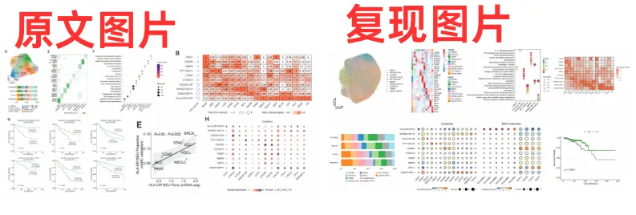
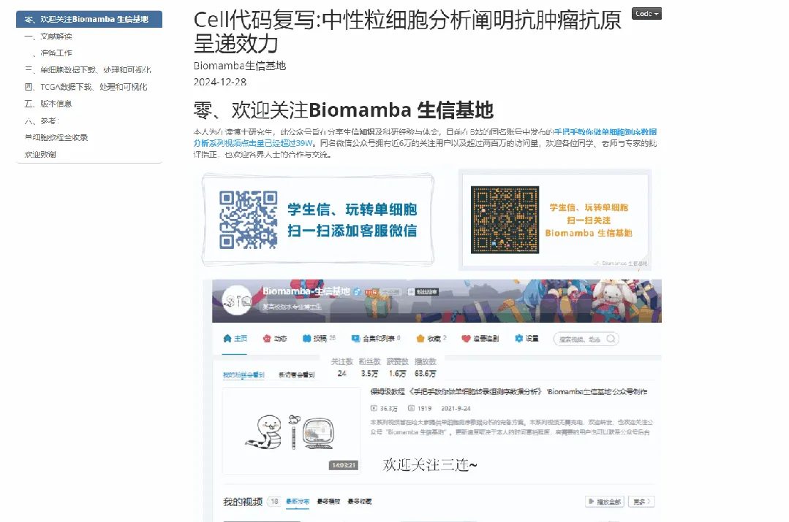
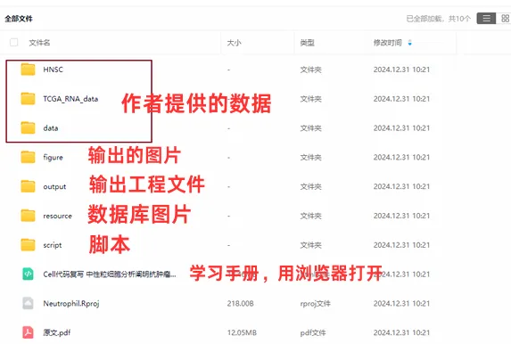

# 《Cell》复现|中性粒细胞scRNA-seq图谱阐明抗肿瘤抗原呈递效力

> 原文：https://mp.weixin.qq.com/s?__biz=MzAwMzIzOTk5OQ==&mid=2247526776&idx=1&sn=99eb6a16c7bf345445b6ff4b61110138&chksm=9b3c1028ac4b993e5cdd2ef10956a2b9fbea0075487feec8fcfaef442b8c5eabd1500eb9c2c3#rd
> 合集：单细胞教程全收录 / 全文复现

****

学习手册

 本次教程中，我们复写了题为"**Neutrophil profiling illuminates anti-tumor antigen-presenting potency** "的文章(DOI: 10.1016/j.cell.2024.02.005)。中性粒细胞是最丰富的免疫细胞之一，负责病原体防御，但在不同类型的癌症中发挥着相反的作用。由于中性粒细胞的**半衰期较短** ，研究它们在癌症中的命运变化充满挑战。这篇文章的结果揭示了中性粒细胞在癌症中的异质性，并为抗原呈递中性粒细胞的治疗机会提供了新的思路。本文分析了来自**143名** 患者、**225个** 样本的**17种** 癌症类型的单细胞转录组数据，发现**中性粒细胞** 具有**10种** 不同的状态，包括炎症、血管生成和抗原呈递。主要发现包括：(1)抗原呈递程序与大多数癌症的良好生存预后相关，并且通过亮氨酸代谢和组蛋白H3K27ac修饰激活。(2)中性粒细胞能够促进抗原特异性和非特异性T细胞反应。(3)亮氨酸饮食或中性粒细胞输送可以调节免疫平衡，从而提高小鼠癌症模型中抗PD-1治疗的效果。(4)我们还额外加入了scRNA联合TCGA数据分析流程进行生存分析验证

本教程基于Linux中的Rstudio环境演示，计算资源不足的同学可参考：
[足够支持你完成硕博生涯的生信环境](<http://mp.weixin.qq.com/s?__biz=MzAwMzIzOTk5OQ==&mid=2247511780&idx=1&sn=3acc0874f7d2fa75f1abbe7a9a9b4069&chksm=9b3cd7b4ac4b5ea27d4d53964e4a4a9fa8c806a19103729dd4ff0fa72e621411f46a251d269f&scene=21#wechat_redirect>)
[配置一个心仪的工作站(硬件+环境配置)](<http://mp.weixin.qq.com/s?__biz=MzAwMzIzOTk5OQ==&mid=2247519707&idx=1&sn=73dcab26f9b2ed75a954327317d07112&chksm=9b3cf48bac4b7d9df5b5a432fbe70d4f9c13bc8d739aa401732614f022223d1912642a7e4bea&scene=21#wechat_redirect>)
[独享服务器，生信分析不求人](<http://mp.weixin.qq.com/s?__biz=MzAwMzIzOTk5OQ==&mid=2247503618&idx=1&sn=ca47ca985aa8560f6b38f15f210519e2&chksm=9b3cb652ac4b3f44292560071b7e98e2f6fa6ec03581cd882a4d59b9d7fa063a5b9ac1b923f3&scene=21#wechat_redirect>)
[为实验室准备一份生物信息学不动产](<http://mp.weixin.qq.com/s?__biz=MzAwMzIzOTk5OQ==&mid=2247492383&idx=1&sn=b8d912877cb38e8d8c9084d1d9370ded&chksm=9b3c9a4fac4b135926091a8af972c45a17a2fa1f94c704779c60df5f733847036c3797894c1c&scene=21#wechat_redirect>)

本教程**复现集锦** ：

**-Biomamba**

所见即所得

学习手册以html文件格式提供，可在浏览器中打开并翻阅学习：‍

‍

**
**

**教程目录** ：

**一、文献解读**

1.0 原文回顾‍1.1 背景介绍1.2 主要内容1.3 复现集锦

**二、准备工作**

2.1 硬件准备
2.2 单细胞基础

**三、数据下载、处理和可视化**

3.1 读取数据、数据整理、信息整理3.2 UMAP图3.3 细胞分组比例图
3.4 细胞Marker热图3.5 Ro/e分析3.6 基因分组表达气泡图3.7 亚群功能富集分析3.8 亚群signature构建

**四****、****TCGA数据下载、处理和可视化**

1 使用GDC门户下载数据2.使用TCGABiolinks下载数据

**五、版本信息**

**六**、** 参考**

文末下载链接中包含的内容：

测试文件约**8.94GB** ，大家注意按需下载！

解锁前需阅读：**[2025订阅须知](<https://mp.weixin.qq.com/s?__biz=MzAwMzIzOTk5OQ==&mid=2247526751&idx=1&sn=7ca3137d770f23f0c3d6195696618d81&scene=21#wechat_redirect>)**

订阅后获取学习手册下载链接：

