# 零代码复现《NC》+1

> 原文：https://mp.weixin.qq.com/s?__biz=MzAwMzIzOTk5OQ==&mid=2247527812&idx=1&sn=26745eb65570f442bab31ef617818c78&chksm=9b3c14d4ac4b9dc2a8785311bf977da842f1f168a98e9f7b95b463749d66731661e1217c0726#rd
> 合集：单细胞教程全收录 / 单细胞云平台

**写在前面**

此前我们在[生信基地](<https://mp.weixin.qq.com/s?__biz=MzAwMzIzOTk5OQ==&mid=2247522649&idx=1&sn=a3a3df860fd162691403281356dcbf1d&scene=21#wechat_redirect>)举办了[生信基地第一课| 1.5天学会单细胞分析](<https://mp.weixin.qq.com/s?__biz=MzAwMzIzOTk5OQ==&mid=2247522889&idx=1&sn=d70f64a6624825b80c70362483ebd637&scene=21#wechat_redirect>)的交流活动，活动结束后有的同学表示在半天就完成了复现NC的作业：

经过1.5d的学习，我们布置了如下文献结果复现作业：

文章标题：Single cell analysis in head and neck cancer reveals potential immune evasion mechanisms during early metastasis

文章中文标题：对头颈部癌症的单细胞分析揭示了早期转移过程中潜在的免疫逃逸机制。

文章链接：https://www.nature.com/articles/s41467-023-37379-y

发表期刊：《Nature Communications》

1.如下图的文章展示 进行大群注释、组间umap图、各细胞类型marker基因小提琴图展示、细胞类型占比分布

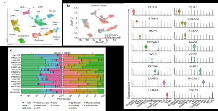

2.对肿瘤细胞（就是上皮细胞，拷贝数变异已确定）完成细胞亚群分析（图a），对个样本上皮细胞EMT基因集打分（图b）；对HN251、HN279样本的肿瘤细胞进行组间拟时序分析（图c、d）

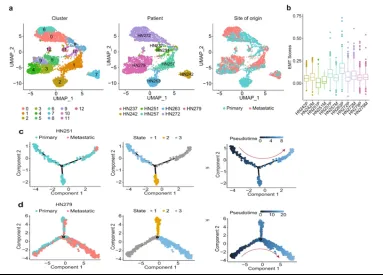

**复现过程及结果**

学完了1.5d的课程后，这位同学已经可以输出以下内容啦，其实很多复现的内容相差无几，甚至图片要比原文更加美观~

1.创建流程之后选择数据，将数据添加到流程并且分组

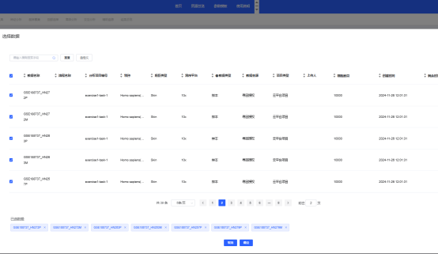

2.打开新流程之后可以看见初始化之后各组细胞量的表达情况

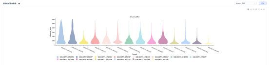

3.进行细胞过滤

参考文献的过滤参数（黄色）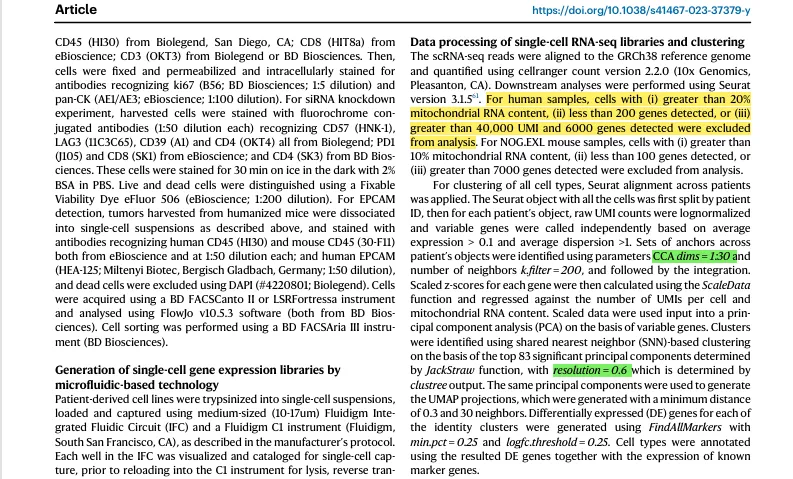

设置过滤参数

4.整合

使用文章中的方法进行整合和聚类（绿色）

设置整合参数

结果

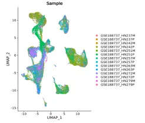

设置聚类参数

结果

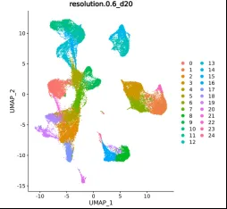

5.大群注释

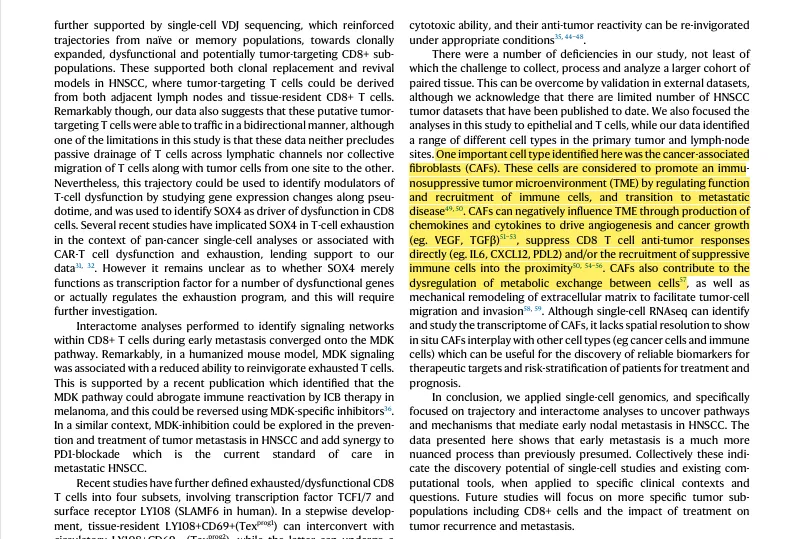

根据文献的手动注释与云平台自动注释相结合

注释结果

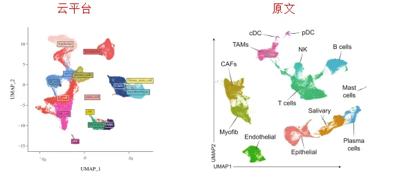

分组情况

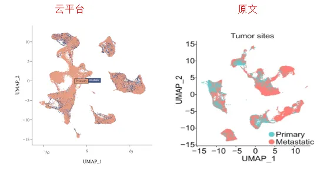

6.不同细胞类型在不同样本的占比情况

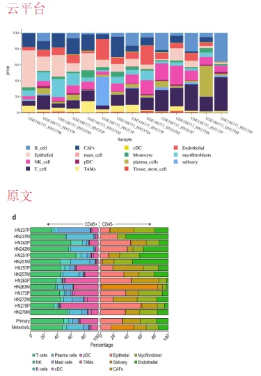

7.亚群分析

7.1亚群提取之后进行分组

7.2根据文献进行参数设置

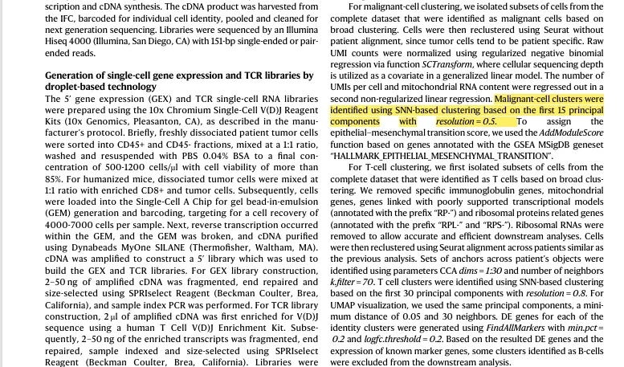

结果

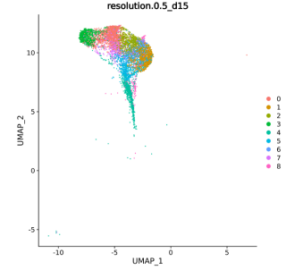

7.3根据文献进行亚群注释与分群

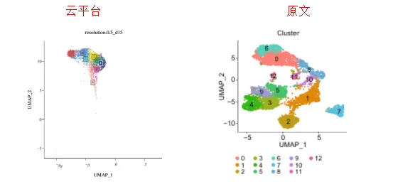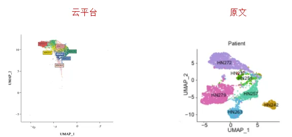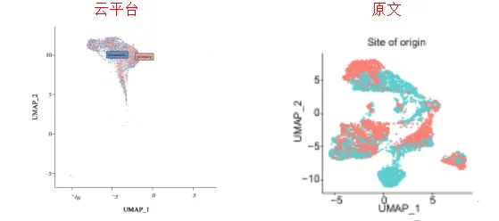

7.4EMT基因集打分情况

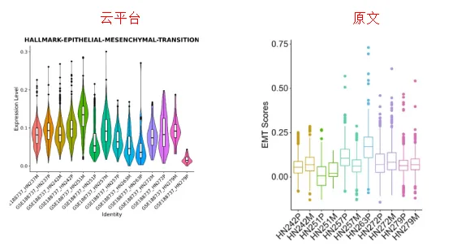

7.5拟时序分析

点击高级分析，选择monocle2

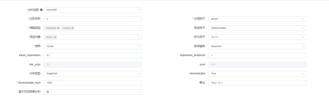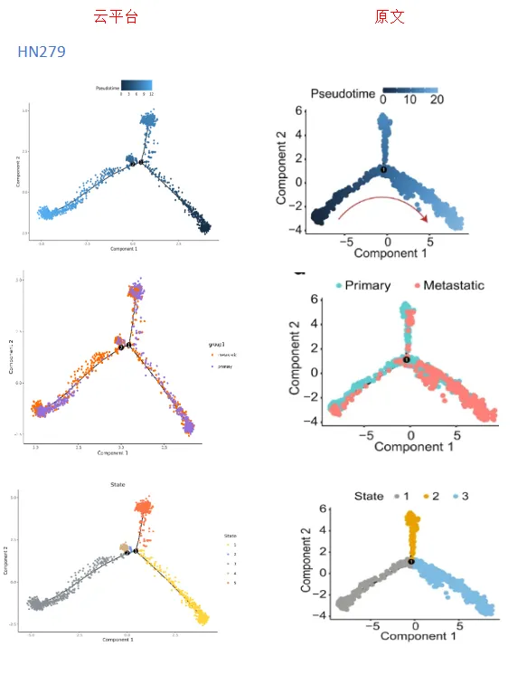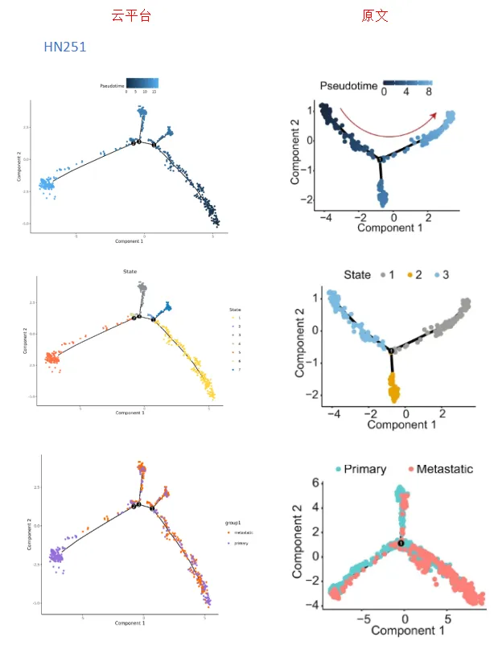

总是有小伙伴在学我们的单细胞**代码** 教程(**[两百篇单细胞知识帖](<https://mp.weixin.qq.com/s?__biz=MzAwMzIzOTk5OQ==&mid=2247522475&idx=1&sn=84dd9a65348528be9aa2b8d2711d776c&scene=21#wechat_redirect>)**)时深感头疼，密密麻麻的代码、繁琐的流程、巨大的数据量，这些都是劝退大家的门槛。这对这一现象，**Biomamba** 联合**寻因生物** 发布了科研利器——**[SeekSoul Online单细胞云平台](<https://mp.weixin.qq.com/mp/appmsgalbum?__biz=MzAwMzIzOTk5OQ==&action=getalbum&album_id=3403706694394970115&scene=173&subscene=&sessionid=svr_69f8cb7b2da&enterid=1713928791&from_msgid=2247510401&from_itemidx=1&count=3&nolastread=1&token=1053256417&lang=zh_CN#wechat_redirect>)** 及对应的**《[2周教你学会单细胞生信全套分析](<https://mp.weixin.qq.com/mp/appmsgalbum?__biz=MzAwMzIzOTk5OQ==&action=getalbum&album_id=3403706694394970115&scene=173&subscene=&sessionid=svr_69f8cb7b2da&enterid=1713928791&from_msgid=2247510401&from_itemidx=1&count=3&nolastread=1&token=1053256417&lang=zh_CN#wechat_redirect>)》**课程，准备好**零代码** 发单细胞文章吧！

云平台访问链接：https://seeksoul.online/t_static/Biomamba/Biomamba.html

往期云平台使用视频教程可参考：[单细胞云平台教程全收录](<https://mp.weixin.qq.com/mp/appmsgalbum?__biz=MzAwMzIzOTk5OQ==&action=getalbum&album_id=3403706694394970115&scene=173&subscene=&sessionid=svr_69f8cb7b2da&enterid=1713928791&from_msgid=2247510401&from_itemidx=1&count=3&nolastread=1#wechat_redirect>)

体验反馈问卷链接：https://www.wjx.cn/vm/QIX0xRI.aspx#

各位同学需要**联系您的专属在线客服，获取demo数据后，进行操作学习。**

****

**视频教程**

本系列视频我们将进行拆解动作，完整视频教程可见合集：

[SeekSoul® Online单细胞云平台](<https://mp.weixin.qq.com/mp/appmsgalbum?__biz=MzAwMzIzOTk5OQ==&action=getalbum&album_id=3403706694394970115&scene=173&subscene=&sessionid=svr_1006a9b5456&enterid=1729128003&from_msgid=2247522176&from_itemidx=2&count=3&nolastread=1#wechat_redirect>)

**如何联系我们**

 公众号后台消息回复不便，这里给大家留一下领取资料及免费服务器([足够支持你完成硕博生涯的生信环境](<http://mp.weixin.qq.com/s?__biz=MzAwMzIzOTk5OQ==&mid=2247507693&idx=1&sn=d9517a0803ad75cb7be430806834e7b8&chksm=9b3ca7bdac4b2eaba1ad01ed04ab1fbcbafcf4f6ddfe9e4f76ed9229707f545fe7d9c9ffd6ae&scene=21#wechat_redirect>))的**微信号** ，方便各位随时交流（别问在么，添加时直接说来意）。呼声很高的**交流群** 也建好了，欢迎大家入群讨论：

[永久免费的生信、科研交流群](<http://mp.weixin.qq.com/s?__biz=MzAwMzIzOTk5OQ==&mid=2247505868&idx=2&sn=20c81313eaef9a7031a84ef3a691d1b5&chksm=9b3cae9cac4b278a42c8de97e864c7664a37e9a4adb5973625fe3f8dd1093e55aeda88d443aa&scene=21#wechat_redirect>)

大家可以阅读完这几篇之后添加[给生信入门初学者的小贴士](<http://mp.weixin.qq.com/s?__biz=MzAwMzIzOTk5OQ==&mid=2247493329&idx=1&sn=597870b7f7ce10346da3561e7c281627&chksm=9b3c9f81ac4b169794088ce9abbcacb5f18e9fd174fc0d7e28da62d78facadf3100ef38aaf22&scene=21#wechat_redirect>)
[如何搜索公众号过往发布内容](<http://mp.weixin.qq.com/s?__biz=MzAwMzIzOTk5OQ==&mid=2247506266&idx=2&sn=22b1164bc9602c25620d058847785422&chksm=9b3ca00aac4b291c16d738271746ffb90149282a728f484e8a1952463c46a8e7dc4f883ab928&scene=21#wechat_redirect>)

**已有生信基地联系方式的同学****无需重复添加**

 您点的每个赞和在看，我都认真当成了喜欢
