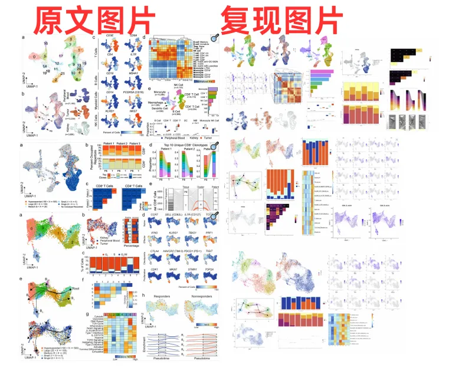
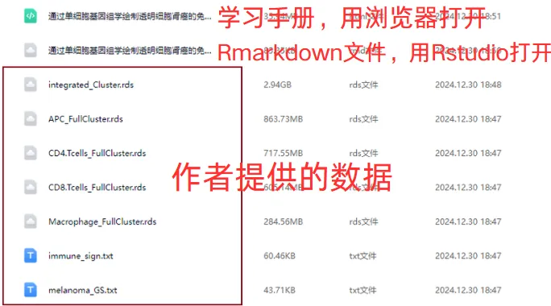

# 代码复现|scRNA-seq绘制透明细胞肾癌的免疫微环境

> 原文：https://mp.weixin.qq.com/s?__biz=MzAwMzIzOTk5OQ==&mid=2247527498&idx=1&sn=c8282e9d4175bfb2e572278312073d81&chksm=9b3c151aac4b9c0c2ac7f0c184f5bba183b52a6c9b9f4e30d0494ef752df0cd216afe15dbf2f#rd
> 合集：单细胞教程全收录 / 全文复现

****

学习手册

 本次教程中，我们复写了题为"Mapping the immune environment in clear cell renal carcinoma by single-cell genomics"的文章(doi: 10.1038/s42003-020-01625-6)。本文表征了Clear cell renal cell carcinoma（ccRCC）的肿瘤免疫微环境，作者对3例ccRCC配对患者的肿瘤和血液组织进行scRNA-seq测序和TCR测序，绘制了CD45+淋巴细胞和髓系细胞图谱。另外还纳入了来自另外四个个体的11,367个来自正常肾脏和外周血的免疫细胞，以促进ccRCC特异性差异的识别和评估。主要发现包括：(1)与正常肾组织相比，肿瘤浸润的免疫细胞中的CD8+T细胞和巨噬细胞总体增加(2)证明了肿瘤浸润性CD8+T细胞的不同细胞转录状态(3)确定了MKI67+增殖亚群是ccRCC进展的潜在罪魁祸首本教程基于Linux中的Rstudio环境演示，计算资源不足的同学可参考：
[足够支持你完成硕博生涯的生信环境](<http://mp.weixin.qq.com/s?__biz=MzAwMzIzOTk5OQ==&mid=2247511780&idx=1&sn=3acc0874f7d2fa75f1abbe7a9a9b4069&chksm=9b3cd7b4ac4b5ea27d4d53964e4a4a9fa8c806a19103729dd4ff0fa72e621411f46a251d269f&scene=21#wechat_redirect>)
[配置一个心仪的工作站(硬件+环境配置)](<http://mp.weixin.qq.com/s?__biz=MzAwMzIzOTk5OQ==&mid=2247519707&idx=1&sn=73dcab26f9b2ed75a954327317d07112&chksm=9b3cf48bac4b7d9df5b5a432fbe70d4f9c13bc8d739aa401732614f022223d1912642a7e4bea&scene=21#wechat_redirect>)
[独享服务器，生信分析不求人](<http://mp.weixin.qq.com/s?__biz=MzAwMzIzOTk5OQ==&mid=2247503618&idx=1&sn=ca47ca985aa8560f6b38f15f210519e2&chksm=9b3cb652ac4b3f44292560071b7e98e2f6fa6ec03581cd882a4d59b9d7fa063a5b9ac1b923f3&scene=21#wechat_redirect>)
[为实验室准备一份生物信息学不动产](<http://mp.weixin.qq.com/s?__biz=MzAwMzIzOTk5OQ==&mid=2247492383&idx=1&sn=b8d912877cb38e8d8c9084d1d9370ded&chksm=9b3c9a4fac4b135926091a8af972c45a17a2fa1f94c704779c60df5f733847036c3797894c1c&scene=21#wechat_redirect>)

本教程**复现集锦** ：

**-Biomamba**

所见即所得

学习手册以html文件格式提供，可在浏览器中打开并翻阅学习

**教程目录** ：

**一、准备工作**

1.1 硬件准备
1.2 单细胞基础

**二、文献解读**

2.1 摘要2.2 主要内容2.3 总结讨论

**三、文章复现**

3.1 复现集锦3.2 数据下载3.3 ccRCC中免疫细胞的单细胞图谱3.4 外周血和肿瘤中CD8+T和CD4+T克隆型比较3.5 ccRCC中CD8+T细胞存在不同亚群转录连续体3.6 ccRCC中CD4+T细胞亚群特征识别3.7 ccRCC中巨噬细胞分化差异

**四、****环境版本信息**

**五、参考**

文末下载链接中包含的内容：

测试文件约**5.39GB** ，大家注意按需下载！

解锁前需阅读：[2025订阅须知](<https://mp.weixin.qq.com/s?__biz=MzAwMzIzOTk5OQ==&mid=2247526751&idx=1&sn=7ca3137d770f23f0c3d6195696618d81&scene=21#wechat_redirect>)

文末还可解锁以下内容

2025订阅合集持续更新中，联系客服微信[**Biomamba_yunying**]可以219￥获取全部资料(包括今年后面更新的内容)。当然，付费不是目的，以下资料都可以通过**转发领取**(更推荐这种方式)。

[2025订阅须知](<https://mp.weixin.qq.com/s?__biz=MzAwMzIzOTk5OQ==&mid=2247526751&idx=1&sn=7ca3137d770f23f0c3d6195696618d81&scene=21#wechat_redirect>)目前我们还[开放终身订阅~](<https://mp.weixin.qq.com/s?__biz=MzAwMzIzOTk5OQ==&mid=2247526967&idx=1&sn=3e4e9acabd6061d7e3dab8cd52924bcc&scene=21#wechat_redirect>)

订阅后获取学习手册下载链接：

