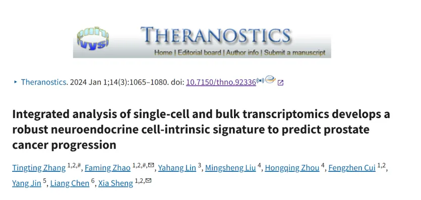
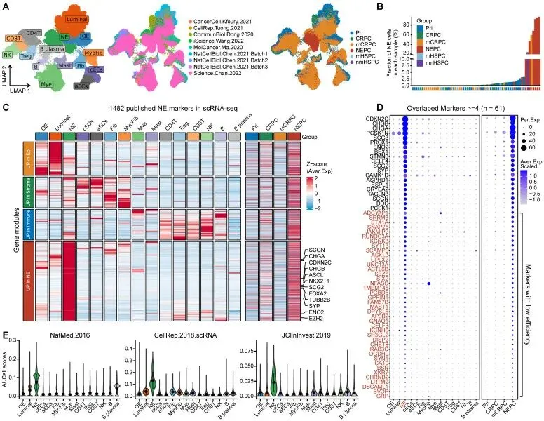
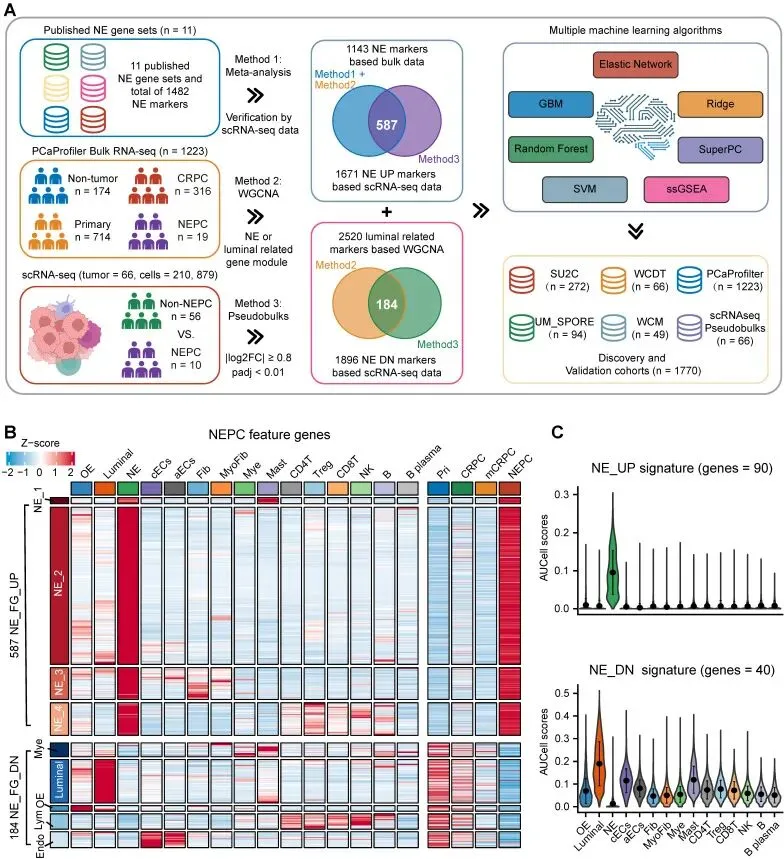
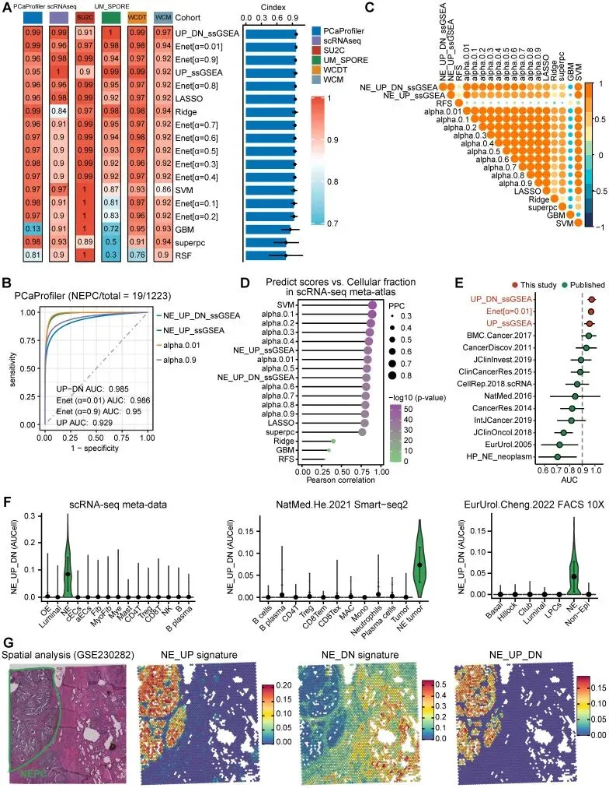
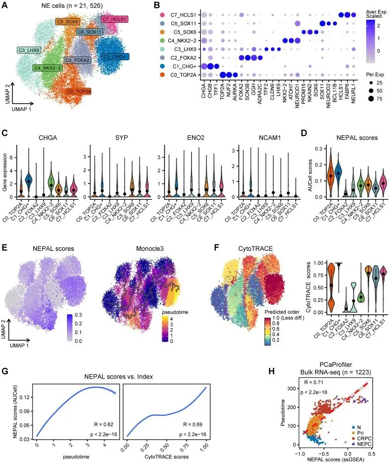
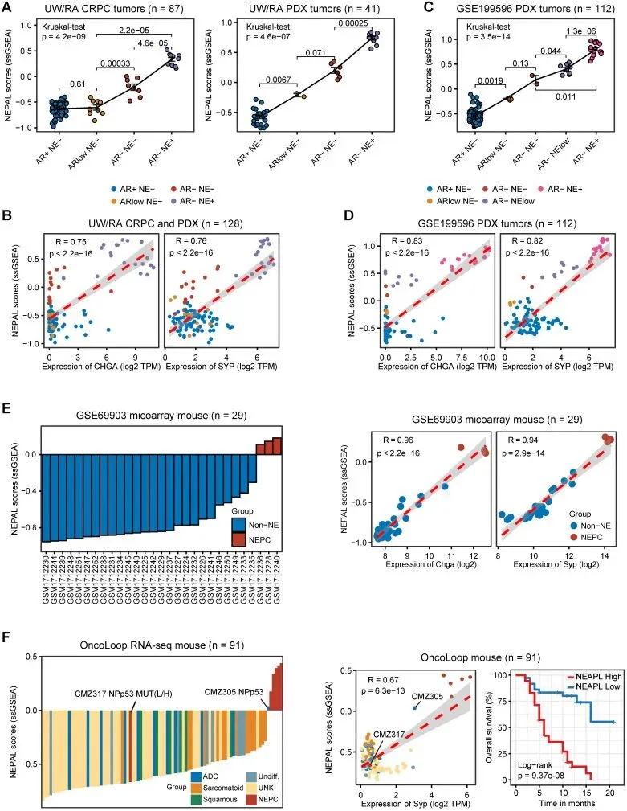
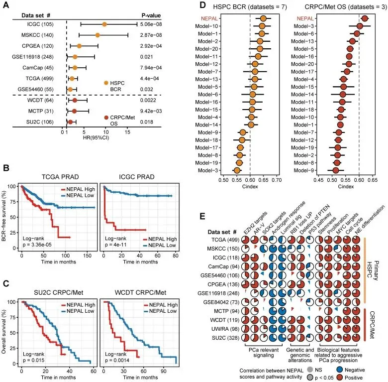
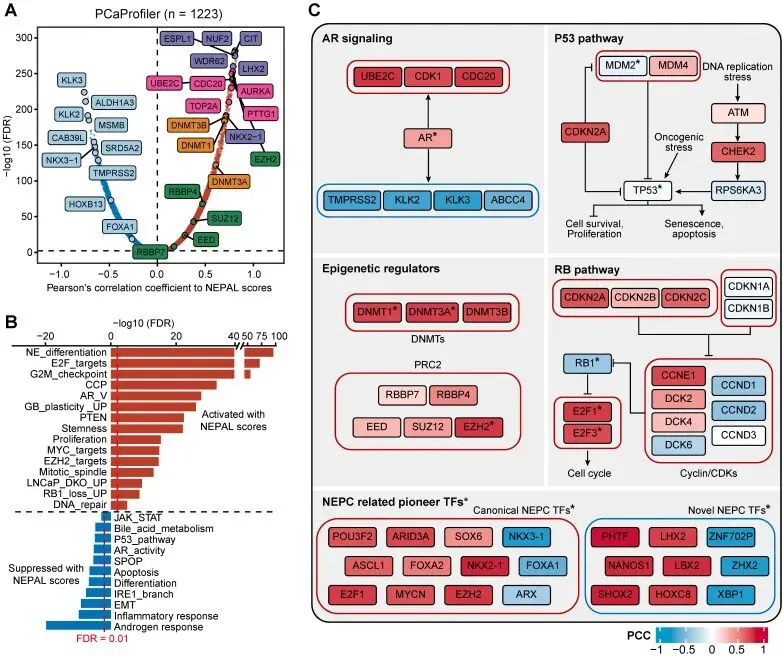

# IF=12.4| sc联合Bulk RNA：构建预测前列腺癌的神经内分泌细胞内在特征

> 原文：https://mp.weixin.qq.com/s?__biz=MzAwMzIzOTk5OQ==&mid=2247528154&idx=1&sn=7665d8dd86083b7818d04474310c1cb8&chksm=9b3c178aac4b9e9c7b12ab42c6c907b02a9ac3260ab59cdfe15b00810972dff393b566bafdc0#rd
> 合集：单细胞教程全收录 / 文献速递

**一、写在前面**

本次分享的文章于2024年01月发布在《THERANOSTICS》（IF=12.4）****，**** 感兴趣的同学可以看看原文：Tingting zhang, Faming zhao,  Yahang Lin,et al."Integrated analysis of single-cell and bulk transcriptomics develops arobust neuroendocrine cell-intrinsic signature to predict prostatecancer progression" ，THERANOSTICS, 2024 Jan 1;14(3):1065-1080.doi: 10.7150/thno.92336  .原文链接：https://pmc.ncbi.nlm.nih.gov/articles/PMC10797290  

**前列腺癌（PCa）** 是男性中最常见的恶性肿瘤之一，**其病程复杂、异质性强，尤其当其进展为神经内分泌型前列腺癌（NEPC）时，治疗难度骤增，患者预后显著恶化。** 精准识别NEPC细胞不仅是破解PCa演化机制的核心难题，也是优化临床诊断和治疗方案的迫切需求。然而，**传统NEPC生物标志物在灵敏度和特异性上的不足，长期以来限制了其在基础研究与临床实践中的应用。**

这篇研究另辟蹊径，通过整合**单细胞RNA测序（scRNA-seq）和Bulk转录组学数据，开发了一个全新的NEPC风险预测模型——NEPAL。** 该模型利用先进的**机器学习算法** 和**大规模数据集** ，不仅突破了传统标志物的局限，还展现出卓越的预测能力和多功能性。NEPAL能够揭示NEPC的分子特征，为PCa的动态监测、预后评估和治疗反应预测提供稳健支持。这一创新工具的诞生，不仅为PCa研究注入了新的活力，也为精准医疗的落地铺平了道路。

如果大家需要数据库搭建、分析**指导** 、生信热点**全文复现** 、自测数据**个性化分析** 辅导，欢迎联系客服微信[**Biomamba_yunying**]

对转录组学、scRNA-seq分析及联合分析感兴趣的同学可参考：
[scRNA-Seq学习手册Seurat V5更新版](<https://mp.weixin.qq.com/s?__biz=MzAwMzIzOTk5OQ==&mid=2247519711&idx=1&sn=d25d4f5daf609bda8367f16db676ecf3&scene=21#wechat_redirect>)[Bulk RNASeq| 转录组实战](<https://mp.weixin.qq.com/s?__biz=MzAwMzIzOTk5OQ==&mid=2247526649&idx=5&sn=03f0f8490b71f61341793a69048efd20&scene=21#wechat_redirect>)[应审稿人要求| pseudo bulk差异分析](<https://mp.weixin.qq.com/s?__biz=MzAwMzIzOTk5OQ==&mid=2247521437&idx=1&sn=d47b48170f7189b8fb74b2316d0c4898&scene=21#wechat_redirect>)

**二、主要结果**

****

1.既往 NEPC 基因集一致性差、效力低

在这项研究中，研究团队首先着手收集并详细分析了**11个已发表的NE标志物基因集。** 这些基因集涵盖了Bulk转录组数据、正常前列腺的单细胞RNA测序（scRNA-seq）数据，以及MSigDB数据库中的泛NE肿瘤基因集（详见表 S2）。他们发现，这11个基因集总共包含**1482个上调表达的NE标志物（NEPC_Meta）** ，**但这些基因集之间的一致性却出奇地差——仅有61个基因在超过4个基因集中重叠出现** （见图 S1A）。这一观察凸显了现有NEPC基因集的局限性。

研究者们全面地检验了这些NE标志物的灵敏度和实用性，通过对**9个已发表的人类前列腺癌（PCa）scRNA-seq数据集** ，精心构建了一个**综合性参考图谱** 。这个图谱整合了**66个PCa肿瘤样本中的210,879个单细胞** ，覆盖了从原发性HSPC到NEPC的多种肿瘤类型（见图 1A和表 S1）。通过生物标志物，他们精准划分出**15种不同的细胞类型** （见表 S1），并进一步统计了每个样本中NE肿瘤细胞的分布情况（见图 1B）。出乎意料的是，研究团队发现竟然有**超过一半的NE标志物（894/1482）并非NE肿瘤细胞独有** ，或者仅在部分具有NE特征的患者样本中表达（见图 1C和图 S1B）。更深入的分析中，他们还注意到，在重叠率较高的61个基因中，有41个基因在NE肿瘤细胞中的表达丰度偏低（百分比表达<20%）（见图 1D），**这表明这些基因的实际检测效率并不理想** 。

为了进一步验证这一结论，他们运用了**AUCell富集分析方法** ，逐一计算了每个基因集的NE评分。结果显示**，大多数基因集在识别scRNA-seq数据中的NE肿瘤细胞时，特异性都表现得不够理想** （见图 1E和图 S1C）。通过这一系列严谨的分析，研究团队明确指出，**既往的NEPC基因集在一致性、灵敏度和特异性方面存在显著不足，整体效力普遍偏低。** 这一发现不仅揭示了当前研究的短板，也为后续开发更高效的NEPC预测工具提供了关键依据。

图 1

#### 2.基于大型 scRNA-seq 和整体 RNA-seq 综合数据库构建 NEPC 分类器

为了挖掘出更高质量的NEPC特征标志物，研究团队精心设计了一个**综合分析流程** 。他们整合了已发表的NEPC_Meta标志物、基于整体RNA-seq数据集PCaProfiler（包含1223个样本，见图 S2A）的**WGCNA基因模块** （通过软阈值β=6构建无尺度网络，并合并相似性>0.8的模块），以及他们自己组装的**PCa scRNA-seq综合图谱** （见图 2A和方法部分）。通过这一努力，成功鉴定出**587个上调和184个下调的NEPC特征基因，统称为NE_FG** （见图 2B和表 S3）。考虑到癌症细胞内在基因表达特征在临床上的重要价值，研究者们进一步通过将NE_FG与NE肿瘤细胞的差异表达基因（DEGs）重叠，提炼出两个精简的NE细胞内在基因特征：**NE_UP（90个基因）** 和**NE_DN（40个基因）** （见图 2C和表 S3）。点图显示，他们观察到**NE_UP特征基因在NE肿瘤细胞中普遍具有高表达水平** （百分比表达>20%，见图 S2B）。

为了打造一个强大的NEPC预测模型，他们在**SU2C训练集** 上应用了**7种经典机器学习算法** （基于NE_FG），包括弹性网络、LASSO等。此外，作者团队还创新性地基于**ssGSEA算法** ，构建了一个结合NE_UP和NE_DN的**NE_UP_DN模型** （见方法部分）。随后，利用这些预测因子，计算了6个包含NEPC肿瘤的数据集中每个样本的NEPC风险评分。为了评估模型性能，他们计算出每种算法的**平均C指数** （见图 3A）和**R2值** （见图 S2C）。令人兴奋的是，大多数预测因子表现出较高的C指数，这或许得益于他们筛选出的高质量NE标志物。在众多模型中，研究者们发现**NE_UP_DN_ssGSEA** 、**Enet [α=0.01]** 和**NE_UP_ssGSEA** 位列前三，ROC曲线下面积（AUC）均超过0.90（见图 3B）。除RSF和GBM模型外，他们还注意到大多数预测因子在NEPC风险评分上显示出较高的Pearson相关系数（见图 3C）。利用scRNA-seq综合图谱，团队进一步揭示，这些算法预测的NEPC风险评分与NE肿瘤细胞的细胞分数之间同样具有较高的相关性（见图 3D）。与此同时，研究者们通过在6个验证数据集上计算AUC指数，将他们的模型与11个已发表的NEPC_Meta基因集进行对比，结果表明**前三名模型一致优于以往的基因列表** （见图 3E）。这一系列发现充分展示了研究团队在构建高效NEPC分类器上的卓越成就。

为了检验模型的可靠性，研究团队特意挑选了最佳分类器NE_UP_DN特征，并在多个数据集上对其预测性能进行了严格评估。他们选择了scRNA-seq综合图谱，并额外引入了三个验证数据集：**a. 基于Smart-seq2的scRNA-seq数据集** ，**b. 基于荧光激活细胞分选（FACS）的单细胞数据集** ，**c. 从头构建的NEPC与HSPC共存的空间基因表达图谱** 。他们发现，结合AUCell算法的NE_UP_DN在所有这些验证集中都能精准预测NEPC细胞状态（见图 3F-G）。通过这些测试，研究者们得出结论，他们的模型能够**基于整体和单细胞来源的转录组数据，稳健地区分出具有NE特征的肿瘤** 。这一发现令人信服地展示了模型的强大能力。值得一提的是，研究团队决定在后续分析中采用NE_UP_DN特征，并正式将其命名为**NEPC算法（NEPAL）** ，为接下来的研究奠定了坚实基础。

图 2

图 3

#### 3.NEPAL 描绘 PCa 进展路径

研究团队不满足于仅仅区分NEPC，他们还大胆假设**NEPAL能够量化NEPC的进展** ，因为这一模型巧妙地将上调和下调的NE细胞内在特征基因纳入其中。为了验证这一设想，他们首先对scRNA-seq综合图谱中的**21,526个NE肿瘤细胞进行了重新聚类** ，成功划分出**8个常见的NEPC亚群** （见图 4A-B）。与最近一份报告的结论相符，研究者们观察到**经典NE标志物（如 _CHGA_ 、 _SYP_ 、 _ENO2_ 和 _NCAM1_ ）在这些亚群中的表达并不均匀**（见图 4C）。更令人兴奋的是，基于**AUCell算法的NEPAL** 几乎在所有NEPC亚群中都表现出稳定的表达（见图 4D）。随后，团队进一步通过**伪时间和CytoTRACE分析** ，探索了这8个NEPC亚群的演化轨迹（见图 4E-F），结果显示这些轨迹与NEPAL风险评分高度吻合（见图 4G）。这一发现清楚地表明，**NEPAL在预测NEPC进展方面具有显著的实用价值** 。

研究团队还发现**NEPAL风险指数与PCaProfiler数据集中的伪时间评分之间存在显著的相关性** （见图 4H）。他们并未止步于此，而是在四个独立数据集（TCGA PRAD、CamCap、ICGC PRAD和CPGEA）中进一步检验了NEPAL风险指数与Gleason评分的关系。研究者们注意到，**在没有去势或NE特征的原发性肿瘤中，这种相关性既一致又显著** （见图 S3A）。综合这些成果，团队得出结论，**NEPAL不仅能追踪NEPC的进展，还能有效预测从激素敏感性到难治性阶段的PCa疾病演化路径** ，为理解前列腺癌的动态变化提供了强大工具

图 4

#### 4.NEPAL 在 PCa 实验模型中的应用

为了进一步验证其实用价值，研究团队决定将NEPAL应用于**前列腺癌（PCa）实验模型的转录组数据** ，探索其在不同体系中的表现。他们首先针对来自CCLE的**8个人类PCa细胞系** 进行了测试，结果显示，**NEPAL准确地将NEPC细胞系NCHI-H660判定为具有最高的NEPC风险评分** 。紧随其后的是CRPC细胞系（如DU145、22RV1和PC3），而激素依赖性细胞系（如MDA-PCa-2B和LNCaP）则呈现出最低的NEPC风险评分（见图 S3B）。更值得注意的是，研究者们发现**NEPAL评分与经典NE标志物（如 _CHGA_ 和 _SYP_ ）之间存在较高的Pearson相关系数**（见图 S3B），这进一步验证了模型的可靠性。

团队成员并未就此止步，他们还将NEPAL应用于**2个人类PCa PDX肿瘤和3个PCa转基因小鼠模型** 生成的整体转录组数据集。**UW/RA PDX数据库** 包含128个人类PCa肿瘤的转录组数据，其中包括87个CRPC和41个PDX肿瘤。引人注目的是，在患者和PDX肿瘤中，他们观察到**NEPAL评分与AR/NE状态的演变密切相关** （见图 5A）。一致的结果显示，**预测的NEPC风险评分与NE标志物之间同样具有较高的Pearson相关系数** （见图 5B）。在另一个独立的PDX数据集中，团队也检测到类似的关联（见图 5C-D）。而且这种表现不仅限于人类PCa，NEPAL还在两个小鼠PCa数据集（GSE69903（图 5E）和GSE90891（图 S3C））中同样表现出色。最后，他们利用最新的小鼠PCa模型RNA-seq数据集测试发现，**NEPAL再次展现出预测NEPC状态的卓越准确性，甚至能显著分层小鼠的生存期** （见图 5F）。通过这一系列验证，研究团队有力地证明，**NEPAL作为区分NEPC的有效工具，在多种实验模型中都表现出强大的适用性和可靠性** 。

图 5

#### 5.NEPAL 的预后价值和生物学相关性

为了探究NEPAL模型在预后预测中的潜力，研究团队精心收集了**12个独立的Bulk转录组数据集** ，包括8个原发性HSPC数据集和4个CRPC/Met数据集，总计**超过2000个人类PCa样本** ，其中10个数据集提供了可用的预后信息。他们惊喜地发现，**NEPAL能够有效区分HSPC患者的生化复发（BCR）和晚期PCa患者的总生存期（OS）** （见图 6A-C）。基于包括激素治疗、化疗和第二代AR信号抑制（ARSI）在内的治疗信息，**NEPAL还能可靠预测患者对化疗和ARSI的耐药性** （见图 S4A）。进一步分析显示，在SU2C、UM/SPORE、MCTP和CPGEA数据集中，未接受治疗和接受过治疗的患者组之间NEPAL评分并无显著差异（见图 S4B-D），这表明患者既往治疗史对NEPAL预后准确性的影响微乎其微。为了全面比较NEPAL的预后能力，团队还汇集了**20个已发表的预后模型** （由不同机器学习算法生成，见表 S2），并将其与传统临床参数（如PSA评分、Gleason评分和肿瘤分期）进行对照。结果通过**C指数** 清楚地表明，在10个多中心PCa数据集中，**NEPAL的预测效能显著优于其他模型和传统参数** （见图 6D和图 S4E），充分揭示了NEPAL在预后预测中的稳健性。

**NEPAL风险评分与谱系可塑性相关的通路（如EZH2、SOX2和NE分化）的活性，以及所有数据集中RB1、PTEN和TP53信号的缺失，呈现出显著的相关性** （见图 6E）。他们还发现，**NEPAL风险评分与晚期PCa的多个标志（如AR-V、细胞周期进程、MYC靶标、增殖和干性）显著正相关，而与雄激素反应和管腔特征呈负相关** （见图 6E）。通过这些分析，研究者们得出结论，**NEPAL不仅在预测PCa患者的预后和治疗反应方面表现出色，还能有效揭示与疾病进展相关的分子特征** ，极大地增强了其在生物学研究中的应用价值。

图 6

#### 6.TME 成分、患者人口统计学和肿瘤分期对 NEPAL 预测准确性的影响

为了探明**肿瘤微环境（TME）成分、患者年龄和种族以及肿瘤分期** 是否会对NEPAL模型的预测准确性产生潜在偏差，研究团队特别开展了一系列分层分析。他们采用了三个TME成分指数——**基质评分、免疫评分和肿瘤纯度** ，结果显示，**无论TME组别如何变化，NEPAL模型都能稳健地预测患者结局** （见图 S4F）和NEPC风险（见图 S4G）。研究者们发现**NEPAL模型还能有效区分PCa不同亚型中具有NE特征的肿瘤** （见图 S4H），展现了其在复杂微环境中的适应能力。

研究团队进一步深入，对患者年龄、种族和癌症分期进行了分层分析。他们观察到，**NEPAL模型对患者预后的预测能力并未受到这些人口统计学和病理学因素的显著影响** （见图 S5A-H）。通过这一系列严谨的验证，得出结论：**NEPAL模型在预测NEPC风险和疾病进展方面展现出极高的普适性和有效性** 。这无疑增强了其作为可靠工具的地位，适用于不同患者群体和疾病背景。

#### 7.NEPAL 揭示 NEPC 的非遗传驱动因素

为了深入理解NEPC的遗传和非遗传驱动机制，研究团队根据NEPAL评分对TCGA PRAD和SU2C CRPC/Met数据集中的肿瘤进行了分层，并仔细分析了它们的表达谱和体细胞突变（见图 S6A-B）。他们发现了一个有趣的现象：在PCa常见的突变基因中，**只有 _TP53_ 在PRAD和CRPC/Met数据集的NEPC高风险组中显示出比低风险组更高的突变率**，而 _AR_ 和 _RB1_ 的高突变率仅在SU2C CRPC/Met数据集的高风险组中显著（见图 S6C-D）。研究者们还注意到**肿瘤突变负荷（TMB）和所有基因的突变计数与TCGA PRAD数据集中的NEPC风险评分显著相关** ，但在SU2C CRPC/Met数据集中这种相关性并不明显（见图 S6C-F），这提示遗传因素的影响可能因数据集而异。

接着，研究团队转向**PCaProfiler数据集** ，包含1223个从正常前列腺到NEPC的组织样本，评估了基因表达与NEPAL风险评分的相关性（见图 7A）。他们观察到，**随着PCa进展中管腔特征的丧失和NE特征的增强，典型的NE标志物和细胞周期基因被激活，而AR调控的分化基因则受到抑制** 。尤其重要的是，研究者们发现**编码染色质重塑因子的关键基因——如DNA甲基转移酶（DNMTs，包括 _DNMT3A_ 、 _DNMT3B_ 、 _DNMT1_ ）和多梳抑制复合物2（PRC2）的成员（如 _EZH2_ 、 _RBBP4_ 、 _SUZ12_ 、 _EED_ 和 _RBBP7_ ）——在相关性排名中名列前茅**。对TCGA PRAD和SU2C CRPC/Met数据集的相似分析进一步印证了这一发现（见图 S7A-B），有力支持了表观遗传调控因子在NEPC中的关键角色。

研究团队还通过**基于相关性排序的GSEA分析** ，揭示出**谱系可塑性相关通路（如NE分化、胶质母细胞瘤可塑性、PTEN缺失、EZH2信号传导及RB1与TP53双敲除上调信号）以及增殖和干性相关通路（如E2F靶标、G2M检查点和MYC信号传导）是最显著激活的通路** ，而与HSPC相关的通路（如雄激素反应、IRE1α-XBP1s信号传导、SPOP缺失和AR信号传导）则被抑制（见图 7B）。

最后，研究者们结合**VIPER方法** 推断的转录因子（TF）活性，分别描绘了AR信号、P53、RB1和表观遗传调控四个与NE转分化相关的通路网络（见图 7C）。他们利用NEPAL和VIPER算法，鉴定出**NEPC相关的先锋TFs** ，包括已知的FOXA2、ASCL1和MYCN，以及新发现的XBP1s、PHTF、LHX2和NANOS1（见表 S5）。而这些TFs如何单独或协同驱动NEPC进展，将是未来研究的重要方向。

图 7

**三、最后聊聊**

这篇论文通过对NEPAL模型的构建，为PCa研究和临床应用带来了令人振奋的突破。NEPAL整合单细胞与Bulk转录组学数据，显著提升了NEPC的识别精度，并为PCa进展的预测和治疗策略优化提供了可靠工具。更重要的是，研究揭示了NEPC的非遗传驱动因素（如表观遗传调控），为后续机制探索和药物靶点开发指明了方向。

从临床视角来看，NEPAL的稳健性与普适性（不受患者年龄、种族或肿瘤分期限制）赋予其巨大的转化潜力，有望助力PCa患者的精准诊断和个性化治疗。从科研角度看，作为一个开源平台，NEPAL也为深入剖析NEPC的分子复杂性和异质性提供了便利。未来，若能通过功能实验进一步验证其预测的表观遗传驱动因素，NEPAL的影响力将更加深远，推动PCa领域向精准医学加速迈进。

**四、学习手册**

对转录组学、scRNA-seq分析及联合分析感兴趣的同学可参考：
[scRNA-Seq学习手册Seurat V5更新版](<https://mp.weixin.qq.com/s?__biz=MzAwMzIzOTk5OQ==&mid=2247519711&idx=1&sn=d25d4f5daf609bda8367f16db676ecf3&scene=21#wechat_redirect>)[Bulk RNASeq| 转录组实战](<https://mp.weixin.qq.com/s?__biz=MzAwMzIzOTk5OQ==&mid=2247526649&idx=5&sn=03f0f8490b71f61341793a69048efd20&scene=21#wechat_redirect>)[应审稿人要求| pseudo bulk差异分析](<https://mp.weixin.qq.com/s?__biz=MzAwMzIzOTk5OQ==&mid=2247521437&idx=1&sn=d47b48170f7189b8fb74b2316d0c4898&scene=21#wechat_redirect>)

**如何联系我们**

 公众号后台消息回复不便，这里给大家留一下领取资料及免费服务器([免费两周学习版上架啦~](<https://mp.weixin.qq.com/s?__biz=MzAwMzIzOTk5OQ==&mid=2247527585&idx=1&sn=fa32112c11b215b33096cab43baf08ea&scene=21#wechat_redirect>))的**微信号** ，方便各位随时交流（别问在么，添加时直接说来意）。同时我们也构建了[交流群矩阵](<https://mp.weixin.qq.com/s?__biz=MzAwMzIzOTk5OQ==&mid=2247528057&idx=1&sn=bb348c2a88c977c7cce67ee6731a3591&scene=21#wechat_redirect>)，欢迎大家入群讨论。

大家可以阅读完这几篇之后添加[给生信入门初学者的小贴士](<http://mp.weixin.qq.com/s?__biz=MzAwMzIzOTk5OQ==&mid=2247493329&idx=1&sn=597870b7f7ce10346da3561e7c281627&chksm=9b3c9f81ac4b169794088ce9abbcacb5f18e9fd174fc0d7e28da62d78facadf3100ef38aaf22&scene=21#wechat_redirect>)
[如何搜索公众号过往发布内容](<http://mp.weixin.qq.com/s?__biz=MzAwMzIzOTk5OQ==&mid=2247506266&idx=2&sn=22b1164bc9602c25620d058847785422&chksm=9b3ca00aac4b291c16d738271746ffb90149282a728f484e8a1952463c46a8e7dc4f883ab928&scene=21#wechat_redirect>)

**已有生信基地联系方式的同学****无需重复添加**

 您点的每个赞和在看，我都认真当成了喜欢
