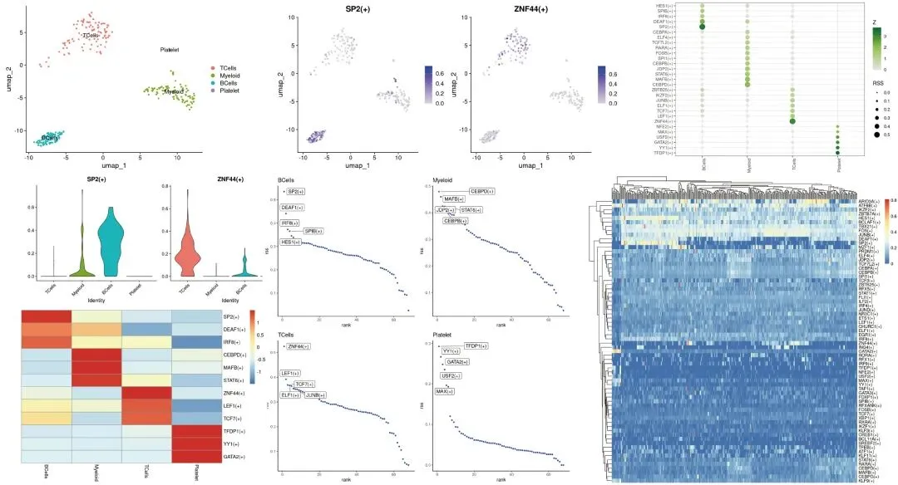
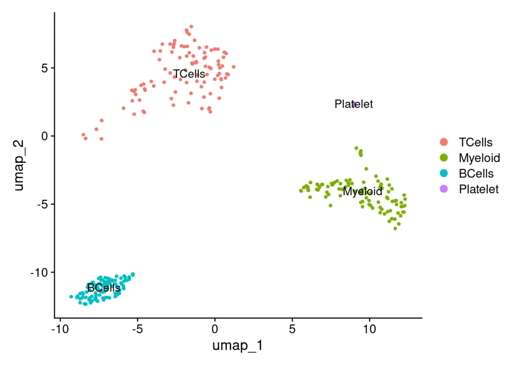
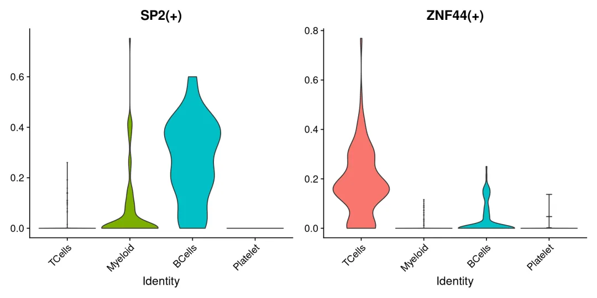
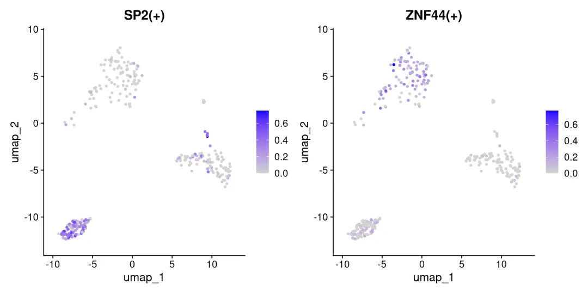
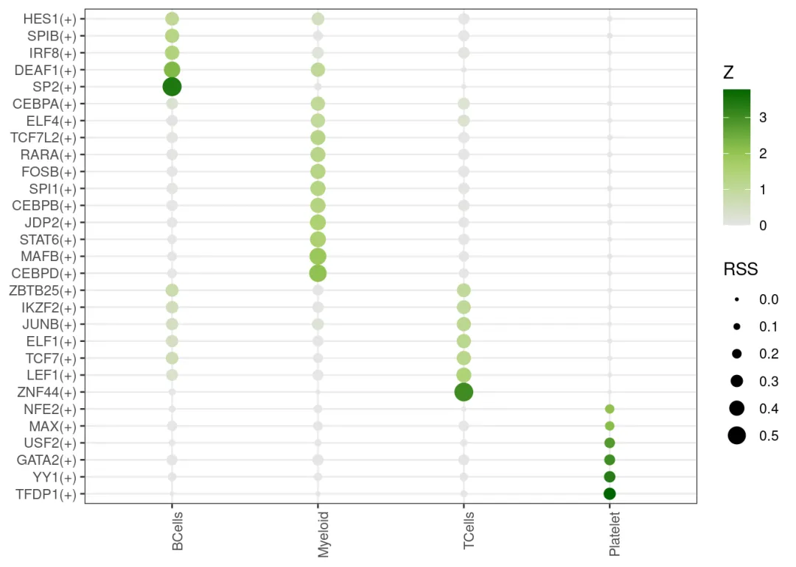
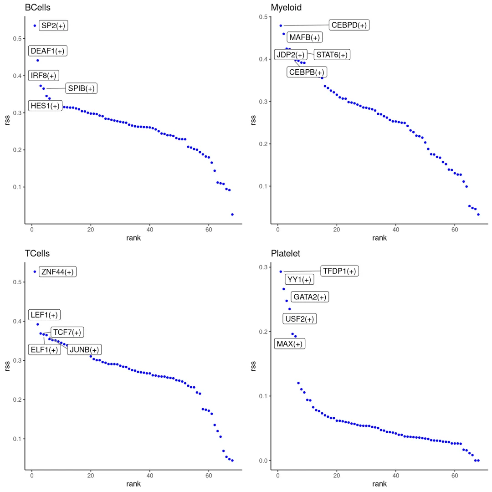
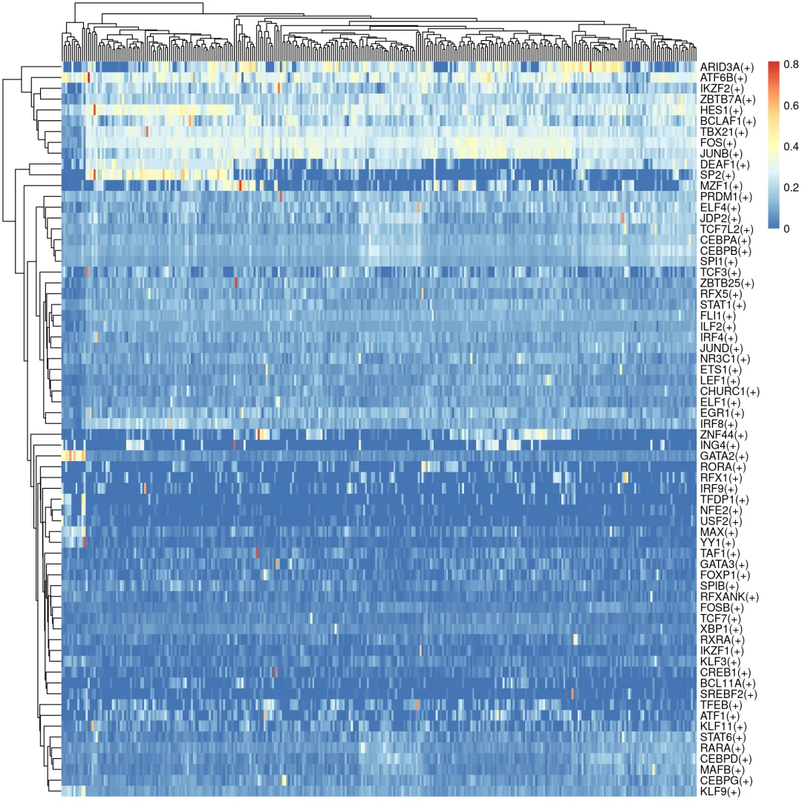
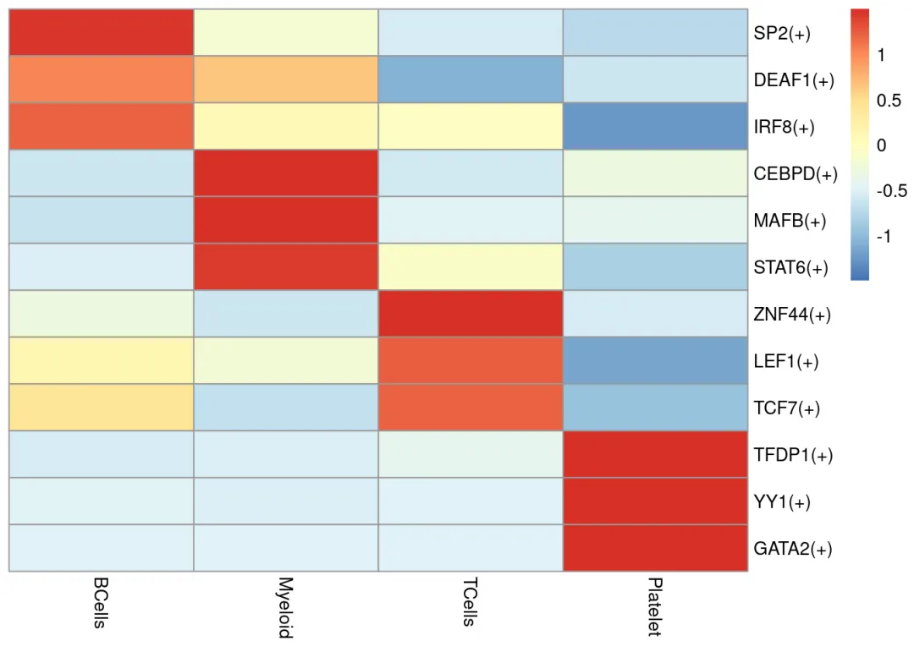

# 比R版本快几十倍| Pyscenic单细胞转录因子预测

> 原文：https://mp.weixin.qq.com/s?__biz=MzAwMzIzOTk5OQ==&mid=2247528198&idx=1&sn=2bdac420c143423d8a7012d028473573&chksm=9b3c1656ac4b9f40e139ffb333d5d0b7da004d627d2d92261a3c5bb0669e602a0d7304a52af0#rd
> 合集：单细胞教程全收录

**一、PySCENIC简介**

SCENIC（Single-Cell Regulatory Network Inference and Clustering）是一个专门可以用于scRNA-seq数据转录因子推断的分析软件。SCENIC的核心功能是解析scRNA-seq数据中转录因子与其下游靶基因的调控关系，从而揭示每个细胞的调控状态及细胞群的生物学特性，达到辅助推断细胞的状态和功能目的。它的核心分析步骤共分为三步:

第一步：输入表达矩阵和转录因子列表，通过GENIE3（随机森林)或GRNBoost (Gradient Boosting) 方法从scRNA-seq数据推断转录因子与候选靶基因之间的共表达模块；

第二步：基于第一步的初始调控网络，根据motif和TF的关系以及motif对基因调控潜能的排序来修剪初始调控网络，最终得到的每个TF及其潜在的直接targets gene称作一个调节因子（regulon）

第三步：AUCelll([一文搞定单细胞基因集评分](<https://mp.weixin.qq.com/s?__biz=MzAwMzIzOTk5OQ==&mid=2247497831&idx=2&sn=82fa51c76a381fba0b444e9b6b23eb5f&scene=21#wechat_redirect>))评估每个regulon在每个细胞里面的活性

关于SCENIC我们做过一系列图文及视频教程，需要scRNA-seq辅导的同学可参考：[这下真手把手教你做scRNA-seq数据基础分析](<https://mp.weixin.qq.com/s?__biz=MzAwMzIzOTk5OQ==&mid=2247528175&idx=1&sn=f1e4b73fcdb4e1ee9dfa8bfc641b1474&scene=21#wechat_redirect>)：

**SCENIC转录因子分析 ：****[SCENIC单细胞转录因子预测|1.绪论](<http://mp.weixin.qq.com/s?__biz=MzAwMzIzOTk5OQ==&mid=2247500098&idx=1&sn=8c31241bd259e303a6ac3c9740f298d9&chksm=9b3cb812ac4b31046fd298c8ee5f0bc0de445df62b234bd934c34ca655e61de3da54d81e2053&scene=21#wechat_redirect>)****[SCENIC单细胞转录因子预测|2.学习手册](<http://mp.weixin.qq.com/s?__biz=MzAwMzIzOTk5OQ==&mid=2247500439&idx=1&sn=d6b4874a8352f5b7a4165629c03058ce&chksm=9b3cbbc7ac4b32d158fd3c5c2f155c54c892d40eaae3718409936fc319f69705da32badf79d6&scene=21#wechat_redirect>)****[SCENIC单细胞转录因子预测|3.软件安装与数据准备](<http://mp.weixin.qq.com/s?__biz=MzAwMzIzOTk5OQ==&mid=2247500631&idx=1&sn=5d73db4dcc74b66de07dee9db910bb83&chksm=9b3cba07ac4b3311d1820bb305778aea707294f19fd6ff2631cd003da80bdcff8f8bc8ed34de&scene=21#wechat_redirect>)****[SCENIC单细胞转录因子预测|4.精简版流程](<http://mp.weixin.qq.com/s?__biz=MzAwMzIzOTk5OQ==&mid=2247501260&idx=1&sn=f1e2a165599e753e2959aad7c8a298cb&chksm=9b3cbc9cac4b358a9499654a2f95fa9010309ee4f408ef8b1f31ceb1a0f263ce22e8b511c430&scene=21#wechat_redirect>)****[SCENIC单细胞转录因子预测|5.step1+step2构建共表达网络与regulon](<http://mp.weixin.qq.com/s?__biz=MzAwMzIzOTk5OQ==&mid=2247501692&idx=1&sn=3f7e263a93942ad03faa1ba5f8694ec4&chksm=9b3cbe2cac4b373af9db74a50ffb08a9b8a3b958fc6385c937385f0f7323bc935cdb0fe5275c&scene=21#wechat_redirect>)****[SCENIC单细胞转录因子预测|6.Step3 利用AUCell对Regulon评分](<http://mp.weixin.qq.com/s?__biz=MzAwMzIzOTk5OQ==&mid=2247501989&idx=1&sn=2700bf779d7d261a4d751d1635fdce2c&chksm=9b3cb1f5ac4b38e3014476242fe956cf510cc45b9f4cef86070af8094fd5f884f9d5c3a3363f&scene=21#wechat_redirect>)****[SCENIC单细胞转录因子预测|7.Step4 二元矩阵的计算与可视化](<http://mp.weixin.qq.com/s?__biz=MzAwMzIzOTk5OQ==&mid=2247503995&idx=1&sn=26c7e9ec56af434e62b02853cfe667d6&chksm=9b3ca92bac4b203d7986645ab5a3fb574f44185c7ced8bd47957fa237d436a95bfa2579d052a&scene=21#wechat_redirect>)****[SCENIC单细胞转录因子预测|8.Step5 regulon聚类、分群、降维](<http://mp.weixin.qq.com/s?__biz=MzAwMzIzOTk5OQ==&mid=2247504024&idx=1&sn=143c0ec4d94b8fca0a4a47d3dc24415b&chksm=9b3ca9c8ac4b20de70a87acb2d3f810b0e1497071b1c6f14f1882a6d844fff016e9ba5581eb3&scene=21#wechat_redirect>)****[SCENIC单细胞转录因子预测|9.下游探索](<http://mp.weixin.qq.com/s?__biz=MzAwMzIzOTk5OQ==&mid=2247505276&idx=1&sn=949c753feb85d5877121433caaa33013&chksm=9b3cac2cac4b253affb587a937d3f5e0576851a4f4e1570cb7510a594d155873961bbd91758d&scene=21#wechat_redirect>)****[SCENIC转录因子调控网络图](<http://mp.weixin.qq.com/s?__biz=MzAwMzIzOTk5OQ==&mid=2247520750&idx=1&sn=496bead1531a7eddd5c286030d350745&chksm=9b3ce8beac4b61a8589a1f8a66bd0571e09c0646655b6d805348bf6f4a0c7b52851615c22868&scene=21#wechat_redirect>)**

遗憾的是R语言版本的SCENIC简直慢到爆，主要限速步骤是GENIE3计算共表达网络，几万个细胞算几周也是常有的事。因此这里我们分享一波PySCENIC的流程，虽然牺牲一波可视化结果，但是计算速度快了几十~上百倍。

本文分析集锦如下：


**
****二、测试文件**

不要再说我的链接失效啦，文字识别链接容易出错，推荐微信扫码领取资料(无提取码)，真的失效了再提醒客服更换链接哦~本推送教程二维码:

通过网盘分享的文件：Py_SCENIC教程

链接:

https://pan.baidu.com/s/1S-e6-PEWV-e-a15m2661OQ?pwd=6kdf

提取码: 6kdf


**三、软件安装**

本教程基于Linux及服务器中的Rstudio环境（[足够支持你完成硕博生涯的生信环境](<https://mp.weixin.qq.com/s?__biz=MzAwMzIzOTk5OQ==&mid=2247526504&idx=2&sn=417d07347cebe0a1bd403f6c3e7d9b29&scene=21#wechat_redirect>)）演示，计算资源不足的同学可参考：
[生信分析为什么要使用服务器？](<https://mp.weixin.qq.com/s?__biz=MzAwMzIzOTk5OQ==&mid=2247491007&idx=1&sn=8619c2bad23791b3252a1c4cb1831931&chksm=9b3f64efac48edf9c02f84959aeee9b12480736fce70c5ddb8b41d79cfc22ce590ea2cb60fba&token=1760636281&lang=zh_CN&scene=21#wechat_redirect>)
[足够支持你完成硕博生涯的生信环境](<http://mp.weixin.qq.com/s?__biz=MzAwMzIzOTk5OQ==&mid=2247511780&idx=1&sn=3acc0874f7d2fa75f1abbe7a9a9b4069&chksm=9b3cd7b4ac4b5ea27d4d53964e4a4a9fa8c806a19103729dd4ff0fa72e621411f46a251d269f&scene=21#wechat_redirect>)
[配置一个心仪的工作站(硬件+环境配置)](<http://mp.weixin.qq.com/s?__biz=MzAwMzIzOTk5OQ==&mid=2247519707&idx=1&sn=73dcab26f9b2ed75a954327317d07112&chksm=9b3cf48bac4b7d9df5b5a432fbe70d4f9c13bc8d739aa401732614f022223d1912642a7e4bea&scene=21#wechat_redirect>)
[独享服务器，生信分析不求人](<http://mp.weixin.qq.com/s?__biz=MzAwMzIzOTk5OQ==&mid=2247503618&idx=1&sn=ca47ca985aa8560f6b38f15f210519e2&chksm=9b3cb652ac4b3f44292560071b7e98e2f6fa6ec03581cd882a4d59b9d7fa063a5b9ac1b923f3&scene=21#wechat_redirect>)
[
](<http://mp.weixin.qq.com/s?__biz=MzAwMzIzOTk5OQ==&mid=2247492383&idx=1&sn=b8d912877cb38e8d8c9084d1d9370ded&chksm=9b3c9a4fac4b135926091a8af972c45a17a2fa1f94c704779c60df5f733847036c3797894c1c&scene=21#wechat_redirect>)

访问链接：https://biomamba.xiyoucloud.net/

更多内容可咨询客服微信[**Biomamba_zhushou**]

首先大家需要先安装conda：[生信软件管家——conda的安装、使用、卸载](<https://mp.weixin.qq.com/s?__biz=MzAwMzIzOTk5OQ==&mid=2247506208&idx=1&sn=24d27bc2ff8de340b1f542610b4dc09e&scene=21#wechat_redirect>)

  *   *   *   *   *   *   *   *   *   *   *   *   *   *   *   *   *   *   *   *   *   *   *

```
# pyscenic环境创建流程conda env remove --name pyscenicconda create -n pyscenic python=3.8.1conda activate pyscenic# !!!!!按照下面的顺序安装，不然可能出现彼此不兼容的报错# 参考：https://www.jianshu.com/p/dc7397fda327pip install numpy==1.19.5pip install pandas==1.3.5pip install numba==0.56.4pip install pyscenic==0.12.1# 检查安装软件版本python -c "import numpy; print(numpy.__version__)"python -c "import pandas; print(pandas.__version__)"python -c "import pyscenic; print(pyscenic.__version__)"pyscenic -hcd /home/cwj/project/09_pyscenic/data# 下载motif排序文件，motif 注释文件和转录因子文件# 以人类基因组hg19版本为参考，转录起始位点（TSS）上下游5kb区域的基因与基序（motifs）的排名数据，数据整合7个物种信息用于评估基因与基序结合可能性，确定转录因子和靶基因间调控关系wget https://resources.aertslab.org/cistarget/databases/homo_sapiens/hg19/refseq_r45/mc9nr/gene_based/hg19-tss-centered-5kb-7species.mc9nr.genes_vs_motifs.rankings.feather# 基序到转录因子的映射关系，通过分析转录因子结合位点基序，识别可能结合特定基序的转录因子。wget https://resources.aertslab.org/cistarget/motif2tf/motifs-v10nr_clust-nr.hgnc-m0.001-o0.0.tbl# 人类基因组中所有转录因子列表wget  https://resources.aertslab.org/cistarget/tf_lists/allTFs_hg38.txt
```

**四、人源PySCENIC分析流程**

##  1、表达矩阵准备

经典的pbmc3k数据集
下面预处理的步骤，看不懂的同学可以先补一下基础知识手把手教你做[单细胞测序数据分析（三）——单样本分析](<https://mp.weixin.qq.com/s?__biz=MzAwMzIzOTk5OQ==&mid=2247487976&idx=1&sn=8edd929256e609e4210a40df63fc1427&chksm=9b3f68b8ac48e1aefd3ff38dd5744c485cde5d7f28d79745b66863928d4614fafb2928b3f617&payreadticket=HMoAY_v8_rICSU7SWHmvxC0_zLzxhvZtkSG6IE0gCGU29Swy8TC2jTa2hBv3oc4ktoOPfGo&scene=21#wechat_redirect>)

  *   *   *   *   *   *   *   *   *   *   *   *   *

```
setwd("/home/cwj/project/09_pyscenic/")suppressMessages({  library(Seurat)  library(ggplot2)  library(dplyr)  library(biomaRt)  library(SCopeLoomR)  library(AUCell)  library(SCENIC)  library(pheatmap)  library(circlize)  library(gridExtra)})
```

  *   *   *   *   *   *   *   *   *   *   *   *   *   *   *   *   *   *   *   *   *   *   *   *   *   *   *   *

```r
# 加载数据sce = Read10X("/home/cwj/project/05_genescore/pbmc3k_filtered_gene_bc_matrices/filtered_gene_bc_matrices/hg19")sce_final <- sce %>% CreateSeuratObject(min.cells = 3, min.features = 200) %>% PercentageFeatureSet(pattern = '^MT',col.name = 'percent.mt')select_c <- WhichCells(sce_final,expression = nFeature_RNA > 200 & nFeature_RNA < 2500 & percent.mt < 5)sce_final = subset(sce_final,cells = select_c)dim(sce_final)sce_final <- sce_final %>% NormalizeData() %>% FindVariableFeatures() %>% ScaleData() %>% RunPCA() %>% FindNeighbors(dims = 1:10) %>% FindClusters(resolution = 0.5) %>% RunTSNE(dims = 1:10) %>% RunUMAP(dims = 1:10)#参考seurat官网添加细胞标签new.cluster.ids <- c("TCells", "Myeloid", "TCells", "BCells", "TCells", "Myeloid", "TCells", "Myeloid", "Platelet")names(new.cluster.ids) <- levels(sce_final)sce_final <- RenameIdents(sce_final, new.cluster.ids)sce_final@meta.data$celltype <- Idents(sce_final)# dwnsample选取部分细胞，减少测试的运算时间pbmc3k_sub <- subset(sce_final,downsample=100)#saveRDS(sce_final,"/home/cwj/project/09_pyscenic/result/pbmc3k.rds")#saveRDS(pbmc3k_sub,"/home/cwj/project/09_pyscenic/result/pbmc3k_sub.rds")# 提取表达矩阵counts <- as.matrix(pbmc3k_sub@assays$RNA@layers$counts)colnames(counts) <- colnames(pbmc3k_sub)rownames(counts) <- rownames(pbmc3k_sub)#write.csv(counts,file = "/home/cwj/project/09_pyscenic/result/counts.csv")
```

## 2、loom文件准备

  *   *   *   *   *   *   *   *   *   *   *   *   *   *

```
import os,sysimport loompy as lpimport numpy as npimport pandas as pdos.getcwd()os.listdir(os.getcwd())counts=pd.read_csv("/home/cwj/project/09_pyscenic/result/counts.csv",index_col = 0, header = 0)features = counts.index.tolist()barcodes = counts.columns.tolist()#loom行属性：用于存储与基因相关的元数据。这些属性可以包括基因名称、基因长度、基因所属的染色体等信息。#loom列属性：存储与细胞相关的元数据。例如细胞类型等信息。row_attrs = {'Gene':np.array(features)}col_attrs = {'CellID':np.array(barcodes)}lp.create("/home/cwj/project/09_pyscenic/result/counts.loom", counts.values,row_attrs,col_attrs)
```

## 3、pyscenic分析

  *   *   *   *   *   *   *   *   *   *   *   *   *   *   *   *   *   *   *   *   *   *   *   *   *   *   *   *   *   *

```
# 第一步 grn (耗时：4.5h)pyscenic grn \  --num_workers 20 \  --output /home/cwj/project/09_pyscenic/result/grn_output.tsv \  --method grnboost2 \  /home/cwj/project/09_pyscenic/result/counts.loom \  /home/cwj/project/09_pyscenic/data/allTFs_hg38.txt# 如果出"现Could not find data: {'ndarray-922cb62afe37c1431b930b4a03c73f34': ['tcp://127.0.0.1:38175']} on workers"类似这样的提示，可能是服务器端口被占用，可以用以下命令替换，参考https://pyscenic.readthedocs.io/en/latest/faq.htmlpython /home/cwj/miniconda3/envs/pyscenic/bin/arboreto_with_multiprocessing.py \  --num_workers 20 \  --output /home/cwj/project/09_pyscenic/result/grn_output.tsv \  --method grnboost2 \  /home/cwj/project/09_pyscenic/result/counts.loom \  /home/cwj/project/09_pyscenic/data/allTFs_hg38.txt#  第二步 ctx (耗时：36min)pyscenic ctx \  /home/cwj/project/09_pyscenic/result/grn_output.tsv \  /home/cwj/project/09_pyscenic/data/hg19-tss-centered-5kb-7species.mc9nr.genes_vs_motifs.rankings.feather \  --annotations_fname /home/cwj/project/09_pyscenic/data/motifs-v10nr_clust-nr.hgnc-m0.001-o0.0.tbl \  --expression_mtx_fname /home/cwj/project/09_pyscenic/result/counts.loom \  --mode "dask_multiprocessing" \  --output /home/cwj/project/09_pyscenic/result/ctx.csv \  --num_workers 20 \  --mask_dropouts#  第三步 AUCellpyscenic aucell \  /home/cwj/project/09_pyscenic/result/counts.loom  \  /home/cwj/project/09_pyscenic/result/ctx.csv \  --output /home/cwj/project/09_pyscenic/result/aucell.loom \  --num_workers 15
```

## 4、结果可视化

  *   *

```r
pbmc3k_sub <- readRDS("/home/cwj/project/09_pyscenic/result/pbmc3k_sub.rds")DimPlot(pbmc3k_sub, label=T)
```



  *   *   *   *   *   *   *   *   *   *   *

```r
loom <- open_loom("./result/aucell.loom")#获取调节因子矩阵：regulons_incidMat <- get_regulons(loom, column.attr.name="Regulons")#将调节因子矩阵转换为基因列表regulons <- regulonsToGeneLists(regulons_incidMat)#获取调节因子的AUC值regulonAUC <- get_regulons_AUC(loom,column.attr.name='RegulonsAUC')#获取调节因子的阈值regulonAucThresholds <- get_regulon_thresholds(loom)sub_regulonAUC <- regulonAUC[,match(colnames(pbmc3k_sub),colnames(regulonAUC))]identical(colnames(sub_regulonAUC), colnames(pbmc3k_sub))
```
```
## [1] TRUE
```

  *   *   *   *

```
#每个细胞的aucell值添加到seurat对象的meta.data中pbmc3k_sub@meta.data = cbind(pbmc3k_sub@meta.data ,t(sub_regulonAUC@assays@data$AUC))#指定关注的转录因子绘图VlnPlot(pbmc3k_sub, features = c("SP2(+)","ZNF44(+)"),pt.size = 0)
```



  *

```
FeaturePlot(object = pbmc3k_sub,features = c("SP2(+)","ZNF44(+)"))
```



  *   *   *   *

```r
# regulon特异性分数(Regulon Specificity Score, RSS)rss<-calcRSS(AUC=getAUC(sub_regulonAUC),cellAnnotation=pbmc3k_sub@meta.data$celltype)rssPlot <- plotRSS(rss)rssPlot$plot
```



  *   *   *   *   *   *

```r
#分细胞类型展示regulon特异性分数p1 <- plotRSS_oneSet(rss,'BCells')p2 <- plotRSS_oneSet(rss,'Myeloid')p3 <- plotRSS_oneSet(rss,'TCells')p4 <- plotRSS_oneSet(rss,'Platelet')grid.arrange(p1, p2, p3, p4, ncol = 2, nrow = 2)
```



  *   *   *

```r
# 热图展示每个细胞中每个转录因子的aucll分值auc <- getAUC(sub_regulonAUC)pheatmap::pheatmap(auc, show_colnames = F)
```



  *   *   *   *   *   *   *   *   *   *   *   *   *

```r
# 热图展示每个细胞类型中top转录因子的aucll均值auc_avg <- data.frame(t(auc))auc_avg[,"group"] <- pbmc3k_sub@meta.data$celltypeauc_avg <- auc_avg %>%  group_by(group) %>%  summarise_all(mean)auc_avg <- as.data.frame(auc_avg )rownames(auc_avg ) <- auc_avg$groupcolnames(auc_avg) <- c("group",rownames(auc)) #计算后+号会因为R要求变成点，重新赋予原来的名称top3_reg <- c("SP2(+)","DEAF1(+)","IRF8(+)","CEBPD(+)","MAFB(+)","STAT6(+)","ZNF44(+)","LEF1(+)","TCF7(+)","TFDP1(+)","YY1(+)","GATA2(+)")auc_avg_sub <- auc_avg[c("BCells","Myeloid","TCells","Platelet"),top3_reg]rownames(auc_avg) <- factor(rownames(auc_avg) , levels = )pheatmap::pheatmap(t(auc_avg_sub), show_colnames = T, cluster_rows = F, cluster_cols = F,scale = "row")
```




**如何联系我们**

 公众号后台消息回复不便，这里给大家留一下领取资料及免费服务器([免费两周学习版上架啦~](<https://mp.weixin.qq.com/s?__biz=MzAwMzIzOTk5OQ==&mid=2247527585&idx=1&sn=fa32112c11b215b33096cab43baf08ea&scene=21#wechat_redirect>))的**微信号** ，方便各位随时交流（别问在么，添加时直接说来意）。同时我们也构建了[交流群矩阵](<https://mp.weixin.qq.com/s?__biz=MzAwMzIzOTk5OQ==&mid=2247528057&idx=1&sn=bb348c2a88c977c7cce67ee6731a3591&scene=21#wechat_redirect>)，欢迎大家入群讨论。

大家可以阅读完这几篇之后添加[给生信入门初学者的小贴士](<http://mp.weixin.qq.com/s?__biz=MzAwMzIzOTk5OQ==&mid=2247493329&idx=1&sn=597870b7f7ce10346da3561e7c281627&chksm=9b3c9f81ac4b169794088ce9abbcacb5f18e9fd174fc0d7e28da62d78facadf3100ef38aaf22&scene=21#wechat_redirect>)
[如何搜索公众号过往发布内容](<http://mp.weixin.qq.com/s?__biz=MzAwMzIzOTk5OQ==&mid=2247506266&idx=2&sn=22b1164bc9602c25620d058847785422&chksm=9b3ca00aac4b291c16d738271746ffb90149282a728f484e8a1952463c46a8e7dc4f883ab928&scene=21#wechat_redirect>)

**已有生信基地联系方式的同学****无需重复添加**

 您点的每个赞和在看，我都认真当成了喜欢
