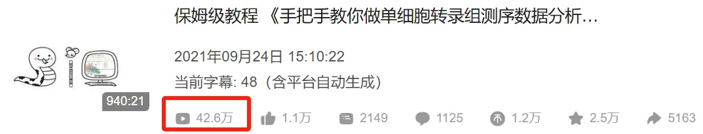
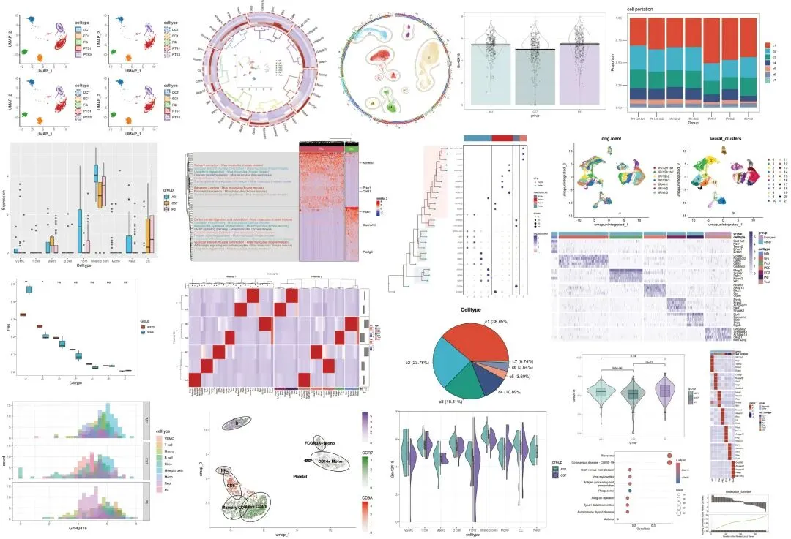
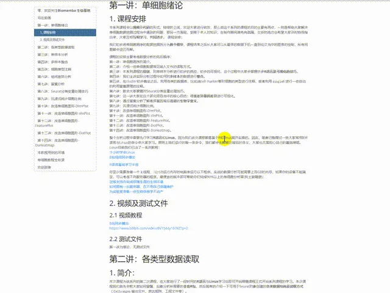
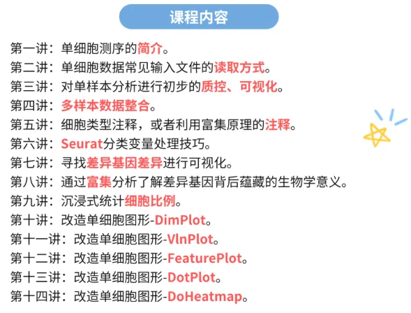
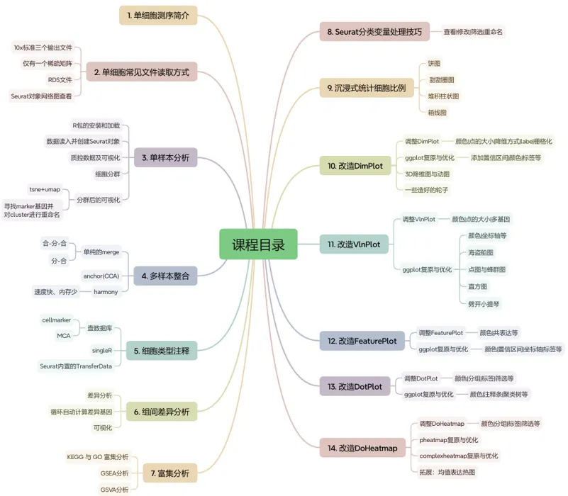
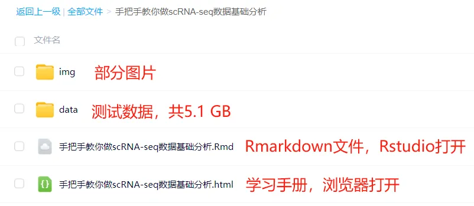

# scRNA-seq数据基础分析手册(2025最新修订)

> 原文：https://mp.weixin.qq.com/s?__biz=MzAwMzIzOTk5OQ==&mid=2247528199&idx=1&sn=ab75e7d7987ab233c675455188f10f33&chksm=9b3c1657ac4b9f41e312a5f508fa1fb2158dfdbaacfb2d67c3ffa3d134b0c6b5672c062499da#rd
> 合集：单细胞教程全收录

scRNA-seq数据基础分析手册

离我们最开始做单细胞教程已经过去四五年，现在已经收获了40w+的阅读量。一共940min的教程相信足够大家完成单细胞的学习与文章发表，我们也陆陆续续收到小伙伴们的发文致谢：[致谢合辑](<https://mp.weixin.qq.com/mp/appmsgalbum?__biz=MzAwMzIzOTk5OQ==&action=getalbum&album_id=3425248581018714114#wechat_redirect>)。
一方面随着时间飞逝，原先教学中的一些内容已然过时，毕竟我们最初的演示是基于Seurat V3，而现在V5上线都已经快两年了。另一方面很多同学由于缺少编程、单细胞、文章套路等基本知识，跟着视频并不能完全自学掌握单细胞分析技能。因此，基于最新的R环境与Seurat版本，我们重新组织、修订了《手把手教你做单细胞测序数据分析》学习手册资料。参与我们[手把手教你做scRNA-seq数据基础分析](<https://mp.weixin.qq.com/s?__biz=MzAwMzIzOTk5OQ==&mid=2247528175&idx=1&sn=f1e4b73fcdb4e1ee9dfa8bfc641b1474&scene=21#wechat_redirect>)的小伙伴无需重复订阅，开课时会自动发放。其他小伙伴也可以联系客服微信[Biomamba_yunying]优惠订阅/报名~建议大家学习此教程前先行掌握：[5.5h入门R语言](<https://mp.weixin.qq.com/s?__biz=MzAwMzIzOTk5OQ==&mid=2247528126&idx=2&sn=668c2709891956b567b316f9f2fb26ea&scene=21#wechat_redirect>)。
教程图片集锦：
本教程基于Linux中的Rstudio环境演示，计算资源不足的同学可参考：
[足够支持你完成硕博生涯的生信环境](<http://mp.weixin.qq.com/s?__biz=MzAwMzIzOTk5OQ==&mid=2247511780&idx=1&sn=3acc0874f7d2fa75f1abbe7a9a9b4069&chksm=9b3cd7b4ac4b5ea27d4d53964e4a4a9fa8c806a19103729dd4ff0fa72e621411f46a251d269f&scene=21#wechat_redirect>)
[独享服务器，生信分析不求人](<http://mp.weixin.qq.com/s?__biz=MzAwMzIzOTk5OQ==&mid=2247503618&idx=1&sn=ca47ca985aa8560f6b38f15f210519e2&chksm=9b3cb652ac4b3f44292560071b7e98e2f6fa6ec03581cd882a4d59b9d7fa063a5b9ac1b923f3&scene=21#wechat_redirect>)

学习资料，所见即所得

同我们以前的资料一样，我们给大家准备了学习手册和学习资料，可以在文末订阅获取：

共包含十四讲内容：

目录大纲：

测试文件，总大小5.1GB：

├── GSE139107

│ ├── GSE139107_MouseIRI_12hours.dge.txt.gz

│ ├── GSE139107_MouseIRI_14days.dge.txt.gz

│ ├── GSE139107_MouseIRI_2days.dge.txt.gz

│ ├── GSE139107_MouseIRI_4hours.dge.txt.gz

│ ├── GSE139107_MouseIRI_6weeks.dge.txt.gz

│ └── GSE139107_MouseIRI_control.dge.txt.gz

├── GSE139107_MouseIRI.metadata.txt.gz

├── MonacoImmuneData.rds

├── bcell.marker.CSV

├── cg.rds

├── color.Rdata

├── data.txt

├── filtered_gene_bc_matrices

│ └── hg19

│ ├── barcodes.tsv

│ ├── genes.tsv

│ └── matrix.mtx

├── iri.intergrate.harmony.rds

├── iri.intergrate.harmony.rename.rds

├── iri.intergrate.havebatch.rds

├── iri.intergrate.havebatch.v5CCA.rds

├── iri.intergrate.rds

├── iri.obj4.rds

├── iri.obj5.rds

├── my.pbmc.tar.gz

├── mycount.txt

├── panc8.rds

├── pbmcrenamed.rds

└── single_cell_datamatrix.txt

3 directories, 27 files

往期订阅

生信基地现已开放终身订阅，现已包含几十篇订阅资料，未来37年持续更新：[那就开放一个终身订阅吧~](<https://mp.weixin.qq.com/s?__biz=MzAwMzIzOTk5OQ==&mid=2247526967&idx=1&sn=3e4e9acabd6061d7e3dab8cd52924bcc&scene=21#wechat_redirect>)

2025已更新订阅内容：

[《Cell》复现|中性粒细胞scRNA-seq图谱阐明抗肿瘤抗原呈递效力](<https://mp.weixin.qq.com/s?__biz=MzAwMzIzOTk5OQ==&mid=2247526776&idx=1&sn=99eb6a16c7bf345445b6ff4b61110138&scene=21#wechat_redirect>)

[代码复现|scRNA-seq绘制透明细胞肾癌的免疫微环境](<https://mp.weixin.qq.com/s?__biz=MzAwMzIzOTk5OQ==&mid=2247527498&idx=1&sn=c8282e9d4175bfb2e572278312073d81&scene=21#wechat_redirect>)

[改造单细胞DoHeatmap](<https://mp.weixin.qq.com/s?__biz=MzAwMzIzOTk5OQ==&mid=2247527762&idx=1&sn=ba7c8a4cb704e71fa86ebfe1f19bffea&scene=21#wechat_redirect>)

[Slingshot拟时序分析学习手册](<https://mp.weixin.qq.com/s?__biz=MzAwMzIzOTk5OQ==&mid=2247527850&idx=1&sn=f4e2ca5e2e5e71eeaf132375bb8270eb&scene=21#wechat_redirect>)

[《Cancer Cell》|时空单细胞揭示CRC的PD-1治疗免疫细胞动态](<https://mp.weixin.qq.com/s?__biz=MzAwMzIzOTk5OQ==&mid=2247528056&idx=1&sn=73c0da3ff7ff50bafbb9315fd5b60f15&scene=21#wechat_redirect>)

解锁前需阅读：**[2025订阅须知](<https://mp.weixin.qq.com/s?__biz=MzAwMzIzOTk5OQ==&mid=2247526751&idx=1&sn=7ca3137d770f23f0c3d6195696618d81&scene=21#wechat_redirect>)**

**
****
****
****
**

订阅后获取学习手册下载链接：

