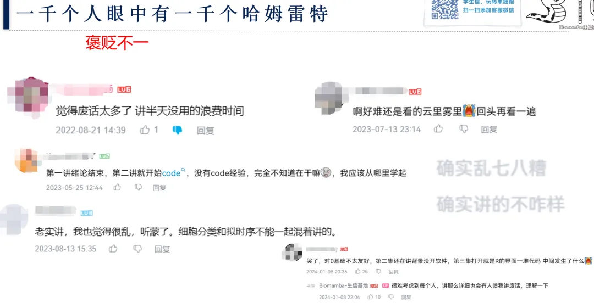
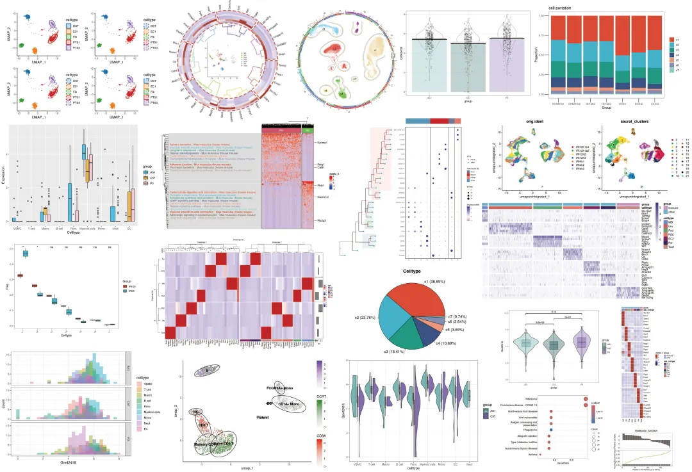
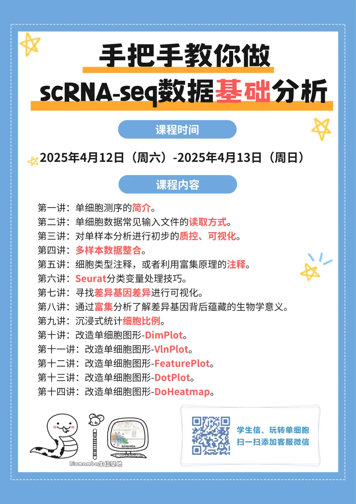
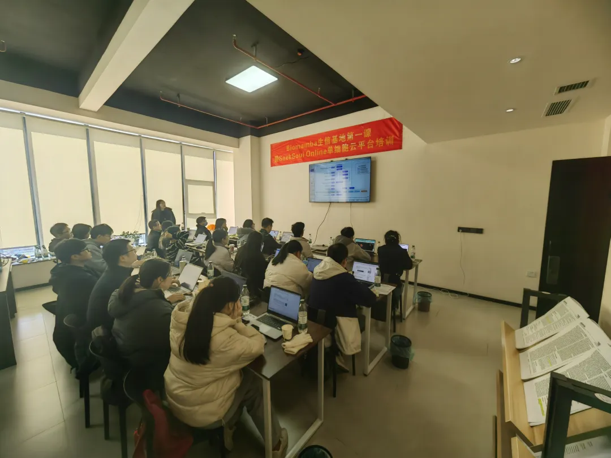
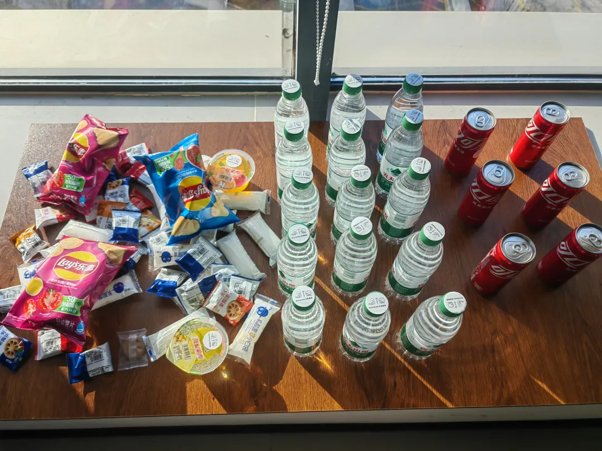

# 谁不知道预制菜不好吃呢

> 原文：https://mp.weixin.qq.com/s?__biz=MzAwMzIzOTk5OQ==&mid=2247528305&idx=1&sn=5f02c1e5f507ebf4d1df7cbe996899ed&chksm=9b3c1621ac4b9f3707b5dcdfa4eb05ed8df1ae5d2bb8507d920d66d83224fa2f96ba9fb1485c#rd
> 合集：单细胞教程全收录 / 漫谈胡侃

一千个人眼中有一千个哈姆雷特

我们在B站单细胞教程单个合集的播放量就超过了四十万(https://www.bilibili.com/video/BV1S44y1b76Z/)。Biomamba还是非常重视用户体验的，我们会定期查看观众评论与弹幕留言，大部分同学还是对我们的课程不吝赞美之词，少有的批评我们也都虚心接受，以便我们做后续课程的优化。值得注意的是，同样的课程，却有不同的声音：有的同学觉得很详细、适合小白，有的同学觉得对零基础不太友好；有的同学缺觉得讲的很好，非常有逻辑，有的同学觉得乱七八八糟、废话连篇；有的同学觉得听完课节省了很多时间，也有的同学觉得听了很多遍还是云里雾里，这也不懂那也不懂。这种现象我是理解的，毕竟众口难调。也请大家理解一下，我们四十多万的点击量，不可能让每位同学都对我们的课程满意，毕竟这只是一个事先录制好的，希望满足大多数同学需求的"预制课"，基础差的人当然觉得听不懂，基础好的人也当然会觉得浪费时间。另外，[生信学习的困难从来不是缺少资料](<https://mp.weixin.qq.com/s?__biz=MzAwMzIzOTk5OQ==&mid=2247528218&idx=1&sn=d356dac75cea6f413f4ef3c3ec2219fd&scene=21#wechat_redirect>)，类似的课程和资料其实有很多，也许大家缺少的是一个能够交流、答疑的课程：[这下真手把手教你做scRNA-seq数据基础分析](<https://mp.weixin.qq.com/s?__biz=MzAwMzIzOTk5OQ==&mid=2247528175&idx=1&sn=f1e4b73fcdb4e1ee9dfa8bfc641b1474&scene=21#wechat_redirect>)

手把手教你做scRNA-seq数据基础分析

离我们最开始做单细胞教程已经过去四五年，现在已经收获了40w+的阅读量。一共940min的教程相信足够大家完成单细胞的学习与文章发表，我们也陆陆续续收到小伙伴们的发文致谢：[致谢合辑](<https://mp.weixin.qq.com/mp/appmsgalbum?__biz=MzAwMzIzOTk5OQ==&action=getalbum&album_id=3425248581018714114#wechat_redirect>)。
一方面随着时间飞逝，原先教学中的一些内容已然过时，毕竟我们最初的演示是基于Seurat V3，而现在V5上线都已经快两年了。另一方面很多同学由于缺少编程、单细胞、文章套路等基本知识，跟着视频并不能完全自学掌握单细胞分析技能。因此，基于最新的R环境与Seurat版本，我们重新组织、修订了《手把手教你做单细胞测序数据分析》课程。04月12日~13日在[生信基地](<https://mp.weixin.qq.com/s?__biz=MzAwMzIzOTk5OQ==&mid=2247526229&idx=1&sn=0718f1702150ba77a7f7e3beadd6e0ba&scene=21#wechat_redirect>)（线上/线下均可参与，错过直播也可以加入录播/答疑+循环开课）也希望真的能够做到“手把手”的带大家完成单细胞测序数据分析的学习，当然，我们拒绝生信快餐，课后欢迎大家随时在群里对课程内容提问~报名即送[5.5h入门R语言](<https://mp.weixin.qq.com/s?__biz=MzAwMzIzOTk5OQ==&mid=2247528126&idx=2&sn=668c2709891956b567b316f9f2fb26ea&scene=21#wechat_redirect>)回放与答疑服务。自学能力强的小伙伴也可以直接跟B站教程与我们的最新版学习手册[scRNA-seq数据基础分析手册(2025最新修订)](<https://mp.weixin.qq.com/s?__biz=MzAwMzIzOTk5OQ==&mid=2247528199&idx=1&sn=ab75e7d7987ab233c675455188f10f33&scene=21#wechat_redirect>)：
https://www.bilibili.com/video/BV1S44y1b76Z/
这次课程的视频介绍也不妨看看：参与此次课程你将获得：1、单细胞数据分析教学指导与答疑2、开箱即用(我们已经布置好了环境)的单细胞分析环境：[学习版上架啦~](<https://mp.weixin.qq.com/s?__biz=MzAwMzIzOTk5OQ==&mid=2247527585&idx=1&sn=fa32112c11b215b33096cab43baf08ea&scene=21#wechat_redirect>)3、[5.5h入门R语言](<https://mp.weixin.qq.com/s?__biz=MzAwMzIzOTk5OQ==&mid=2247528126&idx=2&sn=668c2709891956b567b316f9f2fb26ea&scene=21#wechat_redirect>)回放、答疑群、讲义4、scRNA-seq基础分析手册、代码、测试文件
教程图片集锦：

**报名联系方式**

**已有生信基地联系方式的同学****无需重复添加**

课表

学习资料

同我们以前的课程一样，我们给大家准备了学习手册和学习资料，大家报名后可入群领取：

测试文件，总大小5.1GB：

├── GSE139107

│ ├── GSE139107_MouseIRI_12hours.dge.txt.gz

│ ├── GSE139107_MouseIRI_14days.dge.txt.gz

│ ├── GSE139107_MouseIRI_2days.dge.txt.gz

│ ├── GSE139107_MouseIRI_4hours.dge.txt.gz

│ ├── GSE139107_MouseIRI_6weeks.dge.txt.gz

│ └── GSE139107_MouseIRI_control.dge.txt.gz

├── GSE139107_MouseIRI.metadata.txt.gz

├── MonacoImmuneData.rds

├── bcell.marker.CSV

├── cg.rds

├── color.Rdata

├── data.txt

├── filtered_gene_bc_matrices

│ └── hg19

│ ├── barcodes.tsv

│ ├── genes.tsv

│ └── matrix.mtx

├── iri.intergrate.harmony.rds

├── iri.intergrate.harmony.rename.rds

├── iri.intergrate.havebatch.rds

├── iri.intergrate.havebatch.v5CCA.rds

├── iri.intergrate.rds

├── iri.obj4.rds

├── iri.obj5.rds

├── my.pbmc.tar.gz

├── mycount.txt

├── panc8.rds

├── pbmcrenamed.rds

└── single_cell_datamatrix.txt

3 directories, 27 files

报名费用

2天满满的课程（算上R语言就是四天课程啦）只要799￥，相信比小学生补课班还便宜。生信基地的任何业务均支持对公。

线下学习环境

**地点** ：南京市江宁区，详细地址报名咨询**
****往期活动现场：******

除了知识之外，现场还能够给大家提供：

**茶水吧、咖啡机、零食柜**

**各类饮料、零食小吃**

往期活动

[生信小白入门课(4h视频回放)](<https://mp.weixin.qq.com/s?__biz=MzAwMzIzOTk5OQ==&mid=2247526459&idx=2&sn=13151661ad9d02bf4d8d20ab000b4df0&scene=21#wechat_redirect>)

[5.5h入门R语言](<https://mp.weixin.qq.com/s?__biz=MzAwMzIzOTk5OQ==&mid=2247528126&idx=2&sn=668c2709891956b567b316f9f2fb26ea&scene=21#wechat_redirect>)

[1.5天，你学会单细胞分析了吗？](<https://mp.weixin.qq.com/s?__biz=MzAwMzIzOTk5OQ==&mid=2247523411&idx=2&sn=142574b00dd351fae0b76831cd2d2f19&scene=21#wechat_redirect>)

[生信基地第二课线下阶段收官~](<https://mp.weixin.qq.com/s?__biz=MzAwMzIzOTk5OQ==&mid=2247525030&idx=1&sn=a006e1a4f36ae20744d81c8ff7afc240&scene=21#wechat_redirect>)

[2025国自然申报秘籍大放送！青椒医学大咖亲授](<https://mp.weixin.qq.com/s?__biz=MzAwMzIzOTk5OQ==&mid=2247526009&idx=1&sn=724a8a92d27c83a2c7f6e283c9957584&scene=21#wechat_redirect>)

**如何联系我们**

 留一个领取资料、[免费两周学习版上](<https://mp.weixin.qq.com/s?__biz=MzAwMzIzOTk5OQ==&mid=2247527585&idx=1&sn=fa32112c11b215b33096cab43baf08ea&scene=21#wechat_redirect>)服务器的**微信号** ，方便各位随时交流（别问在么，添加时直接说来意）。同时我们也构建了[交流群矩阵](<https://mp.weixin.qq.com/s?__biz=MzAwMzIzOTk5OQ==&mid=2247528057&idx=1&sn=bb348c2a88c977c7cce67ee6731a3591&scene=21#wechat_redirect>)，欢迎大家入群讨论。

大家可以阅读完这几篇之后添加[给生信入门初学者的小贴士](<http://mp.weixin.qq.com/s?__biz=MzAwMzIzOTk5OQ==&mid=2247493329&idx=1&sn=597870b7f7ce10346da3561e7c281627&chksm=9b3c9f81ac4b169794088ce9abbcacb5f18e9fd174fc0d7e28da62d78facadf3100ef38aaf22&scene=21#wechat_redirect>)
[如何搜索公众号过往发布内容](<http://mp.weixin.qq.com/s?__biz=MzAwMzIzOTk5OQ==&mid=2247506266&idx=2&sn=22b1164bc9602c25620d058847785422&chksm=9b3ca00aac4b291c16d738271746ffb90149282a728f484e8a1952463c46a8e7dc4f883ab928&scene=21#wechat_redirect>)

**已有生信基地联系方式的同学****无需重复添加**

 您点的每个赞和在看，我都认真当成了喜欢
