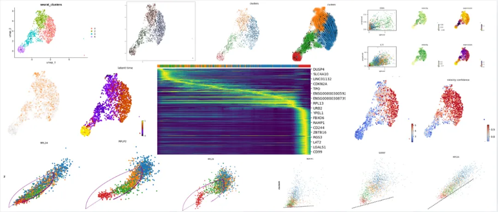

# 一文学会scRNA Velocity剪切速率分析

> 原文：https://mp.weixin.qq.com/s?__biz=MzAwMzIzOTk5OQ==&mid=2247528458&idx=1&sn=900357283922571c6294435be409a2f3&chksm=9b3c095aac4b804cecf155daa5a08391536d9f906ab6edb6c6650ec868ad1b14dc7be8bbde36#rd
> 合集：单细胞教程全收录

RNA Velocity

RNA丰度是单个细胞状态的一个强有力的指标。目前，单细胞RNA测序能够以高定量精度、灵敏度和通量揭示RNA丰度。然而，目前这种方法只能捕获到某一时间点的静态快照，这给诸如胚胎发生或组织再生等时间动态变化研究带来了挑战。因此，作者提出了RNA速率的概念(基因表达状态的时间导数)。通过RNA速率分析区分常见单细胞RNA测序中的未剪接和已剪接mRNA直接估算。RNA速率是一个高维向量，能够在数小时的时间尺度上预测单个细胞的未来状态。本次教程我们从RNA Velocity原文解读、**数据下载、软件安装、生成loom文件、 R中实现RNA速率分析、Python中实现RNA速率分析。**参考内容：

https://velocyto.org/velocyto.py/install/index.html

https://scvelo.readthedocs.io/en/latest/VelocityBasics.html

https://satijalab.org/seurat/articles/pbmc3k_tutorial.html

本教程基于R语言和Python完成，没有基础的小伙伴可见：[5.5h入门R语言](<https://mp.weixin.qq.com/s?__biz=MzAwMzIzOTk5OQ==&mid=2247528126&idx=2&sn=668c2709891956b567b316f9f2fb26ea&scene=21#wechat_redirect>)、[生信Python速查手册](<https://mp.weixin.qq.com/s?__biz=MzAwMzIzOTk5OQ==&mid=2247499921&idx=1&sn=dcd6f95596e3de9bf378d850c217fe78&scene=21#wechat_redirect>)
本教程基于Linux中的Rstudio环境演示，计算资源不足的同学可参考：[生信分析为什么要使用服务器？](<https://mp.weixin.qq.com/s?__biz=MzAwMzIzOTk5OQ==&mid=2247491007&idx=1&sn=8619c2bad23791b3252a1c4cb1831931&scene=21#wechat_redirect>)
[足够支持你完成硕博生涯的生信环境](<http://mp.weixin.qq.com/s?__biz=MzAwMzIzOTk5OQ==&mid=2247511780&idx=1&sn=3acc0874f7d2fa75f1abbe7a9a9b4069&chksm=9b3cd7b4ac4b5ea27d4d53964e4a4a9fa8c806a19103729dd4ff0fa72e621411f46a251d269f&scene=21#wechat_redirect>)
[配置一个心仪的工作站(硬件+环境配置)](<http://mp.weixin.qq.com/s?__biz=MzAwMzIzOTk5OQ==&mid=2247519707&idx=1&sn=73dcab26f9b2ed75a954327317d07112&chksm=9b3cf48bac4b7d9df5b5a432fbe70d4f9c13bc8d739aa401732614f022223d1912642a7e4bea&scene=21#wechat_redirect>)
[独享服务器，生信分析不求人](<http://mp.weixin.qq.com/s?__biz=MzAwMzIzOTk5OQ==&mid=2247503618&idx=1&sn=ca47ca985aa8560f6b38f15f210519e2&chksm=9b3cb652ac4b3f44292560071b7e98e2f6fa6ec03581cd882a4d59b9d7fa063a5b9ac1b923f3&scene=21#wechat_redirect>)
[为实验室准备一份生物信息学不动产](<http://mp.weixin.qq.com/s?__biz=MzAwMzIzOTk5OQ==&mid=2247492383&idx=1&sn=b8d912877cb38e8d8c9084d1d9370ded&chksm=9b3c9a4fac4b135926091a8af972c45a17a2fa1f94c704779c60df5f733847036c3797894c1c&scene=21#wechat_redirect>)本教程可视化集锦 **-Biomamba**

所见即所得

学习手册以html文件格式提供，可在浏览器中打开并翻阅学习：‍

**教程目录** ：

**一、文献解读**

1.0 RNAvelocity原文解读‍1.1 摘要1.2 结果

(1)提出转录动力学模型

(2)小鼠嗜铬细胞验证

(3)小鼠海马体验证

(4)人类前脑验证

1.3 小结

**二、数据下载**

2.1 bam文件
2.2 repeatmask文件2.3gtf文件

**三、软件安装**

**四、生成loom文件**

****五、R中实现RNA速率分析****

5.1 安装R包

5.2 加载R包5.3 处理测试数据5.4 统计spliced和unspliced区域5.5RNA速率推断

**六****、python中实现RNA速率分析******

****6.1 文件准备****

****6.2 加载python模块********6.3 导入loom文件********6.4 导入细胞降维坐标和分群文件********6.5 轨迹推断****

****七****、欢迎致谢********

********7.1 关注基因可视化********

****7.2 鉴定重要基因********7.3 细胞周期分析********7.4 RNA速率的置信度********7.5 潜在时间（latent time）分析********7.6 Cluster-specific top-likelihood 基因********八、参考********九、单细胞教程全收录********十、欢迎致谢****

文末下载链接中包含以下内容：

测试文件约**36.57GB** ，大家注意按需下载！

往期订阅

生信基地现已开放终身订阅，现已包含几十篇订阅资料，未来37年持续更新：[那就开放一个终身订阅吧~](<https://mp.weixin.qq.com/s?__biz=MzAwMzIzOTk5OQ==&mid=2247526967&idx=1&sn=3e4e9acabd6061d7e3dab8cd52924bcc&scene=21#wechat_redirect>)

2025已更新订阅内容：

[《Cell》复现|中性粒细胞scRNA-seq图谱阐明抗肿瘤抗原呈递效力](<https://mp.weixin.qq.com/s?__biz=MzAwMzIzOTk5OQ==&mid=2247526776&idx=1&sn=99eb6a16c7bf345445b6ff4b61110138&scene=21#wechat_redirect>)

[代码复现|scRNA-seq绘制透明细胞肾癌的免疫微环境](<https://mp.weixin.qq.com/s?__biz=MzAwMzIzOTk5OQ==&mid=2247527498&idx=1&sn=c8282e9d4175bfb2e572278312073d81&scene=21#wechat_redirect>)

[改造单细胞DoHeatmap](<https://mp.weixin.qq.com/s?__biz=MzAwMzIzOTk5OQ==&mid=2247527762&idx=1&sn=ba7c8a4cb704e71fa86ebfe1f19bffea&scene=21#wechat_redirect>)

[Slingshot拟时序分析学习手册](<https://mp.weixin.qq.com/s?__biz=MzAwMzIzOTk5OQ==&mid=2247527850&idx=1&sn=f4e2ca5e2e5e71eeaf132375bb8270eb&scene=21#wechat_redirect>)

[《Cancer Cell》|时空单细胞揭示CRC的PD-1治疗免疫细胞动态](<https://mp.weixin.qq.com/s?__biz=MzAwMzIzOTk5OQ==&mid=2247528056&idx=1&sn=73c0da3ff7ff50bafbb9315fd5b60f15&scene=21#wechat_redirect>)

[scRNA-seq数据基础](<https://mp.weixin.qq.com/s?__biz=MzAwMzIzOTk5OQ==&mid=2247528199&idx=1&sn=ab75e7d7987ab233c675455188f10f33&scene=21#wechat_redirect>)[分析手册(2025最新修订](<https://mp.weixin.qq.com/s?__biz=MzAwMzIzOTk5OQ==&mid=2247528199&idx=1&sn=ab75e7d7987ab233c675455188f10f33&scene=21#wechat_redirect>)[)](<https://mp.weixin.qq.com/s?__biz=MzAwMzIzOTk5OQ==&mid=2247528199&idx=1&sn=ab75e7d7987ab233c675455188f10f33&scene=21#wechat_redirect>)[代码复现|吞噬作用增强肿瘤中巨噬细胞的氧化代谢和免疫抑制特征](<https://mp.weixin.qq.com/s?__biz=MzAwMzIzOTk5OQ==&mid=2247528289&idx=1&sn=b56f00f3d8a4b152e54f3acd40aef21d&scene=21#wechat_redirect>)解锁前需阅读：**[2025订阅须知](<https://mp.weixin.qq.com/s?__biz=MzAwMzIzOTk5OQ==&mid=2247526751&idx=1&sn=7ca3137d770f23f0c3d6195696618d81&scene=21#wechat_redirect>)**

订阅后获取学习手册下载链接：

