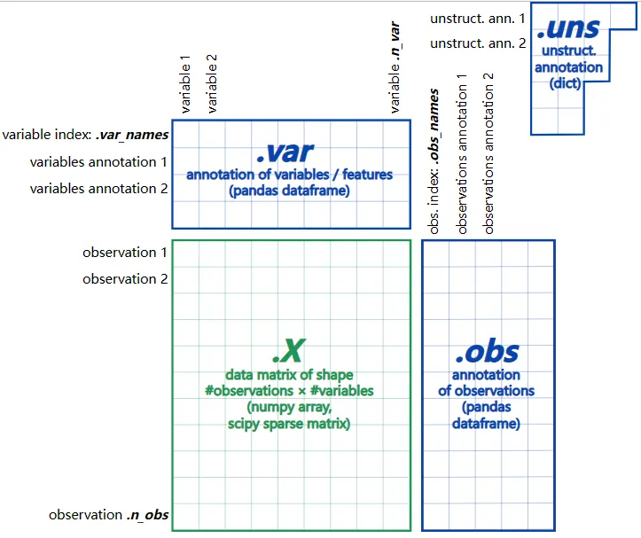

# 一文了解Python中的单细胞通货：AnnData

> 原文：https://mp.weixin.qq.com/s?__biz=MzAwMzIzOTk5OQ==&mid=2247528513&idx=1&sn=1ff1b8bee321f8f5bcac425ce96dc6ff&chksm=9b3c0911ac4b8007b781f78aaf6926a8786783143ee5de734d197c9cf52e6151af7b3338a20e#rd
> 合集：单细胞教程全收录

**一、写在前面**

1、是时候用Python分析单细胞了

此前我们的单细胞分析教程大都是基于R中的神包Seurat([scRNA-seq数据基础分析手册(2025最新修订)](<https://mp.weixin.qq.com/s?__biz=MzAwMzIzOTk5OQ==&mid=2247528199&idx=1&sn=ab75e7d7987ab233c675455188f10f33&scene=21#wechat_redirect>))，现如今面对指数级增长的单细胞数据，基于Python的Scanpy([scRNA-Seq学习手册Python版](<https://mp.weixin.qq.com/s?__biz=MzAwMzIzOTk5OQ==&mid=2247504877&idx=2&sn=2b56a9cfa19fcc918ee6c2ed88fed017&scene=21#wechat_redirect>))其实是一个更好的选择。目前Python具有丰富的科学计算库和活跃的社区支持，在数据处理、可视化和与其他机器学习或生物信息学工具的集成方面展现出巨大的灵活性。

2、Scanpy

Scanpy就是Python环境中对标Seurat的单细胞分析神器，即使是R语言一直引以为傲的可视化能力，也被Scanpy迎头赶上：其内置了多种可视化方法，从而利用matplotlib和seaborn等Python可视化库，可以创建高质量的图形，并且能够方便地进行定制和扩展，以满足不同的可视化需求。由于Python在机器学习([机器学习基础手册](<https://mp.weixin.qq.com/s?__biz=MzAwMzIzOTk5OQ==&mid=2247510121&idx=1&sn=87b53d350d9aedd5b3205d59e51356a0&scene=21#wechat_redirect>))领域的广泛应用，Scanpy可以轻松与其他Python库和工具集成，如用于深度学习的PyTorch和TensorFlow，以及用于数据处理和分析的 Pandas 和 NumPy 等，便于进行更复杂的多模态数据分析和机器学习任务。不得不提的是，在处理大规模单细胞数据集时，Scanpy通常具有较好计算效率，无论是计算速度还是内存占用上都比基于R的Seurat要好得多，这使得它在处理海量单细胞数据时表现出色。所以，不得不拥抱未来，让我们把Python中的单细胞内容学起来吧~

3、AnnData

`AnnData`被设计用于矩阵样数据的处理，可以方便的获得矩阵行与列的索引。例如在scRNA-seq的数据中，每一行的数据对应为一个细胞表达的所有基因数据，每一列的数据对应为一个基因在所有细胞中的表达数据(这点与R中不同，`Seurat`对象的矩阵正好是`AnnData`的转置版)。不仅是表达矩阵，每个细胞（如样本来源、细胞类型等）及每个基因（如别名、基因ID等）还会有自己的注释信息。另外，考虑到单细胞矩阵的稀疏性、以及数据结构需要有用户友好型的特性，`AnnData`显得再合适不过。因此AnnData在Python中被广泛应用于scVelo、scvi等单细胞分析工具中，甚至空间转录组也都沿用这一数据格式对象：[Stereopy空间转录组学习手册](<https://mp.weixin.qq.com/s?__biz=MzAwMzIzOTk5OQ==&mid=2247505686&idx=2&sn=925ce770136ec3e964b954c639eed29e&scene=21#wechat_redirect>)、[Squidpy空间转录组学习手册](<https://mp.weixin.qq.com/s?__biz=MzAwMzIzOTk5OQ==&mid=2247505844&idx=2&sn=5756c0702d080d6e602c504e7d461013&scene=21#wechat_redirect>)。

本教程基于Linux中的Rstudio环境（[足够支持你完成硕博生涯的生信环境](<https://mp.weixin.qq.com/s?__biz=MzAwMzIzOTk5OQ==&mid=2247526504&idx=2&sn=417d07347cebe0a1bd403f6c3e7d9b29&scene=21#wechat_redirect>)）演示，计算资源不足的同学可参考：
[生信分析为什么要使用服务器？](<https://mp.weixin.qq.com/s?__biz=MzAwMzIzOTk5OQ==&mid=2247491007&idx=1&sn=8619c2bad23791b3252a1c4cb1831931&chksm=9b3f64efac48edf9c02f84959aeee9b12480736fce70c5ddb8b41d79cfc22ce590ea2cb60fba&token=1760636281&lang=zh_CN&scene=21#wechat_redirect>)
[足够支持你完成硕博生涯的生信环境](<http://mp.weixin.qq.com/s?__biz=MzAwMzIzOTk5OQ==&mid=2247511780&idx=1&sn=3acc0874f7d2fa75f1abbe7a9a9b4069&chksm=9b3cd7b4ac4b5ea27d4d53964e4a4a9fa8c806a19103729dd4ff0fa72e621411f46a251d269f&scene=21#wechat_redirect>)
[独享服务器，生信分析不求人](<http://mp.weixin.qq.com/s?__biz=MzAwMzIzOTk5OQ==&mid=2247503618&idx=1&sn=ca47ca985aa8560f6b38f15f210519e2&chksm=9b3cb652ac4b3f44292560071b7e98e2f6fa6ec03581cd882a4d59b9d7fa063a5b9ac1b923f3&scene=21#wechat_redirect>)

访问链接：https://biomamba.xiyoucloud.net/

更多内容可咨询客服微信[**Biomamba_zhushou**]

**二、实操**

本教程需要熟练掌握Python，大家可以先行学习：[生信Python速查手册](<https://mp.weixin.qq.com/s?__biz=MzAwMzIzOTk5OQ==&mid=2247499921&idx=1&sn=dcd6f95596e3de9bf378d850c217fe78&scene=21#wechat_redirect>)。更多Python单细胞教程与测试数据可见：[scRNA-Seq学习手册Python版](<https://mp.weixin.qq.com/s?__biz=MzAwMzIzOTk5OQ==&mid=2247504877&idx=2&sn=2b56a9cfa19fcc918ee6c2ed88fed017&scene=21#wechat_redirect>)。

1、构建模拟`Anndata`对象并查看

`AnnData`的基本结构可以看这个示意图：



环境布置可见此前教程：[布置Python单细胞分析环境](<https://mp.weixin.qq.com/s?__biz=MzAwMzIzOTk5OQ==&mid=2247528493&idx=2&sn=b8add6f0303ec6032ecc2242f59d8289&scene=21#wechat_redirect>)
```
# 导包
import numpy as np
import pandas as pd
import anndata as ad
from scipy.sparse import csr_matrix
print(ad.__version__)
```
```
## 0.9.1
```
```
# 模拟一个矩阵构建AnnData对象
counts = csr_matrix(np.random.poisson(1, size=(100, 2000)), dtype=np.float32)
temp_adata = ad.AnnData(counts)
print(f"这个AnnData对象包括{temp_adata.shape[0]}行，与{temp_adata.shape[1]}列")
# 稀疏矩阵存放在temp_adata.X中：
```
```
## 这个AnnData对象包括100行，与2000列
```
```
temp_adata.X
```
```
## <100x2000 sparse matrix of type '<class 'numpy.float32'>'
##  with 126600 stored elements in Compressed Sparse Row format>
```

`AnnData`索引操作可以帮助我们取得对应的`AnnData`子集，这样我们就可以选取感兴趣的细胞或基因参与下游的计算，简化流程并节省计算资源。类似于`pandas`的`DataFrame`通过`obs_names`和`var_names`、布尔值、索引整数数字均可以完成对`AnnData`的取子集操作。
我们的矩阵是刚才模拟出来的，可以用这样的方式添加上细胞名称与基因名称：
```
# 生成细胞名称并传递给obs_names
temp_adata.obs_names = [f"Cell_{i:d}"for i inrange(temp_adata.n_obs)]
# 生成基因名称并传递给var_names
temp_adata.var_names = [f"Gene_{i:d}"for i inrange(temp_adata.n_vars)]

print(f"前五个细胞名称为:\n{temp_adata.obs_names[:5]}")
```
```
## 前五个细胞名称为:
## Index(['Cell_0', 'Cell_1', 'Cell_2', 'Cell_3', 'Cell_4'], dtype='object')
```
```
print(f"前五个基因名称为:\n{temp_adata.var_names[:5]}")
```
```
## 前五个基因名称为:
## Index(['Gene_0', 'Gene_1', 'Gene_2', 'Gene_3', 'Gene_4'], dtype='object')
```
```
# 那么子集就可以这么取:
temp_adata[["Cell_1", "Cell_10"], ["Gene_5", "Gene_1900"]]
# 这样就得到了一个包含"两个细胞"、"两个基因"的表达矩阵
```
```
## View of AnnData object with n_obs × n_vars = 2 × 2
```

## 2、添加注释信息

`adata.obs`与`adata.var`均是`DataFrame`，那么就可以很容易的加上对应的注释，例如加上细胞类型的注释:
```
# 例如这里随机生成"B", "T", "Monocyte"三种细胞类型作为注释
ct = np.random.choice(["B", "T", "Monocyte"], size=(temp_adata.n_obs,))
print(f"ct的前10个元素为{ct[0:10]}")

# 加入adata.obs中
```
```
## ct的前10个元素为['T' 'Monocyte' 'T' 'Monocyte' 'Monocyte' 'B' 'Monocyte' 'Monocyte'
##  'Monocyte' 'T']
```
```
temp_adata.obs["cell_type"] = pd.Categorical(ct)  # Categorical的执行效率较高

# 可以看到adata.obs已经包含了我们刚刚添加的注释
temp_adata.obs
```
```
##         cell_type
## Cell_0          T
## Cell_1   Monocyte
## Cell_2          T
## Cell_3   Monocyte
## Cell_4   Monocyte
## ...           ...
## Cell_95  Monocyte
## Cell_96  Monocyte
## Cell_97         T
## Cell_98         B
## Cell_99         T
##
## [100 rows x 1 columns]
```

同理，我们也可以对基因添加相应的注释：
```
# 例如这里随机生成"Pathway_A", "Pathway_B", "Pathway_C"三种通路名作为细胞的注释
my_path = np.random.choice(["Pathway_A", "Pathway_B", "Pathway_C"],
                      size=(temp_adata.n_vars,))
print(f"ct的前10个元素为{my_path[0:10]}")

# 加入adata.obs中
```
```
## ct的前10个元素为['Pathway_C' 'Pathway_A' 'Pathway_B' 'Pathway_B' 'Pathway_A' 'Pathway_B'
##  'Pathway_C' 'Pathway_A' 'Pathway_C' 'Pathway_C']
```
```
temp_adata.var["my_pathway"] = pd.Categorical(my_path)  # Categorical的执行效率较高

# 可以看到adata.var已经包含了我们刚刚添加的注释
temp_adata.var
```
```
##           my_pathway
## Gene_0     Pathway_C
## Gene_1     Pathway_A
## Gene_2     Pathway_B
## Gene_3     Pathway_B
## Gene_4     Pathway_A
## ...              ...
## Gene_1995  Pathway_C
## Gene_1996  Pathway_C
## Gene_1997  Pathway_A
## Gene_1998  Pathway_C
## Gene_1999  Pathway_B
##
## [2000 rows x 1 columns]
```
```
# 这时这个AnnData对象就包含了我们所添加的cell_type以及my_pathway注释：
temp_adata
```
```
## AnnData object with n_obs × n_vars = 100 × 2000
##     obs: 'cell_type'
##     var: 'my_pathway'
```
```
# 这时可以通过注释来选取数据的子集：
# 取出B cell的细胞数据
bcell_adata = temp_adata[temp_adata.obs.cell_type =="B",:]

# 取出仅包含Pathway_A的基因数据：
PA_adata = temp_adata[:,temp_adata.var.my_pathway =="Pathway_A"]
```

在实际分析过程中，往往有大量的注释内容，例如:
```
# 构建一个略显"复杂"的注释DataFrame
obs_meta = pd.DataFrame({
'time_yr': np.random.choice([0, 2, 4, 8], temp_adata.n_obs),
'subject_id': np.random.choice(['subject 1', 'subject 2', 'subject 4', 'subject 8'], temp_adata.n_obs),
'instrument_type': np.random.choice(['type a', 'type b'], temp_adata.n_obs),
'site': np.random.choice(['site x', 'site y'], temp_adata.n_obs),
    },
    index=temp_adata.obs.index,   # 需要与AnnData的observations相一致
)
obs_meta.head()
```
```
##         time_yr subject_id instrument_type    site
## Cell_0        4  subject 1          type a  site y
## Cell_1        2  subject 4          type a  site y
## Cell_2        8  subject 8          type b  site x
## Cell_3        4  subject 4          type b  site x
## Cell_4        4  subject 2          type a  site y
```
```
# 将注释添加到AnnData对象中:
new_adata = ad.AnnData(temp_adata.X, obs=obs_meta, var=temp_adata.var)

new_adata
# 可以看到多出很多注释内容
```
```
## AnnData object with n_obs × n_vars = 100 × 2000
##     obs: 'time_yr', 'subject_id', 'instrument_type', 'site'
##     var: 'my_pathway'
```

## 3、 注释矩阵管理

刚才我们添加的`cell_type`以及`my_pathway`包含的均是单个围堵的注释信息，而有些数据是以多维度的形式参与单细胞的数据处理。例如`UMAP`与`tsne`的降维矩阵，这些多维度的信息可以添加至`.obsm`或`.varm`中。需要注意的是，矩阵的长度需要与`.n_obs`和`.n_vars`相对应。
例如这里我们模拟一个`UMAP`和`gene_stuff`的结果进行添加：
```
temp_adata.obsm["X_umap"] = np.random.normal(0, 1, size=(temp_adata.n_obs, 2))
temp_adata.varm["gene_stuff"] = np.random.normal(0, 1, size=(temp_adata.n_vars, 5))
temp_adata
# 可以看到X_umap与gene_stuff数据被添加
```
```
## AnnData object with n_obs × n_vars = 100 × 2000
##     obs: 'cell_type'
##     var: 'my_pathway'
##     obsm: 'X_umap'
##     varm: 'gene_stuff'
```

## 4、非结构性的注释信息

这部分`Unstructure metaData`可以存放在`.uns`中，并且对数据格式、内容均无任何要求，可以存放一些提示信息：
```
temp_adata.uns["random"] = [1, 2, 3]
temp_adata.uns
```
```
## OrderedDict([('random', [1, 2, 3])])
```

## 5、Layers

原始的矩阵数据可能会经计算生成一些新的数据，这时我们就可以将这些过程或结果数据存放在不同的`Layers`中，例如数据处理过程中产生的标准化数据`log_transformed`:
```
temp_adata.layers["log_transformed"] = np.log1p(temp_adata.X)
temp_adata
# 可以看到新生成的layer
```
```
## AnnData object with n_obs × n_vars = 100 × 2000
##     obs: 'cell_type'
##     var: 'my_pathway'
##     uns: 'random'
##     obsm: 'X_umap'
##     varm: 'gene_stuff'
##     layers: 'log_transformed'
```
```
# Layer也可以直接转换为矩阵
temp_adata.to_df(layer="log_transformed")

# 也可以输出为csb文件：adata.to_df(layer="log_transformed").to_csv("log_transformed.csv")
```
```
##            Gene_0    Gene_1    Gene_2  ...  Gene_1997  Gene_1998  Gene_1999
## Cell_0   0.693147  0.693147  0.000000  ...   0.693147   0.000000   0.693147
## Cell_1   0.693147  1.098612  1.098612  ...   0.693147   1.386294   0.693147
## Cell_2   0.000000  1.098612  0.000000  ...   0.693147   0.693147   0.000000
## Cell_3   0.000000  0.693147  0.000000  ...   1.098612   0.693147   0.693147
## Cell_4   0.693147  1.098612  0.000000  ...   1.386294   0.693147   0.000000
## ...           ...       ...       ...  ...        ...        ...        ...
## Cell_95  1.098612  0.693147  0.000000  ...   0.693147   0.693147   0.000000
## Cell_96  0.693147  0.000000  0.693147  ...   0.000000   0.693147   1.609438
## Cell_97  1.098612  0.693147  0.693147  ...   0.693147   0.693147   0.000000
## Cell_98  1.386294  0.693147  0.000000  ...   1.386294   0.000000   0.693147
## Cell_99  0.693147  0.693147  0.693147  ...   1.098612   0.693147   1.386294
##
## [100 rows x 2000 columns]
```

6、`AnnData`存储与读取`AnnData`可以很方便的以`h5ad`的形式保存在本地，这种格式的读写速度实际体验起来均比`rds`文件要快。如果需要将`AnnData`或`h5ad`格式的对象转换为R语言中`Seurat`可分析的对象，可参考：
[各类单细胞对象（数据格式）转换大全（一）](<http://mp.weixin.qq.com/s?__biz=MzAwMzIzOTk5OQ==&mid=2247485925&idx=1&sn=14e08440200f0f5cb4dcc2dc615efeb8&chksm=9b3f70b5ac48f9a37a43cc2a8b2a5e485a3f84b4ef87949dfe99056bc6301b110e80800f6bb1&scene=21#wechat_redirect>)
[单细胞对象(数据格式)转换大全|2. h5ad转Seuratobj](<https://mp.weixin.qq.com/s?__biz=MzAwMzIzOTk5OQ==&mid=2247496786&idx=1&sn=408a81e4824c33eaefe6e9e7f0143c7e&chksm=9b3c8d02ac4b0414bc1d11762b870248743bd9aaaef9d15480fd99a36322d47b448b229345be&token=767842863&lang=zh_CN&scene=21#wechat_redirect>)
```
adata = ad.read('my_results.h5ad', backed='r')
adata.isbacked #此时my_results.h5ad处于open状态，即被占用的状态
```
```
## True
```
```
# 此时adata可以被正常使用，且多出路径变量
adata.filename

# 当完成分析时可以解除占用：
```
```
## PosixPath('my_results.h5ad')
```
```
adata.file.close()
# 这其实就是scanpy在分析相同的数据比Seurat占用更少内存的秘诀
```

##

## 7、`AnnData`的`Views`与`copie s`

与`pandas`的`DataFrame`一样，`AnnData`也可以通过`Views`来创建一个对象的”影子”，这样既可以避免占据新的内存，又可以修改原有的对象。
```
# 在做View时候也可以使用切片：
temp_adata[:5, ['Gene_1', 'Gene_3']]
```
```
## View of AnnData object with n_obs × n_vars = 5 × 2
##     obs: 'cell_type'
##     var: 'my_pathway'
##     uns: 'random'
##     obsm: 'X_umap'
##     varm: 'gene_stuff'
##     layers: 'log_transformed'
```
```
# 而copy的方式会占据额外的内存
adata_subset = temp_adata[:5, ['Gene_1', 'Gene_3']].copy()
```

参考：https://scanpy.readthedocs.io/en/stable/

**如何联系我们**

 留一个领取资料、[免费两周学习版](<https://mp.weixin.qq.com/s?__biz=MzAwMzIzOTk5OQ==&mid=2247527585&idx=1&sn=fa32112c11b215b33096cab43baf08ea&scene=21#wechat_redirect>)服务器的**微信号[Biomamba_zhushou]**，方便各位随时交流。同时我们也构建了[交流群矩阵](<https://mp.weixin.qq.com/s?__biz=MzAwMzIzOTk5OQ==&mid=2247528057&idx=1&sn=bb348c2a88c977c7cce67ee6731a3591&scene=21#wechat_redirect>)，欢迎大家入群讨论。

大家可以阅读完这几篇之后添加[给生信入门初学者的小贴士](<http://mp.weixin.qq.com/s?__biz=MzAwMzIzOTk5OQ==&mid=2247493329&idx=1&sn=597870b7f7ce10346da3561e7c281627&chksm=9b3c9f81ac4b169794088ce9abbcacb5f18e9fd174fc0d7e28da62d78facadf3100ef38aaf22&scene=21#wechat_redirect>)
[如何搜索公众号过往发布内容](<http://mp.weixin.qq.com/s?__biz=MzAwMzIzOTk5OQ==&mid=2247506266&idx=2&sn=22b1164bc9602c25620d058847785422&chksm=9b3ca00aac4b291c16d738271746ffb90149282a728f484e8a1952463c46a8e7dc4f883ab928&scene=21#wechat_redirect>)

**已有生信基地联系方式的同学****无需重复添加**

 您点的每个赞和在看，我都认真当成了喜欢
**
**
