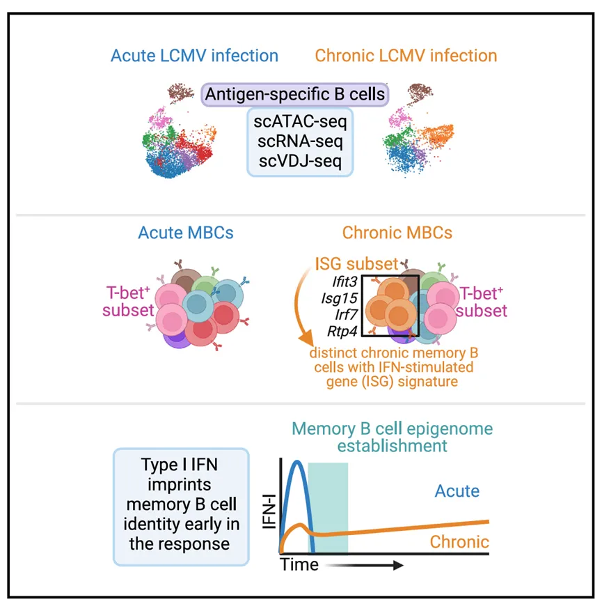
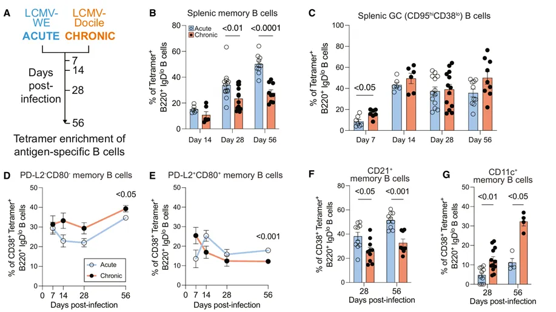
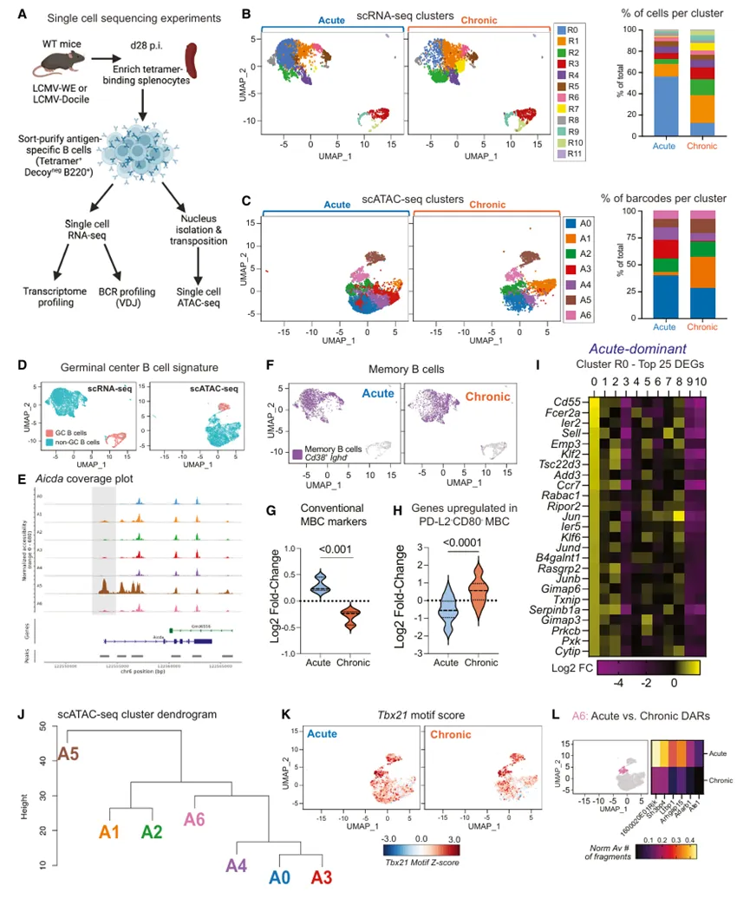
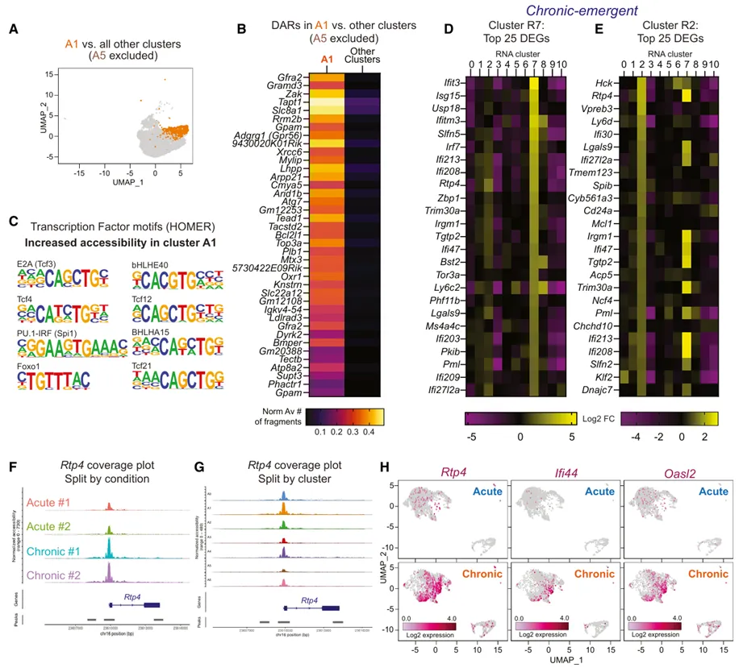
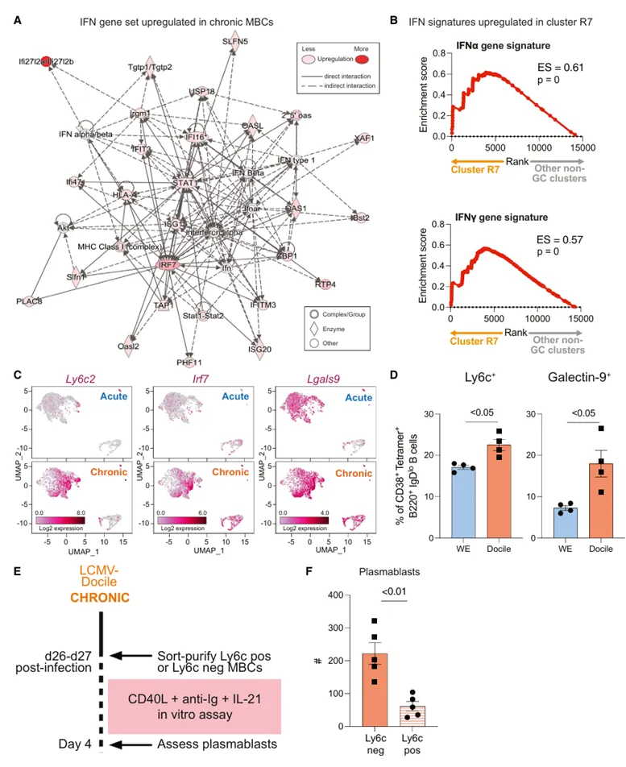
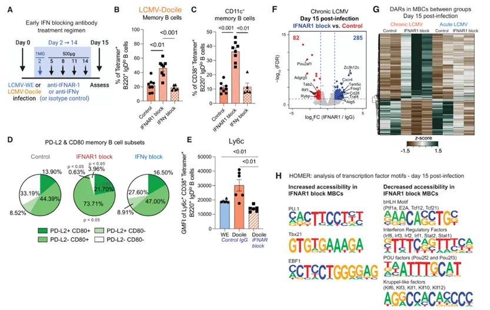
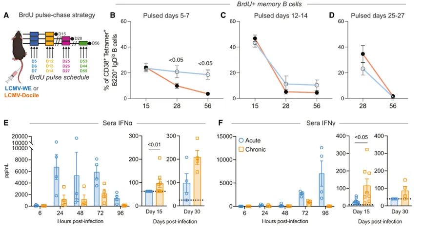
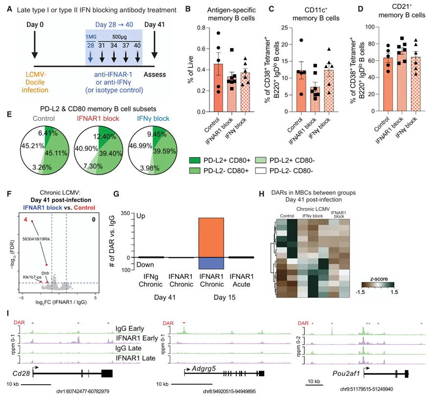

# 《Immunity》(IF=25.5)| scATAC、scRNA-seq、scVDJ-seq联合分析B细胞亚群

> 原文：https://mp.weixin.qq.com/s?__biz=MzAwMzIzOTk5OQ==&mid=2247528765&idx=1&sn=c75b15f8587c07c3e9ac6d60a4e71ecc&chksm=9b3c086dac4b817b7771c0edc193c940455aa942be8489d661b38830b6beb9f15816bc302669#rd
> 合集：单细胞教程全收录

**一、写在前面**

`` 记忆B细胞（Memory B Cells）是适应性免疫系统中的关键组成部分，它们在体液免疫反应中扮演着至关重要的角色，当机体再次遇到相同的病原体时，记忆B细胞能够迅速增殖和分化，快速产生抗体，以应对再次感染。然而，慢性病毒感染如HIV、丙型肝炎和巨细胞病毒会干扰MBC的发育和抗体生产，导致不完全或无效的免疫保护。在这篇文章中作者通过单细胞ATAC测序（[scATAC-seq](<https://mp.weixin.qq.com/s?__biz=MzAwMzIzOTk5OQ==&mid=2247521636&idx=1&sn=208907010f3f7412c1c91343d7dfb0d3&scene=21#wechat_redirect>)）和单细胞RNA测序（[scRNA-seq](<https://mp.weixin.qq.com/s?__biz=MzAwMzIzOTk5OQ==&mid=2247522475&idx=1&sn=84dd9a65348528be9aa2b8d2711d776c&scene=21#wechat_redirect>)），比较了急性和慢性淋巴细胞性脉络丛脑膜炎病毒（LCMV）感染期间的MBC。主要探讨了慢性病毒感染如何改变MBC的发育，以及这些改变是否可逆，最终鉴定出了一个在慢性感染期间存在的记忆亚群，该亚群富集干扰素刺激基因（ISG）且不同于通常与慢性感染相关的T-bet+亚群。文章链接：https://pubmed.ncbi.nlm.nih.gov/38593796/
scATAC分析教程可参考：[scATAC分析学习手册](<https://mp.weixin.qq.com/s?__biz=MzAwMzIzOTk5OQ==&mid=2247521636&idx=1&sn=208907010f3f7412c1c91343d7dfb0d3&scene=21#wechat_redirect>)

scRNA-seq分析教程可参考：
[生信基地122篇单细胞教程全索引](<https://mp.weixin.qq.com/s?__biz=MzAwMzIzOTk5OQ==&mid=2247528470&idx=1&sn=7f3ced59b2b97bed1ac9df560b11ddd6&scene=21#wechat_redirect>)

如果需要数据分析**指导** 、生信热点**全文复现** 、自测数据**个性化分析** 辅导，欢迎联系客服微信[**Biomamba_zhushou**]

**二、主要内容**

``

  1. **1. ****LCMV-Docile****感染改变抗原特异性****MBC****的形成。******

首先，作者建立了同一病毒的两种毒株的小鼠**LCMV****模型** ，分别是两**周内消退的急性感染和慢性持续性感染** （Fig.1A）。分别在急性和慢性感染环境中评估B细胞分化对相同病毒的响应。急性感染中，脾MBC细胞随着时间的推移稳步增加，而慢性感染后第28天和56天观察到的MBC明显减少（Fig.1B）。然而，**两组中抗原特异性****GCB****（****CD95 hiCD38lo****）细胞比例相当** （Fig.1C）。研究表明，**MBCs****的不同表型亚群与它们的功能有关。** 这些亚群可以根据它们表达的特定分子和基因特征来区分，例如相比于naïve样MBC，表达B7家族成员PD-L2和CD80的传统MBCs在再次免疫应答时能够迅速分化为抗体分泌细胞。在此基础上，作者发现在慢性感染模型中，MBC的亚群有明显的转换，**naïve****样亚群增加，****PD-L2+CD80+****亚群减少** （Fig.1D-E）。而且相比于急性感染，慢性感染中**CD21 +MBC****细胞减少** ，

**CD11c +MBC****细胞增加** 。以上结果证实了响应LCMV-Docile的慢性感染的MBC变化与人类慢性疾病变化相似。

**Fig.1**

  1. **2. ****LCMV-Docile****感染改变抗原特异性****MBC****的形成。******

接下来，作者重点探讨了慢病毒如何影响 MBC细胞的表型变化，作者通过**scRNA-seq****分析转录组和免疫球蛋白的多样性** ，**通过****scATAC-seq****分析染色质的可及性** （Fig.2A）。分别对两个seq的数据进行聚类分析来确定急性和慢性感染中MBC细胞的表观遗传变化，scRNA-seq分析确定了12个细胞簇（Fig.2B），scATAC-seq分析确定了7个细胞簇（Fig.2C）,在此基础上，作者通过免疫基因组（ImmGen）进行细胞注释，以确定这些细胞簇和B细胞分化之间的关系，其中R3、R9和R10因Cd38的缺乏和Fas的表达被认为是GCB细胞（Fig.2D）。

为了评估数据集的保真度，作者进行了标签传输，将scRNA-seq注释传输到scATAC-seq数据集中，合并数据的分析显示，scRNA-seq的GC簇与scATAC-seq中A5簇重叠，并且证实A5的特征是GCB细胞上调的基因关键位点，例如Aicda、S1pr2和Fas（Fig.2E）。

为了评估基因的变化是否与MBC细胞表型的减少相关，作者将scRNA-seq分析结果与已发表的小鼠RNA-seq集进行比较，结果显示MBC细胞中传统的记忆标志物减少，而PD-L2－CD80－MBCs明显增加（Fig.2F-H）。以上结果提示，慢性病毒感染后MBC细胞的基因表达发生了明显的变化。

**Fig.2**

  1. **3. ****慢性****LCMV****感染诱导了富含****ISG****的****MBC****群体。******

进一步地，为探究慢性病毒诱导 MBC发生变化具体的分子机制，**作者结合分析****scATAC-seq****和****scRNA-seq****的数据** ，慢性病毒感染后，A1细胞簇数量明显增加，且从A1簇中能够鉴定出39个染色质开放区域（Fig.3A-B），通过**HOMER****评估** ，作者发现这些区域富集了对B细胞生物学重要的转录因子的结合基序（Fig.3C）。与此同时，作者关注了scRNA-seq数据中慢性病毒感染后的R2和R7细胞簇并展示了排名靠前的差异基因（Fig.3D-E），且这两个scRNA-seq亚群都与scATAC-seq数据中的A1重叠。因为Rtp4是干扰素诱导的，作者进一步对Rtp4进行了关注，结果显示与急性感染相比，慢性感染中Rtp4启动子区域的染色质可及性增加（Fig.3F），特别是在A1簇中（Fig.3G）。此外慢性感染期间，Rtp4调控的基因在 MBCs中表达上调（Fig.3H）。以上结果提示IFN在慢性感染后MBC的表观遗传变化中发挥重要的功能。

Fig.3

  1. **4. ****慢性病毒诱导的****MBCs****在体外反应能力降低。******

同时，作者对于数据集进行了富集分析，**IPA****分析** 显示IFN相关基因在慢性感染后富集（Fig.4A），**GSEA****分析** 显示了相同的结果（Fig.4B），且作者通过**流式** 验证了Ly6c2和Lgals9表达的明显增加（Fig.4C-D）。接下来，作者通过Ly6c+和Ly6c-来表示不同的MBCs亚群，在小鼠感染了LCMV-Docile病毒4周后，Ly6c+和Ly6c-的MBCs在体外被CD40L、抗Ig和白细胞介素IL-21刺激,4天后，作者发现Ly6c+的MBC产生浆细胞的能力降低，这些结果显示与经典MBCs相比，慢性病毒刺激的MBCs存在功能上的差异（Fig.4E-F）。

**Fig.4**

  1. **5. ****IFN-I****是驱动慢性病毒感染期间****MBC****表型和表观遗传变化的关键因素。******

上文作者已经发现**IFN****在慢性病毒感染中所发挥的重要作用** ，进一步，为探究它们如何影响MBCs的形成和功能，进行了以下实验，首先假设I型或II型IFN可能是慢性MBCs身份的关键驱动因素，使用野生型小鼠感染LCMV（Fig.5A），并从感染后第2天至第14天每3天给予**IFNα****和****β****受体****1****（****IFNAR-1****）或****IFNγ****的阻断抗体** ，结果显示IFNAR-1阻断导致MBC群体的定性和定量变化，而IFNγ阻断则没有这种效果（Fig.5B-D）。与此同时，作者发现IFNAR-1阻断也会导致Ly6C表达减少（Fig.5E），MBC的免疫景观也会得到重塑（Fig.5F-H）。以上结果表示IFN-I信号在慢性病毒感染中对MBCs的表观遗传特征和表型具有重要影响。在感染早期阻断IFNAR-1可以改变慢性MBCs的染色质景观，减少ISG诱导的转录因子结合位点的可及性，并在主导的MBC亚群中引起表型变化。

**Fig.5**

  1. **6. ****病毒载量不是慢性****MBC****表型的唯一驱动因素。******

接下来，作者测试了 MBCs形成的时间点以及病毒载量如何塑造慢性感染中MBC的发展和维持。通过**5-****溴****-2'-****脱氧尿苷（****BrdU****）标记实验** （Fig.6A），研究者研究了急性与慢性病毒感染中MBC形成和寿命的体内动力学（Fig.6B-D）。结果显示在感染后第 56 天检测到的大多数 BrdU MBC 是在感染早期产生的，表明慢性感染期间病毒的存在可能导致MBCs的持续增殖和变化。同时研究者还比较了急性感染和慢性感染中IFN产生的动力学。急性感染在感染后24小时内诱导了高水平的IFNα，这对于启动有效的免疫反应至关重要。相比之下，慢性感染的IFNα产生延迟，没有达到急性感染的水平（Fig.6E-F）。

**Fig.6**

  1. **7. ****慢性病毒感染期间，****IFN-I****是影响****MBC****染色质景观建立的关键时间窗口。**

为了进一步验证IFN是否对维持慢性MBC细胞至关重要。研究者在已建立的感染后期（感染后第28天至第40天）使用**IFN-I****阻断抗体对小鼠进行治疗** （Fig.7A）。实验结果表明早期阻断IFNAR-1可以改变慢性MBCs的染色质景观（Fig.7G-H），降低ISG诱导转录因子结合基序的可及性（Fig.7I），并诱导主要MBC亚群的表型变化（Fig.7B-E），其中ISG亚群减少，CD11c+CD80+细胞增加。提示慢性病毒感染中的MBC表型与IFN-I信号通路密切相关，早期阻断IFN-I信号可以改变慢性MBCs的表观遗传景观和表型，而晚期阻断IFN-I或IFNγ信号对MBC亚群分布的影响有限。

**Fig.7**

**三、最后聊聊**

``**总而言之，这篇文章通过scATAC-seq和scRNA-seq的联合分析和相互验证，通过将scRNA-seq的聚类标签转移到scATAC-seq数据中，计算基因活性来分析每个基因在每个细胞中的表达水平，并识别不同条件下的显著差异基因区域和基序活性。结果揭示了慢性病毒感染期间，IFN-I如何通过改变MBC的表型和表观遗传特征，影响其功能和免疫记忆。****scATAC-seq和scRNA-seq能够分别提供细胞核染色质可及性和基因表达的信息。这两种数据的联合分析可用于探索和理解单细胞水平上的基因表达和染色质可及性之间的复杂关系。**

**如何联系我们**

 留一个领取资料、[免费两周学习版](<https://mp.weixin.qq.com/s?__biz=MzAwMzIzOTk5OQ==&mid=2247527585&idx=1&sn=fa32112c11b215b33096cab43baf08ea&scene=21#wechat_redirect>)服务器的**微信号[Biomamba_zhushou]**，方便各位随时交流。同时我们也构建了[交流群矩阵](<https://mp.weixin.qq.com/s?__biz=MzAwMzIzOTk5OQ==&mid=2247528057&idx=1&sn=bb348c2a88c977c7cce67ee6731a3591&scene=21#wechat_redirect>)，欢迎大家入群讨论。
大家可以阅读完这几篇之后添加[给生信入门初学者的小贴士](<http://mp.weixin.qq.com/s?__biz=MzAwMzIzOTk5OQ==&mid=2247493329&idx=1&sn=597870b7f7ce10346da3561e7c281627&chksm=9b3c9f81ac4b169794088ce9abbcacb5f18e9fd174fc0d7e28da62d78facadf3100ef38aaf22&scene=21#wechat_redirect>)
[如何搜索公众号过往发布内容](<http://mp.weixin.qq.com/s?__biz=MzAwMzIzOTk5OQ==&mid=2247506266&idx=2&sn=22b1164bc9602c25620d058847785422&chksm=9b3ca00aac4b291c16d738271746ffb90149282a728f484e8a1952463c46a8e7dc4f883ab928&scene=21#wechat_redirect>)

**已有生信基地联系方式的同学****无需重复添加**

 您点的每个赞和在看，我都认真当成了喜欢
