# 《Nature》|scRNA Velocity剪切速率分析

> 原文：https://mp.weixin.qq.com/s?__biz=MzAwMzIzOTk5OQ==&mid=2247529963&idx=1&sn=a13d388071c83554d86921f7b446cc05&chksm=9b3c0cbbac4b85ad41e9a6a4ba9fb60ae9a4351ecedf1cca380f18ed0bc6c2b221fda02e9483#rd
> 合集：单细胞教程全收录

**一、写在前面**

本次分享的是2018年发布于《Nature》的文章****， 该文发布了Velocity工具用于研究单细胞水平下的RNA动力学研究，该工具的完整教程可见：[一文学会scRNA Velocity剪切速率分析](<https://mp.weixin.qq.com/s?__biz=MzAwMzIzOTk5OQ==&mid=2247528458&idx=1&sn=900357283922571c6294435be409a2f3&scene=21#wechat_redirect>)。****感兴趣的同学可以看看原文：

La Manno G, Soldatov R, Zeisel A, et al. RNA velocity of single cells. Nature. 2018 Aug;560(7719):494-498.

doi: 10.1038/s41586-018-0414-6 .

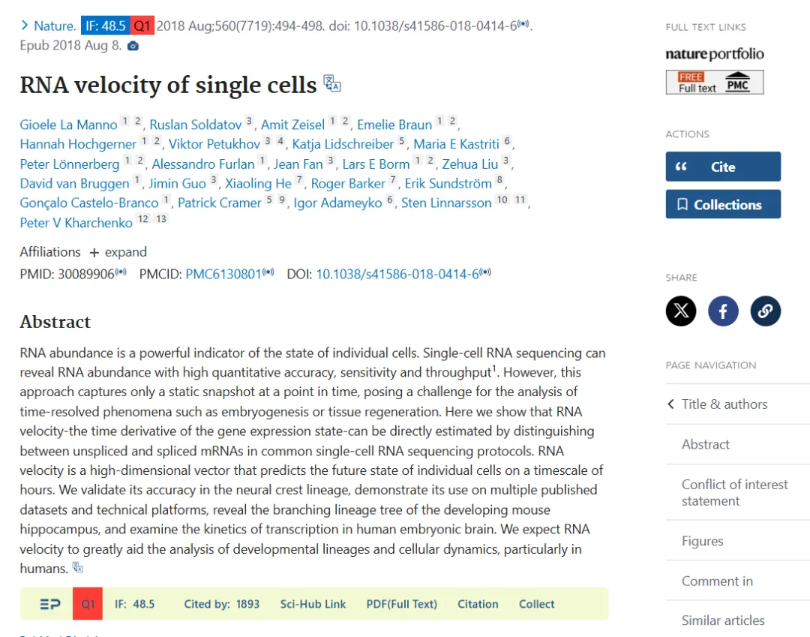

RNA丰度是单个细胞状态的一个强有力的指标。目前，单细胞RNA测序能够以高定量精度、灵敏度和通量揭示RNA丰度。然而，目前这种方法只能捕获到某一时间点的静态快照，这给诸如胚胎发生或组织再生等时间动态变化研究带来了挑战。因此，作者提出了RNA速率的概念(基因表达状态的时间导数)，可以通过区分常见单细胞RNA测序中的未剪接和已剪接mRNA直接估算。RNA速率是一个高维向量，能够在数小时的时间尺度上预测单个细胞的未来状态。作者在神经嵴谱系中验证了其准确性，在多个已发表的数据集和技术平台上展示了其用途。

如果需要[数据分析](<https://mp.weixin.qq.com/s?__biz=MzAwMzIzOTk5OQ==&mid=2247529435&idx=1&sn=cc7e9ff271f0ce0157008532ef4829c3&scene=21#wechat_redirect>)**指导** 、生信热点**全文复现** 、自测数据**个性化分析** 辅导、[常态化实验学习](<https://mp.weixin.qq.com/s?__biz=MzAwMzIzOTk5OQ==&mid=2247528769&idx=1&sn=53528029a1595c5dde109a461ec3708d&scene=21#wechat_redirect>)，欢迎联系客服微信[**Biomamba_zhushou**]

**二、**结果介绍**
**

****

2.1 提出转录动力学模型

####  2.1.1 主要内容

在发育过程中，分化的时间跨度为数小时至数天，这与信使核糖核酸(mRNA)的典型半衰期相当。新生成(未剪接)和成熟(已剪接)mRNA的相对丰度可用于估算基因剪接和降解的速率。同时，在单细胞RNA测序数据中也可能检测到类似的信号，并且这些信号能够揭示动态过程中整个转录组的变化速率和方向。

所有常见的单细胞RNA测序方案都依赖于寡聚脱氧胸苷酸(oligo-dT)引物来富集多聚腺苷酸化的mRNA分子。然而，对基于SMART-seq2、STRT/C1、inDrop和10x Chromium的单细胞RNA测序数据集进行分析，作者发现15%-25%的读段包含未剪接的内含子序列(图1a)，这与之前在bulk(14.6%)和单细胞(约20%)RNA测序中的观察结果一致。大多数此类读段源自内含子区域内的次级引物结合位点。大量内含子分子及其与外显子计数的相关性表明，这些分子代表未剪接的前体mRNA。这一点通过新转录RNA的代谢标记，随后使用寡聚脱氧胸苷酸引物的STRT技术进行RNA测序得到了证实(附录图2)；83%的所有基因显示的表达时间进程与简单的一级动力学一致，正如未剪接读段代表新生mRNA时所预期的那样。

为了量化前体mRNA与成熟mRNA丰度之间随时间变化的关系，作者假设了一个简单的转录动力学模型，其中剪接mRNA丰度的一阶时间导数(RNA速率)由未剪接mRNA转化为剪接mRNA的生成与mRNA降解之间的平衡所决定(图1b)。在这样的模型下，当转录速率α恒定时，系统会渐近地趋向于稳态。此时剪接(s)和未剪接(u)分子的稳态丰度由α决定，并受固定斜率关系的约束，即**u=γs** 。**平衡斜率γ结合了降解和剪接速率** ，反映了基因特异性的调控特性、内含子和外显子长度的比例以及内部启动位点的数量。对最近发表的一份小鼠组织进行研究，发现大多数基因在广泛细胞类型中的稳态行为与单一固定斜率γ一致(附录图3a-c)。然而，11%的基因在不同组织亚组中表现出不同的斜率(附录图3d-e)，这表明存在组织特异性的可变剪接(附录图3f)或降解速率。

在动态过程中，转录速率α的增加会导致未剪接的mRNA迅速增加，随后剪接的mRNA也会随之增加(图1c)，直至达到新的稳态。相反，转录速率的下降首先会导致未剪接的mRNA迅速减少，随后剪接的mRNA也会减少。在基因表达诱导期间，未剪接的mRNA量会超出基于平衡速率γ的预期，而在基因表达抑制期间则情况相反(图1d)。因此，未剪接和剪接的mRNA丰度之间的平衡是成熟mRNA丰度未来状态的指标，从而也是细胞未来状态的指标。

为了说明这样一个简单的模型能够用于预测未来成熟mRNA的丰度，作者研究了小鼠肝脏昼夜节律周期的总RNA测序的时间进程数据。在每个时间点，未剪接的mRNA水平始终与下一个时间点的剪接mRNA更为相似(图1e)，并且许多与昼夜节律相关的基因在上调期间未剪接mRNA相对于斜率γ的含量高于预期，在下调期间则低于预期(图1f-g)。通过求解每个基因的所提出的微分方程，作者能够将每个测量值外推到整个昼夜节律周期，准确地捕捉到预期的昼夜节律周期的进展方向(图1h)。

**图1:**

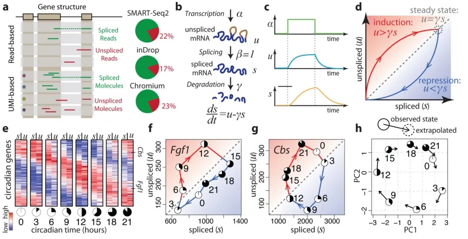

**附录图2:**

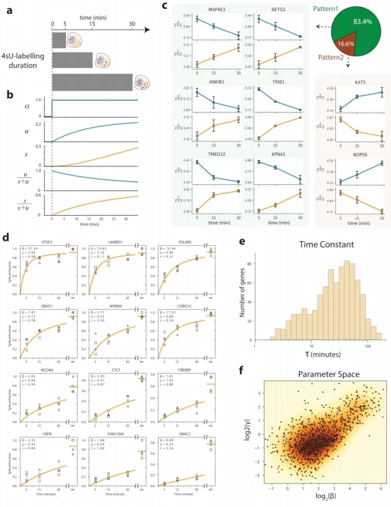

**附录图3:**

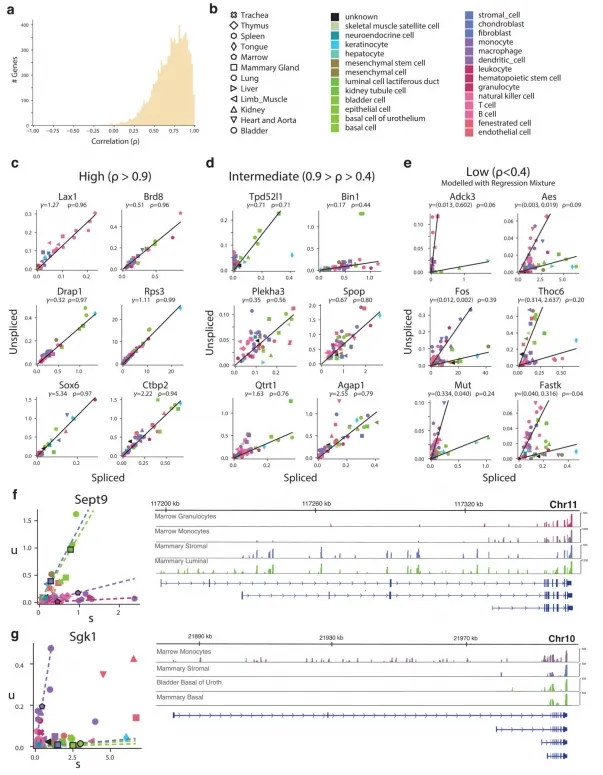

###  1.2.2 小鼠嗜铬细胞验证

#### 1.2.2.1 主要内容

为了展示在单细胞测序中预测转录动态的能力，作者分析了基于SMART-seq2技术测序得到的小鼠嗜铬细胞(chromaffin)单细胞mRNA测序数据。在发育过程中，肾上腺髓质的嗜铬细胞(一种神经内分泌细胞)中，存在相当一部分是由Schwann细胞前体衍生而来。这便提供了一个便捷的测试案例，可以通过谱系追踪来验证分化的方向。基因的相位图展示了与预测稳态关系的预期偏差(图2b-c)。单个细胞的RNA速率估计值准确地概括了该数据集中的转录动力学，包括分化细胞向嗜铬细胞的整体移动，以及向中间分化状态的移动和远离中间分化状态的变化(图2d)。为了适应那些处于稳态之外很远的基因，作者还开发了一种基于基因结构的替代拟合方法(附录图4)。有多种技术可用于在低维空间中可视化速率估计值。观察到的和外推的细胞状态可以共同嵌入到一个共同的低维空间中(例如图2d中的主成分分析)。或者，速率也可以根据外推状态与局部邻域中其他细胞的相似性投影到现有的低维嵌入中如tSNE(图2h)。在大型数据集中，使用局部平均向量场更容易可视化细胞速率的普遍模式(图2i)。由于细胞可以同时在多个独立的成分上具有RNA速率，例如分化、成熟和增殖，所以在解读低维表示时必须谨慎，因为在一个特定嵌入中缺乏明显速率的细胞，在未可视化的一些子空间中仍可能具有相当大的速率。

细胞特异性RNA速率估计为定量建模细胞命运提供了自然基础。代谢标记显示，对于大多数基因而言，在10-100分钟后，剪接/未剪接比率的变化即可被检测到(附录图2)。然而，外推的有效时间尺度取决于所分析的生物学过程。基于对嗜铬细胞祖细胞进行的EdU脉冲标记作者估计能够对未来2.5-3.8小时的情况进行外推(图2f，g)，这也与能够分辨细胞周期事件的能力相一致。不过，鉴于外推的线性性质，这种预测时间尺度将取决于基因表达轨迹的形状(即表达流形的曲率)。

为了展示作者方法的通用性，作者分析了使用其他单细胞RNA测序流程生成的数据。作者观察了小鼠骨髓中中性粒细胞成熟的转录动态，以及使用inDrop技术测序的小鼠皮质中光诱导的神经元激活(附录图5)，以及使用10x Genomics Chromium测量的小鼠肠道上皮(附录图6)、少突胶质细胞分化(附录图7)和海马体发育(见下文)。RNA速率的估计值对模型参数的变化、基因和细胞的抽样都很稳健，其中最敏感的参数是在预定义嵌入中可视化速率时所用邻域的大小。大多数基因的速率估计值与实验观察到的表达导数呈正相关(附录图8)，这证实了速率向量是有信息量的。在特定情况下出现的失败是由于几个明显的原因，包括仅在远离平衡态时观察到的基因、非编码转录本的贡献不均匀以及可变剪接导致在所测群体中存在多个γ率。

#### 1.2.2.2 知识点

#### EdU(5-ethynyl-2′-deoxyuridine)脉冲标记是一种用于检测细胞增殖和DNA合成的技术，常用于细胞周期研究。它是一种胸苷类似物，在细胞复制DNA时可以被掺入新合成的DNA中。

**图2:**

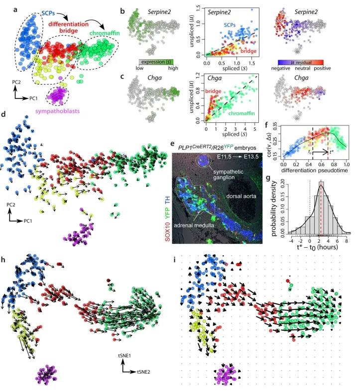

**附录图4:**

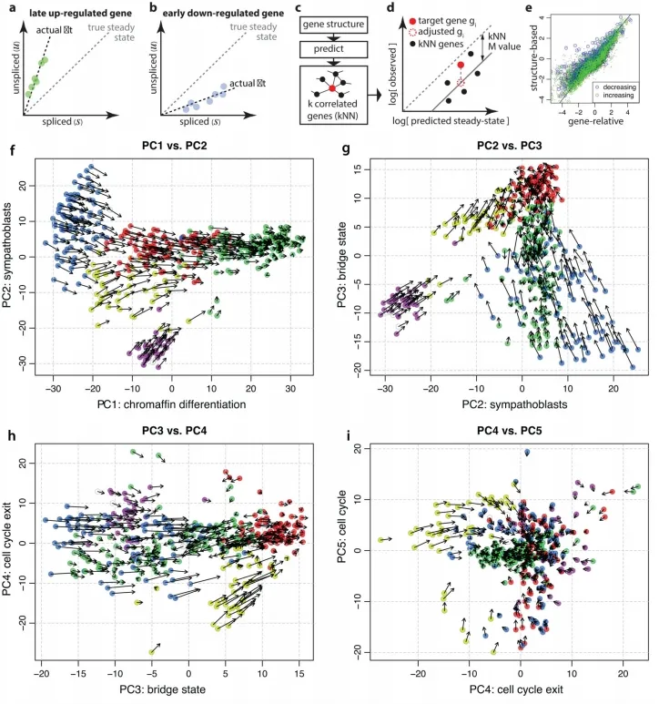 **附录图5:**

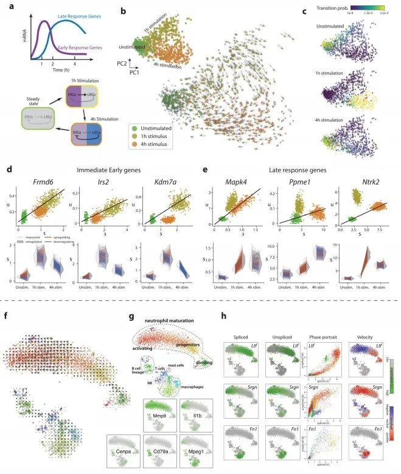

**附录图6:**

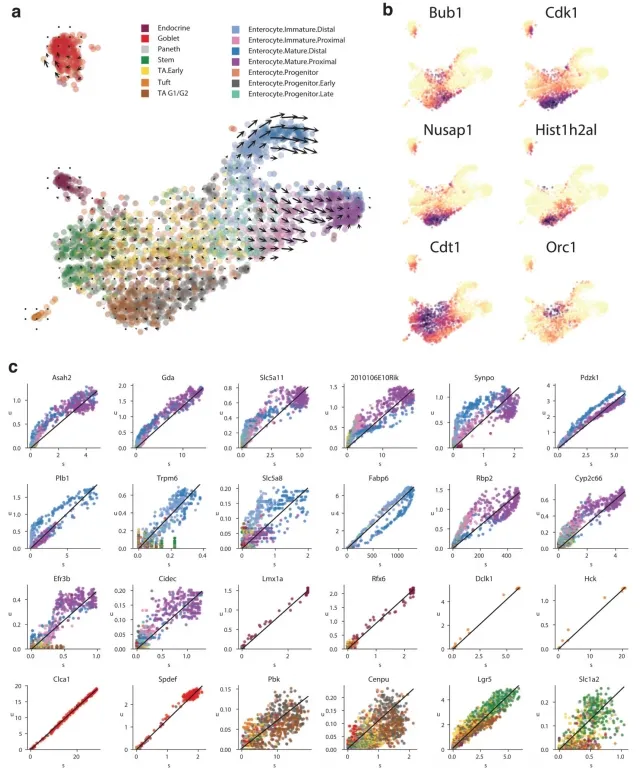

**附录图7:**

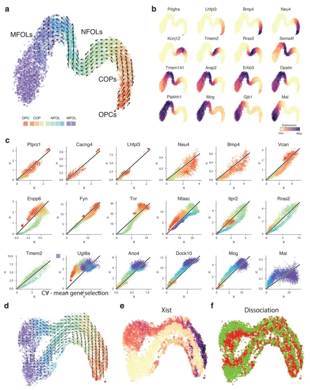

**附录图8:**

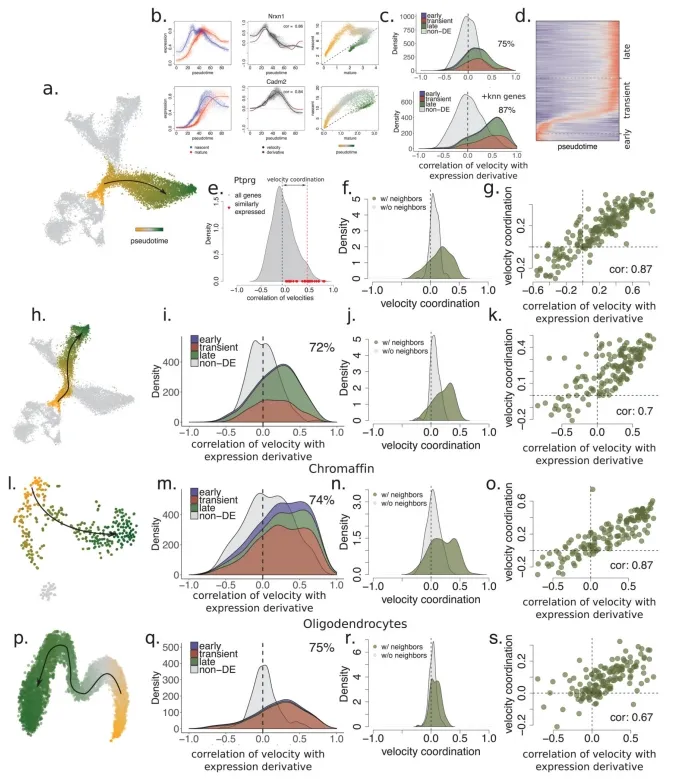

###  1.2.3 小鼠海马体验证

#### 1.2.3.1 主要内容

接下来，作者将RNA速率分析应用于发育中的小鼠海马体分支谱系。去除血管细胞、免疫细胞、GABAergic和CajalRetzius神经元(这些细胞起源于海马体之外)后，t-SNE降维图显示了一个具有多个分支的复杂流形(图3a)。作者利用已知的标记物将分支末端分别识别为星形胶质细胞(astrocytes)、少突胶质前体细胞(OPCs)、齿状回颗粒神经元细胞(dentate gyrus granule neurons)以及海马五个区域(subiculum、CA1、CA2、CA3 和hilus)的锥体神经元细胞(附录图9)。单个基因的相位图显示了沿流形基因表达的特定诱导和抑制(图3b，附录图10)。例如，Pdgfra(OPCs的标记物)在pre-OPCs细胞中被诱导，并在OPCs中得以维持；其在pre-OPCs细胞状态中表现出正速率，但在OPCs中则为零速率。同样，Igfbpl1特异性表达于神经前体细胞(neuroblasts)，从放射状胶质细胞(radial glia)到神经前体细胞表现出正速率，但从神经前体细胞到两个主要神经元分支则表现出负速率。

RNA速率显示出朝向每个主要分支的强烈定向流动(图3c，附录图10)。作者根据包括Notch信号通路的靶基因Hes1和同源框转录因子Hopx在内的标志物的表达，将这些细胞鉴定为放射状胶质细胞(附录图9)。事实上，先前的命运图谱研究已表明放射状胶质细胞是海马体谱系树的真正起源。通过在速率场中使用马尔可夫随机游走模型，可以自动识别终端状态和根状态(图3c)，这证明了RNA速率具有在无需先验发育过程知识的情况下对谱系树进行进化方向推断的能力。一方面，速率指向星形胶质细胞(表达Aqp4)而无需中间细胞分裂，或者通过狭窄通道从pre-OPC 指向OPC细胞状态。作者推测这个狭窄通道代表了向少突胶质细胞谱系的决定时刻。在这一微态水平上，细胞命运的选择可能是一个非确定性过程，涉及基因表达向一种或另一种命运倾斜，随后一旦转录因子反馈回路建立，最终命运便被锁定。将起始于前少突胶质前体细胞(pre-OPCs)的细胞与起始于通向少突胶质前体细胞(OPCs)狭窄通道的细胞未来状态的概率分布进行比较，发现存在明显差异，后者最终成为完全形成的少突胶质前体细胞的可能性极大，而前者则极有可能保持在前少突胶质前体细胞状态(图3d)。

部分祖细胞(附录图9b)表达神经源性转录因子(如Neurod2、Neurod4、Eomes)，这些细胞表现出向未成熟神经母细胞状态发展的趋势，从而指向流形上部的三个主要神经元分支。齿状回颗粒神经元首先从海马体中分离出来，随后海马细胞再次分裂为subiculum/CA1和CA2-4，分别对应于海马体的主要功能和解剖分区(附录图9、10)。这种对分支谱系的单细胞详细观察使作者能够探究细胞命运的选择问题。在CA命运和颗粒细胞命运分支点入口处的两个相邻神经干细胞中(图3e)，尽管它们当前的状态在基因表达空间中是相邻的，但它们的未来命运已倾向于不同方向，这从Prox1的激活情况中可以区分出来(图3c)。与这些发现一致的是，已有研究表明Prox1对颗粒细胞的形成是必需的，当Prox1被删除时，神经干细胞则会转而采取锥体神经元的命运。

#### 1.2.3.2 知识点

  1. Notch信号通路维持Radial Glia细胞干性，通过激活Hes1(Notch信号的主要下游效应因子)抑制其分化；
  2. Hes1高表达时，抑制Hopx，使Radial Glia保持未分化状态；
  3. 当Notch信号减弱时，Hes1下降，Hopx上调，Radial Glia逐步向神经元或星形胶质细胞分化;
  4. Hopx在Radial Glia退出干性、转变为 NIPC（神经前体细胞）或星形胶质细胞中起重要作用。

**图3:**

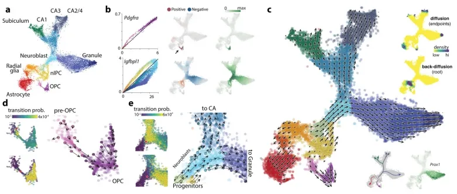

**附录图9:**

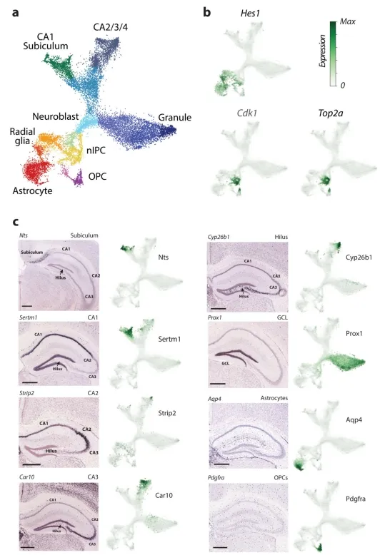

**附录图10:**

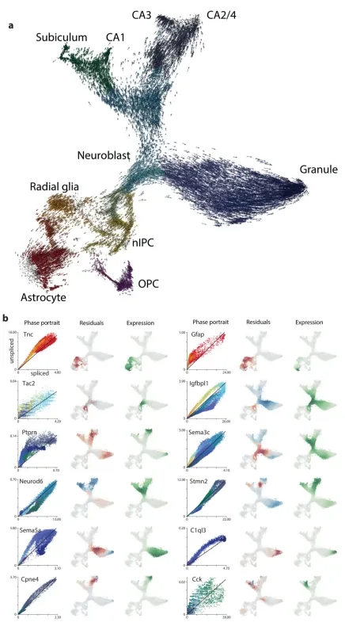

###  2.4 人类前脑验证

#### 2.4.1 主要内容

为了证明RNA速率在人类胚胎中是可检测的，作者在受孕后十周对发育中的人类前脑进行了基于液滴的单细胞mRNA测序，重点关注谷氨酸能神经元谱系(图4a)。作者发现了一个强烈的RNA速率模式，其起源于增殖的祖细胞状态(放射状胶质细胞)，并依次经过一系列中间神经母细胞阶段，最终形成表达SL17A7(前脑兴奋性神经元中使用的囊泡谷氨酸转运蛋白)的更成熟的谷氨酸能神经元。作者通过多重原位杂交验证了已知和新发现的皮质神经元发育标志物的表达(图4b-c)，证实了CLU和FBXO32在室管膜下区(SOX2标记的放射状胶质细胞)、UNC5D在中间区(EOMES标记的神经母细胞)以及SEZ6和RBFOX1在皮质板(SLC17A7标记的神经元，也称为VGLUT1)中的预测表达。这些基因在组织中的分层表达(图4c)与单细胞RNA测序数据中它们表达的伪时间分布(图4b)高度一致。

作者采用主曲线分析法，依据分化假时间对细胞进行排序，并研究了人类原代细胞中转录的时序进程。作者证实，在上调和下调过程中，未剪接的mRNA始终先于剪接的mRNA出现(图4d)。作者观察到了快速和缓慢的动力学过程。例如，RNASEH2B显示出快速的动力学特征，未剪接RNA和剪接RNA之间几乎没有差异。相反，DCX、ELAVL4和STMN2等基因则表现出初始快速转录爆发，随后转录水平持续降低(从未剪接RNA曲线的形状可以看出，图4d)，而剪接转录本则明显延迟。这种具有超调的动态诱导已被认为有助于快速诱导降解动力学缓慢的基因，但在人类胚胎中尚无法进行研究。RNA速率基于真实的转录动力学，这一事实有望为以后理解细胞在基因表达空间中的动态过程（尤其是在分化过程中）提供更加坚实的定量基础。RNA速率已经使我们能够在整个生物体中详细研究动态过程，并且将极大促进人类胚胎中的谱系分析。

**图4:**

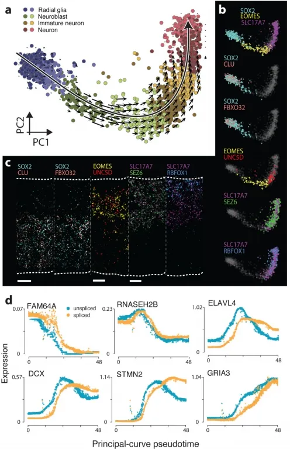

**三、最后聊聊**

综合以上研究内容，我们不难发现基于RNA速率推断可以在没有先验发育过程知识的基础上，实现细胞发育轨迹的推断。同时在不同的物种和组织都得到了有效的认证。其实基于目前的研究，已经开发可用于轨迹推断的软件不止一个。例如我们先前就已经推送过的[拟时序分析| 3.monocle2实操：完整版](<https://mp.weixin.qq.com/s?__biz=MzAwMzIzOTk5OQ==&mid=2247497730&idx=2&sn=930dc0e276219d70c937e943119388ff&scene=21#wechat_redirect>)和[Slingshot拟时序分析学习手册](<https://mp.weixin.qq.com/s?__biz=MzAwMzIzOTk5OQ==&mid=2247527850&idx=1&sn=f4e2ca5e2e5e71eeaf132375bb8270eb&scene=21#wechat_redirect>)。两款分析软件都可以用于轨迹推断。但是RNA速率推断以其本身的算法特点，目前仍是单细胞数据轨迹推断的重要软件之一。因此，今天我们在本教程中，基于R以及python两款不同的RNA速率推断软件，进行分别演示。

**如何联系我们**

 留一个领取资料、[免费两周学习版](<https://mp.weixin.qq.com/s?__biz=MzAwMzIzOTk5OQ==&mid=2247527585&idx=1&sn=fa32112c11b215b33096cab43baf08ea&scene=21#wechat_redirect>)服务器的**微信号[Biomamba_zhushou]**，方便各位随时交流。同时我们也构建了[交流群矩阵](<https://mp.weixin.qq.com/s?__biz=MzAwMzIzOTk5OQ==&mid=2247528057&idx=1&sn=bb348c2a88c977c7cce67ee6731a3591&scene=21#wechat_redirect>)，欢迎大家入群讨论。
大家可以阅读完这几篇之后添加[给生信入门初学者的小贴士](<http://mp.weixin.qq.com/s?__biz=MzAwMzIzOTk5OQ==&mid=2247493329&idx=1&sn=597870b7f7ce10346da3561e7c281627&chksm=9b3c9f81ac4b169794088ce9abbcacb5f18e9fd174fc0d7e28da62d78facadf3100ef38aaf22&scene=21#wechat_redirect>)
[没有检索，就没有发言权](<https://mp.weixin.qq.com/s?__biz=MzAwMzIzOTk5OQ==&mid=2247529398&idx=2&sn=5a429852d61721916a405712677d5905&scene=21#wechat_redirect>)

**已有生信基地联系方式的同学****无需重复添加**

 您点的每个赞和在看，我都认真当成了喜欢
