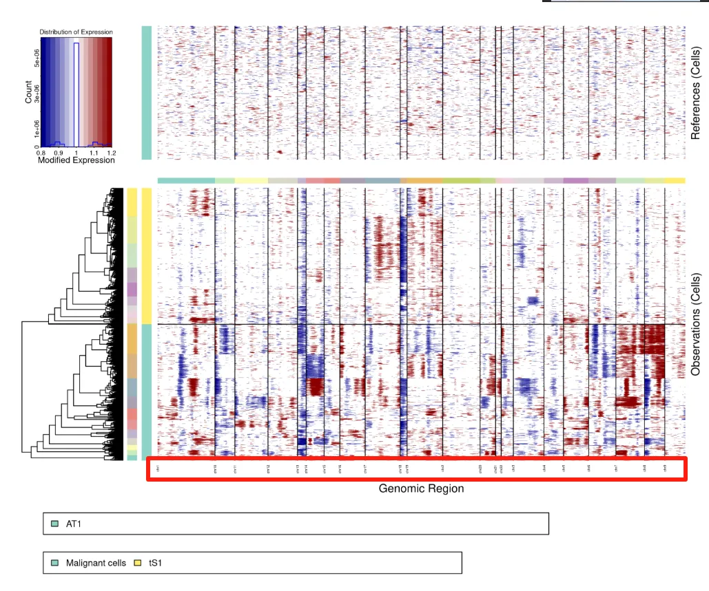
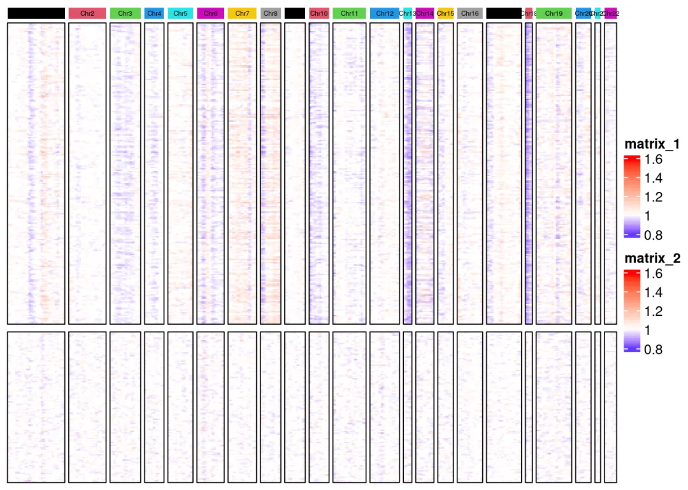

# 大家有没有发现infercnv的这个小bug

> 原文：https://mp.weixin.qq.com/s?__biz=MzAwMzIzOTk5OQ==&mid=2247530697&idx=1&sn=1e10a4463fdb93534b99aa2bfc9d947e&chksm=9b3c0199ac4b888f521354e415c7be5d563d796625d2b405e1d8633df33541650e9f6a1bee6b#rd
> 合集：单细胞教程全收录

**一、写在前面**

不知道大家有没有发现，此前在我们的[肿瘤异质性分析必备| 一文学会四种scRNA-seq拷贝数变异分析](<https://mp.weixin.qq.com/s?__biz=MzAwMzIzOTk5OQ==&mid=2247529921&idx=1&sn=93f8ad6655ee6d2b036cd557a6a74be6&payreadticket=HOF8H4JqVkxkAjJ6lJnJYaeMhEqATk4jgVRuNGZ2yV_Pn2ypT9AkJxtJrKsx16R6GS4Dpwg&scene=21#wechat_redirect>)中，无论是infercnv默认函数绘制的热图有一些小问题：



大家看一下上图的纵坐标，标注的染色体名称是`chr1`、`chr10`、`chr11`、`chr12`……..、`chr2`、`chr20、chr21`、`chr22`、`chr3`。显然这是R语言默认以**字符串** 格式对染色体排序的结果，计算机在处理字符串时，会逐个字符地比较它们的编码（如ASCII或Unicode），而不是将数字作为一个整体来理解其数值大小。我们来拆解一下字符串 “chr1”, “chr11”, “chr2” 的比较过程：

比较前三个字符：均以’chr’开头，平局。
比较第四个字符： “chr1”的第四个字符是’1’
“chr11”的第四个字符是’1’
“chr2”的第四个字符是’2’
在`ASCII`码表中，字符’1’的编码是49，字符’2’的编码是50。
因为’1’(49) < ‘2’(50)，所以所有以’1’开头的字符串都会排在以 ‘2’ 开头的字符串之前，这就造成了chr11排在chr2之前。
但按照生物学意义来说，正确的顺序应该是：
```
paste0('chr',1:22)
```
```
##  [1] "chr1"  "chr2"  "chr3"  "chr4"  "chr5"  "chr6"  "chr7"  "chr8"  "chr9"
## [10] "chr10" "chr11" "chr12" "chr13" "chr14" "chr15" "chr16" "chr17" "chr18"
## [19] "chr19" "chr20" "chr21" "chr22"
```

因此，我们在自行绘制热图时需要做出一定的修改.

**二、热图优化**

这部分不理解的同学可以参考这个教程[手把手学会四种scRNA-seq拷贝数变异分析](<https://mp.weixin.qq.com/s?__biz=MzAwMzIzOTk5OQ==&mid=2247530573&idx=2&sn=86f51d34ba3c6486f5a264b6dfb2a42e&scene=21#wechat_redirect>)
```r
# 加载R包：
library(dplyr)
```
```r
library(infercnv)
library(ComplexHeatmap)
```
```r
library(RCircos)
library(circlize)
```
```r
# 继续可视化：
infercnv_obj =readRDS("Epi_infercnv/output/run.final.infercnv_obj")# 读取运行好的infercnv对象
expr <- infercnv_obj@expr.data# 取出infercnv评分数据

# 获取参考/待测细胞的索引：
normal_loc <- infercnv_obj@reference_grouped_cell_indices# 正常参考细胞的索引
normal_loc <- normal_loc$AT1
test_loc <- infercnv_obj@observation_grouped_cell_indices# 待测细胞的索引
test_loc <-c(test_loc$tS1,test_loc$`Malignant cells`)
```
```r
# 把之前写到本地的分组信息读回来
anno.df=read.table('Epi_infercnv/groupFiles.txt',header = F,sep ='\t')
colnames(anno.df)[1] <-'CB'

# 读取并整理此前保存的基因坐标信息：
geneFile <-read.table("Epi_infercnv/geneLocate.txt",header = F,sep ="\t",stringsAsFactors = F)
rownames(geneFile)=geneFile$V1# 将基因名设置为行名
co_gene <-intersect(rownames(expr),geneFile$V1)# 表达矩阵和基因注释文件都存在的基因
sub_geneFile <-  geneFile[co_gene,]# 取出基因注释文件的交集
expr=expr[co_gene,]# 取出表达矩阵的交集

#聚类，7类，提取结果
set.seed(2024)
kmeans.result <-kmeans(t(expr), 7)# 完成kmeans聚类
kmeans_df <-data.frame(kmeans_class=kmeans.result$cluster)# 取出聚类的cluster信息并转化为数据框
kmeans_df$CB=rownames(kmeans_df)# 设置行名为新的一列，即cell barcode

kmeans_df=kmeans_df%>%inner_join(anno.df,by="CB") # 按照barcode合并分组注释文件与聚类结果
kmeans_df_s=arrange(kmeans_df,kmeans_class) # 按照聚类结果进行排序
rownames(kmeans_df_s)=kmeans_df_s$CB# 设置行名为cell barcode
kmeans_df_s$CB=NULL# 后面用不到cellbarcode了，将这行删除
kmeans_df_s$kmeans_class=as.factor(kmeans_df_s$kmeans_class)# 聚类结果是数字，需要转换为因子，否则后面热图注释会报错
colnames(kmeans_df_s)[2] <-'Sub_type'# 改变第二列的列名
#将kmeans_class转换为因子，作为热图的一个注释，最终在热图上就会按照数字大小排序
head(kmeans_df_s)
```
```
##                        kmeans_class        Sub_type
## AAACGGGAGGCGCTCT_NS_12            1 Malignant cells
## AATCGGTAGCGTAGTG_NS_12            1 Malignant cells
## ACATACGTCGTGGGAA_NS_12            1 Malignant cells
## ACCTTTAAGATCACGG_NS_12            1 Malignant cells
## ACGAGGAGTAGGGACT_NS_12            1 Malignant cells
## ACGAGGATCTGCCCTA_NS_12            1 Malignant cells
```
```r
###### 绘制热图 #####
# 热图这部分代码看不懂的同学请先行学习：https://mp.weixin.qq.com/s/QHFicwAqkIsTykOqIHGSiQ
# 为演示染色体注释的差别，侧栏细胞注释我们就不绘制了
# 顶部注释：
top_anno <-HeatmapAnnotation(foo =anno_block(gp =gpar(fill =1:22, col ="NA"),
labels =paste0('Chr',1:22),
labels_gp =gpar(cex =0.4,rot =45)),
annotation_height =unit(0.3, "cm"))  # 调整注释的高度

color_v=RColorBrewer::brewer.pal(8, "Dark2")[1:7] #类别数
names(color_v)=as.character(1:7)

# 读取分组分拣
group_info <-read.table('Epi_infercnv/groupFiles.txt')
# 恶性细胞cnv_score：
malignant_tS1_data <- expr[,
                           group_info$V1[group_info$V2 %in%c("Malignant cells", "tS1")]
                           ]
# 正常细胞cnv_score：
AT1_data <- expr[,group_info$V1[group_info$V2 %in%c("AT1")] ]

# 配色方案：
my_fn <-fivenum(expr)# 返回最低值、下四分位数、中位数，上四分位数、最大值
col_fun <-colorRamp2(c(my_fn[1], my_fn[3], my_fn[5]), c("#0000FF", "#FFFFFF", "#FF0000"))# 确定最低值、中位数、最高值的颜色分配方案
```
```r
# 读回第一步创建的基因注释文件：
geneInfor <-read.table( 'Epi_infercnv/geneLocate.txt')
# 查看文件
head(geneInfor)
```
```
##           V1   V2     V3     V4
## 1 AP006222.2 chr1 266855 268655
## 2     FAM87B chr1 817371 819837
## 3  LINC00115 chr1 826206 827522
## 4     FAM41C chr1 868071 876903
## 5     SAMD11 chr1 923928 944581
## 6      NOC2L chr1 944203 959309
```
```
# 查看文件行列数
dim(geneInfor)
```
```
## [1] 20363     4
```
```r
# 过滤，保留与表达矩阵共同的基因：
geneInfor <-filter(geneInfor,V1 %in% co_gene)
# 查看现在的基因注释：
dim(geneInfor)
```
```
## [1] 7292    4
```
```r
# 生成“数值型”染色体：
geneInfor$num_chr <-gsub('chr','',geneInfor$V2) %>%as.numeric()
# 看看现在的基因注释信息：
head(geneInfor)
```
```
##         V1   V2      V3      V4 num_chr
## 1    NOC2L chr1  944203  959309       1
## 2     HES4 chr1  998962 1000172       1
## 3    ISG15 chr1 1001138 1014540       1
## 4     AGRN chr1 1020120 1056118       1
## 5 TNFRSF18 chr1 1203508 1206592       1
## 6     SDF4 chr1 1216908 1232067       1
```
```r
# 以数值型进行排序：
geneInfor <- geneInfor[order(geneInfor$num_chr),]
```
```r
# 热图1：Malignant cells + tS1的cnvscore热图
ht1 <-Heatmap(t(malignant_tS1_data)[,geneInfor$V1], col = col_fun,
cluster_rows =FALSE, cluster_columns =FALSE,
show_column_names =FALSE, show_row_names =FALSE,
top_annotation = top_anno,
column_split =factor(geneInfor$num_chr),
border =TRUE  ,# 添加边框
column_title =NULL)
```
```
## `use_raster` is automatically set to TRUE for a matrix with more than
## 2000 columns You can control `use_raster` argument by explicitly
## setting TRUE/FALSE to it.
##
## Set `ht_opt$message = FALSE` to turn off this message.
```
```r
# 热图2：AT1的cnv score热图
ht2 <-Heatmap(t(AT1_data)[,geneInfor$V1], col = col_fun,
cluster_rows =FALSE, cluster_columns =FALSE,
show_column_names =FALSE, show_row_names =FALSE,
column_split =factor(geneInfor$num_chr),
border =TRUE , # 添加边框
show_column_dend =FALSE# 关闭column_split标签
             )
```
```
## `use_raster` is automatically set to TRUE for a matrix with more than
## 2000 columns You can control `use_raster` argument by explicitly
## setting TRUE/FALSE to it.
##
## Set `ht_opt$message = FALSE` to turn off this message.
```
```
# 把两张热图拼接起来
draw(ht1 %v% ht2, heatmap_legend_side ="right")
```



完整测试数据与教程可见：[肿瘤异质性分析必备| 一文学会四种scRNA-seq拷贝数变异分析](<https://mp.weixin.qq.com/s?__biz=MzAwMzIzOTk5OQ==&mid=2247529921&idx=1&sn=93f8ad6655ee6d2b036cd557a6a74be6&payreadticket=HGSx-b2A80tJ8IR6W7KIrg-Il_n3NWDR9Mt1ml1462vOlxkcy1k64LKw0hioMd4JuJtw09Y&scene=21#wechat_redirect>)

**三、演示环境**

一切不给测试文件和分析环境版本的教程都是耍流氓，本推送的代码和测试文件可以在以下链接中下载：


通过网盘分享的文件: https://pan.baidu.com/s/1lsZRUwUTfB0AqmjaVOB6JQ?pwd=ieyg

提取码: ieyg


R语言演示环境([趁开学前| 入手足够完成硕博生涯的生信环境](<https://mp.weixin.qq.com/s?__biz=MzAwMzIzOTk5OQ==&mid=2247530226&idx=2&sn=0522eb4eae67efeea2b96404474af611&scene=21#wechat_redirect>))：
```
sessionInfo()
```
```
## R version 4.4.2 (2024-10-31)
## Platform: x86_64-pc-linux-gnu
## Running under: Ubuntu 20.04.4 LTS
##
## Matrix products: default
## BLAS:   /usr/lib/x86_64-linux-gnu/openblas-pthread/libblas.so.3
## LAPACK: /usr/lib/x86_64-linux-gnu/openblas-pthread/liblapack.so.3;  LAPACK version 3.9.0
##
## locale:
##  [1] LC_CTYPE=en_US.UTF-8       LC_NUMERIC=C
##  [3] LC_TIME=en_US.UTF-8        LC_COLLATE=en_US.UTF-8
##  [5] LC_MONETARY=en_US.UTF-8    LC_MESSAGES=en_US.UTF-8
##  [7] LC_PAPER=en_US.UTF-8       LC_NAME=C
##  [9] LC_ADDRESS=C               LC_TELEPHONE=C
## [11] LC_MEASUREMENT=en_US.UTF-8 LC_IDENTIFICATION=C
##
## time zone: Etc/UTC
## tzcode source: system (glibc)
##
## attached base packages:
## [1] grid      stats     graphics  grDevices utils     datasets  methods
## [8] base
##
## other attached packages:
## [1] circlize_0.4.16       RCircos_1.2.2         ComplexHeatmap_2.12.1
## [4] infercnv_1.23.0       dplyr_1.1.4
##
## loaded via a namespace (and not attached):
##   [1] RcppAnnoy_0.0.22            splines_4.4.2
##   [3] later_1.4.1                 bitops_1.0-9
##   [5] tibble_3.2.1                polyclip_1.10-7
##   [7] fastDummies_1.7.5           lifecycle_1.0.4
##   [9] fastcluster_1.2.6           edgeR_4.4.1
##  [11] doParallel_1.0.17           globals_0.16.3
##  [13] lattice_0.22-6              MASS_7.3-64
##  [15] magrittr_2.0.3              limma_3.62.2
##  [17] plotly_4.10.4               sass_0.4.9
##  [19] rmarkdown_2.29              jquerylib_0.1.4
##  [21] yaml_2.3.10                 httpuv_1.6.15
##  [23] Seurat_5.2.1                sctransform_0.4.1
##  [25] spam_2.11-1                 sp_2.2-0
##  [27] spatstat.sparse_3.1-0       reticulate_1.43.0.9001
##  [29] cowplot_1.1.3               pbapply_1.7-2
##  [31] RColorBrewer_1.1-3          multcomp_1.4-28
##  [33] abind_1.4-8                 zlibbioc_1.52.0
##  [35] Rtsne_0.17                  GenomicRanges_1.58.0
##  [37] purrr_1.0.2                 BiocGenerics_0.52.0
##  [39] TH.data_1.1-3               sandwich_3.1-1
##  [41] GenomeInfoDbData_1.2.13     IRanges_2.40.1
##  [43] S4Vectors_0.44.0            ggrepel_0.9.6
##  [45] irlba_2.3.5.1               listenv_0.9.1
##  [47] spatstat.utils_3.1-4        openintro_2.5.0
##  [49] airports_0.1.0              goftest_1.2-3
##  [51] RSpectra_0.16-2             spatstat.random_3.4-1
##  [53] fitdistrplus_1.2-2          parallelly_1.42.0
##  [55] codetools_0.2-20            coin_1.4-3
##  [57] DelayedArray_0.32.0         shape_1.4.6.1
##  [59] tidyselect_1.2.1            futile.logger_1.4.3
##  [61] UCSC.utils_1.2.0            farver_2.1.2
##  [63] rjags_4-16                  matrixStats_1.5.0
##  [65] stats4_4.4.2                spatstat.explore_3.4-3
##  [67] jsonlite_1.8.9              GetoptLong_1.0.5
##  [69] progressr_0.15.1            ggridges_0.5.6
##  [71] survival_3.8-3              iterators_1.0.14
##  [73] foreach_1.5.2               tools_4.4.2
##  [75] ica_1.0-3                   Rcpp_1.0.14
##  [77] glue_1.8.0                  gridExtra_2.3
##  [79] SparseArray_1.6.0           xfun_0.50
##  [81] MatrixGenerics_1.18.1       GenomeInfoDb_1.42.1
##  [83] formatR_1.14                fastmap_1.2.0
##  [85] caTools_1.18.3              digest_0.6.37
##  [87] parallelDist_0.2.6          R6_2.5.1
##  [89] mime_0.12                   colorspace_2.1-1
##  [91] Cairo_1.6-1                 scattermore_1.2
##  [93] gtools_3.9.5                tensor_1.5
##  [95] spatstat.data_3.1-6         tidyr_1.3.1
##  [97] generics_0.1.3              data.table_1.16.4
##  [99] usdata_0.3.1                httr_1.4.7
## [101] htmlwidgets_1.6.4           S4Arrays_1.6.0
## [103] uwot_0.2.2                  pkgconfig_2.0.3
## [105] gtable_0.3.6                modeltools_0.2-23
## [107] lmtest_0.9-40               SingleCellExperiment_1.28.1
## [109] XVector_0.46.0              htmltools_0.5.8.1
## [111] dotCall64_1.2               clue_0.3-66
## [113] SeuratObject_5.0.2          scales_1.3.0
## [115] Biobase_2.66.0              png_0.1-8
## [117] phyclust_0.1-34             spatstat.univar_3.1-3
## [119] knitr_1.49                  lambda.r_1.2.4
## [121] rstudioapi_0.17.1           rjson_0.2.23
## [123] tzdb_0.4.0                  reshape2_1.4.4
## [125] coda_0.19-4.1               nlme_3.1-168
## [127] GlobalOptions_0.1.2         cachem_1.1.0
## [129] zoo_1.8-12                  stringr_1.5.1
## [131] KernSmooth_2.23-26          parallel_4.4.2
## [133] miniUI_0.1.1.1              libcoin_1.0-10
## [135] pillar_1.10.1               vctrs_0.6.5
## [137] gplots_3.2.0                RANN_2.6.2
## [139] promises_1.3.2              xtable_1.8-4
## [141] cluster_2.1.8               evaluate_1.0.3
## [143] magick_2.7.3                readr_2.1.5
## [145] locfit_1.5-9.11             mvtnorm_1.3-3
## [147] cli_3.6.3                   compiler_4.4.2
## [149] futile.options_1.0.1        rlang_1.1.5
## [151] crayon_1.5.3                future.apply_1.11.3
## [153] argparse_2.2.5              plyr_1.8.9
## [155] stringi_1.8.4               viridisLite_0.4.2
## [157] deldir_2.0-4                munsell_0.5.1
## [159] lazyeval_0.2.2              spatstat.geom_3.4-1
## [161] Matrix_1.7-2                RcppHNSW_0.6.0
## [163] hms_1.1.3                   patchwork_1.3.0
## [165] future_1.34.0               ggplot2_3.5.1
## [167] statmod_1.5.0               shiny_1.10.0
## [169] SummarizedExperiment_1.36.0 ROCR_1.0-11
## [171] igraph_2.1.4                RcppParallel_5.1.10
## [173] bslib_0.9.0                 cherryblossom_0.1.0
## [175] ape_5.8-1
```


**如何联系我们**

 留一个领取[资料](<https://mp.weixin.qq.com/s?__biz=MzAwMzIzOTk5OQ==&mid=2247530154&idx=2&sn=e5d0a63646094c3094b7b916350d22ad&scene=21#wechat_redirect>)、[开箱即用的单细胞分析镜像](<https://mp.weixin.qq.com/s?__biz=MzAwMzIzOTk5OQ==&mid=2247528410&idx=2&sn=0f2bac25479cf8d20dab5d82ae986f2e&scene=21#wechat_redirect>)的**微信号[Biomamba_zhushou]**，方便各位随时交流。同时我们也构建了[交流群矩阵](<https://mp.weixin.qq.com/s?__biz=MzAwMzIzOTk5OQ==&mid=2247528057&idx=1&sn=bb348c2a88c977c7cce67ee6731a3591&scene=21#wechat_redirect>)，欢迎大家入群讨论。
大家可以阅读完这几篇之后添加[给生信入门初学者的小贴士](<http://mp.weixin.qq.com/s?__biz=MzAwMzIzOTk5OQ==&mid=2247493329&idx=1&sn=597870b7f7ce10346da3561e7c281627&chksm=9b3c9f81ac4b169794088ce9abbcacb5f18e9fd174fc0d7e28da62d78facadf3100ef38aaf22&scene=21#wechat_redirect>)
[没有检索，就没有发言权](<https://mp.weixin.qq.com/s?__biz=MzAwMzIzOTk5OQ==&mid=2247529398&idx=2&sn=5a429852d61721916a405712677d5905&scene=21#wechat_redirect>)

**已有生信基地联系方式的同学****无需重复添加**

 您点的每个赞和在看，我都认真当成了喜欢
