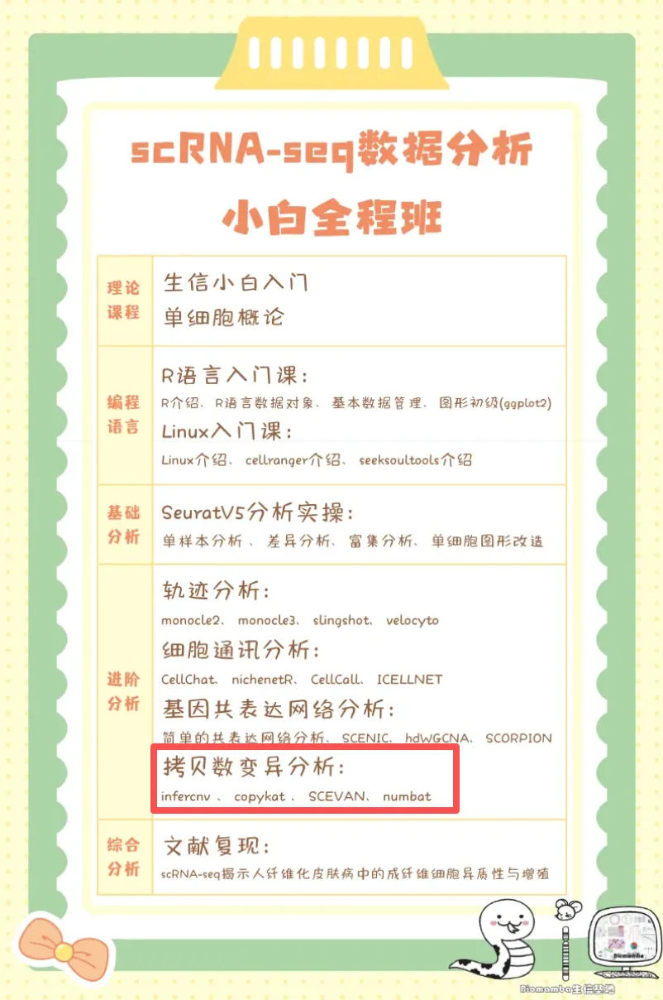
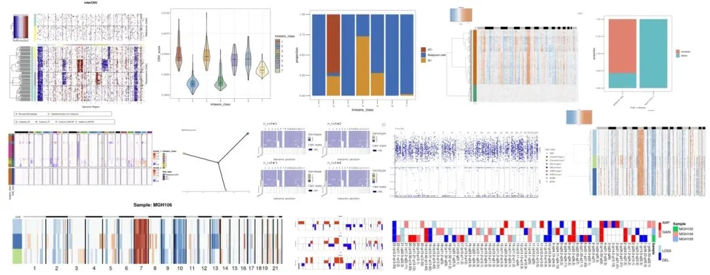
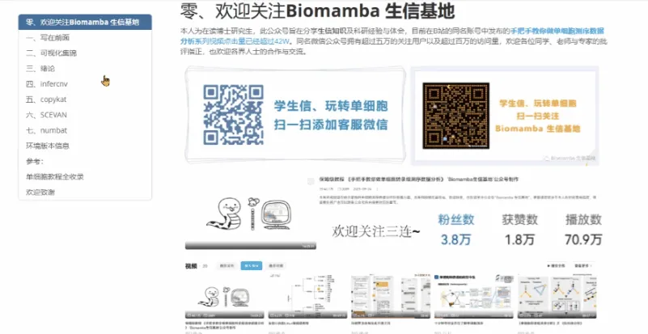

# 肿瘤异质性分析必备| 一文学会四种scRNA-seq拷贝数变异分析

> 原文：https://mp.weixin.qq.com/s?__biz=MzAwMzIzOTk5OQ==&mid=2247531103&idx=2&sn=cad11d768e252d2489d124e68b71c7b0&chksm=9b3c030fac4b8a1985c3a6bff95f2a869a61b09c626f8a264567a25dbb5d0b2e8fb1a2bc148a#rd
> 合集：单细胞教程全收录

scRNA-seq拷贝数变异分析

**拷贝数变异（Copy number alterations，以下简称CNA；infercnv包也习惯描述为 Copy Number Variation，CNV）是一种重要的基因组变异，在癌症的发生和发展过程中起着至关重要的作用。确定肿瘤细胞中CNA的特征对早期肿瘤检测、划分肿瘤异质性、了解肿瘤进展模式和揭示耐药机制具有重要意义。随着单细胞RNA测序（scRNA-seq）的蓬勃发展，研究人员开发出了多种计算方法来从scRNA-seq研究中推断CNA。目前从scRNA-seq数据中推断CNA的计算方法大致可分为两类。一类是基于表达的，即直接从基因表达推断CNA。这类工具包括inferCNV、copykat和SCEVAN。这些工具的工作原理是，CNA扩增（AMPs）或缺失（DELs）将分别导致受影响基因组区域内基因的上调或下调。InferCNV利用基因窗口的校正移动平均数；copykat采用综合贝叶斯分割方法；SCEVAN采用多通道分割算法。第二类将基因表达与等位基因信息相结合，相关工具有Numbat和CaSpER等。**如果自学有困难的话，恰好我们这周进行scRNA-seq拷贝数变异分析教学，错过直播也可以获取录播：[100个小时沉浸式学会scRNA-seq数据分析](<https://mp.weixin.qq.com/s?__biz=MzAwMzIzOTk5OQ==&mid=2247531092&idx=1&sn=9968319b84186bb9b717b7b409132d8b&scene=21#wechat_redirect>)**
****更多生信教程可见：[生信基地终身订阅须知](<https://mp.weixin.qq.com/s?__biz=MzAwMzIzOTk5OQ==&mid=2247530154&idx=2&sn=e5d0a63646094c3094b7b916350d22ad&scene=21#wechat_redirect>)**
本教程基于Linux中的Rstudio环境演示，计算资源不足的同学可参考：[选择西柚云的11个理由](<https://mp.weixin.qq.com/s?__biz=MzAwMzIzOTk5OQ==&mid=2247529471&idx=2&sn=c191f2df999820bf7f1f96832d120d2d&scene=21#wechat_redirect>)
[足够支持你完成硕博生涯的生信环境](<http://mp.weixin.qq.com/s?__biz=MzAwMzIzOTk5OQ==&mid=2247511780&idx=1&sn=3acc0874f7d2fa75f1abbe7a9a9b4069&chksm=9b3cd7b4ac4b5ea27d4d53964e4a4a9fa8c806a19103729dd4ff0fa72e621411f46a251d269f&scene=21#wechat_redirect>)
[忘记宣传了，独享用户连技术支持都是独享的](<https://mp.weixin.qq.com/s?__biz=MzAwMzIzOTk5OQ==&mid=2247529475&idx=1&sn=10827e982a637e0fc36e4b6e857736c8&scene=21#wechat_redirect>)

本教程可视化集锦 **-Biomamba**

所见即所得

学习手册以html文件格式提供，可在浏览器中打开并翻阅学习：

‍

**教程目录** ：

**一、写在前面**

**二、可视化集锦**

**三、绪论**

**3.1 定义**

**3.2 主要研究成果**

**（1）区分肿瘤细胞与正常细胞**

**（2） 推断的拷贝数变异（CNA）谱的准确性**

**（3） 亚克隆结构推断准确性的评估**

（4）计算效率

**3.3 小结**

**四、infercnv**

4.1 简介

4.2 安装

4.3 输入文件

4.4 infercnv workflow

4.5 infercnv实战

（1）数据概况

（2）infercnv流程

（3）热图优化

（4）小提琴图

****五、copykat****

5.1 copykat介绍

（1）简介

（2）copykat工作流程描述

（3）性能评估

（4）实体肿瘤中肿瘤细胞和正常细胞的分类

（5）应用于其他scRNA-seq技术

（6）推断乳腺肿瘤的克隆亚结构

（7）小结

5.2 copykat流程（1）安装（2）counts矩阵预处理（3）常用参数（4）copykat（5）整理数据（6）绘制热图5.3 copykat实战（1）数据概况（2）copykat（3）整理数据（4）热图绘制（5）探究一下拷贝数变异与原来亚群之间的关系（6）CNA score小提琴图

**六****、SCEVAN******

****6.1 安装R包****

****6.2 加载R包********6.3 单样本分析********（1）加载数据********（2）执行分析********（3）结果查看********6.4 多样本分析********（1）加载数据 （2）执行分析（3）结果查看********6.5 联合Seurat对象********（1）创建****Seurat对象**** （2）将拷贝数变异结果加入****Seurat对象**** （3）降维分群（4）可视化****

****七****、numbat********

********7.1****安装R包************

****7.2****加载R包************7.3 数据下载********7.4 等位基因数据准备********（1）运行参数解释 （2）示例脚本（3）可能出现的报错（4）执行分析********7.5 运行numbat********（1）运行参数解释********（2）运行****numbat************7.6 结果解读********（1）拷贝数景观和单细胞系统发育 （2）在系统发育上完善亚克隆（3）共识拷贝数区段（4）pseudobulks水平拷贝数变异（5）进化树********八、环境版本信息********
********九、参考********十、单细胞教程全收录********十一、欢迎致谢****

文末下载链接中包含以下内容：

测试文件约**55.57GB** ，大家注意按需下载！

**
****解锁前需阅 读：**[2025订阅须知](<https://mp.weixin.qq.com/s?__biz=MzAwMzIzOTk5OQ==&mid=2247526751&idx=1&sn=7ca3137d770f23f0c3d6195696618d81&scene=21#wechat_redirect>)****

订阅后获取下方学习手册链接：

请联系[Biomamba_zhushou]获取文件提取码

本推送教程二维码：

https://pan.baidu.com/s/1wGR2oZT3bw7wkbOdUI6hnA?

整个订阅合集的百度云下载地址可见:

https://pan.baidu.com/s/1yXzQi0zBqh4ZLR6Hznckiw?

**-Biomamba**

往期订阅

生信基地现已开放终身订阅，现已包含几十篇订阅资料，未来37年持续更新：[那就开放一个终身订阅吧~](<https://mp.weixin.qq.com/s?__biz=MzAwMzIzOTk5OQ==&mid=2247528482&idx=1&sn=7cc0715eace4f592a62bdaf157b25c01&scene=21#wechat_redirect>)

2025已更新订阅内容：

[《Cell》复现|中性粒细胞scRNA-seq图谱阐明抗肿瘤抗原呈递效力](<https://mp.weixin.qq.com/s?__biz=MzAwMzIzOTk5OQ==&mid=2247526776&idx=1&sn=99eb6a16c7bf345445b6ff4b61110138&scene=21#wechat_redirect>)

[代码复现|scRNA-seq绘制透明细胞肾癌的免疫微环境](<https://mp.weixin.qq.com/s?__biz=MzAwMzIzOTk5OQ==&mid=2247527498&idx=1&sn=c8282e9d4175bfb2e572278312073d81&scene=21#wechat_redirect>)

[改造单细胞DoHeatmap](<https://mp.weixin.qq.com/s?__biz=MzAwMzIzOTk5OQ==&mid=2247527762&idx=1&sn=ba7c8a4cb704e71fa86ebfe1f19bffea&scene=21#wechat_redirect>)

[Slingshot拟时序分析学习手册](<https://mp.weixin.qq.com/s?__biz=MzAwMzIzOTk5OQ==&mid=2247527850&idx=1&sn=f4e2ca5e2e5e71eeaf132375bb8270eb&scene=21#wechat_redirect>)

[《Cancer Cell》|时空单细胞揭示CRC的PD-1治疗免疫细胞动态](<https://mp.weixin.qq.com/s?__biz=MzAwMzIzOTk5OQ==&mid=2247528056&idx=1&sn=73c0da3ff7ff50bafbb9315fd5b60f15&scene=21#wechat_redirect>)

[scRNA-seq数据基础](<https://mp.weixin.qq.com/s?__biz=MzAwMzIzOTk5OQ==&mid=2247528199&idx=1&sn=ab75e7d7987ab233c675455188f10f33&scene=21#wechat_redirect>)[分析手册(2025最新修订](<https://mp.weixin.qq.com/s?__biz=MzAwMzIzOTk5OQ==&mid=2247528199&idx=1&sn=ab75e7d7987ab233c675455188f10f33&scene=21#wechat_redirect>)[)](<https://mp.weixin.qq.com/s?__biz=MzAwMzIzOTk5OQ==&mid=2247528199&idx=1&sn=ab75e7d7987ab233c675455188f10f33&scene=21#wechat_redirect>)[代码复现|吞噬作用增强肿瘤中巨噬细胞的氧化代谢和免疫抑制特征](<https://mp.weixin.qq.com/s?__biz=MzAwMzIzOTk5OQ==&mid=2247528289&idx=1&sn=b56f00f3d8a4b152e54f3acd40aef21d&scene=21#wechat_redirect>)[一文学会scRNA Velocity剪切速率分析](<https://mp.weixin.qq.com/s?__biz=MzAwMzIzOTk5OQ==&mid=2247528458&idx=1&sn=900357283922571c6294435be409a2f3&scene=21#wechat_redirect>)

# [一文学会四种scRNA-seq轨迹分析](<https://mp.weixin.qq.com/s?__biz=MzAwMzIzOTk5OQ==&mid=2247528666&idx=1&sn=d29545d296bac3e41de322e43fde80dd&scene=21#wechat_redirect>)

# [一文学会四种](<https://mp.weixin.qq.com/s?__biz=MzAwMzIzOTk5OQ==&mid=2247528770&idx=1&sn=6242bce437a9d60f81a8651ea9b57e0b&scene=21#wechat_redirect>)[scRNA-seq细胞通讯分析](<https://mp.weixin.qq.com/s?__biz=MzAwMzIzOTk5OQ==&mid=2247528770&idx=1&sn=6242bce437a9d60f81a8651ea9b57e0b&scene=21#wechat_redirect>)

# [一文学会四种基因共表达网络分析](<https://mp.weixin.qq.com/s?__biz=MzAwMzIzOTk5OQ==&mid=2247529410&idx=1&sn=9bbaf955d93ddce60874e1cdc2f16115&scene=21#wechat_redirect>)

# [一文学会四种scRNA-seq拷贝数变异分析](<https://mp.weixin.qq.com/s?__biz=MzAwMzIzOTk5OQ==&mid=2247529921&idx=1&sn=93f8ad6655ee6d2b036cd557a6a74be6&scene=21#wechat_redirect>)

# [分子批量对接与亲和力热图绘制](<https://mp.weixin.qq.com/s?__biz=MzAwMzIzOTk5OQ==&mid=2247530154&idx=1&sn=90de71a3b453e635920d309faedb36c7&scene=21#wechat_redirect>)

# [代码复现| scRNA-seq揭示人纤维化皮肤病中的成纤维细胞异质性与增殖](<https://mp.weixin.qq.com/s?__biz=MzAwMzIzOTk5OQ==&mid=2247530338&idx=1&sn=2d092e76080359f5a169ec14d54d1241&scene=21#wechat_redirect>)

# [一文搞定单细胞免疫组库分析(scTCR+scBCR)](<https://mp.weixin.qq.com/s?__biz=MzAwMzIzOTk5OQ==&mid=2247531049&idx=2&sn=1eedafb06d5d15f110f064bba354501c&scene=21#wechat_redirect>)

**如何联系我们**

 留一个领取[资料](<https://mp.weixin.qq.com/s?__biz=MzAwMzIzOTk5OQ==&mid=2247530154&idx=2&sn=e5d0a63646094c3094b7b916350d22ad&scene=21#wechat_redirect>)、[开箱即用的单细胞分析镜像](<https://mp.weixin.qq.com/s?__biz=MzAwMzIzOTk5OQ==&mid=2247528410&idx=2&sn=0f2bac25479cf8d20dab5d82ae986f2e&scene=21#wechat_redirect>)的**微信号[Biomamba_zhushou]**，方便各位随时交流。同时我们也构建了[交流群矩阵](<https://mp.weixin.qq.com/s?__biz=MzAwMzIzOTk5OQ==&mid=2247528057&idx=1&sn=bb348c2a88c977c7cce67ee6731a3591&scene=21#wechat_redirect>)，欢迎大家入群讨论。
大家可以阅读完这几篇之后添加[给生信入门初学者的小贴士](<http://mp.weixin.qq.com/s?__biz=MzAwMzIzOTk5OQ==&mid=2247493329&idx=1&sn=597870b7f7ce10346da3561e7c281627&chksm=9b3c9f81ac4b169794088ce9abbcacb5f18e9fd174fc0d7e28da62d78facadf3100ef38aaf22&scene=21#wechat_redirect>)
[没有检索，就没有发言权](<https://mp.weixin.qq.com/s?__biz=MzAwMzIzOTk5OQ==&mid=2247529398&idx=2&sn=5a429852d61721916a405712677d5905&scene=21#wechat_redirect>)

**已有生信基地联系方式的同学****无需重复添加**

 您点的每个赞和在看，我都认真当成了喜欢
