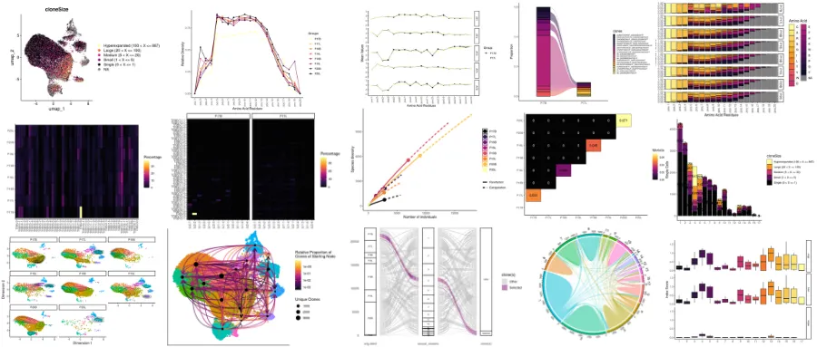
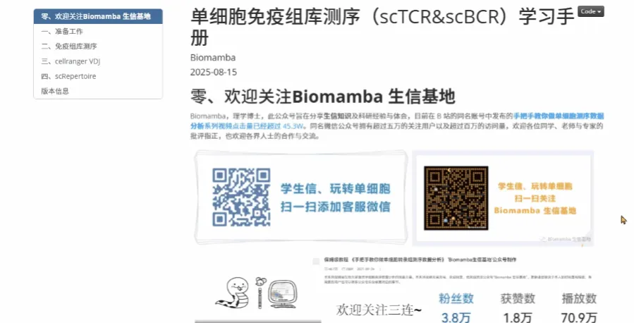
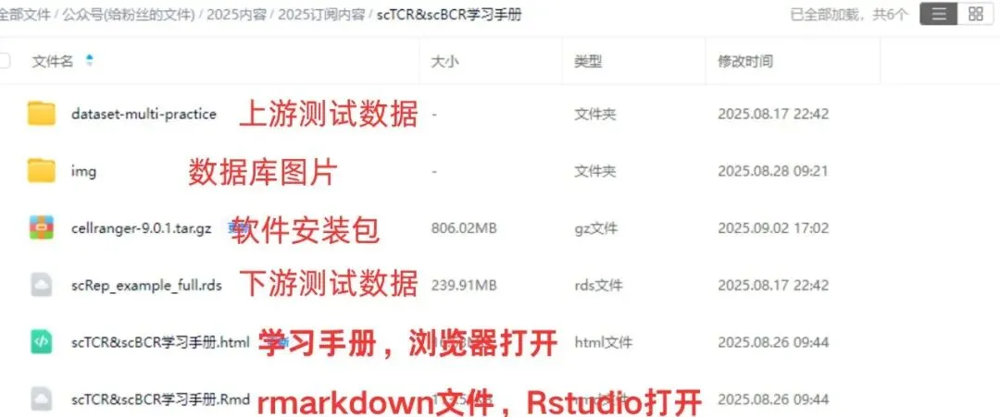

# 单细胞免疫组库测序(scTCR+scBCR)学习手册

> 原文：https://mp.weixin.qq.com/s?__biz=MzAwMzIzOTk5OQ==&mid=2247531388&idx=2&sn=7ee2b9fdf2c5ed4749e5ae91a1136add&chksm=9b3c022cac4b8b3ae72e25ccab817e12730fc1c09efb7f61e29db4cddc11732ba5d385c9c8bc#rd
> 合集：单细胞教程全收录

scTCR&scBCR学习手册

**有多种”Bulk”水平 免疫组库测序技术，涉及从给定组织中分析混合的BCR或TCR。Bulk’s免疫组库测序技术在很大程度上仅限于分析单链（例如,只有TRB或IgH），并不能捕获适应性免疫受体的二聚体性质。文库构建和测序策略也阻碍了真正的配对链测序数据获取。****通过单细胞技术，使成对链的适应性免疫受体在规模上的分析成为可能。各种高通量测序TCRs和BCRs的技术。 针对BCR和TCR的VDJ序列的异质性，在cDNA的基础上，进一步进行扩增子测序，通过分析BCR和TCR的不同序列，分析免疫环境中的克隆型多样性，解析有机体抵制病原微生物入侵的免疫机制。****与[ scRNA-seq](<https://mp.weixin.qq.com/s?__biz=MzAwMzIzOTk5OQ==&mid=2247530022&idx=2&sn=5c6aa081663719ce2f0f9b7f4d173c93&scene=21#wechat_redirect>)类似，通过微流控系统将带有条形码和引物的凝胶珠与单个细胞包裹在油滴中；接下来在每个油滴内，凝胶珠溶解，细胞裂解释放 mRNA，通过逆转录产生带有 10X barcode 和 UMI 信息的 cDNA。破油后，cDNA 一分为二，后续同时进行基因表达和免疫组库的文库构建。其中 TCR 或者 BCR 的 V(D)J 序列通过设计在 C 区的巢式引物进行 PCR 富集。测序后即可一次性获得大量单细胞的基因表达和免疫组库数据。结合[scRNA-seq](<https://mp.weixin.qq.com/s?__biz=MzAwMzIzOTk5OQ==&mid=2247530022&idx=2&sn=5c6aa081663719ce2f0f9b7f4d173c93&scene=21#wechat_redirect>)数据与BCR/TCR多样性数据，解析免疫细胞中更高维度的异质性。****本学习手册将从单细胞免疫组库概论、cellranger VDJ定量、scRepertoire数据实战带领大家一同完成单细胞免疫组库数据的分析流程。** 本教程可视化集锦**
**更多生信教程可见：[生信基地终身订阅须知](<https://mp.weixin.qq.com/s?__biz=MzAwMzIzOTk5OQ==&mid=2247530199&idx=1&sn=59e5e523b7c25fd1410f2b7b71a2d284&scene=21#wechat_redirect>)
本教程基于Linux中的Rstudio环境演示，计算资源不足的同学可参考：[选择西柚云的11个理由](<https://mp.weixin.qq.com/s?__biz=MzAwMzIzOTk5OQ==&mid=2247529471&idx=2&sn=c191f2df999820bf7f1f96832d120d2d&scene=21#wechat_redirect>)
[趁开学前| 入手足够完成硕博生涯的生信环境](<https://mp.weixin.qq.com/s?__biz=MzAwMzIzOTk5OQ==&mid=2247530226&idx=2&sn=0522eb4eae67efeea2b96404474af611&scene=21#wechat_redirect>)
[忘记宣传了，独享用户连技术支持都是独享的](<https://mp.weixin.qq.com/s?__biz=MzAwMzIzOTk5OQ==&mid=2247529475&idx=1&sn=10827e982a637e0fc36e4b6e857736c8&scene=21#wechat_redirect>)
**-Biomamba**

所见即所得

学习手册以html文件格式提供，可在浏览器中打开并翻阅学习：

‍

**教程目录** ：

**一、准备工作**

**1.1 编程基础**

1.2 硬件基础

1.3 生信基础

**二、免疫组库测序**

**2.1 TCR和BCR**

**2.2 结构组成**

**2.3 单细胞免疫组库测序**

**2.4 分析流程**

**三、 cellranger VDJ**

**3.1 scBCR数据的上游定量**

**（1）下载**

**（2）参考基因组准备**

**（3）测试数据下载**

（4）软件运行

**3.2 scTCR数据的上游定量**

**（1）TCR测试数据下载**

**（2）准备配置文件**

**（3）软件运行**

**四、 scRepertoire**

4.1 红斑性头痛/正常皮肤演示数据

4.2 数据实操

（1）基本克隆可视化

（2）可视化克隆动力学

（3）整体序列分布概要

（4）比较样本克隆多样性、差异与相似性

（5）合并克隆和单细胞对象

（6）整合后数据可视化

（7）量化克隆偏差

（8）基于scBCR-seq数据的分析

（9）版本信息

****参考********单细胞教程全收录********欢迎致谢****

文末下载链接中包含以下内容：

测试文件约**9.31GB** ，大家注意按需下载！

解锁前需阅读：**[2025订阅须知](<https://mp.weixin.qq.com/s?__biz=MzAwMzIzOTk5OQ==&mid=2247526751&idx=1&sn=7ca3137d770f23f0c3d6195696618d81&scene=21#wechat_redirect>)**

学习手册链接

联系客服微信[Biomamba_zhushou]获取提取码

本推送教程二维码：

https://pan.baidu.com/s/1YZAE00XfLzyGtiUyA7cB9w?

整个订阅合集的百度云下载地址可见:https://pan.baidu.com/s/1yXzQi0zBqh4ZLR6Hznckiw?

**-Biomamba**

**如何联系我们**

 留一个领取[资料](<https://mp.weixin.qq.com/s?__biz=MzAwMzIzOTk5OQ==&mid=2247530154&idx=2&sn=e5d0a63646094c3094b7b916350d22ad&scene=21#wechat_redirect>)、[开箱即用的单细胞分析镜像](<https://mp.weixin.qq.com/s?__biz=MzAwMzIzOTk5OQ==&mid=2247528410&idx=2&sn=0f2bac25479cf8d20dab5d82ae986f2e&scene=21#wechat_redirect>)的**微信号[Biomamba_zhushou]**，方便各位随时交流。同时我们也构建了[交流群矩阵](<https://mp.weixin.qq.com/s?__biz=MzAwMzIzOTk5OQ==&mid=2247528057&idx=1&sn=bb348c2a88c977c7cce67ee6731a3591&scene=21#wechat_redirect>)，欢迎大家入群讨论。
大家可以阅读完这几篇之后添加[给生信入门初学者的小贴士](<http://mp.weixin.qq.com/s?__biz=MzAwMzIzOTk5OQ==&mid=2247493329&idx=1&sn=597870b7f7ce10346da3561e7c281627&chksm=9b3c9f81ac4b169794088ce9abbcacb5f18e9fd174fc0d7e28da62d78facadf3100ef38aaf22&scene=21#wechat_redirect>)
[没有检索，就没有发言权](<https://mp.weixin.qq.com/s?__biz=MzAwMzIzOTk5OQ==&mid=2247529398&idx=2&sn=5a429852d61721916a405712677d5905&scene=21#wechat_redirect>)

**已有生信基地联系方式的同学****无需重复添加**

 您点的每个赞和在看，我都认真当成了喜欢
