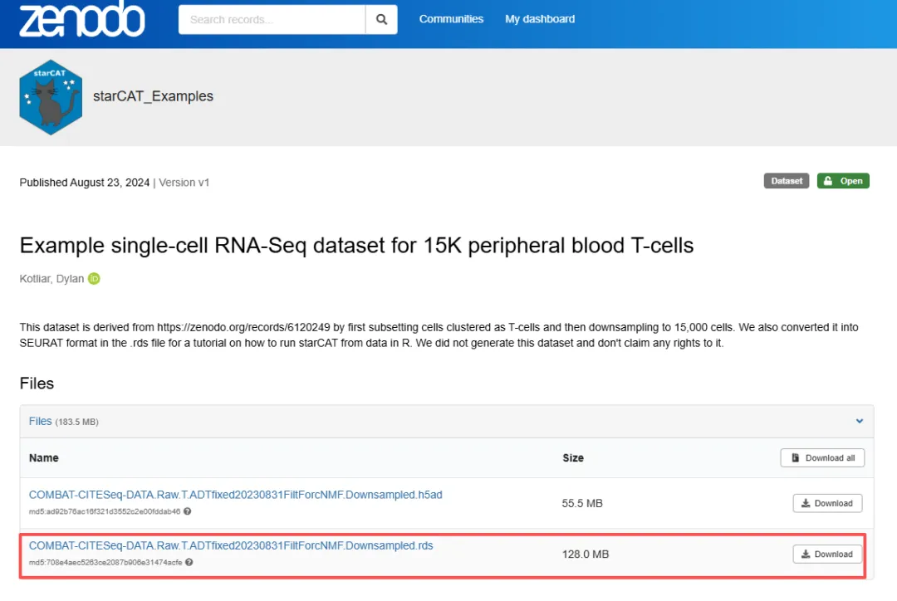
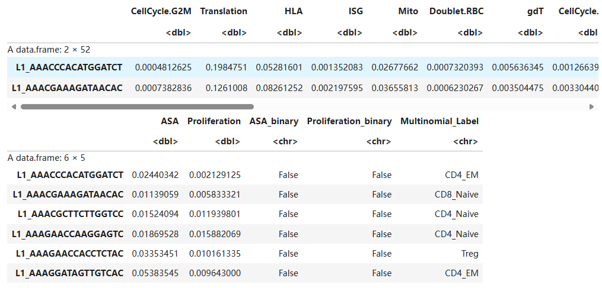
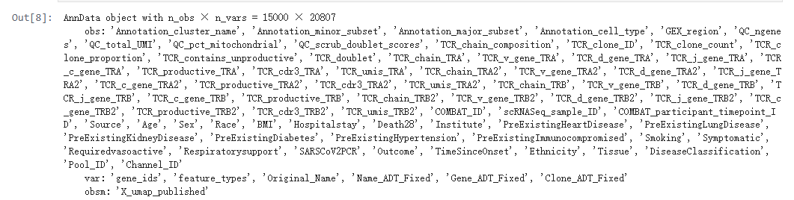
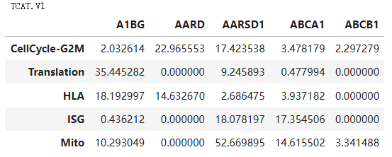
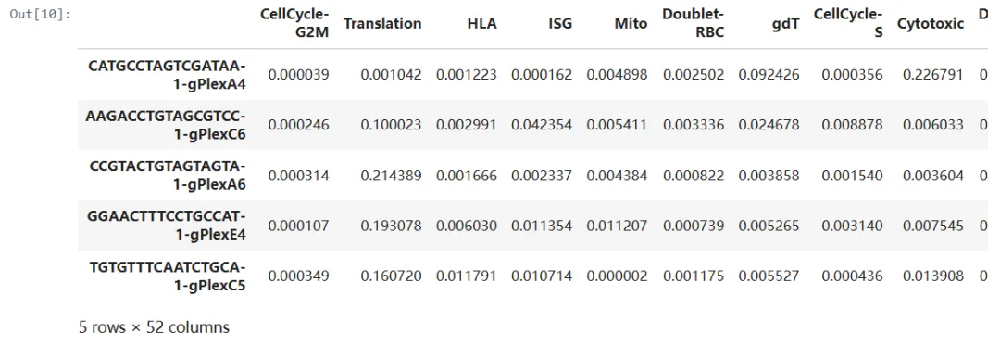
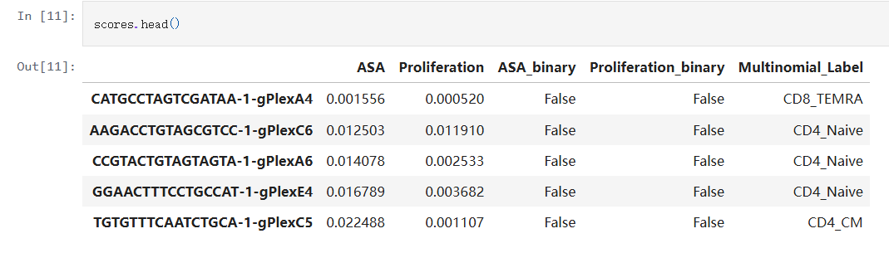
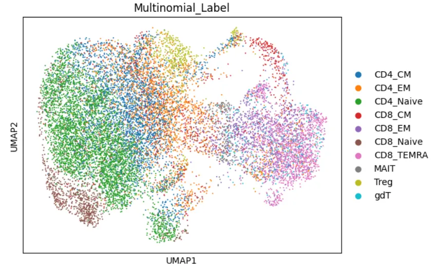

# T Cell注释神器,《Nature Methods》发布T-CellAnnoTator，搞定你的TCell！

> 原文：https://mp.weixin.qq.com/s?__biz=MzAwMzIzOTk5OQ==&mid=2247532453&idx=1&sn=d9cce237c0ff8e1d58d0596b0975ecce&chksm=9b3c06f5ac4b8fe3027a70d79f85f271ad6587426a18531e5399b1594f1e87921e6a394a2bf6#rd
> 合集：单细胞教程全收录

**一、**T-CellAnnoTator****

本次分享的是2025年发布于《Nature Methods》的T Cell亚群注释神器[1]。T细胞在癌症、感染和自身免疫疾病中发挥关键作用，利用单细胞RNA测序体现其状态。但例如聚类作为主要的分析方法，在解释T细胞谱时存在关键局限性。转录组反映了多个基因表达程序GEPs的表达——这些共调控的基因模块反映了不同的生物功能，如细胞类型、激活状态、生命周期过程或外部刺激反应。T细胞GEPs持续变化在单个单元内进行加法结合并表现出依赖刺激的可塑性。然而，聚类使细胞离散化，遮蔽了共表达的GEPs。例如，多个亚群的增殖T细胞可能聚集在一起，掩盖它们的亚群。这或许能解释为何即使是通过CITE-seq积分表面蛋白标记，聚类通常也无法界定许多典型的T细胞亚群。

基于分量的模型如非负矩阵分解（NMF）、层级泊松分解和谱分析克服了聚类的一些限。这些方法将GEP建模为基因表达载体，并将转录组建模为GEP的加权混合。与主成分分析（PCA）不同，NMF成分对应于生物学上可解释的GEPs，反映细胞类型和功能状态，这些都对转录组有叠加性贡献.基于成分的方法产生GEP向量，作为跨数据集比较GEP活动的固定坐标系。这类似于对基因组活动进行评分15但基因权重可变，并同时建模多个GEPs。这防止了相关信号的混淆，并允许比较相对GEP活性。

在这里，作者开发了star-CellAnnoTator（starCAT）[2]，这是一种基于固定多数据集GEPs目录对细胞进行评分的框架。我们通过共识非负矩阵分解（cNMF）推导出全面的T细胞GEP图谱，包含12到7个scRNA-seq数据集，共计170万个T细胞，来自38个人类组织。跨数据集合并GEPs可获得46个共识基因表达程序（cGEPs），捕捉T细胞亚集、激活状态和功能。作者展示了starCAT在推断亚组和抗原特异性激活状态以及识别预测多种肿瘤类型免疫治疗反应的cGEPs方面的实用性。

更多单细胞空转教程可见：

[这可能是全网最全的scRNA-seq分析教程！](<https://mp.weixin.qq.com/s?__biz=MzAwMzIzOTk5OQ==&mid=2247531388&idx=3&sn=dfaf8cac9db70bb408206fb3da27ffda&scene=21#wechat_redirect>)

[单细胞+空间转录组，Python全流程实战教学！](<https://mp.weixin.qq.com/s?__biz=MzAwMzIzOTk5OQ==&mid=2247531221&idx=1&sn=2346109f4cf6d3398dd15351474edf95&scene=21#wechat_redirect>)

如果需要[数据分析](<https://mp.weixin.qq.com/s?__biz=MzAwMzIzOTk5OQ==&mid=2247529435&idx=1&sn=cc7e9ff271f0ce0157008532ef4829c3&scene=21#wechat_redirect>)**指导** 、生信热点**[全文复现](<https://mp.weixin.qq.com/mp/appmsgalbum?__biz=MzAwMzIzOTk5OQ==&action=getalbum&album_id=2981710763847614469#wechat_redirect>)** 、自测/数据库数据**个性化分析** 辅导、[常态化实验学习](<https://mp.weixin.qq.com/s?__biz=MzAwMzIzOTk5OQ==&mid=2247530174&idx=1&sn=c3b0499adcc9093546e4ba1cfffba7bd&scene=21#wechat_redirect>)，欢迎联系客服微信[**Biomamba_zhushou**]

**二、实操**

本教程基于Linux环境演示，计算资源不足的同学可参考：
[足够支持你完成硕博生涯的生信环境](<http://mp.weixin.qq.com/s?__biz=MzAwMzIzOTk5OQ==&mid=2247511780&idx=1&sn=3acc0874f7d2fa75f1abbe7a9a9b4069&chksm=9b3cd7b4ac4b5ea27d4d53964e4a4a9fa8c806a19103729dd4ff0fa72e621411f46a251d269f&scene=21#wechat_redirect>)
[忘记宣传了，独享用户连技术支持都是独享的](<https://mp.weixin.qq.com/s?__biz=MzAwMzIzOTk5OQ==&mid=2247529475&idx=1&sn=10827e982a637e0fc36e4b6e857736c8&scene=21#wechat_redirect>)
[RTX5090、4080S、5070显卡上机](<https://mp.weixin.qq.com/s?__biz=MzAwMzIzOTk5OQ==&mid=2247529840&idx=1&sn=704b0a3d60a17c5bc2445d54c97b834f&scene=21#wechat_redirect>)访问链接：https://biomamba.xiyoucloud.net/欢迎联系客服微信[Biomamba_zhushou]获取帮助
如果你对下面的教程比较迷茫，那么你可以先行学习编程教程：[十小时学会Linux](<http://mp.weixin.qq.com/s?__biz=MzAwMzIzOTk5OQ==&mid=2247505777&idx=1&sn=f3efae390566b838a445ab9f832323c8&chksm=9b3cae21ac4b2737f5923b246470d699474c041bb78de50d2b71b99d537f9f44ca2938002cda&scene=21#wechat_redirect>)
[生信Linux及服务器使用技巧](<https://mp.weixin.qq.com/mp/appmsgalbum?__biz=MzAwMzIzOTk5OQ==&action=getalbum&album_id=2980604042328702978#wechat_redirect>)[5.5h入门R语言](<https://mp.weixin.qq.com/s?__biz=MzAwMzIzOTk5OQ==&mid=2247528126&idx=2&sn=668c2709891956b567b316f9f2fb26ea&scene=21#wechat_redirect>)1、安装： 非常简单，通过pip安装即可：

  *   *   *   *

```
# 安装starcatpypip install starcatpy# 安装依赖包pip install jupyterlab scanpy cnmf
```

2、R语言中的用法[3]：

  *   *   *   *   *   *   *   *   *

```
# 加载必要的包suppressPackageStartupMessages({    library(tidyverse)    library(data.table)    library(Matrix)    library(Seurat)    library(R.utils)})
```

下载测试数据[4]：也可以通过代码下载：

  *   *   *

```
data_dir = './Example_Data/'dir.create(data_dir, recursive = TRUE)
```

  *   *   *   *   *

```r
library(curl)curl_download('https://zenodo.org/records/13368041/files/COMBAT-CITESeq-DATA.Raw.T.ADTfixed20230831FiltForcNMF.Downsampled.rds?download=1',              file.path(data_dir, 'example_data.rds'),               handle = new_handle(timeout = 300))
```

测试数据其实就是我们最熟悉的Seurat对象，可以加载出来保存counts文件：

  *   *   *

```
seu_path = paste0(data_dir, 'example_data.rds')seu_path
```

  *   *

```
seu_object = readRDS(seu_path)
```

  *

```
counts = seu_object@assays$RNA@counts
```

  *   *   *   *   *   *   *   *   *   *   *   *   *   *   *

```r
# Output counts matrixwriteMM(counts, paste0(data_dir, 'matrix.mtx'))gzip(paste0(data_dir, 'matrix.mtx'))# Output cell barcodesbarcodes <- colnames(counts)write_delim(as.data.frame(barcodes), paste0(data_dir, 'barcodes.tsv'),           col_names = FALSE)gzip(paste0(data_dir, 'barcodes.tsv'))# Output feature namesgene_names <- rownames(counts)features <- data.frame("gene_id" = gene_names,"gene_name" = gene_names,type = "Gene Expression")write_delim(as.data.frame(features),delim = "\t", paste0(data_dir, 'features.tsv'),           col_names = FALSE)gzip(paste0(data_dir, 'features.tsv'))
```

大家也不用再切到终端，作者贴心的给了R语言中的调用方式：

  *   *   *

```
output_name = 'example_data'counts_fn = paste0(data_dir, 'matrix.mtx.gz')
```

  *   *   *   *   *   *   *

```
cmd = paste0('starcat',              ' --reference ', '"TCAT.V1"',             ' --counts ', '"', counts_fn, '"',              ' --output-dir ', '"', data_dir, '"',              ' --name ', '"', output_name, '"'            )cmd
```

'starcat --reference "TCAT.V1" --counts "./Example_Data/matrix.mtx.gz" --output-dir "./Example_Data/" --name "example_data"'

  *   *

```
# 提交运行system(cmd)
```

速度出乎意料的快：

  *   *   *

```
usage = read.table(paste0(data_dir, output_name, '.rf_usage_normalized.txt'))scores = read.table(paste0(data_dir, output_name, '.scores.txt'))
```

  *   *

```
usage %>% head(2)scores %>% head()
```

这样你就得到了uasge和scores两个数据框：再添加score中的注释信息回原来的Seurat对象就好：

  *   *   *

```r
scores <- read.table('example_data.scores.txt')
seu_object <- AddMetaData(seu_object,metadata = as.data.frame(scores))
```

2、Python中调用[5]在Python中自然就切换为处理[h5ad](<https://mp.weixin.qq.com/s?__biz=MzAwMzIzOTk5OQ==&mid=2247496786&idx=1&sn=408a81e4824c33eaefe6e9e7f0143c7e&scene=21#wechat_redirect>)文件中的[anndata](<https://mp.weixin.qq.com/s?__biz=MzAwMzIzOTk5OQ==&mid=2247528513&idx=1&sn=1ff1b8bee321f8f5bcac425ce96dc6ff&scene=21#wechat_redirect>)对象啦。

  *   *   *   *   *   *   *   *   *

```
# 加载依赖包import pandas as pdimport numpy as npimport scanpy as scimport osimport matplotlib.pyplot as pltimport sysimport seaborn as snsfrom starcat import starCAT
```

下载测试数据：

  *   *   *   *   *   *   *   *   *   *   *

```
# Initialize directory to download example data todata_dir = './Example_Data'if not os.path.exists(data_dir):    os.mkdir(data_dir)datafn = os.path.join(data_dir, 'example_data.h5ad')cmd = 'wget -O %s https://zenodo.org/records/13368041/files/COMBAT-CITESeq-DATA.Raw.T.ADTfixed20230831FiltForcNMF.Downsampled.h5ad' % datafnprint(cmd)!{cmd}# 加载测试文件：adata = tcat.load_counts(datafn)adata# 这是个标准的anndata
```

库文件

  *   *   *   *   *   *   *   *

```
# 加载包查看依赖库文件import starcatstarcat.available_refs# 目前内置的库文件有这三种# array(['TCAT.V1', 'MYELOID.GLIOMA.V1', 'BONEMARROW.CD34POS.HSPC.V1'],       dtype=object)# 加载我们需要的T Cell依赖文件tcat = starCAT(reference='TCAT.V1', cachedir='./cache')print(tcat.ref_name)display(tcat.ref.iloc[:5, :5])
```

当中包含许多特征评分：
```
实际运行非常简单，一行搞定：
```

  *

```
usage, scores = tcat.fit_transform(adata)
```



  *

```
usage.head()
```


```
作者提供的降维图，区分的不是很开，这也正式需要starCAT的意义，常规的降维分群很难区分这样的精细亚群
```



1、https://www.nature.com/articles/s41592-025-02793-1

2、https://github.com/immunogenomics/starCAT

3、https://github.com/immunogenomics/starCAT/blob/main/Examples/starCAT_vignette_R.ipynb

4、https://zenodo.org/records/13368041/files/COMBAT-CITESeq-DATA.Raw.T.ADTfixed20230831FiltForcNMF.Downsampled.rds?download=1

5、https://zenodo.org/records/13368041/files/COMBAT-CITESeq-DATA.Raw.T.ADTfixed20230831FiltForcNMF.Downsampled.h5ad?download=1


**如何联系我们**

 留一个领取[资料](<https://mp.weixin.qq.com/s?__biz=MzAwMzIzOTk5OQ==&mid=2247530154&idx=2&sn=e5d0a63646094c3094b7b916350d22ad&scene=21#wechat_redirect>)、[开箱即用的单细胞分析镜像](<https://mp.weixin.qq.com/s?__biz=MzAwMzIzOTk5OQ==&mid=2247528410&idx=2&sn=0f2bac25479cf8d20dab5d82ae986f2e&scene=21#wechat_redirect>)的**微信号[Biomamba_zhushou]**，方便各位随时交流。同时我们也构建了[交流群矩阵](<https://mp.weixin.qq.com/s?__biz=MzAwMzIzOTk5OQ==&mid=2247528057&idx=1&sn=bb348c2a88c977c7cce67ee6731a3591&scene=21#wechat_redirect>)，欢迎大家入群讨论。
大家可以阅读完这几篇之后添加[给生信入门初学者的小贴士](<http://mp.weixin.qq.com/s?__biz=MzAwMzIzOTk5OQ==&mid=2247493329&idx=1&sn=597870b7f7ce10346da3561e7c281627&chksm=9b3c9f81ac4b169794088ce9abbcacb5f18e9fd174fc0d7e28da62d78facadf3100ef38aaf22&scene=21#wechat_redirect>)
[没有检索，就没有发言权](<https://mp.weixin.qq.com/s?__biz=MzAwMzIzOTk5OQ==&mid=2247529398&idx=2&sn=5a429852d61721916a405712677d5905&scene=21#wechat_redirect>)

**已有生信基地联系方式的同学****无需重复添加**

 您点的每个赞和在看，我都认真当成了喜欢
