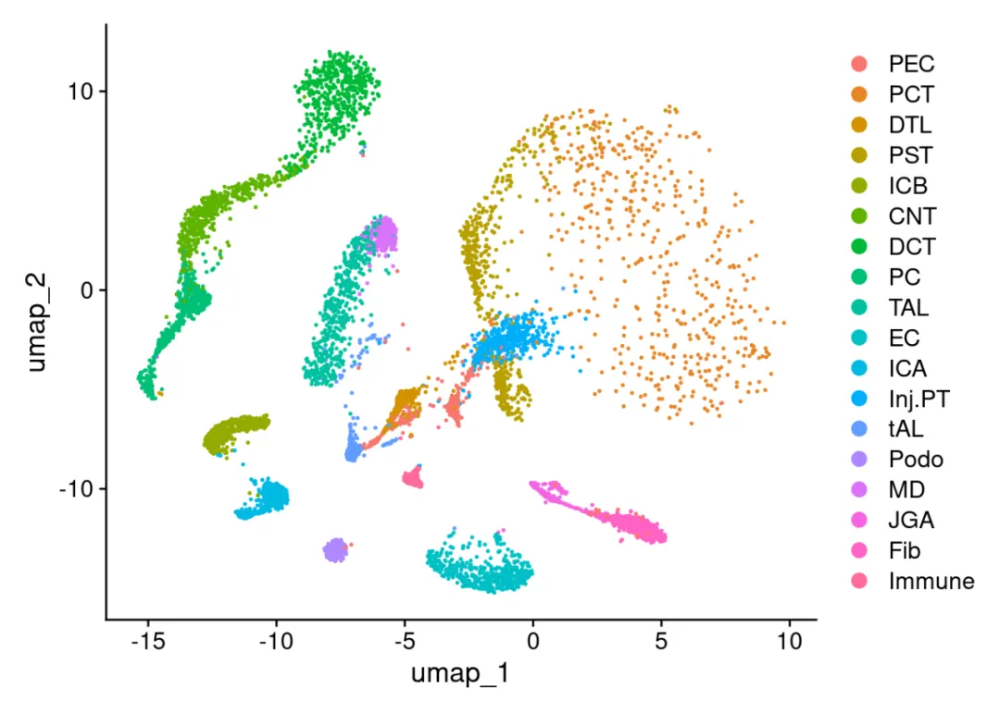
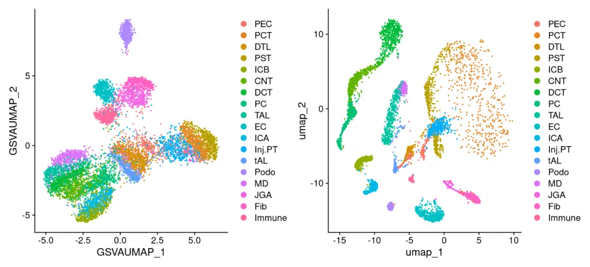
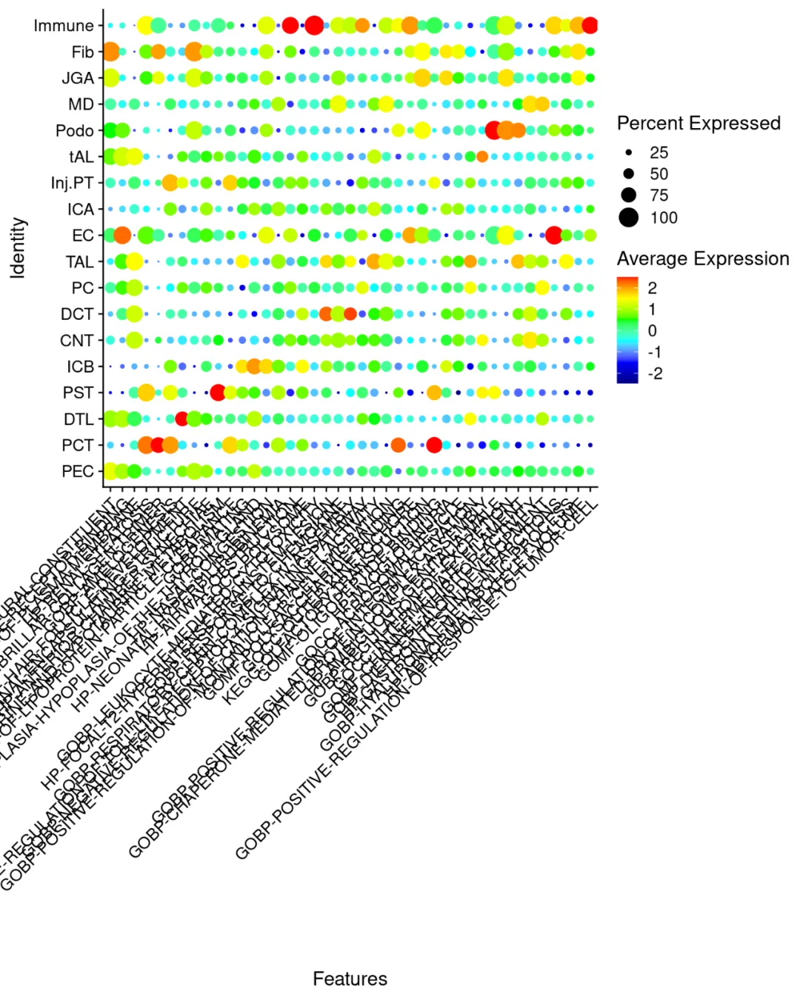
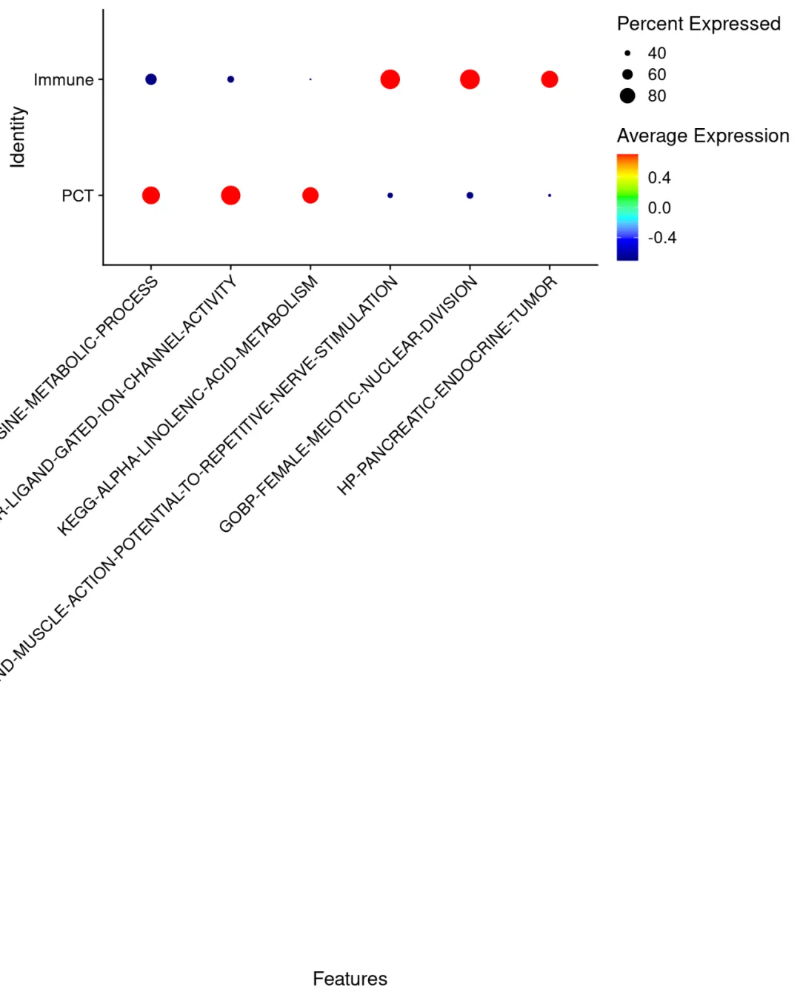

# 抛开基因，只用通路评分来分析单细胞，有没有搞头?

> 原文：https://mp.weixin.qq.com/s?__biz=MzAwMzIzOTk5OQ==&mid=2247534044&idx=1&sn=8017fc5928ac89b8c910379a3d2bbed8&chksm=9b3c3c8cac4bb59aae12bcc543117eff46e521b57b32ae238e76d69e2bbc70a5f44128de6fd7#rd
> 合集：单细胞教程全收录


一、写在前面

当前我们对于转录组的分析几乎都是以基因为单位，倘若我们从来就没有发现过基因，一切的生信世界观都是以通路为单位的，那单细胞数据看起来会是什么样？动手玩一玩，其实很简单，通过我们之前[一文搞定单细胞基因集评分](<https://mp.weixin.qq.com/s?__biz=MzAwMzIzOTk5OQ==&mid=2247497831&idx=2&sn=82fa51c76a381fba0b444e9b6b23eb5f&payreadticket=HFGhAW0dGEH2iwdfk4pFWQVpmLkWeH5WDvvIN3MqnXQ5tw00KxPVu-U1UPiUkQz0cBCHhAw&scene=21#wechat_redirect>)的知识，把单细胞矩阵转换为通路评分即可。更多单细胞教程可见：[这可能是全网最全的scRNA-seq分析教程！](<https://mp.weixin.qq.com/s?__biz=MzAwMzIzOTk5OQ==&mid=2247531388&idx=3&sn=dfaf8cac9db70bb408206fb3da27ffda&scene=21#wechat_redirect>)

学前tips:

本教程基于Linux环境演示，计算资源不足的同学可参考：

[足够支持你完成硕博生涯的生信环境](<https://mp.weixin.qq.com/s?__biz=MzAwMzIzOTk5OQ==&mid=2247511780&idx=1&sn=3acc0874f7d2fa75f1abbe7a9a9b4069&chksm=9b3cd7b4ac4b5ea27d4d53964e4a4a9fa8c806a19103729dd4ff0fa72e621411f46a251d269f&scene=21&token=1904068475&lang=zh_CN#wechat_redirect>)

[忘记宣传了，独享用户连技术支持都是独享的](<https://mp.weixin.qq.com/s?__biz=MzAwMzIzOTk5OQ==&mid=2247529475&idx=1&sn=10827e982a637e0fc36e4b6e857736c8&scene=21&token=1904068475&lang=zh_CN&poc_token=HF-eN2mj01zsfxe_I4r8D5pfZx80xO2AVYSB6qtT#wechat_redirect>)

[RTX5090、4080S、5070显卡上机](<https://mp.weixin.qq.com/s?__biz=MzAwMzIzOTk5OQ==&mid=2247529840&idx=1&sn=704b0a3d60a17c5bc2445d54c97b834f&scene=21&token=1904068475&lang=zh_CN&poc_token=HHWeN2mjUe1w7qMDvfaBNJZRTCq3qpve8MrnSv_z#wechat_redirect>)

访问链接：https://biomamba.xiyoucloud.net/

欢迎联系客服微信[Biomamba_zhushou]获取帮助

如果你对下面的教程比较迷茫，那么你可以先行学习编程教程：

[十小时学会Linux](<https://mp.weixin.qq.com/s?__biz=MzAwMzIzOTk5OQ==&mid=2247505777&idx=1&sn=f3efae390566b838a445ab9f832323c8&chksm=9b3cae21ac4b2737f5923b246470d699474c041bb78de50d2b71b99d537f9f44ca2938002cda&scene=21&token=1904068475&lang=zh_CN#wechat_redirect>)

[生信Linux及服务器使用技巧](<https://mp.weixin.qq.com/mp/appmsgalbum?__biz=MzAwMzIzOTk5OQ==&action=getalbum&album_id=2980604042328702978&token=1904068475&lang=zh_CN#wechat_redirect>)

[5.5h入门R语言](<https://mp.weixin.qq.com/s?__biz=MzAwMzIzOTk5OQ==&mid=2247528126&idx=2&sn=668c2709891956b567b316f9f2fb26ea&scene=21&token=1904068475&lang=zh_CN&poc_token=HMOeN2mjB6Vj1eF0_DgpPebeKGY63vYiUENjmMbo#wechat_redirect>)

如果需要[单细胞数据分析](<https://mp.weixin.qq.com/s?__biz=MzAwMzIzOTk5OQ==&mid=2247531160&idx=2&sn=04d3798dc60958af2c9020fe7c4bd9b8&scene=21#wechat_redirect>)教学、生信热点[全文复现](<https://mp.weixin.qq.com/mp/appmsgalbum?__biz=MzAwMzIzOTk5OQ==&action=getalbum&album_id=2981710763847614469#wechat_redirect>)、自测数据个性化分析辅导、[常态化实验学习](<https://mp.weixin.qq.com/s?__biz=MzAwMzIzOTk5OQ==&mid=2247530174&idx=1&sn=c3b0499adcc9093546e4ba1cfffba7bd&scene=21#wechat_redirect>)，欢迎联系客服微信[Biomamba_zhushou]。


**二、实操**

1\. 加载R包
```r
# 加载包
library(Seurat)
```
```
## Loading required package: SeuratObject
```
```
## Loading required package: sp
```
```
## 'SeuratObject' was built with package 'Matrix' 1.7.1 but the current
## version is 1.7.2; it is recomended that you reinstall 'SeuratObject' as
## the ABI for 'Matrix' may have changed
```
```
##
## Attaching package: 'SeuratObject'
```
```
## The following objects are masked from 'package:base':
##
##     intersect, t
```
```r
library(GSVA)
library(msigdbr)
library(escape)
library(patchwork)
library(dplyr)
```
```
##
## Attaching package: 'dplyr'
```
```
## The following objects are masked from 'package:stats':
##
##     filter, lag
```
```
## The following objects are masked from 'package:base':
##
##     intersect, setdiff, setequal, union
```

## 2\. 测试数据

数据来源于此前[3D与动图降维图](<https://mp.weixin.qq.com/s?__biz=MzAwMzIzOTk5OQ==&mid=2247496343&idx=1&sn=8ac1c511e1197e231c628649167bc26f&payreadticket=HE2H1ePPtcemQjf6OB9h07MCLsVk89xmKlmFCrqwXF18PzMPpGak54uvN-T3-DBf8gJEHAA&scene=21#wechat_redirect>)的小鼠肾脏示例数据
```r
scRNA <-readRDS('data/scRNA.rds')
DimPlot(scRNA)
```



### 3\. 通路评分
```r
# 获取小鼠KEGG基因集
kegg_genesets <-msigdbr(species ="Mus musculus", category ="C2", subcategory ="CP:KEGG")# 当然你也可以选择其它更合适的通路进行评分
# 或者获取小鼠GO基因集
go_genesets <-msigdbr(species ="Mus musculus", category ="C5")# 当然你也可以选择其它更合适的通路进行评分

# 将基因集转换为列表格式
kegg_list <-split(kegg_genesets$gene_symbol, kegg_genesets$gs_name)
go_list <-split(go_genesets$gene_symbol, go_genesets$gs_name)

# 单个种类通路过少，我们合并使用：
genesets <-append(kegg_list,go_list)

# 检查基因集与数据中基因的重叠情况
all_genes <-GetAssayData(scRNA,'RNA','count') %>%rownames()
genes_in_genesets <-unique(unlist(genesets))
overlap_genes <-intersect(all_genes, genes_in_genesets)

cat("总基因数:", length(all_genes), "\n")
```
```
## 总基因数: 23889
```
```
cat("基因集中基因数:", length(genes_in_genesets), "\n")
```
```
## 基因集中基因数: 16782
```
```
cat("重叠基因数:", length(overlap_genes), "\n")
```
```
## 重叠基因数: 14756
```
```r
# 过滤掉基因数太少的基因集：
genesets_filtered <- genesets[sapply(genesets, function(x) length(intersect(x, all_genes)) >= 10)]

expr_matrix <-as.matrix(GetAssayData(scRNA, slot ="data",assay ='RNA'))
gsva_result <-gsva(expr_matrix, genesets_filtered, method ="gsva", kcdf ="Gaussian", parallel.sz =8)
```
```
## Setting parallel calculations through a MulticoreParam back-end
## with workers=8 and tasks=100.
## Estimating GSVA scores for 10899 gene sets.
## Estimating ECDFs with Gaussian kernels
## Estimating ECDFs in parallel on 8 cores
```


```
dim(gsva_result)
```
```
## [1] 10899  9000
```
```r
scRNA[["GSVA"]] <-CreateAssayObject(data = gsva_result)

# 设置默认assay为GSVA
DefaultAssay(scRNA) <-"GSVA"
```

## 4\. 降维
```r
# 基于通路评分的方差选择重要通路
pathway_variance <-apply(gsva_result, 1, var)
top_pathways <-names(sort(pathway_variance, decreasing =TRUE))[1:200]

selected_data <- gsva_result[top_pathways, ]
scaled_data <-t(scale(t(selected_data)))  # 行标准化（每个通路）
scRNA@assays$GSVA$scale.data <- scaled_data

# 直接对标准化后的GSVA数据进行UMAP降维
library(umap)

# 转置数据，使行为细胞，列为通路（UMAP要求的格式）
umap_input <-t(scaled_data)

# 运行UMAP
set.seed(2025)  # 设置随机种子以保证结果可重复
library(umap)
umap_result <-umap(umap_input,
n_neighbors =30,
min_dist =0.3,
metric ="euclidean")

# 提取UMAP坐标
umap_embedding <- umap_result$layout
colnames(umap_embedding) <-c("GSVAUMAP_1", "GSVAUMAP_2")

# 将UMAP结果添加回Seurat对象
# 创建DimReduc对象
umap_reduction <-CreateDimReducObject(
embeddings = umap_embedding,
key ="GSVAUMAP_",
assay ="GSVA"
)

# 添加到Seurat对象
scRNA[["umap_gsva_direct"]] <- umap_reduction

DimPlot(scRNA,reduction ='umap_gsva_direct')|DimPlot(scRNA,reduction ='umap')
```



## 5\. maker通路
```r
# 计算每个细胞群的maker通路
pathway_maker <-FindAllMarkers(scRNA)
```
```
## Calculating cluster PEC
```
```
## Warning in mean.fxn(object[features, cells.1, drop = FALSE]): NaNs produced
```
```
## Warning in mean.fxn(object[features, cells.2, drop = FALSE]): NaNs produced
```
```
## Calculating cluster PCT
```
```
## Warning in mean.fxn(object[features, cells.1, drop = FALSE]): NaNs produced
## Warning in mean.fxn(object[features, cells.1, drop = FALSE]): NaNs produced
```
```
## Calculating cluster DTL
```
```
## Warning in mean.fxn(object[features, cells.1, drop = FALSE]): NaNs produced
## Warning in mean.fxn(object[features, cells.1, drop = FALSE]): NaNs produced
```
```
## Calculating cluster PST
```
```
## Warning in mean.fxn(object[features, cells.1, drop = FALSE]): NaNs produced
## Warning in mean.fxn(object[features, cells.1, drop = FALSE]): NaNs produced
```
```
## Calculating cluster ICB
```
```
## Warning in mean.fxn(object[features, cells.1, drop = FALSE]): NaNs produced
## Warning in mean.fxn(object[features, cells.1, drop = FALSE]): NaNs produced
```
```
## Calculating cluster CNT
```
```
## Warning in mean.fxn(object[features, cells.1, drop = FALSE]): NaNs produced
## Warning in mean.fxn(object[features, cells.1, drop = FALSE]): NaNs produced
```
```
## Calculating cluster DCT
```
```
## Warning in mean.fxn(object[features, cells.1, drop = FALSE]): NaNs produced
## Warning in mean.fxn(object[features, cells.1, drop = FALSE]): NaNs produced
```
```
## Calculating cluster PC
```
```
## Warning in mean.fxn(object[features, cells.1, drop = FALSE]): NaNs produced
## Warning in mean.fxn(object[features, cells.1, drop = FALSE]): NaNs produced
```
```
## Calculating cluster TAL
```
```
## Warning in mean.fxn(object[features, cells.1, drop = FALSE]): NaNs produced
## Warning in mean.fxn(object[features, cells.1, drop = FALSE]): NaNs produced
```
```
## Calculating cluster EC
```
```
## Warning in mean.fxn(object[features, cells.1, drop = FALSE]): NaNs produced
## Warning in mean.fxn(object[features, cells.1, drop = FALSE]): NaNs produced
```
```
## Calculating cluster ICA
```
```
## Warning in mean.fxn(object[features, cells.1, drop = FALSE]): NaNs produced
## Warning in mean.fxn(object[features, cells.1, drop = FALSE]): NaNs produced
```
```
## Calculating cluster Inj.PT
```
```
## Warning in mean.fxn(object[features, cells.1, drop = FALSE]): NaNs produced
## Warning in mean.fxn(object[features, cells.1, drop = FALSE]): NaNs produced
```
```
## Calculating cluster tAL
```
```
## Warning in mean.fxn(object[features, cells.1, drop = FALSE]): NaNs produced
## Warning in mean.fxn(object[features, cells.1, drop = FALSE]): NaNs produced
```
```
## Calculating cluster Podo
```
```
## Warning in mean.fxn(object[features, cells.1, drop = FALSE]): NaNs produced
## Warning in mean.fxn(object[features, cells.1, drop = FALSE]): NaNs produced
```
```
## Calculating cluster MD
```
```
## Warning in mean.fxn(object[features, cells.1, drop = FALSE]): NaNs produced
## Warning in mean.fxn(object[features, cells.1, drop = FALSE]): NaNs produced
```
```
## Calculating cluster JGA
```
```
## Warning in mean.fxn(object[features, cells.1, drop = FALSE]): NaNs produced
## Warning in mean.fxn(object[features, cells.1, drop = FALSE]): NaNs produced
```
```
## Calculating cluster Fib
```
```
## Warning in mean.fxn(object[features, cells.1, drop = FALSE]): NaNs produced
## Warning in mean.fxn(object[features, cells.1, drop = FALSE]): NaNs produced
```
```
## Calculating cluster Immune
```
```
## Warning in mean.fxn(object[features, cells.1, drop = FALSE]): NaNs produced
## Warning in mean.fxn(object[features, cells.1, drop = FALSE]): NaNs produced
```
```r
# 筛选top3通路
top3 <- pathway_maker %>%group_by(cluster) %>%top_n(n =3, wt = avg_log2FC)
# 气泡图检查结果：
library(ggplot2)
DotPlot(scRNA,unique(top3$gene))+
theme( axis.text.x.bottom =element_text(angle =45,hjust =1,vjust =1))+
scale_color_gradientn(colors =c("navy", "blue", "cyan", "green", "yellow", "red"))
```
```
## Scale for colour is already present.
## Adding another scale for colour, which will replace the existing scale.
```



emm，效果似乎不太好，如果两两细胞之间对比呢？
```r
sub_sc<-subset(scRNA,idents =c('PCT','Immune'))
pathway_maker <-FindAllMarkers(sub_sc)
```
```
## Calculating cluster PCT
```
```
## Warning in mean.fxn(object[features, cells.1, drop = FALSE]): NaNs produced
```
```
## Warning in mean.fxn(object[features, cells.2, drop = FALSE]): NaNs produced
```
```
## Calculating cluster Immune
```
```
## Warning in mean.fxn(object[features, cells.1, drop = FALSE]): NaNs produced
## Warning in mean.fxn(object[features, cells.1, drop = FALSE]): NaNs produced
```
```r
top3 <- pathway_maker %>%group_by(cluster) %>%top_n(n =3, wt = avg_log2FC)
DotPlot(sub_sc,unique(top3$gene))+ theme( axis.text.x.bottom =element_text(angle =45,hjust =1,vjust =1))+ scale_color_gradientn(colors =c("navy", "blue", "cyan", "green", "yellow", "red"))
```
```
## Warning: Scaling data with a low number of groups may produce misleading
## results
```
```
## Scale for colour is already present.
## Adding another scale for colour, which will replace the existing scale.
```



### nice，效果还不错看来通路评分还是能够在一定程度上帮助大家发现细胞间差异。


**三、演示环境**

一切不给测试文件和分析环境版本的教程都是耍流氓，本推送的代码和测试文件可以在以下链接中下载：

通过网盘分享的文件:

https://pan.baidu.com/s/1pjJWgHEnuza2hxMBLO8BZQ

提取码: acbu


R语言演示环境([趁开学前| 入手足够完成硕博生涯的生信环境](<https://mp.weixin.qq.com/s?__biz=MzAwMzIzOTk5OQ==&mid=2247530226&idx=2&sn=0522eb4eae67efeea2b96404474af611&scene=21&token=132333536&lang=zh_CN&poc_token=HGT6M2mjBew4fAQPy8gu8Adhx31rzsMf_vYNE-TB#wechat_redirect>))：

```
sessionInfo()
```
```
## R version 4.4.2 (2024-10-31)
## Platform: x86_64-pc-linux-gnu
## Running under: Ubuntu 20.04.4 LTS
##
## Matrix products: default
## BLAS:   /usr/lib/x86_64-linux-gnu/openblas-pthread/libblas.so.3
## LAPACK: /usr/lib/x86_64-linux-gnu/openblas-pthread/liblapack.so.3;  LAPACK version 3.9.0
##
## locale:
##  [1] LC_CTYPE=en_US.UTF-8       LC_NUMERIC=C
##  [3] LC_TIME=en_US.UTF-8        LC_COLLATE=en_US.UTF-8
##  [5] LC_MONETARY=en_US.UTF-8    LC_MESSAGES=en_US.UTF-8
##  [7] LC_PAPER=en_US.UTF-8       LC_NAME=C
##  [9] LC_ADDRESS=C               LC_TELEPHONE=C
## [11] LC_MEASUREMENT=en_US.UTF-8 LC_IDENTIFICATION=C
##
## time zone: Etc/UTC
## tzcode source: system (glibc)
##
## attached base packages:
## [1] stats     graphics  grDevices utils     datasets  methods   base
##
## other attached packages:
##  [1] ggplot2_3.5.1      umap_0.2.10.0      dplyr_1.1.4        patchwork_1.3.0
##  [5] escape_2.2.3       msigdbr_7.5.1      GSVA_1.50.5        Seurat_5.2.1
##  [9] SeuratObject_5.0.2 sp_2.2-0
##
## loaded via a namespace (and not attached):
##   [1] RcppAnnoy_0.0.22            splines_4.4.2
##   [3] later_1.4.1                 bitops_1.0-9
##   [5] R.oo_1.27.0                 tibble_3.2.1
##   [7] polyclip_1.10-7             graph_1.84.1
##   [9] XML_3.99-0.18               fastDummies_1.7.5
##  [11] lifecycle_1.0.4             globals_0.16.3
##  [13] lattice_0.22-6              MASS_7.3-64
##  [15] ggdist_3.3.2                magrittr_2.0.3
##  [17] limma_3.62.2                plotly_4.10.4
##  [19] sass_0.4.9                  rmarkdown_2.29
##  [21] jquerylib_0.1.4             yaml_2.3.10
##  [23] httpuv_1.6.15               sctransform_0.4.1
##  [25] askpass_1.2.1               spam_2.11-1
##  [27] spatstat.sparse_3.1-0       reticulate_1.43.0.9001
##  [29] cowplot_1.1.3               pbapply_1.7-2
##  [31] DBI_1.2.3                   RColorBrewer_1.1-3
##  [33] abind_1.4-8                 zlibbioc_1.52.0
##  [35] Rtsne_0.17                  GenomicRanges_1.58.0
##  [37] presto_1.0.0                R.utils_2.12.3
##  [39] purrr_1.0.2                 BiocGenerics_0.52.0
##  [41] RCurl_1.98-1.16             GenomeInfoDbData_1.2.13
##  [43] IRanges_2.40.1              S4Vectors_0.44.0
##  [45] ggrepel_0.9.6               irlba_2.3.5.1
##  [47] listenv_0.9.1               spatstat.utils_3.1-4
##  [49] openintro_2.5.0             airports_0.1.0
##  [51] goftest_1.2-3               RSpectra_0.16-2
##  [53] spatstat.random_3.4-1       annotate_1.84.0
##  [55] fitdistrplus_1.2-2          parallelly_1.42.0
##  [57] DelayedMatrixStats_1.28.1   codetools_0.2-20
##  [59] DelayedArray_0.32.0         tidyselect_1.2.1
##  [61] UCell_2.10.1                UCSC.utils_1.2.0
##  [63] farver_2.1.2                ScaledMatrix_1.14.0
##  [65] matrixStats_1.5.0           stats4_4.4.2
##  [67] spatstat.explore_3.4-3      jsonlite_1.8.9
##  [69] BiocNeighbors_1.20.2        progressr_0.15.1
##  [71] ggridges_0.5.6              survival_3.8-3
##  [73] tools_4.4.2                 ica_1.0-3
##  [75] Rcpp_1.0.14                 glue_1.8.0
##  [77] gridExtra_2.3               SparseArray_1.6.0
##  [79] xfun_0.50                   distributional_0.5.0
##  [81] MatrixGenerics_1.18.1       AUCell_1.28.0
##  [83] GenomeInfoDb_1.42.1         HDF5Array_1.34.0
##  [85] withr_3.0.2                 fastmap_1.2.0
##  [87] ggpointdensity_0.2.1        rhdf5filters_1.18.0
##  [89] openssl_2.3.2               rsvd_1.0.5
##  [91] digest_0.6.37               R6_2.5.1
##  [93] mime_0.12                   colorspace_2.1-1
##  [95] scattermore_1.2             tensor_1.5
##  [97] spatstat.data_3.1-6         RSQLite_2.3.9
##  [99] R.methodsS3_1.8.2           tidyr_1.3.1
## [101] generics_0.1.3              data.table_1.16.4
## [103] usdata_0.3.1                httr_1.4.7
## [105] htmlwidgets_1.6.4           S4Arrays_1.6.0
## [107] uwot_0.2.2                  pkgconfig_2.0.3
## [109] gtable_0.3.6                blob_1.2.4
## [111] lmtest_0.9-40               SingleCellExperiment_1.28.1
## [113] XVector_0.46.0              htmltools_0.5.8.1
## [115] dotCall64_1.2               GSEABase_1.64.0
## [117] scales_1.3.0                Biobase_2.66.0
## [119] png_0.1-8                   spatstat.univar_3.1-3
## [121] knitr_1.49                  rstudioapi_0.17.1
## [123] tzdb_0.4.0                  reshape2_1.4.4
## [125] nlme_3.1-168                rhdf5_2.50.2
## [127] cachem_1.1.0                zoo_1.8-12
## [129] stringr_1.5.1               KernSmooth_2.23-26
## [131] parallel_4.4.2              miniUI_0.1.1.1
## [133] AnnotationDbi_1.68.0        pillar_1.10.1
## [135] grid_4.4.2                  vctrs_0.6.5
## [137] RANN_2.6.2                  promises_1.3.2
## [139] BiocSingular_1.22.0         beachmat_2.22.0
## [141] xtable_1.8-4                cluster_2.1.8
## [143] evaluate_1.0.3              readr_2.1.5
## [145] cli_3.6.3                   compiler_4.4.2
## [147] rlang_1.1.5                 crayon_1.5.3
## [149] future.apply_1.11.3         labeling_0.4.3
## [151] plyr_1.8.9                  stringi_1.8.4
## [153] viridisLite_0.4.2           deldir_2.0-4
## [155] BiocParallel_1.40.0         babelgene_22.9
## [157] munsell_0.5.1               Biostrings_2.74.1
## [159] lazyeval_0.2.2              spatstat.geom_3.4-1
## [161] Matrix_1.7-2                RcppHNSW_0.6.0
## [163] hms_1.1.3                   sparseMatrixStats_1.18.0
## [165] bit64_4.6.0-1               future_1.34.0
## [167] Rhdf5lib_1.28.0             statmod_1.5.0
## [169] KEGGREST_1.46.0             shiny_1.10.0
## [171] SummarizedExperiment_1.36.0 ROCR_1.0-11
## [173] igraph_2.1.4                memoise_2.0.1
## [175] bslib_0.9.0                 bit_4.5.0.1
## [177] cherryblossom_0.1.0
```


**欢迎致谢**

如果以上内容对你有帮助，欢迎在文章的Acknowledgement中加上这一段，联系客服微信可以发放奖励：
```
Since Biomamba and his wechat public account team produce bioinformatics tutorials and share code with annotation, we thank Biomamba for their guidance in bioinformatics and data analysis for the current study.
```

**欢迎在发文/毕业时向我们分享你的喜悦~**

**已致谢文章：**

**[KIF18A在肝细胞癌转移中的双重角色](<https://mp.weixin.qq.com/s?__biz=MzAwMzIzOTk5OQ==&mid=2247528014&idx=1&sn=d285c9ebd415be328fc682d00e6182c0&scene=21#wechat_redirect>)****[《Advanced Science》新型Arf1抑制剂促进癌症干细胞衰老并增强抗肿瘤免疫](<http://mp.weixin.qq.com/s?__biz=MzAwMzIzOTk5OQ==&mid=2247522233&idx=1&sn=287a380de741ff55f0ce78dc9c727985&chksm=9b3ceee9ac4b67ffd925abafeba2cb215a5984e6dc85f0d8607340a07ec9208f1d19eae0e04b&scene=21#wechat_redirect>)****
****[13分+文章利用scRNA-Seq揭示地铁细颗粒物引起肺部炎症的分子机制](<https://mp.weixin.qq.com/s?__biz=MzAwMzIzOTk5OQ==&mid=2247511886&idx=1&sn=31c712d00377b0f0ed33703b5b4fbfd8&chksm=9b3cd61eac4b5f084fde14a2eb50356f2f40a66c608d38909f12a3d81f48cff029a09ce2ee8c&token=1453608870&lang=zh_CN&scene=21#wechat_redirect>)
[ IF14.3| scRNA-seq+脂质组多组学分析揭示宫内生长受限导致肝损伤的性别差异](<https://mp.weixin.qq.com/s?__biz=MzAwMzIzOTk5OQ==&mid=2247520900&idx=1&sn=157134292ffc2e5df730c5ba8a357b61&chksm=9b3cebd4ac4b62c286543c30381e9b4fdb8b44b28d4fa902fb963bbd45b28e1d3f1bc98eb148&scene=21&cur_album_id=3425248581018714114#wechat_redirect>)
[鼻咽癌的Bulk RNA-Seq与scRNA-Seq联合分析](<https://mp.weixin.qq.com/s?__biz=MzAwMzIzOTk5OQ==&mid=2247510548&idx=1&sn=58048c46e837b1d56dffa282272c6d96&chksm=9b3cd344ac4b5a52369e91b4e61fa0a2c951b82cc21165b99f42ba2c2191d4add803bd73c928&scene=21&cur_album_id=3425248581018714114#wechat_redirect>)
[除了铁死亡，还有铜死亡？！](<https://mp.weixin.qq.com/s?__biz=MzAwMzIzOTk5OQ==&mid=2247518144&idx=1&sn=d036f1bb04b09eb73f53e2104d69404c&chksm=9b3cfe90ac4b77862f2f463b42132c7bfdb687a1b61d350dcf656117b1331271e179710fd4fa&scene=21&cur_album_id=3425248581018714114#wechat_redirect>)
[银屑病和脂肪肝病中共同病理和免疫特征](<https://mp.weixin.qq.com/s?__biz=MzAwMzIzOTk5OQ==&mid=2247521069&idx=1&sn=4ef441a885cb2525ee3b5c81001feddf&chksm=9b3cea7dac4b636be9f10ffdf75e13531fccae62129944b21a457db2e08c3f2db1e1b553ac34&scene=21&cur_album_id=3425248581018714114#wechat_redirect>) ****[scRNA-seq揭示脓毒症预后水平预测的关键靶点！](<http://mp.weixin.qq.com/s?__biz=MzAwMzIzOTk5OQ==&mid=2247522281&idx=1&sn=f95eb12fdc340b8da1123ec6253e6fac&chksm=9b3ceeb9ac4b67afa587e5fa3a2a8960e9bb28a1ad6dc48e49120a76154417a4c8be95af90b0&scene=21#wechat_redirect>)**
**[机器学习+生信多组学联合构建牙周炎"线粒体功能障碍与免疫微环境"关联网络](<https://mp.weixin.qq.com/s?__biz=MzAwMzIzOTk5OQ==&mid=2247527168&idx=1&sn=0791d2bf53a9a60015577f892b10d370&scene=21#wechat_redirect>)**
[ bulk+scRNA-seq挖掘BCL2-MAPK14-TXN氧化应激诊断模型，鉴定脓毒症中氧化应激关键基因](<https://mp.weixin.qq.com/s?__biz=MzAwMzIzOTk5OQ==&mid=2247530000&idx=1&sn=e8ddca4e1b2e60839cdf2a7fe87b3dfe&scene=21#wechat_redirect>)

**
**


**如何联系我们**

 留一个领取[资料](<https://mp.weixin.qq.com/s?__biz=MzAwMzIzOTk5OQ==&mid=2247532585&idx=1&sn=e265d2846ec66e5faaaf21403d274d2f&scene=21#wechat_redirect>)、[开箱即用的单细胞分析镜像](<https://mp.weixin.qq.com/s?__biz=MzAwMzIzOTk5OQ==&mid=2247528410&idx=2&sn=0f2bac25479cf8d20dab5d82ae986f2e&scene=21#wechat_redirect>)的**微信号[Biomamba_zhushou]**，方便各位随时交流。同时我们也构建了[交流群矩阵](<https://mp.weixin.qq.com/s?__biz=MzAwMzIzOTk5OQ==&mid=2247528057&idx=1&sn=bb348c2a88c977c7cce67ee6731a3591&scene=21#wechat_redirect>)，欢迎大家入群讨论。
大家可以阅读完这几篇之后添加[给生信入门初学者的小贴士](<http://mp.weixin.qq.com/s?__biz=MzAwMzIzOTk5OQ==&mid=2247493329&idx=1&sn=597870b7f7ce10346da3561e7c281627&chksm=9b3c9f81ac4b169794088ce9abbcacb5f18e9fd174fc0d7e28da62d78facadf3100ef38aaf22&scene=21#wechat_redirect>)
[没有检索，就没有发言权](<https://mp.weixin.qq.com/s?__biz=MzAwMzIzOTk5OQ==&mid=2247529398&idx=2&sn=5a429852d61721916a405712677d5905&scene=21#wechat_redirect>)

**已有生信基地联系方式的同学****无需重复添加**

 您点的每个赞和在看，我都认真当成了喜欢
