# 还在做简单的差异分析？MOFA单细胞多组学因子分析筛选特征基因

> 原文：https://mp.weixin.qq.com/s?__biz=MzAwMzIzOTk5OQ==&mid=2247534672&idx=1&sn=8f8415f2463cfde5362a3092aee8beab&chksm=9b3c3100ac4bb8163649a55a5a1ed17e8452bfbd0ac6d68cdb221f7c322a2a6995fe1ed02b85#rd
> 合集：单细胞教程全收录


**一、写在前面**

##  MOFA**是一种因子分析模型，它为 无监督方式整合多组学数据集提供了一个通用框架。直观地说，MOFA可以被视为一种适用于多组学数据的灵活且统计上严谨的主成分分析的延伸。给定几个数据矩阵，这些矩阵包含对相同或重叠样本集的多种组学数据类型的测量值，MOFA 推断出一个可解释的低维表示形式，以少量潜在因子的形式呈现。这些学习到的因子代表了跨数据模式的驱动变异源，从而有助于识别细胞状态或疾病亚组。MOFA最早被发布在《Molecular Systems Biology》上[1]，并为大家提供了[R语言](<https://mp.weixin.qq.com/s?__biz=MzAwMzIzOTk5OQ==&mid=2247530924&idx=2&sn=ba3b03a998e48de5cec08933b734d905&scene=21#wechat_redirect>)和[Python](<https://mp.weixin.qq.com/s?__biz=MzAwMzIzOTk5OQ==&mid=2247520999&idx=2&sn=7f6aa90c2ffa786bd660aa40b109de49&scene=21#wechat_redirect>)两个版本，目前已经更新到MOFA2。**

## **本教程我们来演示一下MOFA在时间[ scRNA-seq](<https://mp.weixin.qq.com/s?__biz=MzAwMzIzOTk5OQ==&mid=2247531092&idx=1&sn=9968319b84186bb9b717b7b409132d8b&scene=21#wechat_redirect>)数据集整合流程，并且展示了MOFA+在单一数据模态上的多组集成框架。我们将考察一组scRNA-seq实验数据，包含共8个发育阶段（E6.5、E6.75、E7.0和E7.25）的小鼠胚胎中的16,152个细胞（每阶段两个胚胎），涵盖着床后至早期胃胚形成。尽管发育时间不同，胚胎仍预计包含相似的细胞亚群。因此，MOFA+应检测到群体间共享的生物学变异。作者演示的是原始数据集的简化子集版本([人生苦短，我downsample](<https://mp.weixin.qq.com/s?__biz=MzAwMzIzOTk5OQ==&mid=2247530367&idx=1&sn=f7452a93145295bd6dfc4a7e571413d6&scene=21#wechat_redirect>))，可以点击下载[3]。MOFA允许跨多个群体进行推断，其中组是预定义的样本集合（即不同的条件、批次、队列等）。重要的是，该模型并不专注于捕捉组间的差异变化（例如在进行差异表达时）。多组框架的目标是找出每个组内的变异来源，并区分哪些变异在不同组间是共享的，哪些是单一组的。简单来说MOFA的核心任务就是在多组学数据中找到真正的生物学差异。**

更多单细胞空转教程可见：

[保姆级单细胞&空转教学| 生信全程班一览](<https://mp.weixin.qq.com/s?__biz=MzAwMzIzOTk5OQ==&mid=2247531447&idx=1&sn=242b49b5e2f5496efbd4484bf2e81604&scene=21#wechat_redirect>)


如果需要[单细胞数据分析](<https://mp.weixin.qq.com/s?__biz=MzAwMzIzOTk5OQ==&mid=2247531160&idx=2&sn=04d3798dc60958af2c9020fe7c4bd9b8&scene=21#wechat_redirect>)教学、生信热点[全文复现](<https://mp.weixin.qq.com/mp/appmsgalbum?__biz=MzAwMzIzOTk5OQ==&action=getalbum&album_id=2981710763847614469#wechat_redirect>)、自测数据个性化分析辅导、[常态化实验学习](<https://mp.weixin.qq.com/s?__biz=MzAwMzIzOTk5OQ==&mid=2247530174&idx=1&sn=c3b0499adcc9093546e4ba1cfffba7bd&scene=21#wechat_redirect>)，欢迎联系客服微信[Biomamba_zhushou]。

**二、测试数据**

学习手册下载见文末：
学前tips:本教程基于Linux环境的[Rstudio-server](<https://mp.weixin.qq.com/s?__biz=MzAwMzIzOTk5OQ==&mid=2247524106&idx=1&sn=f23405302a3705007d33b688870196e0&scene=21#wechat_redirect>)演示，计算资源不足的同学可参考：[足够支持你完成硕博生涯的生信环境](<https://mp.weixin.qq.com/s?__biz=MzAwMzIzOTk5OQ==&mid=2247511780&idx=1&sn=3acc0874f7d2fa75f1abbe7a9a9b4069&chksm=9b3cd7b4ac4b5ea27d4d53964e4a4a9fa8c806a19103729dd4ff0fa72e621411f46a251d269f&scene=21&token=1904068475&lang=zh_CN#wechat_redirect>)[忘记宣传了，独享用户连技术支持都是独享的](<https://mp.weixin.qq.com/s?__biz=MzAwMzIzOTk5OQ==&mid=2247529475&idx=1&sn=10827e982a637e0fc36e4b6e857736c8&scene=21&token=1904068475&lang=zh_CN&poc_token=HF-eN2mj01zsfxe_I4r8D5pfZx80xO2AVYSB6qtT#wechat_redirect>)[RTX5090、4080S、5070显卡上机](<https://mp.weixin.qq.com/s?__biz=MzAwMzIzOTk5OQ==&mid=2247529840&idx=1&sn=704b0a3d60a17c5bc2445d54c97b834f&scene=21&token=1904068475&lang=zh_CN&poc_token=HHWeN2mjUe1w7qMDvfaBNJZRTCq3qpve8MrnSv_z#wechat_redirect>)访问链接：https://biomamba.xiyoucloud.net/欢迎联系客服微信[Biomamba_zhushou]获取帮助

## **1\. 加载包与数据****
**
```r
# 加载包
library(Seurat)
```
```
## Loading required package: SeuratObject
```
```
## Loading required package: sp
```
```
## 'SeuratObject' was built with package 'Matrix' 1.7.1 but the current
## version is 1.7.2; it is recomended that you reinstall 'SeuratObject' as
## the ABI for 'Matrix' may have changed
```
```
##
## Attaching package: 'SeuratObject'
```
```
## The following objects are masked from 'package:base':
##
##     intersect, t
```
```r
library(ggplot2)
if(!require(MOFA2))BiocManager::install('MOFA2')# MOFA是可以通过bioconda下载安装的
```
```
## Loading required package: MOFA2
```
```
##
## Attaching package: 'MOFA2'
```
```
## The following object is masked from 'package:stats':
##
##     predict
```
```bash
# 通过R调用的话还是需要配置一下python环境：
# 终端中运行：
sudo apt-get install -y python3-venv python3-pip python3-dev
pip install scikit-learn

# 回到R:
if(!require(reticulate))install.packages('reticulate')
reticulate::py_install('scikit-learn')
# 需要安装2.7.0的稳定版，否则可能会遇到pands的数据转换报错
py_run_string("pip.main(['install', 'mofapy2==0.7.0'])")
# 如果你需要调用GPU，则需要cupy-cuda
py_install("cupy-cuda12x", pip =TRUE
```

作者提供的是一个矩阵已经经过`[Seurat](<https://mp.weixin.qq.com/s?__biz=MzAwMzIzOTk5OQ==&mid=2247519711&idx=1&sn=d25d4f5daf609bda8367f16db676ecf3&payreadticket=HNruwbUd7-KXQlKcd3fDsqEm6Ytgtkv2n567ad2lmBMQC3gRuheqtwbXfRX6tlMbyNeI64w&scene=21#wechat_redirect>)`标准化后的对象
```
# 直接在线读取
load(url("ftp://ftp.ebi.ac.uk/pub/databases/mofa/scrna_gastrulation/gastrulation10x_seurat.RData"))
```
```
# 如果你读取失败了，我们也给你准备好了本地文件：
load('./gastrulation10x_seurat.RData')

# MOFA2的演示数据还停留在V3版本：
seurat@version
```
```
## [1] '3.0.1'
```
```r
# 可以更新一下看看数据结构：
seurat <-UpdateSeuratObject(seurat)
```
```
## Validating object structure
```
```
## Updating object slots
```
```
## Ensuring keys are in the proper structure
```
```
## Warning: Assay RNA changing from Assay to Assay
```
```
## Ensuring keys are in the proper structure
```
```
## Ensuring feature names don't have underscores or pipes
```
```
## Updating slots in RNA
```
```
## Setting assay used for NormalizeData.RNA to RNA
```
```
## Setting assay used for FindVariableFeatures.RNA to RNA
```
```
## Validating object structure for Assay 'RNA'
```
```
## Object representation is consistent with the most current Seurat version
```
```
seurat# MOFA2是支持Seurat V5的
```
```
## An object of class Seurat
## 5000 features across 16152 samples within 1 assay
## Active assay: RNA (5000 features, 5000 variable features)
##  2 layers present: counts, data
```

定义各细胞颜色类型
```r
colors <-c(
"Epiblast"="grey70",
"Primitive Streak"="sandybrown",
"Mesoderm"="violetred",
"ExE endoderm"="#548B54",
"ExE ectoderm"="black"
)
```

**2\. 创建MOFA对象**

根据胚胎和来源阶段对细胞进行分组
```r
seurat@meta.data$stage_sample <-paste(seurat@meta.data$stage,seurat@meta.data$sample, sep="_")
unique(seurat@meta.data$stage_sample)
```
```
## [1] "E6.5_1"   "E6.5_5"   "E7.0_10"  "E7.0_14"  "E7.25_26" "E7.25_27"
```
```r
# seurat V3对象可以一键生成MOFA2对象
MOFAobject <-create_mofa(seurat, groups ="stage_sample")
```
```
## Creating MOFA object from a Seurat object...
```
```
## No assays specified, using all assays by default: RNA
```
```
## No features specified, using variable features from the Seurat object...
```

按照默认分组信息，MOFA可以提供一些基本数据概况，例如RNA变量数、每个分组下的细胞数：
```
plot_data_overview(MOFAobject)
```
```
## Warning in plot_data_overview(MOFAobject): This function is inefficient with
## large number of cells...
```

**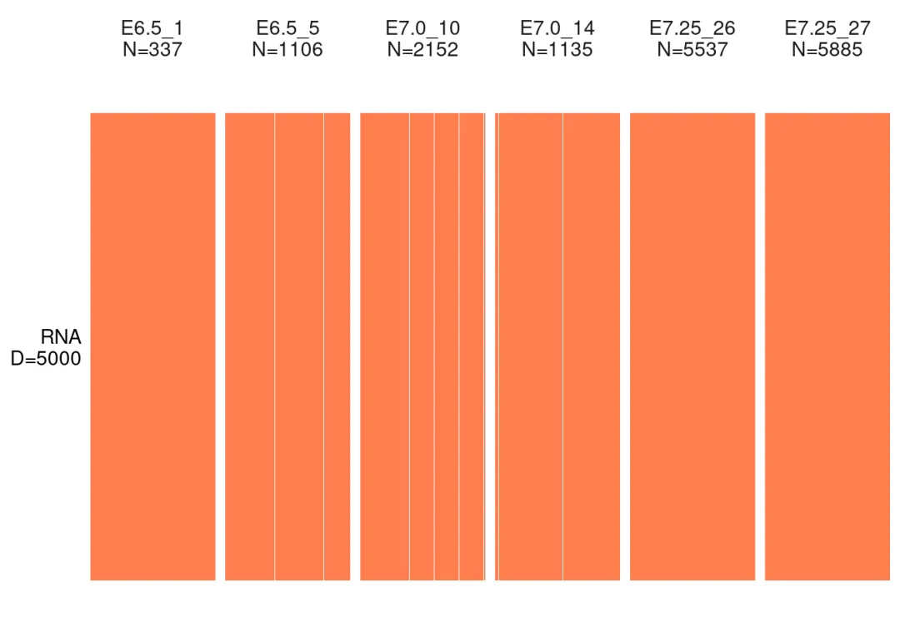**

## **3\. MOFA的选项参数**
```r
# 默认数据选项参数：
data_opts <-get_default_data_options(MOFAobject)
data_opts
```
```
## $scale_views
## [1] FALSE
##
## $scale_groups
## [1] FALSE
##
## $center_groups
## [1] TRUE
##
## $use_float32
## [1] TRUE
##
## $groups
## [1] "E6.5_1"   "E6.5_5"   "E7.0_10"  "E7.0_14"  "E7.25_26" "E7.25_27"
##
## $views
## [1] "RNA"
```

scale_views: 逻辑值，是否对同一个变量进行scale

scale_groups: 逻辑值，是否对各组进行scale，确保各组的方差处于同一水平。

use_float32: 逻辑值，规定浮点数True以`float32`参与计算，选择`FALSE`则是用`float64`

重点检查groups中是否包含你的分组信息，views中是否包含你的矩阵。
```r
# 默认模型选项参数
model_opts <-get_default_model_options(MOFAobject)
model_opts
```
```
## $likelihoods
##        RNA
## "gaussian"
##
## $num_factors
## [1] 25
##
## $spikeslab_factors
## [1] FALSE
##
## $spikeslab_weights
## [1] FALSE
##
## $ard_factors
## [1] TRUE
##
## $ard_weights
## [1] TRUE
```

每个值的意义：
likelihoods：规定似然性特征类型得字符串：连续性数值选择`gaussian`，二分类数值选择`bernoulli`、原始`count`数据选择`poisson`
num_factors：因子的默认数量
spikeslab_factors：输入一个布尔值，是否采用`spike and slab sparsity`法处理因子 spikeslab_weights：输入一个布尔值，是否采用`spike and slab sparsity`法处理权重 ard_factors：输入一个布尔值，是否采用`ARD sparsity`处理因子
ard_weights: 输入一个布尔值，是否采用`ARD sparsity`处理权重
```r
# 训练选项参数
train_opts <-get_default_training_options(MOFAobject)
train_opts
```
```
## $maxiter
## [1] 1000
##
## $convergence_mode
## [1] "fast"
##
## $drop_factor_threshold
## [1] -1
##
## $verbose
## [1] FALSE
##
## $startELBO
## [1] 1
##
## $freqELBO
## [1] 5
##
## $stochastic
## [1] FALSE
##
## $gpu_mode
## [1] FALSE
##
## $gpu_device
## NULL
##
## $seed
## [1] 42
##
## $outfile
## NULL
##
## $weight_views
## [1] FALSE
##
## $save_interrupted
## [1] FALSE
```

maxiter: 表示最大迭代次数的数值。默认值为 1000。收敛性通过 ELBO 统计量进行评估。drop_factor_threshold: 该数值表示在解释方差的比例达到该值时，应将某个因素视为不活跃因素并从模型中剔除。例如，值为 0.01 表示在每个视图中解释方差少于 1% 的因素将被剔除。默认值为 -1（不剔除因素），自定义时在(0,1)定义域里选择即可，理论上数值越大，丢弃的因素越多，计算速度越快。convergence_mode: 表示收敛标准的特征值，分为”fast”,“medium”,“slow”,分别为“快速”、“中等”或“缓慢”，分别对应于 0.0005%、0.00005%或0.000005%的deltaELBO变化量。verbose: 逻辑值，是否提供进度条startELBO: 表示计算ELBO的首个迭代次数的整数（默认值为 1）freqELBO: 表示计算ELBO的首个迭代次数的整数（默认值为 1）stochastic: 逻辑性地指示是否使用随机变分推理（仅适用于非常大的数据集，默认值为“FALSE”）gpu_mode: 逻辑值，是否使用GPU加速gpu_device: 整数，指定使用的GPU编号seed: 随机数，默认是42.以上各类型选项的默认值都可以通过`对象$选项名称`的形式来修改，例如：
```r
train_opts$convergence_mode <-"fast"# 收敛模型
train_opts$seed <-42# 随机数
```

**4\. 模型训练
****4.1 预处理**
```
# 查看当前训练选项的参数值：
train_opts
```
```
## $maxiter
## [1] 1000
##
## $convergence_mode
## [1] "fast"
##
## $drop_factor_threshold
## [1] -1
##
## $verbose
## [1] FALSE
##
## $startELBO
## [1] 1
##
## $freqELBO
## [1] 5
##
## $stochastic
## [1] FALSE
##
## $gpu_mode
## [1] FALSE
##
## $gpu_device
## NULL
##
## $seed
## [1] 42
##
## $outfile
## NULL
##
## $weight_views
## [1] FALSE
##
## $save_interrupted
## [1] FALSE
```
```r
# 预处理：
MOFAobject <-prepare_mofa(MOFAobject,
data_options = data_opts,
model_options = model_opts,
training_options = train_opts
)
```
```
##
## # Multi-group mode requested.
```
```
##
## This is an advanced option, if this is the first time that you are running MOFA, we suggest that you try do some exploration first without specifying groups. Two important remarks:
```
```
##
##  - The aim of the multi-group framework is to identify the sources of variability *within* the groups. If your aim is to find a factor that 'separates' the groups, you DO NOT want to use the multi-group framework. Please see the FAQ on the MOFA2 webpage.
```
```
##
##  - It is important to account for the group effect before selecting highly variable features (HVFs). We suggest that either you calculate HVFs per group and then take the union, or regress out the group effect before HVF selection
```
```
## Checking data options...
```
```
## Checking training options...
```
```
## Checking model options...
```

**4.2 训练MOFA模型**
```r
library(reticulate)
mofapy2 <-import("mofapy2")
MOFAobject@data_options$use_float32 <-TRUE
MOFAobject@training_options$gpu_mode <-TRUE
MOFAobject@model_options$num_factors <-5
# 实际上一行就可以搞定：
MOFAobject <-run_mofa(MOFAobject, outfile ='./mofa_model.hdf5',use_basilisk =FALSE)
```

你的训练结果未必与作者相同，那么你可以选择读取作者训练好的：
```r
# 从网络读取：
# load(url("ftp://ftp.ebi.ac.uk/pub/databases/mofa/scrna_gastrulation/gastrulation10x_mofa.RData"))
# 本地读取
load('gastrulation10x_mofa.RData')
MOFAobject <- model
```

训练后的对象包含以下信息：
```
slotNames(MOFAobject)
```
```
##  [1] "data"               "covariates"         "covariates_warped"
##  [4] "intercepts"         "imputed_data"       "interpolated_Z"
##  [7] "samples_metadata"   "features_metadata"  "expectations"
## [10] "training_stats"     "data_options"       "model_options"
## [13] "training_options"   "stochastic_options" "mefisto_options"
## [16] "dimensions"         "on_disk"            "dim_red"
## [19] "cache"              "status"
```

dimensions包含模型的维度（K 代表因子，M 代表视图，G 代表组，N 代表样本（每组），D 表示特征（每个视图））：
```
MOFAobject@dimensions
```
```
## $M
## [1] 1
##
## $G
## [1] 6
##
## $N
##  E6.5 (1)  E6.5 (2)  E7.0 (1)  E7.0 (2) E7.25 (1) E7.25 (2)
##       337      1106      2152      1135      5537      5885
##
## $D
##  RNA
## 5000
##
## $K
## [1] 10
```

data包含居中（并可选缩放）的输入数据矩阵。它是一个嵌套矩阵列表，第一个索引指向视图，第二个索引指向群。在这种情况下，我们有一个视角（RNA）和六个基团
```
names(MOFAobject@data)
```
```
## [1] "RNA"
```

samples_metadata包含我之前添加到MOFA对象中的单元元数据。列队如下：

阶段：发育阶段。 谱系：单元类型注释。 组：用于MOFA的分组。在这种情况下，每个胚胎对应一个独立的群体。
```
head(MOFAobject@samples_metadata)
```
```
##    sample  stage          lineage    group
##    <char> <char>           <char>   <fctr>
## 1: cell_1   E6.5         Epiblast E6.5 (1)
## 2: cell_2   E6.5 Primitive Streak E6.5 (1)
## 3: cell_5   E6.5     ExE ectoderm E6.5 (1)
## 4: cell_6   E6.5         Epiblast E6.5 (1)
## 5: cell_8   E6.5         Epiblast E6.5 (1)
## 6: cell_9   E6.5         Epiblast E6.5 (1)
```

**5\. 因子差异解释**

### **5.1 各组各因素解释的图方差**

量化各因子在不同群体和视图间解释的方差，可能是MOFA+生成的最重要图表。它将复杂异构数据集的（潜在）信号汇总为单一图。
```
plot_variance_explained(MOFAobject, x="group", y="factor")
```

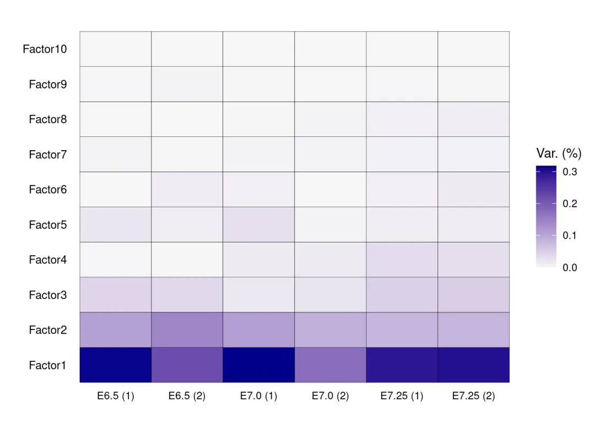

可以看出因子1和因子2解释了多组间的大量差异。相比之下，因子4的活性从E6.5提升到E7.5，表明它捕捉了E6.5出现的变异源。

我们也可以通过加入参数 绘制每组（包含所有因素）解释的总方差。值得注意的是，默认因子数是15个，但只有10个因子足以捕捉每个胚胎35%至55%的转录方差

plot_total = TRUE可以展示各组解释的总方差：
```
plot_variance_explained(MOFAobject, x="group", y="factor",plot_total =TRUE)
```
```
## [[1]]
```


```
##
## [[2]]
```

### **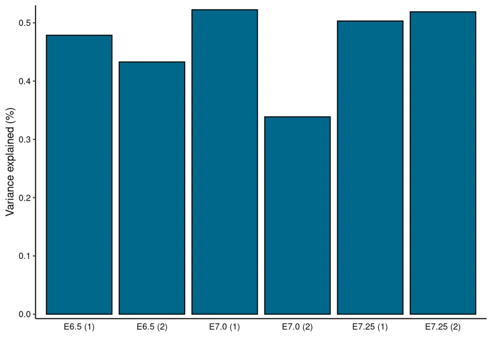**

### **5.2 针对各个基因的差异解释**

我们还可以通过MOFA因子解释单个特征的方差进行检验。高R2 这意味着MOFA因子捕捉了该特征的大部分变异，而值较小则表示模型无法解释该特征的变异（即视为噪声）：

各组中所有因子解释的方差：
```r
features <-c("Rbp4","Ttr","Spink1","Mesp1","E130311K13Rik","Hey1")

plot_variance_explained_per_feature(
  MOFAobject,
view ="RNA",
features = features
)
```

### **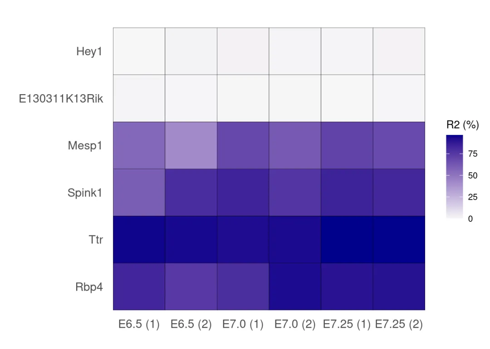**

### ****显然` Hey1`与`E130311K13Rik`基因就没有展现出各个发育时期中的方差贡献度**
**

### **6\. 让因子特征回归基因**

说白了，花里胡哨的因子分析没用，还是需要回归到基因层面，找到每个因子、每个时期的特征基因,这个过程中，也可以生产出一些有意思的图。

### **6.1 因子值的可视化**

每个因子将单元格定位于一维轴上，该轴中心为零。符号不同样本表示表现型相反，绝对值越高表示表型越强。例如，如果k第因子反映了与细胞周期相关的变异性，我们可以预期有丝分裂中的细胞位于因子的一端（无论符号如何，只有相对位置才重要）。相比之下，处于G1期的细胞通常处于因子的另一端。具有中间表型或无明确表型（即无细胞周期基因谱）的细胞，通常位于零附近。我们绘制因子1的数值，并按谱系分配给单元格颜色。显然，这一因素反映了ExE内胚层的出现。
```
plot_factor(MOFAobject,
factor =1,
color_by ="lineage"# lineage is a column in MOFAobject@samples.metadata
) +scale_fill_manual(values=colors)
```

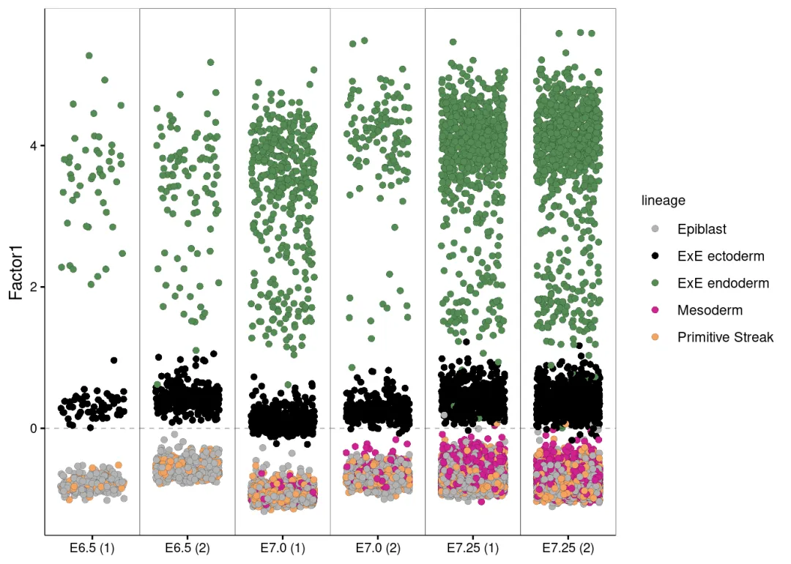

**
**

另一种可视化方式：
```r
p <-plot_factor(MOFAobject,
factor =1,
color_by ="lineage",
dodge = T,           # dodge points with different colors
legend = F,          # remove legend
add_violin = T      # add violin plots
)

p <- p +
scale_fill_manual(values=colors) +
p
```

你也可以通过某种手动定义的分组结构来更改x轴上的默认分组。例如，样本元数据中的一列
```
plot_factor(MOFAobject,
factor =1,
color_by ="lineage",
group_by ="stage",
legend = F
) +scale_fill_manual(values=colors)
```

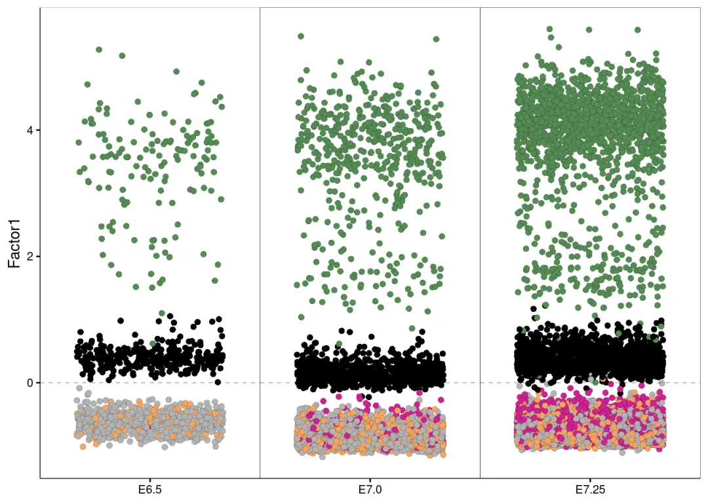****

因子组合可绘制为：plot_factors
```
plot_factors(MOFAobject,
factors =c(1,4),
color_by ="lineage"
) +scale_fill_manual(values=colors)
```

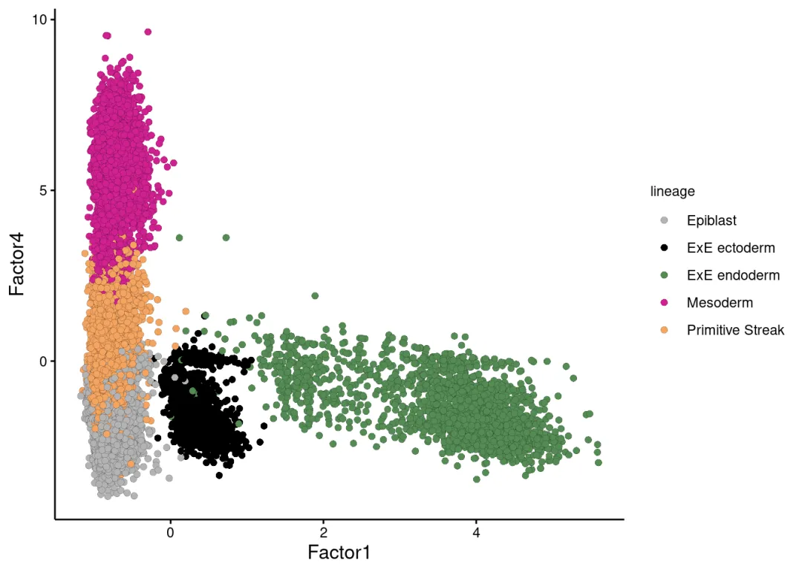

总之，这些图无非是ggplot2产生的，感兴趣的同学可以参考我们的教程：R语言入门课

### **6.2 权重的可视化**

权重为每个基因在每个因子上的评分提供了支持。与该因子无关联的基因通常值接近零，而与该因子强烈关联的基因则期望拥有较大的绝对值。权重符号表示效应方向：正权重表示该特征在因子为正的单元格中更活跃，反之亦然。让我们绘制因子1的权重分布图。
```
plot_weights(MOFAobject,
view ="RNA",
factor =1,
nfeatures =10,     # 标记权重最高的10个基因
scale = T           # 将权重缩放到-1至1
)
```

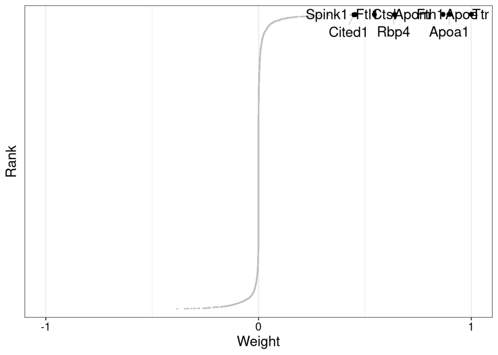

如果你不关心效应的方向性，可以取权重的绝对值abs=TRUE。
```
plot_weights(MOFAobject,
view ="RNA",
factor =1,
nfeatures =10,     # 标记权重最高的10个基因
scale = T    ,       # 将权重缩放到-1至1
abs = T
)
```

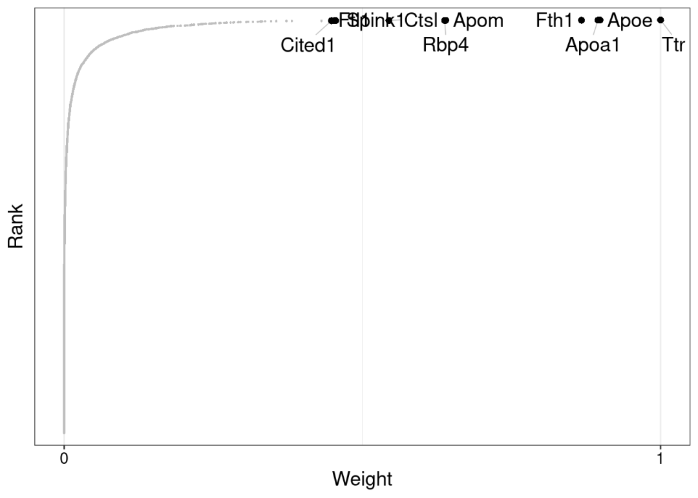

你也可以用`manul`认为指定一些感兴趣的基因进行可视化：
```
plot_weights(MOFAobject,
view ="RNA",
factor =1,
nfeatures =5,
manual =list(c("Snai1","Mesp1","Phlda2"), c("Rhox5","Elf5")),# 这里的list对应下一个选项的颜色
color_manual =c("darkgreen","red"),# 这里的颜色对应上面的gene list
scale = T,
abs = T
)
```

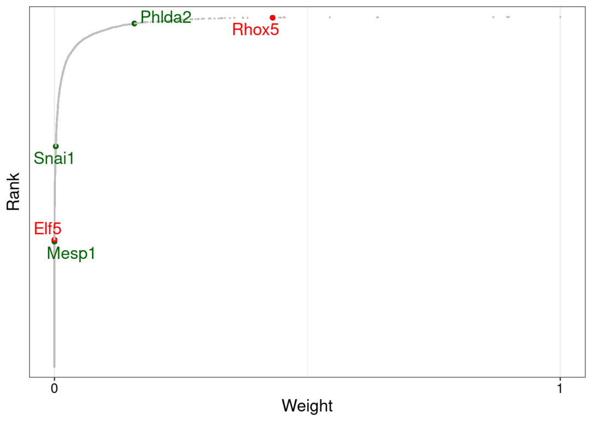

如果你不想要完整分布，只想看最高层权重，可以这样做：
```
plot_top_weights(MOFAobject,
view ="RNA",
factor =1,
nfeatures =10,
scale = T,
abs = T
)
```

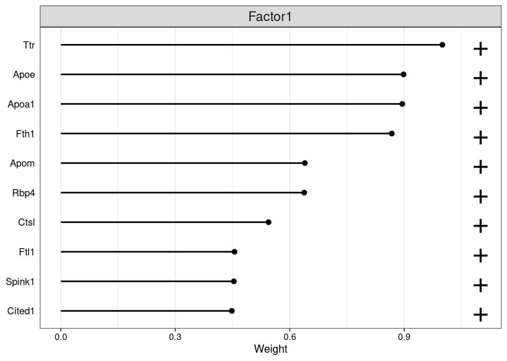

### **6.3 由因子提供的基因表达模式可视化**

按照上文的结果，因子1的负权重是ExE内胚层的标记基因。如果我们按mRNA对权重最大基因（Ttr、Apom）的分布绘制因子1的着色细胞：
```r
library(ggplot2)
genes <-c("Ttr","Apom")

for (i in genes) {
  p <-plot_factor(MOFAobject,
factor =1,
color_by = i
  ) +scale_colour_gradientn(colours =terrain.colors(10))
print(p)
}
```

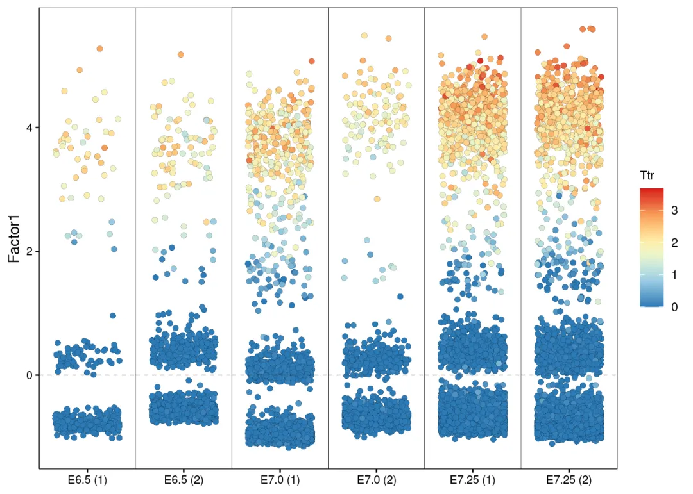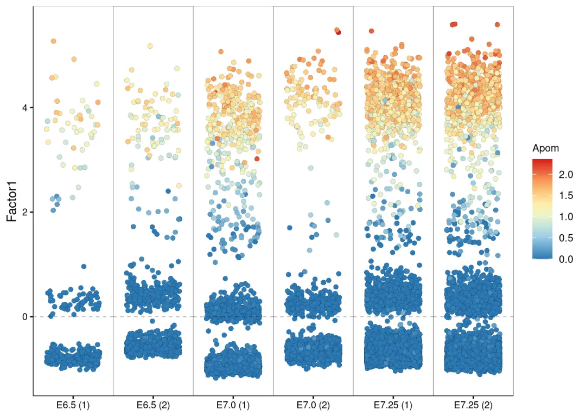

权重有助于了解哪些基因是驱动这些因素的主要基因。然而，为了了解因子与基因组特征的关联程度，我们可以生成因子值与mRNA表达的散点图，针对权重最高的基因：

正向权重的top基因：
```r
p <-plot_data_scatter(MOFAobject,
view ="RNA",
factor =1,
features =6,         # 展示的基因数
sign ="positive",     # top基因对应正向权重
color_by ="lineage",  # 按照谱系来着色
add_lm = T,          # 添加线性回归
lm_per_group = F, # 是否对每个分组进行线性回归
dot_size =2
)
p <- p +
scale_fill_manual(values=colors) +
theme(legend.position ="none")

print(p)
```

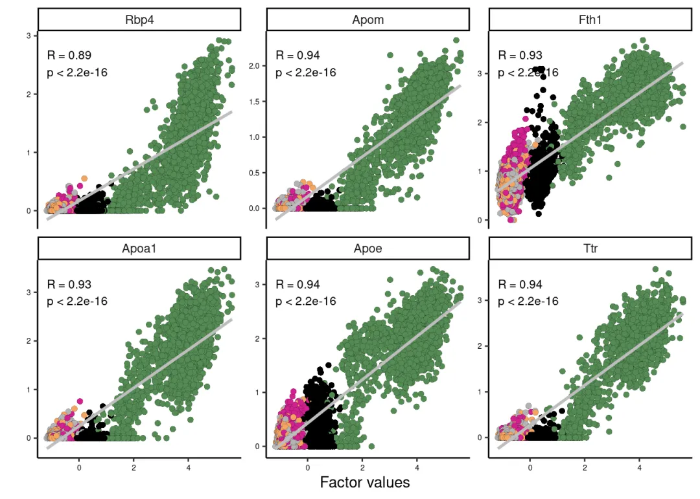

负权重的top基因：
```r
p <-plot_data_scatter(MOFAobject,
view ="RNA",
factor =1,
features =6,         # 展示的基因数
sign ="negative",     # top基因对应负权重
color_by ="lineage",  # 按照谱系来着色
add_lm = T,          # 是否对每个分组进行线性回归
lm_per_group = F,
dot_size =2
)
p <- p +
scale_fill_manual(values=colors) +
theme(legend.position ="none")

print(p)
```

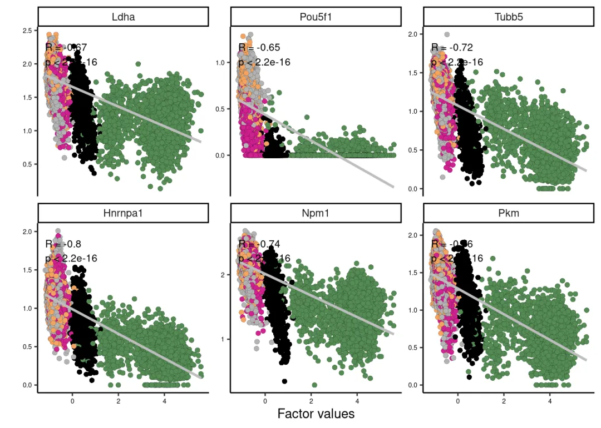

### **7\. 基于MOFA因子的非线性降维**

MOFA推断的潜空间可用作其他单胞算法的输入（相当于替代Seurat当中PCA的过程），用于学习非线性流形，如UMAP或t-SNE。这对于识别细胞群体和重建复杂的伪时间轨迹非常有用。
```r
set.seed(42)
MOFAobject <-run_tsne(MOFAobject)
```

在该数据集中，我们看到MOFA因子的组合具有足够的信息来区分所有细胞类型：
```
plot_dimred(MOFAobject,
method ="TSNE",
color_by ="lineage"
) +scale_fill_manual(values=colors)
```
```
## Warning: The `<scale>` argument of `guides()` cannot be `FALSE`. Use "none" instead as
## of ggplot2 3.3.4.
## ℹ The deprecated feature was likely used in the MOFA2 package.
##   Please report the issue at <https://github.com/bioFAM/MOFA2>.
## This warning is displayed once every 8 hours.
## Call `lifecycle::last_lifecycle_warnings()` to see where this warning was
## generated.
```

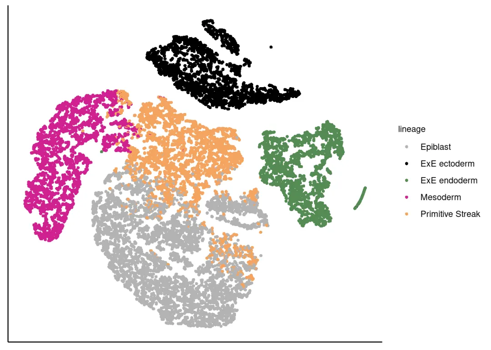

我们也可以通过Seurat中基于PCA的差异看看`MOFA`的效果有什么不同：
```r
scRNA <-FindVariableFeatures(UpdateSeuratObject(seurat), selection.method ="vst", nfeatures =2000)
```
```
## Validating object structure
```
```
## Updating object slots
```
```
## Ensuring keys are in the proper structure
## Ensuring keys are in the proper structure
```
```
## Ensuring feature names don't have underscores or pipes
```
```
## Updating slots in RNA
```
```
## Setting assay used for NormalizeData.RNA to RNA
```
```
## Setting assay used for FindVariableFeatures.RNA to RNA
```
```
## Validating object structure for Assay 'RNA'
```
```
## Object representation is consistent with the most current Seurat version
```
```r
scRNA <-ScaleData(scRNA, features =VariableFeatures(scRNA))
```
```
## Centering and scaling data matrix
```
```r
scRNA <-RunPCA(scRNA, features =VariableFeatures(object = scRNA))
```
```
## PC_ 1
## Positive:  Apoe, Cited1, Fth1, Ttr, Apom, Apoa1, Cotl1, Slc2a3, H19, Amn
##     Ctsh, Rbp4, Folr1, Mt1, Ctsl, Ctsb, Lgmn, Gpx3, Ctsz, Atp6v0b
##     Dab2, Cd63, Vamp8, Ftl1, Pla2g12b, 2610528J11Rik, Gpx4, Cyba, Npl, Spink1
## Negative:  Npm1, Ptma, Pkm, Tubb5, Snrpn, Pou5f1, Ldha, Ifitm2, Tuba1a, Pclaf
##     Fabp5, Tuba1b, Ldhb, Hsp90ab1, Stmn1, Eno1, Pgk1, Eif4a1, Ccnd1, Pim2
##     Dnmt3b, Gapdh, Wfdc2, Igfbp2, Tdgf1, Sox4, Npm3, Socs2, Gsta4, Gng3
## PC_ 2
## Positive:  Gsto1, Elf5, Gm1673, Ddah1, Perp, Fabp3, Gjb3, Cldn3, Tex19.1, S100a6
##     Nup62cl, Htra1, Dppa4, Anxa5, Sfn, Arpc1b, Zfp42, Lgals1, Id2, Wnt6
##     Tfap2c, Bex3, Gm9, Nr0b1, Wnt7b, Rnf128, Gjb5, Upp1, Cdx2, Prss50
## Negative:  Bex4, Stmn1, Emb, Id3, Tceal8, Car4, Ddt, Pou5f1, Pclaf, Igfbp2
##     Ptma, Oat, Cd24a, Gpc3, Ifitm2, Ttr, Apoa1, Apom, Rasgrp2, Ctsh
##     Rbp4, Ctsl, Dab2, Pcbd1, Tuba1a, Sgk1, Tdh, Tspan13, Amn, Sox4
## PC_ 3
## Positive:  Ifitm1, Mesp1, Fgf3, Phlda2, Rbms1, Ccnd2, Fn1, S100a10, Snai1, Ppic
##     Lmo1, Bambi, Dll3, Hmga2, Tdgf1, Lhx1, Wnt2, Fam212a, Foxf1, Lefty2
##     Hand1, Gata6, Myl7, Pmp22, Msx2, Rspo3, Aplnr, Frzb, Cyp26a1, Mixl1
## Negative:  Dnmt3b, Utf1, Epcam, Pim2, Slc7a3, Wfdc2, Rbpms2, Rasgrp2, Bex1, Pou3f1
##     Mkrn1, Bex4, Pou5f1, Uchl1, Cldn6, Tuba1a, Fdps, Cldn7, Crip2, Trh
##     Gng3, Igfbp2, Gsta4, Ldhb, Meg3, Fabp5, Tubb4b, Slc2a1, Cthrc1, Snrpn
## PC_ 4
## Positive:  Phlda2, Lgals2, Car7, S100a1, Msx1, Fabp1, Aldob, Ddt, Igfbp4, Cyba
##     Mesp1, Ifitm1, Apoa2, Gstm1, Tspan13, Aqp3, Fn1, Ccnd2, Fxyd2, Mpc2
##     2210011C24Rik, Apoc3, Psph, Apoc2, Tdh, Aprt, Tmem37, Slc2a2, Rbp4, AI413582
## Negative:  Sfrp1, Gpc4, Pga5, Sfrp5, Krt8, Srgn, Cer1, Ctsc, Akr1c13, Sox17
##     Prss12, Foxq1, Amot, Car2, Dapk2, Hhex, Cd59a, Dkk1, Cd24a, Shisa2
##     Fgf5, Hkdc1, Lrpap1, Cd8a, Hesx1, Igfbp2, Krt18, Cd55, Fam89a, Smim14
## PC_ 5
## Positive:  Car2, Sfrp1, Gpc4, Cd59a, Ctsc, Amot, Emb, Prss12, Rbp1, Car4
##     Sfrp5, Cer1, Dapk2, Akr1c13, Spink1, Hhex, Cfc1, Gsc, Cd24a, Laptm4b
##     Afp, Lhx1, Gpc3, Mest, Cldn6, Krt18, S100a10, Cyp26a1, Npm3, Lhx1os
## Negative:  Sparc, Hs3st1, Kdelr3, Serpinh1, Lamc1, Pth1r, Lama1, P4ha2, Srgn, Cryab
##     Col4a2, Plod2, Lamb1, Col4a1, Aqp8, Nid1, Fxyd3, Serping1, Fst, Cd9
##     Nog, Eva1a, Epas1, Plat, Klf4, F3, Thbd, Ptger3, Serpinb6c, Cmtm7
```
```r
scRNA <-FindNeighbors(scRNA, dims =1:30)
```
```
## Computing nearest neighbor graph
```
```
## Computing SNN
```
```r
scRNA <-RunTSNE(scRNA, dims =1:30)
DimPlot(scRNA, reduction ="tsne")
```

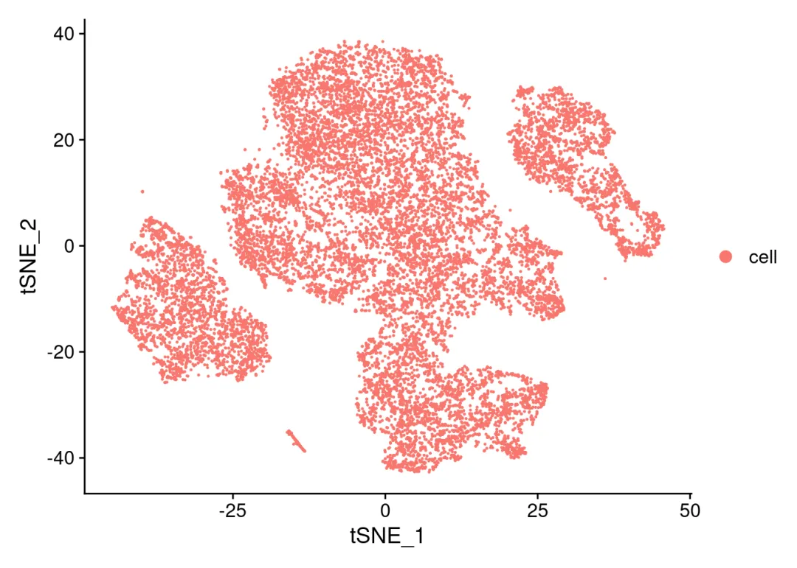

**三、参考**

[1]Argelaguet R, Velten B, Arnol D, Dietrich S, Zenz T, Marioni JC, Buettner F, Huber W, Stegle O. Multi-Omics Factor Analysis-a framework for unsupervised integration of multi-omics data sets. Mol Syst Biol. 2018 Jun 20;14(6):e8124. doi: 10.15252/msb.20178124. PMID: 29925568; PMCID: PMC6010767.
[2]https://biofam.github.io/MOFA2/
[3]https://marionilab.cruk.cam.ac.uk/MouseGastrulation2018/

**四、资料领取**

一切不给测试文件和分析环境版本的教程都是耍流氓，本推送的代码和测试文件可以在以下链接中下载：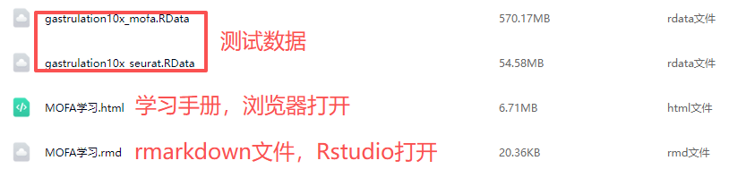文件大小约631.49MB

链接: https://pan.baidu.com/s/1KxyF6cjTOnGkJxG3aiJYgw

提取码：se7k


**欢迎致谢**

如果以上内容对你有帮助，欢迎在文章的Acknowledgement中加上这一段，联系客服微信可以发放奖励：
```
Since Biomamba and his wechat public account team produce bioinformatics tutorials and share code with annotation, we thank Biomamba for their guidance in bioinformatics and data analysis for the current study.
```

**欢迎在发文/毕业时向我们分享你的喜悦~**

**已致谢文章**

[ 鼻咽癌的Bulk RNA-Seq与scRNA-Seq联合分析](<https://mp.weixin.qq.com/s?__biz=MzAwMzIzOTk5OQ==&mid=2247510548&idx=1&sn=58048c46e837b1d56dffa282272c6d96&chksm=9b3cd344ac4b5a52369e91b4e61fa0a2c951b82cc21165b99f42ba2c2191d4add803bd73c928&scene=21&cur_album_id=3425248581018714114#wechat_redirect>)

[13分+文章利用scRNA-Seq揭示地铁细颗粒物引起肺部炎症的分子机制](<https://mp.weixin.qq.com/s?__biz=MzAwMzIzOTk5OQ==&mid=2247511886&idx=1&sn=31c712d00377b0f0ed33703b5b4fbfd8&chksm=9b3cd61eac4b5f084fde14a2eb50356f2f40a66c608d38909f12a3d81f48cff029a09ce2ee8c&token=1453608870&lang=zh_CN&scene=21#wechat_redirect>)

[除了铁死亡，还有铜死亡？！](<https://mp.weixin.qq.com/s?__biz=MzAwMzIzOTk5OQ==&mid=2247518144&idx=1&sn=d036f1bb04b09eb73f53e2104d69404c&chksm=9b3cfe90ac4b77862f2f463b42132c7bfdb687a1b61d350dcf656117b1331271e179710fd4fa&scene=21&cur_album_id=3425248581018714114#wechat_redirect>)

[IF14.3| scRNA-seq+脂质组多组学分析揭示宫内生长受限导致肝损伤的性别差异](<https://mp.weixin.qq.com/s?__biz=MzAwMzIzOTk5OQ==&mid=2247520900&idx=1&sn=157134292ffc2e5df730c5ba8a357b61&chksm=9b3cebd4ac4b62c286543c30381e9b4fdb8b44b28d4fa902fb963bbd45b28e1d3f1bc98eb148&scene=21&cur_album_id=3425248581018714114#wechat_redirect>)[银屑病和脂肪肝病中共同病理和免疫特征](<https://mp.weixin.qq.com/s?__biz=MzAwMzIzOTk5OQ==&mid=2247521069&idx=1&sn=4ef441a885cb2525ee3b5c81001feddf&chksm=9b3cea7dac4b636be9f10ffdf75e13531fccae62129944b21a457db2e08c3f2db1e1b553ac34&scene=21&cur_album_id=3425248581018714114#wechat_redirect>) [《Advanced Science》新型Arf1抑制剂促进癌症干细胞衰老并增强抗肿瘤免疫](<http://mp.weixin.qq.com/s?__biz=MzAwMzIzOTk5OQ==&mid=2247522233&idx=1&sn=287a380de741ff55f0ce78dc9c727985&chksm=9b3ceee9ac4b67ffd925abafeba2cb215a5984e6dc85f0d8607340a07ec9208f1d19eae0e04b&scene=21#wechat_redirect>)

[scRNA-seq揭示脓毒症预后水平预测的关键靶点！](<http://mp.weixin.qq.com/s?__biz=MzAwMzIzOTk5OQ==&mid=2247522281&idx=1&sn=f95eb12fdc340b8da1123ec6253e6fac&chksm=9b3ceeb9ac4b67afa587e5fa3a2a8960e9bb28a1ad6dc48e49120a76154417a4c8be95af90b0&scene=21#wechat_redirect>)

[机器学习+生信多组学联合构建牙周炎"线粒体功能障碍与免疫微环境"关联网络](<https://mp.weixin.qq.com/s?__biz=MzAwMzIzOTk5OQ==&mid=2247527168&idx=1&sn=0791d2bf53a9a60015577f892b10d370&scene=21#wechat_redirect>)

[KIF18A在肝细胞癌转移中的双重角色](<https://mp.weixin.qq.com/s?__biz=MzAwMzIzOTk5OQ==&mid=2247528014&idx=1&sn=d285c9ebd415be328fc682d00e6182c0&scene=21#wechat_redirect>)

[bulk+scRNA-seq挖掘BCL2-MAPK14-TXN氧化应激诊断模型，鉴定脓毒症中氧化应激关键基因](<https://mp.weixin.qq.com/s?__biz=MzAwMzIzOTk5OQ==&mid=2247530000&idx=1&sn=e8ddca4e1b2e60839cdf2a7fe87b3dfe&chksm=9b3c0f40ac4b86562e0e307b9dbb8688159e72b3c19d9ceebf8a4bb2e21638896f005b497b11&scene=21&cur_album_id=3425248581018714114&search_click_id=#wechat_redirect>)

向下滑动查看更多

欢迎大家致谢~


**如何联系我们**

 留一个领取[资料](<https://mp.weixin.qq.com/s?__biz=MzAwMzIzOTk5OQ==&mid=2247532585&idx=1&sn=e265d2846ec66e5faaaf21403d274d2f&scene=21#wechat_redirect>)、[开箱即用的单细胞分析镜像](<https://mp.weixin.qq.com/s?__biz=MzAwMzIzOTk5OQ==&mid=2247528410&idx=2&sn=0f2bac25479cf8d20dab5d82ae986f2e&scene=21#wechat_redirect>)的**微信号[Biomamba_zhushou]**，方便各位随时交流。同时我们也构建了[交流群矩阵](<https://mp.weixin.qq.com/s?__biz=MzAwMzIzOTk5OQ==&mid=2247528057&idx=1&sn=bb348c2a88c977c7cce67ee6731a3591&scene=21#wechat_redirect>)，欢迎大家入群讨论。
大家可以阅读完这几篇之后添加[给生信入门初学者的小贴士](<http://mp.weixin.qq.com/s?__biz=MzAwMzIzOTk5OQ==&mid=2247493329&idx=1&sn=597870b7f7ce10346da3561e7c281627&chksm=9b3c9f81ac4b169794088ce9abbcacb5f18e9fd174fc0d7e28da62d78facadf3100ef38aaf22&scene=21#wechat_redirect>)
[没有检索，就没有发言权](<https://mp.weixin.qq.com/s?__biz=MzAwMzIzOTk5OQ==&mid=2247529398&idx=2&sn=5a429852d61721916a405712677d5905&scene=21#wechat_redirect>)

**已有生信基地联系方式的同学****无需重复添加**

 您点的每个赞和在看，我都认真当成了喜欢
