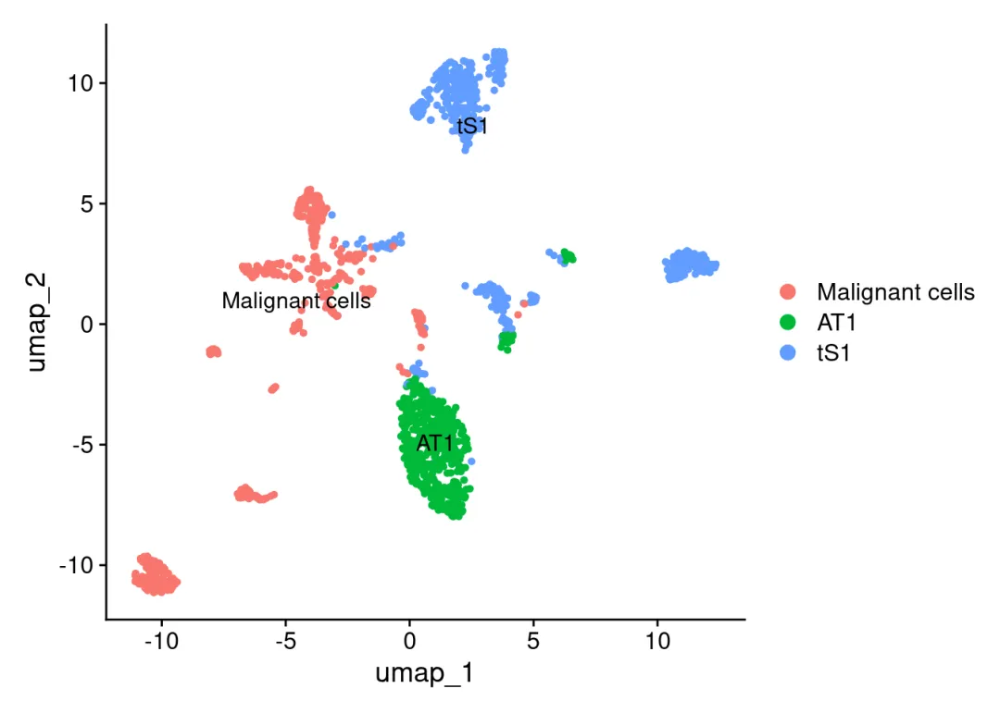
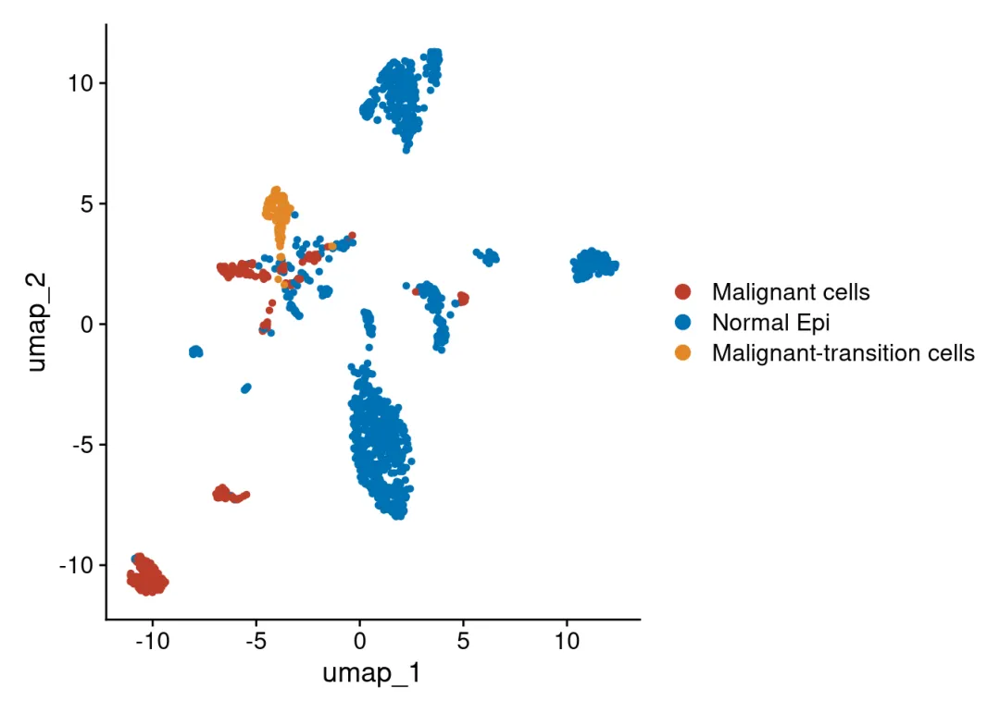
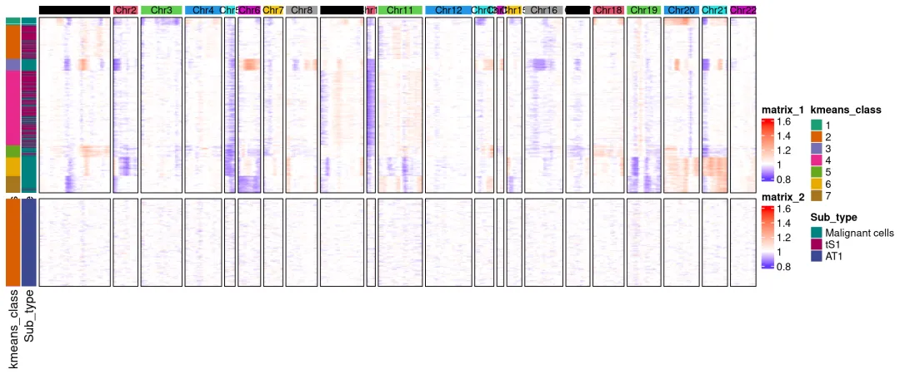
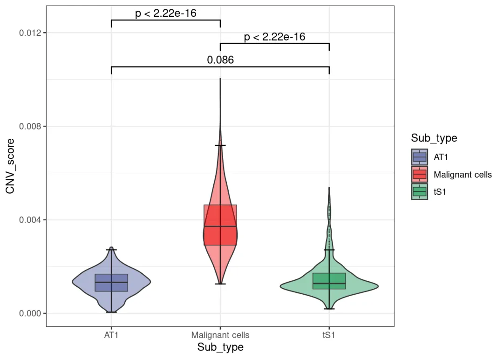
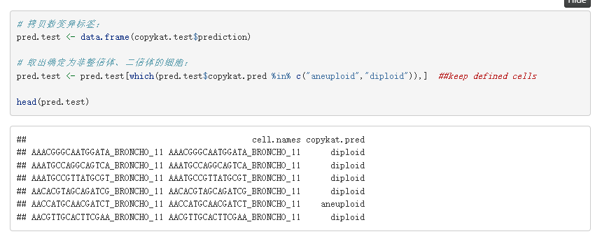
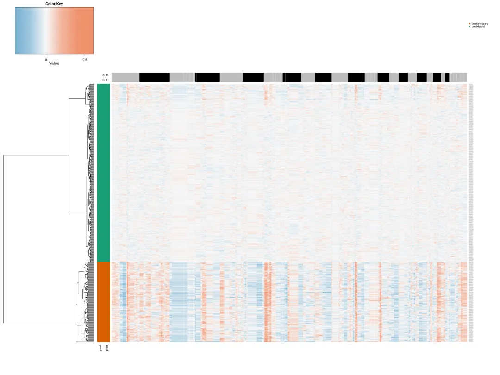
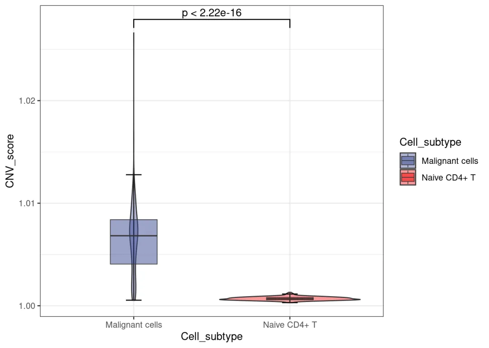
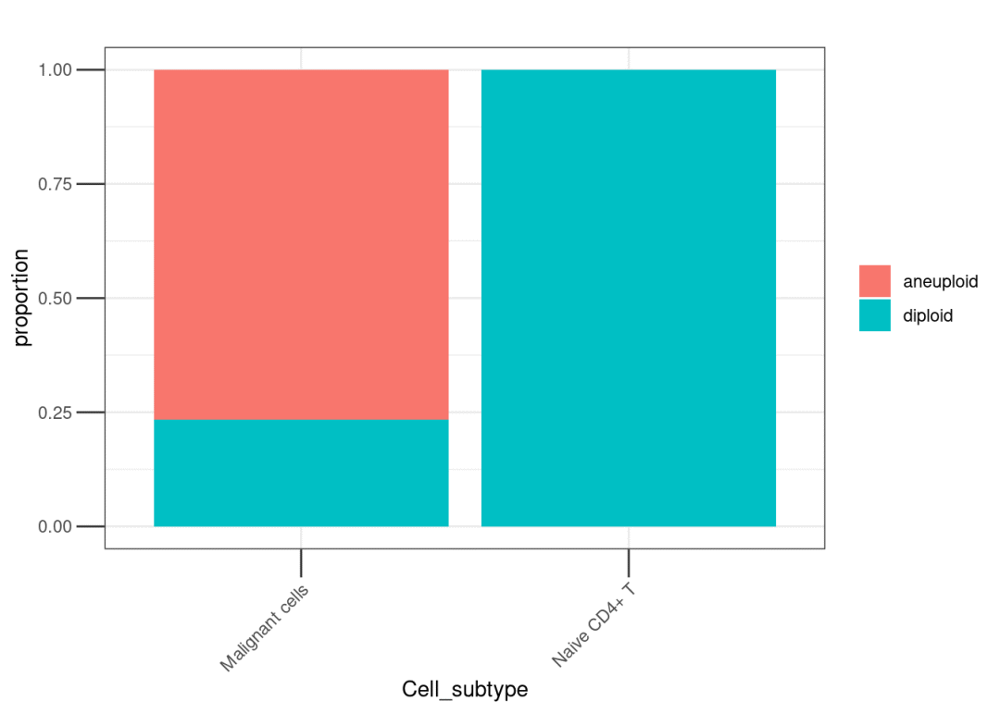

# copykat和infercnv鉴定肿瘤细胞还挺准

> 原文：https://mp.weixin.qq.com/s?__biz=MzAwMzIzOTk5OQ==&mid=2247535878&idx=1&sn=ff9527456bf977fa615fe7f725a3a039&chksm=9b3c3456ac4bbd4038559b4cf750e87ab4706c7fbf9bb094fffe754dae4ebe31be8950de788e#rd
> 合集：单细胞教程全收录

**一、写在前面**

我们此前的[scRNA-seq拷贝数变异学习手册](<https://mp.weixin.qq.com/s?__biz=MzAwMzIzOTk5OQ==&mid=2247529921&idx=1&sn=93f8ad6655ee6d2b036cd557a6a74be6&scene=21#wechat_redirect>)，演示数据来源于转移性肺腺癌的单细胞转录组谱，共包含从44例正常组织或早期到转移期癌症患者的208,506个细胞。该数据集的原文发表在《Nature communication》上[1]。数据GSE131907可以从GEO数据库中直接下载[2]，原文是作者手搓了个函数，通过染色体区段的表达量滑动平均推断 CNV[3]，鉴定出来的肿瘤细胞与正常上皮(AT1、tS1)与infercnv鉴定出来的肿瘤细胞和正常上皮分布高度一致。更多单细胞技巧教程可见：[限时回归！两个月时间，手把手教会你scRNA-seq数据分析！](<https://mp.weixin.qq.com/s?__biz=MzAwMzIzOTk5OQ==&mid=2247535408&idx=1&sn=1f3b4b99bab378887d11dd83fd87feb7&scene=21#wechat_redirect>)专题教程可见：[R语言scRNA-seq拷贝数变异分析专题](<https://mp.weixin.qq.com/s?__biz=MzAwMzIzOTk5OQ==&mid=2247535877&idx=6&sn=6b2682106ed9a84c5bf57dadec45a0d3&scene=21#wechat_redirect>)原文的分群：经infercnv预测通过CNV score聚类、注释得到的结果，可以看出与作者注释的肿瘤细胞分布基本一致，当然也存在少量难以界定的"transition cells"：
infercnv热图如下，可以理解为白色区域不发生拷贝数变异，途中可以明显发现原文作者标注的Malignant cells包含大量的拷贝数变异事件:小提琴中也可以观察到Malignant cells的CNV score明显高于身为正常上皮细胞的AT1与tS1。
再看看copykat，值得一提的是copykat的计算是不需要像infercnv那样选定参考细胞群体的。并且在返回的预测数据框中能够直接给出包含diploid和aneuploid的标签：
热图可以看出diploid(双倍体，绿色侧栏标注)和aneuploid(非整倍体，红色侧栏标注)之间的cnv score差别非常大：我们实际测试的时候混入了Naive CD4+ T Cell观察效果，可以看出T Cell的CNV score非常接近1，且没有一个 T Cell被标注为aneuploid，不过Malignant Cell当中出现了部分diploid，可以看出Copykat并非"贪心算法"。
更多拷贝数变异教程可见：[空间转录组数据拷贝数变异分析学习手册](<https://mp.weixin.qq.com/s?__biz=MzAwMzIzOTk5OQ==&mid=2247532924&idx=1&sn=46b87151e30163e393cf2c1751360bac&scene=21#wechat_redirect>)[肿瘤异质性分析必备| 一文学会四种scRNA-seq拷贝数变异分析](<https://mp.weixin.qq.com/s?__biz=MzAwMzIzOTk5OQ==&mid=2247529921&idx=1&sn=93f8ad6655ee6d2b036cd557a6a74be6&scene=21#wechat_redirect>)

如果需要[单细胞数据分析](<https://mp.weixin.qq.com/s?__biz=MzAwMzIzOTk5OQ==&mid=2247531160&idx=2&sn=04d3798dc60958af2c9020fe7c4bd9b8&scene=21#wechat_redirect>)教学、生信热点[全文复现](<https://mp.weixin.qq.com/mp/appmsgalbum?__biz=MzAwMzIzOTk5OQ==&action=getalbum&album_id=2981710763847614469#wechat_redirect>)、自测数据个性化分析辅导、[常态化实验学习](<https://mp.weixin.qq.com/s?__biz=MzAwMzIzOTk5OQ==&mid=2247530174&idx=1&sn=c3b0499adcc9093546e4ba1cfffba7bd&scene=21#wechat_redirect>)，欢迎联系客服微信[Biomamba_zhushou]。

联系客服微信获取学习资料

学习手册以html文件格式提供，可在浏览器中打开并翻阅学习：

‍

**教程目录** ：

**一、写在前面**

**二、可视化集锦**

**三、绪论**

**3.1 定义**

**3.2 主要研究成果**

**（1）区分肿瘤细胞与正常细胞**

**（2） 推断的拷贝数变异(CNA)谱的准确性**

**（3） 亚克隆结构推断准确性的评估**

（4）计算效率

**3.3 小结**

**四、infercnv**

4.1 简介

4.2 安装

4.3 输入文件

4.4 infercnv workflow

4.5 infercnv实战

（1）数据概况

（2）infercnv流程

（3）热图优化

（4）小提琴图

****五、copykat****

5.1 copykat介绍

（1）简介

（2）copykat工作流程描述

（3）性能评估

（4）实体肿瘤中肿瘤细胞和正常细胞的分类

（5）应用于其他scRNA-seq技术

（6）推断乳腺肿瘤的克隆亚结构

（7）小结

5.2 copykat流程（1）安装（2）counts矩阵预处理（3）常用参数（4）copykat（5）整理数据（6）绘制热图5.3 copykat实战（1）数据概况（2）copykat（3）整理数据（4）热图绘制（5）探究一下拷贝数变异与原来亚群之间的关系（6）CNA score小提琴图

**六****、SCEVAN******

****6.1 安装R包****

****6.2 加载R包********6.3 单样本分析********（1）加载数据********（2）执行分析********（3）结果查看********6.4 多样本分析********（1）加载数据 （2）执行分析（3）结果查看********6.5 联合Seurat对象********（1）创建****Seurat对象**** （2）将拷贝数变异结果加入****Seurat对象**** （3）降维分群（4）可视化****

****七****、numbat********

********7.1****安装R包************

****7.2****加载R包************7.3 数据下载********7.4 等位基因数据准备********（1）运行参数解释 （2）示例脚本（3）可能出现的报错（4）执行分析********7.5 运行numbat********（1）运行参数解释********（2）运行****numbat************7.6 结果解读********（1）拷贝数景观和单细胞系统发育 （2）在系统发育上完善亚克隆（3）共识拷贝数区段（4）pseudobulks水平拷贝数变异（5）进化树********八、环境版本信息********
********九、参考********十、单细胞教程全收录********十一、欢迎致谢****

文末下载链接中包含以下内容：

测试文件约**55.57GB** ，大家注意按需下载！

参考：[1]https://pmc.ncbi.nlm.nih.gov/articles/PMC7210975  /[2]https://www.ncbi.nlm.nih.gov/geo/query/acc.cgi?acc=GSE131907

[3]https://github.com/SGI-LungCancer/SingleCell/blob/master/R/calInferredCNA_for_CEP.R

**如何联系我们**

 留一个领取[资料](<https://mp.weixin.qq.com/s?__biz=MzAwMzIzOTk5OQ==&mid=2247532585&idx=1&sn=e265d2846ec66e5faaaf21403d274d2f&scene=21#wechat_redirect>)、[开箱即用的单细胞分析镜像](<https://mp.weixin.qq.com/s?__biz=MzAwMzIzOTk5OQ==&mid=2247528410&idx=2&sn=0f2bac25479cf8d20dab5d82ae986f2e&scene=21#wechat_redirect>)的**微信号[Biomamba_zhushou]**，方便各位随时交流。同时我们也构建了[交流群矩阵](<https://mp.weixin.qq.com/s?__biz=MzAwMzIzOTk5OQ==&mid=2247528057&idx=1&sn=bb348c2a88c977c7cce67ee6731a3591&scene=21#wechat_redirect>)，欢迎大家入群讨论。
大家可以阅读完这几篇之后添加[给生信入门初学者的小贴士](<http://mp.weixin.qq.com/s?__biz=MzAwMzIzOTk5OQ==&mid=2247493329&idx=1&sn=597870b7f7ce10346da3561e7c281627&chksm=9b3c9f81ac4b169794088ce9abbcacb5f18e9fd174fc0d7e28da62d78facadf3100ef38aaf22&scene=21#wechat_redirect>)
[没有检索，就没有发言权](<https://mp.weixin.qq.com/s?__biz=MzAwMzIzOTk5OQ==&mid=2247529398&idx=2&sn=5a429852d61721916a405712677d5905&scene=21#wechat_redirect>)

**已有生信基地联系方式的同学****无需重复添加**

 您点的每个赞和在看，我都认真当成了喜欢
