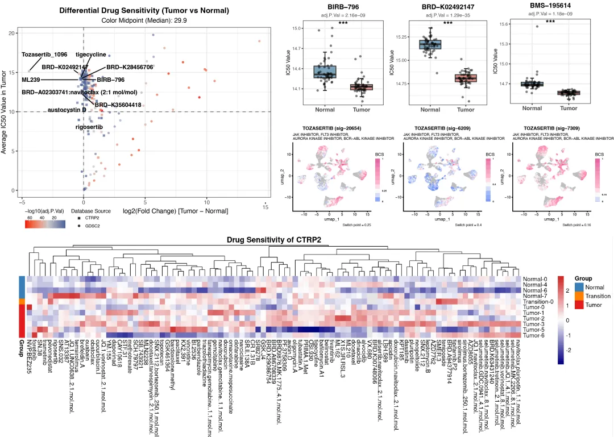
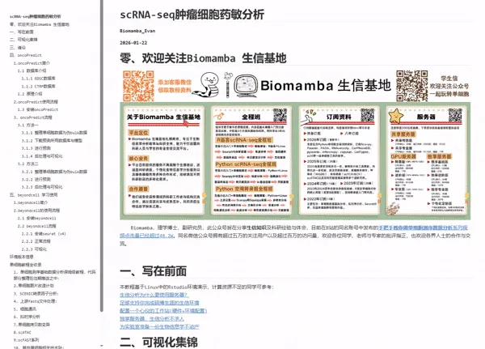
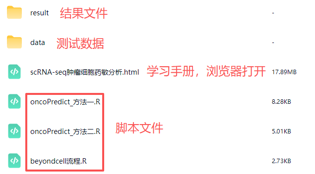
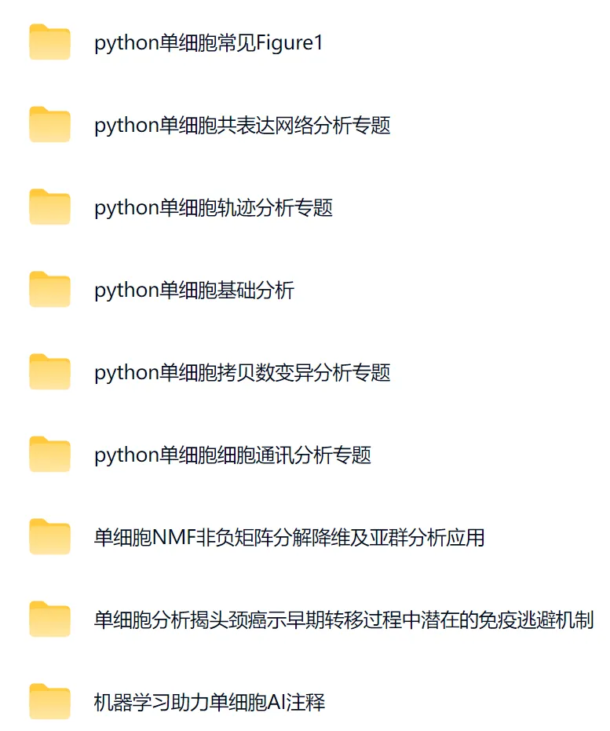

# scRNA-seq肿瘤细胞药物敏感性预测分析

> 原文：https://mp.weixin.qq.com/s?__biz=MzAwMzIzOTk5OQ==&mid=2247537240&idx=2&sn=ec9fdf89154ed90a695cde251308e92e&chksm=9b3c2b08ac4ba21ec81bbfcec7c78a337474b3a6416bdefd7a26e1fc4b19b873b52b6ffd0aee#rd
> 合集：单细胞教程全收录

scRNA-seq肿瘤细胞药敏分析手册

现在的[肿瘤](<https://mp.weixin.qq.com/s?__biz=MzAwMzIzOTk5OQ==&mid=2247529921&idx=1&sn=93f8ad6655ee6d2b036cd557a6a74be6&scene=21#wechat_redirect>)生物信息学研究中，“药物敏感性分析”已成为连接基础多组学数据与临床转化医学的桥梁，也是高质量生信文章中极具加分项的标配分析手段。当通过转录组测序（[Bulk RNA-seq](<https://mp.weixin.qq.com/mp/appmsgalbum?__biz=MzAwMzIzOTk5OQ==&action=getalbum&album_id=2959853503529910274#wechat_redirect>)）或单细胞测序（[scRNA-seq](<https://mp.weixin.qq.com/mp/appmsgalbum?__biz=MzAwMzIzOTk5OQ==&action=getalbum&album_id=2168829347397156865#wechat_redirect>)）鉴定出特定的肿瘤[细胞亚群](<https://mp.weixin.qq.com/s?__biz=MzAwMzIzOTk5OQ==&mid=2247534661&idx=1&sn=16872e942170ace88f26deb0ea6c4b34&scene=21#wechat_redirect>)、预后基因标签或关键调控分子后，往往会面临一个核心科学问题：**针对这些特定亚群或高风险患者，如何选择有效的治疗药物？**

传统的湿实验药物筛选耗时费力，而现在可通过计算生物学利用公共药敏数据库（如经典的**GDSC** 、**CTRP** 等）进行“[虚拟](<https://mp.weixin.qq.com/s?__biz=MzAwMzIzOTk5OQ==&mid=2247535112&idx=1&sn=95a6b88cd49fb2bbb7aa091a00e09e2c&scene=21#wechat_redirect>)筛药”，大大提高了效率。药物敏感分析的核心逻辑：基于肿瘤细胞的基因组或转录组特征，通过数据库和模型预测其对特定药物的半数抑制浓度（IC50值），从而评估疗效。

本学习手册旨在系统讲述这一分析技能。手册从核心原理出发，详细演示如何利用[R语言](<https://mp.weixin.qq.com/s?__biz=MzAwMzIzOTk5OQ==&mid=2247532105&idx=2&sn=b606848ae823f7911bbe14a81876d548&scene=21#wechat_redirect>)及其主流算法包（如oncoPredict，beyondcell），并基于自己的转录组数据，实现对数百种化合物敏感性的批量预测与可视化。通过掌握这一分析，不仅可以找到潜在的药物候选者，还可以显著提升生信文章的临床应用价值与科学深度。自学有困难的同学不妨看看：["古法"单细胞教学](<https://mp.weixin.qq.com/s?__biz=MzAwMzIzOTk5OQ==&mid=2247536584&idx=1&sn=45ce7503565a8e3905b3b21e1f8a41bd&scene=21#wechat_redirect>)

学习手册图片集锦：

优惠订阅资料或参与课程请联系客服微信[Biomamba_zhushou]**更多生信教程可见：[为什么我们敢开放终身订阅](<https://mp.weixin.qq.com/s?__biz=MzAwMzIzOTk5OQ==&mid=2247535983&idx=1&sn=99378a252908b06f56432eb08741d278&scene=21#wechat_redirect>)**
**-Biomamba**

所见即所得

以html格式提供学习手册，可在浏览器中打开并翻阅学习：‍

学习手册目录：

零、欢迎关注

一、写在前面

二、可视化集锦

三、绪论

四、oncoPredict

4.1 oncoPredict简介

4.1.1 数据库介绍

4.1.1.1 GDSC数据库

4.1.1.2 CTRP数据库

4.1.2 原理介绍

4.2 oncoPredict安装

4.3 oncoPredict流程

4.3.1 方法一

4.3.1.1 整理单细胞数据为伪bulk数据

4.3.1.2 下载预测所用数据库与模型

4.3.1.3 进行预测

4.3.1.4 后处理与可视化

4.3.2 方法二

4.3.2.1 整理单细胞数据为伪bulk数据

4.3.2.2 进行预测

4.3.2.3 后处理与可视化

五、beyondcell 学习使用

5.1 beyondcell简介

5.2 beyondcell的使用流程

5.2.1 安装beyondcell

5.2.2 beyondcell流程

5.2.2.1 安装seurat（V4）

5.2.2.2 正常流程

5.2.2.3 可视化

六、环境版本信息

六、单细胞教程全收录

七、欢迎致谢

文末下载链接中包含以下内容：

测试文件，总大小1.53GB

往期推送

Biomamba 生信基地现已开放终身订阅，现已包含几十篇订阅资料，未来37年持续更新：[为什么我们敢开放终身订阅](<https://mp.weixin.qq.com/s?__biz=MzAwMzIzOTk5OQ==&mid=2247535983&idx=1&sn=99378a252908b06f56432eb08741d278&scene=21#wechat_redirect>)

2025年我们零差评完成订阅任务（[2026订阅须知](<https://mp.weixin.qq.com/s?__biz=MzAwMzIzOTk5OQ==&mid=2247534690&idx=1&sn=4ff5291b649fb4fe4d703c48a04d37f2&scene=21#wechat_redirect>)），2026已更新订阅内容：

[单细胞Figure1的常见图表(Python版)](<https://mp.weixin.qq.com/s?__biz=MzAwMzIzOTk5OQ==&mid=2247534718&idx=1&sn=f1492239574ad489be9a1aa0c84af87a&scene=21#wechat_redirect>)

[告别R依赖！一文搞定Python单细胞基础分析](<https://mp.weixin.qq.com/s?__biz=MzAwMzIzOTk5OQ==&mid=2247534702&idx=1&sn=f1531163f8f620b59cf63dfaa1c03e67&scene=21#wechat_redirect>)

[风靡一时的scTenifoldKnk单细胞虚拟基因敲除,准不准?](<https://mp.weixin.qq.com/s?__biz=MzAwMzIzOTk5OQ==&mid=2247535112&idx=1&sn=95a6b88cd49fb2bbb7aa091a00e09e2c&scene=21#wechat_redirect>)

[scRNA拟时序分析三大Python包： palantir、PAGA、RNAvelocity](<https://mp.weixin.qq.com/s?__biz=MzAwMzIzOTk5OQ==&mid=2247535114&idx=1&sn=95b6364b67d7ae9f03ba8455863ddabe&scene=21#wechat_redirect>)

[正刊都在用的AI驱动蛋白质从头设计流程：RFdiffusion+ProteinMPNN+AlphaFold3](<https://mp.weixin.qq.com/s?__biz=MzAwMzIzOTk5OQ==&mid=2247535726&idx=1&sn=fa3a01ca6ec0f20d0e9b7ac960712ac3&scene=21#wechat_redirect>)

[CellphoneDB搞定细胞通讯分析](<https://mp.weixin.qq.com/s?__biz=MzAwMzIzOTk5OQ==&mid=2247536366&idx=1&sn=c3eb2d3abad1952b3b7fa88099c607b7&scene=21#wechat_redirect>)

[scRNA-seq肿瘤细胞药物敏感性预测分析](<https://mp.weixin.qq.com/s?__biz=MzAwMzIzOTk5OQ==&mid=2247536705&idx=1&sn=7fbfeba5dee45f6c3311bd31082a428c&scene=21#wechat_redirect>)

[fastXXX、rapidXXX系列加速你的单细胞数据分析](<https://mp.weixin.qq.com/s?__biz=MzAwMzIzOTk5OQ==&mid=2247536940&idx=1&sn=57eea9f64dfeff9231977ab5028c3dcd&scene=21#wechat_redirect>)

******
**

解锁前需阅读：**[2026订阅须知](<https://mp.weixin.qq.com/s?__biz=MzAwMzIzOTk5OQ==&mid=2247534690&idx=1&sn=4ff5291b649fb4fe4d703c48a04d37f2&scene=21#wechat_redirect>)**

学习手册链接：

资料连接：

https://pan.baidu.com/s/1E7j1P5sL5iCTiB88g7hLJw

联系客服微信Biomamba_zhushou获取提取码：

