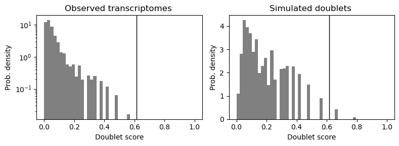
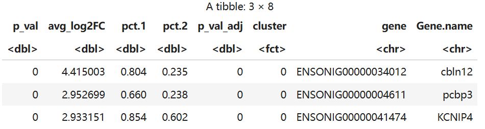
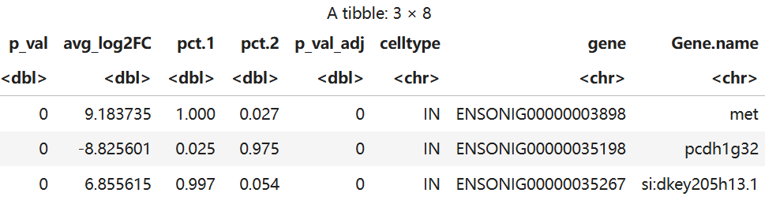
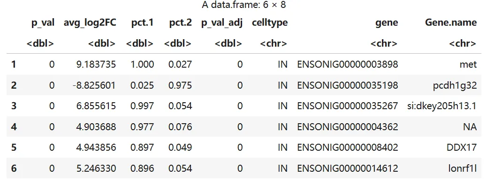
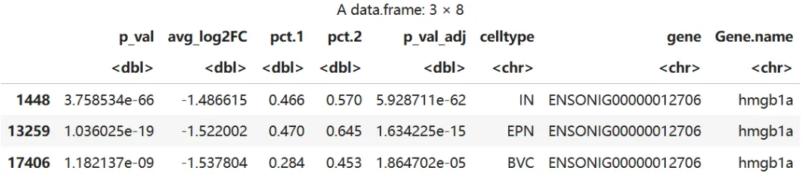

# 单细胞转录组跨物种比对

> 原文：https://mp.weixin.qq.com/s?__biz=MzAwMzIzOTk5OQ==&mid=2247537750&idx=1&sn=21ccf14fa96dc44db59a090966fc419f&chksm=9b3c2d06ac4ba4103fabbadc15a07f7b9b54cef94b5d85389e1217de48f37b0f1f2ff27ff93e#rd
> 合集：单细胞教程全收录

**一、写在前面**

在跨物种[单细胞](<https://mp.weixin.qq.com/mp/appmsgalbum?__biz=MzAwMzIzOTk5OQ==&action=getalbum&album_id=2168829347397156865#wechat_redirect>)研究中，如何消除物种间的进化差异并实现细胞类型的精确比对，是单细胞转录组（[scRNA-seq](<https://mp.weixin.qq.com/mp/appmsgalbum?__biz=MzAwMzIzOTk5OQ==&action=getalbum&album_id=4421772406013378566#wechat_redirect>)）分析中的难点。针对南极鱼（Trematomus bernacchii, TB）与尼罗罗非鱼（Oreochromis niloticus, ON）的脑组织数据，本教程展示了从[ Cell Ranger](<https://mp.weixin.qq.com/s?__biz=MzAwMzIzOTk5OQ==&mid=2247521051&idx=1&sn=e2ab820001013bae6e35310e27897086&scene=21#wechat_redirect>) 原始流程启动，到利用Diamond进行跨物种同源基因预测，并最终通过CCA (Canonical Correlation Analysis) 算法实现多物种数据集整合的完整管线。

在分析过程中，我们不仅引入了Scrublet算法来精准拦截模拟[双细胞](<https://mp.weixin.qq.com/s?__biz=MzAwMzIzOTk5OQ==&mid=2247511622&idx=1&sn=60b35668e569267bab14ec8fbba8bd74&scene=21#wechat_redirect>)，还针对非模式物种研究中常见的基因注释不全问题，演示了如何通过解析GFF3注释文件自定义基因名映射表。通过对比Harmony与CCA在跨物种整合上的表现，让我们在复杂进化背景下，从数万个细胞中抽丝剥茧，定位保守的神经元亚群及其差异表达特征。

如果需要[单细胞数据分析](<https://mp.weixin.qq.com/s?__biz=MzAwMzIzOTk5OQ==&mid=2247531388&idx=3&sn=dfaf8cac9db70bb408206fb3da27ffda&scene=21#wechat_redirect>)指导、生信热点[全文复现](<https://mp.weixin.qq.com/mp/appmsgalbum?__biz=MzAwMzIzOTk5OQ==&action=getalbum&album_id=2981710763847614469&token=1729645779&lang=zh_CN#wechat_redirect>)、自测数据个性化分析辅导、[常态化实验学习](<https://mp.weixin.qq.com/s?__biz=MzAwMzIzOTk5OQ==&mid=2247530174&idx=1&sn=c3b0499adcc9093546e4ba1cfffba7bd&scene=21#wechat_redirect>)，欢迎联系客服微信[Biomamba_zhushou]。

**二、实操流程**
```
1.准备工作
```
```
1.1 安装cellranger
```

下载解压安装包

  *

```
cd /storage/public/yongpeng/work/cellranger
```

  *

```
wget -O cellranger-10.0.0.tar.gz "https://cf.10xgenomics.com/releases/cell-exp/cellranger-10.0.0.tar.gz?Expires=1775781670&Key-Pair-Id=APKAI7S6A5RYOXBWRPDA&Signature=Z51eZif2whpR7Rmp-It1rTPG-P2Z9UOHm-MgqSjds~AJs3cuf98cL0a1oLI8neaeZom72Sr9PQQv8KR3bbWSz1qpNuCMbkgtlG0l7SUC64q7ZTAR8oBmMd~lyfY5961Ba9dnPPtr-JS94SCKHnaAtzv6LfDoWUIu2HZkTi8~eWufI8MjxZCWaMldoQCOkxUBtTwnTUKR-EZjSKCX2ZAt7Ip3-dWcVb2QayDesuRbP~MrN7akrqrCY8~Lfcuv2H7rmc3~yeuklrg0A~DekYqjXny--bouLBVnTzUhyTUx8wZgjgVPBralpU~RuoJkS6Yaklu1nSGpcTK71ozwjhl61A__"
```

  *

```
tar -zxvf /storage/public/yongpeng/work/cellranger/cellranger-7.1.0.tar.gz
```

配置软件路径以及检查是否安装成功

配置软件路径方便后续直接使用cellranger

  *

```
echo 'export PATH=/storage/public/yongpeng/work/cellranger/cellranger-7.1.0:$PATH' >> ~/.bashrc
```

  *

```
source .bashrc
```

尝试使用cellranger看是否安装成功

  *

```
cellranger
```

cellranger cellranger-7.1.0 Process 10x Genomics Gene Expression, Feature Barcode, and Immune Profiling data

USAGE: cellranger

OPTIONS: -h, --help Print help information -V, --version Print version information

SUBCOMMANDS: count Count gene expression (targeted or whole-transcriptome) and/or feature barcode reads from a single sample and GEM well multi Analyze multiplexed data or combined gene expression/immune profiling/feature barcode data multi-template Output a multi config CSV template vdj Assembles single-cell VDJ receptor sequences from 10x Immune Profiling libraries aggr Aggregate data from multiple Cell Ranger runs reanalyze Re-run secondary analysis (dimensionality reduction, clustering, etc) targeted-compare Analyze targeted enrichment performance by comparing a targeted sample to its cognate parent WTA sample (used as input for targeted gene expression) targeted-depth Estimate targeted read depth values (mean reads per cell) for a specified input parent WTA sample and a target panel CSV file mkvdjref Prepare a reference for use with CellRanger VDJ mkfastq Run Illumina demultiplexer on sample sheets that contain 10x-specific sample index sets testrun Execute the 'count' pipeline on a small test dataset mat2csv Convert a gene count matrix to CSV format mkref Prepare a reference for use with 10x analysis software. Requires a GTF and FASTA mkgtf Filter a GTF file by attribute prior to creating a 10x reference upload Upload analysis logs to 10x Genomics support sitecheck Collect linux system configuration information help Print this message or the help of the given subcommand(s)

表明安装成功

1.2 准备单细胞测序数据

  *

```
ls /storage/public/yongpeng/work/cellranger/ONRNA
```

T2RNA_S1_L001_R1_001.fastq.gz T2RNA_S2_L001_R2_001.fastq.gz T2RNA_S4_L001_R1_001.fastq.gz T2RNA_S1_L001_R2_001.fastq.gz T2RNA_S3_L001_R1_001.fastq.gz T2RNA_S4_L001_R2_001.fastq.gz T2RNA_S2_L001_R1_001.fastq.gz T2RNA_S3_L001_R2_001.fastq.gz

  *

```
ls /storage/public/yongpeng/work/cellranger/TBRNA
```

TBRNA_S1_L001_R1_001.fastq.gz TBRNA_S2_L001_R2_001.fastq.gz TBRNA_S4_L001_R1_001.fastq.gz TBRNA_S1_L001_R2_001.fastq.gz TBRNA_S3_L001_R1_001.fastq.gz TBRNA_S4_L001_R2_001.fastq.gz TBRNA_S2_L001_R1_001.fastq.gz TBRNA_S3_L001_R2_001.fastq.gz

1.3 下载基因组文件和注释文件

ON数据（Oreochromis_niloticus）

  *   *

```bash
wget https://ftp.ensembl.org/pub/release-115/fasta/oreochromis_niloticus/dna/Oreochromis_niloticus.O_niloticus_UMD_NMBU.dna.toplevel.fa.gz wget https://ftp.ensembl.org/pub/release-115/gtf/oreochromis_niloticus/Oreochromis_niloticus.O_niloticus_UMD_NMBU.115.gtf.gz
```

TB数据（Trematomus_bernacchii）此基因组文件和注释文件是实验室组装制作

1.4 运行cellranger

  *   *   *   *

```
nohup cellranger mkref \    --genome=Oni_genome_rna \    --fasta=Oreochromis_niloticus.O_niloticus_UMD_NMBU.dna.toplevel.fa \    --genes=Oreochromis_niloticus.O_niloticus_UMD_NMBU.111.gtf &
```

  *   *   *   *   *   *

```
nohup /cellranger count \--id=ON_cellranger\--transcriptome=/storage/public/yongpeng/work/cellranger/Oni_genome_rna \--fastqs=/storage/public/yongpeng/work/cellranger/ONRNA \--sample=T2RNA \--create-bam=true > $s.log 2>&1 &
```

  *   *   *   *

```
nohup cellranger mkref \    --genome=TB_genome_rna \    --fasta=Trematomus_bernacchii.dna.fa \    --genes=Trematomus_bernacchii.gtf &
```

  *   *   *   *   *   *

```
nohup cellranger count \--id=TB_cellranger \--transcriptome=/storage/public/yongpeng/work/cellranger/TB_genome_rna \--fastqs=/storage/public/yongpeng/work/cellranger/T2RNA \--sample=TBRNA \--create-bam=true > $s.log 2>&1 &
```

  *

```
ls /storage/public/yongpeng/work/cellranger/ON_cellranger
```

cmdline _finalstate _log _perf _sitecheck _timestamp _versions extras _invocation _mrosource _perf._truncated _tags _uuid _filelist _jobmode outs SC_RNA_COUNTER_CS ON.mri.tgz _vdrkill 检查目录是否完整

若要合并不同物种的数据，需要先[统一基因名](<https://mp.weixin.qq.com/s?__biz=MzAwMzIzOTk5OQ==&mid=2247484353&idx=2&sn=8fccb88c871a42c803e313be157ab293&scene=21#wechat_redirect>)，这里通过寻找同源基因来达成目的，由于ON物种基因研究较为全面因此把TB基因转换成ON对应的同源基因。

1.5 注释同源基因

准备两个物种的蛋白序列文件TB是实验室提供，ON需要从ENSEMBL下载

  *

```
cd /home/yongpeng/work/blast/diamond
```

  *

```
wget https://ftp.ensembl.org/pub/release-115/fasta/oreochromis_niloticus/pep/Oreochromis_niloticus.O_niloticus_UMD_NMBU.pep.all.fa.gz
```

Eggnog的比对结果相比于diamond更准确，但是由于运行时间过长，这里仅使用diamond作为示例

  *

```
nohup diamond makedb --in Oreochromis_niloticus.O_niloticus_UMD_NMBU.pep.all.fa.gz --db ON_diamond &
```

  *

```
nohup diamond blastp -q Trematomus_bernacchii.pep.faa --db ON_diamond --out /home/yongpeng/work/blast/diamond/TB_ON -p 4 &
```

提取出基因对应表（每个对应关系只保留匹配度最高，匹配度低于80%则删除）保存为TB_TO_ON.xlsx

2.单细胞测序数据质控

使用[jupyter](<https://mp.weixin.qq.com/s?__biz=MzAwMzIzOTk5OQ==&mid=2247531443&idx=3&sn=0930f54959a9bd13b99780d8f26a1155&scene=21#wechat_redirect>)平台连接服务器进行R语言和python分析

conda activate jupyter

jupyter notebook --no-browser

2.1 使用python标注[双细胞](<https://mp.weixin.qq.com/s?__biz=MzAwMzIzOTk5OQ==&mid=2247537531&idx=3&sn=c02a04fcecf0df66a7e544a821a62493&scene=21#wechat_redirect>)

这里使用Scrublet方法，基于模拟双细胞+k近邻分类的算法，用于检测单细胞 RNA 测序数据中的技术性双细胞。

  *   *   *

```
import numpy as npimport pandas as pdimport scanpy as sc
```

读取原始测序文件

  *   *

```r
ON_brain <- "/storage/public/yongpeng/work/cellranger/ON_cellranger/outs/ON_filtered_feature_bc_matrix.h5"TB_brain <- "/storage/public/yongpeng/work/cellranger/TB_cellranger/outs/TB_filtered_feature_bc_matrix.h5"
```

  *   *

```
adata_ON = sc.read_10x_mtx(ON_brain,var_names='gene_ids',cache=True)adata_ON
```

AnnData object with n_obs × n_vars = 12947 × 32125

var: 'gene_symbols', 'feature_types'

  *

```
adata_TB = sc.read_10x_mtx(TB_brain,var_names='gene_ids',cache=True)
```

检测并标记出单细胞数据中可能由技术误差产生的双细胞

  *   *

```
sc.pp.scrublet(adata_ON)sc.pp.scrublet(adata_TB)
```

  *   *

```
sc.pl.scrublet_score_distribution(adata_ON)sc.pl.scrublet_score_distribution(adata_TB)
```



adata_ON 样本的上样浓度较低，预期双细胞率低，因此用更低的阈值（0.16）可能仍能保持较低假阳性；而 adata_TB 样本上样浓度高，双细胞率高，需要更高阈值（0.2）来平衡假阳性和假阴性。

  *   *

```
sc.pp.scrublet(adata_ON,threshold=0.16)sc.pp.scrublet(adata_CH,threshold=0.2)
```

对双细胞进行标记方便后续更具标记删除双细胞

  *   *

```
adata_TB = adata_TB[~adata_TB.obs['predicted_doublet']]adata_ON = adata_ON[~adata_ON.obs['predicted_doublet']]
```

  *   *   *   *

```
sc.pp.filter_cells(adata_TB, min_genes=100)sc.pp.filter_genes(adata_TB, min_cells=3)sc.pp.filter_cells(adata_ON, min_genes=100)sc.pp.filter_genes(adata_ON, min_cells=3)
```

讲标记好的文件保存用以后续筛选

  *   *

```
adata_TB_bc_df = pd.DataFrame(adata_TB.obs.index,columns=['barcode'])adata_TB_bc_df.to_csv('./adata_TB_barcodes.csv',index=False)
```

  *   *

```
adata_TB_bc_df = pd.DataFrame(adata_TB.obs.index,columns=['barcode'])adata_TB_bc_df.to_csv('./adata_ON_barcodes.csv',index=False)
```

得到双细胞标注文件

这里开始转换成R语言

除了去除双细胞外，还要再这一步替换TB中原基因为ON的同源基因以便后续分析

  *   *   *   *   *   *

```r
library(dplyr)library(Seurat)library(patchwork)library(ggplot2)library(data.table)library("Matrix")
```
```
Attaching package: ‘dplyr’
```
```
The following objects are masked from ‘package:stats’:
```
```
      filter, lag
```
```
The following objects are masked from ‘package:base’:
```
```
     intersect, setdiff, setequal, union
```
```
Warning message:
```
```
“package ‘Seurat’ was built under R version 4.3.3”
```
```
Loading required package: SeuratObject
```
```
Warning message:
```
```
 “package ‘SeuratObject’ was built under R version 4.3.3”
```
```
 Loading required package: sp
```
```
Attaching package: ‘SeuratObject’
```
```
The following objects are masked from ‘package:base’:
```
```
      intersect, t
```
```
Attaching package: ‘data.table’
```
```
The following objects are masked from ‘package:dplyr’:
```
```
     between, first, last
```

  *   *

```r
ON_brain <- "/storage/public/yongpeng/work/cellranger/ON_cellranger/outs/ON_filtered_feature_bc_matrix.h5"TB_brain <- "/storage/public/yongpeng/work/cellranger/TB_cellranger/outs/TB_filtered_feature_bc_matrix.h5"
```

  *   *

```r
names(ON_dir) <- c("ON_brain")names(TB_dir) <- c("TB_brain")
```

  *   *   *   *   *   *

```r
ct <- Read10X_h5(ON_dir, use.names = F)if(inherits(ct, "list")){    ct <- ct$`Gene Expression`}colnames(ct) <- paste(names(ON_dir), colnames(ct), sep = "_")TB_ct <- dat_combined_Ti <- dsCombineDGE(sceList)
```

  *   *   *   *   *   *

```r
ct <- Read10X_h5(TB_dir, use.names = F)if(inherits(ct, "list")){    ct <- ct$`Gene Expression`}colnames(ct) <- paste(names(TB_dir), colnames(ct), sep = "_")TB_ct <- ct
```

提前准备后续跨物种整合做准备

注释TB基因为ON同源基因

  *   *

```r
oldnames <- data.frame(TB_ID = rownames(TB_ct))writeLines(oldnames, "/storage/public/yongpeng/work/H5/oldnames.txt")
```

  *   *

```r
library(readxl)library(openxlsx)
```

  *

```r
TB_to_ON <- read_excel("TB_to_ON.xlsx")
```

  *

```r
names(TB_to_ON) <- c("ON", "TB")
```

  *

```
head(TB_to_ON)
```

A tibble: 6 × 2

ON| TB
---|---
<chr>| <chr>
ENSONIG00000008614| hoxd10a
ENSONIG00000035114| hoxd9a
ENSONIG00000000732| xkr7
ENSONIG00000040127| NA
ENSONIG00000039737| NA
ENSONIG00000027180| hsd17b10

  *   *   *

```r
newname <- merge(oldnames, TB_to_ON, by = "TB", all.x = TRUE, sort = FALSE)# 用 match 确保顺序newname <- newname[match(oldnames$TB, newname$TB), ]
```

  *

```r
rownames(TB_ct) <- newname
```

  *   *

```
saveRDS(TB_ct,file='/storage/public/yongpeng/work/H5/H5.ON_brain.rds')saveRDS(TB_ct,file='/storage/public/yongpeng/work/HE/H5.TB_brain.rds')
```

  *   *   *

```r
sc_ON <- CreateSeuratObject(counts = ON_ct,min.cells = 3,min.features = 200)sc_Tb <- CreateSeuratObject(counts = TB_ct,min.cells = 3,min.features = 200)#需要根据自己的数据调整参数
```

  *   *

```
saveRDS(sc_ON,file='/storage/public/yongpeng/work/cellranger/ON_brain.rds')saveRDS(sc_Tb,file='/storage/public/yongpeng/work/cellranger/TB_brain.rds')
```

  *   *

```r
sc_ON$orig.ident <- "ON"sc_Tb$orig.ident <- "TB"
```

  *   *

```r
ON_bc <- read.csv('adata_ON_barcodes.csv')TB_bc <- read.csv('adata_TB_barcodes.csv')
```

  *   *   *

```r
barcodes_to_keep <- ON_bc$barcodesc_ON$barcode <- colnames(sc_ON)ON_filtered <- subset(sc_ON,subset = ON_bc$barcode %in% barcodes_to_keep)
```

  *   *   *

```r
barcodes_to_keep <- TB_bc$barcodesc_Tb$barcode <- colnames(sc_Tb)TB_filtered <- subset(sc_Tb,subset = sc_Tb$barcode %in% barcodes_to_keep)
```

  *   *

```
saveRDS(TB_filtered,file = "TB.doublefiltered.rds")saveRDS(ON_filtered,file = "ON.doublefiltered.rds")
```

至此得到去除双细胞的seurat文件

2.2 QC质控

ON[数据质控](<https://mp.weixin.qq.com/s?__biz=MzAwMzIzOTk5OQ==&mid=2247510401&idx=2&sn=ee7fde2db7471bc5622b73128fc630e5&scene=21#wechat_redirect>)

  *   *   *   *   *   *   *   *   *

```r
# 修改active.identnew_identity <- rep("ON-brain", length(ON_filtered@active.ident))new_identity <- factor(new_identity)ON_filtered@active.ident <- new_identityON_filtered@active.ident <- factor(ON_filtered@active.ident)names(ON_filtered@active.ident) <- colnames(ON_filtered)print(dim(ON_filtered))mt.genes <- rownames(ON_filtered)[grepl("mt-", rownames(ON_filtered))]ON_filtered[["percent.mt"]] <- PercentageFeatureSet(ON_filtered, features = intersect(rownames(ON_filtered),mt.genes))
```

[1] 25275 8811

  *   *   *   *

```
options(repr.plot.width = 10,repr.plot.height = 5)VlnPlot(ON_filtered, features = c("nFeature_RNA", "nCount_RNA", "percent.mt"), ncol = 3,pt.size = 0)FeatureScatter(ON_filtered, feature1 = "nCount_RNA", feature2 = "percent.mt", pt.size = 0.5)FeatureScatter(ON_filtered, feature1 = "nCount_RNA", feature2 = "nFeature_RNA", pt.size = 0.5)
```

Warning message:

“Default search for "data" layer in "RNA" assay yielded no results; utilizing "counts" layer instead.”

Warning message:

“The `slot` argument of `FetchData()` is deprecated as of SeuratObject 5.0.0.

ℹ Please use the `layer` argument instead.

ℹ The deprecated feature was likely used in the Seurat package.

Please report the issue at <https://github.com/satijalab/seurat/issues>.”

Warning message:

“`PackageCheck()` was deprecated in SeuratObject 5.0.0.

ℹ Please use `rlang::check_installed()` instead.

ℹ The deprecated feature was likely used in the Seurat package.

Please report the issue at <https://github.com/satijalab/seurat/issues>.”

  *   *   *   *   *   *   *   *   *   *   *   *   *   *   *   *   *   *   *   *   *   *   *   *   *   *   *   *   *

```r
qc_metrics <- list(  Brain.nFeature = quantile(ON_filtered$nFeature_RNA, probs = c(0.01, 0.99)),  Brain.percent.mt = median(ON_filtered$percent.mt) + 3 * mad(ON_filtered$percent.mt),  ON.nFeature = quantile(ON_filtered$nFeature_RNA, probs = c(0.01, 0.99)),  ON.percent.mt = median(ON_filtered$percent.mt) + 3 * mad(ON_filtered$percent.mt))qc_metrics#进行筛选qc_filter_report <- function(seurat_obj, min_features = 300, mt_thresholds = c(30, 25, 20, 15, 10, 5)) {  total_cells <- ncol(seurat_obj)  results <- data.frame(    percent_mt_threshold = numeric(),    retained_cells = integer(),    retained_percent = numeric()  )  for (threshold in mt_thresholds) {    filtered <- subset(seurat_obj, subset = nFeature_RNA > min_features & percent.mt < threshold)    retained <- ncol(filtered)    percent_retained <- round((retained / total_cells) * 100, 2)    results <- rbind(results, data.frame(      percent_mt_threshold = threshold,      retained_cells = retained,      retained_percent = percent_retained    ))  }  return(results)}qc_filter_report(ON_filtered)ON_filtered <- subset(ON_filtered, subset = nFeature_RNA > 300 & percent.mt < 5)
```

$Brain.nFeature 1%:513 99%:4852.3

$Brain.percent.mt 0.724381513770556

$ON.nFeature 1%:513 99%:4852.3

$ON.percent.mt 0.724381513770556

A data.frame: 6 × 3

percent_mt_threshold| retained_cells| retained_percent
---|---|---
<dbl>| <dbl>| <dbl>
30| 8811| 100
25| 8811| 100
20| 8811| 100
15| 8811| 100
10| 8811| 100
5| 8811| 100

  *

```
saveRDS(ON_filtered,file = "ON.dc.qc.rds")
```

TB数据质控同上

  *   *   *   *   *   *   *   *   *   *   *   *   *   *   *   *   *   *   *   *   *   *   *   *   *   *   *   *   *   *   *   *   *   *   *   *   *   *   *   *   *   *   *

```r
# 修改active.identnew_identity <- rep("TB-brain", length(TB_filtered@active.ident))new_identity <- factor(new_identity)TB_filtered@active.ident <- new_identityTB_filtered@active.ident <- factor(TB_filtered@active.ident)names(TB_filtered@active.ident) <- colnames(TB_filtered)print(dim(TB_filtered))mt.genes <- rownames(TB_filtered)[grepl("mt-", rownames(TB_filtered))]TB_filtered[["percent.mt"]] <- PercentageFeatureSet(TB_filtered, features = intersect(rownames(TB_filtered),mt.genes))options(repr.plot.width = 10,repr.plot.height = 5)VlnPlot(TB_filtered, features = c("nFeature_RNA", "nCount_RNA", "percent.mt"), ncol = 3,pt.size = 0)FeatureScatter(TB_filtered, feature1 = "nCount_RNA", feature2 = "percent.mt", pt.size = 0.5)FeatureScatter(TB_filtered, feature1 = "nCount_RNA", feature2 = "nFeature_RNA", pt.size = 0.5)qc_metrics <- list(  Brain.nFeature = quantile(TB_filtered$nFeature_RNA, probs = c(0.01, 0.99)),  Brain.percent.mt = median(TB_filtered$percent.mt) + 3 * mad(TB_filtered$percent.mt),  TB.nFeature = quantile(TB_filtered$nFeature_RNA, probs = c(0.01, 0.99)),  TB.percent.mt = median(TB_filtered$percent.mt) + 3 * mad(TB_filtered$percent.mt))qc_metrics#进行筛选qc_filter_report <- function(seurat_obj, min_features = 300, mt_thresholds = c(30, 25, 20, 15, 10, 5)) {  total_cells <- ncol(seurat_obj)  results <- data.frame(    percent_mt_threshold = numeric(),    retained_cells = integer(),    retained_percent = numeric()  )  for (threshold in mt_thresholds) {    filtered <- subset(seurat_obj, subset = nFeature_RNA > min_features & percent.mt < threshold)    retained <- ncol(filtered)    percent_retained <- round((retained / total_cells) * 100, 2)    results <- rbind(results, data.frame(      percent_mt_threshold = threshold,      retained_cells = retained,      retained_percent = percent_retained    ))  }  return(results)}qc_filter_report(TB)TB <- subset(TB, subset = nFeature_RNA > 300 & percent.mt < 5)saveRDS(TB,file = "TB.dc.qc.rds")
```

[1] 24803 12147

Warning message:

“Default search for "data" layer in "RNA" assay yielded no results; utilizing "counts" layer instead.”

$Brain.nFeature 1%:448 99%:5770.54

$Brain.percent.mt 1.62767957625196

$TB.nFeature 1%:448 99%:5770.54

$TB.percent.mt 1.62767957625196

A data.frame: 6 × 3

percent_mt_threshold| retained_cells| retained_percent
---|---|---
<dbl>| <dbl>| <dbl>
30| 12147| 100.00
25| 12147| 100.00
20| 12147| 100.00
15| 12146| 99.99
10| 12145| 99.98
5| 12136| 99.91

```
3. CCA整合步骤
```

  *   *   *   *   *   *   *

```r
library(Seurat)library(dplyr)library(ggplot2)library(tidyr)library(patchwork) library(Matrix)library(harmony)
```

Attaching package: ‘tidyr’

The following objects are masked from ‘package:Matrix’:

expand, pack, unpack

Loading required package: Rcpp

  *   *

```r
TB<- readRDS("TB.dc.qc.rds")ON<- readRDS("ON.dc.qc.rds")
```

  *

```r
common_genes <- intersect(rownames(TB), rownames(ON))
```

  *

```r
sc_lc <- merge(TB,y = ON)
```

  *

```
sc_lc
```

An object of class Seurat

35067 features across 20816 samples within 1 assay

Active assay: RNA (35067 features, 2000 variable features)

5 layers present: counts.tb, counts.SeuratProject, data.SeuratProject, scale.data.6.SeuratProject, scale.data.SeuratProject

  *

```
head(common_genes)
```

'ENSONIG00000008614''ENSONIG00000035114''ENSONIG00000000732'

'ENSONIG00000027180''ENSONIG00000016575''ENSONIG00000016573'

只保留ON和TB共有基因，特有基因不纳入跨物种比对范围

  *

```r
sc_filtered <- subset(sc_lc, features = common_genes)
```

  *   *

```r
sc_filtered <- sc_filtered[,sc_filtered$nFeature_RNA < 4000]sc_filtered
```

An object of class Seurat

15774 features across 20170 samples within 1 assay

Active assay: RNA (15774 features, 1257 variable features)

5 layers present: counts.tb, counts.SeuratProject, data.SeuratProject, scale.data.6.SeuratProject, scale.data.SeuratProject

[常规整合](<https://mp.weixin.qq.com/s?__biz=MzAwMzIzOTk5OQ==&mid=2247500117&idx=2&sn=cef0b0abec6d73a8c2615980ef68aec1&scene=21#wechat_redirect>)查看整体情况

  *   *   *   *   *   *   *   *

```r
sc_filtered <- sc_filtered %>%      NormalizeData(verbose = F) %>%      FindVariableFeatures(verbose = F) %>%      ScaleData(verbose = F) %>%      RunPCA(verbose = FALSE) %>%      FindNeighbors(reduction = "pca", dims = 1:30,verbose = F) %>%      FindClusters(resolution = c(0.1,0.2),cluster.name = c('unintegrated_clusters_0.1','unintegrated_clusters_0.2'),verbose = F) %>%      RunUMAP(reduction = "pca", dims = 1:30, reduction.name = "umap.unintegrated", verbose = FALSE)
```

Warning message:

“The default method for RunUMAP has changed from calling Python UMAP via reticulate to the R-native UWOT using the cosine metric

To use Python UMAP via reticulate, set umap.method to 'umap-learn' and metric to 'correlation'

This message will be shown once per session”

  *   *   *   *   *

```r
options(repr.plot.width = 8, repr.plot.height = 8)plot1 <- DimPlot(sc_filtered, reduction = "umap.unintegrated", label = T, group.by = "unintegrated_clusters_0.1") + NoLegend()plot2 <- DimPlot(sc_filtered, reduction = "umap.unintegrated", label = T, group.by = "unintegrated_clusters_0.2") + NoLegend()plot3 <- DimPlot(sc_filtered, reduction = "umap.unintegrated", label = T, group.by = "orig.ident") + NoLegend()plot1 + plot2 + plot3  + plot_layout(nrow = 2)
```

  *

```r
sc_filtered <- RunHarmony(sc_filtered, group.by = "orig.ident")
```

Transposing data matrix

Initializing state using k-means centroids initialization

Harmony 1/10

Harmony 2/10

Harmony 3/10

Harmony 4/10

Harmony 5/10

Harmony converged after 5 iterations

Warning message:

“The `slot` argument of `GetAssayData()` is deprecated as of SeuratObject 5.0.0.

ℹ Please use the `layer` argument instead.

ℹ The deprecated feature was likely used in the Seurat package.

Please report the issue at <https://github.com/satijalab/seurat/issues>.”

  *   *   *   *   *

```r
sc_filtered <- IntegrateLayers(  object = sc_filtered, method = HarmonyIntegration,  orig.reduction = "pca", new.reduction = "harmony",  verbose = FALSE)
```

The `features` argument is ignored by `HarmonyIntegration`.

This message is displayed once per session.

  *   *   *   *

```r
sc_filtered <- sc_filtered %>%  FindNeighbors(reduction = "harmony", dims = 1:30,verbose = F) %>%  FindClusters(resolution = c(0.1,0.2),cluster.name = c('harmony_clusters_0.1','harmony_clusters_0.2'),verbose = F) %>%  RunUMAP(reduction = "harmony", dims = 1:30,reduction.name = 'umap.harmony',verbose = FALSE)
```

  *   *   *   *   *

```r
options(repr.plot.width = 8, repr.plot.height = 8)plot1 <- DimPlot(sc_filtered, reduction = "umap.harmony", label = T, group.by = "harmony_clusters_0.1") + NoLegend()plot2 <- DimPlot(sc_filtered, reduction = "umap.harmony", label = T, group.by = "harmony_clusters_0.2") + NoLegend()plot3 <- DimPlot(sc_filtered, reduction = "umap.harmony", label = T, group.by = "orig.ident") + NoLegend()plot1 + plot2 + plot3 + plot_layout(nrow = 2)
```

使用CCA

  *

```r
brain.split <- SplitObject(sc_lc, split.by = "orig.ident")
```

  *

```
brain.split
```

$TB

An object of class Seurat

24803 features across 12136 samples within 1 assay

Active assay: RNA (24803 features, 1186 variable features)

1 layer present: counts.tb

$T6

An object of class Seurat

25500 features across 8680 samples within 1 assay

Active assay: RNA (25500 features, 2000 variable features)

4 layers present: counts.SeuratProject, data.SeuratProject, scale.data.6.SeuratProject, scale.data.SeuratProject

  *   *   *   *   *   *   *   *   *   *   *

```r
brain.split <- lapply(brain.split, function(x) {  x <- NormalizeData(x, verbose = FALSE)  x <- FindVariableFeatures(x, selection.method = "vst", nfeatures = 2000)  return(x)})# 选择跨数据集的共有高变基因features <- SelectIntegrationFeatures(object.list = brain.split)# 使用FindIntegrationAnchors函数识别锚点anchors <- FindIntegrationAnchors(object.list = brain.split, anchor.features = features)# 使用IntegrateData函数整合数据集integrated_data <- IntegrateData(anchorset = anchors)
```

Finding variable features for layer counts.tb

Finding variable features for layer counts.SeuratProject

Scaling features for provided objects

Finding all pairwise anchors

Running CCA

Merging objects

Warning message:

“The `slot` argument of `SetAssayData()` is deprecated as of SeuratObject 5.0.0.

ℹ Please use the `layer` argument instead.

ℹ The deprecated feature was likely used in the Seurat package.

Please report the issue at <https://github.com/satijalab/seurat/issues>.”

Finding neighborhoods

Finding anchors

Found 15499 anchors

Filtering anchors

Retained 6187 anchors

Finding neighborhoods

Finding anchors

Found 15499 anchors

Filtering anchors

Retained 6187 anchors

Merging dataset 2 into 1

Extracting anchors for merged samples

Finding integration vectors

Warning message:

“Different features in new layer data than already exists for scale.data”

Finding integration vector weights

Integrating data

Warning message:

“Layer counts isn't present in the assay object; returning NULL”

  *

```r
integrated_data <-ScaleData(integrated_data ,verbose = F)
```

  *

```
integrated_data
```

  *   *   *   *   *

```r
integrated_data <- RunPCA(integrated_data, verbose = FALSE)integrated_data <- FindNeighbors(integrated_data, dims = 1:30, reduction = "pca",verbose = F)integrated_data <-FindClusters(integrated_data, resolution = c(0.1,0.2,0.4),cluster.name = c('CCA_clusters_0.1','CCA_clusters_0.2','CCA_clusters_0.4'),verbose = F)integrated_data <- RunUMAP(integrated_data, reduction = "pca", dims = 1:30,                        reduction.name = "umap.unintegrated", verbose = FALSE)
```

  *   *   *   *   *

```r
options(repr.plot.width = 8, repr.plot.height = 8)plot1 <- DimPlot(integrated_data, reduction = "umap.unintegrated", label = T, group.by = "CCA_clusters_0.1") + NoLegend()plot2 <- DimPlot(integrated_data, reduction = "umap.unintegrated", label = T, group.by = "CCA_clusters_0.2") + NoLegend()plot3 <- DimPlot(integrated_data, reduction = "umap.unintegrated", label = T, group.by = "orig.ident") + NoLegend()plot1 + plot2 + plot3  + plot_layout(nrow = 2)
```

  *

```
saveRDS(integrated_data,file="brain.CCATBON.rds")
```

  *   *

```
options(repr.plot.width = 10, repr.plot.height = 5)DimPlot(integrated_data,  label = T,repel = T,split.by = "orig.ident", group.by = "CCA_clusters_0.1")
```

  *   *

```
options(repr.plot.width = 10, repr.plot.height = 5)DimPlot(integrated_data,  label = T,repel = T,split.by = "orig.ident", group.by = "CCA_clusters_0.2")
```

CCA聚类情况相比于Harmony较好

4.进行细胞簇注释

biomart可以用于注释基因名对应表，但是由于版本更新问题，时长会遗漏部分基因，相比之下直接从最新gff3文件中提取基因名对应表更全

下载gff3注释文件到本地

  *

```
cd /storage/public/yongpeng/work/cellranger
```

  *

```bash
wget https://ftp.ensembl.org/pub/release-115/gff3/oreochromis_niloticus/Oreochromis_niloticus.O_niloticus_UMD_NMBU.111.gff3.gz
```

从gff3注释文件中提取和基因名对应表ON.EN_to_name.xlsx

  *   *   *   *   *   *   *   *   *   *   *   *   *   *   *   *   *   *   *   *   *   *   *   *   *   *   *   *   *   *   *   *

```
# 输入文件路径input_file="/storage/public/yongpeng/work/cellranger/Oreochromis_niloticus.O_niloticus_UMD_NMBU.111.gff3"# 输出文件路径output_file="ON.EN_to_name.txt"# 使用awk提取基因Ensembl号和基因名awk -F'\t' '{    if ($3 == "gene") {        # 提取属性字段        attributes = $9        # 初始化Ensembl号和基因名        ensembl_id = ""        gene_name = ""        # 分割属性字段        n = split(attributes, arr, ";")        for (i = 1; i <= n; i++) {            # 提取Ensembl号（通常是ID字段）            if (arr[i] ~ /ID=/) {                ensembl_id = arr[i]                sub(/ID=/, "", ensembl_id)            }            # 提取基因名            if (arr[i] ~ /Name=/) {                gene_name = arr[i]                sub(/Name=/, "", gene_name)            }        }        if (ensembl_id != "" && gene_name != "") {            print ensembl_id "\t" gene_name        }    }}' "$input_file" > "$output_file"echo "基因Ensembl号和基因名的对应表已保存到 $output_file"
```

基因Ensembl号和基因名的对应表已保存到 ON.EN_to_name.txt

  *

```
head ON.EN_to_name.xlsx
```

gene:ENSONIG00000015575 ctsd gene:ENSONIG00000015584 sirt3 gene:ENSONIG00000030102 DRD4 gene:ENSONIG00000015587 psmd13 gene:ENSONIG00000015598 csnk2a2a gene:ENSONIG00000015601 MATCAP1 gene:ENSONIG00000034066 zgc:194679 gene:ENSONIG00000007022 ppip5k1a gene:ENSONIG00000029455 map1aa gene:ENSONIG00000007015 tp53bp1

  *   *   *   *   *   *   *

```r
library(Seurat)library(dplyr)library(ggplot2)library(tidyr)library(patchwork) library(Matrix)library(harmony)
```

修改基因id用于后续的maker注释

  *   *   *   *   *   *   *   *   *   *   *   *   *   *   *   *   *   *   *   *   *

```r
#寻找maker用于注释integrated_data<- readRDS("brain.CCATBON.rds")Idents(integrated_data) = "CCA_clusters_0.1"mak <- FindAllMarkers(integrated_data, only.pos = TRUE,logfc.threshold = 0.5)#修改基因id便于后续的maker注释library(readxl)library(openxlsx)library(dplyr)tilapia_id_name <- read.table("ON.EN_to_name.xlsx", sep = "\t")colnames(tilapia_id_name) <- c("Gene.stable.ID", "Gene.name")write.xlsx(tilapia_id_name, "ON.EN_to_name.xlsx")tilapia_id_name$Gene.stable.ID <- gsub("^gene:", "", tilapia_id_name$Gene.stable.ID, ignore.case = TRUE)tilapia_id_name <- tilapia_id_name %>%  distinct(Gene.stable.ID, .keep_all = TRUE)mak <- mak %>%     filter(p_val_adj <0.01 & pct.1 > 0.1) %>%     group_by(gene) %>%     left_join(tilapia_id_name[,c(1,2)],by = c("gene"="Gene.stable.ID"),multiple = "first") %>%     ungrouphead(mak,3)write.table(mak,'TBONCCA.MAK',sep = '\t',row.names = F)
```

Calculating cluster 0

Warning message in mean.fxn(object[features, cells.1, drop = FALSE]):

“NaNs produced”

Warning message in mean.fxn(object[features, cells.2, drop = FALSE]):

“NaNs produced”

Warning message:

“`PackageCheck()` was deprecated in SeuratObject 5.0.0.

ℹ Please use `rlang::check_installed()` instead.

ℹ The deprecated feature was likely used in the Seurat package.

Please report the issue at <https://github.com/satijalab/seurat/issues>.”

Calculating cluster 1

Warning message in mean.fxn(object[features, cells.1, drop = FALSE]):

“NaNs produced”

Warning message in mean.fxn(object[features, cells.2, drop = FALSE]):

“NaNs produced”

Calculating cluster 2

Warning message in mean.fxn(object[features, cells.1, drop = FALSE]):

“NaNs produced”

Warning message in mean.fxn(object[features, cells.2, drop = FALSE]):

“NaNs produced”

Calculating cluster 3

Warning message in mean.fxn(object[features, cells.1, drop = FALSE]):

“NaNs produced”

Warning message in mean.fxn(object[features, cells.2, drop = FALSE]):

“NaNs produced”

Calculating cluster 4

Warning message in mean.fxn(object[features, cells.1, drop = FALSE]):

“NaNs produced”

Warning message in mean.fxn(object[features, cells.2, drop = FALSE]):

“NaNs produced”

Calculating cluster 5

Warning message in mean.fxn(object[features, cells.1, drop = FALSE]):

“NaNs produced”

Warning message in mean.fxn(object[features, cells.2, drop = FALSE]):

“NaNs produced”

Calculating cluster 6

Warning message in mean.fxn(object[features, cells.1, drop = FALSE]):

“NaNs produced”

Warning message in mean.fxn(object[features, cells.2, drop = FALSE]):

“NaNs produced”

Calculating cluster 7

Warning message in mean.fxn(object[features, cells.1, drop = FALSE]):

“NaNs produced”

Warning message in mean.fxn(object[features, cells.2, drop = FALSE]):

“NaNs produced”

Calculating cluster 8

Warning message in mean.fxn(object[features, cells.1, drop = FALSE]):

“NaNs produced”

Warning message in mean.fxn(object[features, cells.2, drop = FALSE]):

“NaNs produced”

Calculating cluster 9

Warning message in mean.fxn(object[features, cells.1, drop = FALSE]):

“NaNs produced”

Warning message in mean.fxn(object[features, cells.2, drop = FALSE]):

“NaNs produced”

Calculating cluster 10

Warning message in mean.fxn(object[features, cells.1, drop = FALSE]):

“NaNs produced”

Warning message in mean.fxn(object[features, cells.2, drop = FALSE]):

“NaNs produced”

Calculating cluster 11

Warning message in mean.fxn(object[features, cells.1, drop = FALSE]):

“NaNs produced”

Warning message in mean.fxn(object[features, cells.2, drop = FALSE]):

“NaNs produced”

Calculating cluster 12

Warning message in mean.fxn(object[features, cells.1, drop = FALSE]):

“NaNs produced”

Warning message in mean.fxn(object[features, cells.2, drop = FALSE]):

“NaNs produced”

Calculating cluster 13

Warning message in mean.fxn(object[features, cells.1, drop = FALSE]):

“NaNs produced”

Warning message in mean.fxn(object[features, cells.2, drop = FALSE]):

“NaNs produced”

Calculating cluster 14

Warning message in mean.fxn(object[features, cells.1, drop = FALSE]):

“NaNs produced”

Warning message in mean.fxn(object[features, cells.2, drop = FALSE]):

“NaNs produced”

Calculating cluster 15

Warning message in mean.fxn(object[features, cells.1, drop = FALSE]):

“NaNs produced”

Warning message in mean.fxn(object[features, cells.2, drop = FALSE]):

“NaNs produced”

Calculating cluster 16

Warning message in mean.fxn(object[features, cells.1, drop = FALSE]):

“NaNs produced”

Warning message in mean.fxn(object[features, cells.2, drop = FALSE]):

“NaNs produced”

Calculating cluster 17

Warning message in mean.fxn(object[features, cells.1, drop = FALSE]):

“NaNs produced”

Warning message in mean.fxn(object[features, cells.2, drop = FALSE]):

“NaNs produced”

Calculating cluster 18

Warning message in mean.fxn(object[features, cells.1, drop = FALSE]):

“NaNs produced”

Warning message in mean.fxn(object[features, cells.2, drop = FALSE]):

“NaNs produced”

Calculating cluster 19

Warning message in mean.fxn(object[features, cells.1, drop = FALSE]):

“NaNs produced”

Warning message in mean.fxn(object[features, cells.2, drop = FALSE]):

“NaNs produced”



因为输入了全部基因作为Maker筛选，其中某些基因在之前质控过程中中删除了其表达的细胞导致出现了一些基因只在极少数细胞中表达不在任何细胞中表达，导致出现NA，但因为后续分析不考虑这些表达基因，因此并无影响。

  *

```
table(integrated_data$`CCA_clusters_0.1`)
```

0 1 2 3 4 5 6 7 8 9 10 11 12 13 14 15
```
5660 3964  927  905  854  841  721  560  370  336  318  300  202  175  139  132     16     17     18    19
```
```
 106    74     61    34
```

  *   *   *   *   *   *   *   *   *   *   *   *   *   *   *   *   *   *   *   *   *   *

```r
CCA0.1.celltype <- c(  "0" = "EN",   # Excitatory Neurons  "1" = "IN",   # Inhibitory Neurons  "2" = "IMM",  # Immune Cells  "3" = "AST",  # Astrocytes  "4" = "OLG",  # Oligodendrocytes  "5" = "EPN",  # Excitatory Projection Neurons  "6" = "BVC",  # Brain Vascular Cells  "7" = "IN",   # Somatostatin-Positive Interneurons  "8" = "EN",   "9" = "HNC",  # Hypothalamic Neuroendocrine Cells  "10" = "IN",  # Cerebral Cortex Interneurons  "11" = "RGC", # Radial Glial Cells  "12" = "VEC", # Brain Microvascular Endothelial Cells  "13" = "BBBAC",# Blood-Brain Barrier Associated Cells  "14" = "CPEC",# Choroid Plexus Epithelial Cells  "15" = "EPN", # Hippocampus-Hypothalamus Connecting Neurons  "16" = "HNC", # Paraventricular Nucleus Large Cell Neurons  "17" = "CSN", # Cranial Sensory Neurons  "18" = "OPCs",# Oligodendrocyte Precursor Cells  "19" = "CPSC" # Choroid Plexus Stromal Cells)
```

  *

```
integrated_data[['CCA0.1.celltype']] = unname(CCA0.1.celltype[integrated_data@meta.data$CCA_clusters_0.1])
```

  *

```
table(integrated_data$CCA0.1.celltype)
```

AST BBBAC BVC CPEC CPSC CSN EN EPN HNC IMM IN OLG OPCs

905 175 721 139 34 74 6030 973 442 927 4842 854 61

RGC VEC

300 202

  *

```
DimPlot(integrated_data, reduction = "umap.unintegrated", label = T, group.by =c("CCA0.1.celltype"),repel = T)
```

  *

```
saveRDS(integrated_data,'brain.celltype.rds')
```

5.检索差异基因

  *

```
packageVersion("ggplot2")
```

[1] ‘3.5.2’

  *   *   *   *   *   *   *

```r
library(ggplot2)library(Seurat)library(dplyr)library(tidyr)library(patchwork) library(Matrix)library(harmony)
```

Warning message:

“package ‘Seurat’ was built under R version 4.3.3”

Loading required package: SeuratObject

Warning message:

“package ‘SeuratObject’ was built under R version 4.3.3”

Loading required package: sp

Attaching package: ‘SeuratObject’

The following objects are masked from ‘package:base’:

intersect, t

Attaching package: ‘dplyr’

The following objects are masked from ‘package:stats’:

filter, lag

The following objects are masked from ‘package:base’:

intersect, setdiff, setequal, union

Attaching package: ‘Matrix’

The following objects are masked from ‘package:tidyr’:

expand, pack, unpack

Loading required package: Rcpp

  *

```r
brain<- readRDS("brain.celltype.rds")
```

  *

```r
DefaultAssay(brain) <- "RNA"
```

  *

```
brain
```

An object of class Seurat

17774 features across 16679 samples within 2 assays

Active assay: RNA (15774 features, 2000 variable features)

8 layers present: data.1, data.2, counts.1, scale.data.1, counts.2, scale.data.6.SeuratProject.2, scale.data.SeuratProject.2, scale.data.2

1 other assay present: integrated

2 dimensional reductions calculated: pca, umap.unintegrated

  *

```r
brain <-JoinLayers(brain)
```

  *

```r
celltypes <- unique(brain$CCA0.1.celltype)
```

  *   *   *   *   *   *   *   *   *   *   *   *   *   *   *   *   *   *   *   *   *   *   *   *

```r
diff_genes <- list()for (celltype in celltypes) {  tryCatch({    # 1. 子集当前细胞类群    subset_cells <- subset(brain, subset = CCA0.1.celltype == celltype)    # 2. 设置TB为实验组，T6为对照组    Idents(subset_cells) <- "orig.ident"    diff <- FindMarkers(      object = subset_cells,      ident.1 = "TB",       # 实验组      ident.2 = "ON",       # 对照组      min.pct = 0.1,        # 基因在至少10%的细胞中表达      logfc.threshold = 0.25, # 对数FC阈值      only.pos = FALSE    )    # 3. 添加元数据    diff$celltype <- celltype    diff$gene <- rownames(diff)    diff_genes[[celltype]] <- diff    message(paste0("已完成: ", celltype, " | 差异基因数: ", nrow(diff)))  }, error = function(e) {    message(paste0("错误在 ", celltype, ": ", e$message))  })}
```

已完成: IN | 差异基因数: 5302

已完成: EN | 差异基因数: 3132

已完成: RGC | 差异基因数: 4111

已完成: IMM | 差异基因数: 2329

已完成: AST | 差异基因数: 4159

已完成: EPN | 差异基因数: 5669

已完成: BBBAC | 差异基因数: 5323

已完成: BVC | 差异基因数: 3171

已完成: HNC | 差异基因数: 5043

已完成: VEC | 差异基因数: 2833

已完成: OLG | 差异基因数: 3247

已完成: CPEC | 差异基因数: 5495

已完成: CSN | 差异基因数: 6509

已完成: CPSC | 差异基因数: 4647

错误在 OPCs: Cell group 2 has fewer than 3 cells

  *   *   *   *   *

```r
# 合并所有结果combined_results <- bind_rows(diff_genes, .id = "celltype")# 筛选显著差异基因 (按需调整阈值)significant_results <- combined_results %>%  filter(p_val_adj < 0.05 & abs(avg_log2FC) > 0.25)
```

  *   *   *

```r
library(readxl)library(openxlsx)library(dplyr)
```

  *   *   *   *   *   *   *   *   *

```r
tilapia_id_name <- read_excel("ON.EN_to_name.xlsx")tilapia_id_name <- tilapia_id_name %>%  distinct(Gene.stable.ID, .keep_all = TRUE)significant_results <- significant_results %>%     group_by(gene) %>%     left_join(tilapia_id_name[,c(1,2)],by = c("gene"="Gene.stable.ID"),multiple = "first") %>%     ungrouphead(significant_results,3)write.table(significant_results,'TBvsON.txt',sep = '\t',row.names = F)
```



  *   *   *   *   *   *   *   *   *

```r
Idents(brain) <- "orig.ident"allDEGs<-FindMarkers(      object = brain,      ident.1 = "TB",       # 实验组      ident.2 = "ON",       # 对照组      min.pct = 0.1,        # 基因在至少10%的细胞中表达      logfc.threshold = 0.25, # 对数FC阈值      only.pos = FALSE    )
```

  *   *   *

```r
# 筛选显著差异基因 (按需调整阈值)allDEGs <- allDEGs %>%  filter(p_val_adj < 0.05 & abs(avg_log2FC) > 0.5)
```

找个基因查看

  *   *

```r
ON_to_TB <- read_excel("TB_TO_ON.xlsx")#TB_TO_ON.xlsxON.EN_to_name <- read_excel("ON.EN_to_name.xlsx")#ON.EN_to_name.xlsx
```

添加了一个画图功能

  *   *   *   *   *   *   *   *   *   *   *   *   *   *   *   *   *   *   *   *   *   *   *   *   *   *   *   *

```r
plot_gene_vln <- function(gene_id,                           seurat_obj = brain,                           tb_df = ON_to_TB,                           on_df = ON.EN_to_name,                          group.by = "orig.ident",                           split.by = "CCA0.1.celltype",                           assay = "RNA",                           pt.size = 0.1) {  # 提取TB名称  tb_name <- tb_df[[2]][tb_df[[1]] == gene_id]  if (length(tb_name) == 0) tb_name <- "Not found"  # 提取ON名称  on_name <- on_df[[2]][on_df[[1]] == gene_id]  if (length(on_name) == 0) on_name <- "Not found"  title_str <- paste0(gene_id, "  ON:", on_name, "  TB:", tb_name)  options(repr.plot.width = 15, repr.plot.height = 5)  # 绘制小提琴图  p <- VlnPlot(seurat_obj,                features = gene_id,                group.by = group.by,                split.by = split.by,                assay = assay,                pt.size = pt.size)  # 添加标题并居中  p + ggtitle(title_str) +     theme(plot.title = element_text(hjust = 0.5, size = 12))}plot_gene_vln("ENSONIG00000012706")
```

Warning message:

“Groups with fewer than two datapoints have been dropped.

ℹ Set `drop = FALSE` to consider such groups for position adjustment purposes.”

6.其余图片绘制

  *   *   *   *   *   *   *   *   *   *

```r
library(Seurat)library(dplyr)library(ggplot2)library(tidyr)library(patchwork) library(Matrix)library(harmony)library(readxl)library(openxlsx)library(dplyr)
```

  *

```
options(repr.plot.width = 6, repr.plot.height = 5)
```

  *

```
DimPlot(brain, reduction = "umap.unintegrated", label = T, group.by =c("orig.ident"),repel = T)
```

  *

```
DimPlot(integrated_data, reduction = "umap.unintegrated", label = T, group.by =c("CCA0.1.celltype"),repel = T)
```

后续分析不考虑OPCs和CPSC，因为这两类细胞类型不达标

  *

```r
brain <- subset(brain, subset = CCA0.1.celltype != "OPCs" & CCA0.1.celltype != "CPSC")
```

  *   *   *   *   *   *   *   *   *   *   *   *   *   *   *   *   *   *   *   *   *   *   *   *   *   *   *   *   *   *   *   *   *   *   *   *   *   *   *   *

```r
gene_labels <- c(  "ENSONIG00000006551" = "etv1",  "ENSONIG00000009548" = "grin2ca",  "ENSONIG00000041486" = "cck",  "ENSONIG00000018696" = "gad1b",  "ENSONIG00000008574" = "pvalb6",  "ENSONIG00000015427" = "lhx5",  "ENSONIG00000010119" = "ptprc",  "ENSONIG00000012102" = "c1ql4a",  "ENSONIG00000013065" = "csf1ra",  "ENSONIG00000014971" = "slc1a3a",  "ENSONIG00000011931" = "tnc",  "ENSONIG00000040772" = "fabp7b",  "ENSONIG00000004332" = "plp1b",  "ENSONIG00000014598" = "ugt8",  "ENSONIG00000015523" = "myrf",  "ENSONIG00000018007" = "grin2bb",  "ENSONIG00000008933" = "tbr1b",  "ENSONIG00000017606" = "gria1a",  "ENSONIG00000009913" = "ptprb",  "ENSONIG00000014676" = "slc16a1a",  "ENSONIG00000010973" = "rgs5a",  "ENSONIG00000035890" = "pitx2",  "ENSONIG00000029183" = "pmch",  "ENSONIG00000003325" = "cacna1hb",  "ENSONIG00000001111" = "vip",  "ENSONIG00000009878" = "sox5",  "ENSONIG00000019914" = "mki67",  "ENSONIG00000001324" = "cdh5",  "ENSONIG00000020432" = "cldn5a",  "ENSONIG00000007944" = "col1a1b",  "ENSONIG00000016189" = "cyp4t8",  "ENSONIG00000001051" = "tbx18",  "ENSONIG00000003020" = "epcam",  "ENSONIG00000003911" = "cftr",  "ENSONIG00000015841" = "slc8a2a",  "ENSONIG00000006405" = "foxq1b",  "ENSONIG00000001369" = "phox2bb",  "ENSONIG00000040944" = "trarg1")
```

  *   *   *   *   *   *   *   *   *   *   *   *   *   *   *   *   *   *   *   *   *   *   *   *   *   *   *   *

```r
p1 <- DotPlot(brain,                         features = names(gene_labels),  # 使用基因ID作为特征              cluster.idents = TRUE,              group.by = "CCA0.1.celltype") +  scale_size_continuous(range = c(1, 2.5)) +  theme(    panel.border = element_rect(color = "black"),    panel.spacing = unit(1, "mm"),    strip.text = element_text(margin = margin(b = unit(3, "mm"))),    strip.placement = "outside",    axis.line = element_blank(),    axis.text.x = element_text(angle = 90, vjust = 0.5, hjust = 1)  # 设置 x 轴刻度标签垂直显示  ) +  labs(x = "", y = "") +  scale_color_gradientn(colours = c('#99cfe1','#e6f3f8', 'white', '#ffbfb7', 'red')) +  # 设置细胞类型顺序（现在是 y 轴）  scale_y_discrete(limits = c('EN','IN','IMM','AST','OLG','EPN','BVC','HNC','RGC','VEC', 'BBBAC', 'CPEC','CSN')) +  # 替换基因ID为符号（现在是 x 轴）  scale_x_discrete(labels = function(x) {    # 使用映射向量替换标签    ifelse(x %in% names(gene_labels), gene_labels[x], x)  })
```

Scale for size is already present.

Adding another scale for size, which will replace the existing scale.

Scale for colour is already present.

Adding another scale for colour, which will replace the existing scale.

  *

```
options(repr.plot.width = 12, repr.plot.height = 5)
```

  *

```
p1
```

  *

```r
markers<-read.table("TBvsON.txt", header = TRUE)
```

  *

```
head(markers)
```



  *   *   *   *   *   *   *   *   *   *   *   *   *   *   *   *   *   *   *

```r
#细胞类型比例图desired_order <- c('EN','IN','IMM','AST','OLG','EPN','BVC','HNC','RGC','VEC', 'BBBAC', 'CPEC','CSN')brain$CCA0.1.celltype <- factor(brain$CCA0.1.celltype, levels = desired_order)options(repr.plot.width = 7 ,repr.plot.height = 8)colors <- c("#1fa079","#db6c18","#8a78a9","#65a51d",            "#e6ac09","#6c6c6c", "#8cd2c6","#ffffb6","#c6c3de","#fcb5ac",            "#8ebad7","#fdb86b","#b6de6f","#fcd2e7","#cb5768", "#6b5d99","#98757c")ggplot(brain@meta.data,        aes(x=orig.ident, fill=CCA0.1.celltype)) +   geom_bar(position = "fill")+  RotatedAxis()+theme_classic()+   scale_fill_manual(values = colors)+  theme(axis.text.x=element_text(angle=45,hjust = 1,vjust=1,                                 size = 15),        axis.text.y=element_text(size = 15),        axis.text = element_text(color = 'black', size = 12)  )+  # scale_fill_gradient(low="red",high="blue")+  labs(x=NULL,y=NULL)
```

查看单个基因的差异

  *   *

```r
significance_data <- subset(markers, gene == "ENSONIG00000012706")significance_data
```



  *

```r
all_groups <- unique(brain@meta.data$CCA0.1.celltype)
```

  *   *   *

```r
significance_data$significance <- ifelse(significance_data$p_val_adj < 0.001, "***",                                         ifelse(significance_data$p_val_adj < 0.01, "**",                                                ifelse(significance_data$p_val_adj < 0.05, "*", "")))
```

  *   *   *   *   *

```r
complete_significance_data <- data.frame(  CCA0.1.celltype = all_groups,  significance = ifelse(all_groups %in% significance_data$celltype, significance_data$significance, "ns"))complete_significance_data
```

A data.frame: 13 × 2

CCA0.1.celltype| significance
---|---
<chr>| <chr>
IN| ***
EN| ns
RGC| ns
IMM| ns
AST| ns
EPN| ***
BBBAC| ns
BVC| ***
HNC| ns
VEC| ns
OLG| ns
CPEC| ns
CSN| ns

  *

```
VlnPlot(brain, features = c("ENSONIG00000012706"), group.by = "CCA0.1.celltype", split.by = "orig.ident", pt.size = 0.1)
```

以此为基础可以进行后续的对于亚细胞簇的深入分析

**三、参考**

1.https://www.10xgenomics.com/support/software/cell-ranger/latest/tutorials/cr-tutorial-in

2.scrublet: https://github.com/AllonKleinLab/scrublet

3.https://satijalab.org/seurat/articles/integration_introduction.html

4.https://blog.csdn.net/zfyyzhys/article/details/142314175

**四、资料领取**

更多编程教程可见：

[十小时学会Linux](<https://mp.weixin.qq.com/s?__biz=MzAwMzIzOTk5OQ==&mid=2247505777&idx=1&sn=f3efae390566b838a445ab9f832323c8&scene=21#wechat_redirect>)

[5.5小时掌握R语言](<https://mp.weixin.qq.com/s?__biz=MzAwMzIzOTk5OQ==&mid=2247535038&idx=2&sn=717a8673a8bf82d5ac40af4441a07f65&scene=21#wechat_redirect>)

[8小时掌握生信Python](<https://mp.weixin.qq.com/s?__biz=MzAwMzIzOTk5OQ==&mid=2247537399&idx=1&sn=d14c7987d1384fe133094748844b8d59&scene=21#wechat_redirect>)

本推送的相关文件可以在以下链接中下载：


通过网盘分享的文件链接:

https://pan.baidu.com/s/1xmdzr5uJ8g_OJRKu1NY5Lg

提取码: mar6


**欢迎致谢**

如果以上内容对你有帮助，欢迎在文章的Acknowledgement中加上这一段，联系客服微信可以发放奖励：
```
Since Biomamba and his wechat public account team produce bioinformatics tutorials and share code with annotation, we thank Biomamba for their guidance in bioinformatics and data analysis for the current study.
```

**欢迎在发文/毕业时向我们分享你的喜悦~**

**已致谢文章**

[ 鼻咽癌的Bulk RNA-Seq与scRNA-Seq联合分析](<https://mp.weixin.qq.com/s?__biz=MzAwMzIzOTk5OQ==&mid=2247510548&idx=1&sn=58048c46e837b1d56dffa282272c6d96&chksm=9b3cd344ac4b5a52369e91b4e61fa0a2c951b82cc21165b99f42ba2c2191d4add803bd73c928&scene=21&cur_album_id=3425248581018714114#wechat_redirect>)

[13分+文章利用scRNA-Seq揭示地铁细颗粒物引起肺部炎症的分子机制](<https://mp.weixin.qq.com/s?__biz=MzAwMzIzOTk5OQ==&mid=2247511886&idx=1&sn=31c712d00377b0f0ed33703b5b4fbfd8&chksm=9b3cd61eac4b5f084fde14a2eb50356f2f40a66c608d38909f12a3d81f48cff029a09ce2ee8c&token=1453608870&lang=zh_CN&scene=21#wechat_redirect>)

[除了铁死亡，还有铜死亡？！](<https://mp.weixin.qq.com/s?__biz=MzAwMzIzOTk5OQ==&mid=2247518144&idx=1&sn=d036f1bb04b09eb73f53e2104d69404c&chksm=9b3cfe90ac4b77862f2f463b42132c7bfdb687a1b61d350dcf656117b1331271e179710fd4fa&scene=21&cur_album_id=3425248581018714114#wechat_redirect>)

[IF14.3| scRNA-seq+脂质组多组学分析揭示宫内生长受限导致肝损伤的性别差异](<https://mp.weixin.qq.com/s?__biz=MzAwMzIzOTk5OQ==&mid=2247520900&idx=1&sn=157134292ffc2e5df730c5ba8a357b61&chksm=9b3cebd4ac4b62c286543c30381e9b4fdb8b44b28d4fa902fb963bbd45b28e1d3f1bc98eb148&scene=21&cur_album_id=3425248581018714114#wechat_redirect>)[银屑病和脂肪肝病中共同病理和免疫特征](<https://mp.weixin.qq.com/s?__biz=MzAwMzIzOTk5OQ==&mid=2247521069&idx=1&sn=4ef441a885cb2525ee3b5c81001feddf&chksm=9b3cea7dac4b636be9f10ffdf75e13531fccae62129944b21a457db2e08c3f2db1e1b553ac34&scene=21&cur_album_id=3425248581018714114#wechat_redirect>) [《Advanced Science》新型Arf1抑制剂促进癌症干细胞衰老并增强抗肿瘤免疫](<http://mp.weixin.qq.com/s?__biz=MzAwMzIzOTk5OQ==&mid=2247522233&idx=1&sn=287a380de741ff55f0ce78dc9c727985&chksm=9b3ceee9ac4b67ffd925abafeba2cb215a5984e6dc85f0d8607340a07ec9208f1d19eae0e04b&scene=21#wechat_redirect>)

[scRNA-seq揭示脓毒症预后水平预测的关键靶点！](<http://mp.weixin.qq.com/s?__biz=MzAwMzIzOTk5OQ==&mid=2247522281&idx=1&sn=f95eb12fdc340b8da1123ec6253e6fac&chksm=9b3ceeb9ac4b67afa587e5fa3a2a8960e9bb28a1ad6dc48e49120a76154417a4c8be95af90b0&scene=21#wechat_redirect>)

[机器学习+生信多组学联合构建牙周炎"线粒体功能障碍与免疫微环境"关联网络](<https://mp.weixin.qq.com/s?__biz=MzAwMzIzOTk5OQ==&mid=2247527168&idx=1&sn=0791d2bf53a9a60015577f892b10d370&scene=21#wechat_redirect>)

[KIF18A在肝细胞癌转移中的双重角色](<https://mp.weixin.qq.com/s?__biz=MzAwMzIzOTk5OQ==&mid=2247528014&idx=1&sn=d285c9ebd415be328fc682d00e6182c0&scene=21#wechat_redirect>)

[bulk+scRNA-seq挖掘BCL2-MAPK14-TXN氧化应激诊断模型，鉴定脓毒症中氧化应激关键基因](<https://mp.weixin.qq.com/s?__biz=MzAwMzIzOTk5OQ==&mid=2247530000&idx=1&sn=e8ddca4e1b2e60839cdf2a7fe87b3dfe&chksm=9b3c0f40ac4b86562e0e307b9dbb8688159e72b3c19d9ceebf8a4bb2e21638896f005b497b11&scene=21&cur_album_id=3425248581018714114&search_click_id=#wechat_redirect>)

[致谢文章+1，中科院1区，scRNA-seq揭示麻黄-甘草配对治疗呼吸系统症状和多(I:C)诱发肺炎模型机制](<https://mp.weixin.qq.com/s?__biz=MzAwMzIzOTk5OQ==&mid=2247536407&idx=1&sn=4da88e13f112662a02fea89d1b7798e9&scene=21#wechat_redirect>)

# [致谢文章又+1，生物信息学+机器学习鉴定驱动糖尿病肾病免疫激活和小管间隙损伤的PANoptosis枢纽基因](<https://mp.weixin.qq.com/s?__biz=MzAwMzIzOTk5OQ==&mid=2247537544&idx=1&sn=6e5bb738eb11af53173f9fef67b977df&scene=21#wechat_redirect>)

向下滑动查看更多

欢迎大家致谢~


**如何联系我们**

 留一个领取[资料](<https://mp.weixin.qq.com/s?__biz=MzAwMzIzOTk5OQ==&mid=2247535983&idx=1&sn=99378a252908b06f56432eb08741d278&scene=21#wechat_redirect>)、[开箱即用的单细胞分析镜像](<https://mp.weixin.qq.com/s?__biz=MzAwMzIzOTk5OQ==&mid=2247536307&idx=1&sn=8d03259be06f54521aac5251dec988d5&scene=21#wechat_redirect>)的**微信号[Biomamba_zhushou]**，方便各位随时交流。同时我们也构建了[交流群矩阵](<https://mp.weixin.qq.com/s?__biz=MzAwMzIzOTk5OQ==&mid=2247536307&idx=2&sn=2d030173f51d24a4fee43bd0d83da03b&scene=21#wechat_redirect>)，欢迎大家入群讨论。
大家可以阅读完这几篇之后添加[给生信入门初学者的小贴士](<http://mp.weixin.qq.com/s?__biz=MzAwMzIzOTk5OQ==&mid=2247493329&idx=1&sn=597870b7f7ce10346da3561e7c281627&chksm=9b3c9f81ac4b169794088ce9abbcacb5f18e9fd174fc0d7e28da62d78facadf3100ef38aaf22&scene=21#wechat_redirect>)
[没有检索，就没有发言权](<https://mp.weixin.qq.com/s?__biz=MzAwMzIzOTk5OQ==&mid=2247529398&idx=2&sn=5a429852d61721916a405712677d5905&scene=21#wechat_redirect>)

**已有生信基地联系方式的同学****无需重复添加**

 您点的每个赞和在看，我都认真当成了喜欢
