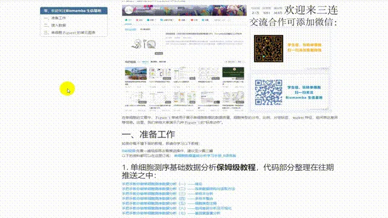
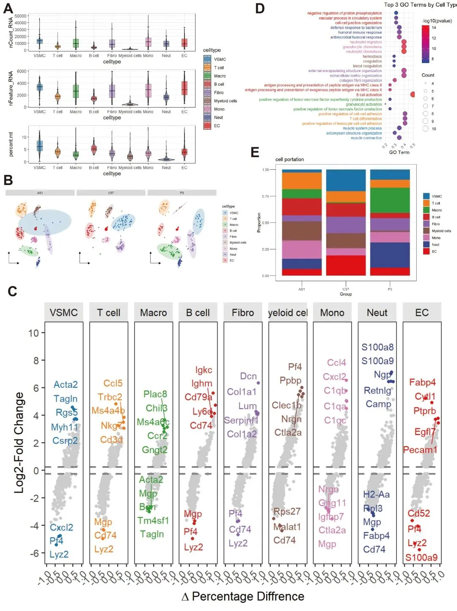

# 单细胞Figure 1常见图表（R语言版）

> 原文：https://mp.weixin.qq.com/s?__biz=MzAwMzIzOTk5OQ==&mid=2247538071&idx=2&sn=4c8baaa1a4ee5f53592c8426dfcb8762&chksm=9b3c2cc7ac4ba5d191da258084ad94f51a78b94787ec5de07bfaa155ebd25ac3d12a6dbe9669#rd
> 合集：单细胞教程全收录

写在前面

近年来随着单细胞测序技术的日益普及，普通的分析及**可视化** 已经越来越不能够满足各位的分析以及可视化需求。信、达、雅的全方位要求使得现在单细胞可视化越来越**卷** ，本文整理了单细胞Figure 1的**常见图表** ，能够展示单细胞数据的质控数据小提琴图、降维图、细胞比例堆积柱状图、富集分析气泡图、marker基因散点图等。更多单细胞可视化教程可参考：[单细胞图片改造计划](<https://mp.weixin.qq.com/mp/appmsgalbum?__biz=MzAwMzIzOTk5OQ==&action=getalbum&album_id=2707677276481814529#wechat_redirect>)更多学习资料可见：
[龙年订阅须知](<http://mp.weixin.qq.com/s?__biz=MzAwMzIzOTk5OQ==&mid=2247509093&idx=1&sn=d82ed3738bc25b922a4837016198951e&chksm=9b3cdd35ac4b5423f08cf6ab2f4afc5d815c2321991d880e8b7162e63fd1d7e4695cd7391022&scene=21#wechat_redirect>)

[单细胞Figure 1常见图表](<https://mp.weixin.qq.com/s?__biz=MzAwMzIzOTk5OQ==&mid=2247509260&idx=1&sn=9ff90a428c3f22d43a31ec864e2d8a94&chksm=9b3cdc5cac4b554a2f7cb2a6368f7df9a9a3f6e406eb070663f53d81841a76e188c0b50727de&token=2143911808&lang=zh_CN&scene=21#wechat_redirect>)

[快速上手Seurat V5](<https://mp.weixin.qq.com/s?__biz=MzAwMzIzOTk5OQ==&mid=2247509880&idx=1&sn=3b7cd169ccfe688d10cb1ca70dc91e91&chksm=9b3cde28ac4b573ec6d5f4bceafa4294c0e9a001b7d0c0b64f274a9978b1438eeccc747ca0c0&token=2143911808&lang=zh_CN&scene=21#wechat_redirect>)

[机器学习基础手册](<https://mp.weixin.qq.com/s?__biz=MzAwMzIzOTk5OQ==&mid=2247510121&idx=1&sn=87b53d350d9aedd5b3205d59e51356a0&chksm=9b3cd139ac4b582f23dd0ca65dcc66bed80b4240da76ee5abfbb61ec1bf62674ebfd2c50a45e&token=2143911808&lang=zh_CN&scene=21#wechat_redirect>)

[scRNA-Seq学习手册Seurat V4修订版](<https://mp.weixin.qq.com/s?__biz=MzAwMzIzOTk5OQ==&mid=2247510380&idx=1&sn=0eb2b0c519ef1dc25ee8821b736a0fde&chksm=9b3cd03cac4b592ad93149fb4847e6ba3dd03ab69e1ca594ddc64d323fb7496775789cae245d&token=2143911808&lang=zh_CN&scene=21#wechat_redirect>)

[Bulk RNASeq| 转录组实战](<https://mp.weixin.qq.com/s?__biz=MzAwMzIzOTk5OQ==&mid=2247510793&idx=1&sn=bfa69e8f261932d9bea74443fab732f0&chksm=9b3cd259ac4b5b4fd4b3bb80d0210a3396cda777b32ab49be1a45339453db314bb2a17fc438d&token=2143911808&lang=zh_CN&scene=21#wechat_redirect>)

[scRNA-Seq双细胞过滤手册](<https://mp.weixin.qq.com/s?__biz=MzAwMzIzOTk5OQ==&mid=2247511622&idx=1&sn=60b35668e569267bab14ec8fbba8bd74&chksm=9b3cd716ac4b5e00122eac47f55085198040a4a0e97c56895bbc39f3a9f1a1eb4eba27048a8f&token=2143911808&lang=zh_CN&scene=21#wechat_redirect>)

[CellChat空转细胞通讯合辑](<https://mp.weixin.qq.com/s?__biz=MzAwMzIzOTk5OQ==&mid=2247512011&idx=1&sn=fbd41832c5995d79fead016931d3bfbd&chksm=9b3cd69bac4b5f8d16e7d8b8eeb5490e4938daf68902b06a8d60e25f150ec4ec459796f3aaac&token=2143911808&lang=zh_CN&scene=21#wechat_redirect>)

[scRNA-Seq学习手册Seurat V5更新版](<https://mp.weixin.qq.com/s?__biz=MzAwMzIzOTk5OQ==&mid=2247519711&idx=1&sn=d25d4f5daf609bda8367f16db676ecf3&chksm=9b3cf48fac4b7d99e65eba6d4c66c63e40b1d187fa1d9e6449d6cd07d5dec5127cff54886f93&token=2143911808&lang=zh_CN&scene=21#wechat_redirect>)

[SCENIC转录因子调控网络图](<https://mp.weixin.qq.com/s?__biz=MzAwMzIzOTk5OQ==&mid=2247520750&idx=1&sn=496bead1531a7eddd5c286030d350745&chksm=9b3ce8beac4b61a8589a1f8a66bd0571e09c0646655b6d805348bf6f4a0c7b52851615c22868&token=2143911808&lang=zh_CN&scene=21#wechat_redirect>)

[scATAC分析学习手册](<https://mp.weixin.qq.com/s?__biz=MzAwMzIzOTk5OQ==&mid=2247521636&idx=1&sn=208907010f3f7412c1c91343d7dfb0d3&chksm=9b3cec34ac4b6522977cb002919634af5334eec170b32f4961826dafb42f44f611144b159b2b&token=2143911808&lang=zh_CN&scene=21#wechat_redirect>)

[单细胞拷贝数变异学习手册](<https://mp.weixin.qq.com/s?__biz=MzAwMzIzOTk5OQ==&mid=2247522733&idx=1&sn=4e3a0707fd8f83b5ad9377bc91ee8e53&chksm=9b3ce0fdac4b69ebf301818e3cccb668f443f66807d2a97edc463721d48392b52e10a262dfa7&token=2143911808&lang=zh_CN&scene=21#wechat_redirect>)

[microRNA-靶标相互作用及疾病和药物关联分析](<https://mp.weixin.qq.com/s?__biz=MzAwMzIzOTk5OQ==&mid=2247523676&idx=1&sn=6dad381e38df9ad63b90ed5935b73bf0&chksm=9b3ce40cac4b6d1af13dc1d8188d1134fae12213f536abcce8c683b6fa8e68b6a48c5b417215&token=2143911808&lang=zh_CN&scene=21#wechat_redirect>)

[《NC》代码复现| scRNA-seq揭示人纤维化皮肤病中的成纤维细胞异质性和间充质成纤维细胞增加](<https://mp.weixin.qq.com/s?__biz=MzAwMzIzOTk5OQ==&mid=2247525649&idx=1&sn=6145f50422ef8680be2a7ffd6c66f5f3&chksm=9b3c1c41ac4b955748b6735bb43b27fb222f3795c4ae49bb8a453f78765fc472ff43f9e7fc89&token=2143911808&lang=zh_CN&scene=21#wechat_redirect>)

[《Nature Communications》| scRNA-seq揭示头颈癌早期转移过程中潜在的免疫逃避机制](<https://mp.weixin.qq.com/s?__biz=MzAwMzIzOTk5OQ==&mid=2247526011&idx=1&sn=e601b8dedfad86ee6d9ce5b6d6ca8511&chksm=9b3c1f2bac4b963d523438200ea92f352bd84ab5fbb40a4b2220e7f1af77778f27aa1f728e47&scene=21&cur_album_id=3348420850777358342#wechat_redirect>)

[代码复写《Developmental Cell》|利用scRNA-seq对新生儿~成人肝脏发育和成熟的时间分析](<https://mp.weixin.qq.com/s?__biz=MzAwMzIzOTk5OQ==&mid=2247526426&idx=1&sn=7191649a25332d1b8bf2bd9c797d06a7&chksm=9b3c114aac4b985cd9d16e134892c140111b32493063036363b39119ef7aad205a3c12bba867&token=2143911808&lang=zh_CN&scene=21#wechat_redirect>)

[龙年订阅资料已完结~](<https://mp.weixin.qq.com/s?__biz=MzAwMzIzOTk5OQ==&mid=2247526649&idx=1&sn=9f822b11a117b2435982d8a22e9f4545&chksm=9b3c11a9ac4b98bf4467e02c806db8b4c8cd9c74897a1d47e1c96ddbe111e6ef487f17d5ce7e&token=2143911808&lang=zh_CN&scene=21#wechat_redirect>)

优惠订阅资料或参与课程请联系客服微信[Biomamba_zhushou]**更多生信教程可见：[为什么我们敢开放终身订阅](<https://mp.weixin.qq.com/s?__biz=MzAwMzIzOTk5OQ==&mid=2247535983&idx=1&sn=99378a252908b06f56432eb08741d278&scene=21#wechat_redirect>)** **-Biomamba**

所见即所得

一如既往地，我们整理好了测试文件和代码的html文件，供大家翻阅学习：
分析输出图片示例：

解锁前需阅读：[龙年订阅须知](<http://mp.weixin.qq.com/s?__biz=MzAwMzIzOTk5OQ==&mid=2247509093&idx=1&sn=d82ed3738bc25b922a4837016198951e&chksm=9b3cdd35ac4b5423f08cf6ab2f4afc5d815c2321991d880e8b7162e63fd1d7e4695cd7391022&scene=21#wechat_redirect>)

提取码联系客服领取：

本推送教程、测试文件下载链接：

https://pan.baidu.com/s/1nH-JuazShVbTAfzn5VSbQg

提取码请联系客服微信获取：

