# 在Python中利用Monocle3进行轨迹分析

> 原文：https://mp.weixin.qq.com/s?__biz=MzAwMzIzOTk5OQ==&mid=2247538758&idx=3&sn=e3d67a5cb8b9f49ac544b9222b2df019&chksm=9b3c2116ac4ba800f758a9e0856fa20d8aac599c4fc55c122ebda0488871e8ccdf9ba0651ed2#rd
> 合集：单细胞教程全收录

本推文沿着 `monocle3-python` 仓库下的 `tutorials/c_elegans_embryo_v2.ipynb`, 把  _C. elegans_ 早期胚胎 [scRNA-seq ](<https://mp.weixin.qq.com/mp/appmsgalbum?__biz=MzAwMzIzOTk5OQ==&action=getalbum&album_id=2168829347397156865#wechat_redirect>)数据的整套 [Monocle3](<https://mp.weixin.qq.com/s?__biz=MzAwMzIzOTk5OQ==&mid=2247490418&idx=1&sn=18ae0b6139fe1a2436dcf6cc47850297&scene=21#wechat_redirect>) [轨迹](<https://mp.weixin.qq.com/s?__biz=MzAwMzIzOTk5OQ==&mid=2247528666&idx=1&sn=d29545d296bac3e41de322e43fde80dd&scene=21#wechat_redirect>)分析在 Python 上重做一遍。每一步先讲算法在算什么 —— size factor、SimplePPT 主图、[pseudotime](<https://mp.weixin.qq.com/s?__biz=MzAwMzIzOTk5OQ==&mid=2247535114&idx=1&sn=95b6364b67d7ae9f03ba8455863ddabe&scene=21#wechat_redirect>)、`graph_test` 用的 Moran's I —— 再贴上 `monocle3-python` (当前 PyPI 版本 `1.4.26.post1`) 的 API 调用。

## 总览

`monocle3-python` 是`cole-trapnell-lab/monocle3`的 AnnData 重写版本。整套 port 的设计目标是逐 step 保留 R`monocle3`的编排顺序与数值行为, 同时把 R 的`cell_data_set`(继承自`SingleCellExperiment`的 S4 容器) 整个替换成`anndata.AnnData`, 把 UMAP、Leiden、MNN、GLM 这些非 monocle3-specific 的算法全部下放给`scverse`生态: UMAP 走`umap-learn`, Leiden 走`leidenalg`, kNN 走`annoy`/`pynndescent`/`hnswlib`, GLM 走`statsmodels`, MNN 用 port 自带的纯 Python`reduced_mnn`(`monocle3/_batchelor.py`是 R`batchelor::reducedMNN`的逐行翻译)。可视化栈走的是 Bio-Babel 同期出的`ggplot2_py`/`pheatmap-python`/`ggrepel-python`/`scales-python`。

整套 port 最值得展开的地方是 SimplePPT 主图学习: Monocle3 论文里的核心算法在 `monocle3/learn_graph.py` 里被逐行翻译, 是后面 `order_cells` 拿到 [pseudotime](<https://mp.weixin.qq.com/s?__biz=MzAwMzIzOTk5OQ==&mid=2247535114&idx=1&sn=95b6364b67d7ae9f03ba8455863ddabe&scene=21#wechat_redirect>) 的几何基础。下面我们按 spine notebook 走一遍, 完整地把这段流水线跑出来。

## 加载 Packer 胚胎数据

`load_packer_embryo()` 把 Packer 早期 _C. elegans_ 胚胎 [scRNA-seq](<https://mp.weixin.qq.com/mp/appmsgalbum?__biz=MzAwMzIzOTk5OQ==&action=getalbum&album_id=2168829347397156865#wechat_redirect>) 数据缓存到`~/.cache/monocle3-python/packer_embryo.h5ad`并返回`AnnData`对象, shape 是 (6188, 20222) —— 6188 个细胞 × 20222 个基因。`obs`里有几列后面会反复用到:`time.point`(胚胎采样时间点)、`embryo.time`(连续时间)、`embryo.time.bin`(粗分箱, 文章后面用`'130-170'`作为最早时段的 root)、`batch`、`cell.type`(Packer 团队给的 ground-truth 注释), 以及`bg.300.loading`、`bg.400.loading`、`bg.500.1.loading`、`bg.500.2.loading`、`bg.r17.loading`、`bg.b01.loading`、`bg.b02.loading` 这 7 个 loading-background 协变量, 它们是 R vignette 里用于 residual model 的输入。
```python
import numpy as np
import pandas as pd

import ggplot2_py as gg
import monocle3 as m3
print('monocle3-python', m3.__version__)
```
```
adata = m3.load_packer_embryo()
adata
```

## size factor + truncated PCA: `preprocess_cds`

`preprocess_cds` 做两件事: 一是把每个细胞的 size factor 写到`obs['Size_Factor']`, 二是在 size-factor-normalized 矩阵上跑一个截断 SVD 把 cells × genes 投到一个`num_dim`维的子空间里。size factor 用的是 R`monocle3`的默认`mean-geometric-mean-total`: 对每个细胞算总 UMI 计数`t_i`, 然后`s_i = t_i / exp(mean(log(t_i)))`—— 一个让所有细胞总量乘以`1/s_i`之后处在相同尺度上的几何均值归一化。Norm 默认`log`, 即对`X / s_i`做`log1p`。

[PCA](<https://mp.weixin.qq.com/s?__biz=MzAwMzIzOTk5OQ==&mid=2247485571&idx=1&sn=a0497f79fe83ff6b86705f6eb0e1cbf9&scene=21#wechat_redirect>) 走的是 `sparse_prcomp` (`monocle3/preprocess.py:312`), 这是 R `irlba::sparse_prcomp_irlba` 的功能等价物。关键点在中心化: 直接对稀疏矩阵减去列均值会把它 densify 掉, 因此 port 在大稀疏矩阵情况下用 `scipy.sparse.linalg.svds` 配合一个 `LinearOperator` 实现"隐式中心化" —— `matvec(v) = X @ (v/std) - col_mean @ (v/std)`、`rmatvec(u) = (X.T @ u - col_mean * u.sum()) / std` —— 这样既能拿到 PCA 等价结果, 又不展开矩阵。小问题 (`n_rows * n_cols < 5e6`) 直接走 `numpy.linalg.svd` 的稠密路径换取确定性。整段在调用 SVD 前显式 `np.random.seed(2016)`, 跟 R 的 `set.seed(2016)` 对齐。
```
m3.preprocess_cds(adata, num_dim=50)
```

执行后 `adata.obsm['X_pca']` 会拿到 (6188, 50) 的 PCA 坐标, 拟合细节 (SVD 旋转矩阵、奇异值、列均值、列标准差、解释方差比例、被保留的基因列表) 写到 `adata.uns['monocle3']['preprocess']['PCA']`, 后面 `find_gene_modules` 算 gene loading 就要去这里拿。

## residual subtraction + reducedMNN: `align_cds`

胚胎 [scRNA-seq](<https://mp.weixin.qq.com/mp/appmsgalbum?__biz=MzAwMzIzOTk5OQ==&action=getalbum&album_id=2168829347397156865#wechat_redirect>) 在做完 PCA 之后, 还要剥掉两类不感兴趣的差异: (a) 几个 loading-background 协变量带来的连续效应 (溶酶体污染等), (b) 不同建库批次间的离散偏移 (`batch` 列)。`align_cds` 把这两件事顺序做一遍。

(a) 走 patsy + OLS。给一个 R 风格的 formula `~ bg.300.loading + ... + bg.b02.loading`, port 在 `align_cds` 内部调 `patsy.dmatrix` 构造 design matrix, 用 `np.linalg.lstsq` 一把求出系数 β, 然后把非 intercept 列对应的 β 乘回 design matrix 再从 PC 坐标里减掉 —— 残差化, 但只减线性效应, 不引入非线性 (`monocle3/alignment.py:35`)。

(b) 走 `_batchelor.reduced_mnn`, 这是 R `batchelor::reducedMNN` 限定在 `monocle3` 调用形态下的纯 Python 翻译: `k=alignment_k` (默认 20), `ndist=3`, sequential merge order, KmknnParam-style 精确 kNN。两个 batch 之间找互最近邻 (mutual nearest neighbors), 在 MNN 对上估计偏移向量, 用 tricube 加权把全部细胞拉到对齐空间, 写出 `adata.obsm['X_aligned']`。
```
m3.preprocess_cds(adata, num_dim=50)
m3.align_cds(
    adata,
    residual_model_formula_str=(
        '~ bg.300.loading + bg.400.loading + bg.500.1.loading + '
        'bg.500.2.loading + bg.r17.loading + bg.b01.loading + bg.b02.loading'
    ),
    alignment_group='batch',
)
```

注意 `preprocess_cds` 在这里被重新调用 —— 为了 spine notebook 的代码块严格可复制, 第一个 cell 留着, 第二个 cell 把它和 `align_cds` 一起重跑一遍是 notebook 原貌, 实际生产里只跑第二段就够。

## UMAP: `reduce_dimension`

`reduce_dimension` 默认从`X_aligned`(若存在, 否则`X_pca`) 取出坐标, 跑 UMAP 投到 2D。后端是`umap-learn`, 但 port 默认`umap_nn_method='annoy'`—— 这条路径下 monocle3-python 不让`umap-learn`自己建 kNN 图, 而是用真正的`annoy`库严格按 R`uwot`的参数 (`n_trees=50`,`search_k = 2 * n_neighbors * n_trees`) 预算 kNN, 把`(indices, distances)`通过`umap.UMAP(precomputed_knn=...)`喂进去 (`monocle3/reduce_dimensions.py:258`)。对`cosine`距离还要把 annoy 的 "angular" 距离 (`sqrt(2*(1-cos))`) 平方再除以 2, 转回`umap-learn`内部期望的`1 - cos`度量 —— 这样数值结果和 R uwot 才能逐 batch 对上。`random_state=2016`,`transform_seed=2016`, 单线程 (`cores=1`) 下可复现;`cores>1` 时会显式 warn umap-learn 的并行 SGD 不确定性。
```
np.random.seed(42)
m3.reduce_dimension(adata, cores=1)
```
```
m3.plot_cells(adata, label_groups_by_cluster=False, color_cells_by='cell.type')
```

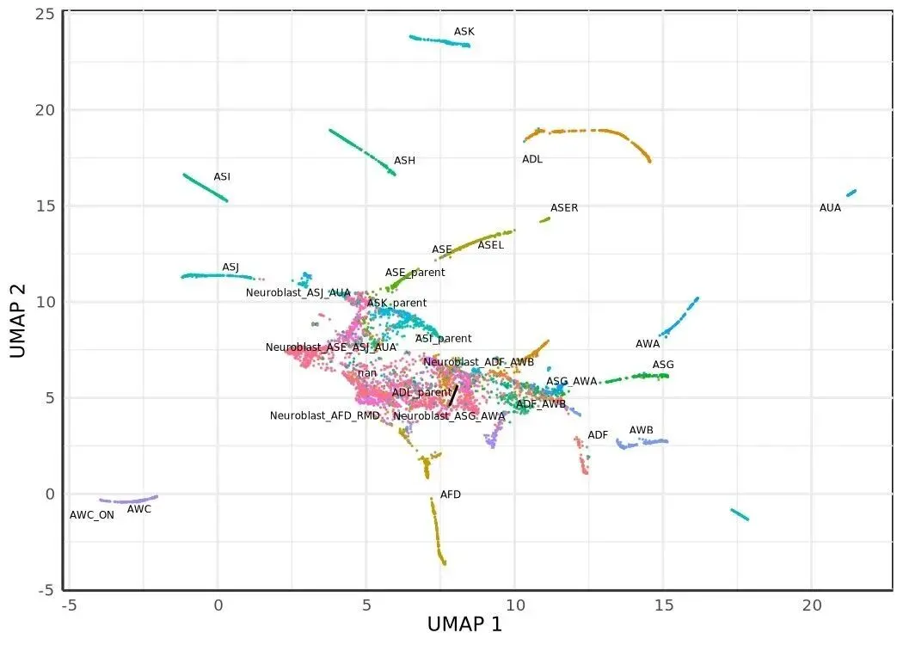

按 Packer 给的 `cell.type` 上色, 能直接看到胚层之间的连续过渡, 这是后面 SimplePPT 要在上面铺 principal graph 的底图。

## Jaccard-Leiden 聚类: `cluster_cells`

聚类的算法直觉是: 在 UMAP 坐标上建 kNN, 把每条边的权重换成两端节点 kNN 集合的 Jaccard 相似度, 然后在这张加权图上跑 Leiden。具体实现里, `_make_knn_graph`先调`nearest_neighbors.search_nn_matrix`拿 (k+1) 邻居, 把 self 那一列换到第 0 列以匹配 R 的`swap_nn_row_index_point`, 再通过`_clustering_cpp.jaccard_coeff`算所有边的 Jaccard 系数, 输出一张`igraph.Graph`(`monocle3/cluster_cells.py:38`)。Leiden 走`leidenalg.find_partition`, 默认`CPMVertexPartition`,`resolution_parameter=resolution`。注意 R`monocle3`默认`resolution=0.0001`, 但 Packer 胚胎数据需要更稀疏的 cluster, 因此 spine notebook 这里手动调成`5e-6`。

聚类得到 cluster 之后, 还要进一步把"显著连接的 cluster"合并成 **partition** , 这是 [Monocle3](<https://mp.weixin.qq.com/s?__biz=MzAwMzIzOTk5OQ==&mid=2247490418&idx=1&sn=18ae0b6139fe1a2436dcf6cc47850297&scene=21#wechat_redirect>) v3 的特色 (R `monocle3` v2 没这一步)。`_compute_partitions` (`monocle3/cluster_cells.py:177`) 在 cluster-cluster 邻接矩阵上做 PAGA 风格的二项检验: `M.T @ A @ M` 拿到每对 cluster 间的真实边数, 与 null 模型 (按节点度分布期望的边数) 比较得到 z-score 和 p-value, Holm step-down 校正, 切掉 q > 0.05 的边, 剩下的连通分量就是 partition。partition 在 `learn_graph` 阶段会被当作"独立轨迹子图"的边界用。
```
m3.cluster_cells(adata, resolution=5e-6)
m3.plot_cells(adata, group_cells_by='partition', color_cells_by='partition')
```

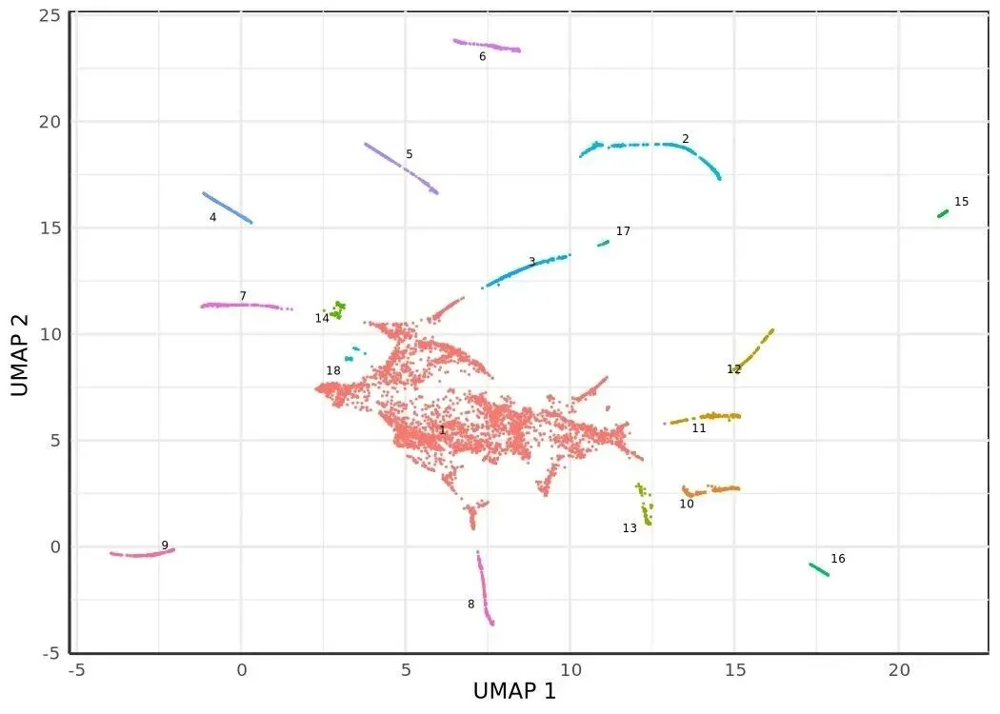

在这个 resolution 下整套数据落到一个 partition 里, 后面学到的 principal graph 也就是单连通的一棵树 (允许有环)。

## SimplePPT 主图: `learn_graph`

这一步是整篇文章最值得展开的地方。`learn_graph` 在每个 partition 内部独立学一张 **principal graph** , 形态上是一棵带可选环的无向图, 顶点是 K 个学习得到的 centroid, 边是它们之间的 MST。算法名叫 **SimplePPT** (Simple Principal Tree), 来自 reversed graph embedding 思想: 一边让 centroid 之间的总图距 (MST 边权和) 尽可能小, 一边让原始细胞与 centroid 的软分配距离尽可能小, 这两项加权求和构成目标函数, 在 centroid 上做交替优化。

`monocle3-python` 把这件事拆成四块, 全在 `monocle3/learn_graph.py` 里:

**初始化** : `_kmeans_with_init` 等距采样 K 个初始点 + k-means 聚到 K 个 cluster (`learn_graph.py:141`), 然后在每个 cluster 内取局部密度最高的点作为 medoid —— 密度估计是 `rho = exp(-mean kNN distance)`, kNN 用的是 `annoy` (`learn_graph.py:723-768`)。K 的默认值来自启发式 `n_clusters * 15 * log10(n_cells)`, 但 spine notebook 这里强制 `ncenter=1000` 以匹配 R vignette (R 的默认对胚胎数据偏粗)。

**SimplePPT 迭代** (`_calc_principal_graph`, `learn_graph.py:77`): 在 K 个 centroid 上交替三步, 直到目标函数相对变化 < `eps=1e-5`:

  1. **MST** : 对 centroid 配对欧式距离矩阵 Φ 跑最小生成树 (`igraph.Graph.Weighted_Adjacency` \+ `spanning_tree`);
  2. **Soft assignment** : 对每个细胞 i 和每个 centroid k, `P_ik ∝ exp(-‖x_i - C_k‖² / σ)`, 行归一化为分布 (`L1_sigma` 默认 0.01);
  3. **闭式重心更新** : 解线性方程 `(2 (diag(W·1) - W) + γ diag(P.T·1)) C.T = γ X P` 得到下一轮 centroid (`L1_gamma` 默认 0.5)。

**Loop closure** (`_connect_tips`, `learn_graph.py:516`): 默认 `close_loop=True`。算每个度为 1 的 tip 在细胞 kNN 图上的 PAGA q-value 矩阵, 同时算 tip-tip 间的 geodesic / euclidean 距离比。如果两个 tip 满足 `q < 0.05` \+ `geodesic ≥ (1/3) * diameter` \+ `euclidean ≤ 1 * max_edge`, 就在它们之间加一条边 —— 这是把 MST 的 acyclic 约束打破, 允许 trajectory 形成环 (例如细胞周期)。

**Prune** (`_prune_tree`, `learn_graph.py:584`): 默认 `prune_graph=True`。从一个度为 2 的 root 跑 BFS, 检查每个非树干分支的长度, 长度 < `minimal_branch_len=10` 就整支砍掉, 防止 noise tips 干扰下游 pseudotime。

最后 `_project2mst` (`learn_graph.py:245`) 把每个细胞投影到最近的 MST 边上, 构造一张 **cell-augmented graph** —— 顶点既有 centroid (`Y_1`、`Y_2`、...) 又有细胞名, 边按"沿 MST 边距离 source centroid 远近"排序后串起来。这张增广图就是下一步 `order_cells` 算 pseudotime 用的 igraph。
```
m3.learn_graph(adata, learn_graph_control={'ncenter': 1000})
```
```
m3.plot_cells(
    adata, color_cells_by='cell.type',
    label_groups_by_cluster=False,
    label_leaves=False, label_branch_points=False,
)
```

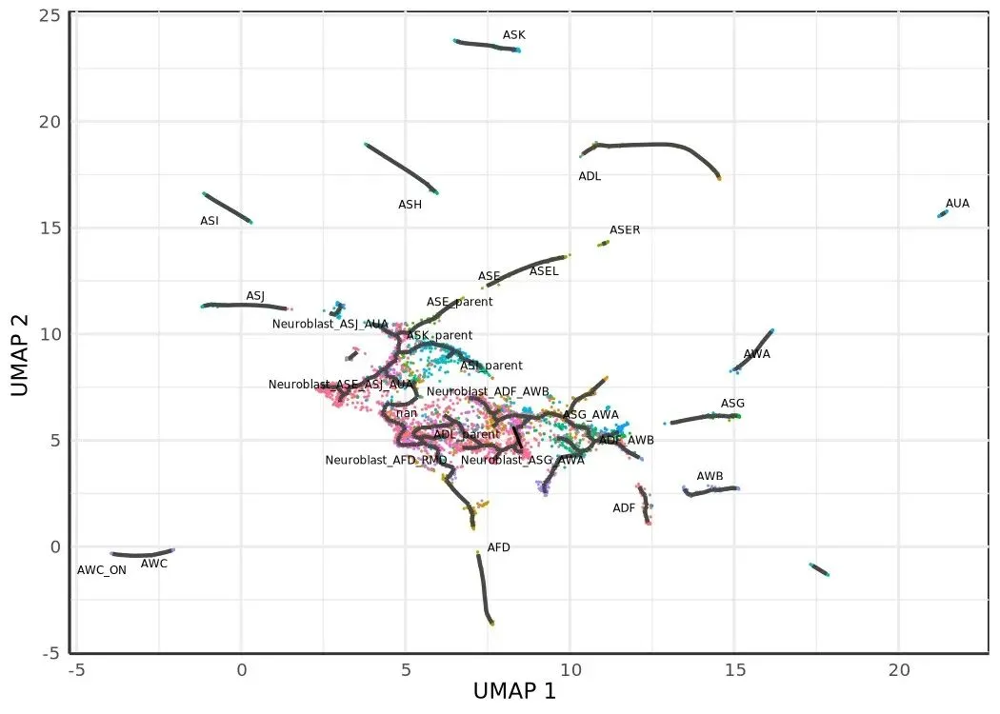
```
m3.plot_cells(
    adata, color_cells_by='embryo.time.bin',
    label_cell_groups=False,
    label_leaves=True, label_branch_points=True,
    graph_label_size=1.5,
)
```

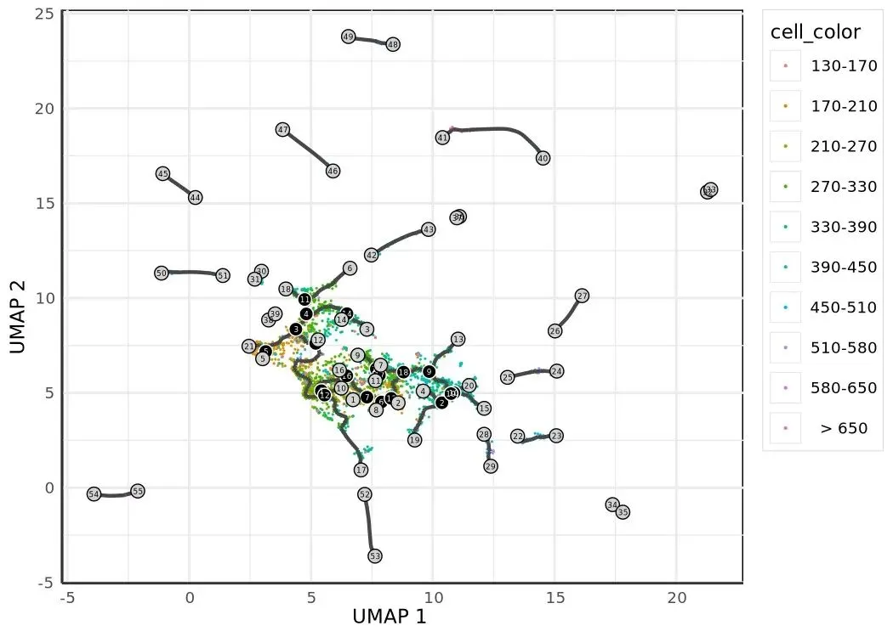

第二张图上标出了所有 leaf (终端 cell type) 和 branch point (命运分歧节点), 黑色折线段就是学到的 principal graph。配合 `embryo.time.bin` 的颜色, 能直接看出"早期时段聚集在中间, 沿着分支向 leaf 推进"的 trajectory 形状, 这就是接下来要量化的 pseudotime 走向。

## pseudotime: `order_cells`

有了 cell-augmented graph 之后, pseudotime 就是一个最短路径问题: 给一个或多个 root 节点, 算每个细胞在这张加权图上到 root 集合的最短路径距离, 多 root 取 min。

spine notebook 这里用的 root 选择策略是"最早时段细胞密度最大的 centroid"。`earliest_principal_node` 读 `adata.uns['monocle3']['principal_graph_aux']['UMAP']['pr_graph_cell_proj_closest_vertex']` 拿到每个细胞最近的 centroid (`V1` 列, 1-based ID), 在 `embryo.time.bin == '130-170'` 的子集里数频次, 最高的那个 `Y_k` 就是 root。这条策略比 R vignette 的 "interactive shiny picker" 严格 —— port 没移植 shiny, 强制用户给 `root_pr_nodes` 或 `root_cells`, 反而更适合做可复现实验。
```python
def earliest_principal_node(adata, time_bin='130-170'):
    mask = adata.obs['embryo.time.bin'].astype(str) == time_bin
    closest = adata.uns['monocle3']['principal_graph_aux']['UMAP'][
        'pr_graph_cell_proj_closest_vertex'
    ]['V1'].to_numpy()
    closest_subset = closest[mask.to_numpy()]
    values, counts = np.unique(closest_subset, return_counts=True)
    return [f'Y_{int(values[np.argmax(counts)])}']

m3.order_cells(adata, root_pr_nodes=earliest_principal_node(adata))
m3.plot_cells(
    adata, color_cells_by='pseudotime',
    label_cell_groups=False,
    label_leaves=False, label_branch_points=False,
    graph_label_size=1.5,
)
```

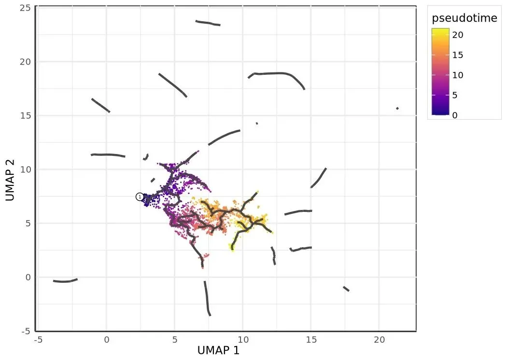

`order_cells` 内部对每个 root `Y_k` 找到 UMAP 空间里最近的实际细胞, 把这些细胞作为 source, 在 `pr_graph_cell_proj_tree` 上调 `igraph.distances(weights='weight')` 算所有节点 (centroid + cell) 到 source 的最短路径, pseudotime 写到 `obs['monocle3_pseudotime']`。一个值得知道的坑: 如果 `use_partition=True` (默认), 每个 partition 的 principal graph 是断开的, 不在 root 所在 partition 里的细胞会拿到 `inf`。这种情况下 port 会显式 `UserWarning` 提示用 `use_partition=False` 或者每个 partition 都给一个 root (`order_cells.py:156-172`)。我们这里只有一个 partition, 所以不会触发。

## 轨迹上的 marker panel

有了 pseudotime 和 principal graph, 下一步就是把 marker 基因在轨迹上的表达模式叠加上来。`plot_cells(genes=...)` 支持一次画多个基因, 每个基因占一个 panel, 颜色是 log-normalized 表达量 (`min_expr=0.1` 控制截断阈值)。
```
ciliated_genes = ['che-1', 'hlh-17', 'nhr-6', 'dmd-6', 'ceh-36', 'ham-1']

m3.plot_cells(
    adata, genes=ciliated_genes,
    label_cell_groups=False, show_trajectory_graph=False,
)
```

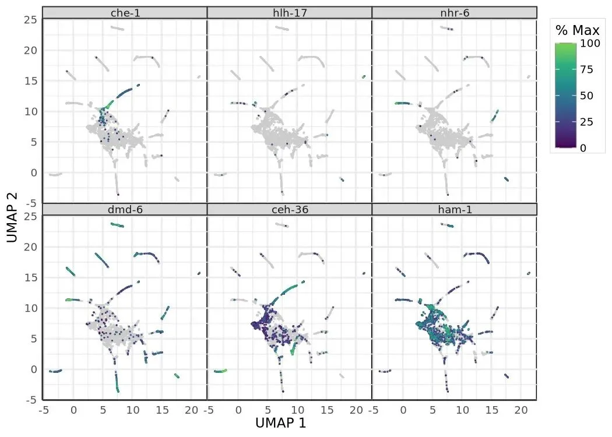

`plot_percent_cells_positive` 把每个时间点上 marker 阳性 (`X > min_expr`) 的细胞比例画成 barplot, 比直接看表达均值更稳健 —— 在 dropout 严重的 scRNA-seq 数据上, "几个细胞高表达 vs 多数细胞低表达"的差异往往比均值更有生物学意义。
```
gene_mask = adata.var['gene_short_name'].astype(str).isin(ciliated_genes)
(
    m3.plot_percent_cells_positive(
        adata[:, gene_mask].copy(),
        group_cells_by='time.point',
    )
    + gg.theme(
        axis_text_x=gg.element_text(angle=45, hjust=1),
        legend_position='none',
    )
)
```

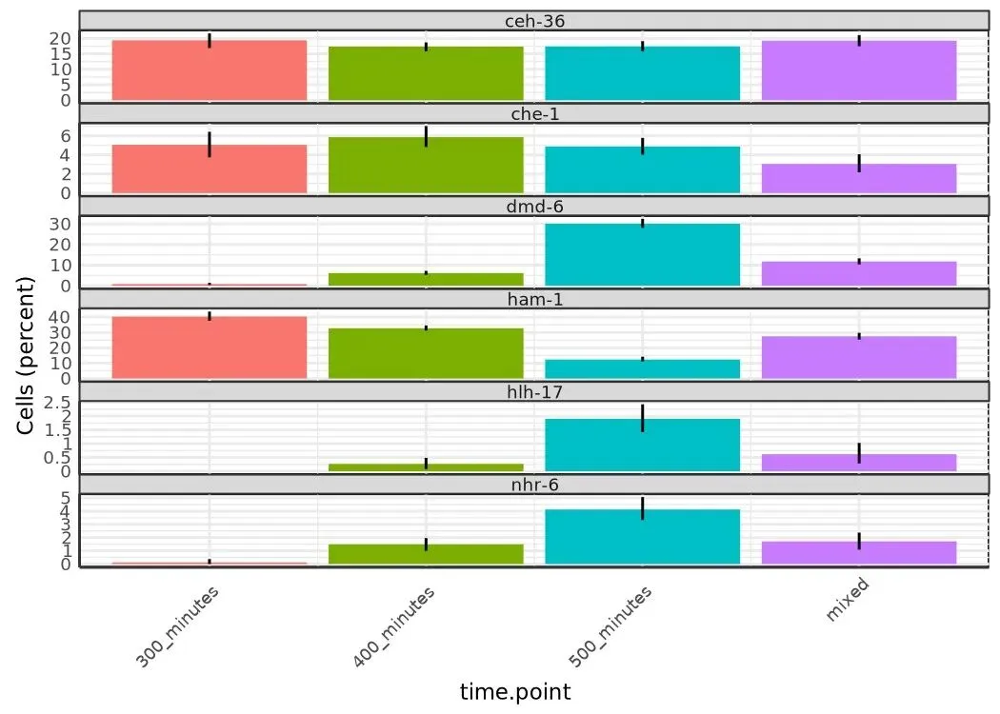

## per-gene GLM 差异表达: `fit_models`

`fit_models` 对每个基因独立拟合一个 GLM, 默认 `expression_family='quasipoisson'`, 对应 `statsmodels.GLM(family=Poisson(), offset=log(Size_Factor))` 加 post-fit dispersion 估计 (`monocle3/expr_models.py`)。把 `Size_Factor` 当 offset 而不是把表达量除以 SF, 是 count-based GLM 的标准做法: 它让模型在 count scale 上工作, 保留 mean-variance 关系。

R `monocle3` 暴露了 `quasipoisson` (默认)、`poisson`、`gaussian`、`binomial`、`negbinomial`、`zipoisson`、`zinegbinomial`, port 全部对接到对应的 `statsmodels` 接口 (NB 和 ZINB 走 `statsmodels.discrete.count_model.NegativeBinomial` / `ZeroInflatedNegativeBinomialP`)。`mixed-negbinomial` 在 port 里抛 `NotImplementedError` —— R 用的 `lme4` glmer 还没有等价的 statsmodels 接口。

下面四段代码展示了 `fit_models` 的几种典型用法: 单变量 (`~ embryo.time`)、加协变量 (`~ embryo.time + batch`)、似然比检验对比模型 (`compare_models`)、用 spline 拟合非线性趋势 (`~ splines::ns(pseudotime, df=3)`)。
```
adata.obs['pseudotime'] = m3.pseudotime(adata)
sub = adata[:, gene_mask].copy()

gene_fits_time = m3.fit_models(sub, model_formula_str='~embryo.time')
fit_coefs = m3.coefficient_table(gene_fits_time)

(
    fit_coefs
    .query("term in ('embryo.time', 'embryo_time')")
    .query('q_value < 0.05')
    [['gene_short_name', 'term', 'q_value', 'estimate']]
)
```

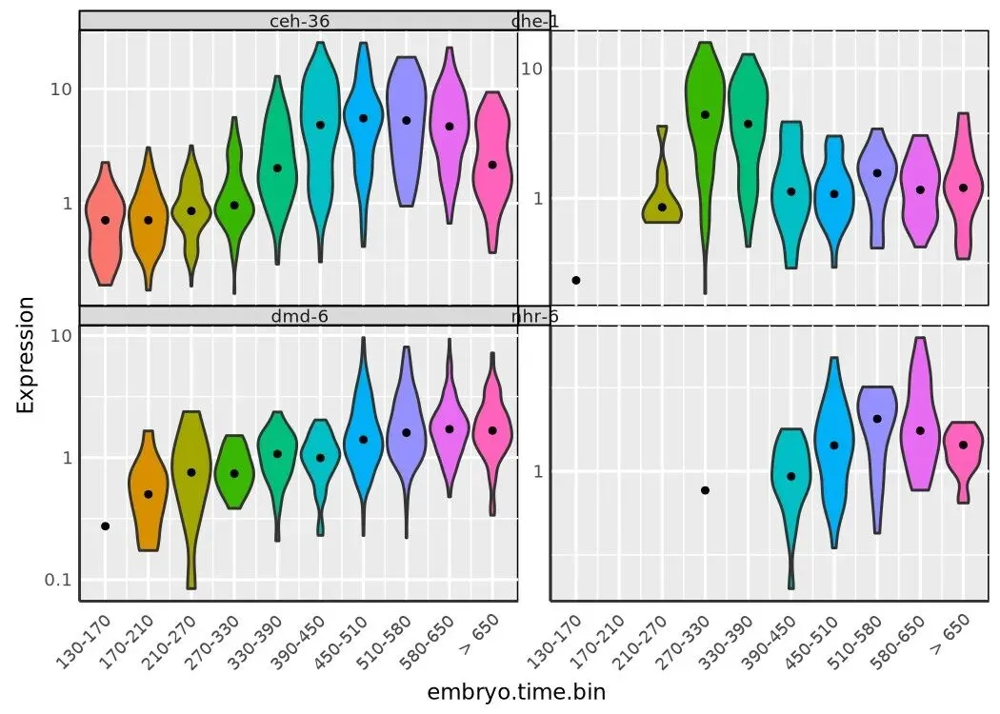
```
violin_mask = adata.var['gene_short_name'].astype(str).isin(
    ['che-1', 'nhr-6', 'dmd-6', 'ceh-36']
)
(
    m3.plot_genes_violin(
        adata[:, violin_mask].copy(),
        group_cells_by='embryo.time.bin', ncol=2,
    )
    + gg.theme(axis_text_x=gg.element_text(angle=45, hjust=1))
)
```
```
gene_fits_batch = m3.fit_models(sub, model_formula_str='~embryo.time + batch')

m3.coefficient_table(gene_fits_batch) \
    .query("term not in ('Intercept', '(Intercept)')") \
    [['gene_short_name', 'term', 'q_value', 'estimate']]
```
```
m3.evaluate_fits(gene_fits_batch)
```
```
time_models = m3.fit_models(
    sub, model_formula_str='~embryo.time', expression_family='negbinomial'
)
time_batch_models = m3.fit_models(
    sub, model_formula_str='~embryo.time + batch', expression_family='negbinomial'
)

m3.compare_models(time_batch_models, time_models)[['gene_id', 'q_value']]
```
```
finite = np.isfinite(adata.obs['pseudotime'].to_numpy())
sub_pt = adata[finite][:, gene_mask].copy()

gene_fits_pt = m3.fit_models(
    sub_pt,
    model_formula_str='~splines::ns(pseudotime, df=3)',
)
(
    m3.coefficient_table(gene_fits_pt)
    .loc[lambda d: d['term'].str.contains('pseudotime')]
    .assign(q_value=lambda d: d['q_value'].fillna(1.0))
    .query('q_value < 0.05')
    [['gene_short_name', 'term', 'q_value', 'estimate']]
)
```

`coefficient_table` 出 broom 风格的 tidy 表 (每行一个`(gene, term)`对),`evaluate_fits`出每个基因的`r_squared`/`df`/`logLik`/`status`,`compare_models`用 chi-square 检验做嵌套模型的似然比检验。注意`~ splines::ns(pseudotime, df=3)`这种 R 风格的函数调用 formula 是被`patsy` 透传识别的, df=3 的 natural cubic spline 把 pseudotime 拆成三段单调可微的曲线, 能拟合"先升后降"或"S 形累积"这类典型基因表达动态。

## 主图驱动的差异表达: `graph_test` \+ gene modules

到这里为止的 DE 都是"基因在某个外部变量 (time, pseudotime, batch) 上的响应"。Monocle3 v3 引入了一种新的视角: 把整张 principal graph 当成空间结构, 问"哪些基因的表达在这张图上有空间自相关", 也就是 **Moran's I** 。直觉是: 一个基因如果在轨迹上每个区域随机分布, Moran's I 接近 0; 如果它在某个 lineage 上集中表达 (邻接细胞表达值相似), Moran's I 显著大于 0。

`graph_test(neighbor_graph='principal_graph')` 的精彩之处在邻接图怎么造 (`monocle3/graph_test.py:207`): 它不直接用 UMAP 上的 kNN, 而是先算 kNN 的 Jaccard 边权, 再造一个"细胞 → 最近 centroid"的 indicator 矩阵 M, 用 `M @ (principal_g + I) @ M.T` 得到 feasibility mask —— 只有"两个细胞各自最近的 centroid 在 principal graph 上相邻 (或就是同一个)"的细胞对才保留, 其他全部置零。这样得到的邻接图把"轨迹相邻"的几何约束硬编码进了空间自相关的定义里, 比直接在 UMAP 上算 Moran's I 更能反映 trajectory 上的表达模式。

Moran's I 本身的方差公式是 R `spdep` 的标准写法, port 在 `_moran_per_row` (`graph_test.py:50`) 里逐项实现, BH 校正出 q-value。
```python
pr_graph_test_res = m3.graph_test(adata, neighbor_graph='principal_graph', cores=4)
pr_deg_ids = pr_graph_test_res.query('q_value < 0.05').index.tolist()

gene_module_df = m3.find_gene_modules(adata[:, pr_deg_ids].copy(), resolution=1e-3)
cell_group_df = pd.DataFrame({
    'cell': adata.obs_names,
    'cell_group': adata.obs['cell.type'].astype(str).to_numpy(),
})

agg_mat = m3.aggregate_gene_expression(
    adata,
    gene_group_df=gene_module_df[['id', 'module']],
    cell_group_df=cell_group_df,
)
agg_mat.index = ['Module ' + str(i) for i in agg_mat.index]

import pheatmap
pheatmap.pheatmap(
    agg_mat, scale='column', clustering_method='ward.D2', fontsize=6,
)
```

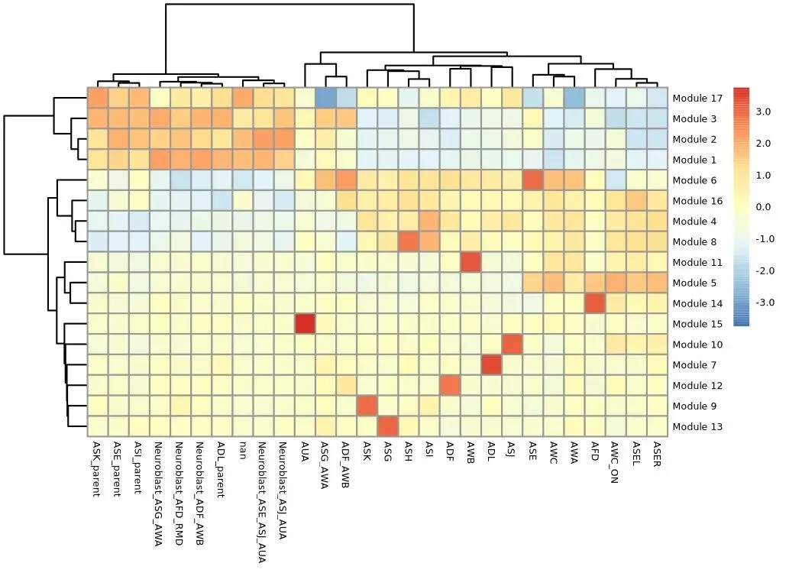

`find_gene_modules` 把 `graph_test` 选出来的显著基因 (`q < 0.05`) 在 PCA loading 空间 (`SVD.v @ diag(SVD.sdev)`) 上跑一遍 UMAP, 然后跑 Leiden 聚类, 得到 (gene_id, module) 表 (`monocle3/cluster_genes.py:97`)。`aggregate_gene_expression` 把它和 `cell_group_df` (这里按 `cell.type` 分组) 一起做成 module × cell_type 的 z-score 矩阵, 喂给 `pheatmap` 画出 module 在不同细胞类型上的特异性 —— 这就是 Monocle3 论文里那张著名的"细胞类型 × 基因模块"热图。
```
m3.plot_cells(adata, genes=gene_module_df, label_cell_groups=False, show_trajectory_graph=False)
```

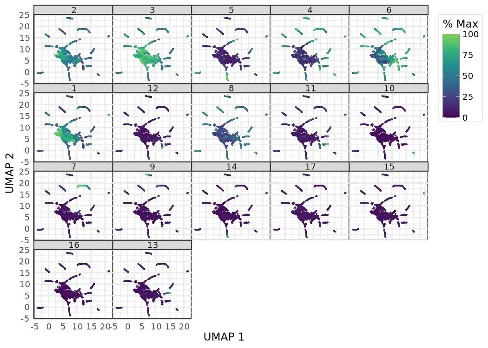

把 `gene_module_df` 直接传给 `plot_cells(genes=...)`, 就能在 UMAP 上每个 module 一个 panel 把"哪些细胞 module-X 整体高表达"可视化出来, 是 module 解读最直观的视图。

## AFD lineage 的 pseudotime 表达曲线

最后看一段沿着 [pseudotime](<https://mp.weixin.qq.com/s?__biz=MzAwMzIzOTk5OQ==&mid=2247535114&idx=1&sn=95b6364b67d7ae9f03ba8455863ddabe&scene=21#wechat_redirect>) 的基因动态。R vignette 这里 hardcode 了 `cluster IDs 22 / 28 / 35` 三个 AFD 神经元相关 cluster, 但 port 里 Leiden 给出的 cluster 编号不一定能对上, spine notebook 用一个更稳健的策略: 取细胞数最多的前三个 cluster 当 AFD 代理子集, 然后在 AFD 子集上画 `gcy-8` / `dac-1` / `oig-8` 三个标志基因沿 pseudotime 的曲线。
```
cluster_counts = m3.clusters(adata).value_counts()
top_clusters = cluster_counts.head(3).index.tolist()
afd_mask = m3.clusters(adata).isin(top_clusters)

afd_cds = adata[afd_mask.to_numpy()].copy()
afd_genes_mask = afd_cds.var['gene_short_name'].astype(str).isin(
    ['gcy-8', 'dac-1', 'oig-8']
)

m3.plot_genes_in_pseudotime(
    afd_cds[:, afd_genes_mask].copy(),
    color_cells_by='embryo.time.bin',
    min_expr=0.5,
)
```

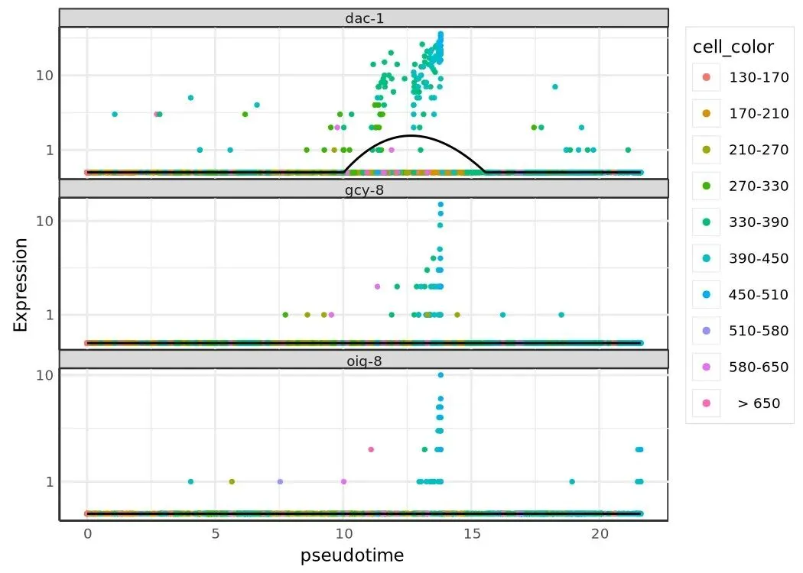

`plot_genes_in_pseudotime` 内部对每个基因在 pseudotime 上拟合一条平滑曲线 (loess 或 spline, 看参数), 把表达 (`> min_expr` 的细胞) 按 pseudotime 排开画 scatter + 拟合曲线。从这张图能直接读到"这个 marker 在 AFD lineage 上是早期高、晚期消失, 还是反过来"的时间走向, 是把 trajectory 落回到具体基因的最后一步。

## 收尾

我们把 spine notebook 的 11 个核心 step 全部走了一遍: 加载 → size factor + PCA → residual + reducedMNN → UMAP → Jaccard-Leiden 聚类 +[ PAGA ](<https://mp.weixin.qq.com/s?__biz=MzAwMzIzOTk5OQ==&mid=2247535114&idx=1&sn=95b6364b67d7ae9f03ba8455863ddabe&scene=21#wechat_redirect>)partition → SimplePPT 主图 + loop closure + prune → cell-augmented 最短路径[ pseudotime](<https://mp.weixin.qq.com/s?__biz=MzAwMzIzOTk5OQ==&mid=2247535114&idx=1&sn=95b6364b67d7ae9f03ba8455863ddabe&scene=21#wechat_redirect>) → marker panel → GLM DE (含 spline 和 LR 检验) → 主图邻接 Moran's I + gene module → AFD lineage 表达曲线。`monocle3-python` 的设计回避了"R 包 Python 化"常见的两个坑: 既没有保留 `cell_data_set` 的 S4 兼容 shim (用户直接读 `adata.X` / `obs` / `var` / `obsm`, 跟整个 scverse 生态一致), 也没有把核心算法拆给第三方接口 (SimplePPT、Moran's I、reducedMNN、[PAGA](<https://mp.weixin.qq.com/s?__biz=MzAwMzIzOTk5OQ==&mid=2247535114&idx=1&sn=95b6364b67d7ae9f03ba8455863ddabe&scene=21#wechat_redirect>) 风格 partition 这几个 monocle3 特有的步骤全部在 port 内部用 numpy / scipy / igraph 重写, 数值上和 R 上游对齐)。日常如果你需要在 Python 里跑 trajectory analysis, 这套 port 现在已经可以当成 R `monocle3` 的直接替代; 如果你的 pipeline 还在 R 那边, port 的 R-parity 也让"做对照实验"或者"跨语言复现"成为可行操作。

* * *

代码: `https://github.com/Bio-Babel/Monocle3-python`. 示例数据: `packer_embryo.h5ad` (Zenodo). 上游 R 包: `https://github.com/cole-trapnell-lab/monocle3`.


**如何联系我们**

 留一个领取[资料](<https://mp.weixin.qq.com/s?__biz=MzAwMzIzOTk5OQ==&mid=2247535983&idx=1&sn=99378a252908b06f56432eb08741d278&scene=21#wechat_redirect>)、[开箱即用的单细胞分析镜像](<https://mp.weixin.qq.com/s?__biz=MzAwMzIzOTk5OQ==&mid=2247536307&idx=1&sn=8d03259be06f54521aac5251dec988d5&scene=21#wechat_redirect>)的**微信号[Biomamba_zhushou]**，方便各位随时交流。同时我们也构建了[交流群矩阵](<https://mp.weixin.qq.com/s?__biz=MzAwMzIzOTk5OQ==&mid=2247536307&idx=2&sn=2d030173f51d24a4fee43bd0d83da03b&scene=21#wechat_redirect>)，欢迎大家入群讨论。
大家可以阅读完这几篇之后添加[给生信入门初学者的小贴士](<http://mp.weixin.qq.com/s?__biz=MzAwMzIzOTk5OQ==&mid=2247493329&idx=1&sn=597870b7f7ce10346da3561e7c281627&chksm=9b3c9f81ac4b169794088ce9abbcacb5f18e9fd174fc0d7e28da62d78facadf3100ef38aaf22&scene=21#wechat_redirect>)[没有检索，就没有发言权](<https://mp.weixin.qq.com/s?__biz=MzAwMzIzOTk5OQ==&mid=2247529398&idx=2&sn=5a429852d61721916a405712677d5905&scene=21#wechat_redirect>)

**已有生信基地联系方式的同学****无需重复添加**

 您点的每个赞和在看，我都认真当成了喜欢
