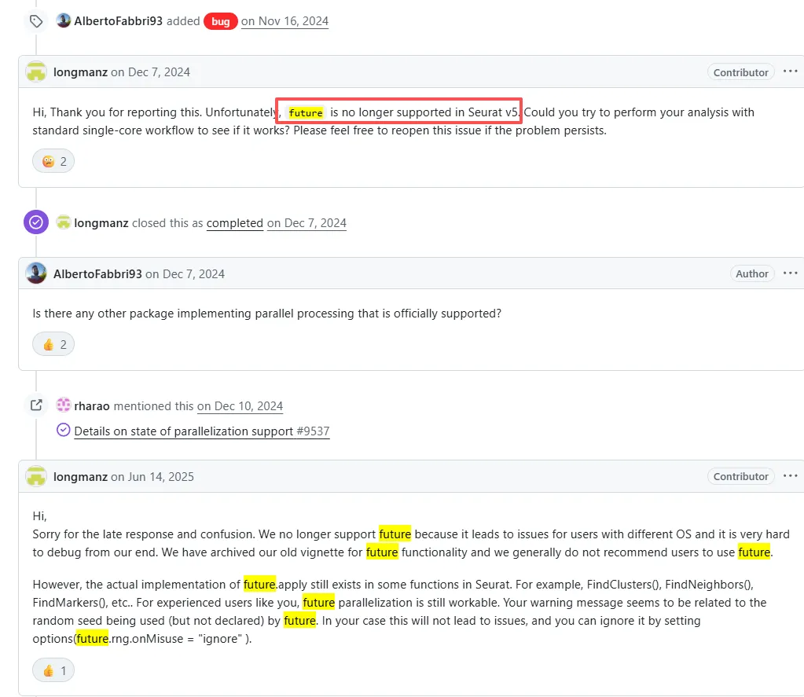
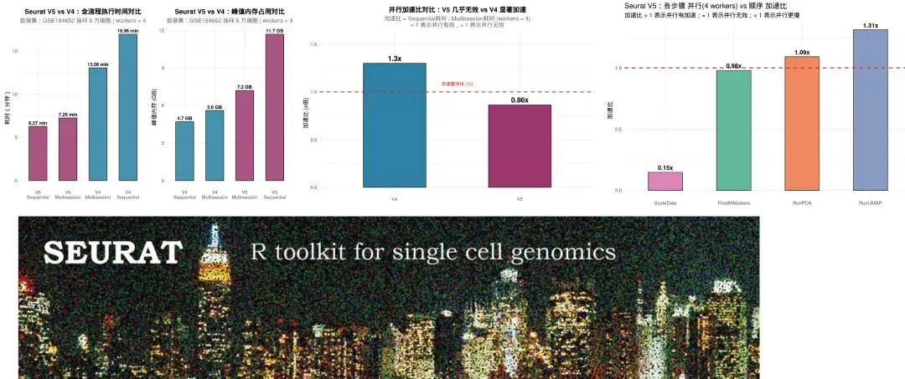
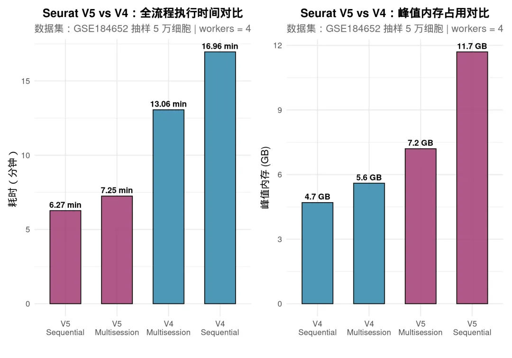
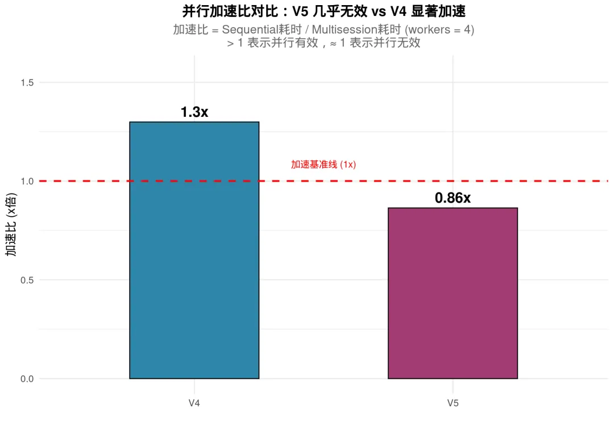
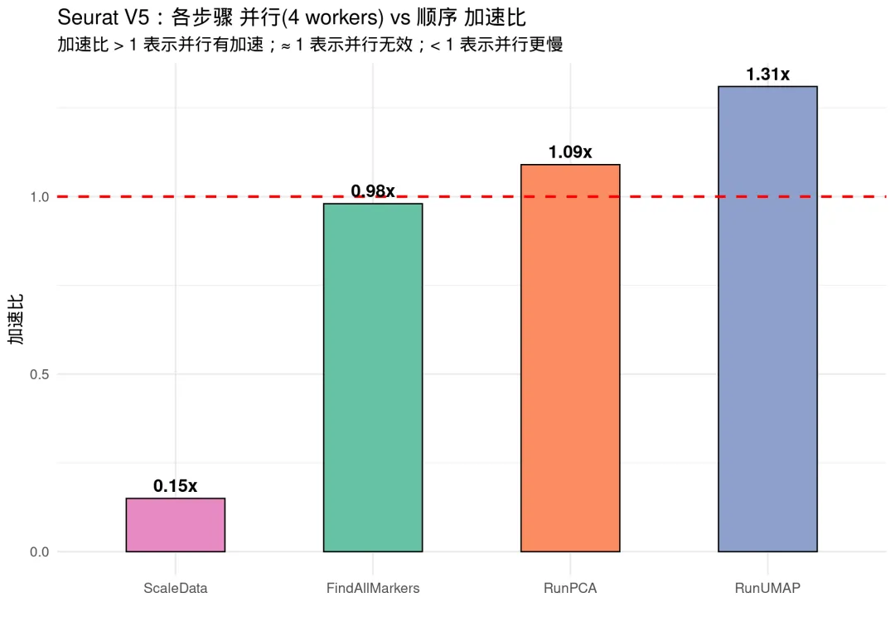

# future并行计算反而会让Seurat v5计算速度变慢

> 原文：https://mp.weixin.qq.com/s?__biz=MzAwMzIzOTk5OQ==&mid=2247540715&idx=1&sn=e8a765d7aecf55195580adee68edb2ef&chksm=9b3c26bbac4bafad168382e3687df9c7031225fd271090a5dfb0fa88e0e75a589f6ae4c7f847#rd
> 合集：单细胞教程全收录


**一、Seurat V5已经不支持future加速
**

在往期教程[百万级单细胞数据](<https://mp.weixin.qq.com/s?__biz=MzAwMzIzOTk5OQ==&mid=2247531160&idx=1&sn=ecf56af3b929ec2b241854c89d25c671&scene=21#wechat_redirect>)资源消耗实测中，我们对 **GSE184652** 这个百万级单细胞数据集进行了基础分析、细胞通讯、拟时序分析和去批次整合的全流程测试。很多同学反馈，虽然[服务器](<https://mp.weixin.qq.com/s?__biz=MzAwMzIzOTk5OQ==&mid=2247538845&idx=2&sn=4f2984867981df3d282b9f5405c85c09&scene=21#wechat_redirect>)配置够高，但分析速度依然不如预期。

一个重要原因是：**Seurat V5 对` future` 并行计算的支持发生了变化**。在 Seurat V4 中，我们可以通过 `future::plan("multisession")` 让 `ScaleData`、`FindAllMarkers` 等关键步骤实现多核并行加速；但在 V5 中，这种并行策略**不再有效** ，甚至可能导致性能下降。 Seurat 官方在 GitHub Issue #9488 中的明确回复，“Unfortunately, future is no longer supported in Seurat v5”。



本教程将通过**同一套数据、相同分析流程** ，分别在 Seurat V5 和 Seurat V4 环境中： - 测试 `sequential`（顺序计算）vs `multisession`（多核并行）的实际表现 - 用 `peakRAM` 和 `system.time` 精准记录内存与时间开销 - 直观展示 V5 与 V4 在并行计算支持上的差异。证明future的确会让Seurat V5性能下降。


核心结论是：1、V5比V4快了近一倍2、V5占用的内存也比V4大了近一倍3、future并行计算对V4可以生效，但对V5时计算效率反而只有顺序计算的86%4、future并行计算在PCA(~9%)、UMAP(~31%)计算时仍展现出一定的加速能力不过真想要速度快，还得看python：[挑战用Python分析一百万个单细胞数据](<https://mp.weixin.qq.com/s?__biz=MzAwMzIzOTk5OQ==&mid=2247534670&idx=1&sn=7178b77f1efe4ca253f90b9121231204&scene=21#wechat_redirect>)[](<https://mp.weixin.qq.com/s?__biz=MzAwMzIzOTk5OQ==&mid=2247539059&idx=1&sn=5707529e91b0bcb7577947f0b6383cf8&scene=21#wechat_redirect>)

**二、实测过程**

如果你的计算机不足以支持大规模的计算，可按需选用适合自己的计算资源：

共享(经济实惠)：[足够支持你完成硕博生涯的共享服务器](<https://mp.weixin.qq.com/s?__biz=MzAwMzIzOTk5OQ==&mid=2247532373&idx=2&sn=4708fac31ac8f4e347847e4b7f2a4fed&scene=21#wechat_redirect>)独享(省电省心)：[如何拥有一台服务器，且不用自己搭建维护](<https://mp.weixin.qq.com/s?__biz=MzAwMzIzOTk5OQ==&mid=2247534670&idx=2&sn=b4296f98e4f8e171a8833a202bd9f926&scene=21#wechat_redirect>)

访问链接：https://biomamba.xiyoucloud.net/

更多内容可骚扰[**Biomamba_zhushou**]

## (一)、环境与数据

## 1、Seurat V5 环境
```r
library(Seurat)
```
```r
library(future)
library(peakRAM)
library(dplyr)
```
```r
library(ggplot2)
library(patchwork)
```
```
cat("Seurat 版本：", as.character(packageVersion("Seurat")), "\n")
```
```
## Seurat 版本： 5.0.0
```
```
cat("future 版本：", as.character(packageVersion("future")), "\n")
```
```
## future 版本： 1.34.0
```
```
cat("R 版本：", as.character(getRversion()), "\n")
```
```
## R 版本： 4.4.2
```

## 2、测试数据

使用 **GSE184652** （小鼠肾脏 snRNA-seq，~95万细胞），随机抽取 **5万个细胞** 进行测试：
```
# 加载预保存的抽样数据（counts矩阵 + metadata）
load("./data/v5_test_counts.RData")

cat("测试细胞数：", ncol(counts), "\n")
```
```
## 测试细胞数： 50000
```
```
cat("基因数：", nrow(counts), "\n")
```
```
## 基因数： 23889
```
```
cat("counts矩阵大小：", format(object.size(counts), units ="auto"), "\n")
```
```
## counts矩阵大小： 672.9 Mb
```

# (二)、Seurat V5 全流程对比: Sequential vs Multisession

以下测试在 Seurat V5 (5.0.0) + R 4.4.2 下完成。我们使用 `peakRAM` 包精确监控整个分析流程的时间和峰值内存。

测试流程覆盖单细胞标准分析的完整步骤：`NormalizeData` → `FindVariableFeatures` → `ScaleData` → `RunPCA` → `FindNeighbors` → `FindClusters` → `RunUMAP` → `RunTSNE` → `FindAllMarkers`
```r
# 读取预计算的V5测试结果
v5_results <-readRDS("./data/v5_pipeline_results.rds")

v5_seq <-v5_results$sequential
v5_multi <-v5_results$multisession

cat("\n========== V5 Sequential 结果 ==========\n")
```
```
##
## ========== V5 Sequential 结果 ==========
```
```
cat("耗时（秒）：", v5_seq$Elapsed_Time_sec, "\n")
```
```
## 耗时（秒）： 375.933
```
```
cat("耗时（分钟）：", round(v5_seq$Elapsed_Time_sec/60, 1), "\n")
```
```
## 耗时（分钟）： 6.3
```
```
cat("峰值内存（MiB）：", v5_seq$Peak_RAM_Used_MiB, "\n")
```
```
## 峰值内存（MiB）： 11932.9
```
```
cat("峰值内存（GB）：", round(v5_seq$Peak_RAM_Used_MiB/1024, 1), "\n")
```
```
## 峰值内存（GB）： 11.7
```
```
cat("\n========== V5 Multisession (4 workers) 结果 ==========\n")
```
```
##
## ========== V5 Multisession (4 workers) 结果 ==========
```
```
cat("耗时（秒）：", v5_multi$Elapsed_Time_sec, "\n")
```
```
## 耗时（秒）： 435.182
```
```
cat("耗时（分钟）：", round(v5_multi$Elapsed_Time_sec/60, 1), "\n")
```
```
## 耗时（分钟）： 7.3
```
```
cat("峰值内存（MiB）：", v5_multi$Peak_RAM_Used_MiB, "\n")
```
```
## 峰值内存（MiB）： 7367.3
```
```
cat("峰值内存（GB）：", round(v5_multi$Peak_RAM_Used_MiB/1024, 1), "\n")
```
```
## 峰值内存（GB）： 7.2
```
```r
# 加速比
v5_speedup <-v5_seq$Elapsed_Time_sec /v5_multi$Elapsed_Time_sec
cat("\n========== V5 加速比分析 ==========\n")
```
```
##
## ========== V5 加速比分析 ==========
```
```
cat("加速比 (Seq/Multi)：", round(v5_speedup, 2), "x\n")
```
```
## 加速比 (Seq/Multi)： 0.86 x
```
```
cat("结论：", ifelse(v5_speedup >1.3, "多核有明显加速",
ifelse(v5_speedup >1.05, "多核有微弱加速",
ifelse(v5_speedup >0.95, "多核几乎无加速（并行失效！）",
"多核反而更慢（并行产生负优化！）"))), "\n")
```
```
## 结论： 多核反而更慢（并行产生负优化！）
```
```r
# 构建结果表
v5_seq_result <-data.frame(Version ="V5", Mode ="Sequential",
Time_sec = v5_seq$Elapsed_Time_sec, Peak_RAM_MiB = v5_seq$Peak_RAM_Used_MiB)
v5_multi_result <-data.frame(Version ="V5", Mode ="Multisession",
Time_sec = v5_multi$Elapsed_Time_sec, Peak_RAM_MiB = v5_multi$Peak_RAM_Used_MiB)
```

## V5 并行过程的警告信息

Seurat V5 在使用 `multisession` 时会产生随机数相关的警告，这暴露了 V5 对未来并行支持的不完善：

> `Warning: UNRELIABLE VALUE: One of the 'future.apply' iterations ('future_lapply-1') unexpectedly generated random numbers without declaring so. There is a risk that those random numbers are not statistically sound`

这意味着**即使表面上开启了并行，Seurat V5 内部其实无法正确管理和协调多进程间的随机数** ，这也是 V5 并行失效的一个佐证。

# 四、Seurat V4 全流程对比: Sequential vs Multisession

## V4 环境安装

通过 conda-forge 的预编译包安装 Seurat V4.4.0（无需从源码编译）：
```
# 终端执行：
# conda create -n SeuratV4_env -c conda-forge r-seurat=4.4.0 r-future r-peakRAM \
#   r-ggplot2 r-dplyr r-patchwork r-matrix r-igraph \
#   r-rcolorbrewer r-ggrepel r-tidyr r-tibble r-scales -y
```

Seurat V5 和 V4 的 SeuratObject 版本不兼容，因此使用 conda 环境进行彻底隔离。

## 生成 V4 测试脚本
```r
# 生成 V4 测试脚本
v4_script <- '
# 验证版本（在 SeuratV4_env conda 环境中运行）
library(Seurat)
library(future)
library(peakRAM)
library(Matrix)
library(dplyr)

cat("========== Seurat V4 环境确认 ==========\\n")
cat("Seurat 版本：", as.character(packageVersion("Seurat")), "\\n")
cat("future 版本：", as.character(packageVersion("future")), "\\n")

# 读取 V5 会话保存的 counts 和 meta
load("./data/v5_test_counts.RData")
cat("细胞数：", ncol(counts), "\\n")

# ========== V4 Sequential ==========
cat("\\n========== V4 Sequential ==========\\n")
plan("sequential")

v4_seq <- peakRAM({
  scRNA_v4_seq <- CreateSeuratObject(counts = counts, project = "scRNA_5w_V4", min.cells = 3, min.features = 200)
  scRNA_v4_seq <- AddMetaData(scRNA_v4_seq, metadata = meta)
  scRNA_v4_seq[["percent.mt"]] <- PercentageFeatureSet(scRNA_v4_seq, pattern = "^MT-")
  scRNA_v4_seq <- NormalizeData(scRNA_v4_seq, normalization.method = "LogNormalize", scale.factor = 10000)
  scRNA_v4_seq <- FindVariableFeatures(scRNA_v4_seq, selection.method = "vst", nfeatures = 2000)
  cat("  >> V4 ScaleData (sequential)...\\n")
  scRNA_v4_seq <- ScaleData(scRNA_v4_seq, features = VariableFeatures(scRNA_v4_seq))
  scRNA_v4_seq <- RunPCA(scRNA_v4_seq, features = VariableFeatures(object = scRNA_v4_seq))
  scRNA_v4_seq <- FindNeighbors(scRNA_v4_seq, dims = 1:20)
  scRNA_v4_seq <- FindClusters(scRNA_v4_seq, resolution = 0.1)
  scRNA_v4_seq <- RunUMAP(scRNA_v4_seq, dims = 1:20)
  scRNA_v4_seq <- RunTSNE(scRNA_v4_seq, dims = 1:20)
  cat("  >> V4 FindAllMarkers (sequential)...\\n")
  scRNA.markers <- FindAllMarkers(scRNA_v4_seq, only.pos = TRUE, min.pct = 0.25, logfc.threshold = 0.25)
})

cat("V4 Sequential: ", v4_seq$Elapsed_Time_sec, "sec, Peak RAM:", v4_seq$Peak_RAM_Used_MiB, "MiB\\n")

# 清理
rm(scRNA_v4_seq); gc()

# ========== V4 Multisession ==========
cat("\\n========== V4 Multisession (4 workers) ==========\\n")
plan("multisession", workers = 4)
options(future.globals.maxSize = 100 * 1024^3)

v4_multi <- peakRAM({
  scRNA_v4_multi <- CreateSeuratObject(counts = counts, project = "scRNA_5w_V4", min.cells = 3, min.features = 200)
  scRNA_v4_multi <- AddMetaData(scRNA_v4_multi, metadata = meta)
  scRNA_v4_multi[["percent.mt"]] <- PercentageFeatureSet(scRNA_v4_multi, pattern = "^MT-")
  scRNA_v4_multi <- NormalizeData(scRNA_v4_multi, normalization.method = "LogNormalize", scale.factor = 10000)
  scRNA_v4_multi <- FindVariableFeatures(scRNA_v4_multi, selection.method = "vst", nfeatures = 2000)
  cat("  >> V4 ScaleData (4 workers parallel)...\\n")
  scRNA_v4_multi <- ScaleData(scRNA_v4_multi, features = VariableFeatures(scRNA_v4_multi))
  scRNA_v4_multi <- RunPCA(scRNA_v4_multi, features = VariableFeatures(object = scRNA_v4_multi))
  scRNA_v4_multi <- FindNeighbors(scRNA_v4_multi, dims = 1:20)
  scRNA_v4_multi <- FindClusters(scRNA_v4_multi, resolution = 0.1)
  scRNA_v4_multi <- RunUMAP(scRNA_v4_multi, dims = 1:20)
  scRNA_v4_multi <- RunTSNE(scRNA_v4_multi, dims = 1:20)
  cat("  >> V4 FindAllMarkers (4 workers parallel)...\\n")
  scRNA.markers <- FindAllMarkers(scRNA_v4_multi, only.pos = TRUE, min.pct = 0.25, logfc.threshold = 0.25)
})

cat("V4 Multisession: ", v4_multi$Elapsed_Time_sec, "sec, Peak RAM:", v4_multi$Peak_RAM_Used_MiB, "MiB\\n")

plan("sequential")

# 保存结果
saveRDS(list(sequential = v4_seq, multisession = v4_multi),
        file = "./data/v4_pipeline_results.rds")
cat("\\nV4 测试完成，结果已保存到 ./data/v4_pipeline_results.rds\\n")
'

writeLines(v4_script, "./data/v4_test_script.R")
cat("V4 测试脚本已生成: ./data/v4_test_script.R\n")
```
```
## V4 测试脚本已生成: ./data/v4_test_script.R
```

## 二、执行 V4 测试
```
# 在 SeuratV4_env conda 环境中运行 V4 测试
system("conda run -n SeuratV4_env Rscript ./data/v4_test_script.R 2>&1", intern =FALSE)
```

# 五、V5 vs V4 综合对比
```r
# 读取 V4 结果（如果已完成 V4 测试）
v4_results_path <- "./data/v4_pipeline_results.rds"

if (file.exists(v4_results_path)) {
  v4_res <-readRDS(v4_results_path)

  v4_seq_result <-data.frame(
Version ="V4", Mode ="Sequential",
Time_sec = v4_res$sequential$Elapsed_Time_sec,
Peak_RAM_MiB = v4_res$sequential$Peak_RAM_Used_MiB)

  v4_multi_result <-data.frame(
Version ="V4", Mode ="Multisession",
Time_sec = v4_res$multisession$Elapsed_Time_sec,
Peak_RAM_MiB = v4_res$multisession$Peak_RAM_Used_MiB)

# 合并
  all_results <-rbind(v5_seq_result, v5_multi_result,
                       v4_seq_result, v4_multi_result)
  all_results$Time_min <-round(all_results$Time_sec /60, 2)
  all_results$Peak_RAM_GB <-round(all_results$Peak_RAM_MiB /1024, 1)
  all_results$Label <-paste(all_results$Version, all_results$Mode)

  v5_speedup_val <-v5_seq_result$Time_sec /v5_multi_result$Time_sec
  v4_speedup_val <-v4_seq_result$Time_sec /v4_multi_result$Time_sec

cat("\n========== V5 vs V4 完整对比 ==========\n")
  knitr::kable(all_results[, c("Version", "Mode", "Time_sec", "Time_min", "Peak_RAM_GB")],
col.names =c("Seurat版本", "计算模式", "耗时(秒)", "耗时(分钟)", "峰值内存(GB)"))

cat("\n--- 加速比对比 ---\n")
cat("V5 加速比 (Seq/Multi)：", round(v5_speedup_val, 2), "x",
ifelse(v5_speedup_val >1.1, "✅ 有加速", "❌ 并行失效"), "\n")
cat("V4 加速比 (Seq/Multi)：", round(v4_speedup_val, 2), "x",
ifelse(v4_speedup_val >1.1, "✅ 有加速", "❌ 并行失效"), "\n")
cat("V4 并行效率提升：", round((v4_speedup_val -1) *100, 1), "%\n")

} else {
cat("⚠️ V4 测试结果文件不存在。请先运行 V4 测试脚本：\n")
cat("  conda run -n SeuratV4_env Rscript ./data/v4_test_script.R\n")
cat("\n以下仅展示 V5 的测试结果：\n\n")

  all_results <-rbind(v5_seq_result, v5_multi_result)
  all_results$Time_min <-round(all_results$Time_sec /60, 2)
  all_results$Peak_RAM_GB <-round(all_results$Peak_RAM_MiB /1024, 1)
  all_results$Label <-paste(all_results$Version, all_results$Mode)

  knitr::kable(all_results[, c("Version", "Mode", "Time_sec", "Time_min", "Peak_RAM_GB")],
col.names =c("Seurat版本", "计算模式", "耗时(秒)", "耗时(分钟)", "峰值内存(GB)"))
}
```
```
##
## ========== V5 vs V4 完整对比 ==========
##
## --- 加速比对比 ---
## V5 加速比 (Seq/Multi)： 0.86 x ❌ 并行失效
## V4 加速比 (Seq/Multi)： 1.3 x ✅ 有加速
## V4 并行效率提升： 29.9 %
```

## 1、时间与内存对比可视化
```r
if (nrow(all_results) >=4) {
  all_results$Group <-paste(all_results$Version, all_results$Mode, sep ="\n")

# 时间对比
  p1 <-ggplot(all_results, aes(x =reorder(Group, Time_sec), y = Time_min, fill = Version)) +
geom_bar(stat ="identity", width =0.6, color ="black", alpha =0.85) +
geom_text(aes(label =paste0(Time_min, " min")), vjust =-0.5, size =4, fontface ="bold") +
scale_fill_manual(values =c("V4" = "#2E86AB", "V5" = "#A23B72")) +
labs(title ="Seurat V5 vs V4：全流程执行时间对比",
subtitle =paste("数据集：GSE184652 抽样 5 万细胞 | workers = 4"),
x ="", y ="耗时（分钟）") +
theme_minimal(base_size =14) +
theme(plot.title =element_text(face ="bold", hjust =0.5, size =16),
plot.subtitle =element_text(hjust =0.5, color ="grey40"),
legend.position ="none")

# 内存对比
  p2 <-ggplot(all_results, aes(x =reorder(Group, Peak_RAM_GB), y = Peak_RAM_GB, fill = Version)) +
geom_bar(stat ="identity", width =0.6, color ="black", alpha =0.85) +
geom_text(aes(label =paste0(Peak_RAM_GB, " GB")), vjust =-0.5, size =4, fontface ="bold") +
scale_fill_manual(values =c("V4" = "#2E86AB", "V5" = "#A23B72")) +
labs(title ="Seurat V5 vs V4：峰值内存占用对比",
subtitle =paste("数据集：GSE184652 抽样 5 万细胞 | workers = 4"),
x ="", y ="峰值内存 (GB)") +
theme_minimal(base_size =14) +
theme(plot.title =element_text(face ="bold", hjust =0.5, size =16),
plot.subtitle =element_text(hjust =0.5, color ="grey40"),
legend.position ="none")

print(p1 +p2)
}
```



## 2、加速比瀑布图
```r
if (exists("v4_speedup_val")) {
  speedup_data <-data.frame(
Version =c("V5", "V4"),
Speedup =c(v5_speedup_val, v4_speedup_val)
  )

ggplot(speedup_data, aes(x = Version, y = Speedup, fill = Version)) +
geom_bar(stat ="identity", width =0.5, color ="black") +
geom_hline(yintercept =1, linetype ="dashed", color ="red", linewidth =1) +
annotate("text", x =1.5, y =1.05, label ="加速基准线 (1x)", color ="red", vjust =-0.5) +
geom_text(aes(label =paste0(round(Speedup, 2), "x")), vjust =-0.5, size =6, fontface ="bold") +
scale_fill_manual(values =c("V4" = "#2E86AB", "V5" = "#A23B72")) +
labs(title ="并行加速比对比：V5 几乎无效 vs V4 显著加速",
subtitle ="加速比 = Sequential耗时 / Multisession耗时 (workers = 4)\n> 1 表示并行有效，≈ 1 表示并行无效",
x ="", y ="加速比 (x倍)") +
theme_minimal(base_size =14) +
theme(plot.title =element_text(face ="bold", hjust =0.5, size =16),
plot.subtitle =element_text(hjust =0.5, color ="grey40"),
legend.position ="none") +
expand_limits(y =max(speedup_data$Speedup) *1.2)
}
```



# 六、深入到单个函数级别

为了更精确地定位问题，我们单独测试每个关键步骤在不同并行模式下的表现。每个步骤都确保有正确的前置条件（如 `RunPCA` 需要先 `ScaleData`）：
```r
# 加载数据准备测试
library(Seurat)
library(future)

cat("开始单个函数级别测试...\n")
```
```
## 开始单个函数级别测试...
```
```r
# 定义测试函数：每个步骤独立准备、独立计时
test_step <-function(name, setup_expr, test_expr_seq, test_expr_par) {
# Sequential
plan("sequential")
eval(setup_expr)
  t_seq <-system.time(eval(test_expr_seq))

# Parallel: 重置后再测
eval(setup_expr)
plan("multisession", workers =4)
options(future.globals.maxSize =100*1024^3)
  t_par <-system.time(eval(test_expr_par))

plan("sequential")
data.frame(Step = name,
Seq_Elapsed = t_seq["elapsed"],
Multi_Elapsed = t_par["elapsed"],
Speedup =round(t_seq["elapsed"] /t_par["elapsed"], 2))
}

# 多种前置准备
prepare_base <-quote({
  scRNA_test <<-CreateSeuratObject(counts = counts, project ="scRNA_step", min.cells =3, min.features =200)
  scRNA_test <<-AddMetaData(scRNA_test, metadata = meta)
  scRNA_test[["percent.mt"]] <<-PercentageFeatureSet(scRNA_test, pattern ="^MT-")
  scRNA_test <<-NormalizeData(scRNA_test, normalization.method ="LogNormalize", scale.factor =10000)
  scRNA_test <<-FindVariableFeatures(scRNA_test, selection.method ="vst", nfeatures =2000)
})

prepare_scaled <-quote({
eval(prepare_base)
  scRNA_test <<-ScaleData(scRNA_test, features =VariableFeatures(scRNA_test))
})

prepare_clustered <-quote({
eval(prepare_scaled)
  scRNA_test <<-RunPCA(scRNA_test, features =VariableFeatures(scRNA_test))
  scRNA_test <<-FindNeighbors(scRNA_test, dims =1:20)
  scRNA_test <<-FindClusters(scRNA_test, resolution =0.1)
})

# 逐项测试
step_results <-rbind(
test_step("ScaleData",
setup_expr = prepare_base,
test_expr_seq =quote(ScaleData(scRNA_test, features =VariableFeatures(scRNA_test))),
test_expr_par =quote(ScaleData(scRNA_test, features =VariableFeatures(scRNA_test)))
  ),
test_step("RunPCA",
setup_expr = prepare_scaled,
test_expr_seq =quote(RunPCA(scRNA_test, features =VariableFeatures(scRNA_test))),
test_expr_par =quote(RunPCA(scRNA_test, features =VariableFeatures(scRNA_test)))
  ),
test_step("RunUMAP",
setup_expr = prepare_clustered,
test_expr_seq =quote(RunUMAP(scRNA_test, dims =1:20)),
test_expr_par =quote(RunUMAP(scRNA_test, dims =1:20))
  ),
test_step("FindAllMarkers",
setup_expr = prepare_clustered,
test_expr_seq =quote(FindAllMarkers(scRNA_test, only.pos =TRUE, min.pct =0.25, logfc.threshold =0.25)),
test_expr_par =quote(FindAllMarkers(scRNA_test, only.pos =TRUE, min.pct =0.25, logfc.threshold =0.25))
  )
)
```
```
cat("\n========== Seurat V5 各步骤并行加速比 ==========\n")
```
```
##
## ========== Seurat V5 各步骤并行加速比 ==========
```
```
knitr::kable(step_results,
col.names =c("步骤", "顺序耗时(s)", "并行耗时(s)", "加速比"))
```

| 步骤| 顺序耗时(s)| 并行耗时(s)| 加速比
---|---|---|---|---
elapsed| ScaleData| 5.168| 34.677| 0.15
elapsed1| RunPCA| 15.584| 14.253| 1.09
elapsed2| RunUMAP| 61.099| 46.659| 1.31
elapsed3| FindAllMarkers| 71.890| 73.722| 0.98

## 单步骤加速比可视化
```
ggplot(step_results, aes(x =reorder(Step, Speedup), y = Speedup, fill = Step)) +
geom_bar(stat ="identity", width =0.5, color ="black") +
geom_hline(yintercept =1, linetype ="dashed", color ="red", linewidth =1) +
geom_text(aes(label =paste0(Speedup, "x")), vjust =-0.5, size =5, fontface ="bold") +
scale_fill_brewer(palette ="Set2") +
labs(title ="Seurat V5：各步骤 并行(4 workers) vs 顺序 加速比",
subtitle ="加速比 > 1 表示并行有加速；≈ 1 表示并行无效；< 1 表示并行更慢",
x ="", y ="加速比") +
theme_minimal(base_size =14) +
theme(legend.position ="none")
```



# 七、为什么 V5 不再支持有效的并行？

Seurat V5 在架构层面做了重大改变，导致 `future` 并行策略失效：

## 1、图层（Layer）架构的改变
```
# V4：默认的 assay 结构
# counts → data → scale.data (全部基因，单一矩阵)
# ScaleData 默认对所有基因进行缩放 → 负担重 → parallel 收益明显

# V5：分层（split layers）架构
# counts → data → scale.data (仅为高变基因，分样本存储)
# ScaleData 仅处理少量基因 → 负担小 → parallel 开销 > 收益
```

## 2、关键函数行为变化

函数| V4 行为| V5 行为| 并行影响
---|---|---|---
`ScaleData`| 处理全部基因，受益于 future| 只处理高变基因，单个 worker 即可| **并行失效**
` FindAllMarkers`| 通过 future_lapply 分发计算| 改变底层算法，不再尊重 plan| **并行失效**
` NormalizeData`| 需要并行加速| 使用图层操作，更快但不受 plan 控制| **并行失效**
` RunPCA`| 依赖 irlba (单线程)| 同 V4，但输入数据量已不同| **效果减弱**

##  3、并发随机数问题

V5 在多进程中无法正确处理随机数，频繁抛出的 `UNRELIABLE VALUE` 警告说明 future 机制与 V5 的内部架构存在根本性矛盾。

## 4、官方设计理念

Seurat V5 的设计目标是**通过算法优化替代粗暴并行** ： - `ScaleData` 只缩放高变基因，数据量骤减 → “不需要并行了” - `FindAllMarkers` 改用 presto 等更高效的算法 - 鼓励 `SCTransform` 替代传统 Normalize+Scale 流程

> **但实际结果** ：对于几十万~百万级数据，V5 的“算法优化”根本无法弥补失去并行加速带来的性能损失。V4 + future 并行仍然是处理大规模单细胞数据的最优方案。

# 八、结论与建议
```
##
## | 指标 | Seurat V5 | Seurat V4 |
## |------|-----------|-----------|
## | **并行加速比** | ** 0.86 x**（几乎无加速） | ** 1.3 x**（明显加速） |
## | **全流程耗时** |  7.3  min |  13.1  min |
## | **并行效率** | ≈ 0% | ≈  30 % |
## | **推荐场景** | 小规模分析（< 3 万细胞） | **中大规模分析（> 3 万细胞）** |
```

## 实操建议

  1. **百万级单细胞数据？请用 Seurat V4 + future 并行**
```r
library(future)
     plan("multisession", workers =8)  # V4 中有效！
     options(future.globals.maxSize =200*1024^3)
```

  2. **如何安装 V4？**
```
# conda 一键安装（推荐）
     conda create -n SeuratV4_env -c conda-forge r-seurat=4.4.0 r-future r-peakRAM ...
     # 使用时
     conda run -n SeuratV4_env Rscript your_analysis.R
```

  3. **对于超大数据的替代方案：**
     * 使用 `SCTransform`（V4/V5 均支持）替代传统 Normalize + ScaleData
     * 使用 `harmony` / `scVI` 替代 CCA 去批次
     * 考虑 **Python 生态** （scanpy、rapids-singlecell）进行 GPU 加速

# 九、演示环境
```
cat("测试完成时间：", as.character(Sys.time()), "\n")
```
```
## 测试完成时间： 2026-07-24 09:24:25.961328
```
```
cat("\n--- Seurat V5 环境 ---\n")
```
```
##
## --- Seurat V5 环境 ---
```
```
sessionInfo()
```
```
## R version 4.4.2 (2024-10-31)
## Platform: x86_64-pc-linux-gnu
## Running under: Ubuntu 20.04.4 LTS
##
## Matrix products: default
## BLAS:   /usr/lib/x86_64-linux-gnu/openblas-pthread/libblas.so.3
## LAPACK: /usr/lib/x86_64-linux-gnu/openblas-pthread/liblapack.so.3;  LAPACK version 3.9.0
##
## locale:
##  [1] LC_CTYPE=en_US.UTF-8       LC_NUMERIC=C
##  [3] LC_TIME=en_US.UTF-8        LC_COLLATE=en_US.UTF-8
##  [5] LC_MONETARY=en_US.UTF-8    LC_MESSAGES=en_US.UTF-8
##  [7] LC_PAPER=en_US.UTF-8       LC_NAME=C
##  [9] LC_ADDRESS=C               LC_TELEPHONE=C
## [11] LC_MEASUREMENT=en_US.UTF-8 LC_IDENTIFICATION=C
##
## time zone: Asia/Shanghai
## tzcode source: system (glibc)
##
## attached base packages:
## [1] stats     graphics  grDevices utils     datasets  methods   base
##
## other attached packages:
## [1] patchwork_1.3.0    ggplot2_3.5.1      dplyr_1.1.4        peakRAM_1.0.2
## [5] future_1.34.0      Seurat_5.0.0       SeuratObject_5.0.0 sp_2.2-0
##
## loaded via a namespace (and not attached):
##   [1] deldir_2.0-4           pbapply_1.7-2          gridExtra_2.3
##   [4] rlang_1.1.5            magrittr_2.0.3         RcppAnnoy_0.0.22
##   [7] spatstat.geom_3.4-1    matrixStats_1.5.0      ggridges_0.5.6
##  [10] compiler_4.4.2         png_0.1-8              vctrs_0.6.5
##  [13] reshape2_1.4.4         stringr_1.5.1          pkgconfig_2.0.3
##  [16] fastmap_1.2.0          labeling_0.4.3         promises_1.3.2
##  [19] rmarkdown_2.29         purrr_1.0.2            xfun_0.50
##  [22] cachem_1.1.0           jsonlite_1.8.9         goftest_1.2-3
##  [25] later_1.4.1            spatstat.utils_3.1-4   irlba_2.3.5.1
##  [28] parallel_4.4.2         cluster_2.1.8          R6_2.5.1
##  [31] ica_1.0-3              spatstat.data_3.1-6    bslib_0.9.0
##  [34] stringi_1.8.4          RColorBrewer_1.1-3     limma_3.62.2
##  [37] reticulate_1.43.0.9001 spatstat.univar_3.1-3  parallelly_1.42.0
##  [40] lmtest_0.9-40          jquerylib_0.1.4        scattermore_1.2
##  [43] Rcpp_1.0.14            knitr_1.49             tensor_1.5
##  [46] future.apply_1.11.3    zoo_1.8-12             sctransform_0.4.1
##  [49] httpuv_1.6.15          Matrix_1.7-2           splines_4.4.2
##  [52] igraph_2.1.4           tidyselect_1.2.1       abind_1.4-8
##  [55] yaml_2.3.10            spatstat.random_3.4-1  codetools_0.2-20
##  [58] miniUI_0.1.1.1         spatstat.explore_3.4-3 listenv_0.9.1
##  [61] lattice_0.22-6         tibble_3.2.1           plyr_1.8.9
##  [64] withr_3.0.2            shiny_1.10.0           ROCR_1.0-11
##  [67] evaluate_1.0.3         Rtsne_0.17             fastDummies_1.7.5
##  [70] survival_3.8-3         polyclip_1.10-7        fitdistrplus_1.2-2
##  [73] pillar_1.10.1          KernSmooth_2.23-26     plotly_4.10.4
##  [76] generics_0.1.3         RcppHNSW_0.6.0         munsell_0.5.1
##  [79] scales_1.3.0           globals_0.16.3         xtable_1.8-4
##  [82] glue_1.8.0             lazyeval_0.2.2         tools_4.4.2
##  [85] data.table_1.16.4      RSpectra_0.16-2        RANN_2.6.2
##  [88] leiden_0.4.3.1         dotCall64_1.2          cowplot_1.1.3
##  [91] grid_4.4.2             tidyr_1.3.1            colorspace_2.1-1
##  [94] nlme_3.1-168           presto_1.0.0           cli_3.6.3
##  [97] spatstat.sparse_3.1-0  spam_2.11-1            viridisLite_0.4.2
## [100] uwot_0.2.2             gtable_0.3.6           sass_0.4.9
## [103] digest_0.6.37          progressr_0.15.1       ggrepel_0.9.6
## [106] htmlwidgets_1.6.4      farver_2.1.2           htmltools_0.5.8.1
## [109] lifecycle_1.0.4        httr_1.4.7             statmod_1.5.0
## [112] mime_0.12              MASS_7.3-64
```


**欢迎交流**

 留一个领取[资料](<https://mp.weixin.qq.com/s?__biz=MzAwMzIzOTk5OQ==&mid=2247532585&idx=1&sn=e265d2846ec66e5faaaf21403d274d2f&scene=21#wechat_redirect>)、[开箱即用的单细胞分析镜像](<https://mp.weixin.qq.com/s?__biz=MzAwMzIzOTk5OQ==&mid=2247528410&idx=2&sn=0f2bac25479cf8d20dab5d82ae986f2e&scene=21#wechat_redirect>)的助手[Biomamba_zhushou]，方便各位随时交流。同时我们也构建了[交流群矩阵](<https://mp.weixin.qq.com/s?__biz=MzAwMzIzOTk5OQ==&mid=2247528057&idx=1&sn=bb348c2a88c977c7cce67ee6731a3591&scene=21#wechat_redirect>)，欢迎大家一起讨论。
您点的每个赞和在看，我都认真当成了喜欢
